# 02. 学习Hello-Agents：智能体及其发展史

> 学习自：[hello-agents](https://github.com/datawhalechina/hello-agents)

> 智能体（Agent）是当前 AI 应用开发的核心概念。本文综合 DataWhale《Hello-Agents》前两章，先讲清楚智能体是什么、怎么分类、怎么运行，并亲手实现一个最小智能体，再回溯它半个多世纪的发展史——从符号主义到心智社会，再到学习范式，最后落地到现代 LLM 智能体。理解这条演进脉络，才能搞懂今天各种 Agent 框架为什么长成现在的样子。

## 目录

- [一、什么是智能体](#一什么是智能体)
  - [1.1 定义与四要素](#11-定义与四要素)
  - [1.2 传统智能体的五类演进](#12-传统智能体的五类演进)
  - [1.3 LLM 驱动的新范式](#13-llm-驱动的新范式)
- [二、智能体的类型与运行机制](#二智能体的类型与运行机制)
  - [2.1 三种分类维度](#21-三种分类维度)
  - [2.2 任务环境：PEAS 模型](#22-任务环境peas-模型)
  - [2.3 智能体循环：感知-思考-行动-观察](#23-智能体循环感知-思考-行动-观察)
  - [2.4 Workflow 与 Agent 的差异](#24-workflow-与-agent-的差异)
  - [2.5 两种协作模式：开发者工具与自主协作者](#25-两种协作模式开发者工具与自主协作者)
- [三、动手体验：5 分钟实现第一个智能体](#三动手体验5-分钟实现第一个智能体)
  - [3.1 指令模板](#31-指令模板)
  - [3.2 工具实现](#32-工具实现)
  - [3.3 接入 LLM](#33-接入-llm)
  - [3.4 行动循环](#34-行动循环)
  - [3.5 运行案例](#35-运行案例)
- [四、发展史之一：符号主义时代](#四发展史之一符号主义时代)
  - [4.1 物理符号系统假说](#41-物理符号系统假说)
  - [4.2 专家系统](#42-专家系统)
  - [4.3 MYCIN：反向链推理](#43-mycin反向链推理)
  - [4.4 SHRDLU：积木世界](#44-shrdlu积木世界)
  - [4.5 符号主义的根本挑战](#45-符号主义的根本挑战)
- [五、发展史之二：从单一智能到分布式智能](#五发展史之二从单一智能到分布式智能)
  - [5.1 ELIZA：规则驱动的局限](#51-eliza规则驱动的局限)
  - [5.2 明斯基的心智社会](#52-明斯基的心智社会)
  - [5.3 对多智能体系统的启发](#53-对多智能体系统的启发)
- [六、发展史之三：学习范式与现代智能体](#六发展史之三学习范式与现代智能体)
  - [6.1 从符号到联结](#61-从符号到联结)
  - [6.2 强化学习](#62-强化学习)
  - [6.3 预训练与 LLM](#63-预训练与-llm)
  - [6.4 LLM 驱动的智能体](#64-llm-驱动的智能体)
  - [6.5 发展关键节点概览](#65-发展关键节点概览)
- [附：高频速记](#附高频速记)

---

## 一、什么是智能体

### 1.1 定义与四要素

在人工智能领域，智能体被定义为：任何能够通过传感器（Sensors）感知其所处环境（Environment），并自主地通过执行器（Actuators）采取行动（Action）以达成特定目标的实体。

这个定义包含四个基本要素：

- 环境（Environment）：智能体所处的外部世界。对自动驾驶汽车是动态道路交通，对交易算法是瞬息万变的金融市场。
- 传感器（Sensors）：感知环境状态的通道。摄像头、麦克风、雷达，或各类 API 返回的数据流，都是感知能力的延伸。
- 执行器（Actuators）：改变环境状态的手段。可以是物理设备（机械臂、方向盘），也可以是虚拟工具（执行代码、调用服务）。
- 自主性（Autonomy）：真正赋予智能体「智能」的关键。智能体不是被动响应刺激、也不是严格执行预设指令，而是基于感知和内部状态独立决策。

从感知到行动的闭环，是所有智能体行为的基础：


### 1.2 传统智能体的五类演进

在 LLM 热潮出现之前，AI 先驱已经对「智能体」探索了几十年。这些「传统智能体」并非单一概念，而是沿着一条从简单到复杂、从被动反应到主动学习的路线演进：

1. 简单反射智能体（Simple Reflex Agent）：决策核心是工程师设计的「条件-动作」规则，只看当前感知，无记忆无预测。经典例子是恒温器——室温高于设定值就启动制冷。可靠高效，但无法应对需要理解上下文的复杂任务。

2. 基于模型的反射智能体（Model-Based Reflex Agent）：引入内部「世界模型」，追踪那些无法被直接感知的状态。比如在隧道中行驶的自动驾驶汽车，即便摄像头暂时看不到前车，内部模型仍维持对前车位置和速度的判断。这让智能体拥有了初级的「记忆」。

3. 基于目标的智能体（Goal-Based Agent）：不再被动反应，而是主动选择能导向特定目标的行动，核心能力是「规划」。经典例子是 GPS 导航——基于地图数据（世界模型），用 A* 等搜索算法规划出最优路径。

4. 基于效用的智能体（Utility-Based Agent）：现实目标往往不止一个（最快、最省油、避开拥堵），需要权衡。它为每个世界状态赋予一个「效用值」，目标是最大化期望效用，决策更接近人类的理性选择。

5. 学习型智能体（Learning Agent）：前三者的决策逻辑（规则/模型/效用函数）都依赖人类先验知识。学习型智能体通过与环境互动自主学习，强化学习（RL）是最具代表性的路径。AlphaGo Zero 就是通过大量自我对弈，发现了超越人类既有知识的策略。


### 1.3 LLM 驱动的新范式

以 GPT 为代表的 LLM 出现后，智能体的构建方法发生了本质变化。传统智能体的能力源于工程师的显式编程，行为确定且有边界；LLM 智能体通过海量数据预训练获得隐式的世界模型和涌现能力，能更灵活通用地应对复杂任务：

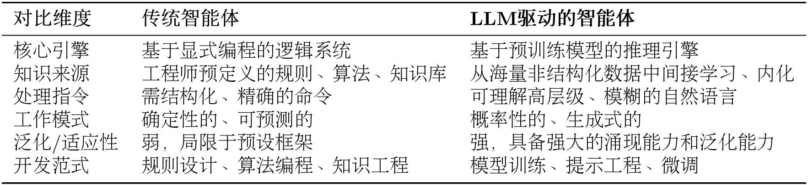

以「智能旅行助手」为例。接到「规划一次厦门之旅」这种模糊指令，LLM 智能体会：

- 规划与推理：把高层目标分解成逻辑子任务——`[确认出行偏好] → [查询目的地信息] → [制定行程草案] → [预订票务住宿]`。
- 工具使用：识别到信息缺口就主动调工具补全，比如调用天气 API 获取实时天气，据此推荐室内还是室外活动。
- 动态修正：把用户反馈（「这家酒店超出预算」）当作新约束，重新搜索推荐。

核心转变是：从「开发专用自动化工具」转向「构建能自主解决问题的系统」，不再是写代码，而是引导一个通用「大脑」去规划、行动和学习。

---

## 二、智能体的类型与运行机制

### 2.1 三种分类维度

智能体可以从三个互补的维度分类：

（1）基于内部决策架构：反应式 → 模型式 → 基于目标 → 基于效用，这正是 1.2 节的传统演进阶梯；学习能力是可赋予所有类型的元能力。

（2）基于时间与反应性：核心是「反应性（快）」与「规划性（最优）」的权衡。反应式智能体（如安全气囊系统）近乎即时响应、速度快但短视，容易陷入局部最优；规划式智能体（如下棋的棋手）深思熟虑、有远见，但时间成本高；混合式智能体分层设计——底层快速反应、高层审慎规划，现代的 LLM 智能体就是这种「思考-行动-观察」微循环的混合模式。

（3）基于知识表示：这是最根本的维度，塑造了两种截然不同的 AI 文化——

- 亚符号主义 AI（连接主义）：知识不是显式规则，而是分布在海量神经元连接中的统计模式，从数据中学习。优点是模式识别强、抗噪，缺点是黑箱、不擅长逻辑推理、易产生幻觉。
- 符号主义 AI：智能源于对符号的逻辑操作，知识是人类可读的规则库和知识图谱。优点是透明可解释，缺点是脆弱、依赖完备规则体系（「知识获取瓶颈」）。
- 神经符号主义 AI：融合两者，既像神经网络一样学习，又像符号系统一样推理。卡尼曼的「双系统」理论是绝佳类比——系统 1 是快速直觉（亚符号），系统 2 是慢速审慎推理（符号），真正的智能是两者协同。

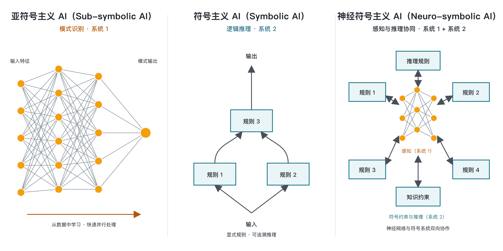

LLM 智能体正是神经符号主义的实践范例：内核是巨大神经网络（模式识别 + 语言生成），工作过程中又生成结构化的思想、计划、API 调用等符号。

### 2.2 任务环境：PEAS 模型

理解智能体的运作，先要理解它所处的任务环境。AI 领域用 PEAS 模型精确描述任务环境，即分析四个维度：性能度量（Performance）、环境（Environment）、执行器（Actuators）、传感器（Sensors）。

LLM 智能体所处的数字环境有几个影响设计的关键特性：

- 部分可观察：无法一次性获取全部信息（比如查不到所有航司的全部余票），需要记忆 + 探索。
- 随机性：行动结果不确定（两次查询票价可能不同），需要处理不确定性。
- 多智能体：环境中还有其他行动者（其他用户、自动脚本、动态调价系统），它们的行动会改变环境状态。
- 序贯 + 动态：当前动作影响未来，环境自身也在变化，要求「感知-思考-行动-观察」循环快速灵活。

### 2.3 智能体循环：感知-思考-行动-观察

智能体并非一次性完成任务，而是通过一个持续循环与环境交互，这个核心机制叫智能体循环（Agent Loop）：


循环包含四个阶段：

1. 感知（Perception）：通过传感器接收环境的输入信息，即观察（Observation）。可以是用户初始指令，也可以是上一步行动导致的环境状态变化反馈。
2. 思考（Thought）：核心决策阶段，由 LLM 驱动，细分为规划（Planning，分解子任务）和工具选择（Tool Selection，选工具 + 定参数）。
3. 行动（Action）：通过执行器执行，通常表现为调用某个工具，改变环境状态。
4. 观察（Observation）与循环：行动引起环境状态变化，产生新的观察，被下一轮感知捕获，形成闭环。

在工程实践中，这个循环体现为 Thought-Action-Observation 交互协议，智能体的输出不再是单一自然语言，而是结构化的思考 + 行动：

```
Thought: 用户想知道北京的天气。我需要调用天气查询工具。
Action: get_weather("北京")
Observation: 北京当前天气为晴，气温25摄氏度，微风。
```

### 2.4 Workflow 与 Agent 的差异

两者都旨在任务自动化，但底层逻辑截然不同。简单说：Workflow 是让 AI 按部就班执行指令，Agent 是赋予 AI 自由度去自主达成目标。

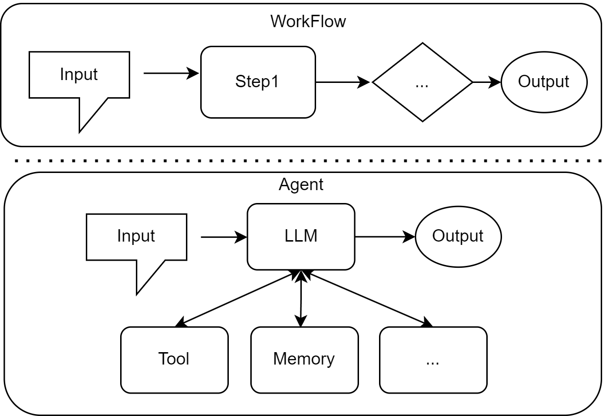

Workflow 是对一系列步骤的预定义、结构化编排，本质是一个精确的静态流程图——每一步、每个判断条件都被预先设定，比如费用报销审批流程。Agent 则是具备自主性的、目标导向的系统，LLM 扮演「大脑」，能理解环境、推理、制定计划并动态行动。核心区别在于：Agent 没有写死「if 天气=晴天 then 推荐颐和园」这类规则，而是基于实时信息动态推理决策。

### 2.5 两种协作模式：开发者工具与自主协作者

按智能体在任务中的角色和自主性程度，它与人类的协作模式分两种：

（1）作为开发者工具的智能体：深度集成到开发者的工作流中，增强而非取代开发者，通过自动化处理繁琐重复的任务，让人专注于创造性核心工作。代表工具各有侧重：

- GitHub Copilot：GitHub 与 OpenAI 联合开发，深度集成于 VS Code 等编辑器，以代码自动补全闻名，后通过 Copilot Chat 扩展了对话式编程能力。
- Claude Code：Anthropic 出品，通过自然语言指令在终端完成编码任务，能理解完整代码库结构，支持无交互（headless）模式，适用于 CI、pre-commit hooks 等自动化场景。
- Cursor：AI 原生的代码编辑器，设计之初就把 AI 交互作为核心，强调让 AI 理解整个代码库上下文，实现更深层的问答、重构和调试。
- Trae：新兴工具，专注代码生成与优化，特色是轻量设计和快速响应，适合频繁迭代与快速原型开发。

（2）作为自主协作者的智能体：不再手把手指导 AI 每一步，而是把高层目标委托给它，让它像项目成员一样独立规划、推理、执行、反思，直到交付成果。这标志着人与 AI 的关系从「命令-执行」演变为「目标-委托」。主流架构范式有三类：

- 单智能体自主循环：如 AgentGPT，一个通用智能体通过「思考-规划-执行-反思」闭环不断自我迭代，完成开放式高层目标。
- 多智能体协作：模拟人类团队协作，细分为角色扮演式对话（如 CAMEL，为「程序员」「产品经理」设定角色和沟通协议）和组织化工作流（如 MetaGPT、CrewAI，模拟分工明确的「虚拟团队」，每个智能体有预设职责和 SOP）；AutoGen、AgentScope 则提供更灵活的对话模式，允许自定义智能体间的交互网络。
- 高级控制流架构：如 LangGraph，把智能体执行过程建模为状态图（State Graph），更灵活可靠地实现循环、分支、回溯和人工介入。

---

## 三、动手体验：5 分钟实现第一个智能体

理论讲完，最好的学习方式是亲手写一个。下面用几行 Python 从零构建一个能工作的「智能旅行助手」，严格遵循前面讲的 Thought-Action-Observation 循环。

要解决的任务是：「你好，请帮我查询一下今天北京的天气，然后根据天气推荐一个合适的旅游景点。」智能体必须先调用天气查询工具，把观察结果作为下一步依据，再调用景点推荐工具，得出最终建议。

### 3.1 指令模板

驱动真实 LLM 的关键是提示工程（Prompt Engineering）。指令模板告诉 LLM 它扮演什么角色、拥有哪些工具、如何格式化思考和行动，它作为 `system_prompt` 传给 LLM：

```python
AGENT_SYSTEM_PROMPT = """
你是一个智能旅行助手。你的任务是分析用户的请求，并使用可用工具一步步地解决问题。

# 可用工具:
- `get_weather(city: str)`: 查询指定城市的实时天气。
- `get_attraction(city: str, weather: str)`: 根据城市和天气搜索推荐的旅游景点。

# 输出格式要求:
你的每次回复必须严格遵循以下格式，包含一对Thought和Action：

Thought: [你的思考过程和下一步计划]
Action: [你要执行的具体行动]

Action的格式必须是以下之一：
1. 调用工具：function_name(arg_name="arg_value")
2. 结束任务：Finish[最终答案]

# 重要提示:
- 每次只输出一对Thought-Action
- Action必须在同一行，不要换行
- 当收集到足够信息可以回答用户问题时，必须使用 Action: Finish[最终答案] 格式结束

请开始吧！
"""
```

### 3.2 工具实现

工具 1 用免费的 `wttr.in` 服务查真实天气：

```python
import requests

def get_weather(city: str) -> str:
    """通过调用 wttr.in API 查询真实的天气信息。"""
    url = f"https://wttr.in/{city}?format=j1"
    try:
        response = requests.get(url)
        response.raise_for_status()
        data = response.json()
        current_condition = data['current_condition'][0]
        weather_desc = current_condition['weatherDesc'][0]['value']
        temp_c = current_condition['temp_C']
        return f"{city}当前天气:{weather_desc}，气温{temp_c}摄氏度"
    except requests.exceptions.RequestException as e:
        return f"错误:查询天气时遇到网络问题 - {e}"
    except (KeyError, IndexError) as e:
        return f"错误:解析天气数据失败，可能是城市名称无效 - {e}"
```

工具 2 用 Tavily 搜索 API 推荐景点：

```python
import os
from tavily import TavilyClient

def get_attraction(city: str, weather: str) -> str:
    """根据城市和天气，使用Tavily Search API搜索并返回景点推荐。"""
    api_key = os.environ.get("TAVILY_API_KEY")
    if not api_key:
        return "错误:未配置TAVILY_API_KEY环境变量。"

    tavily = TavilyClient(api_key=api_key)
    query = f"'{city}' 在'{weather}'天气下最值得去的旅游景点推荐及理由"
    try:
        response = tavily.search(query=query, search_depth="basic", include_answer=True)
        if response.get("answer"):
            return response["answer"]
        formatted_results = []
        for result in response.get("results", []):
            formatted_results.append(f"- {result['title']}: {result['content']}")
        if not formatted_results:
            return "抱歉，没有找到相关的旅游景点推荐。"
        return "根据搜索，为您找到以下信息:\n" + "\n".join(formatted_results)
    except Exception as e:
        return f"错误:执行Tavily搜索时出现问题 - {e}"
```

把所有工具放进一个字典，供主循环调用：

```python
available_tools = {
    "get_weather": get_weather,
    "get_attraction": get_attraction,
}
```

### 3.3 接入 LLM

许多 LLM 服务商（OpenAI、Azure、Ollama、vLLM 等）都遵循与 OpenAI API 相似的接口规范。实现一个通用客户端，即可连接任何兼容 OpenAI 接口的服务：

```python
from openai import OpenAI

class OpenAICompatibleClient:
    """一个用于调用任何兼容OpenAI接口的LLM服务的客户端。"""
    def __init__(self, model: str, api_key: str, base_url: str):
        self.model = model
        self.client = OpenAI(api_key=api_key, base_url=base_url)

    def generate(self, prompt: str, system_prompt: str) -> str:
        """调用LLM API来生成回应。"""
        try:
            messages = [
                {'role': 'system', 'content': system_prompt},
                {'role': 'user', 'content': prompt}
            ]
            response = self.client.chat.completions.create(
                model=self.model, messages=messages, stream=False
            )
            return response.choices[0].message.content
        except Exception as e:
            return f"错误:调用语言模型服务时出错。"
```

### 3.4 行动循环

主循环整合所有组件，通过格式化后的 Prompt 驱动 LLM 决策：

```python
import re

# 1. 配置 LLM 客户端（替换成你自己的凭证和地址）
llm = OpenAICompatibleClient(model=MODEL_ID, api_key=API_KEY, base_url=BASE_URL)

# 2. 初始化
user_prompt = "你好，请帮我查询一下今天北京的天气，然后根据天气推荐一个合适的旅游景点。"
prompt_history = [f"用户请求: {user_prompt}"]

# 3. 运行主循环
for i in range(5):  # 设置最大循环次数
    full_prompt = "\n".join(prompt_history)

    # 3.1 调用 LLM 思考（截断多余的 Thought-Action 对）
    llm_output = llm.generate(full_prompt, system_prompt=AGENT_SYSTEM_PROMPT)
    match = re.search(r'(Thought:.*?Action:.*?)(?=\n\s*(?:Thought:|Action:|Observation:)|\Z)', llm_output, re.DOTALL)
    if match and match.group(1).strip() != llm_output.strip():
        llm_output = match.group(1).strip()
    prompt_history.append(llm_output)

    # 3.2 解析并执行 Action
    action_match = re.search(r"Action: (.*)", llm_output, re.DOTALL)
    if not action_match:
        observation_str = "Observation: 错误: 未能解析到 Action 字段。"
        prompt_history.append(observation_str)
        continue
    action_str = action_match.group(1).strip()

    if action_str.startswith("Finish"):
        final_answer = re.match(r"Finish\[(.*)\]", action_str).group(1)
        print(f"任务完成，最终答案: {final_answer}")
        break

    tool_name = re.search(r"(\w+)\(", action_str).group(1)
    args_str = re.search(r"\((.*)\)", action_str).group(1)
    kwargs = dict(re.findall(r'(\w+)="([^"]*)"', args_str))

    # 3.3 执行工具，记录观察结果
    observation = available_tools[tool_name](**kwargs) if tool_name in available_tools else f"错误:未定义的工具 '{tool_name}'"
    prompt_history.append(f"Observation: {observation}")
```

这套代码的核心是「工具」与「提示工程」的结合，正是当前主流智能体框架（LangChain、LlamaIndex 等）的设计精髓。

### 3.5 运行案例

下面是一次成功的执行流程，三轮循环清晰展示了智能体的核心能力：

```text
用户输入: 你好，请帮我查询一下今天北京的天气，然后根据天气推荐一个合适的旅游景点。
========================================
--- 循环 1 ---
模型输出:
Thought: 首先需要获取北京今天的天气情况，之后再根据天气情况来推荐旅游景点。
Action: get_weather(city="北京")

Observation: 北京当前天气:Sunny，气温26摄氏度
========================================
--- 循环 2 ---
模型输出:
Thought: 现在已经知道了北京今天的天气是晴朗且温度适中，接下来可以基于这个信息来推荐一个适合的旅游景点了。
Action: get_attraction(city="北京", weather="Sunny")

Observation: 北京在晴天最值得去的旅游景点是颐和园，因其美丽的湖景和古建筑。另一个推荐是长城，因其壮观的景观和历史意义。
========================================
--- 循环 3 ---
模型输出:
Thought: 已经获得了两个适合晴天游览的景点建议，现在可以根据这些信息给用户提供满意的答复。
Action: Finish[今天北京的天气是晴朗的，气温26摄氏度，非常适合外出游玩。我推荐您去颐和园欣赏美丽的湖景和古建筑，或者前往长城体验其壮观的景观和深厚的历史意义。]

任务完成，最终答案: 今天北京的天气是晴朗的，气温26摄氏度，非常适合外出游玩。我推荐您去颐和园欣赏美丽的湖景和古建筑，或者前往长城体验其壮观的景观和深厚的历史意义。
```

这个案例集中演示了基于 Thought-Action-Observation 范式的智能体所具备的四项基本能力：任务分解、工具调用、上下文理解和结果合成。正是这个循环的不断迭代，把一个模糊的用户意图，转化为一系列具体可执行的步骤，最终达成目标。

---

## 四、发展史之一：符号主义时代

智能体的发展不是一条直线，而是几大思想流派半个多世纪的交织、竞争与融合。理解这条脉络，才能洞察今天 Agent 架构的根源：

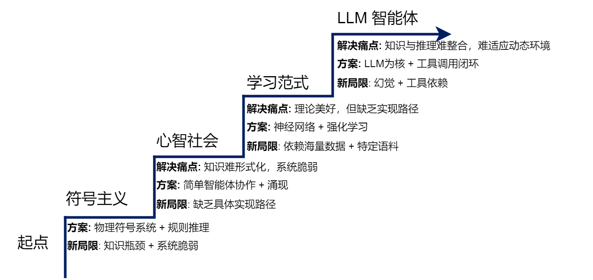

每个新范式的出现，都是为了解决上一代范式的核心痛点，而新方案又引入新的局限，为下一代范式埋下伏笔。

### 4.1 物理符号系统假说

AI 早期深受数理逻辑影响，研究者相信：人类智能（尤其逻辑推理）可以被形式化的符号体系捕捉复现，这就是符号主义（Symbolicism）。

其理论基石是 1976 年纽厄尔（Newell）和西蒙（Simon）提出的物理符号系统假说（PSSH），包含两个论断：

- 充分性论断：任何物理符号系统都具备产生通用智能行为的充分手段。
- 必要性论断：任何能展现通用智能行为的系统，本质必然是物理符号系统。

一句话：智能的本质，就是符号的计算与处理。这个假说把「人类心智」这个哲学问题，转化成了可以在计算机上工程化实现的具体问题。

### 4.2 专家系统

在 PSSH 直接影响下，专家系统（Expert System）成为符号主义最重要、最成功的应用。它通过把专家知识编码成程序，模拟专家解决特定领域问题的能力。典型结构由知识库、推理机、用户界面组成：

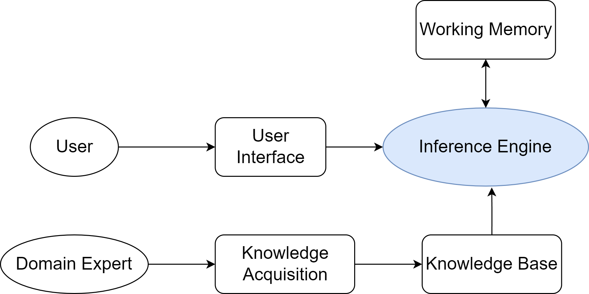

这种「知识与推理分离」的设计是符号主义的重要特征：

- 知识库（Knowledge Base）：存放领域知识，最常用产生式规则（Production Rules），即「IF-THEN」条件语句，如 `IF 发烧 AND 咳嗽 THEN 可能呼吸道感染`。
- 推理机（Inference Engine）：根据事实在知识库中匹配应用规则，推导新结论。正向链（Forward Chaining）从事实出发「数据驱动」；反向链（Backward Chaining）从目标出发「目标驱动」。

### 4.3 MYCIN：反向链推理

MYCIN 是史上最著名的专家系统之一，斯坦福 70 年代开发，用于辅助诊断细菌性血液感染并推荐抗生素。知识库含约 600 条「IF-THEN」规则，推理机主要用反向链——从「确定致病菌」这个最高目标出发，反向推导需要哪些证据，再向医生提问获取：

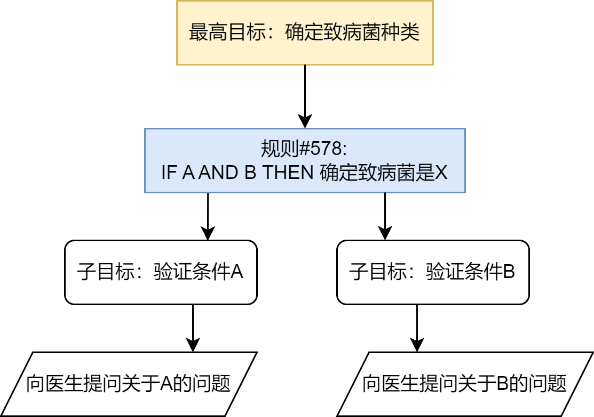

MYCIN 的重要创新是引入置信因子（Certainty Factor, CF），用 -1 到 1 的数值表示结论可信度，从而处理医学诊断的不确定性。评估中它的表现超过了非专业医生，达到专家水平，证明了「知识工程 + 符号推理」在专业领域的有效性。

### 4.4 SHRDLU：积木世界

如果说专家系统展示了符号 AI 的「深度」，威诺格拉德（Winograd）1968-1970 年的 SHRDLU 则展示了「广度」。它在「积木世界」这一微观环境中，通过自然语言与人类流畅交互——理解指令、自主规划、执行动作、回答问题。

SHRDLU 首次把语言理解、规划、记忆等多个 AI 模块集成在一个统一系统，其「感知-思考-行动」的闭环设计，奠定了现代智能体研究的基础。但它也揭示了符号主义的局限：能力严格局限于规则完备的积木世界，引发了对「符号处理」与「真正理解」之间差异的长期思辨。

### 4.5 符号主义的根本挑战

从 80 年代起，符号主义在走向开放复杂现实世界时，遇到方法论固有的难题：

- 知识获取瓶颈（Knowledge Acquisition Bottleneck）：专家知识需人工访谈、提炼、编码，成本高昂难规模化，且大量知识是内隐直觉，难以表达成规则。
- 常识问题（Common-sense Problem）：人类依赖庞大常识（「水是湿的」「绳子能拉不能推」），符号系统除非显式编码否则一无所知。
- 框架问题（Frame Problem）：动态世界中，动作执行后如何高效判断「什么没变」，是逻辑难题。
- 系统脆弱性（Brittleness）：完全依赖预设规则，遇到规则之外的任何变化就失灵。

---

## 五、发展史之二：从单一智能到分布式智能

### 5.1 ELIZA：规则驱动的局限

ELIZA 是麻省理工魏泽鲍姆（Weizenbaum）1966 年发布的早期自然语言程序，最成功的脚本 DOCTOR 模仿心理治疗师。它从不正面回答，而是识别关键词、套用预设转换规则，把陈述变成开放式提问。

它的算法是模式匹配（Pattern Matching）+ 文本替换（Text Substitution）：关键词识别排序 → 分解规则（通配符捕获）→ 重组规则（随机选回应）→ 代词转换（I→you）。通过这套机制，它把「自然语言理解」简化成了基于规则的匹配游戏。

下面是一个迷你版 ELIZA 的核心实现，足以展示其工作机制：

```python
import re
import random

# 定义规则库：模式(正则表达式) -> 响应模板列表
rules = {
    r'I need (.*)': [
        "Why do you need {0}?",
        "Would it really help you to get {0}?",
        "Are you sure you need {0}?"
    ],
    r'Why don\'t you (.*)\?': [
        "Do you really think I don't {0}?",
        "Perhaps eventually I will {0}.",
        "Do you really want me to {0}?"
    ],
    r'I am (.*)': [
        "Did you come to me because you are {0}?",
        "How long have you been {0}?",
        "How do you feel about being {0}?"
    ],
    r'.* mother .*': [
        "Tell me more about your mother.",
        "What was your relationship with your mother like?"
    ],
    r'.*': [
        "Please tell me more.",
        "Can you elaborate on that?"
    ]
}

# 定义代词转换规则
pronoun_swap = {
    "i": "you", "you": "i", "me": "you", "my": "your",
    "am": "are", "are": "am", "was": "were", "mine": "yours"
}

def swap_pronouns(phrase):
    """对输入短语中的代词进行第一/第二人称转换"""
    words = phrase.lower().split()
    return " ".join(pronoun_swap.get(word, word) for word in words)

def respond(user_input):
    """根据规则库生成响应"""
    for pattern, responses in rules.items():
        match = re.search(pattern, user_input, re.IGNORECASE)
        if match:
            captured_group = match.group(1) if match.groups() else ''
            swapped_group = swap_pronouns(captured_group)
            return random.choice(responses).format(swapped_group)
    return random.choice(rules[r'.*'])
```

运行示例：

```text
Therapist: Hello! How can I help you today?
You: I am feeling sad today.
Therapist: How long have you been feeling sad today?
You: I need some help with my project.
Therapist: Are you sure you need some help with your project?
You: My mother is not happy with my work.
Therapist: Tell me more about your mother.
```

魏泽鲍姆的本意是证明「机器完全不理解内容也能营造智能假象」，但出乎意料，很多人对 ELIZA 产生了情感依赖，深信它理解自己——这就是著名的「ELIZA 效应」。

ELIZA 的实践清晰暴露了规则系统的三大局限，直接印证了 4.5 节符号主义的理论挑战：缺乏语义理解（面对「I am not happy」仍机械匹配 `I am (.*)` 规则）、无上下文记忆（无状态，每次只基于当前单句）、规则扩展性差（规则库规模爆炸、冲突难管理）。

### 5.2 明斯基的心智社会

符号主义的困境促使马文·明斯基（Marvin Minsky）反思 AI 最底层的设计哲学。他在 1986 年《心智社会》（The Society of Mind）中提出：智能的力量源于「极大多样性」，而非某个单一完美原则。

他不再把心智看作金字塔式的层级结构，而是看作扁平的、充满互动协作的「社会」。在这个框架里，智能体是极其简单、专门化的心智过程（如识别线条的 LINE-FINDER、负责抓握的 GRASP），它们本身「无心」；大量智能体组织成机构（Agency），通过去中心化的激活与抑制信号相互影响。

以「搭建积木塔」为例：高层机构 BUILD-TOWER 只负责激活下属，BUILDER 只负责循环，ADD-BLOCK 依次激活 FIND-BLOCK、GET-BLOCK、PUT-ON-TOP——没有任何一个智能体拥有全局规划，但智能行为从局部交互中自发涌现（Emergence）。

### 5.3 对多智能体系统的启发

心智社会最深远的影响，是为分布式人工智能（DAI）和多智能体系统（MAS）提供了概念基础：如果心智内部的智能能从大量简单智能体协作中涌现，那么多个物理上分离的计算实体之间，是否也能涌现「群体智能」？

它把研究焦点从「构建全能的单一智能体」转向「设计高效协作的智能体群体」，具体启发包括：去中心化控制（无中央节点）、涌现式计算（蚁群算法、粒子群优化）、智能体社会性（通信语言、交互协议、协商策略）。

---

## 六、发展史之三：学习范式与现代智能体

### 6.1 从符号到联结

符号主义自上而下、依赖显式规则；联结主义（Connectionism）80 年代复兴，自下而上、模仿大脑神经网络。核心思想：知识不是存储在知识库的符号规则，而是以连接权重的形式分布式存储在大量简单处理单元之间；每个神经元只做简单计算；智能来自「学习」——通过反向传播等算法迭代调整权重。

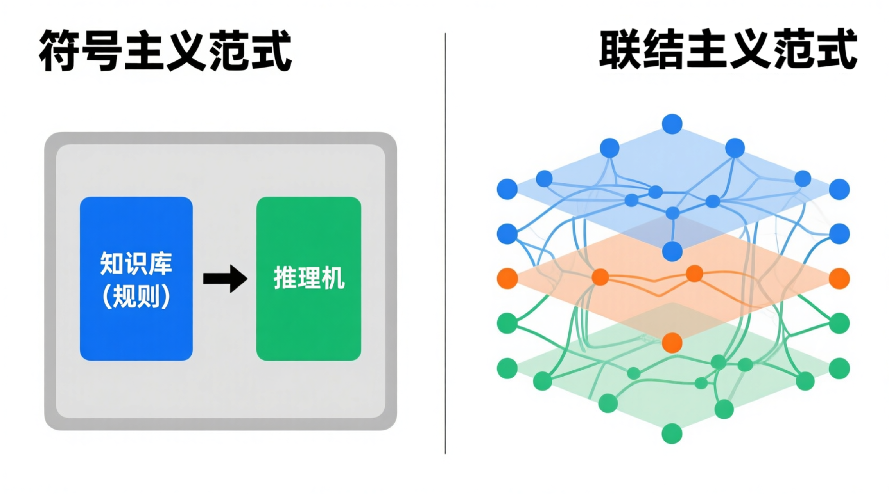

联结主义（尤其深度学习）为智能体赋予了强大的感知和模式识别能力，能直接从图像、声音、文本理解世界，这是符号主义时代难以想象的。

### 6.2 强化学习

联结主义解决「感知」，而智能体更核心的任务是「决策」。强化学习（RL）专注于序贯决策：不直接从标注数据学习，而是通过智能体与环境的交互，在试错中最大化长期收益。

以 AlphaGo 为例：智能体观察棋盘（状态），决定落子（行动），一局结束根据胜负收到奖励信号，通过数百万次自我对弈不断调整策略。核心要素：智能体、环境、状态（State）、行动（Action）、奖励（Reward），以及从状态到行动映射的策略（Policy）：

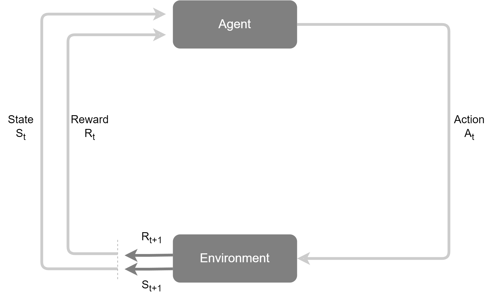

学习目标不是单步即时奖励，而是最大化累积奖励（回报），这要求智能体有「远见」，必要时牺牲眼前小利换取长远大利（如围棋「弃子」）。

### 6.3 预训练与 LLM

强化学习需要海量特定任务交互数据，缺乏先验知识。如何让智能体在学具体任务前就具备对世界的广泛理解？答案出现在 NLP 领域——基于大规模数据的预训练（Pre-training）。

预训练-微调（Pre-training, Fine-tuning）范式两步走：先在互联网级文本上通过自监督学习训练超大模型（最常见目标就是「预测下一个词」），再针对具体任务用少量标注数据微调：

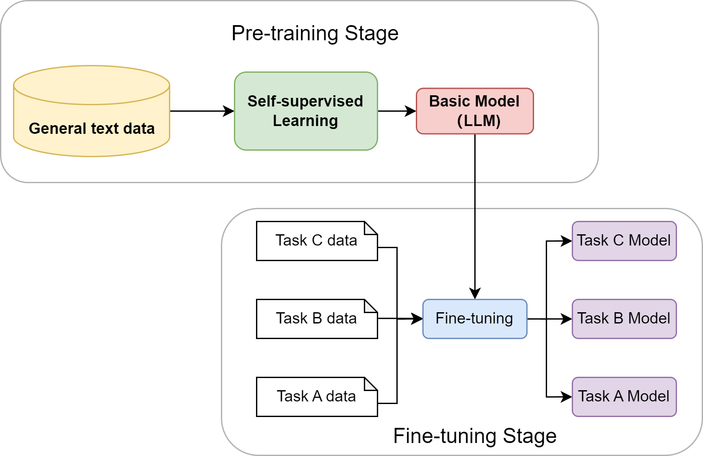

当模型规模跨越阈值后，涌现出未被直接训练的能力：上下文学习（In-context Learning，few-shot/zero-shot 就能完成新任务）、思维链（Chain-of-Thought，先输出推理步骤显著提升复杂推理准确率）。LLM 由此从一个语言模型，演变成兼具海量知识库和通用推理引擎双重角色的组件——它以全新方式解决了符号主义最棘手的「知识获取瓶颈」。

### 6.4 LLM 驱动的智能体

LLM 智能体通过多模块协同的持续迭代闭环完成任务：

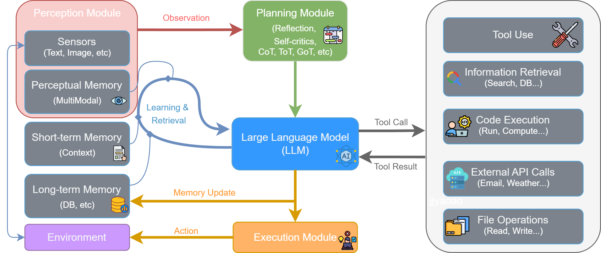

流程：感知模块接收外部输入形成观察 → 思考阶段（规划模块做反思、自我批判、分解目标，LLM 结合记忆模块推理决策出工具调用）→ 行动阶段（执行模块解析指令、从工具箱调工具与环境交互）→ 观察（工具结果 + 新环境状态构成新观察，更新记忆，开启下一轮循环）。

### 6.5 发展关键节点概览

主导智能体发展史的三大思潮：

- 符号主义（Symbolism）：西蒙、明斯基等为代表，催生了 SHRDLU、专家系统、深蓝。
- 联结主义（Connectionism）：辛顿等推动，反向传播奠定基础，深度学习的 CNN、Transformer 成为当前主流。
- 行为主义（Behaviorism）：强调试错学习，现代化身是强化学习，代表是击败人类棋手的 AlphaGo。

进入 21 世纪 20 年代，三大思潮深度融合：GPT 系列大模型本身是联结主义的产物，却成为执行符号推理、工具调用和规划决策的「大脑」，形成神经-符号结合的现代智能体架构：

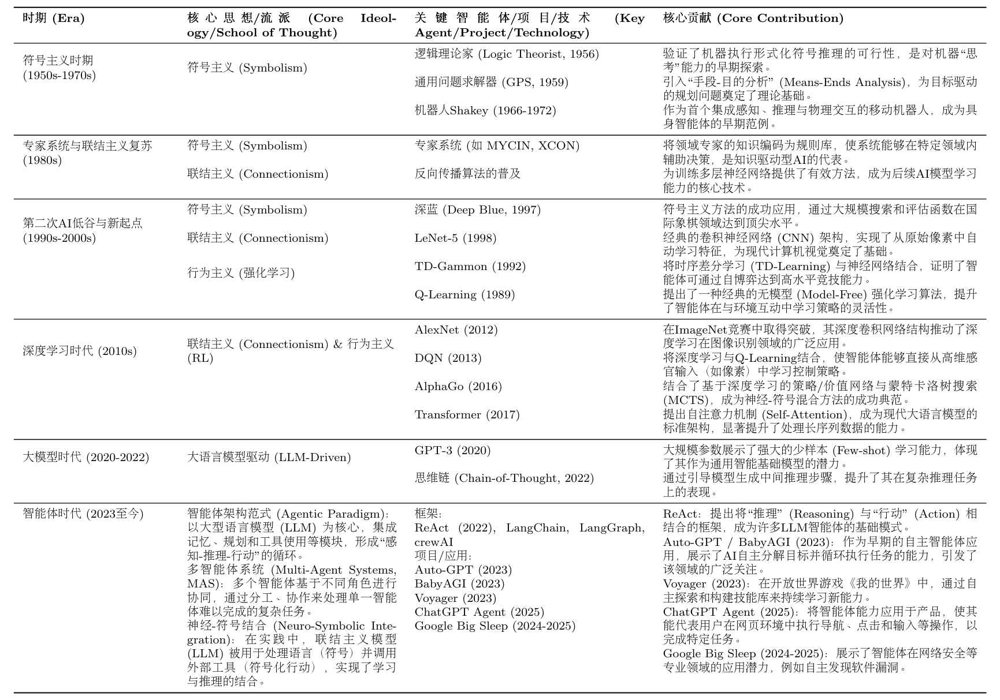

---

## 附：高频速记

- 智能体 = 传感器感知环境 + 执行器采取行动 + 自主决策达成目标的实体；四要素是环境、传感器、执行器、自主性。
- 传统智能体五类演进：反射 → 基于模型 → 基于目标 → 基于效用 → 学习型（RL）。
- 三种分类维度：决策架构、时间反应性（反应/规划/混合）、知识表示（亚符号/符号/神经符号）。
- PEAS 模型描述任务环境：性能度量、环境、执行器、传感器。
- Agent Loop = 感知-思考-行动-观察；工程上体现为 Thought-Action-Observation 交互协议。
- Workflow 是按部就班执行预定义步骤，Agent 是自主目标导向动态推理。
- 两种协作模式：作为开发者工具（Copilot/Cursor/Claude Code）、作为自主协作者（单智能体循环/多智能体协作/控制流架构）。
- 动手实现一个智能体的核心 = 指令模板（Prompt）+ 工具函数 + 主循环（解析 Action → 执行工具 → 记录 Observation）。
- 符号主义基石：物理符号系统假说（PSSH）——智能的本质是符号的计算与处理。
- 专家系统 = 知识库（IF-THEN 规则）+ 推理机（正向链/反向链）；MYCIN 用反向链 + 置信因子。
- 符号主义四大挑战：知识获取瓶颈、常识问题、框架问题、系统脆弱性。
- ELIZA = 模式匹配 + 文本替换，暴露规则系统的「无语义、无记忆、难扩展」三大局限。
- 明斯基「心智社会」：智能从大量简单智能体的局部交互中涌现，启发多智能体系统。
- 联结主义：知识分布式存储在连接权重，通过学习调整；强化学习：试错中最大化累积奖励。
- 预训练-微调范式解决了「知识获取瓶颈」，LLM 涌现出上下文学习、思维链能力。
- 现代 LLM 智能体 = 神经-符号融合：神经网络做感知推理，结构化符号做规划与工具调用。
