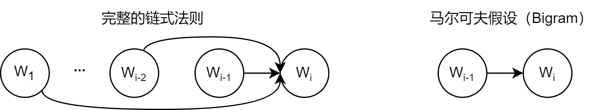
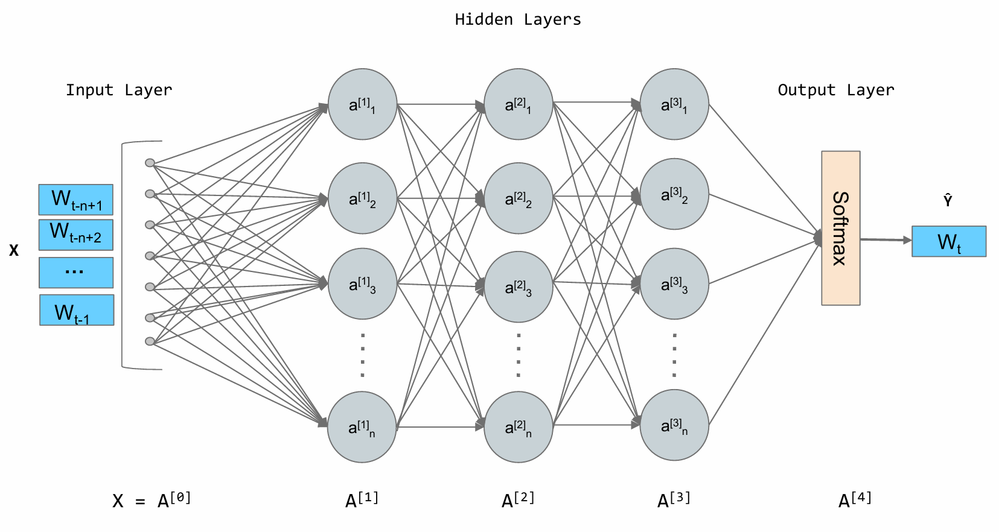
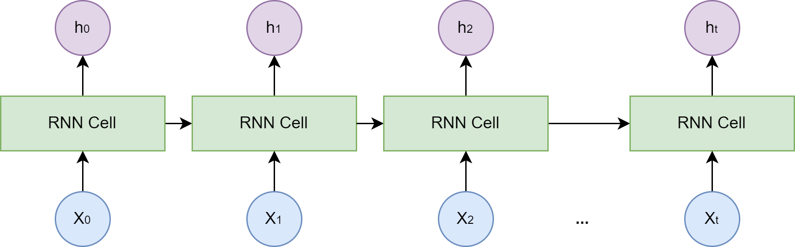
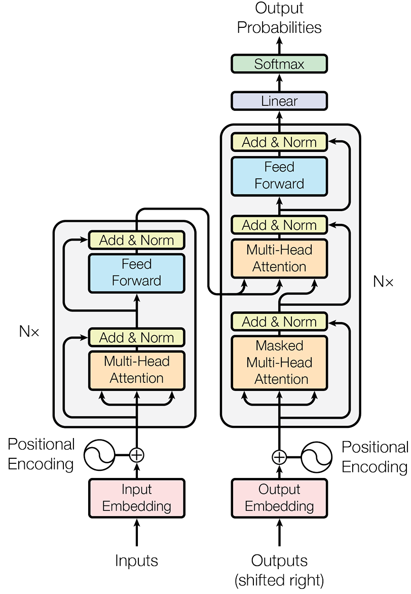
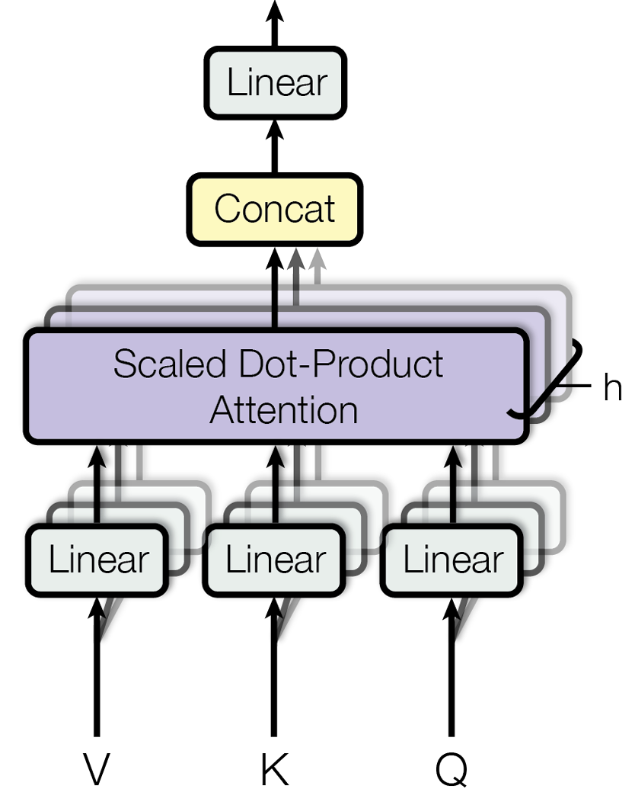
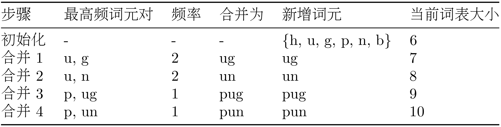

# 03. 学习Hello-Agents：大语言模型基础

> 学习自：[hello-agents](https://github.com/datawhalechina/hello-agents)

> 智能体的核心引擎是大语言模型（LLM）。本文从语言模型的数学定义出发，讲清 N-gram → 神经网络 → RNN/LSTM → Transformer 的演进，重点拆解 Transformer 与 Decoder-Only 架构（为什么现代 LLM 都长这个样子），再落到工程实践——怎么用提示工程和分词与模型打交道、怎么本地部署开源模型、怎么选型，最后讲清楚缩放法则与幻觉这两条理解 LLM 能力边界的关键线索。

## 目录

- [一、语言模型的演进：从 N-gram 到 Transformer](#一语言模型的演进从-n-gram-到-transformer)
  - [1.1 统计语言模型与 N-gram](#11-统计语言模型与-n-gram)
  - [1.2 神经网络语言模型与词嵌入](#12-神经网络语言模型与词嵌入)
  - [1.3 RNN 与 LSTM](#13-rnn-与-lstm)
- [二、Transformer 架构解析](#二transformer-架构解析)
  - [2.1 Encoder-Decoder 整体结构](#21-encoder-decoder-整体结构)
  - [2.2 从自注意力到多头注意力](#22-从自注意力到多头注意力)
  - [2.3 前馈神经网络](#23-前馈神经网络)
  - [2.4 残差连接与层归一化](#24-残差连接与层归一化)
  - [2.5 位置编码](#25-位置编码)
- [三、Decoder-Only 架构](#三decoder-only-架构)
  - [3.1 从「先理解再生成」到「预测下一个词」](#31-从先理解再生成到预测下一个词)
  - [3.2 自回归生成](#32-自回归生成)
  - [3.3 掩码自注意力](#33-掩码自注意力)
  - [3.4 Decoder-Only 的优势](#34-decoder-only-的优势)
- [四、与大语言模型交互](#四与大语言模型交互)
  - [4.1 提示工程](#41-提示工程)
  - [4.2 文本分词](#42-文本分词)
  - [4.3 调用开源大语言模型](#43-调用开源大语言模型)
  - [4.4 模型的选择](#44-模型的选择)
- [五、缩放法则与局限性](#五缩放法则与局限性)
  - [5.1 缩放法则](#51-缩放法则)
  - [5.2 模型幻觉](#52-模型幻觉)
- [附：高频速记](#附高频速记)

---

## 一、语言模型的演进：从 N-gram 到 Transformer

语言模型（Language Model, LM）是自然语言处理的核心，根本任务是计算一个词序列（也就是一个句子）出现的概率。一个好的语言模型能告诉我们什么样的句子是通顺、自然的。在多智能体系统里，语言模型是智能体理解人类指令、生成回应的基础。本节回顾从经典统计方法到现代深度学习模型的演进，为理解后续的 Transformer 打下基础。

### 1.1 统计语言模型与 N-gram

（1）统计语言模型与 N-gram 的思想

深度学习兴起之前，统计方法是语言模型的主流。核心思想是：一个句子出现的概率，等于句中每个词出现的条件概率的连乘。对于一个由词 $w_1,w_2,\cdots,w_m$ 构成的句子 $S$，其概率表示为：

$$P(S)=P(w_1,w_2,\cdots,w_m)=P(w_1)\,P(w_2\mid w_1)\,P(w_3\mid w_1,w_2)\cdots P(w_m\mid w_1,\cdots,w_{m-1})$$

这就是概率的链式法则。但直接算这个公式几乎不可能——像 $P(w_m\mid w_1,\cdots,w_{m-1})$ 这种条件概率太难从语料里估计了，词序列 $w_1,\cdots,w_{m-1}$ 可能从未在训练数据中出现过。



为解决这个问题，研究者引入了马尔可夫假设（Markov Assumption）：不必回溯一个词的全部历史，可以近似地认为，一个词出现的概率只与它前面有限的 $n-1$ 个词有关。基于这个假设建立的语言模型，就叫 N-gram 模型，其中「N」代表上下文窗口大小：

- Bigram（N=2）：一个词的出现只与它前面一个词有关，$P(w_i\mid w_1,\cdots,w_{i-1})\approx P(w_i\mid w_{i-1})$。
- Trigram（N=3）：一个词的出现只与它前面两个词有关，$P(w_i\mid w_1,\cdots,w_{i-1})\approx P(w_i\mid w_{i-2},w_{i-1})$。

这些概率可以用最大似然估计（Maximum Likelihood Estimation, MLE）来计算。术语听着唬人，思想很直观：最可能出现的，就是数据里看到次数最多的。以 Bigram 为例，$P(w_i\mid w_{i-1})$ 可以直接用计数估算：

$$P(w_i\mid w_{i-1})=\frac{Count(w_{i-1},w_i)}{Count(w_{i-1})}$$

其中 $Count(w_{i-1},w_i)$ 是词对 $(w_{i-1},w_i)$ 在语料中连续出现的次数，$Count(w_{i-1})$ 是单个词 $w_{i-1}$ 出现的总次数。

举个手动计算的例子。假设迷你语料只有两句：`datawhale agent learns`、`datawhale agent works`，用 Bigram 估算句子 `datawhale agent learns` 的概率：

- 第一步，$P(\text{datawhale})=\dfrac{2}{6}\approx 0.333$（`datawhale` 出现 2 次，总词数 6）。
- 第二步，$P(\text{agent}\mid\text{datawhale})=\dfrac{2}{2}=1$（`datawhale agent` 出现 2 次）。
- 第三步，$P(\text{learns}\mid\text{agent})=\dfrac{1}{2}=0.5$（`agent learns` 出现 1 次）。

最后连乘：$P\approx 0.333\times 1\times 0.5\approx 0.167$。下面是等价的 Python 实现：

```python
import collections

corpus = "datawhale agent learns datawhale agent works"
tokens = corpus.split()
total_tokens = len(tokens)

# P(datawhale)
count_datawhale = tokens.count('datawhale')
p_datawhale = count_datawhale / total_tokens
print(f"P(datawhale) = {count_datawhale}/{total_tokens} = {p_datawhale:.3f}")

# P(agent|datawhale)
bigrams = zip(tokens, tokens[1:])
bigram_counts = collections.Counter(bigrams)
p_agent_given_datawhale = bigram_counts[('datawhale', 'agent')] / count_datawhale
print(f"P(agent|datawhale) = {p_agent_given_datawhale:.3f}")

# P(learns|agent)
count_agent = tokens.count('agent')
p_learns_given_agent = bigram_counts[('agent', 'learns')] / count_agent
print(f"P(learns|agent) = {p_learns_given_agent:.3f}")

# 连乘
p_sentence = p_datawhale * p_agent_given_datawhale * p_learns_given_agent
print(f"P('datawhale agent learns') ≈ {p_sentence:.3f}")
```

N-gram 简单有效，但有两个致命缺陷：一是数据稀疏性（Sparsity），一个词序列若从未在语料中出现，其概率估计就是 0，虽有平滑（Smoothing）技术缓解但无法根除；二是泛化能力差，模型无法理解词与词之间的语义相似性——即便见过很多次 `agent learns`，也无法把这个知识迁移到语义相近的 `robot learns` 上。

（2）神经网络语言模型与词嵌入

N-gram 的根本缺陷在于把词当作孤立、离散的符号。为克服这一点，研究者转向神经网络，提出用连续向量表示词。2003 年 Bengio 等人提出的前馈神经网络语言模型（Feedforward Neural Network Language Model）是里程碑。核心思想分两步：

1. 构建语义空间：创建一个高维连续向量空间，把词汇表中每个词映射为空间中的一个点，这个点就是词嵌入（Word Embedding）或词向量。语义相近的词，向量在空间中位置也相近——`agent` 和 `robot` 靠得近，`agent` 和 `apple` 离得远。
2. 学习从上下文到下一个词的映射：用神经网络学习一个函数，输入前 $n-1$ 个词的词向量，输出词汇表中每个词在当前上下文后出现的概率分布。



在这个架构里，词嵌入是在训练过程中自动学到的——模型为了完成「预测下一个词」的任务，不断调整每个词向量的位置，最终让向量蕴含丰富语义。词变成向量后，就能用数学工具度量它们的关系，最常用的是余弦相似度（Cosine Similarity）：

$$\text{similarity}(\vec{a},\vec{b})=\cos\theta=\frac{\vec{a}\cdot\vec{b}}{|\vec{a}|\,|\vec{b}|}$$

夹角 0° 余弦值为 1（完全相关），90° 为 0（毫无关系），180° 为 -1（完全负相关）。词向量不仅能捕捉同义词关系，还能捕捉复杂的类比关系。经典例子是 `vector('King') - vector('Man') + vector('Woman')` 的结果与 `vector('Queen')` 惊人地接近——好比从「国王」出发，减去「男性」，加上「女性」，抵达「女王」。这证明词嵌入能学到「性别」「皇室」这类抽象概念：

```python
import numpy as np

embeddings = {
    "king":  np.array([0.9, 0.8]),
    "queen": np.array([0.9, 0.2]),
    "man":   np.array([0.7, 0.9]),
    "woman": np.array([0.7, 0.3])
}

def cosine_similarity(vec1, vec2):
    return np.dot(vec1, vec2) / (np.linalg.norm(vec1) * np.linalg.norm(vec2))

result_vec = embeddings["king"] - embeddings["man"] + embeddings["woman"]
sim = cosine_similarity(result_vec, embeddings["queen"])
print(f"king - man + woman 结果向量: {result_vec}")
print(f"与 'queen' 的相似度: {sim:.4f}")  # 输出 1.0000
```

神经网络语言模型通过词嵌入解决了 N-gram 泛化差的问题，但它仍有一个类似 N-gram 的限制：上下文窗口是固定的，只能考虑固定数量的前文。这为能处理任意长序列的循环神经网络埋下伏笔。

（3）循环神经网络（RNN）与长短时记忆网络（LSTM）

为了打破固定窗口的限制，循环神经网络（Recurrent Neural Network, RNN）应运而生，核心思想是给网络增加「记忆」能力。



RNN 引入了一个隐藏状态（Hidden State）向量，可理解为网络的短期记忆。处理序列的每一步，网络读取当前输入词，结合上一刻的记忆（上一个时间步的隐藏状态），生成新的记忆传递给下一刻。这个循环往复的过程，让信息可以在序列中不断向后传递。

但标准 RNN 有一个严重问题——长期依赖问题（Long-term Dependency Problem）。训练时模型通过反向传播调整网络深处的权重，而对 RNN 来说序列的长度就是网络的深度。序列很长时，梯度从后向前传播经过多次连乘，会快速趋向于零（梯度消失）或变得极大（梯度爆炸）。梯度消失让模型无法学习序列早期信息对后期输出的影响，难以捕捉长距离依赖。

为解决这个问题，长短时记忆网络（Long Short-Term Memory, LSTM）被设计出来。它是特殊的 RNN，核心创新是引入细胞状态（Cell State）和一套门控机制（Gating Mechanism）。细胞状态是一条独立于隐藏状态的信息通路，让信息在时间步之间更顺畅地传递；门控机制由几个小型神经网络构成，学习如何有选择地让信息通过：

- 遗忘门（Forget Gate）：决定从上一时刻的细胞状态中丢弃哪些信息。
- 输入门（Input Gate）：决定将当前输入中的哪些新信息存入细胞状态。
- 输出门（Output Gate）：决定根据当前细胞状态输出哪些信息到隐藏状态。

---

## 二、Transformer 架构解析

RNN 和 LSTM 通过循环结构处理序列，一定程度上解决了长距离依赖问题，但循环计算方式带来新瓶颈：必须按顺序处理数据，第 $t$ 个时间步要等第 $t-1$ 个时间步完成才能开始，无法大规模并行计算，处理长序列效率低下，极大限制了模型规模和训练速度。Transformer 于 2017 年由谷歌团队提出，完全抛弃循环结构，转而依赖注意力（Attention）机制捕捉序列内的依赖关系，实现了真正意义上的并行计算。

### 2.1 Encoder-Decoder 整体结构

最初的 Transformer 为机器翻译设计，宏观上遵循经典的编码器-解码器（Encoder-Decoder）架构。



可以把结构理解为一个分工明确的团队：

1. 编码器（Encoder）：任务是「理解」输入的整个句子，读取所有输入词元，为每个词元生成一个富含上下文信息的向量表示。
2. 解码器（Decoder）：任务是「生成」目标句子，参考自己已生成的前文，并「咨询」编码器的理解结果，生成下一个词。

为真正理解 Transformer 的工作原理，最好亲手实现它。下面采用「自顶向下」的方法，先搭出完整的代码骨架，再像拼图一样逐一实现各个模块：

```python
import torch
import torch.nn as nn
import math


class PositionalEncoding(nn.Module):
    """位置编码模块"""
    def forward(self, x):
        pass


class MultiHeadAttention(nn.Module):
    """多头注意力机制模块"""
    def forward(self, query, key, value, mask):
        pass


class PositionWiseFeedForward(nn.Module):
    """位置前馈网络模块"""
    def forward(self, x):
        pass


class EncoderLayer(nn.Module):
    def __init__(self, d_model, num_heads, d_ff, dropout):
        super(EncoderLayer, self).__init__()
        self.self_attn = MultiHeadAttention()
        self.feed_forward = PositionWiseFeedForward()
        self.norm1 = nn.LayerNorm(d_model)
        self.norm2 = nn.LayerNorm(d_model)
        self.dropout = nn.Dropout(dropout)

    def forward(self, x, mask):
        attn_output = self.self_attn(x, x, x, mask)
        x = self.norm1(x + self.dropout(attn_output))
        ff_output = self.feed_forward(x)
        x = self.norm2(x + self.dropout(ff_output))
        return x


class DecoderLayer(nn.Module):
    def __init__(self, d_model, num_heads, d_ff, dropout):
        super(DecoderLayer, self).__init__()
        self.self_attn = MultiHeadAttention()
        self.cross_attn = MultiHeadAttention()
        self.feed_forward = PositionWiseFeedForward()
        self.norm1 = nn.LayerNorm(d_model)
        self.norm2 = nn.LayerNorm(d_model)
        self.norm3 = nn.LayerNorm(d_model)
        self.dropout = nn.Dropout(dropout)

    def forward(self, x, encoder_output, src_mask, tgt_mask):
        attn_output = self.self_attn(x, x, x, tgt_mask)
        x = self.norm1(x + self.dropout(attn_output))
        cross_attn_output = self.cross_attn(x, encoder_output, encoder_output, src_mask)
        x = self.norm2(x + self.dropout(cross_attn_output))
        ff_output = self.feed_forward(x)
        x = self.norm3(x + self.dropout(ff_output))
        return x
```

### 2.2 从自注意力到多头注意力

现在填充骨架中最关键的模块——注意力机制。

读这句话：「The agent learns because it is intelligent.」。读到 `it` 时，为了理解它的指代，大脑会不自觉地把更多注意力放在前面的 `agent` 上。自注意力（Self-Attention）机制就是对这种现象的数学建模：它允许模型在处理序列中每一个词时，兼顾句子中的所有其他词，并为这些词分配不同的注意力权重。权重越高的词，与当前词的关联性越强，其信息在当前词表示中占比越大。

为每个输入词元向量引入三个可学习的角色：

- 查询（Query, Q）：代表当前词元，正主动「查询」其他词元以获取信息。
- 键（Key, K）：代表句子中可被查询的词元「标签」或「索引」。
- 值（Value, V）：代表词元本身携带的「内容」或「信息」。

三个向量都由原始词嵌入向量乘以三个不同的可学习权重矩阵（$W^Q,W^K,W^V$）得到。计算过程可想象成一次高效的开卷考试：先为每个词生成 Q、K、V 向量；计算词 A 的新表示时，用 A 的 Q 向量去和所有词（含 A 自己）的 K 向量做点积得到相关性得分；将得分除以缩放因子 $\sqrt{d_k}$（$d_k$ 是 K 向量的维度）防止梯度过小，再用 Softmax 转成总和为 1 的权重；最后把权重分别乘以每个词对应的 V 向量并求和，得到 A 融合全局上下文后的新表示。整个过程概括为一个公式：

$$\text{Attention}(Q,K,V)=\text{softmax}\left(\frac{QK^{T}}{\sqrt{d_{k}}}\right)V$$

如果只做一次注意力计算（单头），模型可能只学会关注一种关联，比如处理 `it` 时只学会关注主语。但语言中的关系是复杂的，希望模型同时关注指代、时态、从属等多种关系，多头注意力（Multi-Head Attention）应运而生。它的思想是把一次做完变成分成几组、分开做、再合并：将 Q、K、V 在维度上切分成 $h$ 份（$h$ 是头数），每一份独立做一次单头注意力，相当于让 $h$ 个「专家」从不同角度审视句子，最后把 $h$ 个输出拼接起来再经一个线性变换整合。



这种设计让模型能共同关注来自不同位置、不同表示子空间的信息，极大增强了表达能力。实现如下：

```python
import torch
import torch.nn as nn
import math


class MultiHeadAttention(nn.Module):
    def __init__(self, d_model, num_heads):
        super(MultiHeadAttention, self).__init__()
        assert d_model % num_heads == 0, "d_model 必须能被 num_heads 整除"

        self.d_model = d_model
        self.num_heads = num_heads
        self.d_k = d_model // num_heads

        self.W_q = nn.Linear(d_model, d_model)
        self.W_k = nn.Linear(d_model, d_model)
        self.W_v = nn.Linear(d_model, d_model)
        self.W_o = nn.Linear(d_model, d_model)

    def scaled_dot_product_attention(self, Q, K, V, mask=None):
        attn_scores = torch.matmul(Q, K.transpose(-2, -1)) / math.sqrt(self.d_k)
        if mask is not None:
            attn_scores = attn_scores.masked_fill(mask == 0, -1e9)
        attn_probs = torch.softmax(attn_scores, dim=-1)
        output = torch.matmul(attn_probs, V)
        return output

    def split_heads(self, x):
        batch_size, seq_length, d_model = x.size()
        return x.view(batch_size, seq_length, self.num_heads, self.d_k).transpose(1, 2)

    def combine_heads(self, x):
        batch_size, num_heads, seq_length, d_k = x.size()
        return x.transpose(1, 2).contiguous().view(batch_size, seq_length, self.d_model)

    def forward(self, Q, K, V, mask=None):
        Q = self.split_heads(self.W_q(Q))
        K = self.split_heads(self.W_k(K))
        V = self.split_heads(self.W_v(V))
        attn_output = self.scaled_dot_product_attention(Q, K, V, mask)
        return self.W_o(self.combine_heads(attn_output))
```

### 2.3 前馈神经网络

每个 Encoder 和 Decoder 层里，多头注意力子层之后都跟着一个逐位置前馈网络（Position-wise Feed-Forward Network, FFN）。如果说注意力层的作用是从整个序列「动态地聚合」相关信息，前馈网络的作用就是从这些聚合后的信息中提取更高阶的特征。

「逐位置」是关键：这个前馈网络会独立作用于序列中的每一个词元向量。对于一个长度为 `seq_len` 的序列，FFN 实际会被调用 `seq_len` 次，每次处理一个词元，所有位置共享同一组权重。这种设计既保持了对每个位置独立加工的能力，又大大减少了参数量。结构很简单，由两个线性变换和一个 ReLU 激活函数组成：

$$\text{FFN}(x)=\max(0,xW_1+b_1)W_2+b_2$$

其中 $x$ 是注意力子层的输出，$W_1,b_1,W_2,b_2$ 是可学习参数。通常第一个线性层的输出维度 `d_ff` 远大于输入维度 `d_model`（如 `d_ff = 4 * d_model`），经 ReLU 后再由第二个线性层映射回 `d_model`。这种「先扩大再缩小」的模式有助于学习更丰富的特征表示：

```python
class PositionWiseFeedForward(nn.Module):
    def __init__(self, d_model, d_ff, dropout=0.1):
        super(PositionWiseFeedForward, self).__init__()
        self.linear1 = nn.Linear(d_model, d_ff)
        self.dropout = nn.Dropout(dropout)
        self.linear2 = nn.Linear(d_ff, d_model)
        self.relu = nn.ReLU()

    def forward(self, x):
        x = self.linear1(x)
        x = self.relu(x)
        x = self.dropout(x)
        x = self.linear2(x)
        return x
```

### 2.4 残差连接与层归一化

在 Transformer 的每个编码器和解码器层中，所有子模块（多头注意力、前馈网络）都被一个 `Add & Norm` 操作包裹，这是保证 Transformer 稳定训练的关键。操作由两部分组成：

- 残差连接（Add）：把子模块的输入 $x$ 直接加到其输出 $Sublayer(x)$ 上，即 $\text{Output}=x+Sublayer(x)$。它解决了深度神经网络的梯度消失问题——反向传播时梯度可以绕过子模块直接向前传播，即使网络很深也能有效训练。
- 层归一化（Norm）：对单个样本的所有特征做归一化，使其均值为 0、方差为 1，解决内部协变量偏移（Internal Covariate Shift）问题，让每层输入分布保持稳定，加速收敛、提高稳定性。

### 2.5 位置编码

自注意力通过计算任意两个词元的关系来捕捉依赖，但这种方式有个固有问题：它本身不含任何关于词元顺序或位置的信息。对自注意力来说，「agent learns」和「learns agent」完全等价，因为它只关心词元之间的关系、忽略排列。为此 Transformer 引入位置编码（Positional Encoding）。

核心思想是给输入序列中每个词元嵌入向量，额外加上一个能代表其绝对位置和相对位置信息的「位置向量」。这个向量不是学出来的，而是用固定数学公式直接算出。这样即使两个词元（如两个都叫 `agent` 的词元）自身嵌入相同，因位置不同，加上不同位置编码后就变得独一无二。原论文用正弦和余弦函数生成：

$$PE_{(pos,2i)}=\sin\left(\frac{pos}{10000^{2i/d_{model}}}\right)$$

$$PE_{(pos,2i+1)}=\cos\left(\frac{pos}{10000^{2i/d_{model}}}\right)$$

其中 $pos$ 是词元在序列中的位置，$i$ 是位置向量中的维度索引（从 0 到 $d_{model}/2$），$d_{model}$ 是词嵌入向量的维度。实现如下：

```python
class PositionalEncoding(nn.Module):
    def __init__(self, d_model: int, dropout: float = 0.1, max_len: int = 5000):
        super().__init__()
        self.dropout = nn.Dropout(p=dropout)

        position = torch.arange(max_len).unsqueeze(1)
        div_term = torch.exp(torch.arange(0, d_model, 2) * (-math.log(10000.0) / d_model))

        pe = torch.zeros(max_len, d_model)
        pe[:, 0::2] = torch.sin(position * div_term)   # 偶数维用 sin
        pe[:, 1::2] = torch.cos(position * div_term)   # 奇数维用 cos
        self.register_buffer('pe', pe.unsqueeze(0))

    def forward(self, x: torch.Tensor) -> torch.Tensor:
        x = x + self.pe[:, :x.size(1)]
        return self.dropout(x)
```

至此已经搭起了理解现代大语言模型的架构基础。下一节探讨 Decoder-Only 架构，看它是如何从 Transformer 的思想演变而来。

---

## 三、Decoder-Only 架构

### 3.1 从「先理解再生成」到「预测下一个词」

前面的完整 Transformer 在端到端场景表现出色，但构建一个与人对话、创作、作为智能体大脑的通用模型时，未必需要那么复杂的结构。Transformer 的设计哲学是「先理解，再生成」：编码器深入理解整个句子形成全局上下文记忆，解码器基于记忆生成翻译。OpenAI 开发 GPT（Generative Pre-trained Transformer）时提出了更简单的思想——语言的核心任务，不就是预测下一个最有可能出现的词吗？

无论回答问题、写故事还是生成代码，本质上都是在一个已有文本序列后面，一个词一个词地添加最合理的内容。基于这个思想，GPT 做了一个大胆的简化：完全抛弃编码器，只保留解码器部分。这就是 Decoder-Only 架构的由来。

### 3.2 自回归生成

Decoder-Only 架构的工作模式叫自回归（Autoregressive），描述的是一个非常简单的过程：

1. 给模型一个起始文本（如 `Datawhale Agent is`）。
2. 模型预测下一个最可能的词（如 `a`）。
3. 模型把刚生成的 `a` 加到输入末尾，形成新输入（`Datawhale Agent is a`）。
4. 基于新输入再次预测下一个词（如 `powerful`）。
5. 不断重复，直到生成完整句子或达到停止条件。

模型就像在玩「文字接龙」，不断回顾自己已写下的内容，思考下一个字该写什么。

### 3.3 掩码自注意力

一个自然的问题是：训练时模型通常一次性拿到完整文本，如何保证预测第 $t+1$ 个词时不「偷看」后面的答案？

答案就是掩码自注意力（Masked Self-Attention）。训练阶段，一段文本可以被并行送入模型，但在自注意力算出注意力分数矩阵之后、进行 Softmax 归一化之前，模型会应用一个「因果掩码」，把所有位于当前位置之后的词元对应的分数替换为一个非常大的负数。经过 Softmax 后，这些位置的概率就变为 0。这样模型在计算任意位置的表示时，都被从数学上阻止了关注后面的信息。

生成阶段更直接：未来的词元还没生成出来，模型只能把已生成的内容作为上下文输入，一步步预测下一个词。掩码自注意力保证了训练时的学习方式与生成时的自回归使用方式一致，让模型始终只依赖当前位置之前的信息。

### 3.4 Decoder-Only 的优势

这种看似简单的架构带来了巨大成功，优势在于：

- 训练目标统一：模型的唯一任务就是「预测下一个词」，这个简单目标非常适合在海量无标注文本上预训练。
- 结构简单、易于扩展：更少的组件意味着更容易规模化扩展。今天的 GPT-4、Llama 等拥有数千亿甚至万亿参数的巨型模型，都基于这种简洁架构。
- 天然适合生成任务：自回归工作模式与所有生成式任务（对话、写作、代码生成等）完美契合，这是它能成为通用智能体基础的核心原因。

从 Transformer 解码器演变而来的 Decoder-Only 架构，通过「预测下一个词」这一简单范式，开启了我们今天所处的大语言模型时代。

---

## 四、与大语言模型交互

### 4.1 提示工程

如果把大语言模型比作一个能力极强的「大脑」，提示（Prompt）就是我们与这个大脑沟通的语言。提示工程就是研究如何设计精准的提示，引导模型产生期望输出的回复。对构建智能体而言，精心设计的提示能让智能体之间协作分工更高效。

（1）模型采样参数

使用大模型时经常看到 `Temperature` 这类可配置参数，本质是通过调整模型对「概率分布」的采样策略，让输出匹配具体场景需求。传统的概率分布由 Softmax 计算：$p_i=\dfrac{e^{z_i}}{\sum_{j=1}^k e^{z_j}}$，采样参数的本质就是在此基础上按不同策略「重新调整」或「截断」分布，从而改变模型输出的下一个 token。

- Temperature（温度）：控制输出「随机性」与「确定性」的关键参数。引入温度系数 $T>0$，把 Softmax 改写为 $p_i^{(T)}=\dfrac{e^{z_i/T}}{\sum_{j=1}^k e^{z_j/T}}$。$T$ 变小时分布更陡峭，高概率项权重进一步放大，生成更保守、重复率更高的文本；$T$ 变大时分布更平坦，低概率项权重提升，生成更多样但可能不连贯的内容。
  - 低温度（$0\leqslant T<0.3$）：输出精准、确定，适合事实性任务（问答、数据计算、代码生成）和严谨性场景（法律条文解读、技术文档撰写、学术概念解释）。
  - 中温度（$0.3\leqslant T<0.7$）：输出平衡、自然，适合日常对话（客服交互、聊天机器人）和常规创作（邮件、产品文案、简单故事）。
  - 高温度（$0.7\leqslant T<2$）：输出创新、发散，适合创意性任务（诗歌、科幻故事、广告 slogan、艺术灵感）和发散性思考。
- Top-k：把所有 token 按概率从高到低排序，取前 $k$ 个组成候选集，再归一化：$\hat{p}_i=\dfrac{p_i}{\sum_{j\in\text{候选集}}p_j}$。与温度采样的区别是：温度通过 $T$ 调整所有 token 的概率分布（平滑或陡峭），不改变候选 token 数量；Top-k 通过 $k$ 限制候选 token 数量，只保留前 $k$ 个高概率 token 再采样。当 $k=1$ 时输出完全确定，退化为贪心采样。
- Top-p：把所有 token 按概率从高到低排序，从第一个开始逐步累加概率，直到累积和首次达到或超过阈值 $p$（$\sum_{i\in S}p_{(i)}\geqslant p$），累加过程中包含的所有 token 组成「核集合」，再归一化。相比固定截断大小的 Top-k，Top-p 能动态适应不同分布的「长尾」特性，对概率分布不均匀的极端情况适应性更好。

同时设置 Top-p、Top-k 和温度时，它们按分层过滤协同工作，优先级顺序为：温度调整 → Top-k → Top-p。温度调整整体分布陡峭程度，Top-k 先保留概率最高的 $k$ 个候选，Top-p 再从 Top-k 结果中选取累积概率 $\geqslant p$ 的最小集合。通常 Top-k 和 Top-p 二选一即可，若同时设置，实际候选集为两者交集。另外，若温度为 0，Top-k 和 Top-p 就无关紧要了（最可能的 token 成为下一个预测）；若 Top-k 设为 1，温度和 Top-p 也无关紧要（只有一个 token 通过）。

（2）零样本、单样本与少样本提示

按给模型提供示例（Exemplar）的数量，提示分三种。以情感分类任务为例：

- 零样本提示（Zero-shot Prompting）：不给任何示例，直接下指令。得益于模型在海量数据预训练后获得的泛化能力。

```text
文本: Datawhale的AI Agent课程非常棒！
情感: 正面
```

- 单样本提示（One-shot Prompting）：给一个完整的「问题-答案」对作示范，展示任务格式和期望输出风格，再提新问题。

```text
文本: 这家餐厅的服务太慢了。
情感: 负面

文本: Datawhale的AI Agent课程非常棒！
情感:
```

- 少样本提示（Few-shot Prompting）：提供多个示例，让模型更准确理解任务的细节、边界和细微差别，获得更好性能。

```text
文本: 这家餐厅的服务太慢了。
情感: 负面

文本: 这部电影的情节很平淡。
情感: 中性

文本: Datawhale的AI Agent课程非常棒！
情感:
```

（3）指令调优的影响

早期的 GPT 模型（如 GPT-3）主要是「文本补全」模型，擅长续写但不一定理解并执行指令。指令调优（Instruction Tuning）是一种微调技术，用大量「指令-回答」格式的数据对预训练模型进一步训练，使模型更好地理解并遵循用户指令。今天使用的 `ChatGPT`、`DeepSeek`、`Qwen` 都是经过指令调优的模型。

- 对「文本补全」模型的提示（需用少样本「教会」模型做什么）：

```text
这是一段将英文翻译成中文的程序。
英文: Hello
中文: 你好
英文: How are you?
中文:
```

- 对「指令调优」模型的提示（可直接下指令）：

```text
请将下面的英文翻译成中文:
How are you?
```

指令调优极大简化了人与模型的交互方式，让直接、清晰的自然语言指令成为可能。

（4）基础提示技巧

- 角色扮演（Role-playing）：赋予模型一个特定角色，引导它的回答风格、语气和知识范围。

```text
你现在是一位资深的Python编程专家。请解释一下Python中的GIL（全局解释器锁）是什么，要让一个初学者也能听懂。
```

- 上下文示例（In-context Example）：与少样本提示一致，在提示中提供清晰的输入输出示例来「教会」模型如何处理请求，在处理复杂格式或特定风格任务时尤其有效。

```text
我需要你从产品评论中提取产品名称和用户情感。请严格按照下面的JSON格式输出。

评论: 这款"星尘"笔记本电脑的屏幕显示效果惊人，但我不太喜欢它的键盘手感。
输出: {"product_name": "星尘笔记本电脑", "sentiment": "混合"}

评论: 我刚买的"声动"耳机音质很棒，续航也超出了我的预期！
输出:
```

（5）思维链

对需要逻辑推理、计算或多步骤思考的复杂问题，直接让模型给答案往往容易出错。思维链（Chain-of-Thought, CoT）通过引导模型「一步一步地思考」，提升模型在复杂任务上的推理能力。实现关键在于提示里加一句「请逐步思考」或「Let's think step by step」。

```text
一个篮球队在一个赛季的80场比赛中赢了60%。在接下来的赛季中，他们打了15场比赛，赢了12场。两个赛季的总胜率是多少？
请一步一步地思考并解答。

>>>
（模型可能会输出）
好的，我们来一步步计算。
第一步: 第一个赛季赢得的比赛数 = 80 * 60% = 48场。
第二步: 总比赛数 = 80 + 15 = 95场；总胜利数 = 48 + 12 = 60场。
第三步: 总胜率 = 60 / 95 * 100% ≈ 63.16%。
所以，两个赛季的总胜率约为63.16%。
```

通过显式展示推理过程，模型不仅更容易得出正确答案，回答也变得更可信、更易于检查和纠正。

### 4.2 文本分词

计算机本质上只能理解数字，把自然语言喂给大模型之前，必须先转成模型能处理的数字格式。这个把文本序列转换为数字序列的过程叫分词（Tokenization），分词器（Tokenizer）的作用就是定义规则，把原始文本切分成最小单元——词元（Token）。

（1）为何需要分词

早期 NLP 任务可能采用简单策略：

- 按词分词（Word-based）：直接用空格或标点切分。直观，但面临词表爆炸与未登录词（Out-Of-Vocabulary, OOV）——语言词汇量巨大，每个词都作独立词元会难以管理，且无法处理未出现过的词（如 `DatawhaleAgent`）；此外还会丢失语义关联，`look`、`looks`、`looking` 被当作三个完全不同的词元，低频词因出现次数少也难以被充分学习。
- 按字符分词（Character-based）：切分成单个字符。词表很小、不存在 OOV，但单个字符大多不具备独立语义，模型要花更多精力学习如何组合字符，学习效率低。

为兼顾词表大小和语义表达，现代大模型普遍采用子词分词（Subword Tokenization）：常见词（如 `agent`）保留为完整词元，不常见词（如 `Tokenization`）拆成多个有意义的子词片段（如 `Token` + `ization`）。这样既控制词表大小，又能通过组合子词理解和生成新词。

（2）字节对编码算法解析

字节对编码（Byte-Pair Encoding, BPE）是最主流的子词分词算法之一，GPT 系列就采用它。核心思想是一个「贪心」的合并过程：

1. 初始化：把词表初始化为语料库中所有出现过的基本字符。
2. 迭代合并：统计所有相邻词元对的出现频率，找到最高频的一对，合并成一个新词元加入词表。
3. 重复第 2 步，直到词表大小达到预设阈值。

假设迷你语料是 `{"hug": 1, "pug": 1, "pun": 1, "bun": 1}`，想构建大小为 10 的词表，合并过程如下表所示：



训练结束后，对一个未见过的词 `bug`，分词器先查 `bug` 是否在词表（不在），再查 `bu`（不在），最后查 `b` 和 `ug`（都在），于是切分为 `['b', 'ug']`。下面是模拟代码：

```python
import re, collections


def get_stats(vocab):
    pairs = collections.defaultdict(int)
    for word, freq in vocab.items():
        symbols = word.split()
        for i in range(len(symbols) - 1):
            pairs[symbols[i], symbols[i + 1]] += freq
    return pairs


def merge_vocab(pair, v_in):
    v_out = {}
    bigram = re.escape(' '.join(pair))
    p = re.compile(r'(?<!\S)' + bigram + r'(?!\S)')
    for word in v_in:
        w_out = p.sub(''.join(pair), word)
        v_out[w_out] = v_in[word]
    return v_out


vocab = {'h u g </w>': 1, 'p u g </w>': 1, 'p u n </w>': 1, 'b u n </w>': 1}
num_merges = 4

for i in range(num_merges):
    pairs = get_stats(vocab)
    if not pairs:
        break
    best = max(pairs, key=pairs.get)
    vocab = merge_vocab(best, vocab)
    print(f"第{i+1}次合并: {best} -> {''.join(best)}")
    print(f"新词表（部分）: {list(vocab.keys())}")
```

后续许多算法都是在 BPE 基础上优化。影响力最大的两种是 Google 的 WordPiece 和 SentencePiece：

- WordPiece：Google BERT 采用的算法，与 BPE 很相似，但合并标准不是「最高频率」，而是「能最大化提升语料库的语言模型概率」，优先合并让整个语料「通顺度」提升最大的词元对。
- SentencePiece：Google 开源的分词工具，Llama 系列采用。最大的特点是把空格也当作普通字符（常用下划线 `_` 表示），使分词和解码完全可逆，且不依赖特定语言（不需要知道中文不使用空格分词）。

（3）分词器对开发者的意义

理解分词算法细节并非目的，但对智能体开发者而言，理解分词器的实际影响很重要，直接关系到智能体的性能、成本和稳定性：

- 上下文窗口限制：模型的上下文窗口（如 8K、128K）以 Token 数量计算，而不是字符数或单词数。同样一段话在不同语言或分词器下，Token 数量可能相差巨大。精确管理输入长度、避免超出上下文限制，是构建长时记忆智能体的基础。
- API 成本：大多数模型 API 按 Token 数量计费，了解文本会被如何分词是预估和控制智能体成本的关键。
- 模型表现的异常：有时模型的奇怪表现根源在分词。例如模型擅长算 `2 + 2`，但 `2+2`（无空格）可能出错，因为后者被分词器视为一个独立的不常见词元；首字母大小写不同也可能被切成完全不同的 Token 序列。设计提示词和解析输出时考虑这些陷阱，有助于提升智能体的鲁棒性。

### 4.3 调用开源大语言模型

第一章通过 API 与大模型交互驱动智能体，快捷方便但并非唯一方式。对需要处理敏感数据、希望离线运行或精细控制成本的场景，把大模型直接部署在本地至关重要。

Hugging Face Transformers 是一个强大的开源库，提供标准化接口加载和使用数以万计的预训练模型。为了让多数读者在个人电脑上顺利运行，这里选择小规模但功能强大的 `Qwen/Qwen1.5-0.5B-Chat`——阿里达摩院开源的约 5 亿参数对话模型，体积小、性能好，适合入门学习和本地部署。

先安装必要的库：

```text
pip install transformers torch
```

加载模型和分词器通常用 `AutoModelForCausalLM` 和 `AutoTokenizer` 两个类，下面代码会自动从 Hugging Face Hub 下载模型文件和分词器配置：

```python
import torch
from transformers import AutoModelForCausalLM, AutoTokenizer

model_id = "Qwen/Qwen1.5-0.5B-Chat"
device = "cuda" if torch.cuda.is_available() else "cpu"

tokenizer = AutoTokenizer.from_pretrained(model_id)
model = AutoModelForCausalLM.from_pretrained(model_id).to(device)
print("模型和分词器加载完成！")
```

创建对话提示（Qwen1.5-Chat 遵循特定对话模板），再用分词器把文本转换成模型能理解的数字 ID（Token ID）：

```python
messages = [
    {"role": "system", "content": "You are a helpful assistant."},
    {"role": "user", "content": "你好，请介绍你自己。"}
]

text = tokenizer.apply_chat_template(
    messages, tokenize=False, add_generation_prompt=True
)
model_inputs = tokenizer([text], return_tensors="pt").to(device)
print(model_inputs)
```

调用 `generate()` 生成回答（模型输出一系列 Token ID），最后用 `decode()` 把数字 ID 翻译回文本：

```python
generated_ids = model.generate(model_inputs.input_ids, max_new_tokens=512)

generated_ids = [
    output_ids[len(input_ids):]
    for input_ids, output_ids in zip(model_inputs.input_ids, generated_ids)
]

response = tokenizer.batch_decode(generated_ids, skip_special_tokens=True)[0]
print(response)
```

运行完所有代码，就能在本地看到模型关于 Qwen 的介绍，至此就成功在本地部署并运行了一个开源大语言模型。

### 4.4 模型的选择

选择语言模型并非简单追求「最大、最强」，而是在性能、成本、速度和部署方式之间权衡。需要说明的是，大模型技术迭代极快，下面提到的具体版本和性能数据可能随时间变化，重点在于核心技术特点、发展趋势和通用选型原则。

（1）模型选型的关键考量

- 性能与能力：最核心的考量。不同模型擅长的任务不同，可参考公开基准测试排行榜（如 LMSys Chatbot Arena Leaderboard）评估综合能力。
- 成本：闭源模型成本主要在 API 调用费（按 Token 计费）；开源模型成本在本地部署的硬件（GPU、内存）和运维。
- 速度（延迟）：对需要实时交互的智能体（客服、游戏 NPC），响应速度至关重要。
- 上下文窗口：模型一次能处理的 Token 上限。理解长文档、分析代码库或维持长期对话记忆的智能体，需要较大上下文窗口（如 128K 或更高）。
- 部署方式：API 最简单便捷但数据要发给第三方；本地部署保证数据隐私和自主可控，但对技术和硬件要求更高。
- 生态与工具链：主流模型拥有更丰富的社区支持、教程、微调工具和兼容框架（LangChain、LlamaIndex、Hugging Face Transformers），能加速开发。
- 可微调性与定制化：处理特定领域数据或任务的智能体，需要模型有便捷的微调能力，开源模型通常更灵活。
- 安全性与伦理：需考虑模型在偏见、毒性、幻觉方面的表现，以及服务商或社区在负责任 AI 上的投入。

（2）闭源模型概览

闭源模型通常代表 AI 技术最前沿，提供稳定易用的 API 服务，是构建高性能智能体的首选。

1. OpenAI GPT 系列：从开启大模型时代的 GPT-3，到引入 RLHF（人类反馈强化学习）实现与人类意图对齐的 ChatGPT，再到开启多模态时代的 GPT-4，持续引领行业发展。最新的 GPT-5 将多模态能力和通用智能提升到新高度，能无缝处理文本、音频和图像输入，在实时语音对话方面尤其出色。
2. Google Gemini 系列：原生多模态代表，统一处理文本、代码、音视频和图像，以超长上下文窗口见长。Gemini Ultra 最强，Gemini Pro 广泛适用，Gemini Nano 针对端侧部署；最新的 Gemini 2.5 Pro/Flash 进一步提升了推理能力和上下文窗口。
3. Anthropic Claude 系列：从设计之初就把 AI 安全放在首位，以处理长文档、减少有害输出、遵循指令的可靠性闻名。Claude 3 系列含 Opus（最强）、Sonnet（平衡）、Haiku（最快最紧凑），最新的 Claude 4 Opus 在通用智能、复杂推理和代码生成上进展显著。
4. 国内主流模型：百度文心一言（ERNIE Bot）、腾讯混元（Hunyuan）、华为盘古（Pangu-α）、科大讯飞星火（SparkDesk）、月之暗面（Moonshot AI）等国产模型，在中文处理上有天然优势。

（3）开源模型概览

开源模型提供最高程度的灵活性、透明度和自主性，允许本地部署、定制化微调，拥有完整控制权。

- Meta Llama 系列：开源大模型的重要里程碑，凭借出色的综合性能、开放许可和强大社区支持，成为许多衍生项目和研究的基座。Llama 4 系列（2025 年 4 月）是 Meta 首批采用混合专家（MoE）架构的模型，通过仅激活处理特定任务所需的部分来提升计算效率，含三款：Scout（1000 万 token 上下文，长文档分析和移动端）、Maverick（多模态、编码推理多语言）、Behemoth（STEM 基准最强）。
- Mistral AI 系列：法国公司，以「小尺寸、高性能」闻名。最新 Mistral Medium 3.1（2025 年 8 月）在代码生成、STEM 推理和跨领域问答上准确率与响应速度显著提升，具备原生多模态能力，内置「语调适配层」。
- 国内开源力量：阿里通义千问（Qwen）系列、清华与智谱 AI 合作的 ChatGLM 系列，提供强大中文能力并构建了活跃社区。

对智能体开发者而言，闭源模型提供「开箱即用」的便捷，开源模型赋予「随心所欲」的定制自由。理解两大阵营的特点和代表模型，是做出明智技术选型的第一步。

---

## 五、缩放法则与局限性

大语言模型能力边界不断拓展的背后，离不开对模型规模、数据量和计算资源之间关系的深刻理解，即缩放法则（Scaling Laws）。同时 LLM 也面临诸多挑战和局限。理解能力边界，才能在构建智能体时扬长避短。

### 5.1 缩放法则

缩放法则是近年来大模型领域最重要的发现之一，它揭示模型性能与参数量、训练数据量、计算资源之间存在可预测的幂律关系，为 LLM 的持续发展提供了理论指导。

研究发现，在对数-对数坐标系下，模型性能（通常用损失 Loss 衡量）与参数量、数据量、计算量三者都呈平滑的幂律关系。只要持续按比例增加这三要素，性能就会可预测、平滑地提升，不会出现明显瓶颈。早期研究更侧重增加参数量，DeepMind 2022 年提出的「Chinchilla 定律」对此做了重要修正：在给定计算预算下，为达最优性能，参数量和训练数据量之间存在最优配比——最优模型应该比之前认为的更小，但用多得多的数据训练。例如 700 亿参数的 Chinchilla 模型因使用了比 GPT-3（1750 亿参数）多 4 倍的数据训练，性能反而超越后者。这纠正了「越大越好」的片面认知，强调数据效率的重要性，指导了后续 Llama 等高效大模型的设计。

缩放法则最令人惊奇的产物是「能力的涌现」：当模型规模达到一定阈值后，会突然展现出小规模模型完全不存在或表现不佳的全新能力。链式思考（Chain-of-Thought）、指令遵循（Instruction Following）、多步推理、代码生成等能力，都是在参数量达到数百亿甚至千亿级后才显著出现。对智能体开发者而言，能力的涌现意味着选择一个足够大规模的模型，是实现复杂自主决策和规划能力的前提。

### 5.2 模型幻觉

模型幻觉（Hallucination）指大模型生成的内容与客观事实、用户输入或上下文信息相矛盾，或生成了不存在的事实、实体或事件。本质是模型在生成过程中过度自信地「编造」信息，而非准确检索或推理。按表现形式可分为：

- 事实性幻觉（Factual Hallucinations）：生成与现实世界事实不符的信息。
- 忠实性幻觉（Faithfulness Hallucinations）：在摘要、翻译等任务中，生成内容未能忠实反映源文本含义。
- 内在幻觉（Intrinsic Hallucinations）：生成内容与输入信息直接矛盾。

幻觉的产生是多方因素共同作用的结果：训练数据中可能包含错误或矛盾信息；自回归生成机制决定了模型只是在预测下一个最可能的词元，没有内置的事实核查模块；面对需要复杂推理的任务，模型可能在逻辑链条中出错而「编造」出错误结论。例如一个旅游规划 Agent 可能推荐一个不存在的景点，或预订一个航班号错误的机票。

此外，LLM 还面临知识时效性不足（模型知识止于训练数据收集时的最新材料）和训练数据偏见（不可避免吸收人类社会各种偏见与刻板印象）等挑战。

为提高可靠性，研究者和开发者积极探索检测和缓解幻觉的方法：

1. 数据层面：通过高质量数据清洗、引入事实性知识、强化学习与人类反馈（RLHF），从源头减少幻觉。
2. 模型层面：探索新架构，或让模型能表达对生成内容的不确定性。
3. 推理与生成层面：
   - 检索增强生成（Retrieval-Augmented Generation, RAG）：目前缓解幻觉的有效方法之一。RAG 系统在生成前从外部知识库（文档数据库、网页）检索相关信息，把检索到的信息作为上下文，引导模型生成基于事实的回答。
   - 多步推理与验证：引导模型多步推理，每一步做自我检查或外部验证。
   - 引入外部工具：让模型调用搜索引擎、计算器、代码解释器等外部工具，获取实时信息或进行精确计算。

幻觉短期难以完全消除，但通过这些策略能显著降低其发生频率和影响。

---

## 附：高频速记

- 语言模型的核心任务 = 计算词序列出现的概率；N-gram 用马尔可夫假设（只回溯前 n-1 个词）简化链式法则，概率用 MLE 计数估算。
- N-gram 两大缺陷：数据稀疏性、泛化能力差（无法理解词义相似性）。
- 词嵌入把词映射为连续向量，语义相近的词向量位置相近；余弦相似度度量向量夹角，`king - man + woman ≈ queen` 证明向量能捕捉类比关系。
- RNN 用隐藏状态引入「记忆」，但存在长期依赖问题（梯度消失/爆炸）；LSTM 用细胞状态 + 遗忘/输入/输出三门缓解。
- Transformer 抛弃循环结构，用注意力并行计算：Q 查询、K 索引、V 内容，$\text{Attention}(Q,K,V)=\text{softmax}(QK^T/\sqrt{d_k})V$。
- 多头注意力 = 把 Q/K/V 切成 h 份分别算注意力再拼接，让模型同时关注多种关系。
- FFN 逐位置独立处理每个词元（共享权重），「先扩到 d_ff 再缩回 d_model」提取高阶特征。
- Add & Norm：残差连接解梯度消失（$\text{Output}=x+Sublayer(x)$），层归一化解内部协变量偏移。
- 位置编码用 sin/cos 公式给词元加位置信息，因为自注意力本身对顺序不敏感。
- Decoder-Only 架构抛弃编码器，只留解码器，唯一任务是「预测下一个词」；掩码自注意力阻止模型偷看后面的答案。
- 采样三参数：Temperature 调分布陡峭/平坦（低=确定、高=发散）、Top-k 保留前 k 个、Top-p 按累积概率动态截断；协同优先级为温度 → Top-k → Top-p。
- 提示按示例数量分 Zero-shot（无示例）/ One-shot（一个）/ Few-shot（多个）；指令调优让模型从「文本补全」变成「遵循指令」。
- CoT 通过「请逐步思考」引导模型展示推理过程，提升复杂任务的正确率和可解释性。
- 分词把文本转成数字序列；子词分词兼顾词表大小与语义，BPE 通过贪心合并最高频相邻词元对构建词表。
- 上下文窗口和 API 计费都以 Token 为单位，分词陷阱（空格、大小写）可能导致模型表现异常。
- 缩放法则：性能与参数量/数据量/计算量呈幂律关系；Chinchilla 定律指出参数量与数据量存在最优配比，纠正「越大越好」。
- 能力涌现：模型达到一定规模后突然出现思维链、指令遵循等新能力。
- 幻觉 = 生成内容与事实/输入/上下文矛盾；缓解靠数据清洗、RLHF、RAG、多步验证、外部工具调用。
