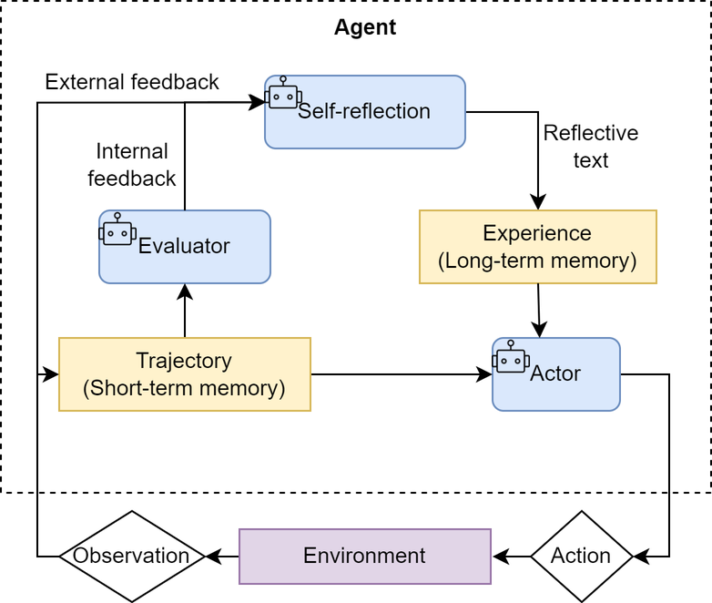

# 04. 学习Hello-Agents：智能体经典范式

> 学习自：[hello-agents](https://github.com/datawhalechina/hello-agents)

> 有了第三章的大语言模型这个「大脑」，这一章把它接到外部世界上，动手构建真正的智能体。智能体的核心能力，是把 LLM 的推理能力和外部工具（搜索引擎、API、代码解释器）联通起来，自主理解意图、拆解任务、调用工具、达成目标。业界围绕「怎么组织智能体的思考与行动」沉淀出三种经典范式：ReAct（边想边做）、Plan-and-Solve（三思后行）、Reflection（事后反思）。本文不仅把它们的原理、工作机制、适用场景与局限讲透，还补充了它们各自的论文背景、与 Function Calling 等机制的对比，以及由此衍生出的 Self-Ask、ReWOO、ToT、LATS 等一系列变体，串起智能体范式的完整演进谱系。

## 目录

- [一、智能体范式的全景](#一智能体范式的全景)
  - [1.1 三种核心范式一句话画像](#11-三种核心范式一句话画像)
  - [1.2 为什么亲手实现而非直接用框架](#12-为什么亲手实现而非直接用框架)
  - [1.3 范式演进谱系：从 CoT 到多智能体](#13-范式演进谱系从-cot-到多智能体)
- [二、ReAct：思考与行动协同](#二react思考与行动协同)
  - [2.1 从「纯思考」「纯行动」到 ReAct](#21-从纯思考纯行动到-react)
  - [2.2 思考-行动-观察循环](#22-思考-行动-观察循环)
  - [2.3 工具：智能体连接世界的手脚](#23-工具智能体连接世界的手脚)
  - [2.4 实现要点](#24-实现要点)
  - [2.5 ReAct 与 Function Calling 的对比](#25-react-与-function-calling-的对比)
  - [2.6 特点、局限与调试技巧](#26-特点局限与调试技巧)
- [三、Plan-and-Solve：先规划后执行](#三plan-and-solve先规划后执行)
  - [3.1 Zero-shot CoT 的三大缺陷](#31-zero-shot-cot-的三大缺陷)
  - [3.2 两阶段工作流](#32-两阶段工作流)
  - [3.3 规划阶段与 PS/PS+ 提示词](#33-规划阶段与-psps-提示词)
  - [3.4 执行阶段与状态管理](#34-执行阶段与状态管理)
  - [3.5 与 ReWOO、Plan-and-Execute 的区别](#35-与-rewooplan-and-execute-的区别)
  - [3.6 适用场景与局限](#36-适用场景与局限)
- [四、Reflection：自我反思与迭代优化](#四reflection自我反思与迭代优化)
  - [4.1 执行-反思-优化循环](#41-执行-反思-优化循环)
  - [4.2 Reflexion 三组件与「口头强化学习」](#42-reflexion-三组件与口头强化学习)
  - [4.3 记忆模块与反思质量](#43-记忆模块与反思质量)
  - [4.4 三种角色的提示词](#44-三种角色的提示词)
  - [4.5 运行案例：素数算法优化](#45-运行案例素数算法优化)
  - [4.6 成本收益分析](#46-成本收益分析)
- [五、范式演进与变体：超越三种基础范式](#五范式演进与变体超越三种基础范式)
  - [5.1 ReAct 的四个短板催生四类变体](#51-react-的四个短板催生四类变体)
  - [5.2 两条演进主线](#52-两条演进主线)
  - [5.3 生产实践的选择](#53-生产实践的选择)
- [六、三种范式的对比与选择](#六三种范式的对比与选择)
- [附：高频速记](#附高频速记)

---

## 一、智能体范式的全景

### 1.1 三种核心范式一句话画像

一个现代的智能体，核心能力在于把大语言模型的推理能力与外部世界联通：自主理解用户意图、拆解复杂任务，并通过调用代码解释器、搜索引擎、API 等一系列「工具」来获取信息、执行操作，最终达成目标。但它并非万能，同样受制于大模型本身的幻觉、复杂任务中的推理循环，以及工具误用等挑战——这些构成了智能体的能力边界。

为了更好地组织智能体的「思考」与「行动」，业界涌现出三种最具代表性的经典范式：

- ReAct（Reasoning and Acting）：把「思考」和「行动」紧密结合，让智能体边想边做，动态调整。
- Plan-and-Solve：一种「三思而后行」的范式，智能体首先生成完整行动计划，然后严格执行。
- Reflection：赋予智能体「反思」能力，通过自我批判和修正来优化结果。

### 1.2 为什么亲手实现而非直接用框架

市面上已有 LangChain、LlamaIndex 等众多成熟框架，为什么还要「重复造轮子」？原因有三层：

1. 成熟的框架在工程效率上优势显著，但直接使用高度抽象的工具，不利于理解背后的设计机制是怎么运行的、有何好处。
2. 亲手实现会暴露出项目真正的工程挑战。框架帮我们处理了许多问题——模型输出格式的解析、工具调用失败的重试、防止智能体陷入死循环等。亲手处理这些问题，是培养系统设计能力最直接的方式。
3. 掌握了设计原理，才能真正从一个框架的「使用者」转变为一个智能体应用的「创造者」。当标准组件无法满足复杂需求时，就拥有了深度定制乃至从零构建全新智能体的能力。

三种范式在实现上共享一套基础组件：统一的 LLM 客户端（模型 ID、API 密钥、服务地址通过环境变量配置，客户端封装流式调用），以及一个可注册、可调度的工具执行器。

### 1.3 范式演进谱系：从 CoT 到多智能体

理解这三种范式，最好先看它们在智能体研究版图中的位置。一切从思维链（Chain-of-Thought, CoT）开始——2022 年初，人们发现只要在提示词里加一句「让我们一步一步思考」，就能显著激发大模型的推理能力。但 CoT 的推理完全发生在模型「脑子里」，无法接触外部世界。于是研究分叉出两条路，一路强调「边想边做」，一路强调「先规划后执行」，之后又叠加了「反思」与「搜索」，最终走向多智能体协作：

```
CoT（2022.01，纯内部推理）
 │
 ├── ReAct（2022.10，推理+行动交替）──┬── Reflexion（2023，加反思记忆）
 │                                      ├── ReWOO（2023，规划执行分离）
 │                                      └── LATS（2023，融合树搜索）
 │
 ├── Self-Ask（2022.10，显式自问自答分解）
 ├── ToT / Tree-of-Thoughts（2023.05，多路树搜索）
 │
 └── Plan-and-Solve（2023，先规划后执行）
         │
         └── Plan-and-Execute（2023-2025）── LLM Compiler（2024，DAG 并行）
                                               └── Multi-Agent（多智能体协作）
```

这张谱系图说明了两件事：其一，三种基础范式并非孤岛，而是同一条「如何组织思考与行动」主线上的三个关键节点；其二，所有后续变体都在围绕两个核心矛盾做文章——灵活性与效率的平衡、幻觉抑制与能力增强的平衡。理解了这两条主线，后面每个范式的来龙去脉就都清楚了。

---

## 二、ReAct：思考与行动协同

### 2.1 从「纯思考」「纯行动」到 ReAct

ReAct（Reason + Act）由 Shunyu Yao 于 2022 年提出（论文《ReAct: Synergizing Reasoning and Acting in Language Models》，发表于 ICLR 2023），核心思想是模仿人类解决问题的方式，把推理（Reasoning）与行动（Acting）显式结合起来，形成一个「思考-行动-观察」的循环。

论文的核心发现，直指此前两类方法的各自短板：

- 「纯思考」型，如思维链（CoT）。它能引导模型进行复杂的逻辑推理，但无法与外部世界交互，容易产生事实幻觉——模型对「自己知道答案」的问题推理得很好，一旦缺乏必要知识，就会流利地「编造」答案。
- 「纯行动」型，模型直接输出要执行的动作，但缺乏规划和纠错能力——它跳过逐步思考直接输出调用指令，复杂任务里容易选错工具、填错参数。

ReAct 的巧妙之处在于，它认识到思考与行动是相辅相成的：思考指导行动，行动的结果反过来修正思考。它通过一种特殊的提示工程引导模型，使每一步的输出都遵循固定的轨迹，把「知识获取」从隐式的、不可见的过程，变成一个显式的、可审计的步骤——模型不能再悄悄编造，必须真正去「取」它声称需要的信息。

### 2.2 思考-行动-观察循环

ReAct 每一步的输出包含三个角色：

- Thought（思考）：智能体的「内心独白」，分析当前情况、分解任务、制定下一步计划，或者反思上一步的结果。
- Action（行动）：决定采取的具体动作，通常是调用一个外部工具，例如 `Search[华为最新款手机]`。
- Observation（观察）：执行 Action 后从外部工具返回的结果，例如搜索结果的摘要或 API 的返回值。

智能体不断重复这个 Thought → Action → Observation 循环，把新的观察结果追加到历史记录中，形成不断增长的上下文，直到在 Thought 中判断已找到最终答案，然后输出结果。这个过程形成强大的协同效应：推理使行动更具目的性，行动则为推理提供事实依据——这就是所谓的「基于事实的推理」（Grounded Reasoning），也是 ReAct 区别于纯 CoT 的抗幻觉机制所在。

这个过程可以形式化表达。在每个时间步 $t$，智能体的策略（即大语言模型 $\pi$）根据初始问题 $q$ 和之前所有步骤的「行动-观察」历史轨迹 $((a_1,o_1),\dots,(a_{t-1},o_{t-1}))$，生成当前的思考 $th_t$ 和行动 $a_t$：

$$(th_t,a_t)=\pi\bigl(q,(a_1,o_1),\ldots,(a_{t-1},o_{t-1})\bigr)$$

随后，环境中的工具 $T$ 执行行动 $a_t$，返回新的观察结果 $o_t$：

$$o_t=T(a_t)$$

循环不断进行，把新的 $(a_t,o_t)$ 对追加到历史中，直到模型在思考 $th_t$ 中判断任务已完成。


这种机制特别适用于三类场景：

- 需要外部知识的任务：查询实时信息（天气、新闻、股价）、搜索专业领域知识等。
- 需要精确计算的任务：把数学问题交给计算器工具，避免 LLM 的计算错误。
- 需要与 API 交互的任务：操作数据库、调用服务 API 完成特定功能。

典型例子是回答「华为最新的手机是哪一款？它的主要卖点是什么？」这类问题——它超出了 LLM 自身知识库的时效范围，必须主动上网搜索。

### 2.3 工具：智能体连接世界的手脚

如果说大语言模型是智能体的大脑，那么工具（Tools）就是它与外部世界交互的「手和脚」。一个良好定义的工具应包含三个核心要素：

1. 名称（Name）：简洁、唯一的标识符，供智能体在 Action 中调用，例如 `Search`。
2. 描述（Description）：清晰的自然语言说明工具的用途。这是整个机制中最关键的部分，因为大语言模型会依赖这段描述来判断何时使用哪个工具。
3. 执行逻辑（Execution Logic）：真正执行任务的函数或方法。

当智能体需要使用多种工具时（除了搜索，还可能需要计算、查询数据库等），需要统一的管理器来注册和调度这些工具。管理器内部维护一个「名称 → 描述与执行函数」的映射表，对外提供注册、按名查找、生成可用工具清单三个能力。智能体在每次决策前，会看到一份格式化好的可用工具清单，据此判断该调用哪一个。

工具描述的质量直接决定工具选择的准确率——这是多工具场景下 Agent 开发的核心挑战。当可用工具数量从几个增长到几十上百个时，单纯把所有工具描述塞进提示词会迅速挤爆上下文、降低选择准确率，工程上需要引入工具检索、分组或按需注入等机制来应对。

### 2.4 实现要点

一个 ReAct 智能体虽然代码实现不算复杂，但有几个关键设计决定了它能否稳定工作：

1. 系统提示词是基石。模板需要动态插入四类信息：角色定义（「你是一个有能力调用外部工具的智能助手」）、工具清单、格式规约（强制 LLM 用 `Thought:` / `Action:` 结构化输出，便于代码精确解析意图）、动态上下文（用户原始问题 + 不断累积的交互历史）。

2. 核心循环。主体是一个「格式化提示词 → 调用 LLM → 执行动作 → 整合结果」的 while 循环，直到收到 `Finish[最终答案]` 指令或达到最大步数限制。`max_steps` 参数是重要的安全阀，防止智能体陷入无限循环耗尽资源。

3. 输出解析器。LLM 返回的是纯文本，需要从中精确提取 Thought 和 Action。通常用正则表达式分别匹配 `Thought:` 到 `Action:` 之间的内容、以及 `Action:` 到末尾的内容；再进一步从 `Search[华为最新手机]` 这种格式里解析出工具名和工具输入。

4. 工具调用与结果整合。解析出 Action 后，先判断是否为 `Finish` 指令（是则提取最终答案并结束），否则通过工具管理器查找对应函数执行，得到 Observation。最关键的一步是把本轮 Action 和 Observation 追加回历史记录——这形成闭环，让智能体在下一轮能「看到」上一步的结果，据此继续思考和规划。

### 2.5 ReAct 与 Function Calling 的对比

ReAct 最初是一种纯文本的提示词格式：提示词用示例「教会」模型 Thought/Action/Observation 的结构，系统再解析模型输出的自由文本、提取动作。这种方式有一个先天脆弱点——解析自由文本不可靠。随着模型能力演进，现代大模型普遍支持原生 Function Calling（工具调用），模型可以直接输出结构化的工具调用请求，无需解析文本，由 Agent 框架负责把工具结果回填、让模型继续推理再调用。范式本身（思考-行动-观察循环）不变，但实现方式从「文本解析」升级为「结构化工具调用」，更加健壮。

两者的差异可以从多个维度对比：

| 维度 | ReAct | Function Calling |
| ---- | ---- | ---- |
| 推理过程 | 显式展示 Thought 思考过程 | 不一定展示推理过程 |
| 适用范围 | 通用 Prompt 模式，任何模型可用 | 需要模型原生支持工具调用 |
| 多步推理 | 天然支持多轮「思考-行动」循环 | 通常单次调用，多步需应用层编排 |
| 可控性 | 靠 Prompt 引导，可控性较低 | 靠 Schema 约束，可控性较高 |
| 可解释性 | Thought 过程提供可解释性 | 输出简洁，可解释性较低 |
| Token 消耗 | 较高（要输出 Thought） | 较低 |

一句话概括：Function Calling 给了模型一把「锤子」，ReAct 教会它「盖房子」——差别不在工具本身，而在决定何时、如何挥动锤子的推理。实践上，简单工具调用优先用 Function Calling（更可靠），复杂多步推理用 ReAct 或「ReAct + Function Calling」结合（在 Function Calling 基础上加入 Thought 步骤，兼顾可靠性与可解释性）。

### 2.6 特点、局限与调试技巧

（1）主要特点

1. 高可解释性：ReAct 最大的优点是透明。通过 Thought 链，可以清晰看到智能体每一步的「心路历程」——它为什么选这个工具、下一步打算做什么。这对理解、信任和调试智能体行为至关重要。
2. 动态规划与纠错能力：与一次性生成完整计划的范式不同，ReAct 是「走一步，看一步」，根据每一步获得的 Observation 动态调整后续的 Thought 和 Action。上一步搜索结果不理想，下一步就能修正搜索词重试。
3. 工具协同能力：天然地把 LLM 的推理能力与外部工具的执行能力结合——LLM 负责运筹帷幄（规划推理），工具负责解决具体问题（搜索、计算），突破了单一 LLM 在知识时效性、计算准确性上的固有局限。

（2）固有局限性

1. 对 LLM 自身能力的强依赖：流程成败高度依赖底层 LLM 的综合能力。若 LLM 的逻辑推理、指令遵循或格式化输出能力不足，就容易在 Thought 环节规划错误，或在 Action 环节生成不合格式的指令，导致流程中断。
2. 执行效率问题：循序渐进的特性意味着完成任务需要多次调用 LLM，每次调用都伴随网络延迟和计算成本。对步骤繁多的复杂任务，串行的「思考-行动」循环总耗时和费用可能较高。
3. 提示词的脆弱性：整个机制的稳定运行建立在精心设计的提示词模板之上。模板任何微小变动、甚至用词差异，都可能影响 LLM 行为；且并非所有模型都能持续稳定地遵循预设格式。
4. 可能陷入局部最优：步进式决策意味着缺乏全局、长远规划，可能因眼前的 Observation 选择看似正确但长远并非最优的路径，甚至「原地打转」。

这四点局限——「不学习、不分解、慢且贵、不探索」——正是后续一系列变体的出发点，将在第五章详细展开。

（3）调试技巧

行为不符合预期时，可从五个方面入手：打印每次调用前完整格式化好的提示词（追溯决策源头）；解析失败时打印 LLM 的原始未处理文本（判断是模型没遵循格式还是解析逻辑有误）；验证工具输入格式和返回格式是否匹配；在提示词中加入一两个完整的 Thought-Action-Observation 成功案例（few-shot 引导）；换更强的模型或把 temperature 设为 0 保证输出确定性。

---

## 三、Plan-and-Solve：先规划后执行

### 3.1 Zero-shot CoT 的三大缺陷

如果说 ReAct 像一位经验丰富的侦探，根据现场蛛丝马迹（Observation）一步步推理、随时调整调查方向；那么 Plan-and-Solve 更像一位建筑师，动工之前先绘制完整蓝图（Plan），再严格按蓝图施工（Solve）。如今很多大模型工具的 Agent 模式都融入了这种设计。

Plan-and-Solve Prompting 由 Lei Wang 等于 2023 年提出（论文发表于 ACL 2023），核心动机是解决思维链在多步骤、复杂问题上的可靠性问题。论文通过对 Zero-shot CoT（即「让我们一步一步思考」）的错误分析，识别出三类典型错误：

- 计算错误（Calculation Errors）：模型在做基础算术时算错，约占 GSM8K 错误样本的 7%。
- 缺步错误（Missing-step Errors）：模型跳过了解题必需的关键逻辑步骤，约占 12%。
- 语义误解错误（Semantic Misunderstanding）：模型误解了问题的核心要求或上下文，约占 27%。

前两类错误的根源，正在于模型缺少显式的问题分解、对中间计算不够关注，容易「未经规划就一头扎进求解」。这启发了「先规划、后执行」的思路。

### 3.2 两阶段工作流

与 ReAct 把思考和行动融合在每一步不同，Plan-and-Solve 把整个流程解耦为两个核心阶段：

1. 规划阶段（Planning Phase）：智能体接收完整问题后，第一个任务不是直接解题或调用工具，而是把问题分解，制定出清晰、分步骤的行动计划。这个计划本身就是一次大语言模型的调用产物。
2. 执行阶段（Solving Phase）：获得完整计划后，严格按照计划中的步骤逐一执行。每一步的执行都可能是一次独立的 LLM 调用，或对上一步结果的加工处理，直到所有步骤完成、得出答案。

这种「先谋后动」的策略，使智能体在处理需要长远规划的复杂任务时能保持更高的目标一致性，避免在中间步骤迷失方向。

两阶段过程可以形式化表达。规划模型 $\pi_{\text{plan}}$ 根据原始问题 $q$ 生成包含 $n$ 个步骤的计划 $P=(p_1,p_2,\dots,p_n)$：

$$P=\pi_{\text{plan}}(q)$$

执行阶段，执行模型 $\pi_{\text{solve}}$ 逐一完成计划中的步骤。第 $i$ 个步骤的解 $s_i$ 同时依赖原始问题 $q$、完整计划 $P$ 以及之前所有步骤的执行结果 $(s_1,\dots,s_{i-1})$：

$$s_i=\pi_{\text{solve}}\bigl(q,P,(s_1,\dots,s_{i-1})\bigr)$$

最终答案就是最后一个步骤的执行结果 $s_n$。


### 3.3 规划阶段与 PS/PS+ 提示词

论文提出了两个版本的提示词策略：

1. PS（Plan-and-Solve）：用结构化的引导语替代「一步一步思考」，改为「先理解问题并制定一个解决计划，然后按照计划一步一步地解决问题」。这迫使模型先把复杂任务分解成可管理的子任务，在动手计算之前先确立逻辑路线图。

2. PS+（增强版）：在 PS 基础上追加更细的指令，明确要求模型「提取相关变量及其数值」「计算中间结果」「注意计算和常识」。这种「变量锚定」的做法，相当于给模型建立了一个工作记忆，把它的推理锚定在题目给出的具体数字上，防止它在执行阶段遗忘或幻觉出数字。

规划提示词的关键设计点在于格式约束——强制要求输出结构化的步骤列表（如 Python 列表），而非自然语言。这极大简化了后续解析：解析结构化列表比解析自然语言更稳定、更可靠。论文实验还揭示了一个重要现象：输出中「是否包含形式化计划」与「是否出现缺步/计算错误」呈负相关，结构越清晰，准确率越高。

实验结论相当有力：在 GPT-3 上，PS+ 在所有十个基准（六个算术、两个常识、两个符号推理）上一致地超越了 Zero-shot CoT，且一个零样本方法竟能媲美甚至超过需要八个人工示例的 8-shot CoT——例如 MultiArith 上达到 91.8%，结合自洽性（Self-Consistency，多次采样投票）后 GSM8K 达到 73.7%。这证明高质量指令可以在一定程度上替代人工示例。

### 3.4 执行阶段与状态管理

规划器生成清晰蓝图后，执行器负责逐一完成任务。执行器不仅要调用大模型解决每个子问题，还承担一个至关重要的角色——状态管理：记录每一步的执行结果，并将其作为上下文提供给后续步骤，确保信息在整个任务链条中顺畅流动。

执行器的提示词与规划器不同，目标不是分解问题，而是在已有上下文基础上专注解决当前这一个步骤。它需要包含四类关键信息：

- 原始问题：确保模型始终了解最终目标。
- 完整计划：让模型了解当前步骤在整个任务中的位置。
- 历史步骤与结果：提供至今已完成的工作，作为当前步骤的直接输入。
- 当前步骤：明确指示模型现在要解决哪一个具体任务。

执行器循环遍历计划，每完成一步就把「步骤 + 结果」追加进历史，作为下一步的输入。整个智能体由规划器和执行器两个组件组合而成，主类只作为协调者（Orchestrator）调度它们，体现「组合优于继承」的设计原则。

一个典型运行实例是水果店应用题：「周一卖 15 个苹果，周二是周一的两倍，周三比周二少 5 个，三天共卖多少？」规划阶段把它分解成四个步骤（算周一 15、算周二 30、算周三 25、算总销量 70），执行阶段严格按顺序逐步求解，每一步正确引用上一步结果，最终得出 70。

### 3.5 与 ReWOO、Plan-and-Execute 的区别

「先规划后执行」是一大类范式的共同思想，Plan-and-Solve 只是其中一种具体提示方法，它与几个相近概念需要区分清楚：

- Plan-and-Solve 本质是一种提示策略（Prompting），规划发生在「推理内」，执行仍是逐句自然语言推理，没有真正的工具调用。
- ReWOO（Reasoning WithOut Observation）是「分离规划与执行」的工程化实现：先把问题一次性规划成一组工具调用（并引入变量机制串联步骤间的数据传递），再批量并行执行，中间不再反复回看观察结果。它把 LLM 调用次数压到最低、延迟最低，代价是计划一旦出错难以中途纠偏，且要求工具结果可预测。实测在 HotpotQA 上能以 5 倍更少的 token 取得 +4% 的准确率，规划器甚至可以蒸馏到 7B 小模型。
- Plan-and-Execute 是 ReWOO 的泛化：先规划、再执行（可串行可并行），是 LangChain 等框架中的成熟模式。

三者的取舍核心在于「工具结果是否可预测」：可预测时前置规划、批量执行（ReWOO）最省成本；不可预测时则要退回 ReAct 的边走边看。

### 3.6 适用场景与局限

Plan-and-Solve 尤其适用于结构性强、可被清晰分解的复杂任务：

- 多步数学应用题：先列出计算步骤，再逐一求解。
- 需要整合多个信息源的报告撰写：先规划报告结构（引言、数据来源 A、数据来源 B、总结），再逐一填充内容。
- 代码生成任务：先构思函数、类和模块的结构，再逐一实现。

它的局限同样明显：规划是一次性生成的「静态」计划，若执行中发现某步无法完成或结果不符合预期，缺少动态重规划能力；且它只能缓解计算错误和缺步错误，对语义误解错误（模型一开始就没读懂题）基本无能为力——计划本身就是错的，再严格执行也白搭。这正是它与 ReAct 互补的地方：ReAct 靠实时观察纠偏，Plan-and-Solve 靠结构稳定推进。

---

## 四、Reflection：自我反思与迭代优化

### 4.1 执行-反思-优化循环

在 ReAct 和 Plan-and-Solve 中，智能体一旦完成任务，工作流程便告结束。但它们生成的初始答案——无论是行动轨迹还是最终结果——都可能存在谬误或有待改进之处。Reflection 机制的核心思想，是为智能体引入一种事后（post-hoc）的自我校正循环，让它像人类一样审视自己的工作、发现不足、迭代优化。

这一思想灵感来源于人类的学习过程：完成初稿后校对、解出数学题后验算。它在 Shinn 于 2023 年提出的 Reflexion 框架等研究中得到体现。核心工作流程可概括为三步循环「执行 → 反思 → 优化」：

1. 执行（Execution）：用熟悉的方法（如 ReAct 或 Plan-and-Solve）尝试完成任务，生成初步解决方案或行动轨迹，可看作「初稿」。
2. 反思（Reflection）：进入反思阶段，调用一个独立或带特殊提示词的 LLM 实例扮演「评审员」，审视初稿并从多个维度评估——是否存在事实性错误、逻辑漏洞、效率问题，是否遗漏关键约束或信息。据此生成结构化的反馈（Feedback），指出具体问题和改进建议。
3. 优化（Refinement）：把「初稿」和「反馈」作为新上下文，再次调用 LLM，要求它根据反馈修正初稿，生成更完善的「修订稿」。

这个循环可以重复多次，直到反思阶段不再发现新问题，或达到预设的迭代次数上限。形式化地，设 $O_i$ 是第 $i$ 次迭代的输出（$O_0$ 为初始输出），反思模型 $\pi_{\text{reflect}}$ 生成针对 $O_i$ 的反馈 $F_i$：

$$F_i=\pi_{\text{reflect}}(\text{Task},O_i)$$

随后，优化模型 $\pi_{\text{refine}}$ 结合原始任务、上一版输出和反馈，生成新一版输出 $O_{i+1}$：

$$O_{i+1}=\pi_{\text{refine}}(\text{Task},O_i,F_i)$$



与前两种范式相比，Reflection 的价值在于：

- 提供一个内部纠错回路，使智能体不再完全依赖外部工具的反馈（ReAct 的 Observation），从而能修正更高层次的逻辑和策略错误。
- 把一次性的任务执行转变为持续优化的过程，显著提升复杂任务的最终成功率和答案质量。
- 构建一个临时的「短期记忆」。整个「执行-反思-优化」轨迹形成宝贵经验记录，智能体不仅知道最终答案，还记得自己如何从有缺陷的初稿迭代到最终版本。更进一步，这个记忆系统还可以是多模态的，允许智能体反思和修正文本以外的输出（如代码、图像），为构建多模态智能体奠定基础。

### 4.2 Reflexion 三组件与「口头强化学习」

第四章中的 Reflection 实现只是一个简化版，学界最完整的框架是 Reflexion（Shinn et al., NeurIPS 2023）。它提出了一个极富洞察力的概念——「口头强化学习」（Verbal Reinforcement Learning）：不通过梯度更新来「学习」，而是把失败后的反馈写成一段自然语言反思，存进记忆，下次执行时读出来作为上下文。强化信号是真实的，但策略更新是一句话，而不是一次权重变化。

Reflexion 由三个角色组件协同工作：

1. Actor（执行者）：负责生成文本与动作，与环境交互产生轨迹。它可以用 CoT 或 ReAct 来引导。
2. Evaluator（评估者）：给 Actor 的输出打分。反馈可以是标量奖励、硬性判定（如单元测试通过与否），也可以是自由文本评价。整个机制的成败几乎完全取决于评估信号的质量——评估者若给出噪声大、含糊或可被钻空子的反馈，模型就会「自信地学到错误的教训」，自我强化的错误越滚越大。
3. Self-Reflection（自我反思者）：把评估者的反馈转化为可操作的口头强化语（例如「我上次没检查文件是否存在就用了它」），存入情景记忆（Episodic Memory），供后续尝试参考。

这套机制不需要微调、不需要 GPU 训练、甚至不需要访问模型权重，只需一个可推理的端点和一个可判定的任务结果，就能让智能体「从失败中学习」。它在决策（AlfWorld）、推理（HotPotQA）和编程（HumanEval、MBPP、LeetcodeHardGym）三类任务上都取得了显著提升——例如 AlfWorld 上完成 130/134 个任务，HumanEval 的 pass@1 相对 GPT-4 基线提升 11 个百分点。

### 4.3 记忆模块与反思质量

Reflection 的核心在于迭代，而迭代的前提是能记住之前的尝试和反馈。因此一个「短期记忆」模块是实现该范式的必需品，负责存储每一次「执行-反思」循环的完整轨迹。

引入记忆模块还有一个现实原因：当上下文足够长时，若让「评审员」直接获取所有信息再反思，往往会传入很多冗余信息。记忆模块的价值就是把轨迹「序列化」成一段精炼文本，直接插入后续提示词，为模型的反思和优化提供完整且必要的上下文。一个简洁的记忆模块主体包含：按顺序存储每次执行与反思记录的列表、添加记录的方法、把轨迹序列化成文本的核心方法、以及取最新执行结果的方法。

记忆本身也有讲究：

- 记忆衰减（Memory Decay）：情景记忆是有限的滚动缓冲，受上下文窗口约束，通常只保留最近一到三条反思。保留全部反思会迅速挤爆 token 上限，因此需要遗忘或检索机制来维持记忆的可用性。
- 反思质量：模糊的反思（如「我应该更小心」）毫无用处，必须提示模型产出具体、可操作的教训（如「遇到含糊的 bug 报告，先定位调用点再编辑」）。幻觉出的反思（事后编造的不具迁移性的解释）同样有害，需要用留出评估集来验证。

### 4.4 三种角色的提示词

与前两种范式不同，Reflection 机制需要多个不同角色的提示词协同工作：

1. 初始执行提示词（Execution Prompt）：智能体首次尝试解决问题的提示词，内容相对直接，只要求模型完成指定任务（如「资深 Python 程序员，按规范编写函数」）。
2. 反思提示词（Reflection Prompt）：Reflection 机制的灵魂。它指示模型扮演「代码评审员」角色，对上一轮成果进行批判性分析，并提供具体、可操作的反馈。关键在角色设定——例如「极其严格的代码评审专家，对性能有极致要求，专注找算法效率瓶颈」，并明确「若已最优才回答无需改进」。
3. 优化提示词（Refinement Prompt）：收到反馈后，引导模型根据反馈内容对原有成果进行修正和优化。

三套提示词各司其职，形成「执行 → 反思 → 优化」的闭环。反思提示词里「算法上更优」的强约束、以及「无需改进」这个明确信号，是整个迭代能收敛的关键设计。

### 4.5 运行案例：素数算法优化

以「编写 Python 函数找出 1 到 n 之间所有素数」为例，这个任务能很好地检验 Reflection 机制——存在明确优化路径（初版常是低效实现）、反思点清晰（时间复杂度过高）、优化方向明确（换成更高效算法）。

- 初始执行：模型首先生成一个功能正确但效率低的初版，用逐个试除法判断素数，时间复杂度约 $O(n\sqrt{n})$。
- 第一轮反思：评审员没有满足于功能正确的初版，而是精准指出试除法在 n 很大时性能显著下降的瓶颈，建议改用埃拉托斯特尼筛法（Sieve of Eratosthenes），复杂度降至 $O(n\log\log n)$。
- 第一轮优化：模型采纳反馈，把代码改写成筛法实现。
- 第二轮反思：面对已经高效的筛法，评审员进一步提到分段筛、奇数筛等更高级的优化方向，但最终做出「一般情况无需改进」的正确判断。
- 收敛：这个「无需改进」的信号触发了终止条件，优化过程收敛。

这个案例充分说明，设计良好的 Reflection 机制的价值不仅在于修复错误，更在于驱动解决方案在质量和效率上实现阶梯式提升。

### 4.6 成本收益分析

Reflection 机制在提升质量上表现出色，但这种能力并非没有代价，需要在实际应用中权衡。

（1）主要成本

1. 模型调用开销增加：每进行一轮迭代，至少额外调用两次 LLM（一次反思、一次优化）。迭代多轮时，API 成本和计算资源消耗成倍增加。
2. 任务延迟显著提高：Reflection 是串行过程，每轮优化都要等上一轮反思完成，总耗时显著延长，不适合实时性要求高的场景。
3. 提示工程复杂度上升：为「执行」「反思」「优化」等不同阶段设计和调试有效提示词，需要投入更多开发精力。

（2）核心收益

1. 解决方案质量的跃迁：把「合格」的初始方案迭代优化成「优秀」的最终方案，实现从功能正确到性能高效、从逻辑粗糙到逻辑严谨的提升，在许多关键任务中至关重要。
2. 鲁棒性与可靠性增强：通过内部自我纠错循环，发现并修复逻辑漏洞、事实性错误、边界情况处理不当等问题，大幅提高最终结果的可靠性。

综上，Reflection 是典型的「以成本换质量」策略，非常适合对最终结果质量、准确性和可靠性有极高要求、且对实时性要求相对宽松的场景——例如生成关键业务代码或技术报告、科学研究中的复杂逻辑推演、需要深度分析的决策支持系统。反之，若需要快速响应、或「大致正确」即可，用更轻量的 ReAct 或 Plan-and-Solve 更具性价比。

---

## 五、范式演进与变体：超越三种基础范式

### 5.1 ReAct 的四个短板催生四类变体

ReAct 是通用性最强的兜底范式，但它有四个原始短板——不学习、不分解、慢且贵、不探索。每个短板都催生了一类变体，围绕「记忆增强、效率优化、搜索增强」三条线演进：

1. Reflexion（加反思记忆）：任务失败后让 LLM 写反思笔记，跨任务积累经验。深刻意义是把「经验学习」引入 Agent——对应「不学习」短板。
2. Self-Ask（加显式分解）：让 LLM 自问自答，把大问题拆成子问题链，逐个解决再整合，适合多跳问答——对应「不分解」短板。
3. ReWOO（加分离规划执行）：一次性打包所有工具调用，批量并行执行，LLM 调用最少、延迟最低，但要求工具结果可预测——对应「慢且贵」短板。
4. ToT / Tree-of-Thoughts（加树搜索）：把推理变成一棵树，在多个候选思路上并行探索、用自评估打分、必要时回溯，适合需要多路尝试的难题——对应「不探索」短板。典型效果：24 点游戏（Game of 24）的准确率从 CoT 的 4% 跃升到 74%。

此外还有两个值得单独一提的范式：

- Self-Refine（Madaan et al., 2023）：用一个 LLM 扮演三个角色（生成、反馈、优化）循环打磨输出，平均带来约 20 个百分点的绝对提升。它与 Reflexion 互补——Reflexion 跨任务学习（存反思），Self-Refine 在单次响应内改进。CRITIC 则进一步把反馈环节接到外部工具上做验证，让「批评」更可靠。
- LATS（Language Agent Tree Search, Zhou et al., 2024）：把 ToT、ReAct、Reflexion 统一到蒙特卡洛树搜索（MCTS）之下，在「想+做」的复合空间里搜索。效果上限极高（HumanEval pass@1 达 92.7%），但 LLM 调用量是 ReAct 的 5-20 倍，实现复杂度极高，且依赖环境支持「状态回溯」——因此它是研究范式而非生产范式，生产中几乎不用，而是用 ReAct + 局部回溯来近似它的好处。

这些变体的横向对比：

| 变体 | 改进点 | LLM 调用 | 鲁棒性 | 适用场景 |
| ---- | ---- | ---- | ---- | ---- |
| ReAct | 基础范式 | 中 | 中 | 通用兜底 |
| Reflexion | 加反思记忆 | 中（多次尝试） | 高（跨任务学习） | 多次尝试、需积累经验 |
| Self-Ask | 加显式分解 | 中 | 中 | 多跳问答 |
| ReWOO | 分离规划执行 | 少 | 低（计划脆） | 工具结果可预测、可并行 |
| LATS | 加树搜索 | 极多 | 极高 | 极难任务、不计成本 |

### 5.2 两条演进主线

纵观从 CoT 到 LATS 的演进，一切始终围绕两个核心矛盾——灵活性与效率的平衡、幻觉抑制与能力增强的平衡，可归纳为两条主线：

1. 规划先行（效率优化）：ReAct → ReWOO → Plan-and-Solve → Plan-and-Execute → LLM Compiler。核心诉求是减少串行等待、降低大模型调用次数与成本，手段是「规划-执行分离」「变量机制」「任务 DAG 与并行调度」。代价是鲁棒性下降——预规划的静态流程难以应对突发状况。
2. 反思驱动（质量纠错）：Reflexion → Self-Refine → LATS。核心诉求是提升输出质量与可靠性，手段是「自我反思」「外部工具验证」「树搜索回溯」。终点 LATS 融合了两条主线。

这两条线继续向前，就走向多智能体协作——与其让一个 Agent 越来越强，不如让多个 Agent 分工合作。多智能体可以看作 ReAct 范式的「横向扩展」：每个 Agent 内部仍是 ReAct 循环，Agent 之间通过消息协作。

### 5.3 生产实践的选择

在 2026 年的工程实践中，几乎每个生产级 Agent——Claude Code、Cursor、Devin、Operator 等——都是 ReAct 循环的变体：推理 token 与工具调用、观察结果交替出现，直到触发停止条件。「思考-行动-观察」循环已经成为智能体的底层通用协议。

成熟的工程化选择通常是组合而非单选：

- 通用兜底用 ReAct。
- 多次尝试、需跨任务积累经验时，叠 Reflexion（失败时触发反思）。
- 信息检索、可并行时用 ReWOO 降低成本延迟。
- 关键节点局部用 ToT 做多路探索。

生产主流是「ReAct 主体 + 局部 Reflexion 反思 + 关键节点局部搜索」的混合范式，比单一变体更鲁棒。此外，反思与评估的模式在 2026 年已被各框架固化为标准组件——Anthropic 称之为 evaluator-optimizer，OpenAI Agents SDK 称之为 guardrail loop。理解这些范式背后的原理，才能真正驾驭这些高度封装的开箱组件。

---

## 六、三种范式的对比与选择

三种范式代表了智能体解决问题的三种不同策略，选择哪一种取决于任务的核心需求：

| 范式 | 核心机制 | 核心优势 | 适用场景 |
| ---- | ---- | ---- | ---- |
| ReAct | 思考-行动-观察循环 | 环境适应性、动态纠错 | 探索性、需外部工具输入的任务（实时信息、精确计算、API 交互） |
| Plan-and-Solve | 先规划、后执行 | 结构性、稳定性 | 逻辑路径确定、内部推理密集的任务（多步数学、报告撰写、代码生成） |
| Reflection | 执行-反思-优化循环 | 显著提升方案质量 | 对准确性、可靠性要求极高的场景（关键代码、科研推演、决策支持） |


一句归纳：要实时探索和纠错选 ReAct，要结构化稳定推进选 Plan-and-Solve，要最高质量不惜成本选 Reflection。三者并不互斥，实际系统常常组合使用——例如用 ReAct 做底层的「思考-行动」执行，再叠一层 Reflection 对最终结果做全局反思优化。

---

## 附：高频速记

- 智能体核心能力 = LLM 推理能力 + 外部工具（搜索引擎、API、代码解释器）联通，自主理解意图、拆解任务、调用工具、达成目标。
- 亲手实现而非用框架的三个理由：理解设计机制、暴露工程挑战（解析/重试/防死循环）、从使用者变创造者。
- 范式演进谱系：CoT → ReAct / ToT / Self-Ask → Reflexion / ReWOO / LATS → Plan-and-Execute / LLM Compiler → 多智能体。
- ReAct = 边想边做，Thought → Action → Observation 循环；论文核心发现是「纯 CoT 易幻觉、纯工具调用易选错」，靠 grounded reasoning（基于事实的推理）抗幻觉。
- ReAct 形式化：$(th_t,a_t)=\pi(q,\text{历史轨迹})$，$o_t=T(a_t)$；三大特点（可解释、动态纠错、工具协同）+ 四大短板（不学习、不分解、慢且贵、不探索）。
- 工具三要素：名称（唯一标识）、描述（最关键，LLM 据此判断何时调用）、执行逻辑；工具多了要靠检索/分组避免上下文爆炸。
- ReAct vs Function Calling：ReAct 是显式文本思考 + 通用 Prompt（可控性低、可解释高、token 高）；Function Calling 是原生结构化调用（可控性高、可解释低）；复杂任务可「Function Calling + Thought」结合。
- Plan-and-Solve = 三思后行；动机是 Zero-shot CoT 三大缺陷：计算错误 7%、缺步错误 12%、语义误解 27%。
- PS 提示词「先理解问题制定计划，再逐步执行」；PS+ 追加「提取变量、计算中间结果」做变量锚定，零样本媲美 8-shot CoT。
- Plan-and-Solve 形式化：$P=\pi_{\text{plan}}(q)$，$s_i=\pi_{\text{solve}}(q,P,(s_1,\dots,s_{i-1}))$；局限是计划静态、难治语义误解。
- ReWOO = 分离规划执行，批量并行，5 倍更少 token、+4% HotpotQA，要求工具结果可预测；Plan-and-Solve 是「推理内」提示策略，无真工具调用。
- Reflection = 事后自我校正，执行 → 反思 → 优化循环；形式化 $F_i=\pi_{\text{reflect}}(\text{Task},O_i)$，$O_{i+1}=\pi_{\text{refine}}(\text{Task},O_i,F_i)$。
- Reflexion 三组件：Actor（执行）、Evaluator（评估，成败全系于此）、Self-Reflection（反思）；核心是「口头强化学习」——不更新权重，用自然语言反思当语义梯度。
- Reflexion 靠情景记忆（Episodic Memory）跨任务积累经验，通常只保留最近 1-3 条（记忆衰减）；模糊反思无用，需具体可操作的教训。
- Reflexion vs Self-Refine：前者跨 episode 学习，后者单次响应内打磨；Self-Refine 一个 LLM 三角色，平均 +20 点。
- ToT 树搜索让 Game of 24 从 4% 到 74%；LATS = ToT + ReAct + Reflexion + MCTS，HumanEval 92.7% 但调用量是 ReAct 5-20 倍，是研究范式非生产范式。
- Reflection 成本：每轮至少 2 次 LLM 调用、串行延迟、提示工程复杂；收益：质量跃迁、鲁棒性增强——「以成本换质量」。
- 两条演进主线：规划先行（效率、并行、降本）、反思驱动（质量、纠错、学习）；生产主流是 ReAct 主体 + 局部 Reflexion 组合。
- 三范式选择：探索纠错选 ReAct，结构化稳定选 Plan-and-Solve，最高质量选 Reflection；三者可组合。
