# 05. 学习Hello-Agents：低代码平台与Agent框架

> 学习自：[hello-agents](https://github.com/datawhalechina/hello-agents)

> 上一篇我们用最原始的方式手写了 ReAct、Plan-and-Solve、Reflection 三种范式，摸清了智能体「怎么想、怎么动」。这一篇先看一条不写代码的路线——低代码平台把模型、插件、知识库、工作流都封装成可视化节点，拖拽连线就能搭出智能体，Coze、Dify、FastGPT、n8n 四个平台各有侧重；然后回到代码路线，看框架怎么把这些反复出现的能力抽象成基础设施——AutoGen、AgentScope、CAMEL、LangGraph 四个代表框架的设计哲学，再补上 2026 年最新的框架格局（CrewAI、OpenAI Agents SDK、AutoGen 继任者 MAF 等）和 MCP / A2A 两个协议，最后给出选型建议。两条路线并不冲突：平台负责快，框架负责深，「混合开发」才是工程化的常态。贯穿框架部分的主线是一条取舍：框架在「让协作自然涌现」和「把流程显式控制」之间怎么选，看懂这条线，才能在几十个框架里不迷路。

## 目录

- [一、低代码平台：不写代码搭智能体](#一低代码平台不写代码搭智能体)
  - [1.1 平台化构建的兴起](#11-平台化构建的兴起)
  - [1.2 Coze：零代码与插件生态](#12-coze零代码与插件生态)
  - [1.3 Dify：开源全栈 LLMOps](#13-dify开源全栈-llmops)
  - [1.4 FastGPT：RAG 知识库问答](#14-fastgptrag-知识库问答)
  - [1.5 n8n：通用工作流自动化](#15-n8n通用工作流自动化)
  - [1.6 平台选型建议](#16-平台选型建议)
- [二、为什么需要 Agent 框架](#二为什么需要-agent-框架)
  - [2.1 从手动实现到框架](#21-从手动实现到框架)
  - [2.2 框架的四个核心价值](#22-框架的四个核心价值)
- [三、主流框架总览](#三主流框架总览)
  - [3.1 四个代表性框架对比](#31-四个代表性框架对比)
  - [3.2 框架演进与 2026 最新格局](#32-框架演进与-2026-最新格局)
- [四、AutoGen：对话驱动的协作](#四autogen对话驱动的协作)
  - [4.1 核心机制](#41-核心机制)
  - [4.2 优势与局限](#42-优势与局限)
- [五、AgentScope：工程化优先](#五agentscope工程化优先)
  - [5.1 核心机制](#51-核心机制)
  - [5.2 优势与局限](#52-优势与局限)
- [六、CAMEL：角色扮演与引导性提示](#六camel角色扮演与引导性提示)
  - [6.1 核心机制](#61-核心机制)
  - [6.2 优势与局限](#62-优势与局限)
- [七、LangGraph：图建模与状态机](#七langgraph图建模与状态机)
  - [7.1 核心机制](#71-核心机制)
  - [7.2 优势与局限](#72-优势与局限)
- [八、2026 最新框架格局](#八2026-最新框架格局)
  - [8.1 CrewAI：角色化快速原型](#81-crewai角色化快速原型)
  - [8.2 OpenAI Agents SDK：handoff 交接](#82-openai-agents-sdkhandoff-交接)
  - [8.3 AutoGen 的现状：维护模式与 MAF/AG2](#83-autogen-的现状维护模式与-mafag2)
  - [8.4 MCP 与 A2A：框架之上的新协议](#84-mcp-与-a2a框架之上的新协议)
- [九、选型与总结](#九选型与总结)
  - [9.1 两大设计权衡](#91-两大设计权衡)
  - [9.2 选型决策表](#92-选型决策表)
- [附：高频速记](#附高频速记)

## 一、低代码平台：不写代码搭智能体

### 1.1 平台化构建的兴起

手写智能体对深入学习至关重要，但业务逻辑一复杂，纯代码的维护成本和开发周期会急剧上升。就像网站开发从手写 HTML/CSS/JS 演进到 WordPress、Wix 这类建站平台一样，智能体的构建也迎来了平台化浪潮：图形化、模块化的低代码平台，把重心从「实现细节」转向「业务逻辑」。

低代码平台的价值归纳为四点：

第一，降低技术门槛。API 调用、状态管理、并发控制这些复杂细节被封装成一个个人人能懂的「节点」或「模块」，拖拽、连接就能构建出功能完整的工作流。产品经理、设计师、业务专家这些不写代码的人也能参与智能体的设计与创造。

第二，提升开发效率。项目初期验证一个想法，低代码平台数小时甚至数分钟就能完成原本数天的编码，开发者可以把精力投到业务逻辑梳理和提示词优化上，而不是底层工程实现。

第三，可视化与可观测性。图形化平台天然提供智能体运行轨迹的端到端可视化：数据在节点之间怎么流动、哪个环节耗时最长、哪个工具调用失败，一眼看清。这种调试体验，比在终端里打印日志直观得多。

第四，标准化与最佳实践沉淀。成熟的平台内置了行业最佳实践——预设的 ReAct 模板、优化过的知识库检索引擎、标准化的工具接入规范，既避免踩坑，也让团队协作有统一的组件和标准。

低代码平台并不是要取代代码，而是提供一种更高层次的抽象。实际项目里完全可以根据阶段灵活切换：用平台快速验证想法，用代码做精细化控制；平台处理标准化流程，代码处理特殊逻辑。

当前的智能体低代码平台百花齐放，四个有代表性的平台定位各不相同：

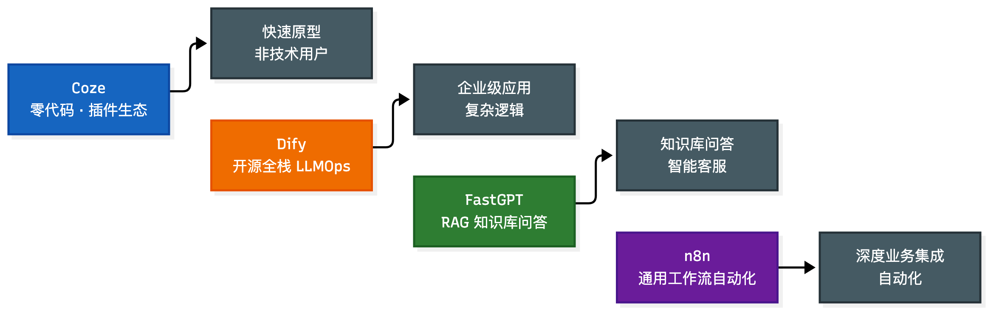

### 1.2 Coze：零代码与插件生态

Coze（扣子）由字节跳动推出，主打零代码/低代码的智能体构建体验，是目前市面上应用最广泛的智能体平台。

它的可视化界面非常友好，像搭乐高一样通过拖拽插件、配置知识库、设定工作流来创建智能体。创建入口分两大类：智能体（单智能体自主规划模式、单智能体对话流模式、多智能体模式）和应用（桌面/网页端、小程序、H5 界面）。资源库是开发的核心武器库，存放工作流、对话流、插件、知识库、卡片、提示词库、数据库等所有开发要素；空间配置统一管理发布渠道和模型。整体可以概括成一套「游戏装备」：工作流是关卡路线图，插件是角色技能卡，知识库是游戏百科全书，数据库是云存档，效果评测是闯关评分系统。

生态是 Coze 最大的护城河。内置插件库极其丰富，开发完成的智能体可以一键发布到抖音、飞书、微信公众号、豆包等主流平台，还在不断接入新的手机厂商和硬件厂商；企业用户也能通过 API 把智能体能力集成进现有业务系统。

优势与局限：

- 优势：插件生态系统强大，接入外部服务和数据源几乎零成本；可视化编排门槛低，不写代码就能搭复杂工作流；提示词支持细粒度控制，且有提示词管理和模板；多平台部署便捷，一次搭建多端分发。
- 局限：不支持 MCP 协议，工具扩展被锁死在平台内置插件库里，是它最被诟病的短板；部分插件配置复杂度高，需要 API Key 和一定的 JS/Python 基础；无法导出标准 JSON 编排文件（付费版导出的 zip 也只能在扣子内部互导），平台锁定明显。

适用人群：AI 应用入门用户、产品经理、运营人员，以及希望快速把创意变成可交互产品的个人创作者。

### 1.3 Dify：开源全栈 LLMOps

Dify 是一个开源的 LLM 应用开发平台，融合了后端即服务（BaaS）和 LLMOps 理念，为从原型设计到生产部署提供全流程支持。

架构上采用分层模块化设计：数据层、开发层、编排层、基础层各层解耦，便于扩展。模型高度中立，GPT、DeepSeek、Llama 等数百种开源或商业模型统一接口接入，任何兼容 OpenAI API 的模型都能用。部署灵活：官方提供 Docker Compose 一键本地部署（数据留在自有环境），也可以直接用官方 SaaS 云服务。

Marketplace 插件生态是它的核心壁垒：插件分模型、工具、智能体策略、扩展、捆绑包五类，数量已超过 8000 个。平台还为插件开发者提供远程调试，可连接 SaaS 服务的同时把插件操作转发到本地环境测试。插件生态的丰富程度直接决定了智能体能力上限——模型谁都能接，提示词可以复制，但工具插件的有无直接决定能不能做出意想不到的功能。

优势与局限：

- 优势：全栈式开发体验，RAG 管道、AI 工作流、模型管理一站式；在低代码便利性和专业开发灵活性之间平衡得好；企业级安全与合规（AES-256 加密、RBAC 权限、审计日志）；工具集成能力覆盖 9000+ 工具和 API；开源社区活跃。
- 局限：对完全无技术背景的用户仍有学习曲线；高并发场景有性能瓶颈（核心服务端由 Python 实现）；多模态支持不足，以文本处理为主；企业版定价偏高；API 格式不兼容 OpenAI，可能限制与部分第三方系统集成。

适用人群：有一定技术背景的开发者、需要构建可扩展企业级 AI 应用的团队。

### 1.4 FastGPT：RAG 知识库问答

FastGPT 是一个开源的、基于 LLM 的知识库问答平台与 Agent 构建工具，定位「企业级 AI 生产力引擎」。与 Coze 的零代码体验和 Dify 的全栈能力不同，它把知识库问答当第一等公民，围绕「数据导入 → 智能分块 → 向量检索 → 对话生成」这条完整 RAG 链路做了深度优化。

知识库能力是它最核心的竞争力。支持 Word、Markdown、PDF 等多种格式导入，文件处理提供两种模式（分块存储、问答对提取），分块条件可精细配置（如原文超过 1000 字符触发分块），并支持多种索引增强：标题加入索引、自动生成补充索引、图片自动索引——最后这个对教材、研报这类图文混排文档尤其关键，让模型回答时能理解并引用视觉信息。分块结果透明可查，每个分块的文本预览和元数据（文件大小、原文长度、处理模式、索引状态）都能直接看，调试知识库非常方便。

工具集成上，FastGPT 原生支持 MCP 协议，可以在「我的工具」里统一管理各类 MCP 服务，无缝对接魔搭社区、阿里云百炼等生态的 MCP 市场，工具扩展不再受限于平台内置插件库。工作流编排用可视化的 Flow 模块，意图识别、问卷收集、报告生成这类多分支逻辑拖拽就能构建。

优势与局限：

- 优势：对 RAG 全流程的精细化控制和透明化调试，私有知识库问答开箱即用；原生 MCP 支持；模型中立（OpenAI、Claude、通义千问、DeepSeek 等自由切换）；可视化工作流降低非开发者上手门槛。
- 局限：模板和预置工具生态相对薄弱（MCP 一定程度上补了短板，但配置 MCP 服务对非技术用户仍有门槛）；免费版额度紧张（100 积分、30 QPM、600 条索引，难以支撑稍具规模的团队）；社区活跃度和文档完善度与 Dify、n8n 还有差距。

适用人群：基于私有知识库搭建智能客服、企业内部知识助手、文档问答机器人的开发者和中小企业团队，以及对 RAG 技术感兴趣但想降低实现门槛的技术爱好者。

### 1.5 n8n：通用工作流自动化

n8n 的核心身份是一个开源的通用工作流自动化平台，不是纯粹的 LLM 应用构建工具。理解这一点是掌握 n8n 的关键：用它构建智能应用时，设计的是一个更大的自动化流程，大语言模型只是流程中的一个（或多个）强大的「处理节点」。

两个最基本的概念：

- 节点（Node）：工作流中执行具体操作的最小单元，像有特定功能的积木块。n8n 提供数百种预置节点，覆盖发邮件、读写数据库、调 API、处理文件等常见操作，每个节点都有输入输出和图形化配置界面。节点分两类：触发节点（Trigger Node）是工作流的起点，负责启动流程（收到一封 Gmail 邮件、每小时定时、接收到 Webhook 请求），一个工作流有且仅有一个；常规节点（Regular Node）负责处理具体数据和逻辑。
- 工作流（Workflow）：多个节点连接成的自动化流程图，定义数据从触发节点开始如何在节点间传递、处理，最终完成任务的完整路径。数据以结构化 JSON 在节点间传递，每个环节的输入输出都可精确控制。

AI 能力的整合靠 AI Agent 节点：它把 Chat Model（LLM 思考核心）、Memory（会话记忆）、Tools（搜索、知识库、API 等工具）整合进一个统一节点，Agent 能自主理解意图、在多个工具间决策——传统自动化是线性流程，AI Agent 节点让流程具备了「思考」的能力：

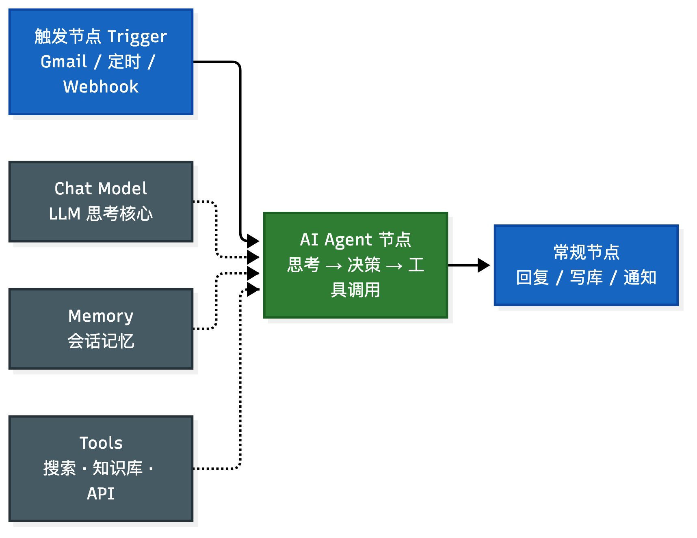

n8n 真正的威力在「连接」：把原本孤立的 CRM、社交媒体、数据库和大语言模型串成端到端的自动化业务流程，实现过去要复杂编码才能完成的事。

优势与局限：

- 优势：开发效率高，复杂逻辑抽象成直观的可视化工作流，数据流全链路在画布上一目了然；功能强大且高度集成，数百种预置节点连接常见服务，AI Agent 节点把模型、记忆、工具管理整合在一起，Code 节点保证了自定义能力的上限；支持私有化部署，是相对简单就能部署完整版的私有化 Agent 方案，敏感数据不出自有环境，对数据安全和合规至关重要。
- 局限：工作流复杂后调试与错误处理繁琐，数据格式出错要逐节点检查输入输出，不如代码断点直接；内置存储（Simple Memory、Simple Vector Store）基于内存不持久，服务重启数据全丢，生产环境必须换 Redis、Pinecone 等外部持久化方案，增加配置维护成本；版本控制和多人协作不如传统代码成熟，工作流 JSON 的变更远不如 git diff 清晰，多人同时编辑易冲突；超高并发场景下节点调度有性能开销，不如纯代码服务。

适用人群：需要把 AI 能力深度整合进现有业务流程、实现高度定制化自动化的开发者和企业。

### 1.6 平台选型建议

四个平台的选型按场景对号入座：

| 场景 | 推荐平台 | 理由 |
| --- | --- | --- |
| 快速原型验证、非技术用户 | Coze | 零代码 + 丰富插件 + 多平台一键发布 |
| 企业级应用、复杂业务逻辑、多模态生成 | Dify | 全栈式编排 + 插件市场 + 企业级安全 |
| 私有知识库问答、智能客服 | FastGPT | RAG 全链路精细控制 + 原生 MCP |
| 深度业务集成、通用自动化流程 | n8n | 数百节点连接一切 + 私有化部署 |

值得强调的是，低代码平台并非取代代码开发，而是互补的选择。实际项目中可以按阶段灵活切换：用平台快速验证想法、用代码实现精细化控制；用平台处理标准化流程、用代码处理特殊逻辑。这种「混合开发」的思维，才是智能体工程化的最佳实践。而当平台的表达力不够、需要真正的多智能体协作和复杂状态管理时，就该往下看代码框架了。

## 二、为什么需要 Agent 框架

### 2.1 从手动实现到框架

手写智能体（第 04 篇），本质就是自己搭一个循环：把用户输入塞进 prompt、调 LLM、解析出要执行的 Action、调工具、把 Observation 拼回上下文、再进下一轮。这套「感知-思考-行动-观察」的骨架，每个项目都要重写一遍，而且越写越复杂——多轮对话的历史怎么存？上下文超窗口了怎么截断？工具越来越多怎么统一注册？多个智能体互相喊话怎么协调？

框架做的事，就是把这套反复出现的骨架和周边问题，一次性抽象成可复用的基础设施。你不再从零写循环，而是去定义「有哪些角色、每个角色什么分工、它们怎么协作」，剩下的交给框架跑。

### 2.2 框架的四个核心价值

框架带来的收益，可以归纳成四件事：

第一，代码复用与效率。框架内置了 Agent 基类和执行器，封装好核心循环，你不再重复造轮子。写一个带工具的智能体，从几百行降到几十行。

第二，组件解耦与可扩展。框架强制把关注点分开：模型层（Model Layer）负责接不同的大模型，OpenAI、Anthropic、本地模型都能换；工具层（Tool Layer）统一工具的定义、注册和执行接口；记忆层（Memory Layer）可以切换滑动窗口、摘要记忆等不同策略。换模型不改业务代码，换记忆策略不动工具。

第三，状态管理标准化。多轮对话的上下文窗口限制、历史持久化、多智能体之间的状态跟踪，这些最容易出 bug 的地方，框架给了统一的处理方式。

第四，可观测与可调试。框架通过事件回调（Callback）在关键节点（模型调用开始、工具执行结束、智能体完成等）埋点，自动触发日志和上报。出问题时能看清楚智能体每一步做了什么、为什么这么走，而不是对着一个黑盒抓瞎。

## 三、主流框架总览

### 3.1 四个代表性框架对比

四个有代表性的框架，设计哲学各不相同，几乎代表了智能体框架的几种主流思路：

| 框架 | 核心思想 | 关键特点 |
| --- | --- | --- |
| AutoGen | 通过对话实现协作 | 把多智能体抽象成「可对话」智能体的群聊，定义角色和交互规则 |
| AgentScope | 工程化优先 | 易用性 + 工程化，内置消息传递机制和分布式部署支持 |
| CAMEL | 角色扮演（Role-Playing） | 双智能体在「引导性提示」下自主协作 |
| LangGraph | 图（Graph）建模 | 把执行流程建模为节点 + 边的有向图，天然支持循环 |

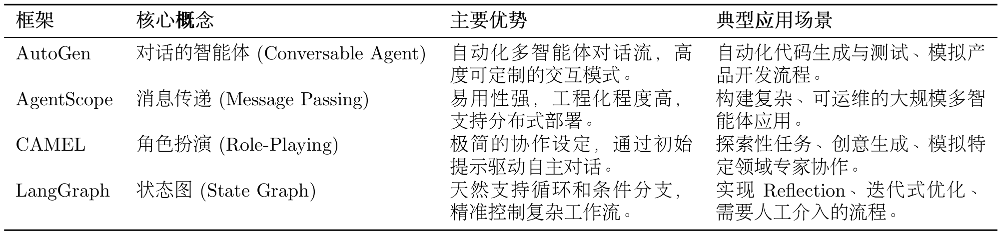

这四个框架两两一组能看出分野：AutoGen 和 CAMEL 走「涌现式」路线，靠对话和角色自然协作；LangGraph 走「显式控制」路线，靠图结构精确编排；AgentScope 则站在工程化角度，关心的是怎么把实验原型推上生产。这个分野后面会反复出现。

### 3.2 框架演进与 2026 最新格局

这四个框架成文于 2024 年前后，两年过去格局已经变了。最明显的一点：AutoGen 已进入维护模式，微软重心转向了它的继任者 MAF（Microsoft Agent Framework），社区则分叉出了 AG2；OpenAI 把实验性的 Swarm 升级成了正式的 Agents SDK；主打「角色化 crew」的 CrewAI 在快速原型领域跑到了最前面；LangGraph 则坐稳了企业生产的位子。此外，MCP 和 A2A 两个协议在 2026 年成为框架之上的新标准。这些变化放到第八章专门展开。

## 四、AutoGen：对话驱动的协作

### 4.1 核心机制

AutoGen 是微软出品，核心理念是把「多智能体协作」抽象成一场「群聊」：每个智能体是一个能对话的角色，协作就是它们之间的消息往来。

框架结构在 0.7.x 版本做过一次重要演进，拆成了两个核心模块：autogen-core 放底层基础，autogen-agentchat 放高级接口。同时全面转向异步编程（async/await），用并发撑起多智能体同时工作。

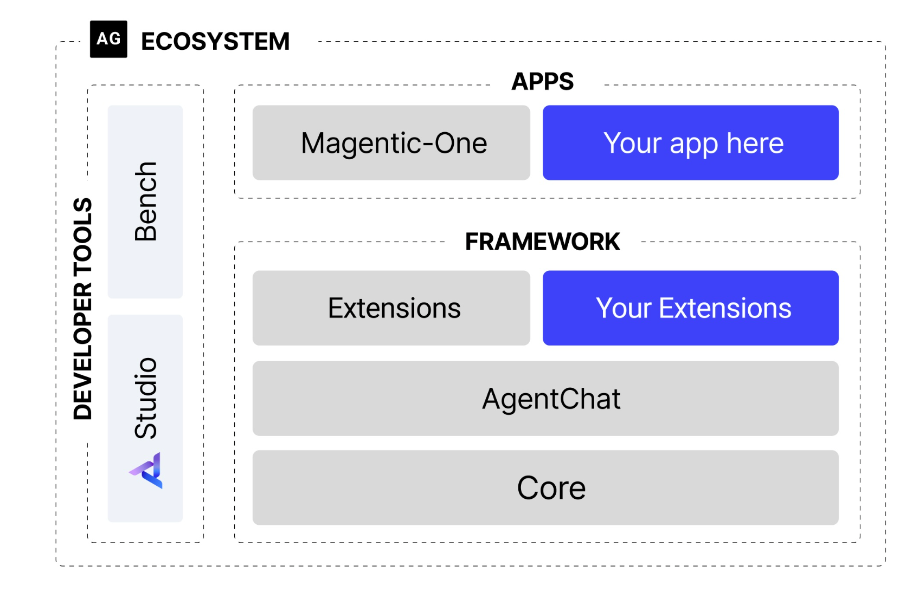

它有两个基础角色：

- AssistantAgent（助理智能体）：任务的主要解决者，封装了 LLM，通过系统消息赋予不同的「专家」身份。
- UserProxyAgent（用户代理智能体）：一身兼两职，既是人类用户的「代言人」，又是可靠的「执行器」，负责执行代码、调用工具。

团队协调上，早期的 GroupChatManager 在 0.4 之后演化为 Team 概念，其中 RoundRobinGroupChat（轮询群聊）最常用：智能体按预定义顺序依次发言，前一个发言写进对话历史，后一个基于历史接续，直到触发终止条件。

### 4.2 优势与局限

优势在于对话驱动贴近人类协作模式，把复杂任务建模成「一群专家开会」，门槛低；通过系统消息赋予高度专业化角色，易于复用和扩展；RoundRobinGroupChat 提供清晰可预测的流程，UserProxyAgent 天然支持「人类在环」。

局限在于，基于 LLM 的对话本质上有不确定性，可能偏离预期甚至陷入循环；调试时你拿到的是对话历史而非清晰的错误堆栈，「对话式调试」比普通调试费劲得多。

## 五、AgentScope：工程化优先

### 5.1 核心机制

AgentScope 是阿里达摩院出的多智能体平台，定位就是工程化优先，内置分布式部署、容错恢复、可观测性这些企业级特性。

它采用四层架构：

- 基础组件层：Message（统一消息格式）、Memory（记忆管理）、Model API（模型调用抽象）、Tool（外部交互）。
- 智能体基础设施层：预构建智能体、ReAct 范式、智能体钩子、并行工具调用、状态管理，原生支持异步执行与实时控制。
- 多智能体协作层：MsgHub（消息中心）+ Pipeline（工作流编排）。
- 开发与部署层：AgentScope Runtime（生产级运行时）+ AgentScope Studio（可视化开发工具链）。

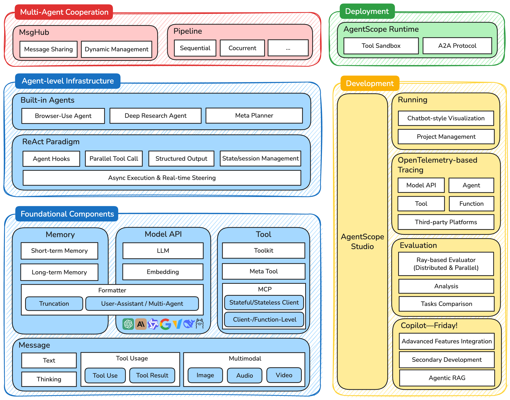

它最鲜明的设计是消息驱动：所有智能体交互都抽象成消息的收发，Msg 对象包含 name、content、role、metadata 字段。这样做带来四个好处——异步解耦（收发双方时间上解耦）、位置透明（不用关心对方在本地还是远程）、可观测（每条消息可记录追踪）、可靠（消息可持久化和重试）。开发者只需继承统一的 AgentBase 基类，实现核心的 reply 方法即可。MsgHub 则负责消息路由（点对点、广播、组播）、持久化（SQLite、MongoDB）和跨节点通信（RPC）。

### 5.2 优势与局限

优势是消息驱动把复杂流程优雅映射成并发异步的消息事件，结构化输出把规则变成代码级约束，原生并发加容错保证稳健运行。

局限是技术要求高，要懂异步编程和分布式通信；对简单场景可能「过度工程化」；生态和社区资源还在完善中。适用场景很明确：大规模、高可靠性的生产级多智能体系统；快速原型或简单应用还是选更轻的框架。

## 六、CAMEL：角色扮演与引导性提示

### 6.1 核心机制

CAMEL 来自「Communicative Agents for Mind Exploration」，走的是「轻架构、重提示」的路子。它有两个核心概念：

角色扮演（Role-Playing）：任务由两个互补角色的智能体协作完成——AI 用户（AI User）提出需求、下达指令、构思任务步骤；AI 助理（AI Assistant）执行操作、给出方案。一个负责「想干什么」，一个负责「怎么干」。

引导性提示（Inception Prompting）：在对话开始前注入精心设计的结构化初始指令，包含四件事——明确自身角色、告知协作者角色、定义共同目标、设定行为约束和沟通协议（比如「一次只提一个清晰步骤」、用特定标志标识任务完成）。这个初始提示的写得好不好，直接决定协作质量。

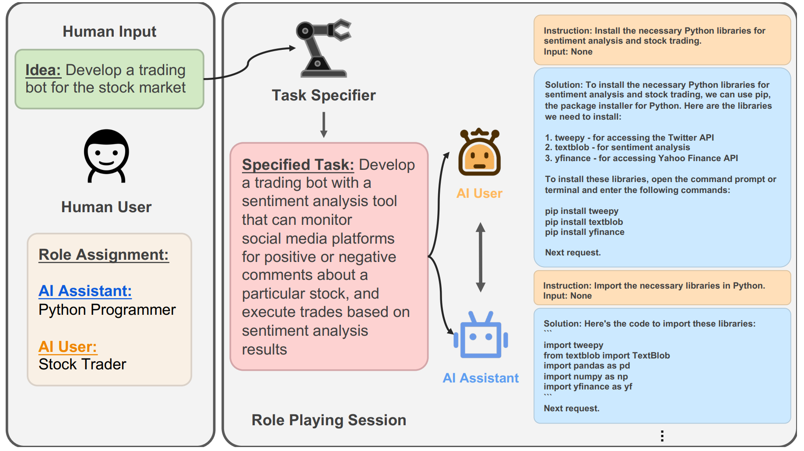

### 6.2 优势与局限

优势是「轻架构、重提示」，通过精心设计的初始提示实现高质量协作，代码量最少；自然涌现的协作行为比硬编码工作流更灵活；框架发展很快，已具备多模态、工具集成、多模型适配，还能和 LangChain、CrewAI、AutoGen 互操作。

局限是高度依赖提示工程，提示设计门槛高、调试复杂、不同 LLM 理解有差异；协作规模受限，缺复杂对话路由、分布式状态管理和冲突仲裁；任务有边界——严格流程控制该用 LangGraph，大规模并发该用 AgentScope，复杂决策树该用 AutoGen。

## 七、LangGraph：图建模与状态机

### 7.1 核心机制

LangGraph 是 LangChain 团队出的，核心理念是把智能体执行流程建模成状态机（State Machine）和有向图（Directed Graph），用节点和边显式控制每一步，天然支持循环。

三个基本要素：

- 全局状态（State）：共享的状态对象，通常定义成 Python 的 TypedDict，装着对话历史、中间结果、迭代次数等。
- 节点（Nodes）：每个节点是接收当前状态、返回更新后状态的 Python 函数，做具体的工作。
- 边（Edges）：常规边指定固定跳转；条件边（Conditional Edges）通过函数判断当前状态，动态决定下一步跳转——这是实现循环和分支的关键。

组装流程是一条固定的链：StateGraph 建图 → add_node 加节点 → set_entry_point 设入口 → add_edge / add_conditional_edges 连边 → compile 编译 → stream 运行。

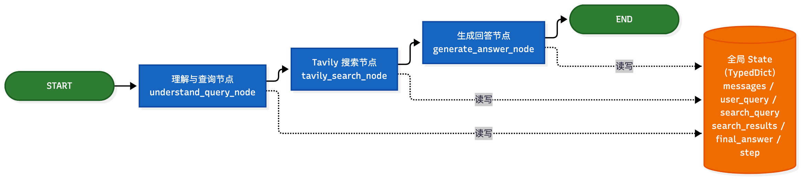

### 7.2 优势与局限

优势是高度可控与可预测，显式流程图精确规划每一步；原生支持循环，通过条件边轻松构建「反思-修正」循环，实现自我优化和容错；模块化强，每个节点是独立函数；人机协作支持直接，插一个「等待人工审核」的节点就行。

局限是需要写更多前期样板代码，简单任务开发繁琐；缺少对话式智能体那种「涌现」式交互，不适合模拟开放式社会协作；调试有挑战，问题可能出在节点逻辑、状态传递或条件判断等多个环节。

## 八、2026 最新框架格局

这些框架成文于 2024 年，两年间格局变化不小。先用一张图看清从经典四框架到 2026 最新格局的演进关系：

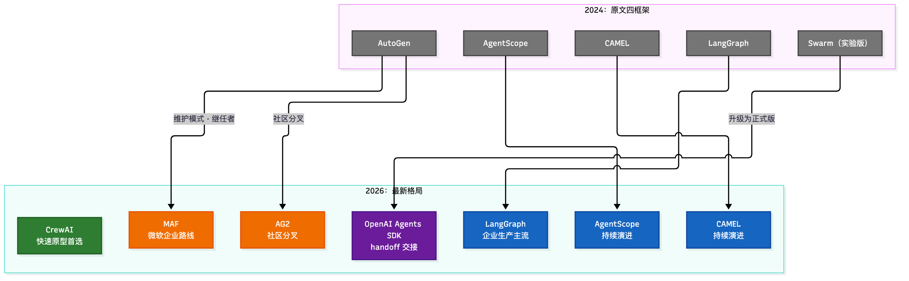

### 8.1 CrewAI：角色化快速原型

CrewAI 用「crew」这个隐喻组织多智能体：你给每个智能体定义角色（role）、目标（goal）、背景（backstory），把任务（Task）派给它们，让它们协作产出。代码可读性极高，几行就能定义一个团队：

```python
from crewai import Agent, Task, Crew

researcher = Agent(role="Research Analyst", goal="Find comprehensive information",
                   backstory="Expert at synthesizing data", tools=[search_tool])
writer = Agent(role="Content Writer", goal="Write engaging summaries",
               backstory="Skilled communicator")

crew = Crew(agents=[researcher, writer],
            tasks=[Task(description="Research AI agents 2026", agent=researcher),
                   Task(description="Write 500-word summary", agent=writer)])
result = crew.kickoff()
```

它在 2026 年的位置是「快速原型首选」：52K stars，20 行代码就能跑通一个 demo，上手门槛最低，社区活跃。短板是复杂条件逻辑不如 LangGraph 灵活，重依赖框架内置能力。它还是最早原生支持 A2A 协议的框架。

### 8.2 OpenAI Agents SDK：handoff 交接

OpenAI 把实验性的 Swarm 升级成了正式的 Agents SDK，是几个主流框架里最「轻」的一个：不搞复杂的图结构，也不搞多角色群聊，核心就两样东西——Agent 和 handoff。

它有四个核心抽象：

- Agent：封装了指令（instructions）、模型和工具的智能体单元。
- Handoff：智能体之间的控制权交接。
- Session：会话状态管理，负责多轮对话历史的维护。
- Guardrail：护栏，与主任务并行运行的安全校验，可以在输入侧拦截越狱、在输出侧拦截违规内容，不占用主循环。

handoff 的典型用法是「分诊」（triage）：入口 Agent 接到用户请求后，判断该由谁处理，通过 handoff 把控制权连同对话上下文整体移交给对应的专家 Agent，后续轮次由专家接管。交接是明确、可枚举的——谁能把活儿交给谁，在代码里写得清清楚楚，这和 AutoGen 群聊那种「大家商量着来」是完全不同的协作哲学。

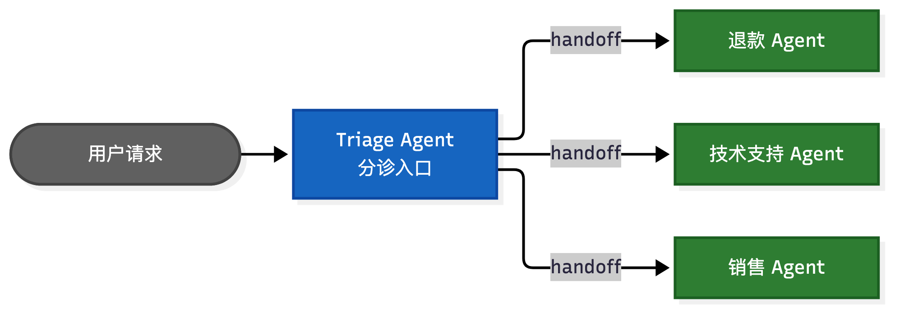

工具方面，OpenAI 服务端内置了一批 hosted tools：网页搜索（WebSearchTool）、文件检索（FileSearchTool）、代码解释器（Code Interpreter）、Computer Use（操作电脑），这些跑在 OpenAI 侧，不用自己部署；自定义工具用 function tool 声明即可。观测也是开箱即用——内置免费的 tracing，每一次 LLM 调用、工具执行、handoff 链路都有完整的可视化 trace。

定位是「OpenAI 生态里的生产级轻量多智能体」：97% 可靠性，四智能体流水线延迟 34 秒，是几个框架里最短的；MCP 支持是 first-class，四个框架里最强。代价是供应商锁定最重——内置工具、tracing 深度集成这些最好用的能力都绑 OpenAI 模型，换供应商会损失核心体验。

### 8.3 AutoGen 的现状：维护模式与 MAF/AG2

AutoGen 到 2026 年已经进入维护模式，不再作为主推方向。但它没有消失，而是分成两条线被继承下来：

AG2（社区线）：社区从 AutoGen 分叉出来的项目，延续对话式 GroupChat 路线，保持 API 兼容。适合做智能体行为研究、想继续用群聊模式的团队。

MAF（微软线）：Microsoft Agent Framework，2026 年 2 月正式发布，定位是 AutoGen 和 Semantic Kernel 的下一代——由同一批工程团队打造，把 AutoGen 直观的多智能体抽象，和 Semantic Kernel 的企业级能力（会话状态管理、类型安全、Middleware、遥测）合并到一起，再配上一套基于图的工作流引擎。

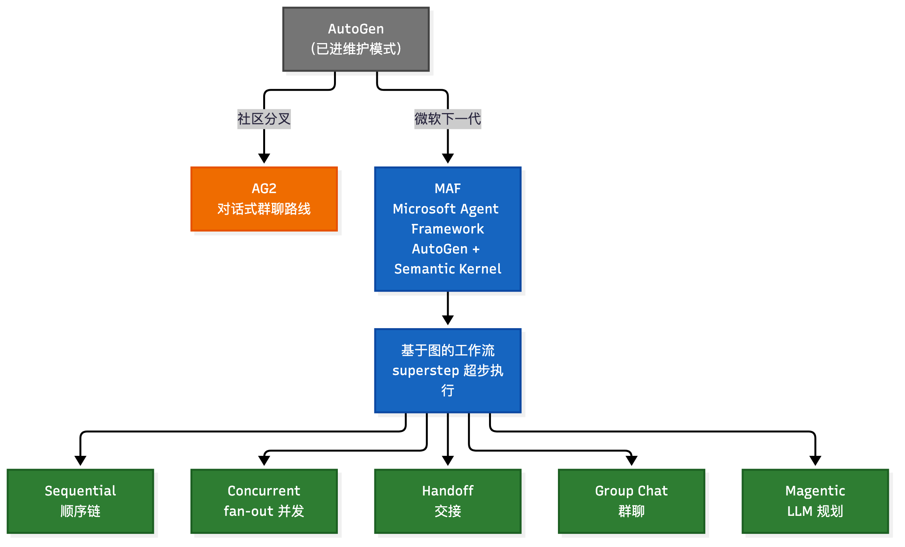

MAF 工作流引擎的执行模型叫 superstep（超步），源自 Pregel 的 BSP（批量同步并行）模型：每个超步先收集上一轮的全部消息，按边路由给目标执行器，然后并发执行所有目标，最后在同步屏障处等全部完成，才进入下一个超步。这个模型换来三个硬保障——确定性执行（同样输入必得同样执行顺序）、可靠检查点（每个超步边界都能存状态，故障后恢复，甚至能从任意历史检查点重放）、没有超步之间的竞态。

引擎之上内置了五种编排模式：Sequential（顺序链）、Concurrent（fan-out 并发 + 屏障汇聚）、Handoff（交接）、Group Chat（群聊）、Magentic（LLM 动态规划）。这些模式不是五套独立代码，而是同一套图原语的不同预置拓扑。

组件层面，MAF 提供统一的 Agent 基类、模型客户端（Foundry、Anthropic、Azure OpenAI、OpenAI、Ollama 等一个接口切换）、Agent Session（持久化对话上下文）、Context Provider（即插即用记忆）、函数工具、内置 MCP 客户端，以及三层 Middleware（agent / function / chat 三个粒度的执行钩子），生产关切（日志、鉴权、重试）都挂在 Middleware 上而不是散在业务逻辑里。

所以现在看到「AutoGen」要分清指哪个——原版已趋于停滞，AG2 是社区延续，MAF 是微软的企业路线，也是官方推荐的迁移方向。

### 8.4 MCP 与 A2A：框架之上的新协议

2026 年框架选型绕不开两个协议，它们比单个框架更「底层」，是架构层面的长期承诺。

MCP（Model Context Protocol，模型上下文协议）由 Anthropic 在 2024 年 11 月发布，2025 年 12 月捐赠给 Linux Foundation 旗下的 Agentic AI Foundation（Anthropic、Block、OpenAI 联合创办），从此成为中立开放标准。它要解决的是 N×M 集成困境：每个 AI 应用都要为每个数据源、每个工具写一遍定制对接，接了一个新系统就要重新适配一轮。

协议里有三个角色：

- Host：用户面对的 LLM 应用，比如 Claude、Cursor、自研智能体。
- Client：Host 内部的协议连接器，与每个 Server 保持一条连接。
- Server：能力提供方，把文件系统、数据库、企业 API 包装成标准能力。

Server 暴露三类能力：Tools（模型可执行的函数，如 create_ticket）、Resources（可读的上下文和数据，如文件、数据库记录）、Prompts（可复用的提示模板）。通信基于 JSON-RPC 2.0，本地走 stdio、远程走 HTTP+SSE。2026 年 7 月的规范更新把协议改成了无状态：去掉 session 握手和 session ID，每个请求自带全部上下文，负载均衡后面任何 server 实例都能处理任何请求，水平扩展从此不用考虑会话粘性。生态已经爆发：2026 年 3 月索引到的 MCP server 仓库超过 2.5 万个，Redis、MongoDB、AWS、Azure、GCP 都有官方实现，Claude Code、Cursor、Copilot、VS Code 全部原生支持。

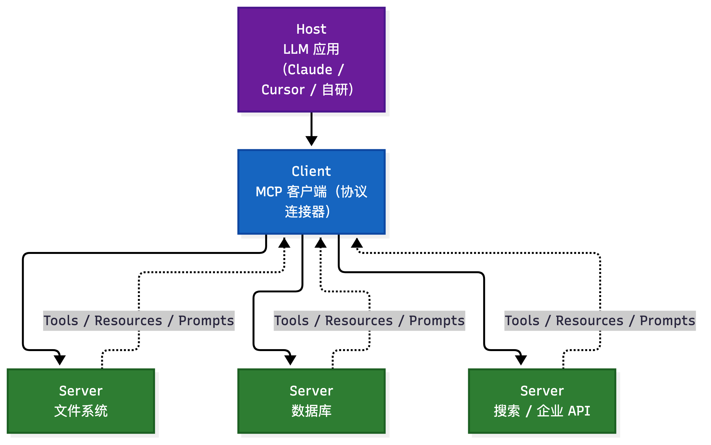

A2A（Agent2Agent Protocol，智能体对智能体协议）由 Google 在 2025 年 4 月发布，同年 6 月捐赠 Linux Foundation，2026 年 3 月发布 v1.0。它解决的是另一个问题——Agent 孤岛：财务、法务、客服这些专业智能体由不同团队、不同框架、不同厂商实现，彼此之间怎么发现、怎么协作。

四个核心抽象：

- Agent Card：智能体的「能力名片」，一个 JSON 清单放在 /.well-known/agent-card.json，声明身份、技能、认证要求——发现机制就这一步。
- Message：通信轮次。
- Task：工作单元，有完整生命周期（SUBMITTED → WORKING → COMPLETED / FAILED 等）。
- Artifact：最终产物。

最关键的状态是 INPUT_REQUIRED：远程智能体可以反过来向调用方要信息、要澄清。这是纯工具协议给不了的——工具只会被调用然后返回，不会中途「反问」，而智能体会。这也是 A2A 独立于 MCP 存在的最大理由。设计上，远程智能体的内部逻辑是私有的，只对外暴露能力。

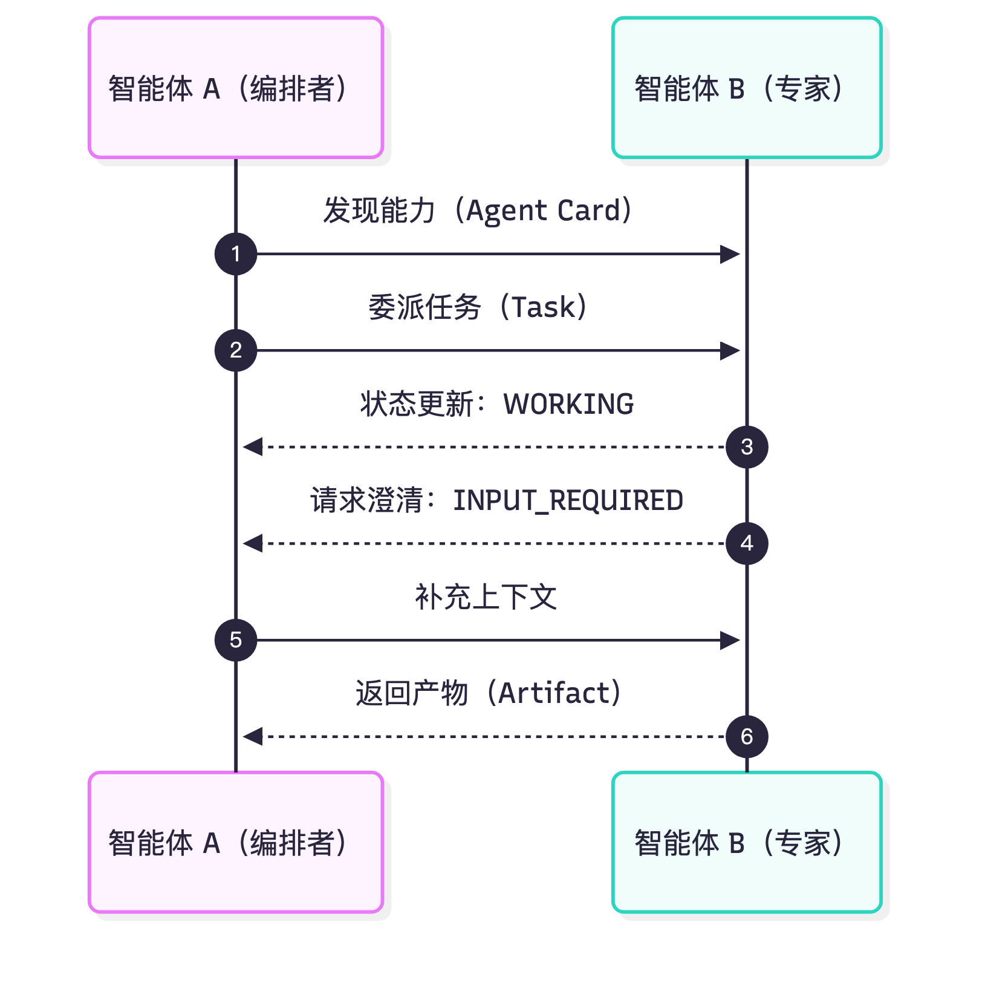

两者不是竞争关系，而是同一套栈里的互补层：

| 维度 | MCP | A2A |
| --- | --- | --- |
| 连接对象 | 智能体 ↔ 工具、数据源 | 智能体 ↔ 智能体 |
| 核心抽象 | Tools / Resources / Prompts | Agent Card / Task / Artifact |
| 提出方 | Anthropic（2024.11） | Google（2025.04） |
| 治理 | Agentic AI Foundation（Linux Foundation） | Linux Foundation |
| 典型场景 | 查数据库、读文件、调 API | 跨厂商智能体委派与协作 |

一句话：框架可能会换，但 MCP 管「连工具」、A2A 管「连智能体」这两条协议线，会长期存在。选型时不看这两个，等于建数据库不考虑接口契约。

## 九、选型与总结

### 9.1 两大设计权衡

把这些框架摆在一起，本质是两条权衡线：

第一条，「涌现式协作」对「显式控制」。AutoGen、CAMEL 走涌现式：定义角色和目标，让协作行为从对话规则里自然长出来，更贴近人类交互，但难预测、难调试。LangGraph 走显式控制：明确定义每一步和跳转条件，牺牲「涌现」的惊喜，换来可靠性、可控性和可观测性。

第二条，「快速原型」对「生产工程」。CrewAI、OpenAI Agents SDK 上手快、跑通快，适合验证想法；AgentScope、LangGraph、MAF 面向生产，扛并发、容错、审计、可观测这些硬指标。

### 9.2 选型决策表

落到具体场景，可以这样对号入座：

| 场景 | 推荐框架 | 理由 |
| --- | --- | --- |
| 快速验证多智能体想法，可接受后续迁移 | CrewAI | 门槛最低，20 行跑通 |
| 复杂工作流、长程任务、需要精确控制和审计 | LangGraph | 图结构可表达一切，生产成熟度最高 |
| 代码生成、多智能体对话、研究探索 | AutoGen / AG2 | 对话式协作、代码迭代能力强 |
| 全押 OpenAI 生态，要内置搜索/代码执行/观测 | OpenAI Agents SDK | 零配置起步，MCP 原生支持 |
| 大规模、高可靠性生产系统，分布式并发 | AgentScope | 消息驱动 + 分布式 + 容错 |
| 双智能体深度协作（科研、创作） | CAMEL | 角色扮演 + 引导性提示，轻架构 |
| 微软技术栈、.NET、Azure | MAF | AutoGen 企业级继任者 |

没有银弹。如果只能记一条：要最大控制力选 LangGraph，要最快跑通选 CrewAI，专注代码任务选 AutoGen/AG2，追求生产稳定且押 OpenAI 选 Agents SDK。

## 附：高频速记

- 低代码平台四价值：降门槛、提效率、可视化可观测、标准化沉淀；定位是更高层次抽象，不取代代码，「混合开发」是最佳实践。
- 四平台速记：Coze 零代码插件生态多端发布（不支持 MCP 是硬伤）；Dify 开源全栈 LLMOps + 8000 插件市场（企业级，学习曲线陡）；FastGPT RAG 知识库第一等公民 + 原生 MCP（模板生态弱）；n8n 通用自动化 + AI Agent 节点（内置存储不持久）。
- 平台选型：快速原型/非技术用户 Coze，企业级复杂逻辑 Dify，私有知识库问答 FastGPT，深度业务集成 n8n。
- 框架四价值：复用效率、组件解耦（模型/工具/记忆三层）、状态管理、可观测调试。
- AutoGen：对话驱动的群聊协作，AssistantAgent + UserProxyAgent，RoundRobinGroupChat 轮询发言，涌现式。
- AgentScope：阿里出品，四层架构，消息驱动（MsgHub），工程化/分布式/容错，适合大规模生产。
- CAMEL：角色扮演（AI User + AI Assistant）+ Inception Prompting，轻架构重提示，双智能体深度协作。
- LangGraph：状态机 + 有向图，State（TypedDict）+ Node + Edge（条件边做循环），显式控制，生产成熟度最高。
- 2026 新格局：AutoGen 进维护模式，微软转 MAF、社区分叉 AG2；CrewAI 是快速原型首选；OpenAI Agents SDK 取代 Swarm（handoff + 内置 tracing）；LangGraph 坐稳企业生产。
- 两大协议：MCP 管「连工具」（2026 转 Linux Foundation），A2A 管「连智能体」（CrewAI 原生支持）。
- 两条权衡线：涌现式协作 vs 显式控制；快速原型 vs 生产工程。
- 选型口诀：最大控制 LangGraph，最快跑通 CrewAI，代码任务 AutoGen/AG2，押 OpenAI 选 Agents SDK。
