# 01. 移动端跨平台技术方案详解

> 写一套代码，跑在 iOS、Android、甚至小程序和 Web 上，这是移动端开发者做了十几年的梦。从最早的 WebView 套壳，到 JSBridge 桥接，到 React Native 的原生渲染桥，再到 Flutter 的自绘引擎、Kotlin Multiplatform 的原生共享，路线换了一茬又一茬，但内核始终是两个问题在较劲：**渲染由谁来做**，**逻辑和平台之间怎么通信**。这篇文章不追求「哪个方案最牛」，而是把 Web 容器/Hybrid、JSBridge、React Native、Flutter、Kotlin Multiplatform 这些主流路线一个个拆开，讲清楚它们各自的渲染机制、通信机制、性能边界、生态现状，最后做一张能落地的选型对比表。读完你会有一个判断框架：面对一个新项目，知道该从「渲染方式、通信成本、团队技术栈、动态化需求」这几个维度去选跨平台方案，而不是人云亦云。

## 目录

- [一、跨平台方案全景与演进](#一跨平台方案全景与演进)
- [二、Web 容器与 Hybrid：WebView 套壳的起点](#二web-容器与-hybridwebview-套壳的起点)
- [三、JSBridge：跨语言通信的桥梁](#三jsbridge跨语言通信的桥梁)
- [四、React Native：原生渲染桥](#四react-native原生渲染桥)
- [五、Flutter：自绘引擎的极限性能](#五flutter自绘引擎的极限性能)
- [六、Kotlin Multiplatform：原生共享逻辑](#六kotlin-multiplatform原生共享逻辑)
- [七、深度横向对比](#七深度横向对比)
- [八、选型决策与未来趋势](#八选型决策与未来趋势)
- [附：高频速记](#附高频速记)

## 一、跨平台方案全景与演进

先把全景图摊开。这么多跨平台方案不是散落一地的名字，而是一条主线加一条支线。主线是「渲染权」的争夺——从浏览器内核渲染（WebView），到原生控件渲染（React Native），到完全自己画（Flutter）；支线是「逻辑共享」的 KMP 路线——它不争渲染权，而是把「逻辑」跨平台共享。

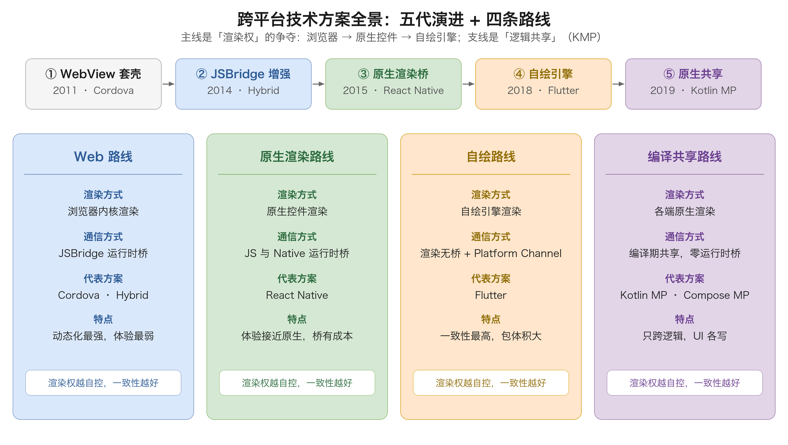

理解跨平台，先理解一个最根本的矛盾：**UI 的渲染方式决定了方案的性能天花板，而逻辑与平台的通信方式决定了方案的开发成本**。所有方案本质上都是在「渲染」和「通信」这两个维度上做不同的取舍。

先给跨平台下个准确定义：跨平台（Cross-Platform）指的是**一套代码，多端运行**。但「多端」的范围、「一套代码」的纯度、「运行」的质量，不同方案差别极大。有的方案逻辑和 UI 全跨（Flutter），有的方案只跨逻辑不跨 UI（Kotlin Multiplatform），有的方案跨的是「开发语言」而不是「运行时」（React Native 用 JS 写但跑原生控件）。

### 1.1 演进脉络

跨平台方案的发展可以大致分成五代，每一代都在试图解决上一代的某个致命短板：

1. **第一代 · WebView 套壳（2011 年前后）**：PhoneGap/Cordova、早期 Hybrid。用 WebView 渲染 HTML/CSS/JS 页面，套一个原生壳。优点是上手快、可热更新、Web 人才多；缺点是性能差、体验「不像原生」、能力受限（早期拿不到相机、定位等硬件能力）。
2. **第二代 · JSBridge 增强 Hybrid（2014 年前后）**：在 WebView 基础上补了 JSBridge，让 JS 能调用原生能力、原生能回调 JS。代表是各类 Hybrid 框架和早期小程序。性能瓶颈依然在 WebView 渲染，但能力边界被打开了。
3. **第三代 · 原生渲染桥（2015 年）**：React Native。抛弃 WebView，用 JS 驱动原生控件渲染。JS 负责逻辑，原生负责渲染，通过桥通信。体验大幅接近原生，但桥通信有性能损耗、平台差异仍在。
4. **第四代 · 自绘引擎（2018 年）**：Flutter。连原生控件都不用了，自己用 Skia/Impeller 引擎把每一帧画出来。渲染完全自控，跨平台一致性极高，性能逼近甚至超越原生，但包体积大、原生生态要靠插件桥接。
5. **第五代 · 原生共享逻辑（2019 年至今）**：Kotlin Multiplatform、Compose Multiplatform。不追求「一套 UI」，而是把业务逻辑用 Kotlin 写一份，各端复用，UI 仍用各端原生写。逻辑零通信损耗、完全原生体验，但 UI 层无法复用。

这条演进线背后是一个清晰的趋势：**渲染权越来越往「框架自己手里」收，从浏览器 → 原生控件 → 自绘引擎；同时逻辑与平台的通信从「运行时桥接」越来越往「编译期共享」走**。前者是为了体验，后者是为了成本。

### 1.2 三条路线

把五代方案归类，本质上是三条技术路线：

| 路线 | 渲染方式 | 通信方式 | 代表方案 | 一句话概括 |
| --- | --- | --- | --- | --- |
| Web 路线 | 浏览器内核 | JSBridge 运行时桥 | Cordova、Hybrid、早期小程序 | 用 Web 技术栈换多端，牺牲体验 |
| 原生渲染路线 | 原生控件 | JS↔Native 运行时桥 | React Native | 逻辑用 JS，渲染用原生，桥是成本 |
| 自绘路线 | 自绘引擎 | 无跨语言桥（同进程调用） | Flutter | 自己画一切，一致性和性能最好 |
| 编译/共享路线 | 各端原生 | 编译期共享，无运行时桥 | Kotlin Multiplatform | 只跨逻辑，UI 各写各的 |

这四条线（Web、原生渲染、自绘、编译共享）不是互斥的，实际工程里经常混用：一个原生 App 里塞几个 H5 页面（Hybrid），H5 页面里再嵌一个 Flutter 模块（add-to-app），核心业务逻辑用 KMP 共享。真正的选型，往往是「以哪条路线为主，哪几条为辅」的组合题。

## 二、Web 容器与 Hybrid：WebView 套壳的起点

### 2.1 核心思路

Hybrid 是跨平台最古老、也最容易被低估的方案。它的核心思想一句话：**原生 App 里放一个 WebView，用 HTML/CSS/JS 渲染页面，原生只做「壳」和「能力提供者」**。

架构上分两层：

- **原生壳（Native Shell）**：负责 App 生命周期、页面容器（WebView）、以及提供 JS 拿不到的系统能力（相机、定位、文件、推送、支付）。
- **Web 内容（Web Content）**：H5 页面，跑在 WebView 的浏览器内核里，负责 UI 展示和大部分交互逻辑。

它最大的优势是「复用」：Web 技术栈人才多、生态成熟、页面可以随时下发更新（不用发版、不用过审），这是所有跨平台方案里**动态化能力最强**的一条。代价也很明确：WebView 渲染性能有限，交互复杂、动画密集、列表长滚动的场景会明显「卡」，而且不同机型的 WebView 内核版本不一，兼容性是一笔隐形成本。

### 2.2 渲染机制：浏览器内核

Hybrid 的渲染完全依赖 WebView 的浏览器内核。以 Android 为例，WebView 内核在不同 Android 版本上可能是不同的 Chromium 版本，iOS 上则统一是 WKWebView（基于 WebKit，性能比老的 UIWebView 强很多）。渲染流程和浏览器一模一样：

```
HTML/CSS/JS → 解析构建 DOM/CSSOM → 合成 Render Tree → Layout（布局）→ Paint（绘制）→ Composite（合成）→ 上屏
```

这张图把渲染管线拆开看，关键在「DOM 与 CSSOM 先分别解析、再合并成渲染树」这一步，以及后面 Layout、Paint、Composite 三个各司其职的阶段：

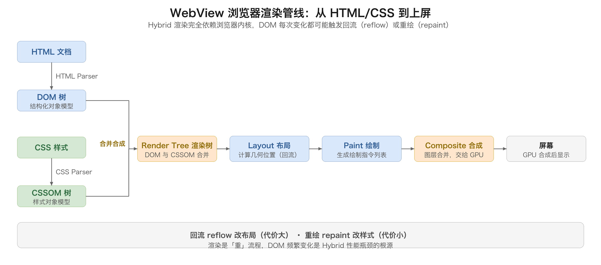

这里有两个关键结论：

1. **渲染是「重」流程**。每次 DOM 变化都可能触发重排（reflow）或重绘（repaint），复杂页面每一帧都要走完整或部分的渲染管线，这决定了 Hybrid 在动画和高频交互上的性能天花板。
2. **渲染和原生 UI 是「两张皮」**。WebView 里的页面和原生壳的控件是两套独立的渲染系统，中间隔着 WebView 容器，所以「H5 页面看起来像不像原生」，全靠 CSS 去模拟原生观感，这是体验差异的根源。

### 2.3 通信机制：JSBridge 的引入

纯 WebView 套壳有个致命问题：H5 页面拿不到原生能力。早期连拍照、定位都做不了，App 形同虚设。于是 JSBridge 登场——它在 JS 和原生之间架一座桥，让 JS 能调原生、原生能回调 JS。这一节的细节放到第三章专门展开，这里先记住结论：**JSBridge 是 Hybrid 方案能用的前提，它决定了 Hybrid 的能力边界和通信性能**。

### 2.4 优缺点

优点：

- 上手快、开发成本低，Web 前端直接转移动端。
- 动态化最强：H5 资源放服务器，随时更新，无需发版、无需应用商店审核（注意苹果对热更新的合规红线，纯 H5 更新一般是允许的，整包逻辑替换才可能违规）。
- 跨平台范围最广：iOS、Android、小程序内嵌 WebView、甚至桌面端都能跑同一份 H5。

缺点：

- 渲染性能弱，复杂交互、长列表、动画密集场景体验差。
- 体验「不像原生」，观感、手感（手势、回弹、惯性）难做到一致。
- WebView 内核版本碎片化，兼容性成本高。
- 原生能力依赖 JSBridge 逐一暴露，能力越多，桥接代码越膨胀。

### 2.5 代码 demo

用一个最小 demo 看 Hybrid 的「壳 + 页面」结构。原生壳加载一个本地或远程 H5，并暴露一个原生能力给 JS 调用：

```kotlin
// Android 原生壳：加载 H5，并注入一个原生能力
class HybridActivity : AppCompatActivity() {
    override fun onCreate(savedInstanceState: Bundle?) {
        super.onCreate(savedInstanceState)
        val webView = WebView(this)
        webView.settings.javaScriptEnabled = true
        // 注入原生能力：JS 调用 window.native.toast(...)
        webView.addJavascriptInterface(object {
            @JavascriptInterface
            fun toast(msg: String) {
                Toast.makeText(this@HybridActivity, msg, Toast.LENGTH_SHORT).show()
            }
        }, "native")
        webView.loadUrl("https://example.com/index.html")
        setContentView(webView)
    }
}
```

```javascript
// H5 页面：通过注入的 native 对象调用原生能力
function onButtonClick() {
  window.native.toast("Hello from H5");
}
```

这段代码最值得看的是 `addJavascriptInterface` 那行：它把原生对象挂到了 JS 的 `window.native` 上，H5 就能「像调 JS 函数一样」调原生方法。这是 JSBridge 最朴素的一种实现（注入对象），但它有安全隐患（后面会讲），真实项目一般会封装成更安全的桥接协议。

一句话总结：Hybrid 是「用体验换动态化」的方案。它不会消失——今天几乎每个 App 里都有 H5 页面，但它更适合「低频、偏内容展示、需要频繁更新」的场景，不适合「高频交互、追求原生手感」的核心页面。

## 三、JSBridge：跨语言通信的桥梁

JSBridge 是 Hybrid、React Native、小程序等一大批方案的地基，值得单独拎出来讲透。它的本质一句话：**在 JavaScript 运行时和原生运行时之间，建立一条双向通信的通道**。

### 3.1 为什么需要 JSBridge

JS 跑在 JS 引擎里（WebView 的 V8/JavaScriptCore，或 RN 的 Hermes），原生跑在 Android/iOS 的系统运行时里，两者是**两个隔离的世界**：内存不共享、对象不互通、调用不直达。JS 想要拍照、定位、读文件、跳原生页面，必须跨过这道「语言和运行时」的鸿沟。JSBridge 就是架在这道鸿沟上的桥。

先看通信时序图：

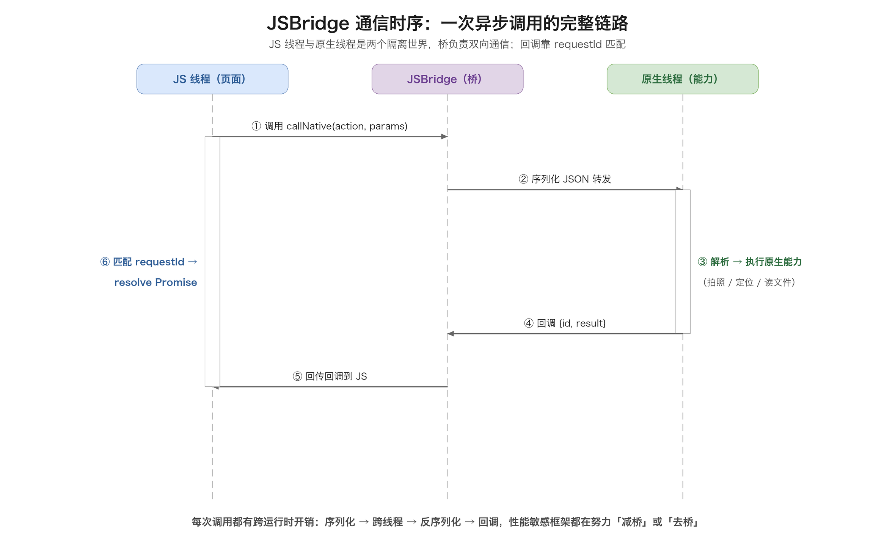

### 3.2 三种实现方式

JSBridge 的实现五花八门，但归纳起来就三类：**URL 拦截、注入对象、消息通道**。

#### 3.2.1 URL 拦截

最早、最通用的方案。JS 通过发起一个「带约定协议」的请求，原生在 WebView 的加载回调里拦截这个请求，解析出参数后执行对应原生能力。

```javascript
// JS 侧：发起一个自定义协议的请求
function callNative(action, params) {
  const url = `jsbridge://${action}?data=${encodeURIComponent(JSON.stringify(params))}`;
  // 用一个隐藏 iframe 触发，避免页面跳转
  const iframe = document.createElement('iframe');
  iframe.style.display = 'none';
  iframe.src = url;
  document.body.appendChild(iframe);
  setTimeout(() => iframe.remove(), 0);
}
```

```kotlin
// Android 原生侧：拦截约定协议的请求
webView.webViewClient = object : WebViewClient() {
    override fun shouldOverrideUrlLoading(view: WebView, url: String): Boolean {
        if (url.startsWith("jsbridge://")) {
            // 解析 action 和 data，执行对应原生方法
            handleBridgeUrl(url)
            return true   // 拦截，不让 WebView 真的去加载
        }
        return false
    }
}
```

URL 拦截的优点是**兼容性极好**，任何 WebView 都支持，不依赖平台的桥接 API；缺点是参数要序列化进 URL（有长度限制、要 encode）、异步回调要自己维护「请求 ID → 回调」的映射、而且每次调用都有一次「URL 加载」的开销。它是最「土」但最稳的方案，早期 Hybrid 和小程序底层都用过类似思路。

#### 3.2.2 注入对象

原生把一个对象「注入」到 JS 的全局作用域，JS 直接调用它的方法。Android 用 `addJavascriptInterface`，iOS 用 WKWebView 的 `evaluateJavaScript` 配合 ScriptMessageHandler。

```javascript
// JS 侧：直接调用注入的原生对象
window.NativeBridge.toast("Hello");
window.NativeBridge.openCamera(function(result) { ... });
```

```kotlin
// Android：注入对象
webView.addJavascriptInterface(NativeBridgeImpl(), "NativeBridge")
```

```swift
// iOS：WKScriptMessageHandler 方式
let config = WKWebViewConfiguration()
config.userContentController.add(self, name: "NativeBridge")
// JS 调用 window.webkit.messageHandlers.NativeBridge.postMessage(...)
```

注入对象的优点是**调用直观、同步返回、性能比 URL 拦截好**；缺点是**安全隐患大**——Android 4.2 之前的 `addJavascriptInterface` 有著名的远程代码执行漏洞（JS 可以通过反射访问注入对象的 `getClass()` 拿到整个类加载器）。所以现代实践里，注入对象要么只暴露白名单方法、要么配合更安全的封装（如只传一个「消息转发」入口）。

#### 3.2.3 消息通道

最现代、最规范的方案。原生和 JS 之间维护一条「消息队列」，双方通过 postMessage 类 API 收发结构化消息（JSON 字符串），消息里有 `requestId`、`action`、`params`，回调通过 requestId 匹配。

```javascript
// JS 侧：统一的消息收发封装
let requestId = 0;
const pending = new Map();

function callNative(action, params) {
  return new Promise((resolve, reject) => {
    const id = ++requestId;
    pending.set(id, { resolve, reject });
    window.__nativePostMessage(JSON.stringify({ id, action, params }));
  });
}

// 原生回调回来时触发
window.__onNativeResponse = function (msg) {
  const { id, result, error } = JSON.parse(msg);
  const p = pending.get(id);
  if (error) p.reject(error); else p.resolve(result);
  pending.delete(id);
};
```

消息通道是前两种方案的「规范化综合」：它保留了注入对象的性能优势，又用 `requestId + 回调表` 解决了 URL 拦截的异步匹配问题，还通过「只暴露一个消息入口」规避了注入对象的安全风险。现代 Hybrid 框架、React Native 的桥、小程序的双线程通信，本质上都是这种「消息队列 + 回调匹配」的思想。

### 3.3 同步与异步

JSBridge 的调用分同步和异步，这是理解它性能的关键。

- **同步调用**：JS 调用后原地等待原生返回结果，期间 JS 线程被阻塞。适合「立刻要结果」的轻量调用（如读一个配置值），但**滥用同步会卡 UI**。
- **异步调用**：JS 调用后立即返回一个 Promise/回调，原生处理完再通过 requestId 回调回来。绝大多数耗时操作（网络、文件、相机）都必须异步。

一个重要的性能事实：**JSBridge 的每次调用都有跨运行时开销**。序列化参数、跨线程/跨进程传递、反序列化、回调，每一步都有成本。所以性能敏感的框架（React Native）才要拼了命地「减少桥的调用次数、合并消息」（batching），而 Flutter 干脆把桥取消了。

### 3.4 线程模型

JSBridge 还牵涉线程模型，这是很多 bug 的源头：

- JS 线程跑在 WebView 的 JS 引擎线程上（或 RN 的 JS 线程）。
- 原生 UI 必须跑在主线程（Android Main Thread / iOS Main Thread）。
- 所以 JSBridge 的回调如果是「要更新 UI」的，必须**切回主线程**执行；如果是「耗时计算」的，反而要**放到后台线程**避免卡主线程。

一个典型的坑：JS 频繁调用原生，每次调用都跨线程切来切去，会导致消息堆积、掉帧。好的桥实现会做「消息合并」和「线程调度」优化。

## 四、React Native：原生渲染桥

### 4.1 核心思路

React Native（2015 年 Facebook 开源）的诞生，就是为了解决 Hybrid「体验不像原生」的痛点。它的核心口号是 **Learn once, write anywhere**（学一次，到处写），而不是「写一次到处跑」——因为它要保留原生体验，就注定不能 100% 复用 UI 代码。

RN 的架构一句话：**用 JS/React 写逻辑和 UI 描述，用原生控件渲染 UI，中间靠「桥（Bridge）」通信**。JS 不直接操作原生控件，而是把「要渲染成什么样子」的描述通过桥发给原生，原生解析后创建/更新对应的原生控件。

渲染方式的关键差异在这里：Hybrid 渲染的是 WebView 里的 DOM，RN 渲染的是**真正的原生控件**（iOS 是 UIView，Android 是 View）。所以 RN 的按钮就是真按钮、列表就是真列表，手感、手势、惯性回弹都是原生的，这是它体验远好于 Hybrid 的根本原因。

### 4.2 三层架构

RN 的经典架构分三层：

- **JS 层（JavaScript 层）**：跑 React 代码，负责 UI 描述（Virtual DOM/组件树）和业务逻辑，运行在 JS 引擎上（默认 Hermes，之前是 JSCore/V8）。
- **桥（Bridge）层**：JS 和原生之间的通信通道，负责把 JS 的 UI 指令、原生的事件、回调来回传递。桥是异步的、批量化的（batch）。
- **原生层（Native 层）**：负责真正的 UI 渲染和平台能力，跑在原生线程上。

数据流是单向的：JS 的组件树 diff 出变化 → 序列化成 UI 指令 → 通过桥批量发给原生 → 原生执行指令更新控件 → 用户操作产生事件 → 事件通过桥回传给 JS → JS 更新组件树 → 再来一轮。这是一个「JS 驱动、原生渲染」的循环。

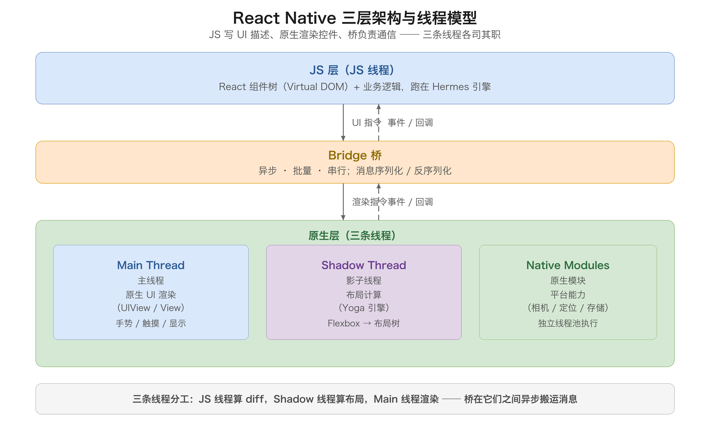

#### 4.2.1 三条线程：RN 并发的骨架

三层架构落到具体线程上，是 RN 最容易被忽视、却最影响性能的细节。旧架构里，RN 一共用到三条关键线程加一个线程池：

- **JS 线程（JS Thread）**：跑 JS 引擎（Hermes），执行 React 的组件渲染逻辑和业务代码。所有 `setState`、diff 计算、生命周期都发生在这里。它**只有一个**，JS 里的任何同步长任务（大循环、复杂计算）都会卡住整条渲染链路——这就是「别在 JS 里做重计算」的根源。
- **Shadow 线程（Shadow Thread / Layout Thread）**：RN 在原生侧维护一棵「影子树」（Shadow Tree），专门负责布局计算，用的是 **Yoga 引擎**（Facebook 开源、C++ 实现的 Flexbox 布局引擎）。JS 发来的 UI 结构先在这里算好位置、尺寸，再交给主线程渲染。把它独立出来的好处是：布局计算不占用主线程。
- **Main 线程（主线程）**：真正的原生 UI 渲染。iOS 的 UIView、Android 的 View 都在这里创建、更新、上屏。任何对原生控件的操作最终都要落到主线程，所以主线程的繁忙程度直接决定「掉不掉帧」。
- **Native Modules 线程池**：原生模块（相机、定位、存储等）跑在独立的线程池里，不占用上面三条线程，异步返回结果。

理解这四条，就能看懂 RN 的性能模型：**JS 线程算 diff、Shadow 线程算布局、Main 线程渲染，三条线程靠桥异步协作**。任何一条线程忙，都会表现为卡顿，而桥是它们之间唯一的通道。

### 4.3 桥的性能瓶颈与通信机制

桥是 RN 旧架构的核心，也是它的软肋。先看一次 setState 触发屏幕更新，消息在桥上的完整往返：

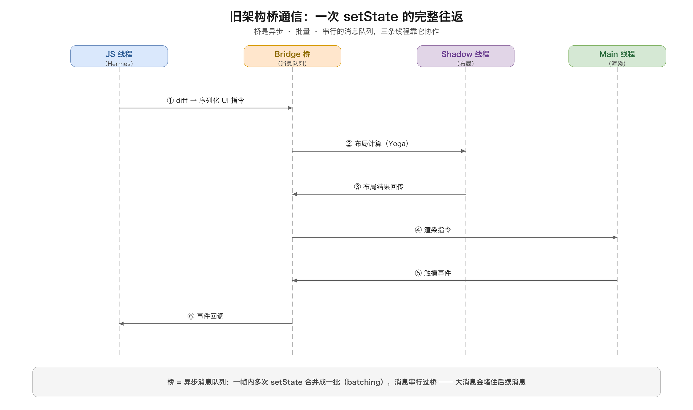

桥之所以成为瓶颈，源于它的三个设计特性——**异步、批量、串行**：

- **异步**：JS 发指令不等原生，原生处理完再回调，避免互相阻塞。代价是「往返延迟」，一次交互要等消息在 JS 和原生之间走一个来回。
- **批量（Batching）**：一帧内的多次 setState 会被合并成一次桥通信，减少跨桥次数。这是优化，但批量也意味着「实时性让位于吞吐」——极端情况下，紧急的更新也要排队等批。
- **串行**：同一时刻桥上只有一个消息在跑（旧架构），所有消息在一个队列里排队。一旦某个大消息（比如一个长列表一次性 diff 出几千个节点的变化）上桥，它后面所有消息都得等它传完。

再深一层，桥的每一次通信都有真实成本，主要花在**序列化**上：JS 侧的对象要先序列化成 JSON（或其他格式）字符串，跨线程、跨语言传给原生，原生再反序列化回来。这个「序列化 → 传输 → 反序列化」三步，每一步都有 CPU 开销，而且**跨语言**——JS 对象和 Objective-C/Java 对象互相不认识，必须靠文本或二进制格式中转。

所以桥的瓶颈可以概括成一句话：**高频交互时，JS 线程、Shadow 线程、Main 线程通过一条「异步批量串行」的消息队列频繁往返，任何一次通信量大或频率高，队列就会堵，表现为滚动掉帧、手势延迟、动画卡顿**。这也是为什么 RN 社区长期被诟病「桥性能问题」，以及为什么后续要用 JSI 把桥彻底换掉。

### 4.4 新架构：JSI、Fabric 与 TurboModules

为了解决桥的瓶颈，RN 从 2018 年开始重构，2022 年正式推出新架构（New Architecture）。它的核心思路一句话：**废弃「异步序列化桥」，让 JS 和原生通过 JSI 同步直连**。

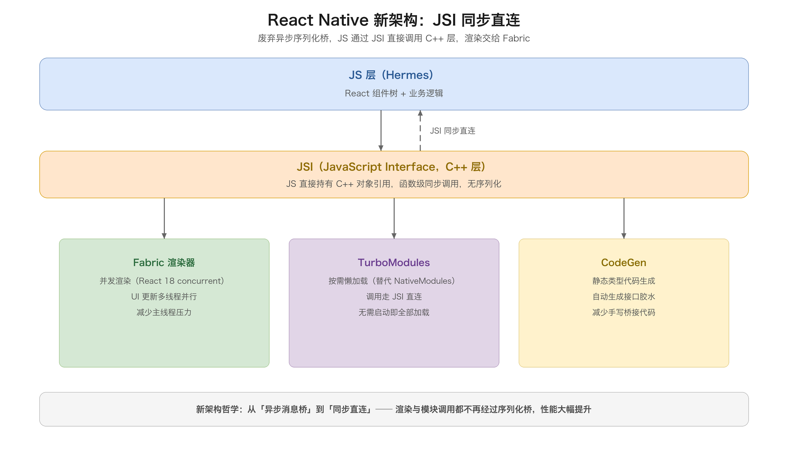

新架构由四个部分组成：

#### 4.4.1 JSI：把桥「变薄」甚至「去掉」

JSI（JavaScript Interface）是新架构的地基。它是一层 C++ API，让 JS 引擎（Hermes）能**直接、同步地**调用 C++ 层的方法，也能让 C++ 层持有 JS 对象。关键变化有两个：

1. **同步调用**：旧桥是异步的（发完消息要等回调），JSI 让 JS 调用原生方法可以像调普通函数一样**原地拿到返回值**，不需要序列化、不需要消息队列。
2. **共享对象引用**：旧桥每次通信都要序列化/反序列化，JSI 则让 JS 和 C++ 直接持有**同一个对象的引用**，改它、调它都不再经过「序列化中转」。

JSI 的另一个妙处是**它和 JS 引擎解耦**：因为 JSI 定义在 C++ 层，理论上可以换掉 JS 引擎（Hermes、JSC、V8）而不影响上层代码。RN 社区甚至用 JSI 把原生库（比如数据库、加密库）直接暴露给 JS 同步调用，绕过桥的损耗。

#### 4.4.2 Fabric：并发渲染器

Fabric 是新的 UI 渲染管线。旧架构里，JS 的 Virtual DOM 变化要通过桥发给 Shadow 线程和 Main 线程，一条消息串行处理；Fabric 则把渲染管线的核心（Shadow Tree 的 diff 和布局）下沉到 C++ 层，并且支持 React 18 的**并发特性**（concurrent rendering）：

- **优先级调度**：紧急更新（用户输入、动画）可以打断低优先级更新（后台数据渲染），先上屏，减少卡顿。
- **多线程并行**：不同子树的布局和渲染可以在不同线程并行处理，主线程压力更小。
- **直接操作原生**：Fabric 让 JS 可以通过 JSI 直接操作原生 UI 组件树，而不是发「UI 指令」等原生解析。

#### 4.4.3 TurboModules：按需懒加载的原生模块

旧架构的 NativeModules 有个大问题：App 启动时要**一次性加载所有原生模块**，拖慢启动速度。TurboModules 改成**按需懒加载**——用到哪个模块才加载哪个，而且模块方法通过 JSI 直连调用（而不是走桥的序列化），启动更快、调用更省。

#### 4.4.4 CodeGen：消灭手写胶水

旧架构里，JS 和原生之间要写大量「胶水代码」（类型声明、接口绑定），费时且易错。CodeGen 用**静态类型**（TypeScript / Flow）自动生成这些接口：JS 侧写类型定义，原生侧的绑定代码自动生成，减少手写、避免类型不匹配的 bug。

#### 4.4.5 Hermes：为移动端定制的 JS 引擎

Hermes 是 Meta 专为 RN 打造的 JS 引擎，目标是「更快的启动、更低的内存」。它不做 JIT（即时编译），而是**预编译成字节码（AOT）**，启动时直接执行字节码，省去了传统 JS 引擎的解析和 JIT 预热，冷启动更快、内存占用更低。这也是 RN 在低端机上体验改善的重要原因之一。

#### 4.4.6 新旧架构对比

| 维度 | 旧架构（Legacy） | 新架构（New Architecture） |
| --- | --- | --- |
| JS ↔ 原生通信 | 异步序列化桥 | JSI 同步直连 |
| 调用方式 | 发消息 + 等回调 | 函数级直连，可同步返回 |
| 序列化 | 每次通信都要序列化 | 共享对象引用，无需序列化 |
| 渲染 | 桥串行转发 UI 指令 | Fabric 并发渲染 + 优先级 |
| 原生模块 | 启动时全量加载 | TurboModules 按需懒加载 |
| 接口绑定 | 手写胶水代码 | CodeGen 自动生成 |
| JS 引擎 | JSC / V8 | Hermes（AOT 字节码） |
| 性能 | 高频交互易掉帧 | 大幅改善，接近直连 |

新架构的哲学是「从『异步消息桥』走向『同步直连』」。但要清醒：新架构复杂度高、迁移成本不低，老项目升级需要原生侧配合改造（模块改造、渲染器切换），新老架构并存期生态也有碎片化。截至 2024 年，新架构已默认启用，但存量项目仍在逐步迁移中。

### 4.5 代码 demo

用计数器看 RN 的「JS 写 UI、原生渲染」结构：

```jsx
import React, { useState } from 'react';
import { View, Text, Button } from 'react-native';

export default function Counter() {
  const [count, setCount] = useState(0);
  return (
    <View>
      <Text>当前计数：{count}</Text>
      {/* Button 是真正的原生按钮，不是 WebView 里的 DOM */}
      <Button title="+1" onPress={() => setCount(count + 1)} />
    </View>
  );
}
```

值得注意的两点：`<Button>`、`<Text>` 这些组件在 RN 里映射到原生控件（iOS 的 UIButton/UILabel，Android 的 android.widget.Button/TextView），而不是 HTML 标签；`setCount` 触发组件树 diff，diff 结果通过桥（或新架构的 JSI）同步到原生更新控件。JS 侧写的是 React 组件，跑的是原生控件——这就是「原生渲染桥」的含义。

再看一个原生模块（TurboModule）的写法，理解「JS 声明 + 原生实现 + 接口绑定」的完整链路。以读取电量为例：

```typescript
// JS 侧：声明模块接口（CodeGen 依此自动生成原生绑定）
export interface Spec extends TurboModule {
  getBatteryLevel(): number;
}
```

```java
// Android 原生侧：实现模块方法
public class BatteryModule extends NativeBatterySpec {
  @Override
  public double getBatteryLevel() {
    // 直接返回电量：新架构下走 JSI 直连，旧架构下走桥
    return readBatteryLevel();
  }
}
```

```swift
// iOS 原生侧：实现模块方法
@objc(BatteryModule)
class BatteryModule: NSObject, NativeBatterySpec {
  func getBatteryLevel() -> Double {
    return Double(UIDevice.current.batteryLevel)
  }
}
```

这三段代码串起来就是 RN 模块调用的全貌：**JS 声明接口 → CodeGen 生成绑定 → 原生实现 → JS 调用**。新架构下，`getBatteryLevel` 这类调用不再经过「序列化 + 队列 + 反序列化」，而是 JSI 直连，这是它性能提升的关键。

### 4.6 优缺点

优点：

- **体验接近原生**：渲染的是真原生控件，手感、性能远好于 Hybrid，双端 UI 观感也容易保持统一。
- **开发效率高**：用 React 组件化 + 声明式 UI 写一份逻辑跑两个平台，能直接复用 Web 端积累的 JS 技能和前端工程体系，支持热更新（JS bundle 可下发）。
- **生态成熟**：社区组件库、第三方库极其丰富，Facebook/Meta 官方持续投入，人才供给充足。
- **适合快速验证**：小团队、MVP、非核心页面场景下，RN 能显著压缩「从想法到上线」的周期，这是它至今仍有生命力的根本原因。

缺点：

- **桥通信有性能损耗**（旧架构）：高频交互、复杂动画、长列表仍可能掉帧。细看这笔账——人眼流畅需要 60fps，每帧预算约 16ms；桥的一次通信虽然只有几百微秒，但长列表动态测量 item 高度要靠 `onLayout` 回调回传布局信息，一次滚动会产生海量跨线程往返，预算很容易被挤爆。
- **系统级能力集成深度不足**：相机、定位这类常见能力社区库能覆盖，但遇到 AR Quick Look、Core ML、VisionKit、设备端 OCR、人像分割这类系统框架，生态往往没有现成封装，只能自己写 Native Module。尤其在 GenAI、视觉 AI 越来越普及的今天（商品识别、文档扫描），这些能力几乎都来自平台原生 ML 框架，跨平台生态没有现成替代，跨平台的优势会被一点点消耗掉。
- **「手感」细节吃力**：原生体验不只是画一个按钮，而是商品卡片阴影/圆角跟随滚动动态变化、图片加载优先级、列表滚动惯性、键盘避让、转场动画跟随手势、系统分享面板、Apple Pay 唤起等大量细节。RN 都能做，但每个细节都要靠自定义原生组件去「找补」，这些工作复杂且不在 JS 层可控范围内。
- **长期维护成本可能反超开发成本**：第一笔账是「省了双端人力」，第二笔账却是版本升级、第三方库兼容、桥接层排障、JS 与原生团队的沟通成本。RN 每次大版本升级在大型项目里都可能引发全 App 回归风险；Bug 定位时往往需要 iOS、Android、JS 三层人员同时在场排查。
- **平台差异仍在**：同一组件在 iOS/Android 表现可能不一致，UI 代码做不到 100% 复用，很多场景要写平台分支。
- **新架构迁移成本高**：Hermes、Fabric、TurboModules 确实改善了通信模型，但对已有历史债的存量项目，换引擎不是一夜能填平的，新老架构并存期生态也有碎片化。

真实案例的注脚：Shopify 是少有的把 RN 用在「最高压场景」（商品列表、搜索、购物车、结账）的标杆，从 2016 年押注 RN，到最终渐进式退回 UIKit / Jetpack Compose，它的路径很典型——**「先赢在开发效率，后输在运行性能和长期协作成本」**。这不是说 RN 不行，而是说明：跨平台框架在 Demo 和中小项目里表现很好，一旦进入长列表、富交互、多团队并行、长生命周期维护，账就要换一种算法。

RN 的优势场景与吃力场景，可以这样对照：

| 维度 | RN 的优势场景 | RN 的吃力场景 |
| --- | --- | --- |
| 页面形态 | 表单、设置、静态内容、中等列表 | 密集长列表、信息流、富交互编辑器 |
| 性能目标 | 可用即可，不追求极致手感 | 60fps 滚动、首屏秒开、弱网健壮 |
| 系统集成 | 相机、定位、推送等常见能力 | AR/ML、系统支付、深度无障碍 |
| 团队规模 | 小团队快节奏、验证想法 | 多团队并行、业务生命周期 5 年以上 |

一句话总结：RN 是「用 JS 的开发效率，换接近原生的体验」，代价是桥（旧架构）和平台差异。它最适合「前端团队为主、UI 不是极端复杂、追求快速迭代」的项目——也就是优势场景那一列；一旦业务长成「高负载核心页面 + 系统级能力深集成 + 多团队长期维护」，就要认真掂量吃力场景那一列的代价。

## 五、Flutter：自绘引擎的极限性能

### 5.1 核心思路

Flutter（2018 年 Google 发布 1.0）走了一条和 RN 截然相反的路：**它连原生控件都不用了，自己用 Skia 引擎把每一个像素画出来**。

Flutter 的架构一句话：**Dart 写逻辑和 UI，Skia/Impeller 引擎自绘渲染，不经过任何原生控件**。因为是自己画，所以 iOS 和 Android 上的每一个像素、每一个动画、每一帧的渲染结果都完全一致——这是 Flutter 跨平台一致性冠绝所有方案的根源。

### 5.2 三层架构

Flutter 架构分三层：

- **Framework 层（Dart）**：Widget/Element/RenderObject 三棵树，声明式 UI，Material/Cupertino 两套设计语言组件库。
- **Engine 层（C++）**：Skia/Impeller 图形引擎、Dart VM、文本排版、平台通道（Platform Channel）。这是 Flutter 的「发动机」。
- **Embedder 层（各平台原生）**：把 Engine 嵌入到具体平台的「壳」里，负责窗口、输入事件、渲染 surface、生命周期。

先看 Flutter 的三层架构与渲染链路：

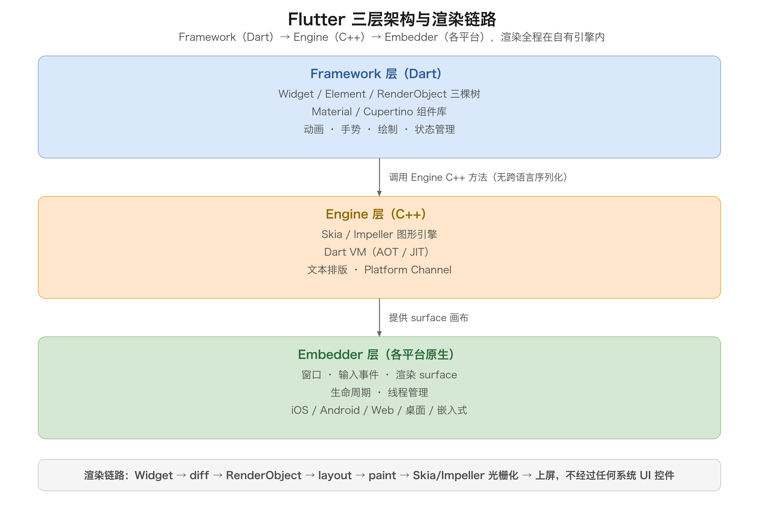

这三层各司其职，理解它们的分工，就理解了 Flutter 的性能来源：

- **Framework 层是「大脑」**：全是 Dart 代码，开发者 99% 的工作都在这一层。Widget 描述 UI、Element 做 diff、RenderObject 做布局绘制，Material/Cupertino 提供两套现成组件。
- **Engine 层是「发动机」**：C++ 实现，是性能的关键。Skia/Impeller 负责把 RenderObject 的绘制指令光栅化成像素，Dart VM 负责执行 Dart 代码。Framework 层调用 Engine 是**同进程内的 C++ 函数调用，没有跨语言序列化**。
- **Embedder 层是「插座」**：把 Engine 嵌入各平台，只提供一个「画布」（surface）和系统事件入口。Flutter 在这块画布上自己画，原生平台只是宿主。

关键点在于渲染链路：Dart 的 Widget 树 → diff → RenderObject 树 → 布局 → 绘制 → 交给 Skia 光栅化 → 上屏。**整条链路都在自己的引擎里，不经过任何系统 UI 控件**。

再看 RN 与 Flutter 渲染架构的对比，这是理解两者本质差异最直观的一张图：

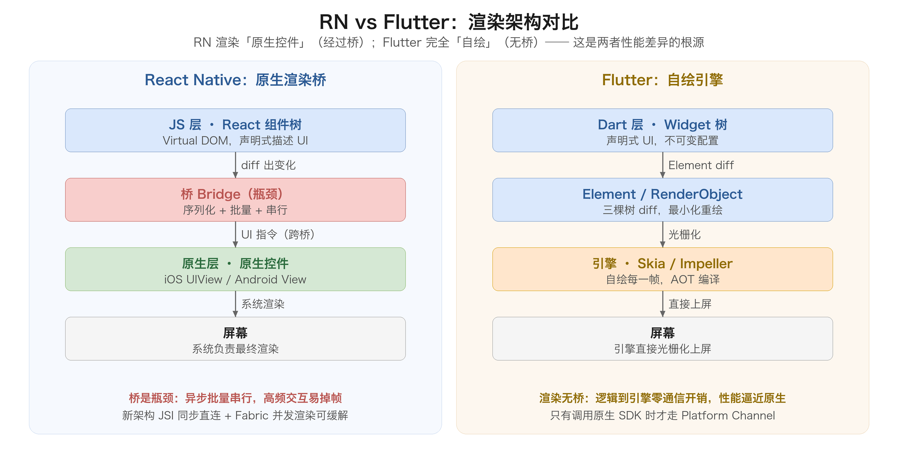

### 5.3 三棵树与声明式 UI

Flutter 的 UI 是声明式的，核心是「三棵树」模型：

1. **Widget 树**：不可变的配置描述（描述「我要什么」），每次 build 都会重建，非常轻量。
2. **Element 树**：Widget 和 RenderObject 之间的桥梁，负责 diff（判断哪个 Widget 变了）。
3. **RenderObject 树**：真正负责布局和绘制的对象，只有它变化时才重绘。

三棵树分离带来的好处是「最小化重绘」：Widget 重建很便宜，Element diff 判断出哪些 RenderObject 真的变了，只有变了的才重新布局和绘制。这是 Flutter 性能好的一个重要原因。

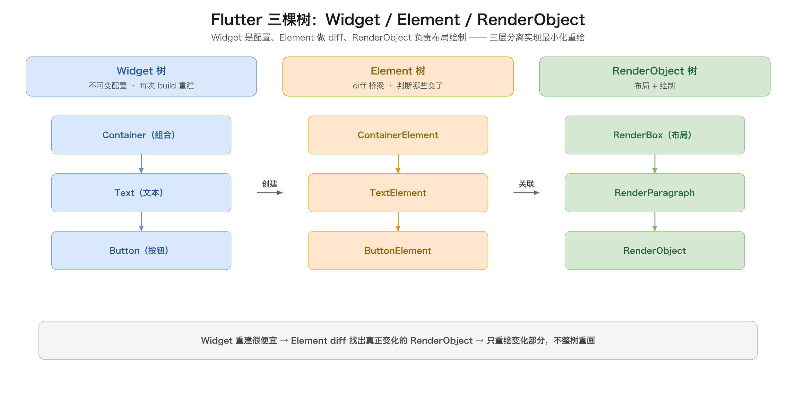

```dart
import 'package:flutter/material.dart';

void main() => runApp(const CounterApp());

class CounterApp extends StatefulWidget {
  const CounterApp({super.key});
  @override
  State<CounterApp> createState() => _CounterAppState();
}

class _CounterAppState extends State<CounterApp> {
  int _count = 0;
  @override
  Widget build(BuildContext context) {
    return MaterialApp(
      home: Scaffold(
        body: Center(
          child: Column(
            mainAxisAlignment: MainAxisAlignment.center,
            children: [
              Text('当前计数：$_count'),
              ElevatedButton(
                onPressed: () => setState(() => _count++),
                child: const Text('+1'),
              ),
            ],
          ),
        ),
      ),
    );
  }
}
```

注意 `setState` 触发 `build` 重建 Widget 树，但 Flutter 通过 Element diff 只重绘真正变化的 `Text`，不会整棵树重画。这就是「声明式 + 三棵树」的性能秘密。

#### 5.3.1 Key：让 Element 正确复用

三棵树模型里有一个容易被忽略却很关键的细节——**Key**。当列表里的 Widget 顺序变化、或同类型 Widget 换位时，Element 默认按「位置」复用：第一个 Element 对第一个 Widget，第二个对第二个。如果某个 Widget 被删了，后面的 Widget 会「顶上来」，Element 复用到错误的 Widget 上，导致状态错乱。

给 Widget 加 Key 后，Element 就按「Key」而不是「位置」来匹配 Widget，能正确识别「哪个 Widget 是我」。这是 Flutter 列表里「增删排序导致状态错乱」这类 bug 的标准解法。

```dart
// 无 Key：按位置复用，删掉一项后状态会错位
ListView(children: items.map((e) => Text(e.name)));

// 有 Key：按 Key 复用，正确识别每一项
ListView(children: items.map((e) => Text(e.name, key: ValueKey(e.id))));
```

#### 5.3.2 状态管理：从 setState 到 Provider / Riverpod / Bloc

`setState` 是最基础的状态更新方式，但它有两个局限：一是状态只存在于单个 StatefulWidget 里，跨组件共享要靠层层传参（props drilling）；二是组件树一大，重建范围和状态流向会失控。

Flutter 社区为此演化出一整套状态管理方案，核心思路都是「把状态从 Widget 里抽出来，集中管理、按需订阅」：

| 方案 | 核心思路 | 适用场景 |
| --- | --- | --- |
| setState | 状态留在 Widget 内 | 局部、简单状态 |
| InheritedWidget | 状态沿组件树向下共享，依赖方自动重建 | 主题、配置等跨层共享 |
| Provider | 基于 InheritedWidget 的封装，依赖注入 | 中小项目首选 |
| Riverpod | Provider 的编译期安全增强版 | 中大型项目 |
| Bloc | 事件驱动 + 单向数据流（Redux 风格） | 复杂业务、需要可测性 |

选型口诀：局部状态用 `setState`，跨层共享用 `InheritedWidget`/`Provider`，复杂业务逻辑用 `Bloc`/`Riverpod`。状态管理不是「越新越好」，而是「和业务复杂度匹配」。

### 5.4 无桥通信：Platform Channel

Flutter 最大的架构亮点之一，是它**取消了 JS↔Native 的运行时桥**。Dart 代码跑在 Dart VM 里，直接调用 Engine 的 C++ 方法（同进程、无跨语言序列化），所以「逻辑到渲染」这条链路是**零通信开销**的——这正是它性能能逼近原生的根本原因。

那 Flutter 怎么访问原生能力（相机、定位、支付）？答案是 **Platform Channel**（平台通道）。它只在「Dart 需要调原生 SDK」时才用，本质是异步消息传递（类似简化版 JSBridge），但**渲染路径完全不经过它**。

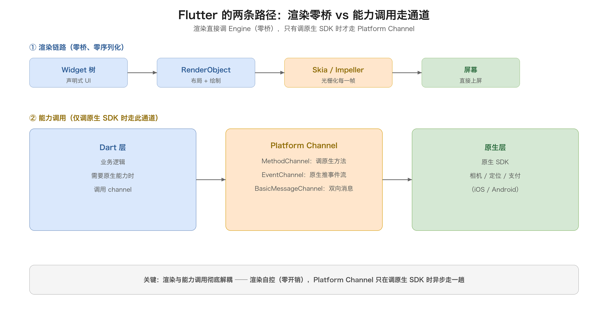

Platform Channel 有三种：

- **MethodChannel**：Dart 调原生方法（最常见）。
- **EventChannel**：原生向 Dart 推事件流。
- **BasicMessageChannel**：双向消息传递。

```dart
// Dart 侧：通过 MethodChannel 调原生
const channel = MethodChannel('com.example/device');
final battery = await channel.invokeMethod('getBatteryLevel');
```

```kotlin
// Android 原生侧：实现 channel 的方法
MethodChannel(flutterEngine.dartExecutor.binaryMessenger, "com.example/device")
    .setMethodCallHandler { call, result ->
        when (call.method) {
            "getBatteryLevel" -> result.success(getBatteryLevel())
            else -> result.notImplemented()
        }
    }
```

关键结论：**Flutter 把「渲染」和「原生能力调用」彻底解耦**。渲染完全自控（零桥、零损耗），只有调原生 SDK 时才走 Platform Channel。这让它在「高频交互 + 复杂动画」场景碾压 RN 旧架构的桥，同时又不失去访问原生能力的通道。

### 5.5 渲染管线：每帧发生了什么

理解了「渲染零桥」，再深入一层看 Flutter 每一帧的完整渲染管线。从 `setState` 到屏幕显示，一帧要经过六个阶段：

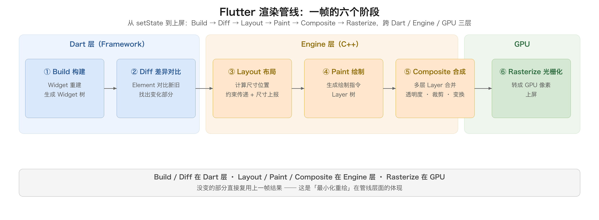

1. **Build（构建）**：Widget 重建，生成新的 Widget 树。这是声明式 UI 的「描述」阶段，很轻量。
2. **Diff（差异对比）**：Element 对比新旧 Widget，找出需要更新的 RenderObject。
3. **Layout（布局）**：RenderObject 自顶向下传约束、自底向上报尺寸，算出每个节点的位置和大小。
4. **Paint（绘制）**：把布局结果转成绘制指令（Layer 树），记录「画什么、画在哪」。
5. **Composite（合成）**：把多层 Layer 合成到一起，处理透明度、裁剪、变换。
6. **Rasterize（光栅化）**：Skia/Impeller 把绘制指令转成 GPU 像素，上屏。

这六个阶段里，**Build 和 Diff 在 Dart 层，Layout/Paint/Composite 在 Engine 层，Rasterize 在 GPU**。Flutter 的优化目标就是让每一帧尽量只走「变化的部分」：没变的部分直接复用上一帧的结果，这是它「最小化重绘」在管线层面的体现。

理解这条管线，也就理解了 Flutter 的性能调优思路：**卡顿往往发生在某个阶段做多了**。比如 Widget build 里做了重计算（Build 慢）、布局频繁变化（Layout 慢）、绘制了过多图层（Paint/Composite 慢），对症下药即可。

### 5.6 渲染引擎与 Dart 运行时

#### 5.6.1 渲染引擎：从 Skia 到 Impeller

Flutter 的渲染引擎在演进：早期是 Skia（也是 Chrome、Android 底层用的引擎），Google 从 2023 年开始逐步切换到自研的 **Impeller** 引擎（iOS 已默认，Android 逐步跟进）。Impeller 的目标是解决 Skia 的「着色器编译卡顿（jank）」问题——Skia 在运行时动态编译 GPU 着色器，首次渲染复杂图形时会卡一下；Impeller 把着色器编译提前到构建期（AOT），运行时不再有编译卡顿，动画更丝滑。

这是理解 Flutter「性能还能再进化」的一个点：它连底层图形引擎都在持续自研优化，目标就是「消除一切运行时开销」。

#### 5.6.2 Dart 的 AOT 与 JIT：热重载的魔法

Dart 的双编译模式是 Flutter 开发体验的一大利器：

- **JIT（即时编译）**：开发模式（debug）下，Dart 代码边运行边编译，配合 **Hot Reload**（热重载）——改完代码按一下，Flutter 把新代码注入正在运行的 Dart VM，状态保留、UI 秒级刷新，不用重启 App。这是 Flutter 开发效率碾压原生「改一行重编译」体验的核心。
- **AOT（预编译）**：发布模式（release）下，Dart 提前编译成原生机器码，运行时直接执行机器码，没有 JIT 的解释和编译开销，启动快、性能高。

这个「开发用 JIT 换热重载，发布用 AOT 换性能」的组合是 Flutter 独有的：RN 的 Hermes 引擎也有字节码预编译的思路，但 Flutter 的 AOT 是直接到机器码，性能上限更高。

#### 5.6.3 单线程 + Isolate：Dart 的并发模型

Dart 是**单线程事件循环**模型（和 JS 类似），所有 Dart 代码跑在一条「UI Isolate」上。先看图：

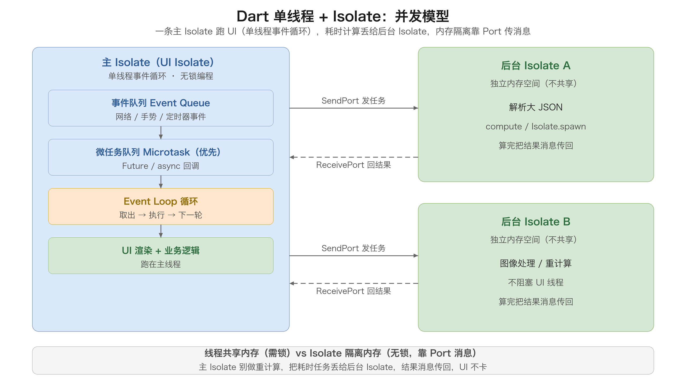

**事件循环（Event Loop）**：Dart 的「单线程」其实是一个不断循环的事件循环，它维护两个队列：

- **事件队列（Event Queue）**：网络响应、手势、定时器、IO 等外部事件按到达顺序排队。
- **微任务队列（Microtask Queue）**：`Future.then`、`async` 内部产生的微任务，**优先级高于事件队列**——每一轮事件处理前，Event Loop 会先清空所有微任务。

这个优先级顺序用一段代码就能看清：

```dart
// 猜猜打印顺序？
print('1 同步代码');
Future(() => print('2 事件队列'));
Future.microtask(() => print('3 微任务队列'));
print('4 同步代码');
// 输出：1 4 3 2
// 顺序：同步代码先跑完 → 清空微任务（3）→ 再取事件队列（2）
```

规律是：**每一段同步代码执行完后，Event Loop 先把微任务队列全部清空，才去事件队列取下一件事**。所以 `Future.then`、`async` 里的微任务会「插队」到下一个事件之前。理解这个顺序，能解释很多「为什么我的回调还没执行」的困惑——因为它排在了微任务队列里，要等当前同步代码和它前面的微任务都跑完。

单线程 + 事件循环的好处是**无锁编程**：同一时刻只有一段代码在跑，不存在多线程竞争同一份数据的问题，写起来简单、不容易出并发 bug；坏处是一条线程做重计算（大循环、复杂算法）会卡住整个事件循环，UI 掉帧。

**Isolate：不共享内存的「轻量进程」**。解决并发靠 Isolate，它和传统线程有本质区别：

| 对比 | 传统线程 | Isolate |
| --- | --- | --- |
| 内存 | 共享同一进程内存 | 各自独立，互不共享 |
| 通信 | 共享变量（需加锁） | Port 消息传递（无锁） |
| 数据竞争 | 存在，需锁 / 原子操作 | 不存在（内存隔离） |
| 开销 | 较轻 | 稍重（独立堆） |

要做耗时计算（解析大 JSON、图像处理），就开一个后台 Isolate，算完把结果消息传回来。最常用的是 `compute`，它本质是 `Isolate.spawn` + `ReceivePort` 的便捷封装：

```dart
// compute：Flutter 提供的便捷封装，适合「一次性任务」
final result = await compute(heavyComputation, largeData);
```

`compute` 有两条硬限制，踩坑的人不少：**函数必须是顶层函数或静态方法**（不能传捕获局部变量的闭包，因为闭包变量在另一个 Isolate 里根本不存在）；**参数和返回值必须可序列化**（Isolate 间传消息是拷贝，UI 对象、闭包、`BuildContext` 这类东西传不过去）。

`compute` 只适合「一次性任务」，长期运行的后台 worker（比如持续的日志上报、实时数据处理）需要手动建立双向通道：

```dart
// 主 Isolate：spawn 后先拿到 worker 的 sendPort，再持续收发
final rp = ReceivePort();
await Isolate.spawn(worker, rp.sendPort);
final workerSendPort = await rp.first;        // worker 回传它自己的 sendPort
workerSendPort.send({'cmd': 'compute', 'data': bigData});
rp.listen((msg) { /* 收 worker 的结果 */ });

// worker：拿到主 Isolate 的 sendPort 后，持续监听任务
void worker(SendPort mainPort) {
  final rp = ReceivePort();
  mainPort.send(rp.sendPort);                 // 把自己的 sendPort 交给主 Isolate
  rp.listen((msg) {
    final result = doHeavyWork(msg['data']);
    mainPort.send(result);                    // 回传结果
  });
}
```

这个「先握手交换 sendPort，再双向收发」的模式，是 Isolate 长生命周期通信的标准套路。

**什么时候该用 Isolate**：判断标准很简单——一次计算是否超过一帧预算（约 16ms）。解析几 MB 的 JSON、大图处理、加解密、复杂排序这类几十上百毫秒的操作，放主 Isolate 必然掉帧，就该开后台 Isolate；反之几毫秒的小计算别折腾——开 Isolate 本身也有开销（独立堆 + 消息拷贝），杀鸡用牛刀反而更慢。

另外，Isolate 间传消息是**拷贝**（不是共享引用），大对象传输有拷贝成本，别把超大数据频繁在 Isolate 间传，必要时用 `TransferableTypedData` 做零拷贝。

这对比 JS 的 Web Worker、原生 Android 的线程模型，是理解 Flutter 并发和「为什么别在主 Isolate 做重活」的关键。记住一句口诀：**主 Isolate 只做「轻、快」的 UI 和逻辑，重计算丢给后台 Isolate，结果消息传回**。

### 5.7 优缺点

优点：

- 渲染完全自控，跨平台一致性极高（像素级一致）。
- 性能逼近甚至超越原生：自绘 + AOT 编译 + 三棵树最小化重绘 + 无桥渲染链路。
- 开发体验好：Dart 语言现代、热重载（Hot Reload）秒级生效、工具链完善（flutter doctor、devtools）。
- 一套代码真正多端：iOS、Android、Web、桌面（Windows/macOS/Linux）、甚至嵌入式，同一套 UI 全跑。

缺点：

- 包体积大：Flutter 引擎（Dart VM + Skia/Impeller）要打进 App，最小也要几 MB，比 RN 的 JS bundle 大。
- 生态和原生有隔阂：原生能力全靠插件桥接，一些冷门原生 SDK 没有现成插件，得自己写。
- Dart 是「新语言」，团队有学习成本（虽然有 JS/Java 基础上手快）。
- 「不像原生」的另一面：Flutter 自绘的观感、手感是「模拟」原生，而不是真原生，部分细节（如 iOS 的原生导航转场、系统组件的最新样式）跟不上系统更新。
- 长列表等场景需要正确使用（懒加载、缓存）才能发挥性能，否则也会卡。

一句话总结：Flutter 是「用包体积和学习成本，换极致的一致性和性能」的方案。它最适合「追求像素级一致、动画复杂、UI 独特、不想被原生细节拖累」的项目，是目前自绘路线的绝对霸主。

## 六、Kotlin Multiplatform：原生共享逻辑

### 6.1 核心思路

Kotlin Multiplatform（KMP，2019 年 JetBrains 推出，2023 年 Kotlin 官方宣布 Stable）走的是和前三个方案**完全不同的哲学**：**它不追求「一套 UI」，只追求「一套逻辑」**。

KMP 的核心思想一句话：**用 Kotlin 写业务逻辑，编译成各平台的目标代码（Android 的 JVM 字节码、iOS 的原生 framework），各端复用；UI 仍然用各端原生写（Android 用 Compose/View，iOS 用 SwiftUI/UIKit）**。

这带来一个颠覆性的认知转变：跨平台不一定非要跨 UI。很多项目里，真正「跨」有价值的是业务逻辑——网络请求、数据模型、状态管理、算法、持久化——这些代码占大头且平台无关。UI 恰恰是各平台最有差异、最该保留原生体验的部分。KMP 的定位就是「逻辑共享、UI 各写」。

### 6.2 源码集结构：一套代码如何「分层共享」

KMP 组织代码的基本单位是**源码集（Source Set）**——它是一组「针对特定编译目标」的源码 + 资源的集合。默认一个 KMP 工程会生成这些源码集：

- **commonMain**：所有平台共享的代码，放平台无关的逻辑（网络、数据模型、算法、状态机）。
- **androidMain**：仅 Android 编译，可以依赖 Android SDK（`android.os.*`、`Context` 等）。
- **iosMain**：仅 iOS 编译，可以依赖 iOS 平台能力（`UIDevice`、`NSUserDefaults` 等）。
- **commonTest / androidUnitTest / iosTest**：对应的测试源码集。

关键点在于 iOS 侧的**层级细分**：`iosMain` 其实是一个「中间源码集（intermediate source set）」，它下面还挂着 `iosArm64Main`（真机）、`iosSimulatorArm64Main`（Apple Silicon 模拟器）、`iosX64Main`（Intel 模拟器）等真正的编译目标。写在 `iosMain` 里的代码会被所有这些 iOS 目标复用，这也是「写一份 iOS 逻辑」能同时覆盖真机和模拟器的原因。

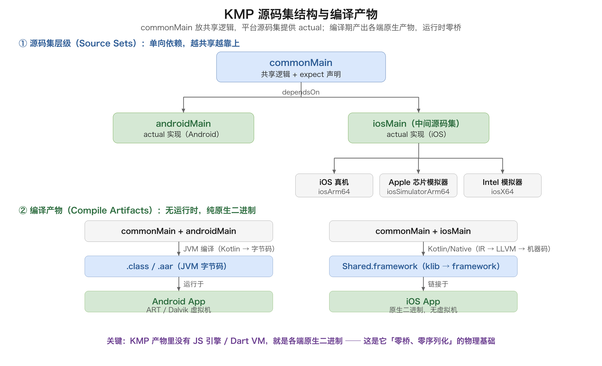

源码集之间的依赖是**单向、有方向**的，这是 KMP 最核心的约束：

| 规则 | 说明 |
| --- | --- |
| 平台源码集依赖共享源码集 | `androidMain`、`iosMain` 都能「看到」`commonMain` 的代码（`dependsOn(commonMain)`） |
| 共享源码集看不到平台源码集 | `commonMain` 里不能写 `android.os.Build`，因为编译 commonMain 时根本没有 Android SDK |
| 平台之间互相隔离 | `androidMain` 看不到 `iosMain`，反之亦然，避免平台代码串味 |

这个「单向依赖」可以概括成一句话：**越共享的代码越要靠上（commonMain），越平台的代码越要靠下（androidMain/iosMain）**。依赖用 Gradle 精确控制，每个源码集还能声明自己的第三方依赖：

```kotlin
// build.gradle.kts：声明目标平台 + 各源码集依赖
kotlin {
    androidTarget()
    listOf(iosArm64(), iosSimulatorArm64()).forEach {
        it.binaries.framework { baseName = "Shared" }
    }
    sourceSets {
        commonMain.dependencies {
            implementation("org.jetbrains.kotlinx:kotlinx-coroutines-core:1.8.0")
            implementation("org.jetbrains.kotlinx:kotlinx-serialization-json:1.6.3")
        }
        androidMain.dependencies {
            implementation("androidx.core:core-ktx:1.13.0")
        }
        iosMain.dependencies {
            // iOS 专属依赖
        }
    }
}
```

> **易错点**：新手最常见的错误是「把平台 API 写进 commonMain」。编译会直接报 `Unresolved reference`，因为 commonMain 编译时没有任何平台 SDK。正确的做法是把平台差异「下沉」到 expect/actual（见 6.3），或「上提」成抽象接口让各平台实现。

### 6.3 架构模型：expect/actual（编译期共享的本质）

KMP 能实现「零运行时桥」，靠的核心机制就是 **expect/actual**。它把「平台差异」从运行时挪到了编译期：

- **`expect`**：在 commonMain 里声明「我需要某个能力，但我不关心它怎么实现」——这是**契约（contract）**。
- **`actual`**：在每个平台源码集里提供「这个能力在本平台的真实实现」——这是**履约（implementation）**。

```kotlin
// commonMain：只声明契约，不含实现
expect fun platformName(): String
expect class PlatformInfo {
    fun deviceName(): String
}

class Greeting {
    fun greet(): String = "Hello from ${PlatformInfo().deviceName()}（${platformName()}）"
}
```

```kotlin
// androidMain：Android 履约
actual fun platformName() = "Android ${android.os.Build.VERSION.RELEASE}"
actual class PlatformInfo {
    actual fun deviceName() = android.os.Build.MODEL
}
```

```kotlin
// iosMain：iOS 履约
actual fun platformName() = "iOS ${UIDevice.currentDevice.systemVersion}"
actual class PlatformInfo {
    actual fun deviceName() = UIDevice.currentDevice.name
}
```

编译期发生了什么？每个平台编译时，编译器把 `expect` 声明和**该平台唯一对应的** `actual` 实现「钉」在一起，最终产出的代码里**不存在任何抽象层、桥、反射或序列化**——`Greeting().greet()` 在 Android 里就是直接调 `android.os.Build.MODEL`，在 iOS 里就是直接调 `UIDevice`，性能和手写原生代码一模一样。

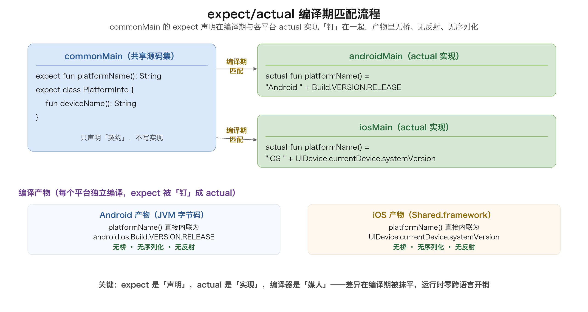

#### expect/actual 能用于哪些声明

`expect/actual` 几乎覆盖 Kotlin 的所有声明类型：

| 声明类型 | 示例 | 说明 |
| --- | --- | --- |
| 函数 | `expect fun now(): Long` | 最常用 |
| 类 | `expect class Clock()` | 类本身、方法、属性都要加 actual |
| 属性 | `expect val isDebug: Boolean` | getter 在平台侧实现 |
| 对象 | `expect object Log` | 单例 |
| 顶层变量 | `expect var appVersion: String` | |
| 注解 / 类型别名 | `expect annotation class` / `expect typealias` | 少见 |

#### 匹配规则与易错点（踩坑高发区）

1. **一 expect 必须恰好一 actual**：同一个 `expect` 在**每个编译目标**都必须有且仅有一个 `actual`。少一个 → 编译报「actual missing」；多一个 → 报「actual duplicate」。注意 iOS 有 `iosArm64`、`iosSimulatorArm64`、`iosX64` 多个目标，好在它们都依赖 `iosMain`，只要在 `iosMain` 写一份 actual 即可全部覆盖。

2. **包名必须完全一致**：`expect` 和 `actual` 必须在**相同的包名**下，否则编译器认为它们不是同一对。

3. **expect class 的限制**：不能有构造函数体、不能有 `init` 块、不能有 `lateinit` 属性、不能写 secondary constructor 的实现体。它的构造函数只能「声明签名」，不能「写实现」。

4. **默认参数的历史坑**：早期 `expect fun` 不能带默认参数值（默认值要写在 actual 侧），较新的 Kotlin 已放宽，但仍建议「默认值只写一处」以免两端行为不一致。

5. **可见性要匹配**：`actual` 的可见性必须与 `expect` 一致，不能 expect 是 public、actual 写成 internal。

6. **类型要对齐**：`expect` 用到的每个类型，其 `actual` 也要能被 `expect` 类型「看见」，否则报「expect 类型没有对应 actual」。

一句话记住：**expect 是「声明」，actual 是「实现」，编译器是「媒人」**——它在编译期把它们撮合成一段纯粹的原生代码，这正是 KMP 零开销的秘密。

### 6.4 Kotlin/Native 编译产物：从源码到 framework

KMP 的「原生」体现在编译产物上，Android 和 iOS 两侧完全不同：

| 平台 | 编译目标 | 中间产物 | 最终产物 | 运行时 |
| --- | --- | --- | --- | --- |
| Android | JVM | `.class` → `.jar` / `.aar` | Android 库 | ART/Dalvik 虚拟机 |
| iOS | Kotlin/Native | `.klib` | `.framework`（静态/动态） | 无虚拟机，纯原生二进制 |

**Android 侧**：Kotlin 代码走的是和普通 Android 开发一模一样的 JVM 编译，产出 JVM 字节码。KMP 的 Android 部分本质上就是「一个普通 Android 库」，没有任何运行时差异——这也是 Android 团队零门槛的原因。

**iOS 侧**：Kotlin/Native 编译器把 Kotlin 代码**直接编译成目标平台机器码**（不经过 JVM），产出 `Shared.framework`，可以像普通 iOS framework 一样被 Xcode 链接。编译流水线是：

```
Kotlin 源码 → Kotlin/Native 前端（类型检查）→ 中间表示 IR → LLVM 后端 → 目标机器码 → 打包成 .framework
```

关键产物是 **klib（Kotlin Library）**——Kotlin/Native 的库格式，类似 Java 的 `.jar`，包含编译后的 IR + 元数据，用于在 KMP 模块之间共享代码。第三方 KMP 库（kotlinx-coroutines、ktor、SQLDelight 等）就是以 klib 形式发布的。

iOS framework 有两种形态：

- **静态 framework（static）**：代码直接链接进 App 二进制，启动快、无额外动态库，是默认推荐。
- **动态 framework（dynamic）**：作为独立动态库存在，可被多个 target 共享，但增加启动开销。

```kotlin
// 生成 framework 的配置
kotlin {
    listOf(iosArm64(), iosSimulatorArm64(), iosX64()).forEach {
        it.binaries.framework {
            baseName = "Shared"
            isStatic = true   // true = 静态 framework
        }
    }
}
```

在 Xcode 里，通过 Gradle 任务 `embedAndSignAppleFrameworkForXcode` 把 framework 嵌入并签名，Swift 代码就能 `import Shared` 直接调用 Kotlin。这也是 KMP 和 RN/Flutter 的根本差别：**RN/Flutter 的产物里带了一个「运行时」（JS 引擎 / Dart VM），而 KMP 的产物里没有运行时，就是纯原生二进制**。

### 6.5 互操作：Kotlin 与 Swift/Objective-C 双向调用

「原生共享逻辑」要落地，关键在**互操作（interop）**——Kotlin 和平台原生代码要能双向调用。

#### 方向一：Kotlin 调用平台 API（cinterop）

Kotlin/Native 通过 **cinterop** 机制调用 C / Objective-C 框架。做法是写一个 `.def` 文件声明要导入的库：

```
// platform.def
language = Objective-C
package = com.example.shared
modules = UIKit Foundation
```

然后在 Gradle 里用 `cinterops { }` 声明，编译后就能在 Kotlin 里直接 `import platform.UIKit.*` 调用 UIKit。像 `UIDevice`、`NSUserDefaults` 这些 iOS 系统 API，官方已经预置了对应的 platform 库，开箱即用。

#### 方向二：Swift 调用 Kotlin（framework 导出）

生成的 `Shared.framework` 会把 Kotlin 的公开 API「翻译」成 Swift 能看懂的接口：

```swift
import Shared

let greeting = Greeting()
print(greeting.greet())              // Kotlin 类直接被 Swift 调用
print(PlatformInfo().deviceName())
```

类型和命名映射有几条规则要记：

| Kotlin | Swift/Objective-C | 说明 |
| --- | --- | --- |
| `String` | `String` | 无缝 |
| `Int` | `Int32` | Kotlin Int 是 32 位 |
| `Long` | `Int64` | |
| `List<T>` | `[T]` / `NSArray` | |
| `suspend fun` | `async` 函数 | Kotlin 1.5.30+ 自动映射为 Swift async/await |
| `@Throws` 异常 | `NSError` | 不带 @Throws 的异常会直接崩溃 |

> **易错点**：
> 1. **`Int`/`Long` 在 Swift 里是 `Int32`/`Int64`**，不是 Swift 的 `Int`，直接赋给 `Int` 会编译报错，需要 `Int(value)` 转换。
> 2. **可空性要显式**：Kotlin 的 `String?` 导出到 Swift 是 `String?`，但来自 ObjC 的平台类型在 Swift 里可能变成隐式解包 `String!`，要留意空安全。
> 3. **suspend 函数跨语言有开销**：导出为 Swift async/await 虽方便，但底层会创建 continuation，频繁跨语言调用 suspend 函数不如纯 Kotlin 内部调用高效，热路径尽量收敛在 Kotlin 内部。
> 4. **泛型会被擦除/降级**：Kotlin 泛型导出到 ObjC 有类型擦除，复杂泛型（如 `Flow<Result<T>>`）跨语言时表达力有损失。

### 6.6 Compose Multiplatform：把 UI 也跨了

KMP 原本只跨逻辑，但 JetBrains 推出了 **Compose Multiplatform（CMP）**，把 Jetpack Compose 的声明式 UI 也跨了——Android、iOS、桌面（Windows/macOS/Linux）、Web 都能用一套 Compose 代码写 UI（iOS 端 2024 年 stable）。这让 KMP 路线出现了两条子路线：

1. **纯逻辑共享（KMP 经典用法）**：逻辑跨，UI 各写原生。最保守、最稳、性能最好。
2. **Compose Multiplatform（CMP）**：逻辑 + UI 都跨，用 Compose 一套 UI 跑 Android 和 iOS。开发效率更高，但 UI 层引入了一层渲染引擎。

#### 架构分层：一套 UI 为何能多端跑

CMP 之所以能「一套 UI 多端跑」，靠的是清晰的分层：最上层是共享的 Compose 代码，中间是声明式 UI 框架，底层是自绘引擎 + 各平台图形后端。

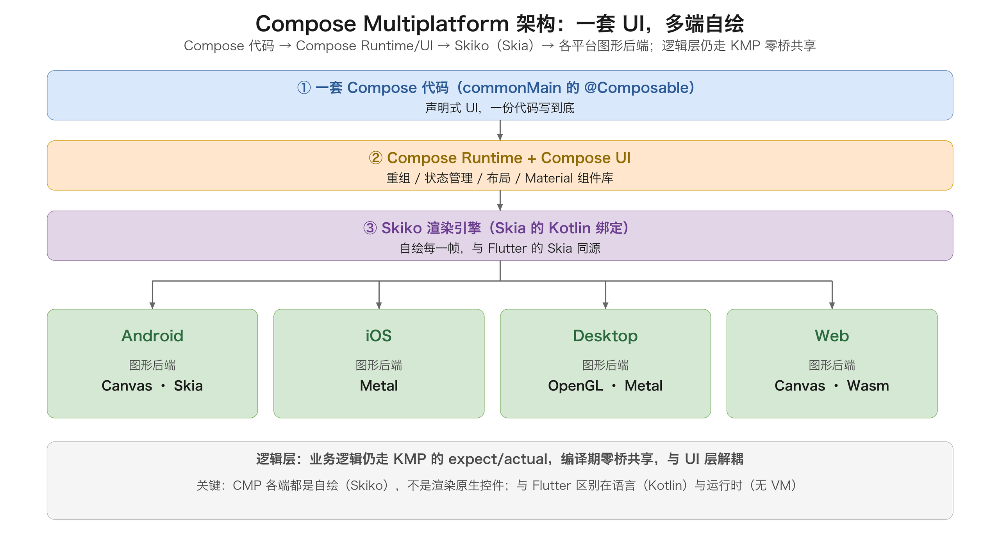

从上往下理解这四层：

| 层 | 作用 | 跨平台程度 |
| --- | --- | --- |
| ① Compose 代码 | `@Composable` 函数描述的 UI，写在 commonMain | 完全跨平台 |
| ② Compose Runtime + Compose UI | 声明式 UI 框架：重组（recomposition）、状态管理、布局、组件库 | 完全跨平台 |
| ③ Skiko 渲染引擎 | Skia 的 Kotlin 绑定，负责自绘每一帧 | 完全跨平台（各端同一套引擎） |
| ④ 平台图形后端 | Android Canvas/Skia、iOS Metal、桌面 OpenGL/Metal、Web Canvas/Wasm | 平台相关（薄薄一层） |

关键点在于**第 ③ 层 Skiko**：它和 Flutter 用的 Skia 是同一套 2D 图形引擎，区别只是 Flutter 用 Dart 调 Skia、CMP 用 Kotlin 调 Skia。所以 CMP 和 Flutter 在「渲染」这一层是**同源**的——都是自绘，都不是渲染原生控件。

#### 代码示例：一套 Compose 跑多端

```kotlin
// commonMain：一套 Compose UI，Android/iOS/桌面/Web 共用
@Composable
fun Counter() {
    var count by remember { mutableStateOf(0) }
    Column(
        modifier = Modifier.fillMaxSize().padding(16.dp),
        horizontalAlignment = Alignment.CenterHorizontally,
        verticalArrangement = Arrangement.Center
    ) {
        Text("当前计数：$count", fontSize = 24.sp)
        Button(onClick = { count++ }) {
            Text("+1")
        }
    }
}
```

这段 `Counter` 组件在 Android（Compose 渲染）、iOS（Skiko + Metal 渲染）、桌面（Skiko + OpenGL）、Web（Wasm + Canvas）上渲染出**同一套 UI**，不需要写任何平台专属代码。这就是 CMP 相对「纯逻辑共享」的最大诱惑：**UI 也只需写一份**。

#### 澄清一个常见误解：CMP 是「自绘」，不是「原生控件」

很多人以为 CMP 在 iOS 上是「把 Compose 翻译成 SwiftUI/UIKit 的原生控件」，这是错的。**CMP 在各端都是自绘**——用 Skiko 把 UI 逐像素画出来，各平台只提供一块「画布」（Android 的 Canvas、iOS 的 Metal、桌面的 OpenGL/Metal、Web 的 Canvas）。

这带来的好处和代价都和 Flutter 类似：

- **好处**：跨平台一致性极高，Android 和 iOS 的 UI 像素级一致，不依赖各端原生控件的行为差异。
- **代价**：自绘的观感、手感是「模拟」原生，不是真原生；某些系统级交互（如 iOS 的原生返回手势、系统级文本选择菜单）需要额外适配；动画性能受 Skiko 成熟度影响。

#### CMP 与 Jetpack Compose 的关系

一句话：**CMP 是 Jetpack Compose 的「跨平台超集」**。Jetpack Compose 只能在 Android 上跑；CMP 把 Compose Runtime、Compose UI 组件库、Material 组件这些核心层抽出来做成了跨平台，再给每个平台接上 Skiko 后端。Android 开发者写 Compose 的经验可以几乎无缝迁移到 CMP——学习成本接近零，这正是 CMP 的核心竞争力。

#### 三条子路线的选择

KMP 生态现在实际有三条渐进路线可选：

| 路线 | 逻辑 | UI | 适用场景 |
| --- | --- | --- | --- |
| 纯逻辑共享 | KMP 共享 | 各端原生 | 已有双端原生团队、UI 要求极致原生体验 |
| 混合 | KMP 共享 | 部分 Compose + 部分原生 | 存量原生 App 逐步引入 Compose 页面 |
| CMP 全跨 | KMP 共享 | 全 Compose | Android 团队向 iOS 扩张、UI 一致性优先 |

#### 成熟度与局限

CMP 的价值很明确，但选型前要认清它的现状：

- **iOS 端 2024 年才 stable**，动画性能、文本渲染、无障碍（accessibility）等仍在追赶 Flutter 和原生。
- **生态还在早期**：导航库（Compose Navigation 多端版）、图片加载、生命周期适配等第三方库不如 Flutter 丰富。
- **Skiko 的包袱**：Skiko 作为 Skia 的 Kotlin 绑定，版本演进和 bug 修复依赖 JetBrains，遇到渲染 bug 时排查链路比 Flutter 更长。
- **与原生 UI 混用有成本**：CMP 页面要嵌入原生 App，需要处理 UIViewController/Activity 的容器桥接，比 Flutter 的 add-to-app 更年轻。

| 维度 | CMP（Compose Multiplatform） | Flutter |
| --- | --- | --- |
| UI 语言 | Kotlin + Compose | Dart + Widget |
| 渲染引擎 | Skiko（Skia 绑定，Metal/OpenGL 后端） | Skia / Impeller |
| 运行时 | 无（编译成原生） | 自带 Dart VM |
| 逻辑层 | KMP 共享（原生零桥） | Dart，跨语言靠 Platform Channel |
| iOS 成熟度 | 2024 年才 stable，生态较新 | 成熟 |
| 适合谁 | 已有 Kotlin/Compose 的 Android 团队 | 追求极致一致性的新团队 |

一句话总结：**CMP 是「用 Compose 一套 UI 跨所有端」的 KMP 进阶形态**。它和 Flutter 在「自绘渲染」上同源，区别在于语言（Kotlin vs Dart）和运行时（无 VM vs 带 VM）。它最大的价值是让 Android 团队零成本扩展到 iOS/桌面/Web；但 iOS 端的成熟度和生态仍在追赶 Flutter，选型时要在「团队已有 Compose 资产」和「iOS 端成熟度」之间权衡。

### 6.7 内存模型与并发

Kotlin/Native 和 JVM 最大的技术差异之一，在**内存模型与并发**上。这曾经是 KMP 劝退很多人的第一道坎，但现在已大幅简化。

#### 旧内存模型：手动 freeze（已被淘汰）

早期 Kotlin/Native 的并发模型是「**每个线程独立内存 + 对象所有权**」：一个线程创建的对象默认不能被另一个线程访问，跨线程共享前必须显式调用 `freeze()` 把对象「冻结」成不可变。忘了 freeze，运行时就抛 `InvalidMutabilityException`。这套模型能避免数据竞争，但心智负担极大，是 KMP 被吐槽最多的地方。

#### 新内存模型：自动内存管理（现行标准）

从 Kotlin 1.7.20 起，**新内存模型（New Memory Model）成为默认**（1.9 起旧模型被彻底移除）。新模型下：

- **不需要 freeze**，对象可以自由跨线程共享。
- 内存自动管理，有独立的 GC，行为向 JVM 靠拢。
- 依然推荐用**协程 + `Dispatchers`** 而不是手撸线程，因为 Kotlin/Native 的线程创建成本高。

```kotlin
// 新内存模型下：协程跨线程共享状态，无需 freeze
class Counter {
    private val _count = MutableStateFlow(0)
    val count: StateFlow<Int> = _count

    fun increment() { _count.value++ }  // 直接改，无需 freeze
}
```

| 对比 | 旧模型（已淘汰） | 新模型（现行） |
| --- | --- | --- |
| 跨线程共享 | 必须 `freeze()` | 直接共享 |
| 忘记 freeze | 运行时崩溃 | 无此问题 |
| 内存回收 | 引用计数为主 | 自动 GC |
| 并发推荐方式 | 受限的线程 | 协程 + Dispatchers |

> **易错点**：新内存模型解决的是「对象能不能共享」，不是「并发安全」。多线程同时改一个可变状态依然会竞态，该用 `Mutex`、`Atomic`、`StateFlow` 的地方还是得用。很多人误以为「新模型 = 自动线程安全」，这是错的。

### 6.8 优缺点

优点：

- 性能最佳：编译成原生代码，零运行时桥、零序列化，逻辑层性能和原生一模一样。
- 原生体验最佳：UI 用各端原生写（或 CMP），没有「模拟原生」的违和感。
- 渐进式接入：可以只共享一小部分逻辑，不强制全量迁移，对已有原生项目友好。
- Kotlin 生态：Android 团队零门槛上手，代码可测试性、类型安全好。

缺点：

- **UI 不跨（经典 KMP）**：iOS UI 还是要写 SwiftUI/UIKit，团队得懂两套 UI 栈。
- iOS 侧工具链仍在完善：Kotlin/Native 的编译、调试、Xcode 集成（embedAndSignAppleFrameworkForXcode）体验不如原生顺畅。
- 生态相对年轻：共享库生态不如 RN/Flutter 丰富，冷门能力要自己写 expect/actual。
- 二进制产物：iOS 侧要导出 framework，构建流程和 CI 比纯原生复杂。

一句话总结：KMP 是「用『UI 各写』换『逻辑零损耗共享』」的方案。它最适合「已有 Android/Kotlin 团队、iOS 有原生团队、业务逻辑复杂且价值高」的项目，是「渐进式跨平台」的最佳代表。

## 七、深度横向对比

把前面所有方案放在一起横向看，差别集中在几个关键维度上。先看一张总对比表：

| 维度 | Hybrid/Cordova | React Native | Flutter | KMP |
| --- | --- | --- | --- | --- |
| 渲染方式 | WebView 浏览器内核 | 原生控件 | 自绘引擎（Skia/Impeller） | 各端原生 |
| 语言 | JS/HTML/CSS | JS/TS(React) | Dart | Kotlin |
| 逻辑-平台通信 | JSBridge | 桥（旧）/JSI（新） | 无桥渲染 + Platform Channel | 编译期共享（零桥） |
| 跨平台一致性 | 差（内核碎片） | 中（平台差异在） | 极高（像素级） | 高（UI 各写原生） |
| 性能 | 弱 | 中-良（新架构良） | 良-优 | 优（逻辑零损耗） |
| 动态化/热更新 | 最强（H5 下发） | 强（JS bundle 下发） | 弱（AOT，受审核限制） | 弱（编译产物） |
| 包体积 | 小 | 中 | 大（引擎几 MB） | 中 |
| 生态成熟度 | 成熟（Web 生态） | 最成熟 | 成熟 | 成长中 |
| 学习成本 | 低 | 中 | 中（Dart） | 中（Kotlin） |
| 原生能力访问 | JSBridge 逐一暴露 | 原生模块 | Platform Channel | 原生直调 |
| 适合团队 | Web 前端 | 前端/React | 追求一致的团队 | Android/Kotlin |

### 7.1 渲染机制对比：性能的根源

性能差异的根源，几乎全在「渲染机制」上。把渲染链路抽象成一条线，不同方案在这条线上的位置不同：

- **WebView 渲染**（Hybrid）：HTML → DOM/CSSOM → Render Tree → Layout → Paint → Composite。链路最长、最重，每次变化都可能重排重绘。
- **原生控件渲染**（RN）：JS 描述 → 桥 → 原生控件更新。原生控件本身性能好，但「桥」和「跨线程」是额外开销。
- **自绘渲染**（Flutter）：Widget → Element diff → RenderObject → Skia 光栅化。链路自控、无桥、最小化重绘，性能最优。
- **原生直渲染**（KMP）：各端原生写 UI，逻辑层零开销，UI 层就是原生性能。

一句话：**渲染权越「自控」，性能天花板越高；渲染权越「交给平台」，一致性越好但性能越受平台限制**。这是理解所有跨端性能差异的总纲。

### 7.2 通信机制对比：成本的根源

通信机制决定「开发成本」和「高频交互性能」：

| 方案 | 通信机制 | 开销 | 说明 |
| --- | --- | --- | --- |
| Hybrid | JSBridge | 高（每次跨运行时 + 序列化） | 能力调用频繁时成本明显 |
| RN（旧） | 异步批量桥 | 中-高（序列化 + 串行 + 批量） | 高频交互是瓶颈 |
| RN（新） | JSI 同步直连 | 低 | 函数级直连，接近无桥 |
| Flutter | 渲染无桥 + Platform Channel | 低（渲染零开销，仅原生调用有开销） | 渲染与能力调用解耦 |
| KMP | 编译期共享 | 零 | 运行时无桥无序列化 |

这个对比揭示一个趋势：**从「运行时桥」到「编译期共享」，通信成本一路降低**。RN 新架构的 JSI 是「把桥变薄」，Flutter 是「渲染不经过桥」，KMP 是「直接没有桥」。越新的方案，越在努力消灭「跨语言通信」这个历史包袱。

## 八、选型决策与未来趋势

### 8.1 选型判断准则

选型没有标准答案，但有几个能落地的判断准则：

1. **看渲染需求**：需要像素级一致、复杂动画、独特 UI → Flutter；只要「接近原生、够用」→ RN；UI 各端原生体验优先 → KMP。
2. **看动态化需求**：强动态化（频繁更新、运营活动页）→ Hybrid 或 RN；弱动态化、稳定性优先 → Flutter/KMP。
3. **看团队技术栈**：前端/React 团队 → RN；Web 前端 → Hybrid；Kotlin/Android 团队 → KMP；想学新语言且追求一致 → Flutter（Dart）。
4. **看目标平台**：iOS+Android → RN/Flutter/KMP；还要 Web/桌面 → Flutter。
5. **看项目阶段**：快速验证 MVP → Hybrid（最快上线）；长期演进、逻辑复杂 → KMP 共享逻辑 + 各端原生 UI，或 Flutter 全跨。
6. **看包体积敏感度**：对包体积敏感（如东南亚市场、低端机）→ 慎用 Flutter；不敏感 → Flutter 无压力。

### 8.2 常见组合方案

真实工程里，几乎没有项目只用一种方案，都是组合：

- **原生 + H5**：核心页面原生，运营活动页、帮助中心、低频页用 H5（Hybrid）。这是最普遍、最稳的组合。
- **原生 + Flutter 模块（add-to-app）**：老原生 App 逐步用 Flutter 重写部分模块，平滑迁移。
- **RN + 原生模块**：RN 承载大部分 UI，性能敏感、能力复杂的模块用原生写，通过桥/模块接入。
- **KMP 共享逻辑 + 原生 UI**：业务逻辑用 KMP 共享，iOS/Android UI 各写原生，逻辑零损耗、体验原生。

组合的核心原则是：**哪里体验要求高，哪里用原生/自绘；哪里动态化要求高，哪里用 Web；哪里逻辑价值高，哪里用共享**。

### 8.3 未来趋势

跨平台技术的未来，几个明确的方向：

1. **编译期共享取代运行时桥**：KMP 的 expect/actual、RN 的 JSI、Flutter 的「渲染无桥」，都在往「编译期解决差异、运行时零开销」走。未来的跨端框架，桥会越来越薄甚至消失。
2. **自绘引擎继续进化**：Impeller 等新一代渲染引擎都在把「运行时开销」压到极限。自绘路线的性能天花板还会再抬。
3. **AI 辅助跨端**：大模型生成多端代码、跨端框架的 DSL 转换，正在降低跨端开发的「适配成本」。
4. **鸿蒙成为新变量**：国内多端覆盖里，鸿蒙平台正在成为必须考虑的新一端，主流跨端框架都在积极适配。
5. **「逻辑共享 + 原生 UI」回归**：当 UI 框架（SwiftUI/Compose）越来越成熟、声明式 UI 成为主流后，很多团队发现「UI 各写原生、逻辑共享」比「UI 强跨」更务实。KMP 路线的价值会被重新认识。

### 8.4 结语

跨平台技术没有「终极答案」，只有「当前约束下的最优解」。渲染方式决定性能天花板，通信方式决定开发成本，动态化需求决定 Web 技术的占比，团队技术栈决定迁移成本。理解这四条，就不会被「XX 框架要取代 YY」的营销话术带偏——**每个方案都是在特定约束下，用某一种代价换某一种收益**。

真正的选型智慧是：先搞清楚「我要什么」（体验、速度、动态化、成本），再去看「每个方案用什么代价换什么收益」，最后选「代价我付得起、收益我正需要」的那一个。方案会过时，但这个判断框架不会过时。

## 附：高频速记

**跨平台本质**：渲染方式决定性能天花板，通信方式决定开发成本，动态化决定 Web 技术占比。

**演进五代**：WebView 套壳 → JSBridge 增强 Hybrid → 原生渲染桥（RN）→ 自绘引擎（Flutter）→ 原生共享逻辑（KMP）。

**Hybrid**：WebView 渲染 + JSBridge 通信；动态化最强、体验最弱；适合运营页、低频页。

**JSBridge 三实现**：URL 拦截（兼容好）、注入对象（直观但有安全风险）、消息通道（requestId + 回调表，最规范）。

**RN**：JS 驱动原生控件渲染，桥（异步批量串行）是瓶颈；新架构 JSI 同步直连 + Fabric 并发渲染。

**Flutter**：Dart + Skia/Impeller 自绘，渲染无桥、三棵树最小化重绘；Platform Channel 只用于调原生能力；一致性最高、包体积最大。

**KMP**：Kotlin 写逻辑，expect/actual 编译期共享，运行时零桥；UI 各写原生（或 CMP 跨 UI）；性能最佳、逻辑价值最高。

**通信成本排序**：KMP（零桥）< Flutter（渲染无桥）< RN 新架构 JSI < RN 旧架构桥 < Hybrid JSBridge。

**动态化排序**：Hybrid > RN > Flutter ≈ KMP。

**选型口诀**：看渲染需求、看动态化、看团队技术栈、看目标平台、看项目阶段、看包体积敏感度；真实项目多用「原生 + H5 / Flutter 模块 / KMP 逻辑共享」的组合。


