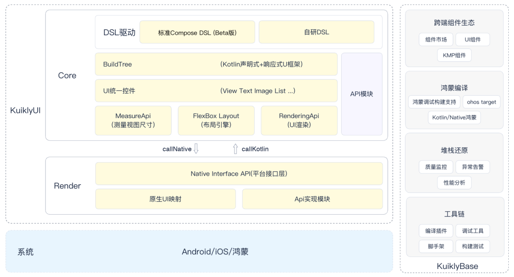
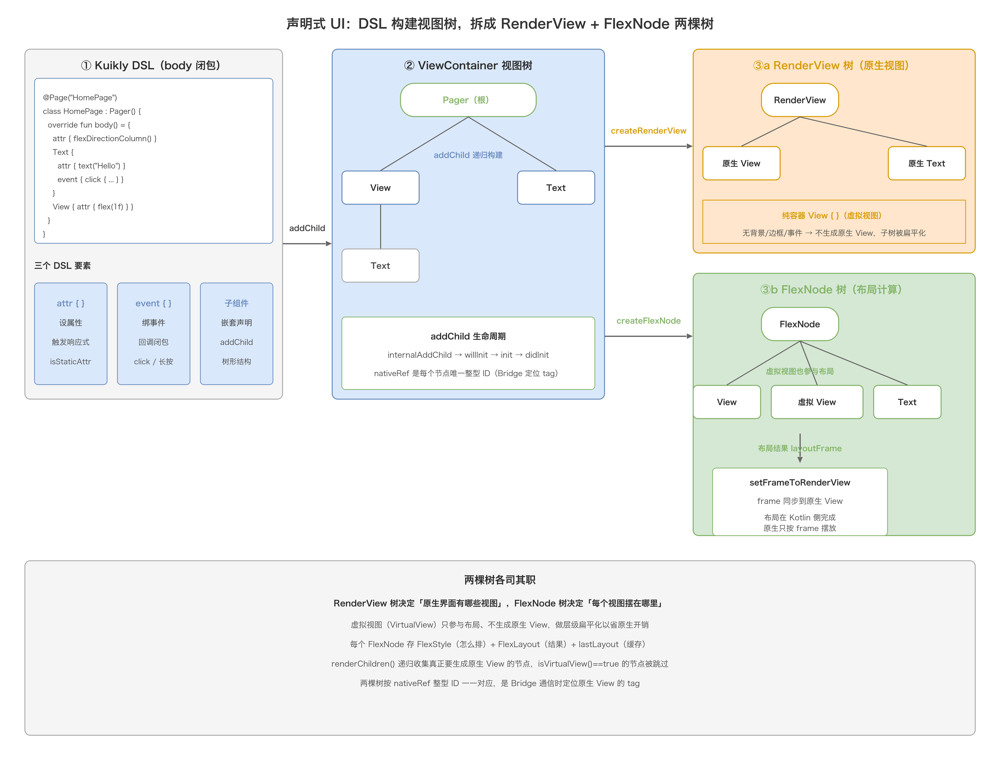
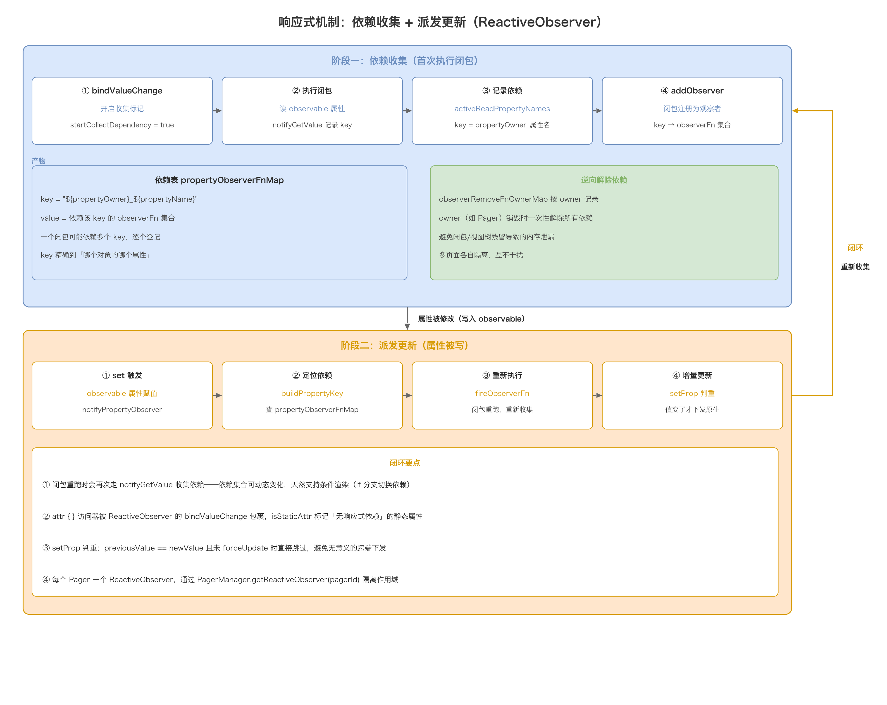
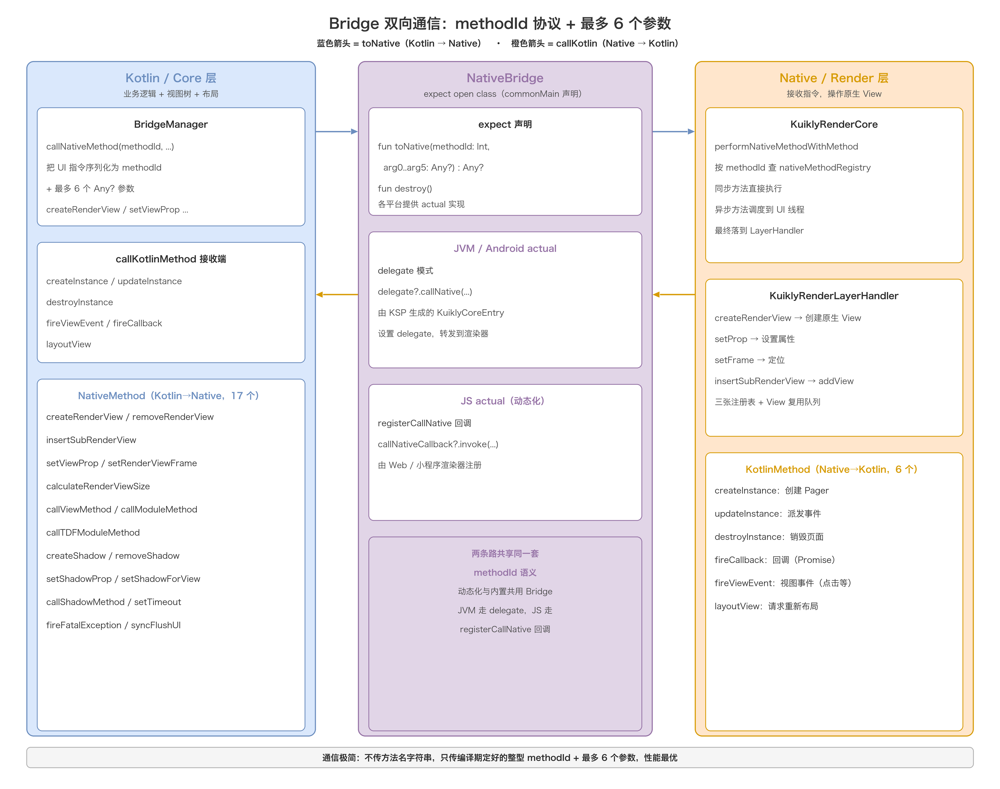
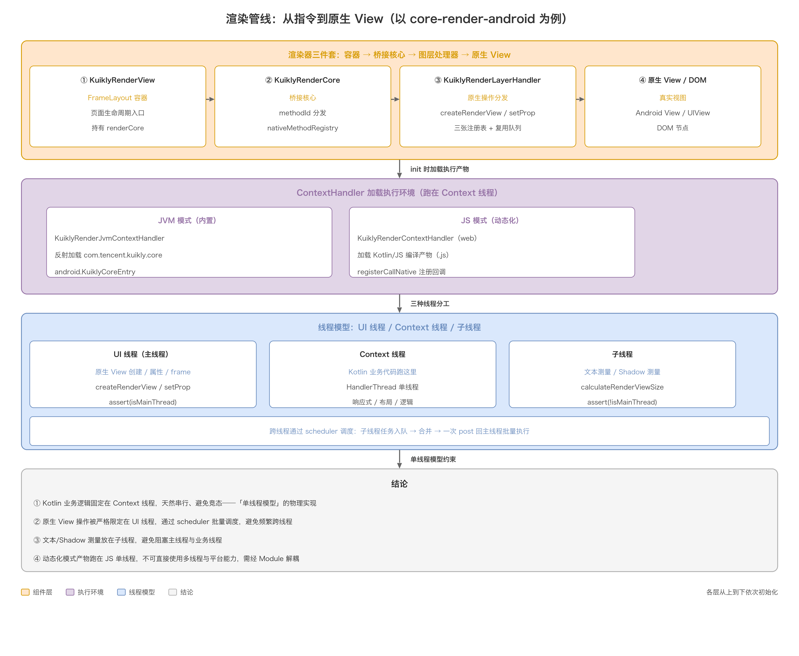
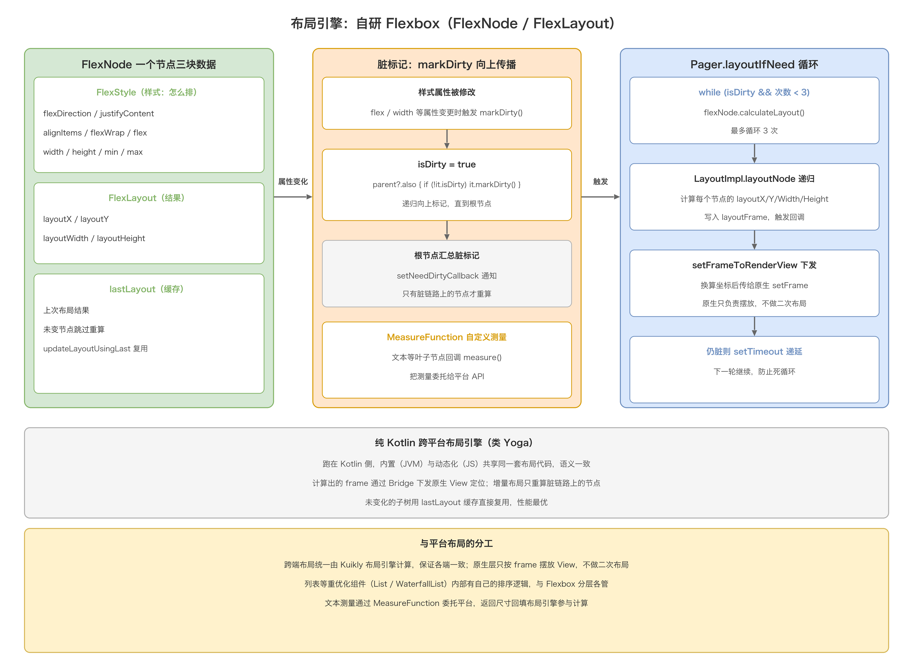
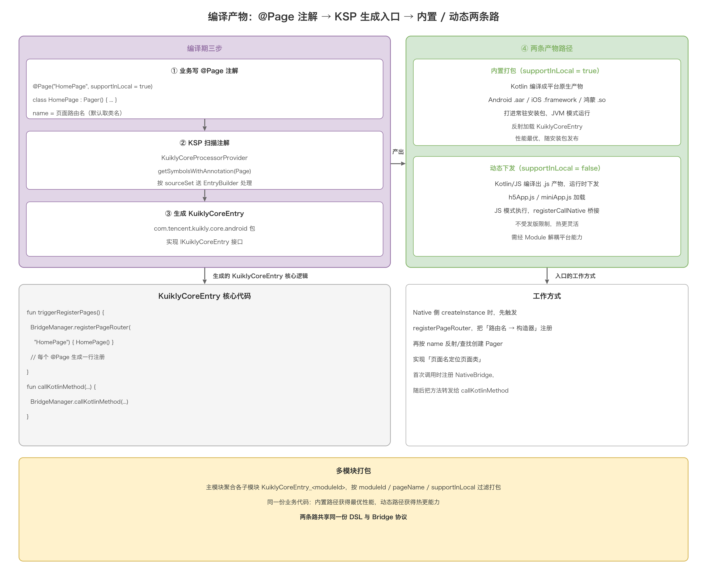

# 02. Kuikly 跨端框架总览

> `Kuikly` 是腾讯大前端 Oteam 推出的、基于 Kotlin Multiplatform（KMP）的 UI 与逻辑全面跨端框架，口号是「一码六端」，已落地 Android、iOS、鸿蒙、Web、小程序、macOS。它和 RN、Flutter 走的是完全不同的路：既不像 RN 用 JS 驱动、也不像 Flutter 自绘渲染，而是用 Kotlin 写一份逻辑和 UI 声明，把「画什么、摆在哪」翻译成协议化指令，交给各平台**原生组件**去渲染。这篇总览从「框架长什么样」讲起——先把它的整体结构、代码目录、内置能力摆清楚，再钻进源码，把响应式、布局、Bridge、渲染、动态化这条核心链路讲透。读完你会有两张地图：一张「这个框架由哪些模块组成」，一张「一条指令从 Kotlin 到原生 View 经过了什么」。

## 目录

- [一、定位与核心思想](#一定位与核心思想)
  - [1.1 一句话定位](#11-一句话定位)
  - [1.2 与 RN / Flutter / CMP 的差别](#12-与-rn--flutter--cmp-的差别)
  - [1.3 三大核心特点](#13-三大核心特点)
- [二、总体框架结构](#二总体框架结构)
  - [2.1 官方架构总览](#21-官方架构总览)
  - [2.2 核心模块职责](#22-核心模块职责)
- [三、代码目录结构](#三代码目录结构)
  - [3.1 仓库顶层目录](#31-仓库顶层目录)
  - [3.2 core 模块的包结构](#32-core-模块的包结构)
  - [3.3 compose 模块结构](#33-compose-模块结构)
  - [3.4 各端渲染器与宿主壳](#34-各端渲染器与宿主壳)
- [四、核心能力全景](#四核心能力全景)
  - [4.1 内置组件清单](#41-内置组件清单)
  - [4.2 内置 Module 清单](#42-内置-module-清单)
- [五、核心机制：从 DSL 到原生 View](#五核心机制从-dsl-到原生-view)
  - [5.1 声明式 UI 与双树结构](#51-声明式-ui-与双树结构)
  - [5.2 响应式机制](#52-响应式机制)
  - [5.3 Bridge 协议](#53-bridge-协议)
  - [5.4 渲染管线](#54-渲染管线)
- [六、布局引擎 Flexbox](#六布局引擎-flexbox)
  - [6.1 为什么要自研 Flexbox](#61-为什么要自研-flexbox)
  - [6.2 FlexNode 与脏标记](#62-flexnode-与脏标记)
  - [6.3 布局触发与循环](#63-布局触发与循环)
  - [6.4 MeasureFunction 测量注入](#64-measurefunction-测量注入)
- [七、编译产物与动态化](#七编译产物与动态化)
  - [7.1 @Page → KSP → KuiklyCoreEntry](#71-page--ksp--kuiklycoreentry)
  - [7.2 Android 打包](#72-android-打包)
  - [7.3 iOS 打包](#73-ios-打包)
  - [7.4 内置打包与动态下发](#74-内置打包与动态下发)
- [八、完整流程串联](#八完整流程串联)
- [附：高频速记](#附高频速记)

## 一、定位与核心思想

### 1.1 一句话定位

Kuikly 的核心思想是「逻辑跨端 + UI 跨端」两手抓，但两者走的技术路径不一样：

- **逻辑跨端靠 KMP**。业务逻辑、网络、存储、协程这些不碰 UI 的东西，用 Kotlin 写一份，编译到各平台。
- **UI 跨端靠「抽象通用 UI 渲染接口，复用平台原生组件」**。它不是自绘引擎，而是定义了一套跨端的视图描述和指令协议，各平台渲染器把这套指令翻译成本平台真正的原生 View（Android 的 `View`、iOS 的 `UIView`、鸿蒙的 ArkUI、Web 的 DOM）。

一句话概括：**Kotlin 写一份逻辑和 UI 声明，渲染复用各平台原生组件，靠一套 Bridge 协议把两者连起来**。这样既拿到了 KMP 的「一份代码」，又拿到了原生渲染的「性能和体验」。

### 1.2 与 RN / Flutter / CMP 的差别

四个主流跨端方案放在一起看，差别主要在「渲染模型」和「逻辑语言」上：

| 维度 | Kuikly | React Native | Flutter | Compose Multiplatform |
| --- | --- | --- | --- | --- |
| 逻辑语言 | Kotlin（KMP） | JavaScript / TS | Dart | Kotlin（KMP） |
| 渲染模型 | 复用原生组件 | 复用原生组件（Bridge 驱动） | 自绘引擎（Skia / Impeller） | 自绘引擎（Skiko） |
| 布局引擎 | 自研 Flexbox（纯 Kotlin） | Yoga（C++） | 自研 Flex（Dart） | Compose 测量布局 |
| 通信 | 协议化 methodId，极简 | JS Bridge（可序列化消息） | 无（同进程） | 无（同进程） |
| 动态化 | 可（Kotlin/JS 产物下发） | 可（JS Bundle 下发） | 受限（AOT） | 受限 |
| SDK 体积 | 小（AOT 下 Android 约 300KB） | 中 | 较大（引擎） | 较大（引擎） |

这张表里最值得记住的是：**Kuikly 和 RN 同属「复用原生组件」，但通信协议比 RN 轻得多；和 CMP 同属 KMP 阵营，但渲染模型相反（Kuikly 复用原生、CMP 自绘）**。所以 Kuikly 可以看成「KMP 版的、渲染模型更接近 RN 的方案」——它把 RN 的 JS 换成了 Kotlin，把 Flutter/CMP 的自绘换成了原生渲染。

### 1.3 三大核心特点

Kuikly 最有辨识度的三个点：

1. **原生渲染**：最终画出来的是各平台真正的原生控件，不是画在 Canvas 上的像素。这意味着手势、无障碍、字体渲染、系统行为都天然符合平台习惯，也省掉了自绘引擎的体积和启动成本。
2. **协议化 Bridge**：跨端通信不传方法名字符串，只传编译期定好的整型 `methodId` + 最多 6 个参数，把通信成本压到最低（详见 5.3）。
3. **单线程模型**：业务代码固定在一条 Context 线程串行执行，天然无竞态；这也让「内置（JVM）」和「动态化（JS）」两种模式共享同一套单线程心智（详见 5.4）。

## 二、总体框架结构

### 2.1 官方架构总览

下图是 Kuikly 官方的整体架构图，一图看懂它的分层和双向通信：



从左到右、从上到下拆解这张图：

**左侧是 KuiklyUI 主体（虚线框），分 Core / Render / 系统三层：**

- **Core 层**：跨端共享的核心逻辑，全部用 Kotlin 写在 `commonMain`。
  - **DSL 驱动**：两种写 UI 的语法——「标准 Compose DSL」（Beta 版）和「自研 DSL」，最终都落到同一套声明式 UI 框架上。
  - **BuildTree**：Kotlin 声明式 + 响应式 UI 框架，负责把 DSL 声明构建成视图树。
  - **UI 统一控件**：跨端统一的组件抽象（View、Text、Image、List…），对应 4.1 的内置组件清单。
  - 底部三个 API 是 Core 对外的三件套：**MeasureApi**（测量视图尺寸）、**FlexBox Layout**（布局引擎，第六章专题）、**RenderingApi**（UI 渲染）。
  - 右侧纵贯的 **API 模块**：跨端层访问平台能力的解耦通道（对应 4.2 的 Module 清单）。
- **Core 与 Render 之间**：靠 `callNative`（Kotlin → 原生，向下）和 `callKotlin`（原生 → Kotlin，向上）双向通信，这就是 5.3 讲的 Bridge 协议。
- **Render 层**：**Native Interface API**（平台接口层）统一收口，下面接「原生 UI 映射」和「Api 实现模块」——把抽象指令翻译成具体平台的原生 View 和能力实现。
- **系统层**：Android / iOS / 鸿蒙三端，最终落到真正的原生控件。

**右侧是 KuiklyBase（逻辑跨端基建）**，是「用 Kuikly 造 App 过程中沉淀的逻辑跨端设施」，分四个模块：

| 模块 | 职责 |
| --- | --- |
| 跨端组件生态 | 组件市场、UI 组件、KMP 组件 |
| 鸿蒙编译 | 鸿蒙调试构件支持、ohos target、Kotlin/Native 鸿蒙 |
| 堆栈还原 | 质量监控、异常告警、性能分析 |
| 工具链 | 编译插件、调试工具、脚手架、构建测试 |

> 一句话记住这张图：**KuiklyUI 解决「UI 怎么跨端」，KuiklyBase 解决「逻辑和工程怎么跨端」**。本文聚焦 KuiklyUI，但要知道 KuiklyBase 是它的配套底座。

### 2.2 核心模块职责

从源码仓库看，KuiklyUI 的模块划分如下：

| 模块 | 职责 | 代码平台 |
| --- | --- | --- |
| `core` | 跨端核心：响应式、DSL、布局引擎、Bridge 协议、组件库、动画、手势 | commonMain 共享 |
| `core-render-android` | Android 渲染器：把指令翻译成原生 View | androidMain |
| `core-render-ios` | iOS 渲染器：翻译成 UIView | appleMain |
| `core-render-ohos` | 鸿蒙渲染器：翻译成 ArkUI | ohosArm64Main |
| `core-render-web` | Web / 小程序渲染器：翻译成 DOM | jsMain |
| `compose` | Compose DSL：Jetpack Compose 1.7.3 的 KMP 移植 | commonMain |
| `core-annotations` | `@Page` 等注解定义 | 纯 Kotlin |
| `core-ksp` | KSP 注解处理器，生成入口文件 `KuiklyCoreEntry` | JVM |
| `demo` | DSL 示例代码（374 个 kt 文件，最大学习宝藏） | commonMain |
| `androidApp` / `iosApp` / `ohosApp` / `h5App` / `miniApp` / `macApp` | 各端宿主壳工程 | 各端 |

核心关系一句话：**`core` 是心脏（跨端共享），`core-render-*` 是四肢（各端落地），`compose` 是第二套 DSL 皮肤，`core-annotations` + `core-ksp` 是编译期装配线，`demo` 和各端 App 是使用方**。

## 三、代码目录结构

### 3.1 仓库顶层目录

```
KuiklyUI/
├── core/                  # 跨端核心（响应式 UI、布局、Bridge）
│   └── src/
│       ├── commonMain/    # 跨平台共享代码（框架主体，全在这里）
│       ├── androidMain/   # Android 平台实现（.aar）
│       ├── jvmMain/       # 泛 JVM 代码（不涉及 Android API）
│       ├── appleMain/     # Apple（iOS + macOS）实现（.framework）
│       ├── ohosArm64Main/ # 鸿蒙实现（.so）
│       └── jsMain/        # H5 / 微信小程序实现
├── core-render-android/   # Android 渲染器
├── core-render-ios/       # iOS 渲染器
├── core-render-ohos/      # 鸿蒙渲染器
├── core-render-web/       # Web 渲染器
├── core-wx/               # 微信小程序相关
├── compose/               # Compose DSL（魔改 Jetpack Compose 1.7.3）
├── core-annotations/      # @Page 注解
├── core-ksp/              # KSP 注解处理器
├── core-kapt/             # KAPT 注解处理器（旧）
├── buildSrc/              # 编译、打包、分包脚本
├── demo/                  # DSL 示例代码（374 个 kt 文件）
├── androidApp/ iosApp/ ohosApp/ h5App/ miniApp/ macApp/   # 各端宿主壳
├── docs/                  # 官方文档（Introduction/DevGuide/API/Compose/...）
├── publish/               # 各 Kotlin 版本发布脚本（1.3.10_publish.sh ~ 2.1.21_publish.sh）
└── build.*.gradle.kts     # 各 Kotlin 版本的构建配置（1.3.10 ~ 2.1.21）
```

> 注意根目录那一堆 `build.1.3.10.gradle.kts` ~ `build.2.1.21.gradle.kts`：Kuikly 同时支持 Kotlin 1.3.10 到 2.1.21 多个版本，通过 `settings.*.gradle.kts` 切换，默认用 2.1.21。这是它「兼容老项目」的体现，不是冗余文件。

### 3.2 core 模块的包结构

`core/src/commonMain/kotlin/com/tencent/kuikly/core/` 下的包结构，是理解核心的最好入口：

| 包 | 职责 | 关键类 |
| --- | --- | --- |
| `base` | 视图基类、Attr/Event/Props、动画 | `DeclarativeBaseView`、`ViewContainer`、`ComposeView`、`Attr`、`Props` |
| `reactive` | 响应式 | `ReactiveObserver`、`ObservableProperty` |
| `layout` | 布局引擎（Flexbox） | `FlexNode`、`FlexStyle`、`FlexLayout`、`LayoutImpl` |
| `nvi` | Bridge 接口（expect/actual） | `NativeBridge` |
| `manager` | 桥接/页面/任务编排 | `BridgeManager`、`PagerManager`、`TaskManager` |
| `module` | 内置 Module（网络、路由、存储等） | `NetworkModule`、`RouterModule` |
| `pager` | 页面基类与数据 | `Pager`、`PagerData` |
| `views` | 内置组件 | `TextView`、`ListView`、`ScrollerView` |
| `directives` | 指令 | `vif`、`vfor` |
| `coroutines` | 内建协程 | `KuiklyCoroutineScope` |
| `collection` / `timer` / `utils` / `reflection` | 集合、定时器、工具、反射 | — |

`base` 是「视图基类」的所在地：`DeclarativeBaseView<A, E>` 是所有视图的祖先（`A` 是 Attr 类型、`E` 是 Event 类型），`ViewContainer` 是能挂子节点的容器，`ComposeView` 是页面根容器。动画也在这里（`Animation`、`AnimationManager`、`NativeAnimationBridge`）。

### 3.3 compose 模块结构

`compose` 模块是 Jetpack Compose 1.7.3 的 KMP 移植，包名从 `androidx.compose` 改成了 `com.tencent.kuikly.compose`：

```
compose/src/commonMain/kotlin/com/tencent/kuikly/
├── compose/          # 魔改的 Compose 核心
│   ├── foundation/   # 基础布局、手势
│   ├── material3/    # Material 3 组件
│   ├── ui/           # UI 原语（Modifier、Graphics 等）
│   ├── animation/    # 动画
│   ├── gestures/     # 手势
│   ├── text/         # 文本
│   ├── layout/       # 布局
│   ├── scroller/     # 滚动容器
│   ├── resources/    # 资源管理
│   └── platform/     # 平台适配
└── lifecycle/        # Lifecycle + ViewModel（跨端版）
    ├── compose/
    └── viewmodel/
```

> 关键点：Compose DSL 和自研 DSL 最终**共用同一套 `core` 的地基**（响应式、布局、Bridge、渲染器）。Compose DSL 只是换了一套「写 UI 的语法」，渲染链路完全一致。所以学懂了 `core`，两套 DSL 就通了一半。

### 3.4 各端渲染器与宿主壳

渲染器是「指令 → 原生 View」的翻译层，各端一套镜像实现：

| 渲染器 | 宿主壳 | 核心翻译 |
| --- | --- | --- |
| `core-render-android` | `androidApp` | 指令 → Android `View` |
| `core-render-ios` | `iosApp` / `macApp` | 指令 → iOS `UIView` / macOS `NSView` |
| `core-render-ohos` | `ohosApp` | 指令 → 鸿蒙 ArkUI |
| `core-render-web` | `h5App` / `miniApp` | 指令 → DOM / 小程序节点 |

以 `core-render-android` 为例，渲染器由三个核心类串起来：`KuiklyRenderView`（容器）→ `KuiklyRenderCore`（methodId 分发）→ `KuiklyRenderLayerHandler`（原生 View 操作），iOS/鸿蒙/Web 是同一套结构的镜像（详见 5.4）。

## 四、核心能力全景

### 4.1 内置组件清单

`core/src/commonMain/.../views/` 下是内置组件，覆盖绝大多数 UI 场景：

| 分类 | 组件 |
| --- | --- |
| 基础 | `DivView`、`TextView`、`ImageView`、`CanvasView` |
| 输入 | `InputView`、`TextAreaView`、`AutoHeightTextAreaView`、`RichTextView` |
| 列表滚动 | `ListView`、`ScrollerView`、`PageListView`、`WaterfallListView`、`RefreshView`、`FooterRefreshView` |
| 容器浮层 | `ModalView`、`MaskView`、`HoverView`、`SafeAreaView`、`TransitionView` |
| 选择 | `SwitchView`、`CheckBoxView`、`SliderView`、`DatePickerView`、`ScrollPickerView`、`TabsView` |
| 弹窗 | `AlertDialogView`、`ActionSheetView` |
| 富媒体 | `VideoView`、`AudioView`、`PAGView`、`APNGView`、`BlurView`、`ActivityIndicatorView` |

### 4.2 内置 Module 清单

Module 是「跨端层访问平台能力」的解耦通道，内置约 15 个：

| Module | 职责 |
| --- | --- |
| `NetworkModule` | 网络请求 |
| `RouterModule` | 页面路由跳转 |
| `NotifyModule` | 跨页面事件通知 |
| `SharedPreferencesModule` | 键值存储 |
| `MemoryCacheModule` | 内存缓存 |
| `FileModule` | 文件读写 |
| `CalendarModule` | 日历 |
| `CodecModule` | 编解码 |
| `FontModule` | 字体 |
| `SnapshotModule` | 截图 |
| `BackPressModule` | 返回键 |
| `PerformanceModule` | 性能监控 |
| `TurboDisplayModule` | 秒开加速 |
| `VsyncModule` | 垂直同步信号 |
| `ReflectionModule` | 反射 |

> **易错点**：Module 不是「随便调用的工具库」，它是「单线程模型 + 动态化」约束下的**解耦边界**。动态化页面（跑在 JS 单线程）不能直接碰平台能力和多线程，必须通过 Module 解耦调用。这是 Kuikly 工程里最容易踩的坑，务必记住（详见 7.4）。

## 五、核心机制：从 DSL 到原生 View

### 5.1 声明式 UI 与双树结构

声明式语法的落地入口是 `ViewContainer.addChild`：

```kotlin
open fun <T : DeclarativeBaseView<*, *>> addChild(child: T, init: T.() -> Unit, index: Int) {
    internalAddChild(child, index)   // 挂到 children 列表、设 pagerId、parentRef
    child.willInit()
    child.init()                      // init 里会执行 body 或属性
    child.didInit()
}
```

每个视图节点都是一个 `DeclarativeBaseView<A, E>`。`nativeRef` 是它在页面里的唯一整型 ID，也是 Bridge 通信时定位原生 View 的「tag」。

Kuikly 视图模型里最值得记住的一点：**一棵声明式视图树，内部拆成了两棵树**。



- **RenderView 树**：对应「原生层面有哪些视图」。每个需要落到原生层的节点生成一个 `RenderView`，通过 `createRenderView` 桥接创建原生 View。
- **FlexNode 树**：对应「每个视图摆在哪个位置」。每个节点挂一个 `FlexNode`，参与布局计算。

两棵树的拆分靠 `isRenderView()`（默认 true）和 `isVirtualView()` 区分。`renderChildren()` 递归收集「真正要生成原生 View」的节点，`isVirtualView() == true` 的节点被跳过——这就是「虚拟视图扁平化」（flat-layer）：一个没有任何视觉属性的纯容器（无背景、无边框、无事件的 `View { }`），不生成原生 View，子节点直接「浮」到最近的渲染父节点上，省掉一层原生 View 的开销。

### 5.2 响应式机制

Kuikly 的响应式和 Vue 是同一个思路：数据变化时，精确地重新执行「依赖了这份数据」的闭包。核心类是 `ReactiveObserver`。

业务侧声明一个响应式属性：

```kotlin
private var lineBreakTriggered by observable(false)
```

`observable` 返回 `ReadWriteProperty` 委托，读走 `onGetValue`、写走 `onValueChange`，两个回调都打到当前 Pager 的 `ReactiveObserver` 上。依赖收集的完整过程（`bindValueChange`）：

```kotlin
fun bindValueChange(byOwner: Any, valueChange: (first: Boolean) -> Unit) : Boolean {
    startCollectDependency()   // 1. 开启收集标记
    valueChange(true)          // 2. 执行闭包：读 observable 时 notifyGetValue 记录 key
    val result = addObserver(byOwner) { valueChange(false); byOwner }  // 3. 登记观察者
    endCollectDependency()     // 4. 结束收集
    return result
}
```

`notifyGetValue` 只在「正在收集依赖」时把 key 记进 `activeReadPropertyNames`。key 形如 `"$propertyOwner_$propertyName"`，精确到「哪个对象的哪个属性」。

数据被写时，`notifyPropertyObserver` → `fireObserverFn` 找到依赖这个 key 的所有 observerFn 并重新执行：

```kotlin
private fun fireObserverFn(propertyKey: String, fromObserverFnSet: Set<ObserverFn>?, pageId: String?) {
    fromObserverFnSet?.also {
        it.toFastList().forEach { observerFn ->
            if (it.contains(observerFn)) {
                observerFnCollectionPropertiesMap[observerFn]?.also { keys ->
                    if (keys.contains(propertyKey)) {
                        startCollectDependency()     // 重新执行时再次收集依赖
                        val observerFnOwner = observerFn()
                        addObserver(observerFnOwner, observerFn)
                        endCollectDependency()
                    }
                }
            }
        }
    }
}
```

这里有一个 Vue 里也有的精妙设计：observerFn 重新执行时**再次走依赖收集**，依赖集合是动态的。闭包里写 `if (condition) { text(a) } else { text(b) }`，condition 变化导致分支切换后，依赖会从 `a` 自动换成 `b`，天然支持条件渲染。



响应式闭包重跑后，最终落到 `Props.setProp`，先判重再下发：

```kotlin
fun setProp(propKey: String, propValue: Any) {
    checkThread("attr", "access")
    val previousValue = propsMap[propKey]
    if (previousValue == propValue && !forceUpdate) return   // 判重：值没变直接跳过
    propsMap[propKey] = propValue
    targetView?.didSetProp(propKey, propValue)               // 下发到原生
}
```

这个判重是响应式更新的最后一道闸，把「重复赋值」挡在 Bridge 之外，避免无意义的跨端通信。

> **易错点**：每个 Pager 一个 `ReactiveObserver`，多页面各自隔离；所有响应式操作都带 `checkThreadLegacy()` 线程检查，呼应「单线程模型」——响应式回调里不能做耗时操作，否则阻塞整条 Context 线程。

### 5.3 Bridge 协议

Kuikly 的跨端通信刻意做得「原始」：不传方法名字符串，只传编译期定好的整型 `methodId` + 最多 6 个参数：

```kotlin
expect open class NativeBridge() {
    fun toNative(methodId: Int, arg0: Any?, arg1: Any?, arg2: Any?,
                 arg3: Any?, arg4: Any?, arg5: Any?) : Any?
    fun destroy()
}
```

`expect` 声明在 commonMain，各平台提供 `actual` 实现。两个方向的 methodId 定义得明明白白：

- **Kotlin → Native（`NativeMethod`，17 个）**：`CREATE_RENDER_VIEW`(1)、`REMOVE_RENDER_VIEW`(2)、`INSERT_SUB_RENDER_VIEW`(3)、`SET_VIEW_PROP`(4)、`SET_RENDER_VIEW_FRAME`(5)、`CALCULATE_RENDER_VIEW_SIZE`(6)、`CALL_VIEW_METHOD`(7)、`CALL_MODULE_METHOD`(8)、Shadow 相关(9~12,14)、`SET_TIMEOUT`(13)、`FIRE_FATAL_EXCEPTION`(15)、`SYNC_FLUSH_UI`(16)、`CALL_TDF_MODULE_METHOD`(17)。
- **Native → Kotlin（`KotlinMethod`，6 个）**：`CREATE_INSTANCE`(1)、`UPDATE_INSTANCE`(2)、`DESTROY_INSTANCE`(3)、`FIRE_CALLBACK`(4)、`FIRE_VIEW_EVENT`(5)、`LAYOUT_VIEW`(6)。

`KotlinMethod` 的分发在 `BridgeManager.callKotlinMethod` 里用一个 `when` 完成：

```kotlin
fun callKotlinMethod(methodId: Int, arg0: Any? = null, ...) {
    currentPageId = arg0 as String
    when (methodId) {
        KotlinMethod.CREATE_INSTANCE  -> PagerManager.createPager(arg0 as String, arg1 as String, arg2)
        KotlinMethod.UPDATE_INSTANCE  -> PagerManager.firePagerEvent(arg0 as String, arg1 as String, arg2)
        KotlinMethod.DESTROY_INSTANCE -> { PagerManager.destroyPager(arg0 as String); nativeBridgeMap.remove(arg0)?.destroy() }
        KotlinMethod.FIRE_CALLBACK    -> PagerManager.fireCallBack(arg0 as String, arg1 as String, arg2)
        KotlinMethod.FIRE_VIEW_EVENT  -> PagerManager.fireViewEvent(arg0 as String, arg1 as Int, arg2 as String, arg3)
        KotlinMethod.LAYOUT_VIEW      -> PagerManager.fireLayoutView(arg0 as String)
        else -> KLog.e(TAG, "[callKotlinMethod]:call method failed. methodId: $methodId")
    }
}
```

`NativeBridge` 的 `actual` 实现决定了 `toNative` 最终把指令送到哪：**JVM/Android 走 delegate 模式**（KSP 生成的入口设置 delegate，转发到渲染器）、**JS 走回调注册模式**（`registerCallNative` 由 Web/小程序渲染器注册进来）。两条路共享完全相同的 methodId 语义——这就是动态化和内置共享同一套 Bridge 的底层原因。



### 5.4 渲染管线

以 `core-render-android` 为例，渲染器由三个核心类串起来（iOS/鸿蒙/Web 是镜像实现）：

- `KuiklyRenderView`：宿主侧 `FrameLayout` 容器，页面生命周期入口。
- `KuiklyRenderCore`：桥接核心，Kotlin 传来的 methodId 在这里分发。
- `KuiklyRenderLayerHandler`：图层处理器，把 methodId 映射为真正的原生 View/Module/Shadow 操作。

methodId 分发是 RenderCore 的心脏，`initNativeMethodRegisters()` 把 17 个 method 注册进 `SparseArray`，`performNativeMethodWithMethod` 按 methodId 查表：

```kotlin
private fun performNativeMethodWithMethod(method: KuiklyRenderNativeMethod, args: List<Any?>): Any? {
    val cb = nativeMethodRegistry[method.value]
    cb?.also {
        assert(!isMainThread())               // 分发必须发生在非主线程（Context 线程）
        if (isSyncMethodCall(method, args)) {
            return it(method, args)          // 同步方法（如计算尺寸）直接执行
        } else {
            uiScheduler?.scheduleTask(isUpdateViewTree = isUpdateViewTreeMethodCall(method)) {
                it(method, args)             // 异步方法调度到 UI 线程
            }
        }
    }
    return null
}
```

`KuiklyRenderLayerHandler` 维护 `renderViewRegistry`、`shadowRegistry`、`moduleRegistry` 三张表，外加一个 **View 复用队列** `renderViewReuseListMap`。滚出屏幕的原生 View 不销毁，按 viewName 进复用队列，滚回来时直接复用——这是 `ListView` 等虚拟化长列表的关键。

**线程模型**是「单线程业务 + 严格分线程的原生操作」：

| 线程 | 跑什么 | 关键断言 |
| --- | --- | --- |
| UI 线程（主线程） | 原生 View 的创建、属性、frame | `assert(isMainThread())` |
| Context 线程 | Kotlin 业务（响应式、布局、逻辑） | 单例 HandlerThread |
| 子线程 | 文本测量、Shadow 测量 | `assert(!isMainThread())` |

业务代码全部跑在 Context 线程（一个懒加载单例 `HandlerThread`），天然串行、无竞态——这就是「单线程模型」的物理实现，也是动态化（JS 单线程）能和内置（Context 单线程）语义一致的根本原因。



## 六、布局引擎 Flexbox

### 6.1 为什么要自研 Flexbox

布局是跨端框架里最难跨的一块——不同平台的原生布局系统（Android 的 `ViewGroup` 测量、iOS 的 AutoLayout/Frame、Web 的 CSS）语义各不相同。Kuikly 没有依赖第三方跨端布局引擎（如 Yoga），而是**用纯 Kotlin 自研了一套 Flexbox**，核心类在 `core/.../layout/`：`FlexNode`、`FlexStyle`、`FlexLayout`、`LayoutImpl`。

这样做的理由：布局逻辑 100% 落在 `commonMain`，**内置（JVM）和动态化（JS）共享同一套布局代码**，语义完全一致；同时避免了跨语言调用 Yoga 的桥接开销。

`FlexStyle` 支持的是标准 Flexbox 属性集：

| 属性 | 含义 |
| --- | --- |
| `flexDirection` | 主轴方向（row / column） |
| `justifyContent` | 主轴对齐（flex-start / center / space-between…） |
| `alignItems` / `alignSelf` / `alignContent` | 交叉轴对齐 |
| `flexWrap` | 是否换行 |
| `flex` | 弹性比例 |
| `positionType` | 相对 / 绝对定位 |
| `minWidth` / `maxWidth` / `minHeight` / `maxHeight` | 尺寸约束 |

### 6.2 FlexNode 与脏标记

每个 `FlexNode` 装着三块数据：`FlexStyle`（样式，我要怎么排）、`FlexLayout`（结果，算出来摆哪、多大）、`lastLayout`（缓存，上一次结果）。

样式属性被修改会触发 `markDirty()`，脏标记向上传播到根：

```kotlin
fun markDirty() {
    checkThread("Layout", "modify")
    if (isDirty) return
    isDirty = true
    parent?.also { if (!it.isDirty) it.markDirty() }   // 递归向上标记
    setNeedDirtyCallback?.invoke()
}
```

脏标记 + 缓存是布局性能的关键：只有「脏了」的子树才需要重新计算，没动的子树直接复用 `lastLayout`。

### 6.3 布局触发与循环

布局触发入口是 `Pager.layoutIfNeed()`，内部 `while` 最多循环 3 次：

```kotlin
fun layoutIfNeed() {
    var count = 0
    while (isLayoutDirty && count < 3) {
        isLayoutDirty = false
        count++
        // 触发根 FlexNode 的 calculateLayout，递归算每个节点的 frame
    }
    if (isLayoutDirty) {
        setTimeout { layoutIfNeed() }   // 仍脏则延迟到下一轮，避免死循环
    }
}
```

最多循环 3 次的原因：布局过程中可能出现「第一轮算完发现依赖又变了」（如文本测量回流），允许有限次重算；3 次后仍脏就 `setTimeout` 延迟到下一轮，避免同一帧死循环。

### 6.4 MeasureFunction 测量注入

Flexbox 自身算不了「一段文字占多宽多高」，Kuikly 用 `MeasureFunction` 把测量能力注入布局引擎：

```kotlin
interface MeasureFunction {
    fun measure(node: FlexNode, width: Float, height: Float, measureOutput: MeasureOutput)
}
```

文本类视图给 `FlexNode` 挂 `measureFunction`，布局引擎需要测量叶子节点时回调它，它再把测量委托给平台 API（Android 的 `StaticLayout`/`Paint`、iOS 的 `NSAttributedString`）。这就是「布局在 Kotlin 侧、文本测量在平台侧」能配合的原因。



## 七、编译产物与动态化

### 7.1 @Page → KSP → KuiklyCoreEntry

`@Page` 注解在 `core-annotations` 定义，`core-ksp` 里的 `KuiklyCoreProcessorProvider` 扫描所有 `@Page` 类，交给各平台的 `EntryBuilder`（`AndroidTargetEntryBuilder`/`IOSTargetEntryBuilder`/`OhOsTargetEntryBuilder`）生成入口文件 `KuiklyCoreEntry`。生成的代码核心就两块：

1. **注册页面路由**：`BridgeManager.registerPageRouter("$pageName") { $pageQualifiedName() }`——把「路由名 → 页面类」登记进路由表。
2. **桥接入口**：首次调用时注册 NativeBridge，随后把方法转发给 `BridgeManager.callKotlinMethod`。

`pageName` 取值规则：`@Page` 的 `name` 为空则回退为类名 simpleName。多模块打包时，主模块生成 `KuiklyCoreEntry`，子模块生成 `KuiklyCoreEntry_<moduleId>`，主模块汇总注册。



### 7.2 Android 打包

Android 端最终产物是 **`.aar`**，由 `core` 和 `core-render-android` 两个模块分别产出，走 Maven 发布：

| 模块 | 插件 | 产物 | 说明 |
| --- | --- | --- | --- |
| `core` | `kotlin("multiplatform")` + `com.android.library` | `core-release.aar` | KMP 的 `androidTarget` 只发布 release 变体 |
| `core-render-android` | `com.android.library` + `kotlin.android` | `core-render-android.aar` | 纯 Android 库，依赖 `core`（compileOnly） |

`core` 的 `androidTarget` 配置：

```kotlin
androidTarget {
    publishLibraryVariantsGroupedByFlavor = true
    publishLibraryVariants("release")   // 只发 release，不发 debug
}
```

发布走 `maven-publish` 插件：有账号密码就发远程 Maven 仓库，否则退到 `mavenLocal()`。仓库根目录的 `publish/2.1.21_publish.sh` 是现成的发布脚本，本质是按顺序执行：

```bash
KUIKLY_AGP_VERSION="7.4.2" KUIKLY_KOTLIN_VERSION="2.1.21" \
  ./gradlew -c settings.2.1.21.gradle.kts \
  :core-annotations:publishToMavenLocal \
  :core:publishToMavenLocal \
  :core-ksp:publishToMavenLocal \
  :core-render-android:publishToMavenLocal \
  :compose:publishToMavenLocal ...
```

业务侧在 `build.gradle.kts` 里通过 Maven 坐标 `implementation("com.tencent.kuikly:core:xxx")` + `implementation("com.tencent.kuikly:core-render-android:xxx")` 引入即可。

> **易错点**：`core-render-android` 对 `core` 是 `compileOnly` 依赖——渲染器编译期引用 core 的接口，但最终由业务工程同时引入两者，运行时才拼在一起。所以业务工程**必须显式依赖 `core`**，否则运行时找不到类。

### 7.3 iOS 打包

iOS 端产物分两块，都是通过 **CocoaPods** 集成：

| 模块 | 产物 | 集成方式 |
| --- | --- | --- |
| `core` | `core.framework`（Kotlin/Native 静态 framework） | `core.podspec`（vendored_frameworks） |
| `core-render-ios` | 纯 ObjC 源码（`.h/.m/.mm` 等） | `OpenKuiklyIOSRender.podspec`（source_files） |

`core` 是 KMP 模块，用 `kotlin("native.cocoapods")` 插件，声明了三个 iOS target：

```kotlin
iosSimulatorArm64()   // 模拟器（Apple Silicon）
iosX64()              // 模拟器（Intel）
iosArm64()            // 真机
```

framework 通过 Gradle task 生成：`syncFramework`（增量同步）或 `generateDummyFramework`（占位生成）。`core.podspec` 把产物指向 `build/cocoapods/framework/core.framework`，并在 `script_phases` 里声明一个编译脚本：

```ruby
spec.vendored_frameworks = 'build/cocoapods/framework/core.framework'
spec.script_phases = [{
  :name => 'Build core',
  :execution_position => :before_compile,
  :script => '$REPO_ROOT/../gradlew -p "$REPO_ROOT" :core:syncFramework ...'
}]
```

`core-render-ios` 是纯 ObjC 代码，不参与 KMP 编译，直接由 `OpenKuiklyIOSRender.podspec` 以源码形式发布：

```ruby
spec.ios.deployment_target = '12.0'
spec.source_files = 'core-render-ios/**/*.{h,m,c,mm,s,cpp,cc}'
spec.ios.frameworks = ['UIKit', 'QuartzCore', 'CoreGraphics', 'Foundation', 'CoreText']
```

业务侧的 `Podfile` 同时引用两个 pod（`core` 提供跨端逻辑产物、`OpenKuiklyIOSRender` 提供渲染实现），`pod install` 时触发 `syncFramework` 编译出 `core.framework`，最终一起打进 App。

### 7.4 内置打包与动态下发

`@Page` 的 `supportInLocal` 参数决定页面走内置还是动态：

| 模式 | 条件 | 产物 | 运行环境 | 特点 |
| --- | --- | --- | --- | --- |
| 内置 | `supportInLocal = true` | Android .aar / iOS .framework / 鸿蒙 .so | JVM / Native | 性能最优，随安装包发布 |
| 动态化 | `supportInLocal = false` | Kotlin/JS 产物 | JS | 不受发版限制，运行时下发 |

同一份业务代码，既能全量内置，也能按页面/模块粒度动态分包（`packLocalAarBundle`、`pageName`、`packBundleByModuleId` 三个编译参数控制粒度）。JS 产物由 `js(IR)` target 编译，`binaries.executable()` 把 Kotlin/JS 与代码打包成一份可直接运行的 `.js` 文件。

> **约束提醒**：动态化页面跑在 JS 单线程、无法直接提供平台能力，所以**不能直接用多线程和平台能力**，必须通过 Module 解耦调用。这是开发动态化页面时最需要记住的边界。

## 八、完整流程串联

把前面串起来，一次完整的「页面创建 → 渲染 → 响应式更新 → 点击」链路：

1. 宿主调 `KuiklyRenderView.init`，RenderCore 初始化，投递到 Context 线程，加载 KSP 生成的 `KuiklyCoreEntry`（或 JS 模式加载 .js 产物）。
2. RenderCore 调 `CREATE_INSTANCE` → `BridgeManager.callKotlinMethod` → `PagerManager.createPager` 按页面名创建 Pager。
3. Pager 依次执行：`initModule`（注册 Module）→ `didInit`（构建 shadow 树）→ `createBody`（`createFlexNode` + `createRenderView` + `insertToRootView` + `layoutIfNeed`）。
4. `body()` 闭包执行，`addChild` 构建视图树；`attr { }` 闭包被 `bindValueChange` 包裹，首次执行收集响应式依赖。
5. 视图创建时 `BridgeManager.createRenderView` → `NativeBridge.toNative` → RenderCore 按 methodId 查表 → 调度到 UI 线程 → `LayerHandler.createRenderView` 创建原生 View。
6. `layoutIfNeed` 触发布局循环，`FlexNode.calculateLayout` 递归算 frame（第六章），`setFrameToRenderView` 下发原生，`insertSubRenderView` 挂到父 View。
7. 用户改一个 `observable` 属性，`ReactiveObserver` 触发依赖闭包重跑，`setProp` 判重后下发新属性，脏标记触发下一轮布局。
8. 用户点击，原生侧回调 `FIRE_VIEW_EVENT`，`PagerManager.fireViewEvent` 定位到 `nativeRef` 对应视图，触发 `event { click { } }` 闭包。
9. 页面销毁时 `DESTROY_INSTANCE` → `PagerManager.destroyPager` → 解绑响应式依赖、清理视图树、移除原生 View。

这条链路里，跨端边界始终只有一处——`NativeBridge.toNative` / `callKotlinMethod` 的 methodId 协议。其余所有响应式、布局、视图树维护，都在 Kotlin 侧独立完成，与平台无关。

## 附：高频速记

**定位**：KMP 逻辑跨端 + 抽象 UI 接口复用原生组件；Kotlin 写一份逻辑和 UI 声明，渲染复用各平台原生 View，靠 methodId 协议连接。

**总体框架结构**：KuiklyUI（Core 层：DSL 驱动 + BuildTree + UI 统一控件 + Measure/FlexBox/Rendering 三 API；Render 层：Native Interface + 原生映射；系统层：Android/iOS/鸿蒙）+ KuiklyBase（组件生态、鸿蒙编译、堆栈还原、工具链）；Core 与 Render 靠 callNative/callKotlin 双向通信。

**目录结构**：core 的 `base`(视图基类)、`reactive`(响应式)、`layout`(Flexbox)、`nvi`(Bridge)、`manager`(编排)、`module`(内置 Module)、`pager`(页面)、`views`(组件)、`directives`(指令)、`coroutines`(内建协程)。

**双树结构**：声明式视图树拆成 RenderView 树（原生视图）和 FlexNode 树（布局），`isVirtualView` 的纯容器被扁平化不生成原生 View。

**响应式**：`observable` 委托 → `ReactiveObserver` 依赖收集 + 派发；重跑时重新收集，依赖动态变化；`setProp` 判重挡掉无意义下发。

**布局引擎**：自研纯 Kotlin Flexbox，`FlexNode` 存 style/layout/lastLayout；`markDirty` 向上传播，`layoutIfNeed` 最多循环 3 次；文本测量走 `MeasureFunction` 委托平台。

**Bridge**：`NativeBridge.toNative(methodId, arg0..arg5)` 极简协议；NativeMethod 17 个、KotlinMethod 6 个；JVM 走 delegate，JS 走 registerCallNative。

**渲染**：RenderView（容器）→ RenderCore（methodId 分发）→ LayerHandler（原生操作）；UI 线程管原生 View、Context 线程跑业务、子线程做测量；View 复用队列支撑长列表。

**打包与动态化**：Android 出 `.aar`（core + core-render-android，Maven 发布）、iOS 出 `core.framework` + `core-render-ios` 源码（CocoaPods 集成）；`@Page` → KSP → `KuiklyCoreEntry`；`supportInLocal` 决定内置还是动态（.js 下发）。
