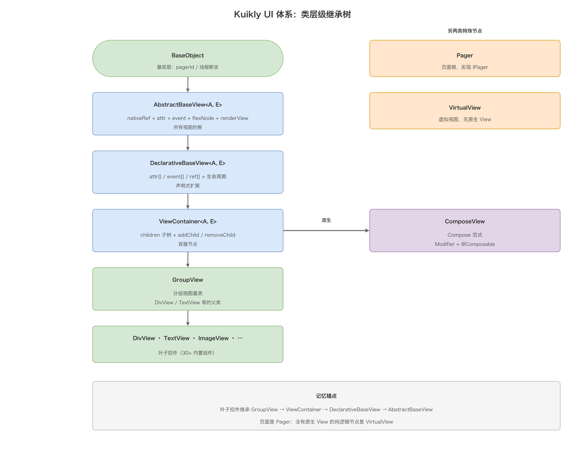
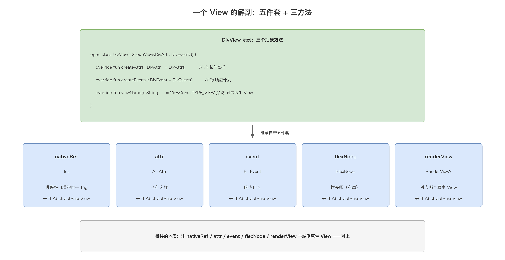
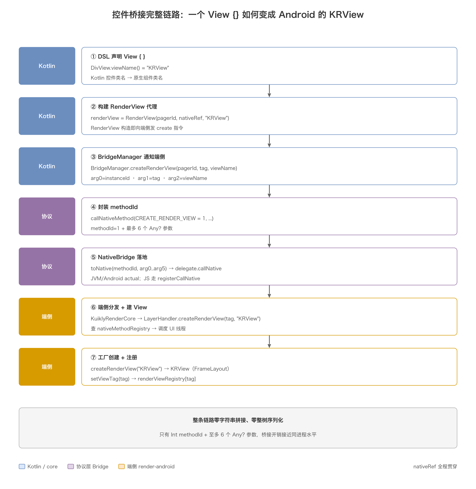
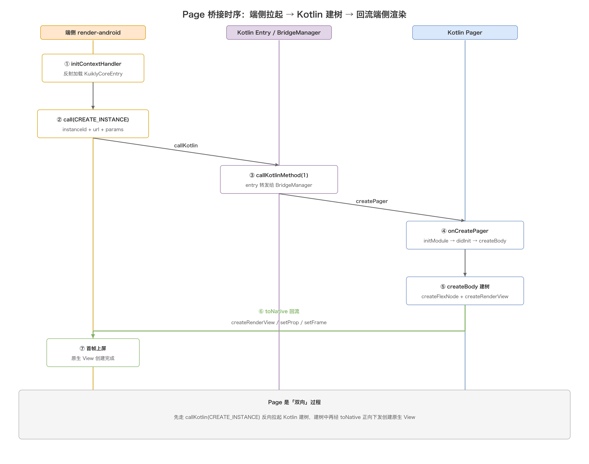
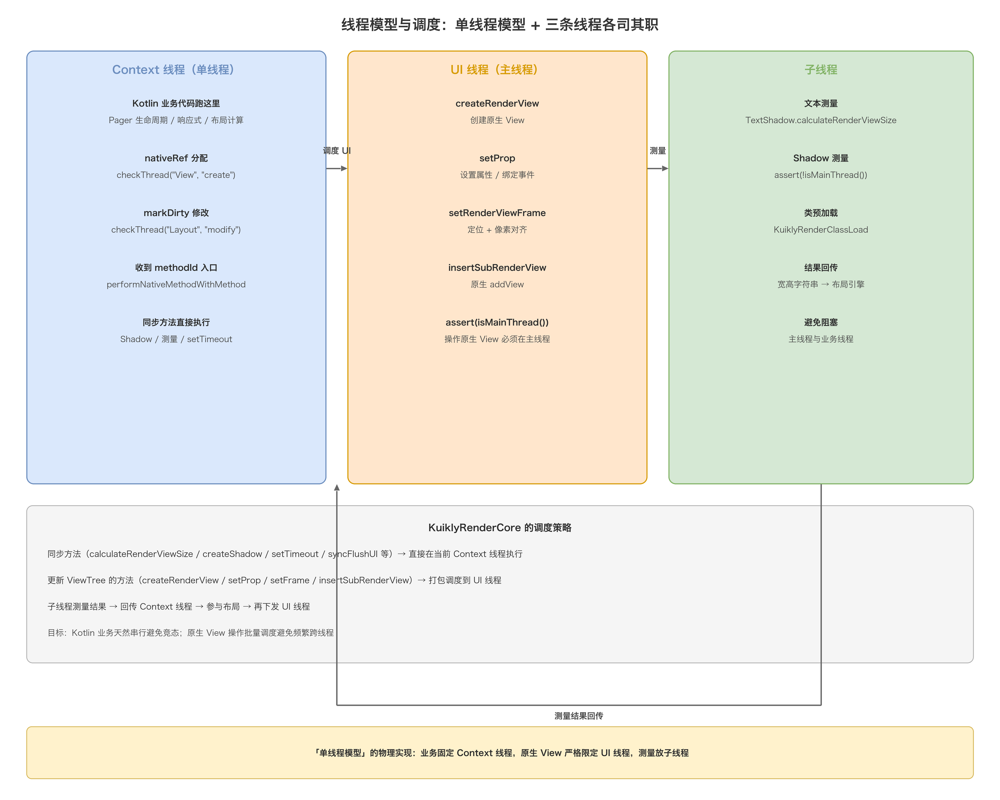
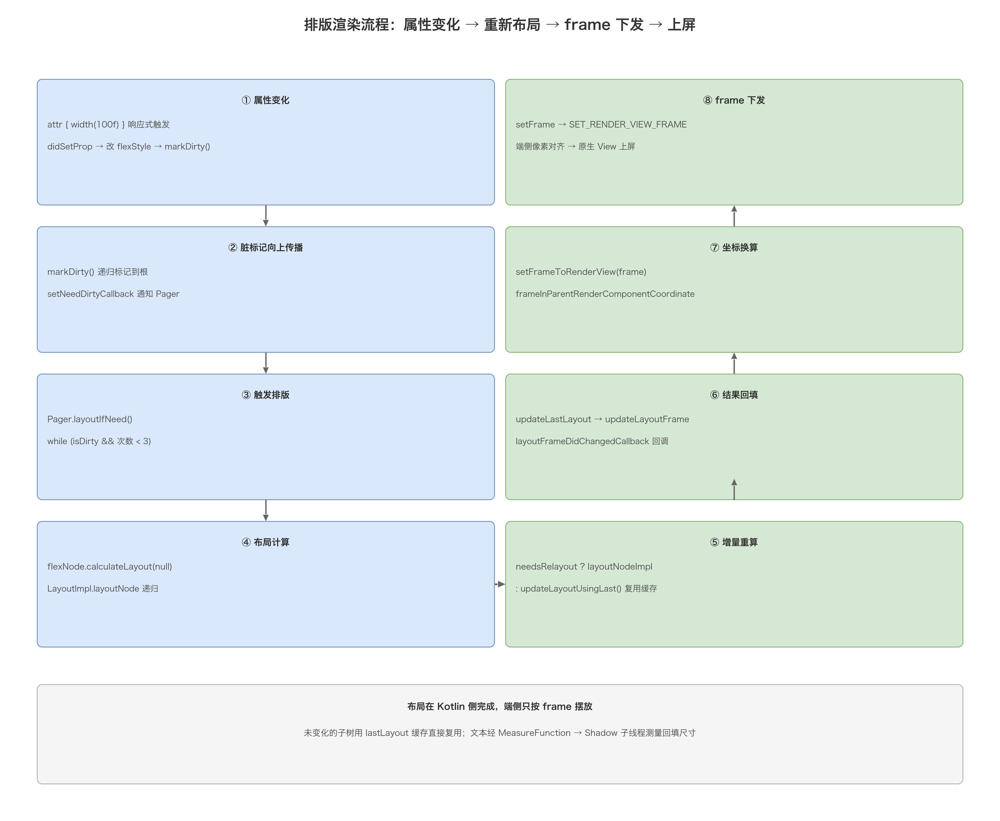

# 03. Kuikly 渲染机制详解

> 上一篇《Kuikly 跨端框架总览》把框架的模块组成和「一条指令从 Kotlin 到原生 View 经过什么」画成了地图；这一篇则把这张地图里最核心的一段——**渲染机制**——放大到源码级别。动手前，**第一章先把 Kuikly 的 UI 体系讲清楚**（声明式 DSL、继承树、attr/event、响应式、指令、内置控件），再回答两个问题：**① UI 控件、Page 到底是怎么「桥接」到 Android/iOS/鸿蒙/Web 各端的？** **② 视图的排版和渲染过程具体是怎么跑的？** 读完你会掌握三个贯穿全文的关键词：`nativeRef`（跨端定位原生 View 的 tag）、`methodId`（极简的协议）、`Export`（控件的端侧工厂），以及一条完整的链路：**DSL 声明 → 双树（RenderView + FlexNode）→ Bridge 协议 → 原生 View 上屏**。

## 目录

- [一、Kuikly 的 UI 体系](#一kuikly-的-ui-体系)
  - [1.1 声明式 UI：两种 DSL 范式](#11-声明式-ui-两种-dsl-范式)
  - [1.2 类层级：一棵继承树](#12-类层级一棵继承树)
  - [1.3 一个 View 的解剖：五件套 + 三方法](#13-一个-view-的解剖五件套--三方法)
  - [1.4 属性系统：Attr / Props 与 with 中缀](#14-属性系统-attr--props-与-with-中缀)
  - [1.5 事件系统：Event 中心](#15-事件系统-event-中心)
  - [1.6 响应式：observable + ReactiveObserver](#16-响应式-observable--reactiveobserver)
  - [1.7 指令与内置控件](#17-指令与内置控件)
- [二、渲染机制全景](#二渲染机制全景)
  - [2.1 六个核心角色](#21-六个核心角色)
  - [2.2 与 RN / Flutter 的渲染差异](#22-与-rn--flutter-的渲染差异)
- [三、桥接的三大支柱](#三桥接的三大支柱)
  - [3.1 nativeRef：跨端定位原生 View 的唯一 tag](#31-nativeref跨端定位原生-view-的唯一-tag)
  - [3.2 methodId：极简的协议](#32-methodid极简的协议)
  - [3.3 Export：控件的端侧工厂](#33-export控件的端侧工厂)
- [四、UI 控件如何桥接到对应端](#四ui-控件如何桥接到对应端)
  - [4.1 Kotlin 侧：控件如何声明创建原生 View](#41-kotlin-侧控件如何声明创建原生-view)
  - [4.2 协议层：NativeBridge 的 expect/actual](#42-协议层nativebridge-的-expectactual)
  - [4.3 原生端：KuiklyRenderCore + LayerHandler 分发](#43-原生端kuiklyrendercore--layerhandler-分发)
  - [4.4 控件工厂与 View 复用](#44-控件工厂与-view-复用)
  - [4.5 控件桥接完整链路](#45-控件桥接完整链路)
- [五、Page 如何桥接到对应端](#五page-如何桥接到对应端)
  - [5.1 @Page → KSP → KuiklyCoreEntry](#51-page--ksp--kuiklycoreentry)
  - [5.2 createInstance 与 Page 生命周期](#52-createinstance-与-page-生命周期)
  - [5.3 Page 桥接时序](#53-page-桥接时序)
- [六、视图排版：自研 Flexbox](#六视图排版自研-flexbox)
  - [6.1 双树模型：RenderView 树 + FlexNode 树](#61-双树模型renderview-树--flexnode-树)
  - [6.2 层级扁平化与虚拟视图](#62-层级扁平化与虚拟视图)
  - [6.3 FlexNode 的三块数据](#63-flexnode-的三块数据)
  - [6.4 脏标记与增量布局](#64-脏标记与增量布局)
  - [6.5 文本测量：Shadow + MeasureFunction](#65-文本测量shadow--measurefunction)
- [七、渲染过程：从 layoutIfNeed 到上屏](#七渲染过程从-layoutifneed-到上屏)
  - [7.1 排版触发](#71-排版触发)
  - [7.2 布局计算](#72-布局计算)
  - [7.3 帧下发与坐标换算](#73-帧下发与坐标换算)
  - [7.4 属性与事件的下发](#74-属性与事件的下发)
  - [7.5 线程模型与调度](#75-线程模型与调度)
  - [7.6 排版渲染完整流程](#76-排版渲染完整流程)
- [八、对比与易错点](#八对比与易错点)
  - [8.1 渲染链路对比表](#81-渲染链路对比表)
  - [8.2 边界与易错点](#82-边界与易错点)
- [附：高频速记](#附高频速记)

## 一、Kuikly 的 UI 体系

在讲「怎么渲染」之前，得先搞清楚 Kuikly 的 UI 是怎么写的、由哪些零件搭起来的。后面几章反复出现的 `AbstractBaseView`、`attr{}`、`flexNode`、`renderView`，全都源自这一章。

### 1.1 声明式 UI：两种 DSL 范式

Kuikly 是**声明式 UI**框架：你不写「先 `new` 一个 View、再 `add` 到父容器、再 `set` 属性」这种命令式代码，而是用 Kotlin DSL 描述「界面上有什么」。它同时提供两套写法，底层共用同一棵视图树：

| 范式 | 写法风格 | 典型代码 | 适用场景 |
| --- | --- | --- | --- |
| KuiklyDSL（继承式） | 声明式 + 指令 | `View { attr { size(100f, 100f) } }` | 主推范式，全平台通用 |
| ComposeDSL | Jetpack Compose 风格 | `@Composable` + `Modifier` | 迁移自 Compose 的团队 |

两套范式最终都落到同一套基类（`AbstractBaseView`）上，只是「糖」不同：KuiklyDSL 用 `attr{}` / `event{}` 闭包，ComposeDSL 用 `Modifier` 与 `@Composable` 组合函数。本文后续一律以 **KuiklyDSL** 为准展开。

### 1.2 类层级：一棵继承树

整个 UI 体系的骨架是一条继承链，越往上越抽象、越往下越具体：

```
BaseObject                          // 最底层：pagerId、线程断言等基础能力
 └─ AbstractBaseView<A, E>          // 所有「视图」的根：nativeRef + attr + event + flexNode + renderView
     └─ DeclarativeBaseView<A, E>   // 声明式扩展：attr{} / event{} / ref{} 与生命周期
         └─ ViewContainer<A, E>     // 容器：children 子树 + addChild / removeChild
             ├─ GroupView           // 分组视图基类（DivView / TextView 等的父类）
             │   ├─ DivView         // 最基础的 View 容器（对应原生 View / UIView）
             │   ├─ TextView        // 文本
             │   ├─ ImageView       // 图片
             │   └─ ...             // 其余 30+ 内置控件
             └─ ComposeView         // Compose 范式的容器基类
```

另有两类特殊节点不在「叶子控件」这条线上：

- **`Pager`**：页面本身，实现 `IPager`，是整棵树的根（`createBody()` 构建树）。
- **`VirtualView`**：虚拟视图，没有对应的原生 View，只参与「结构 / 布局 / 逻辑」——比如指令（`vif` / `vfor`）的容器、`SafeArea` 等纯逻辑节点。

> 记忆锚点：**叶子控件继承「GroupView → ViewContainer → DeclarativeBaseView → AbstractBaseView」；页面是 Pager；没有原生 View 的纯逻辑节点是 VirtualView。**



### 1.3 一个 View 的解剖：五件套 + 三方法

任何一个控件（以最基础的 `DivView` 为例），本质上就是「**五件套 + 三个抽象方法**」：

```kotlin
open class DivView : GroupView<DivAttr, DivEvent>() {
    override fun createAttr(): DivAttr   = DivAttr()            // ① 长什么样
    override fun createEvent(): DivEvent = DivEvent()           // ② 响应什么
    override fun viewName(): String      = ViewConst.TYPE_VIEW  // ③ 对应哪个原生 View（"KRView"）
}
```

五件套来自基类 `AbstractBaseView`，每个 View 都自带：

| 成员 | 类型 | 作用 |
| --- | --- | --- |
| `nativeRef` | `Int` | 进程级自增的**唯一 tag**，跨端定位这个 View 对应的原生 View |
| `attr` | `A : Attr` | 属性对象：长什么样（宽高、颜色、边框…） |
| `event` | `E : Event` | 事件对象：响应什么（点击、长按、拖拽…） |
| `flexNode` | `FlexNode` | 布局节点：参与自研 Flexbox 排版 |
| `renderView` | `RenderView?` | 渲染代理：创建后代表端侧的那个原生 View，可空 |

这五者里，`nativeRef` / `attr` / `event` / `flexNode` 是「Kotlin 侧」的声明与状态，`renderView` 是「端侧原生 View」的句柄——**桥接的本质，就是让这五者与端侧的原生 View 一一对上**（详见第三、四、五章）。



### 1.4 属性系统：Attr / Props 与 with 中缀

属性由 `Attr` 体系承载：`Attr : Props(), IStyleAttr, ILayoutAttr`。一个属性方法分两大类：

**① 布局类属性 —— 直接写 `flexNode`，不跨端。** 如 `width` / `height` / `flex` / `margin` / `top`，实现是 `flexNode?.styleWidth = width`，只在 Kotlin 侧改布局树，等排版时才生效：

```kotlin
override fun width(width: Float): Attr {
    flexNode?.styleWidth = width
    return this
}
```

**② 样式类属性 —— 写 `StyleConst` 键，经桥接下发到端侧。** 如 `backgroundColor` / `border` / `opacity` / `transform`，实现是 `"backgroundColor" with color.toString()`：

```kotlin
override fun backgroundColor(color: Color): Attr {
    StyleConst.BACKGROUND_COLOR with color.toString()
    return this
}
```

这里的 `with` 是 `Props` 定义的中缀函数，把「属性名 → 值」存进 `propsMap` 并触发下发：

```kotlin
infix fun String.with(propsValue: Any) {
    bindProp(this, propsValue)   // 值不是闭包 → setProp；值是闭包 → 绑定响应式
}
```

`setProp` 是属性系统的咽喉：**线程断言（`checkThread("attr","access")`）→ 值去重（值不变且非 `forceUpdate` 则跳过）→ 写入 `propsMap` → `view().didSetProp(key, value)` 下发到 `renderView`**。`didSetProp` 的默认实现就是 `renderView?.setProp(propKey, propValue)`（详见第四章的桥接链路）。

> 关键点：**布局类属性只改 `flexNode`，样式类属性走 `with` 下发**。前者是「纯 Kotlin 计算」，后者是「跨端指令」。

### 1.5 事件系统：Event 中心

事件由 `Event` 体系承载，`Event : BaseEvent()`。它内置一批标准事件，业务在 `event{}` 闭包里直接写：

```kotlin
event {
    click { params -> /* 单击 */ }
    longPress { params -> /* 长按 */ }
    pan { params -> /* 拖拽 */ }
    pinch { params -> /* 捏合 */ }
}
```

底层是 `register(eventName, handler, isSync)`：把处理函数存进 `eventMap`，同时调 `renderView.setEvent(eventName, isSync)` 通知端侧「我要监听这个事件」；事件发生时端侧回传，经 `onFireEvent` 命中对应 handler。

事件体系还支持**插件扩展**：通过 `putPluginEvent(name, event)` 注入自定义事件中心（框架内置的 `VisibilityEvent` 就是这样扩展出来的），不感知具体事件也能扩展能力。

### 1.6 响应式：observable + ReactiveObserver

声明式 UI 的「自动刷新」靠响应式。核心是 `ObservableProperties<V>`，一个 Kotlin **属性委托**（`ReadWriteProperty`）：

```kotlin
// 页面里声明可变状态（observableList() / observableSet() 同理）
private var count by observable(0)
```

- `getValue` → `notifyGetValue`：**记录「谁读了我」**（依赖收集）；
- `setValue` → 值变了就 `notifyValueChange`：**通知「读了我的」重新执行**。

配合 `ReactiveObserver.bindValueChange(owner) { ... }`，`attr{}` 闭包就变成了「可重放的模板」：闭包里只要读到 `count`，`count` 一变，闭包就带着新值重新执行、重新 `setProp` 把变化下发到端侧。`DeclarativeBaseView.attr()` 正是这样写的：

```kotlin
override fun attr(init: A.() -> Unit) {
    // bindValueChange 返回 Boolean：闭包里是否真的读到了 observable 状态
    val observable = ReactiveObserver.bindValueChange(this) { isFirst ->
        attr.apply {
            if (isFirst) apply(init)                                  // 首次：直接执行 init
            else { beginApplyAttrProperty(); apply(init); endApplyAttrProperty() } // 状态变化：带动画标记重放 init
        }
    }
    attr.isStaticAttr = !observable   // 没读响应式状态 → 静态属性，可参与扁平化
}
```

> 一句话：**`by observable` 制造「可观察的状态」，`ReactiveObserver` 把「读状态」的 `attr{}` 闭包变成「状态一变就重跑」的订阅者**。这就是 Kuikly 无需 diff、精准局部更新的根基。

### 1.7 指令与内置控件

**指令**让声明式 UI 能表达「条件 / 循环」，本质是「包装真实子 View 的虚拟节点」：

| 指令 | 作用 | 实现 |
| --- | --- | --- |
| `vif` / `velseif` / `velse` | 条件渲染 | `ConditionView` 包装，条件变化时增删真实子 View |
| `vfor` | 循环渲染 | `LoopDirectivesView`，遍历集合生成子 View |
| `vbind` | 绑定表达式 | `BindDirectivesView`，重算并回填绑定值 |

**内置控件**（`core/views/`，30+）按职责分几类：

| 分类 | 控件 |
| --- | --- |
| 基础 | View(DivView)、Text、Image、Input、TextArea、RichText |
| 滚动容器 | Scroller、List、WaterfallList、PageList、Refresh、FooterRefresh、Tabs |
| 交互输入 | Switch、Slider、CheckBox、ScrollPicker、DatePicker |
| 浮层 | Modal、Mask、AlertDialog、ActionSheet、Hover、Transition |
| 媒体特效 | Video、Audio、APNG、PAG、Canvas、Blur |
| 布局辅助 | SafeArea、Center、Row、Column |

> 小结：**一棵 Kuikly 页面 = `Pager` 根部 → `ViewContainer` 树干 → 叶子控件**；每个节点都是「`attr`(长什么样) + `event`(响应什么) + `flexNode`(摆在哪) + `renderView`(对应哪个原生 View)」的组合，靠 `nativeRef` 串成树。后面讲桥接、排版、渲染，都是在这棵树上做文章。

## 二、渲染机制全景

### 2.1 六个核心角色

理解 Kuikly 渲染机制，先记住六个角色，它们分布在「Kotlin 跨端层」和「各端渲染器」两侧：

| 角色 | 所在位置 | 职责一句话 |
| --- | --- | --- |
| `AbstractBaseView` / `DeclarativeBaseView` | core（Kotlin 侧） | 每个 DSL 节点的基类，持有 `nativeRef`、`flexNode`、`renderView` 三件套 |
| `ViewContainer` | core（Kotlin 侧） | 容器节点，维护 `children` 子树，负责 `addChild`、`renderChildren`、扁平化判断 |
| `Pager` | core（Kotlin 侧） | 页面对应对象，`createBody()` 构建整棵树，`layoutIfNeed()` 驱动排版 |
| `NativeBridge` + `BridgeManager` | core（Kotlin 侧） | 协议层，把「创建 View / 设属性 / 设 frame」翻译成 `methodId + 参数` |
| `KuiklyRenderCore` | 各端渲染器 | 端侧桥接核心，接收 `methodId` 并按注册表分发，负责线程调度 |
| `KuiklyRenderLayerHandler` + Export 工厂 | 各端渲染器 | 真正操作原生 View：`createRenderView` / `setProp` / `setFrame` / `addView` |

一句话串起来：**Kotlin 侧的 DSL 节点（View）拿着自己的 `nativeRef`，通过 `NativeBridge.toNative(methodId, …)` 把意图发给端侧；端侧 `KuiklyRenderCore` 按 `methodId` 查注册表分发到 `LayerHandler`，`LayerHandler` 再用 `viewName → Export 工厂` 找到对应的原生 View 类去创建、设属性、摆位置。**

### 2.2 与 RN / Flutter 的渲染差异

| 维度 | Kuikly | React Native | Flutter |
| --- | --- | --- | --- |
| 渲染目标 | 平台原生 View（View/UIView/ArkUI/DOM） | 平台原生 View | 自绘（Skia/Impeller） |
| 谁算布局 | 自研纯 Kotlin Flexbox（`FlexNode`） | Yoga（C++） | 自研 Flex（Dart） |
| 通信粒度 | `methodId`（Int）+ 最多 6 个参数 | 可序列化 JSON 消息 | 无（同进程） |
| 控件映射 | `viewName` 字符串 → Export 工厂 | 组件注册表 | Widget → RenderObject |
| 典型开销 | 极低（不传字符串、不序列化整树） | Bridge 序列化 | 无 Bridge |

Kuikly 最鲜明的特点是**通信极简**：不传方法名字符串、不序列化整棵视图树，而是编译期定好的 `Int` 型 `methodId` + 至多 6 个 `Any?` 参数。这让它在「复用原生组件」的路线里，把桥接开销压到了接近同进程的水平。

## 三、桥接的三大支柱

要讲清「控件、Page 如何桥接到端」，必须先吃透三个概念，它们是后续所有内容的基石。

### 3.1 nativeRef：跨端定位原生 View 的唯一 tag

`nativeRef` 是每个 DSL 节点分配到的**全局递增的整型 ID**，是 Bridge 通信时定位原生 View 的唯一凭据。源码在 `AbstractBaseView`：

```kotlin
// core/commonMain/.../base/AbstractBaseView.kt
abstract class AbstractBaseView<A : Attr, E : Event> : BaseObject(), ... {
    val nativeRef: Int = ++nativeRefProducer   // 构造时自增分配
    var parentRef: Int = 0                     // 父节点的 nativeRef
    val flexNode = FlexNode()                  // 布局节点（每节点必有）
    var renderView: RenderView? = null         // 原生视图代理（只有真正落地的节点才有）

    companion object {
        private var nativeRefProducer = 0
            set(value) {
                checkThread("View", "create")  // 只允许在 Context 线程创建
                field = value
            }
    }
}
```

关键点：

- `nativeRef` 是**进程内全局递增**的，不是「每个页面从 0 开始」。它同时被两处使用：Kotlin 侧的 `nativeRefViewMap`（`nativeRef → AbstractBaseView`）和端侧的 `renderViewRegistry`（`tag → RenderViewHandler`），两者通过同一个数字对齐。
- `parentRef` 记录父节点的 `nativeRef`，据此可以在 `Pager.getViewWithNativeRef(parentRef)` 反查父容器。
- **不是每个节点都有 `renderView`**：只有真正要生成原生 View 的节点，其 `renderView` 才非空；被「扁平化」掉的虚拟容器节点，`renderView == null`（见 6.2）。

### 3.2 methodId：极简的协议

Kuikly 的桥接协议只有两个方向、两组 `Int` 常量，定义在 `BridgeManager` 里：

```kotlin
// core/commonMain/.../manager/BridgeManager.kt
object KotlinMethod {   // Native → Kotlin（6 个）
    const val CREATE_INSTANCE = 1      // 创建 Pager
    const val UPDATE_INSTANCE = 2      // 派发页面事件
    const val DESTROY_INSTANCE = 3     // 销毁 Pager
    const val FIRE_CALLBACK = 4        // 回调（Promise）
    const val FIRE_VIEW_EVENT = 5      // 视图事件（点击等）
    const val LAYOUT_VIEW = 6          // 请求重新布局
}

object NativeMethod {   // Kotlin → Native（17 个）
    const val CREATE_RENDER_VIEW = 1
    const val REMOVE_RENDER_VIEW = 2
    const val INSERT_SUB_RENDER_VIEW = 3
    const val SET_VIEW_PROP = 4        // 设属性 / 绑事件
    const val SET_RENDER_VIEW_FRAME = 5// 设 frame
    const val CALCULATE_RENDER_VIEW_SIZE = 6
    const val CALL_VIEW_METHOD = 7
    const val CALL_MODULE_METHOD = 8
    const val CREATE_SHADOW = 9
    const val REMOVE_SHADOW = 10
    const val SET_SHADOW_PROP = 11
    const val SET_SHADOW_FOR_VIEW = 12
    const val SET_TIMEOUT = 13
    const val CALL_SHADOW_METHOD = 14
    const val FIRE_FATAL_EXCEPTION = 15
    const val SYNC_FLUSH_UI = 16
    const val CALL_TDF_MODULE_METHOD = 17
}
```

协议通道本身极其简单，只有一个方法（`expect` 声明）：

```kotlin
// core/commonMain/.../nvi/NativeBridge.kt
expect open class NativeBridge() {
    fun toNative(methodId: Int, arg0: Any?, arg1: Any?, arg2: Any?,
                 arg3: Any?, arg4: Any?, arg5: Any?): Any?
    fun destroy()
}
```

`toNative` 的第一个参数就是 `methodId`，后面**最多 6 个 `Any?`**。这 6 个参数承载一切：`instanceId`（页面 id）、`tag`（nativeRef）、`propKey`、`propValue` 等。为什么是 6 个？因为 `SET_VIEW_PROP` 需要 `instanceId + tag + propKey + propValue + isEvent + sync` 恰好 6 个。

### 3.3 Export：控件的端侧工厂

「控件如何映射到原生 View」的答案，就藏在 `Export` 工厂里。端侧维护三张「名字 → 工厂」的表：

```kotlin
// core-render-android/.../KuiklyRenderView.kt
override fun renderViewExport(viewName: String,
                              renderViewExportCreator: (Context) -> IKuiklyRenderViewExport,
                              shadowExportCreator: (() -> IKuiklyRenderShadowExport)?) {
    viewExportCreator[viewName] = renderViewExportCreator      // 视图工厂
    shadowExportCreator?.also { shadowExportCreator[viewName] = it } // 测量工厂
}

override fun createRenderView(name: String, context: Context): IKuiklyRenderViewExport {
    return viewExportCreator[name]?.invoke(context)
        ?: throw KuiklyRenderViewExportException("can not find viewExport, name: $name")
}
```

Kotlin 侧的控件，通过 `viewName()` 返回一个字符串（如 `"KRView"`），这个字符串就是上面 `viewExportCreator` 的 key。端侧在启动时把每个原生 View 类都注册进这张表，于是 `"KRView"` 就精确对应到 Android 的 `KRView`（一个 `FrameLayout` 子类）、iOS 的 `KRView`（一个 `UIView` 子类）。

## 四、UI 控件如何桥接到对应端

### 4.1 Kotlin 侧：控件如何声明创建原生 View

以最基础的容器控件 `DivView`（DSL 里的 `View {}`）为例，它通过 `viewName()` 声明自己对应哪个原生组件：

```kotlin
// core/commonMain/.../views/DivView.kt
open class DivView : GroupView<DivAttr, DivEvent>() {
    override fun viewName(): String {
        return ViewConst.TYPE_VIEW   // = "KRView"
    }
    // 扁平化：无属性/静态/无事件的容器可能不生成原生 View
    override fun isRenderView(): Boolean {
        return isRenderViewForFlatLayer()
    }
}
// DSL 入口
fun ViewContainer<*, *>.View(init: DivView.() -> Unit) {
    val viewGroup = createViewFromRegister(ViewConst.TYPE_VIEW_CLASS_NAME) as? DivView
    if (viewGroup != null) addChild(viewGroup, init)          // 业务可自定义扩展
    else addChild(DivView(), init)                            // 默认内置 DivView
}
```

而 `viewName()` 到原生类的对应关系，统一集中在 `ViewConst`：

```kotlin
// core/commonMain/.../base/ViewConst.kt
object ViewConst {
    const val TYPE_VIEW_CLASS_NAME = "DivView"        // Kotlin 类名（registerViewCreator 用）
    const val TYPE_TEXT_CLASS_NAME = "TextView"
    const val TYPE_VIEW = "KRView"                    // 映射到 Native 组件类名
    const val TYPE_IMAGE = "KRImageView"
    const val TYPE_RICH_TEXT = "KRRichTextView"
    const val TYPE_LIST = "KRListView"
    // ... 每个控件一个 KR 前缀的原生类名
}
```

真正的「创建原生 View」发生在 `RenderView` 的构造器里——它一被创建，就立刻向端侧发一条 `CREATE_RENDER_VIEW`：

```kotlin
// core/commonMain/.../base/RenderView.kt
class RenderView(private val pagerId: String,
                 private val viewRef: Int,        // 就是 nativeRef
                 private val viewName: String) {
    init {
        BridgeManager.createRenderView(pagerId, viewRef, viewName)  // 构造即通知端侧
    }
    fun setProp(key: String, value: Any) { BridgeManager.setViewProp(pagerId, viewRef, key, value, 0) }
    fun setFrame(x: Float, y: Float, width: Float, height: Float) {
        currentFrame = Frame(x, y, width, height)
        BridgeManager.setRenderViewFrame(pagerId, viewRef, x, y, width, height)
    }
    fun insertSubRenderView(subViewRef: Int, index: Int) { ... }
}
```

而 `RenderView` 的创建，由 `DeclarativeBaseView.createComponentRenderViewIfNeed()` 触发：

```kotlin
// core/commonMain/.../base/DeclarativeBaseView.kt
protected fun createComponentRenderViewIfNeed() {
    if (renderView !== null) return
    renderView = RenderView(pagerId, nativeRef, viewName())   // ① 创建代理 → 通知端侧
    attr.setPropsToRenderView()                                // ② 把已设属性回放下发
    event.onRenderViewDidCreated()                             // ③ 事件回调（绑定）
    if (!flexNode.layoutFrame.isDefaultValue()) {              // ④ 若已有布局结果，先补 frame
        setFrameToRenderView(flexNode.layoutFrame)
    }
    performRenderViewLazyTasks()                               // ⑤ 执行挂起的任务
}
```

> 注意顺序：`RenderView` 构造（发 create）→ 属性回放（发 setProp）→ 事件绑定（发 setProp + isEvent）→ 补 frame（发 setFrame）。端侧按同样的顺序收到 4 类指令，恰好能还原一个「已设置好属性的原生 View」。

### 4.2 协议层：NativeBridge 的 expect/actual

`NativeBridge` 在 commonMain 是 `expect`，各平台各自 `actual`。它们做的事都一样：把 `toNative` 转发给一个 `delegate`（JVM/Android）或回调（JS）：

```kotlin
// core/src/jvmMain/.../nvi/NativeBridge.kt  （androidMain 几乎一致）
actual open class NativeBridge actual constructor() {
    var delegate: NativeBridgeDelegate? = null
    actual fun toNative(methodId: Int, arg0: Any?, ..., arg5: Any?): Any? {
        return delegate?.callNative(methodId, arg0, arg1, arg2, arg3, arg4, arg5)
    }
    interface NativeBridgeDelegate {
        fun callNative(methodId: Int, arg0: Any?, ..., arg5: Any?): Any?
    }
}
```

于是「谁实现了这个 delegate」就成了桥接落地的关键。Android 端在 `KuiklyRenderJvmContextHandler` 里：

```kotlin
// core-render-android/.../context/KuiklyRenderJvmContextHandler.kt
class KuiklyRenderJvmContextHandler : KuiklyRenderCommonContextHandler(), IKuiklyCoreEntry.Delegate {
    private val kuiklyCoreEntry = newKuiklyCoreEntryInstance()  // 反射加载 KSP 生成的入口
    init { kuiklyCoreEntry.delegate = this }

    override fun callNative(methodId: Int, arg0: Any?, ..., arg5: Any?): Any? {
        assert(!isMainThread())   // 必须在 Context 线程
        val result = callNativeCallback?.invoke(
            KuiklyRenderNativeMethod.fromInt(methodId), listOf(arg0, arg1, arg2, arg3, arg4, arg5))
        return result?.toKotlinObject()
    }
}
```

而 `callNativeCallback` 是 `KuiklyRenderCore` 在初始化时注册的：

```kotlin
// core-render-android/.../core/KuiklyRenderCore.kt（initContextHandler 内）
contextHandler?.apply {
    registerCallNative { method, args -> performNativeMethodWithMethod(method, args) }
    ...
}
```

各端 actual 的落地方式差异，用一个表总结：

| 平台 | NativeBridge actual | toNative 最终落到 |
| --- | --- | --- |
| JVM / Android | `delegate.callNative(...)` | `KuiklyRenderJvmContextHandler.callNative` → `callNativeCallback` → `KuiklyRenderCore.performNativeMethodWithMethod` |
| iOS / 鸿蒙 | `delegate.callNative(...)`（同理） | `core-render-ios` / `core-render-ohos` 的桥接核心 |
| JS（动态化） | `registerCallNative` 回调 | Web/小程序渲染器注册的 `callNativeCallback` |

### 4.3 原生端：KuiklyRenderCore + LayerHandler 分发

指令到达端侧后，第一站是 `KuiklyRenderCore.performNativeMethodWithMethod`：

```kotlin
// core-render-android/.../core/KuiklyRenderCore.kt
private fun performNativeMethodWithMethod(method: KuiklyRenderNativeMethod, args: List<Any?>): Any? {
    val cb = nativeMethodRegistry[method.value]   // 查注册表
    cb?.also {
        assert(!isMainThread())                     // 入口必须在 Context 线程
        if (isSyncMethodCall(method, args)) {       // 同步方法：直接执行
            return it(method, args)
        } else {
            uiScheduler?.scheduleTask(isUpdateViewTree = isUpdateViewTreeMethodCall(method)) {
                it(method, args)                    // 其余调度到 UI 线程
            }
        }
    }
    return null
}
```

两条重要分支：

- **同步方法**（`calculateRenderViewSize`、`createShadow`、`removeShadow`、`setShadowProp`、`setTimeout`、`callShadowMethod`、`syncFlushUI` 等）直接在 Context 线程执行，因为它们不碰原生 View（Shadow 测量跑子线程，`setTimeout` 只是调度）。
- **更新 ViewTree 的方法**（`createRenderView`、`removeRenderView`、`insertSubRenderView`、`setViewProp`、`setRenderViewFrame`）被标记 `isUpdateViewTree = true`，调度到 UI 线程执行——原生 View 的创建和修改必须在主线程。

`nativeMethodRegistry` 是一个 `SparseArray<Callback>`，`initNativeMethodRegisters()` 里把 17 个 `methodId` 各自绑定到 `createRenderView` / `setViewProp` / `setRenderViewFrame` 等处理函数，最终全部转发给 `renderLayerHandler`：

```kotlin
private fun createRenderView(method: KuiklyRenderNativeMethod, args: List<Any?>): Any? =
    renderLayerHandler?.createRenderView(args.secondArg(), args.thirdArg())   // tag, viewName
```

### 4.4 控件工厂与 View 复用

`LayerHandler` 是「真正摸到原生 View」的地方。它持有三张注册表 + 一张复用队列：

```kotlin
// core-render-android/.../layer/KuiklyRenderLayerHandler.kt
class KuiklyRenderLayerHandler : IKuiklyRenderLayerHandler {
    private val renderViewRegistry = SparseArray<RenderViewHandler>()            // tag → 原生 View 包装
    private var shadowRegistry: SparseArray<IKuiklyRenderShadowExport>? = null   // tag → Shadow（测量）
    private val moduleRegistry = ArrayMap<String, IKuiklyRenderModuleExport>()   // name → Module
    private val renderViewReuseListMap = ArrayMap<String, MutableList<RenderViewHandler>>() // 复用队列

    override fun createRenderView(tag: Int, viewName: String) {
        assert(isMainThread()) { "must call on ui thread" }
        createRenderViewHandler(tag, viewName)
    }
    private fun createRenderViewHandler(tag: Int, viewName: String) {
        var renderViewHandler = getRenderViewHandler(tag)
            ?: popRenderViewHandlerFromReuseQueue(viewName)   // ① 先尝试复用
        if (renderViewHandler == null) {
            renderViewHandler = RenderViewHandler(viewName,
                renderView.kuiklyRenderExport.createRenderView(viewName, context))  // ② 工厂创建
        }
        renderViewHandler.viewExport.setViewTag(tag)           // ③ 把 tag 写回原生 View
        putRenderViewHandler(tag, renderViewHandler)           // ④ 入注册表
    }
}
```

这里最关键的三个动作：

1. **`createRenderView(viewName, context)`**：查 `viewExportCreator[viewName]` 工厂，创建原生 View（如 `KRView`）。这就是「控件 → 原生 View」的最终映射。
2. **`setViewTag(tag)`**：把 Kotlin 侧的 `nativeRef` 写进原生 View 的 `ViewData`，这样端侧事件回传时才能定位回 Kotlin 侧的节点（`getViewTag()` 反查）。
3. **入 `renderViewRegistry`**：`tag → RenderViewHandler`，后续所有 `setProp` / `setFrame` / `removeRenderView` 都靠 `tag` 在这里查。

`insertSubRenderView` 则直接调用原生 `addView`：

```kotlin
override fun insertSubRenderView(parentTag: Int, childTag: Int, index: Int) {
    val parentView = if (parentTag == ROOT_VIEW_TAG) {         // -1 表示挂到页面根
        renderViewWeakRef?.get()?.view ?: return
    } else getRenderViewHandler(parentTag)?.viewExport?.viewGroup ?: return
    val childView = getRenderViewHandler(childTag)?.viewExport?.view() ?: return
    parentView.addView(childView, insertIndex)                 // 原生 addView
    viewExport.onAddToParent(parentView)
}
```

**View 复用**是列表性能的关键：`removeRenderView` 时不销毁 View，而是 `resetProp` / `resetShadow` 后推进复用队列（`renderViewReuseListMap[viewName]`），下次同名控件 `createRenderView` 时优先弹出复用，最大缓存 `MAX_REUSE_COUNT = 50` 个：

```kotlin
private fun innerRemoveRenderView(tag: Int) {
    val handler = getRenderViewHandler(tag)
    handler?.viewExport?.also {
        pushRenderViewHandlerToReuseQueue(handler.viewName, handler)  // 重置后入复用队列
        it.removeFromParent()
    }
    removeRenderViewHandler(tag)
}
```

### 4.5 控件桥接完整链路

把 3.1~3.4 串起来，一个 `View {}` 从声明到出现在屏幕上，经历如下链路：



链路自上而下共 7 步，每一步的「载体」都很轻：第 1~2 步在 Kotlin 侧内存里，第 3~4 步是 `methodId + ≤6 个 Any?`，第 5~7 步是端侧的原生操作。中间没有任何整树序列化。

## 五、Page 如何桥接到对应端

### 5.1 @Page → KSP → KuiklyCoreEntry

Page 的桥接和控件不同，它不走 `viewName`，而是走**编译期生成的路由表**。业务用 `@Page` 注解声明页面，KSP 编译期扫描并生成一个入口类 `KuiklyCoreEntry`：

```kotlin
@Page("HomePage", supportInLocal = true)
class HomePage : Pager() {
    override fun body() = { /* DSL 声明 */ }
}
```

生成的 `KuiklyCoreEntry` 核心逻辑是「路由名 → 构造器」的注册：

```kotlin
// KSP 生成的代码（示意）
class KuiklyCoreEntry : IKuiklyCoreEntry {
    override fun triggerRegisterPages() {
        BridgeManager.registerPageRouter("HomePage") { HomePage() }   // 每个 @Page 一行
    }
    override fun callKotlinMethod(methodId: Int, ...) {
        BridgeManager.callKotlinMethod(methodId, ...)
    }
}
```

端侧 `KuiklyRenderJvmContextHandler` 通过反射拿到这个入口：

```kotlin
companion object {
    private val kuiklyClass = Class.forName("com.tencent.kuikly.core.android.KuiklyCoreEntry")
    fun newKuiklyCoreEntryInstance(): IKuiklyCoreEntry =
        kuiklyClass.newInstance() as IKuiklyCoreEntry
}
```

### 5.2 createInstance 与 Page 生命周期

Page 的创建由端侧发起，走「Native → Kotlin」方向的 `KotlinMethod.CREATE_INSTANCE`：

```kotlin
// KuiklyRenderCore.initContextHandler() 内
call(KuiklyRenderContextMethod.KuiklyRenderContextMethodCreateInstance,
     listOf(instanceId, url, createInstanceParams))       // 端侧发起 createInstance
```

这条 `call` 经过 `KuiklyRenderJvmContextHandler.callKotlinMethod` → `kuiklyCoreEntry.callKotlinMethod` → 回到 core 的 `BridgeManager.callKotlinMethod`，最终分发给 `PagerManager.createPager`：

```kotlin
// core/commonMain/.../manager/BridgeManager.kt
fun callKotlinMethod(methodId: Int, arg0: Any?, ..., arg5: Any?) {
    currentPageId = arg0 as String
    when (methodId) {
        KotlinMethod.CREATE_INSTANCE  -> PagerManager.createPager(arg0, arg1, arg2)
        KotlinMethod.UPDATE_INSTANCE  -> PagerManager.firePagerEvent(arg0, arg1, arg2)
        KotlinMethod.DESTROY_INSTANCE -> { PagerManager.destroyPager(arg0); nativeBridgeMap.remove(arg0)?.destroy() }
        KotlinMethod.FIRE_CALLBACK     -> PagerManager.fireCallBack(arg0, arg1, arg2)
        KotlinMethod.FIRE_VIEW_EVENT   -> PagerManager.fireViewEvent(arg0, arg1 as Int, arg2 as String, arg3)
        KotlinMethod.LAYOUT_VIEW       -> PagerManager.fireLayoutView(arg0)
    }
}
```

`Pager` 的创建过程在 `onCreatePager`，注意它的顺序：**先建树，再排版**：

```kotlin
// core/commonMain/.../pager/Pager.kt
override fun onCreatePager(pagerId: String, pageData: JSONObject) {
    this.pagerId = pagerId
    taskManager = TaskManager(pagerId)
    willInit()
    initModule()               // 1. 初始化内置 + 外部 Module
    didMoveToParentView()
    didInit()                  // 2. 构建 Shadow 树
    createBody()               // 3. 构建视图树 + 布局
    didCreateBody = true
}

private fun createBody() {
    createFlexNode()                        // ① 递归构建 FlexNode 树
    createRenderView()                      // ② 递归创建 RenderView（发 create 指令）
    renderView?.insertToRootView()          // ③ 把根 RenderView 挂到端侧页面根（tag=-1）
    layoutIfNeed()                          // ④ 首次排版
    flexNode.setNeedDirtyCallback = { renderView?.setEvent(PAGER_EVENT_SET_NEED_LAYOUT) }
}
```

### 5.3 Page 桥接时序

Page 从「端侧要打开一个页面」到「首帧上屏」的完整时序如下：



要点：**Page 是「端侧拉起、Kotlin 侧建树、再回流到端侧渲染」的双向过程**——先走 `callKotlin(CREATE_INSTANCE)` 反向拉起 Kotlin 侧构建，构建过程中又通过 `toNative` 正向下发 `createRenderView` / `setProp` / `setFrame` 把原生 View 建出来。

## 六、视图排版：自研 Flexbox

### 6.1 双树模型：RenderView 树 + FlexNode 树

Kuikly 的每个 DSL 节点，同时属于两棵树：

- **RenderView 树**：决定「原生界面有哪些 View」。每个节点若 `isRenderView()` 为真，就有 `renderView`（对应一个原生 View）。
- **FlexNode 树**：决定「每个 View 摆在哪」。每个节点必有 `flexNode`，包括被扁平化的虚拟节点。

两棵树不一定同构——正是「虚拟视图扁平化」让 FlexNode 树比 RenderView 树「更密」。`ViewContainer` 里有两个关键的递归方法，分别操作两棵树：

```kotlin
// core/commonMain/.../base/ViewContainer.kt
override fun createRenderView() {
    createRenderViewing = true
    super.createRenderView()                       // 先建自己
    createRenderViewing = false
    var index = 0
    renderChildren().forEach { child ->            // 只遍历「真正落地」的子节点
        child.createRenderView()
        renderView?.insertSubRenderView(child.nativeRef, index++)
    }
}

override fun createFlexNode() {
    super.createFlexNode()
    didCreateFlexNode = true
    var index = 0
    domChildren().forEach { child ->               // 遍历「所有」子节点（含虚拟）
        child.createFlexNode()
        flexNode.addChildAt(child.flexNode, index)
        index++
    }
}
```

`renderChildren()` 与 `domChildren()` 的区别，是理解双树的核心：

```kotlin
fun renderChildren(): List<DeclarativeBaseView<*, *>> {
    val renderChildren = fastArrayListOf<DeclarativeBaseView<*, *>>()
    forEachChild { child ->
        if (child.isRenderView()) renderChildren.add(child)        // 真实节点直接收
        else if (child is ViewContainer) renderChildren.addAll(child.renderChildren())  // 虚拟节点穿透
    }
    return renderChildren
}
```

### 6.2 层级扁平化与虚拟视图

「虚拟视图」是 Kuikly 重要的性能优化：**只参与布局、不生成原生 View 的容器**。判断逻辑在 `ViewContainer.isRenderViewForFlatLayer()`：

```kotlin
internal fun isRenderViewForFlatLayer(): Boolean {
    val forceMode = (getViewAttr() as? ContainerAttr)?.forceRenderView
    if (forceMode == ForceRenderViewMode.SELF || forceMode == ForceRenderViewMode.SUB_TREE) return true
    if (getPager().isDebugUIInspector) return true
    // 无属性 + 静态 + 无事件 → 可扁平化（不生成原生 View）
    if (getViewAttr().isEmpty() && getViewAttr().isStaticAttr && getViewEvent().isEmpty()) return false
    return super.isRenderView()
}
```

一个纯布局用的 `View {}`（只有 `flexDirection` 这类**布局属性**，没有背景、边框、点击等**渲染/交互属性**），其子树会被「上提」到最近的真实祖先，自身不生成原生 View。这样省掉了大量无意义的原生 ViewGroup 层级。

> **边界/易错点**：扁平化带来的副作用是「坐标换算」和「事件回传」都要跳过虚拟节点——`domParent` 会向上穿透虚拟节点找到真实父容器，`frameInParentRenderComponentCoordinate` 会把虚拟节点的 offset 累加进坐标。业务若依赖「每个 `View {}` 都有一个原生 View」的假设，会踩坑。需要强制生成原生 View 时，用 `forceRenderViewSelf()` / `forceRenderViewSubtree()`。

### 6.3 FlexNode 的三块数据

每个 `FlexNode` 持有三块数据，对应「怎么排 / 排的结果 / 上次结果」：

```kotlin
// core/commonMain/.../layout/FlexNode.kt
class FlexNode {
    private val flexStyle = FlexStyle()          // 样式：flexDirection / justifyContent / flex ...
    private val flexLayout = FlexLayout()        // 结果：layoutX/Y、layoutWidth/Height
    private val lastLayout = FlexLayoutCache()   // 缓存：上次结果 + parentMaxWidth
    var layoutFrame = Frame.zero                 // 对外暴露的 frame
    var layoutFrameDidChangedCallback: (() -> Unit)? = null   // 布局变化回调
    var setNeedDirtyCallback: (() -> Unit)? = null            // 脏标记通知
    var isDirty = true
}
```

`FlexStyle` 的每一个样式属性 setter，都会触发 `markDirty()`：

```kotlin
var flexDirection: FlexDirection = ...
    set(value) { field = value; markDirty() }
var justifyContent: FlexJustifyContent = ...
    set(value) { field = value; markDirty() }
var flex: Float = ...
    set(value) { field = value; markDirty() }
```

这就是响应式更新能自动驱动重排的底层原因：`attr { width(100f) }` → 改 `flexStyle.width` → `markDirty()` → 通知 Pager 重新 `layoutIfNeed`。

### 6.4 脏标记与增量布局

`markDirty()` 是增量布局的入口，它**向上传播**到根，并通知 Pager：

```kotlin
fun markDirty() {
    checkThread("Layout", "modify")
    if (isDirty) return
    isDirty = true
    parent?.also { if (!it.isDirty) it.markDirty() }   // 递归向上标记
    setNeedDirtyCallback?.invoke()                      // 通知 Pager（触发 layoutIfNeed）
}
```

`calculateLayout` 则用「脏节点集合」实现增量重算，未变的子树直接复用缓存：

```kotlin
fun calculateLayout(layoutContext: FlexLayoutContext?) {
    flexLayout.resetResult()
    val dirtyList = fastMutableSetOf<FlexNode>()
    LayoutImpl.layoutNode(this, /*maxWidth*/..., layoutContext, dirtyList = dirtyList)
    dirtyList.forEach { it.updateLastLayout(); it.markNotDirty() }
}
```

`LayoutImpl.layoutNode` 先判 `needsRelayout`，不需要重算的节点直接 `updateLayoutUsingLast()`（从 `lastLayout` 拷回）——这是「类 Yoga」纯 Kotlin 实现的核心优化：

```kotlin
// core/commonMain/.../layout/LayoutImpl.kt
fun layoutNode(node: FlexNode, parentMaxWidth: Float, ..., dirtyList: MutableSet<FlexNode>) {
    if (needsRelayout(node, parentMaxWidth)) {
        node.lastLayoutWidth = node.layoutWidth; node.lastLayoutHeight = node.layoutHeight
        node.lastParentMaxWith = parentMaxWidth
        layoutNodeImpl(node, parentMaxWidth, ..., dirtyList)   // 递归真正计算
        dirtyList.add(node)
    } else {
        node.updateLayoutUsingLast()                            // 复用缓存，跳过重算
        node.markNotDirty()
    }
}
```

### 6.5 文本测量：Shadow + MeasureFunction

文本这类「尺寸依赖平台测量」的控件，走一条特殊路径。`TextView` 同时实现了 `MeasureFunction` 并持有一个 `TextShadow`：

```kotlin
// core/commonMain/.../views/TextView.kt
open class TextView : DeclarativeBaseView<TextAttr, TextEvent>(), MeasureFunction {
    var shadow: TextShadow? = null
    override fun willInit() { super.willInit(); shadow = TextShadow(pagerId, nativeRef, viewName()) }
    override fun createFlexNode() { super.createFlexNode(); flexNode.measureFunction = this }  // 注入测量
    override fun viewName(): String =
        if (attr.didSetTextGradient) ViewConst.TYPE_GRADIENT_RICH_TEXT else ViewConst.TYPE_RICH_TEXT
}
```

布局引擎算到叶子节点时，发现 `measureFunction` 非空，就回调它来拿尺寸；这个测量最终通过 `CALCULATE_RENDER_VIEW_SIZE` 下发到端侧的 **Shadow**（`shadowRegistry` 里的对象），在**子线程**完成真正的文本排版测宽高，把结果以 `"宽|高"` 字符串回传：

```kotlin
// core/commonMain/.../manager/BridgeManager.kt
fun calculateRenderViewSize(instanceId: String, tag: Int, width: Float, height: Float): String {
    val s = callNativeMethod(NativeMethod.CALCULATE_RENDER_VIEW_SIZE, instanceId, tag, width, height)
    return s as? String ?: ""
}
```

> **为什么分 Shadow**：原生 View 的创建/修改必须在主线程，但文本测量很耗时，若放在主线程会卡 UI。所以 Kuikly 把「测量」抽象成独立的 Shadow（跑子线程），与「显示」的 View（跑主线程）分离——这是类 RN 的 Shadow 树思想。

## 七、渲染过程：从 layoutIfNeed 到上屏

### 7.1 排版触发

排版的总入口是 `Pager.layoutIfNeed()`，它用「最多循环 3 次」的 while 循环驱动，直到脏标记清空：

```kotlin
// core/commonMain/.../pager/Pager.kt
private fun layoutIfNeed() {
    if (ignoreLayout) return
    var maxLoopTimes = 3
    while (flexNode.isDirty && (--maxLoopTimes) >= 0) {
        notifyPagerWillCalculateLayoutObservers()
        flexNode.calculateLayout(null)          // ① 计算
        notifyPagerCalculateLayoutFinishObservers()
        performDidCalculateLayoutTasks()        // ② 回调（含 setFrameToRenderView）
        notifyPagerDidLayoutObservers()
        performLayoutFinishTasks()
    }
    if (flexNode.isDirty) {                      // 3 次还脏 → 递延到下一轮，防止死循环
        performTask(true) { layoutIfNeed() }
    }
}
```

`layoutIfNeed` 的触发点有三个：首次 `createBody()`、`markDirty` 通过 `setNeedDirtyCallback` 通知、以及端侧尺寸变化时走 `LAYOUT_VIEW` 反向调用。

### 7.2 布局计算

布局计算就是 5.4 里的 `calculateLayout` → `LayoutImpl.layoutNode` 递归。算完后，每个脏节点的 `updateLastLayout` 会更新 frame 并触发回调：

```kotlin
// core/commonMain/.../layout/FlexNode.kt
private fun updateLastLayout() {
    lastLayout.copy(flexLayout)
    updateLayoutFrame(Frame(layoutX, layoutY, layoutWidth, layoutHeight))
}
fun updateLayoutFrame(newFrame: Frame) {
    if (layoutFrame.isDefaultValue() || !layoutFrame.equals(newFrame)) {
        layoutFrame = newFrame
        layoutFrameDidChangedCallback?.invoke()   // → AbstractBaseView 里的回调
    }
}
```

这个回调在 `AbstractBaseView.createFlexNode` 时被设置，最终转发给 `layoutFrameDidChanged` → `setFrameToRenderView`：

```kotlin
// core/commonMain/.../base/AbstractBaseView.kt
open fun createFlexNode() {
    flexNode.layoutFrameDidChangedCallback = {
        getPager().addTaskWhenPagerDidCalculateLayout {
            if (layoutFrame.isDefaultValue() || !flexNode.layoutFrame.equals(layoutFrame)) {
                layoutFrame = flexNode.layoutFrame
                layoutFrameDidChanged(flexNode.layoutFrame)   // 触发 setFrame 下发
            }
        }
    }
}
```

### 7.3 帧下发与坐标换算

`setFrameToRenderView` 把布局结果换算到「真实父 RenderView」的坐标系，再下发：

```kotlin
// core/commonMain/.../base/DeclarativeBaseView.kt
open fun setFrameToRenderView(frame: Frame) {
    renderView?.also {
        val rFrame = frameInParentRenderComponentCoordinate(frame)  // 关键：坐标换算
        it.setFrame(rFrame.x, rFrame.y, rFrame.width, rFrame.height)
    }
}
open fun frameInParentRenderComponentCoordinate(frame: Frame): MutableFrame {
    var parentRenderComponent: ViewContainer<*, *>? = parent
    val resFrame = MutableFrame(frame.x, frame.y, frame.width, frame.height)
    while (parentRenderComponent?.isRenderView() == false) {   // 跳过虚拟节点，累加 offset
        resFrame.x += parentRenderComponent.flexNode.layoutFrame.x
        resFrame.y += parentRenderComponent.flexNode.layoutFrame.y
        parentRenderComponent = parentRenderComponent.parent
    }
    return resFrame
}
```

端侧 `setRenderViewFrame` 收到后，把逻辑坐标转成像素并做**整数对齐**，避免相邻 View 出现 1px 缝隙：

```kotlin
// core-render-android/.../layer/KuiklyRenderLayerHandler.kt
override fun setRenderViewFrame(tag: Int, frame: RectF) {
    // frame 语义是 (x, y, width, height)，先转 px
    val leftI = xPx.roundToInt(); val topI = yPx.roundToInt()
    val rightI = (xPx + widthPx).roundToInt(); val bottomI = (yPx + heightPx).roundToInt()
    setProp(tag, KRCssConst.FRAME, Rect().apply {   // 用边界差反算 width/height
        left = leftI; top = topI
        right = rightI - leftI; bottom = bottomI - topI
    })
}
```

> **边界/易错点**：端侧 `setRenderViewFrame` 里，`RectF` 是 bridge 复用的容器，字段语义是 `(x, y, width, height)` 而非 `(left, top, right, bottom)`；且必须「先对边界四舍五入、再用边界差反算宽高」，若对 x/y 与 width/height 各自独立舍入，会让相邻 View 在接缝处出现 1px 缝隙或重叠。

### 7.4 属性与事件的下发

属性下发走 `didSetProp → renderView.setProp → SET_VIEW_PROP`；事件绑定也走同一条通道，只是 `isEvent = 1`：

```kotlin
// core/commonMain/.../base/AbstractBaseView.kt
open fun didSetProp(propKey: String, propValue: Any) {
    renderView?.setProp(propKey, propValue)
}
// RenderView.kt
fun setEvent(eventName: String, sync: Int = 0) {
    BridgeManager.setViewProp(pagerId, viewRef, eventName, 1, 1, sync)  // isEvent=1
}
```

端侧 `KuiklyRenderCore.setViewProp` 识别到 `isEvent`，会把 `propValue` 包成一个 `KuiklyRenderCallback`，事件触发时反向回传：

```kotlin
private fun setViewProp(method: KuiklyRenderNativeMethod, args: List<Any?>): Any? {
    var propValue = args.fourthArg<Any>()
    if (isEvent(args)) {   // 第 5 个参数 == 1
        propValue = object : KuiklyRenderCallback {
            override fun invoke(result: Any?) {
                contextHandler?.call(KuiklyRenderContextMethod.KuiklyRenderContextMethodFireViewEvent,
                    listOf(instanceId, tag, args.thirdArg(), result))   // 事件回传 → FIRE_VIEW_EVENT
            }
        }
    }
    return renderLayerHandler?.setProp(args.secondArg(), args.thirdArg(), propValue)
}
```

事件回传走的是 `Native → Kotlin` 方向的 `FIRE_VIEW_EVENT`，最终 `Pager.onViewEvent` 用 `nativeRef` 反查节点并触发 `onFireEvent`：

```kotlin
// Pager.kt
override fun onViewEvent(viewRef: Int, event: String, res: JSONObject?) {
    getViewWithNativeRef(viewRef)?.onFireEvent(event, res)   // nativeRef 反查
}
```

### 7.5 线程模型与调度

Kuikly 的渲染是严格的**单线程模型**，三条线程各司其职：

| 线程 | 跑什么 | 关键断言 |
| --- | --- | --- |
| Context 线程（后台单线程） | Kotlin 业务代码、响应式、布局计算 | `assert(!isMainThread())`；`nativeRef` 分配、`markDirty` 都在这条线程 |
| UI 线程（主线程） | 原生 View 创建 / 设属性 / 设 frame | `assert(isMainThread())` |
| 子线程 | 文本 / Shadow 测量 | `assert(!isMainThread())` |

**最容易误会的正是第一行——Context 线程不是主线程，恰恰相反，它是 Kuikly 自己拉起的一条后台线程。** 它由 `KuiklyRenderCoreContextScheduler` 创建，是一个独立的 `HandlerThread`，线程名 `HRContextQueueHandlerThread`（前台优先级 `THREAD_PRIORITY_FOREGROUND`）。`KuiklyRenderCore` 用 `performOnContextQueue { }` 把任务投递到这条线程，`KuiklyRenderCommonContextHandler.call()` 开头就是 `assert(!isMainThread())` 断言自己不在主线程；源码注释里也把它叫作「KTV 线程」（Kotlin View）。

也就是说：**Kotlin 侧的 DSL 构建、响应式更新、布局计算全部在后台 Context 线程完成，它只把「该改哪个原生 View」的指令经 `methodId` 协议发给主线程；真正碰原生 View 的动作才切回主线程（UI 线程）**，由 `uiScheduler` 批量调度、避免频繁跨线程。`createRenderView` / `setProp` / `setFrame` 都断言在 UI 线程执行。



### 7.6 排版渲染完整流程

把第五、六章串起来，一次「属性变化 → 重新排版 → 上屏」的完整流程如下：



## 八、对比与易错点

### 8.1 渲染链路对比表

| 环节 | Kuikly | React Native | Flutter |
| --- | --- | --- | --- |
| 声明 UI | Kotlin DSL | JSX | Widget 组合 |
| 树模型 | RenderView 树 + FlexNode 树（双树） | Virtual DOM → Shadow 树 → 原生树 | Widget 树 → Element 树 → RenderObject 树 |
| 布局 | 自研纯 Kotlin Flexbox | Yoga（C++） | RenderObject 布局 |
| 增量更新 | 脏标记（markDirty）+ lastLayout 缓存 | 协调（diff） | 布局约束传递 |
| 桥接 | methodId + ≤6 参数 | JSON 消息 | 无（同进程） |
| 文本测量 | Shadow（子线程） | Yoga measure（子线程） | TextPainter |

### 8.2 边界与易错点

1. **`nativeRef` 是进程级自增，且只在 Context 线程分配**：不要在非 Context 线程创建 View；不要假设「每页从 1 开始」。
2. **虚拟视图扁平化**：`renderChildren()`（真实子节点）和 `domChildren()`（全部子节点）必须分清。坐标换算、事件回传都依赖跳过虚拟节点的逻辑。
3. **同步 vs 异步方法**：`createRenderView` / `setProp` / `setFrame` 必须走 UI 线程；`calculateRenderViewSize` / Shadow 相关在子线程。搞混线程会踩断言。
4. **frame 的语义与像素对齐**：端侧 `setRenderViewFrame` 的 `RectF` 是复用容器，语义是 `(x, y, width, height)`；像素对齐要「边界先舍入、差值反算宽高」，否则出现 1px 缝隙。
5. **View 复用**：复用的 View 必须正确 `resetProp` / `resetShadow`，否则样式会串到下一个列表项；`reusable` 默认 `false`，只有实现该标志的控件才参与复用。
6. **Page 生命周期顺序**：`onCreatePager` 是「先建树、再排版」；`createBody` 里 `createFlexNode` 必须在 `createRenderView` 之前，否则 frame 下发时原生 View 还没建出来。
7. **属性回放顺序**：`createComponentRenderViewIfNeed` 里，create → 属性回放 → 事件绑定 → 补 frame 的顺序不能乱，端侧按同序还原。

## 附：高频速记

- **三大支柱**：`nativeRef`（进程级自增 tag，跨端定位）、`methodId`（Int 协议，17 个 toNative + 6 个 callKotlin）、`Export`（`viewName → 端侧工厂`）。
- **控件桥接链路**：`viewName()` → `RenderView 构造发 createRenderView` → `BridgeManager.callNativeMethod` → `NativeBridge.toNative(methodId, …)` → `KuiklyRenderCore.performNativeMethodWithMethod` → `LayerHandler.createRenderView(tag, viewName)` → `kuiklyRenderExport.createRenderView(viewName)` 工厂 → 原生 View + `setViewTag(tag)` 入 `renderViewRegistry`。
- **Page 桥接链路**：`@Page` → KSP → `KuiklyCoreEntry`；端侧 `call(CREATE_INSTANCE)` → `BridgeManager.callKotlinMethod` → `PagerManager.createPager` → `onCreatePager`（先建树再排版）。
- **双树**：RenderView 树（原生视图，`renderChildren()`）+ FlexNode 树（布局，`domChildren()`）；虚拟视图只进 FlexNode 树，做层级扁平化。
- **排版**：`markDirty()` 向上传播 → `setNeedDirtyCallback` → `layoutIfNeed()`（最多循环 3 次）→ `calculateLayout` → `LayoutImpl.layoutNode`（未变节点 `updateLayoutUsingLast` 复用缓存）→ `updateLastLayout` → `layoutFrameDidChangedCallback` → `setFrameToRenderView`（坐标换算跳过虚拟节点）→ `setFrame` 下发。
- **文本测量**：`TextView` 实现 `MeasureFunction` + 持 `TextShadow`；`measure()` 在子线程经 `CALCULATE_RENDER_VIEW_SIZE` 回传 `"宽|高"`。
- **线程**：Context 线程（业务+布局）、UI 线程（原生 View 操作）、子线程（Shadow 测量）。
- **易错点**：`renderChildren` vs `domChildren`；同步方法（Shadow/测量）vs 异步方法（create/setProp/setFrame）；frame 像素对齐；View 复用 resetProp。
