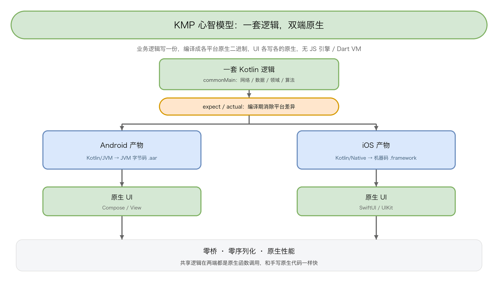
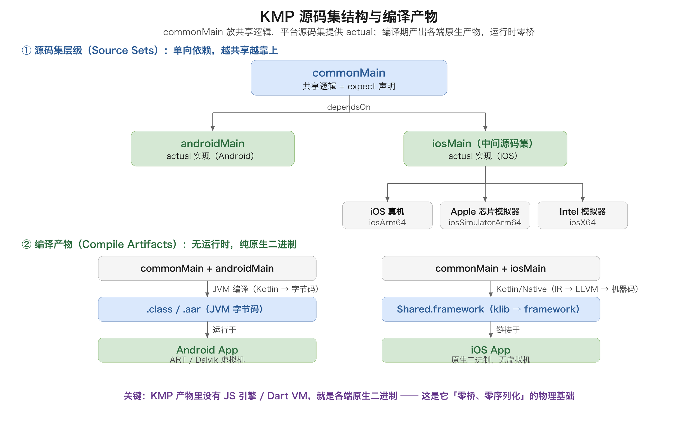
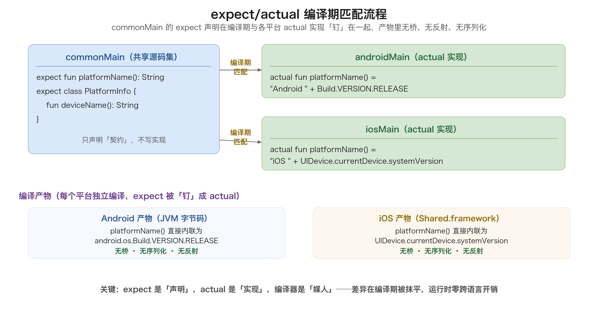
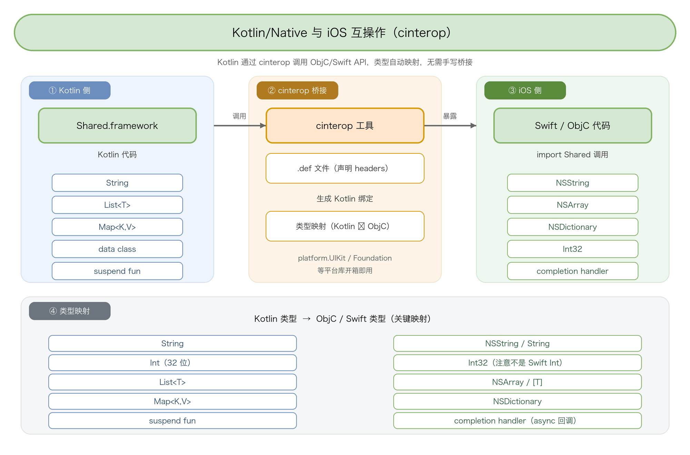
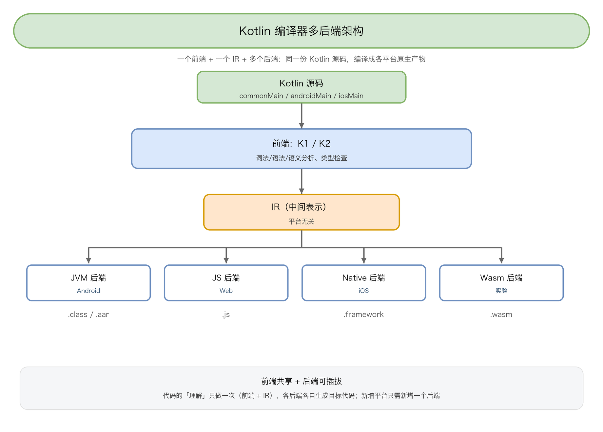
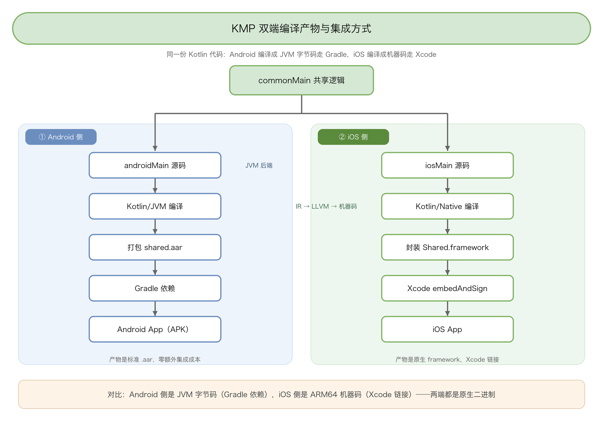
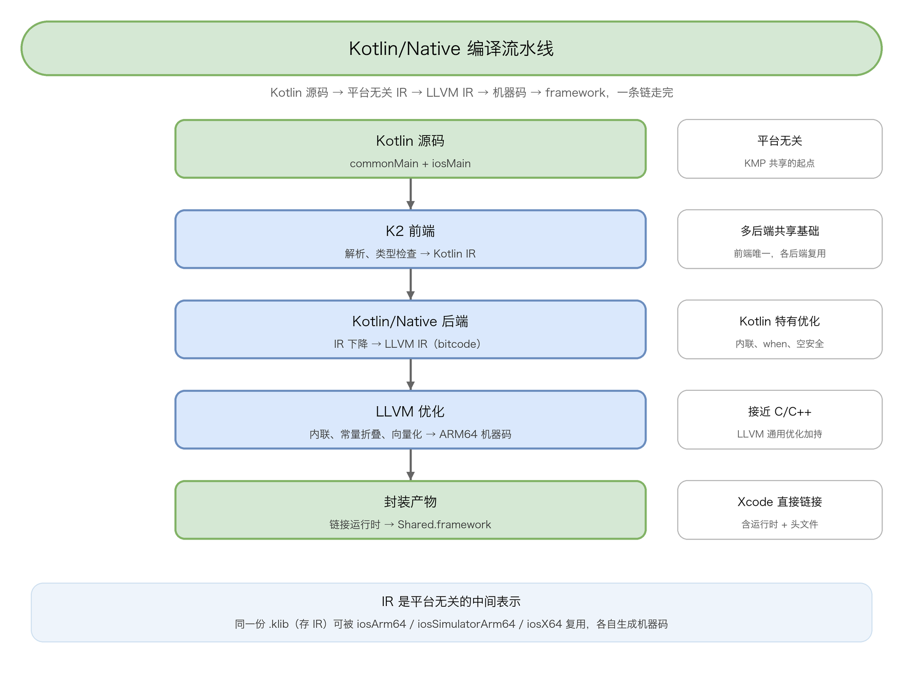
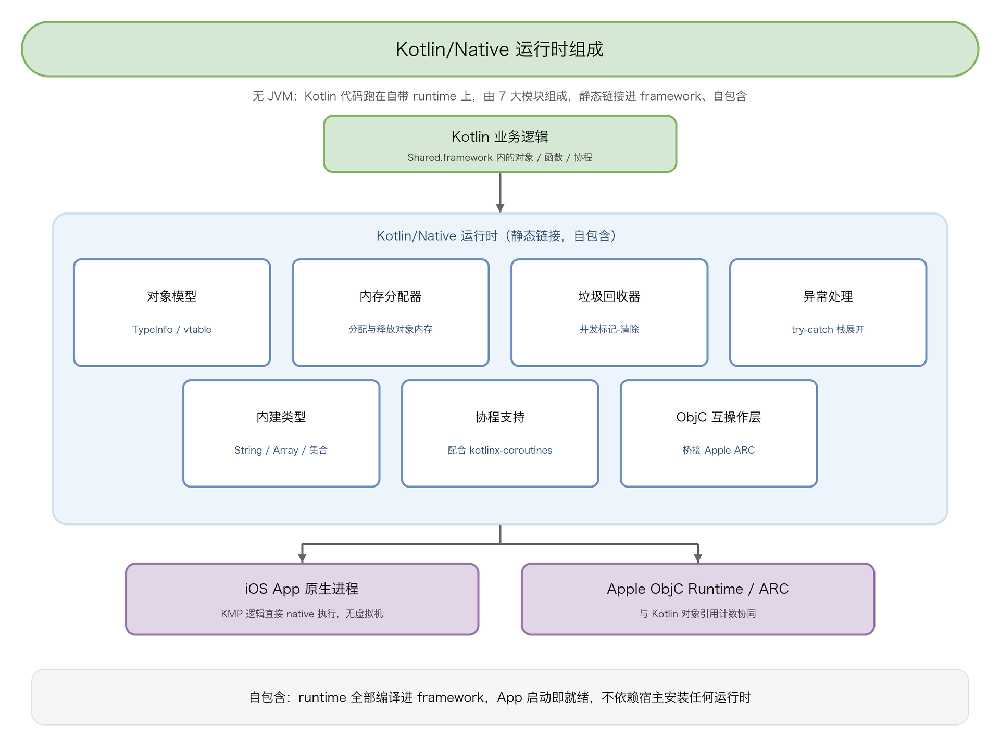
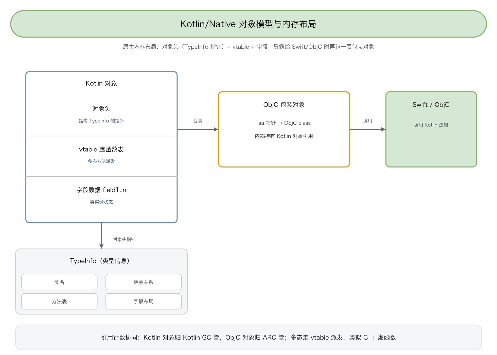
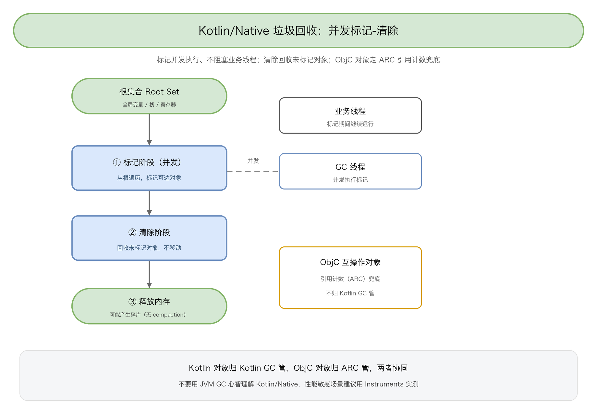

# KMP 跨平台原理与使用

> Kotlin Multiplatform（KMP）是 JetBrains 主推的「逻辑共享、UI 各写」跨平台方案：一套 Kotlin 代码，编译成 Android 的 JVM 字节码和 iOS 的原生 framework，业务逻辑零桥接、零序列化地被两端复用。本文按「是什么 → 代码怎么组织 → 平台差异怎么处理 → 怎么跑通双端 → 怎么复用依赖 → 底层为什么 → 怎么选型」的主线推进：前五章读完就能上手搭一个同时跑通 Android 和 iOS 的工程，第六章是可选的原理进阶，帮你理解「为什么它能跑得和原生一样快」。

## 目录

- [一、KMP 定位与核心理念](#一kmp-定位与核心理念)
- [二、工程结构与源码集](#二工程结构与源码集)
- [三、expect/actual 机制](#三expectactual-机制)
- [四、Android 与 iOS 集成](#四android-与-ios-集成)
- [五、依赖与生态](#五依赖与生态)
- [六、编译与运行原理](#六编译与运行原理)
- [七、优缺点与选型](#七优缺点与选型)
- [附：高频速记](#附高频速记)

---

## 一、KMP 定位与核心理念

先用一张图建立全局观——KMP 的完整体系就这四层：



### 1.1 核心定位：逻辑共享，UI 各写

KMP 走的是和 React Native、Flutter **完全不同的哲学**。RN 用 JS 桥接原生控件，Flutter 用自绘引擎彻底重画 UI，而 KMP **不争渲染权，只共享逻辑**：

- **共享的是「逻辑」**：网络请求、数据模型、序列化、状态管理、算法、持久化、业务规则——这些代码占工程大头且天然平台无关，用 Kotlin 写一份，两端复用。
- **不共享的是「UI」**：Android 用 Compose/View，iOS 用 SwiftUI/UIKit，各写各的，保留最原生的交互体验。

> **关键认知**：跨平台不一定非要跨 UI。很多项目里真正值得「跨」的是逻辑层，UI 恰恰是各端差异最大、最该保留原生质感的部分。

### 1.2 和其他跨平台方案的区别

| 维度 | React Native | Flutter | Kotlin Multiplatform |
| --- | --- | --- | --- |
| 共享范围 | 逻辑 + UI | 逻辑 + UI | **只共享逻辑（UI 各写）** |
| 渲染方式 | 原生控件 + JS 桥 | 自绘引擎（Skia） | 各端原生渲染 |
| 运行时 | JS 引擎（Hermes） | Dart VM | **无运行时，编译成原生产物** |
| 通信开销 | JS ↔ 原生桥（序列化） | 无桥（同进程 Dart） | **零桥（直接调用）** |
| 产物形态 | JS bundle | AOT 机器码 + 引擎 | Android 字节码；iOS framework |

### 1.3 编译产物：为什么「零桥」

KMP 最容易被低估的一点是它的**编译产物**——它既不像 RN 那样塞一个 JS 引擎跑 bundle，也不像 Flutter 那样打包一个 Dart VM，而是把 Kotlin 直接编译成：

- **Android 侧**：标准 JVM 字节码（`.class`），打成 `.jar` / `.aar`，和手写 Java/Kotlin 代码没有任何区别。
- **iOS 侧**：Kotlin/Native 把 Kotlin 编译成 **LLVM 中间码再生成 ARM64 机器码**，封装成 `.framework`，iOS App 直接链接。

因为两端都是**原生二进制**，所以共享逻辑在 Android 里就是普通 JVM 方法调用、在 iOS 里就是普通 native 函数调用——**没有 JS 引擎、没有 Dart VM、没有跨语言桥、没有序列化**。这就是「跑得和原生一样快」的物理基础。

### 1.4 适用与不适用

**适合**：逻辑占比高的应用（网络/数据/领域层）、双端已有成熟原生团队、SDK/库提供方（输出 `.aar` + `.framework`）、老项目增量迁移（只抽某几个模块做共享）。

**不适合**：纯 UI 快速出活（选 Flutter/RN 更省事）、强依赖平台特性的重交互页面、团队没有 Kotlin 背景。

---

## 二、工程结构与源码集

### 2.1 Source Set 与单向依赖

KMP 用**源码集（Source Set）**组织代码——它是「针对某一组编译目标」的源码 + 资源的集合，核心能力是**依赖关系声明**：源码集 A 可以 `dependsOn` B，表示「A 能访问 B 的一切」。

默认工程生成的源码集：

| 源码集 | 面向目标 | 职责 |
| --- | --- | --- |
| `commonMain` | 所有目标 | 共享逻辑 + `expect` 声明 |
| `commonTest` | 所有目标 | 共享测试 |
| `androidMain` | Android | Android 专属实现 + `actual` |
| `iosMain` | 所有 iOS 目标 | iOS 专属实现 + `actual` |
| `iosArm64` / `iosSimulatorArm64` / `iosX64` | 真机 / Apple 芯片模拟器 / Intel 模拟器 | 目标专属（少见） |

依赖方向是**单向、有向**的，这是 KMP 最核心的约束：

```
commonMain  ←──  androidMain（可见 commonMain 的一切）
   ↑
   └──────────  iosMain  ←──  iosArm64 / iosSimulatorArm64 / iosX64
```

`commonMain` 是所有平台的「公共分母」，只能依赖公共依赖，**看不到任何平台 SDK**；`androidMain` 能看到 Android SDK，`iosMain` 能看到 Apple 的 SDK（Foundation、UIKit 等）。

> **易错点**：新手最常见的错误是「把平台 API 写进 commonMain」，编译直接报 `Unresolved reference`。正确做法是把平台差异「下沉」到 expect/actual（见第三章），或「上提」成抽象接口让各平台实现。

### 2.2 标准工程目录

一个标准 KMP 工程（含 shared 模块）长这样：

```
MyKMPProject/
├── build.gradle.kts                 # 根构建脚本（声明版本）
├── settings.gradle.kts              # 声明模块
├── shared/                          # KMP 共享模块
│   ├── build.gradle.kts             # KMP + Android 插件配置
│   └── src/
│       ├── commonMain/kotlin/       # 共享逻辑 + expect 声明
│       ├── commonTest/kotlin/
│       ├── androidMain/kotlin/      # Android actual 实现
│       └── iosMain/kotlin/          # iOS actual 实现
├── androidApp/                      # Android 宿主 App
└── iosApp/                          # iOS 宿主 App（Xcode 工程）
```

`iosMain` 通过**默认层级模板**自动同时服务于 `iosArm64`、`iosSimulatorArm64`、`iosX64` 三个目标，所以**一份 iOS 代码覆盖真机 + 两种模拟器**，无需重复写。



---

## 三、expect/actual 机制

### 3.1 声明 vs 实现

KMP 能实现「零运行时桥」，核心机制是 **expect/actual**——它把「平台差异」从运行时挪到了**编译期**：

- **`expect`**：在 `commonMain` 声明「我需要某个能力，但不关心怎么实现」——这是**契约（contract）**。
- **`actual`**：在每个平台源码集提供「这个能力在本平台的真实实现」——这是**履约（implementation）**。

每个平台编译时，编译器把 `expect` 声明和该平台**唯一对应的** `actual` 实现「钉」在一起。最终产物里**不存在任何抽象层、桥、反射或序列化**——`Greeting().greet()` 在 Android 里就是直接调 `android.os.Build.MODEL`，在 iOS 里就是直接调 `UIDevice`，性能和手写原生代码一模一样。

### 3.2 双端示例：获取平台名

**commonMain 的 expect 声明（契约）：**

```kotlin
// commonMain/kotlin/Greeting.kt
package com.example.shared

// 声明：我需要一个「平台名」，但不写实现
expect fun platformName(): String

expect class PlatformInfo {
    fun deviceName(): String
    val osVersion: String
}

class Greeting {
    fun greet(): String = "Hello from ${platformName()} on ${PlatformInfo().deviceName()}"
}
```

**androidMain 的 actual 实现：**

```kotlin
// androidMain/kotlin/Platform.android.kt
package com.example.shared

import android.os.Build

actual fun platformName(): String = "Android ${Build.VERSION.RELEASE}"

actual class PlatformInfo {
    actual fun deviceName(): String = Build.MODEL
    actual val osVersion: String = Build.VERSION.RELEASE
}
```

**iosMain 的 actual 实现：**

```kotlin
// iosMain/kotlin/Platform.ios.kt
package com.example.shared

import platform.UIKit.UIDevice

actual fun platformName(): String = "iOS ${UIDevice.currentDevice.systemVersion}"

actual class PlatformInfo {
    actual fun deviceName(): String = UIDevice.currentDevice.name
    actual val osVersion: String = UIDevice.currentDevice.systemVersion
}
```

注意 `platform.UIKit.UIDevice` 这种包名：Kotlin/Native 通过 cinterop 把 ObjC 的 `UIDevice` 映射成 Kotlin 类，iOS 侧可以像写 Kotlin 一样直接调 Apple API（详见 4.4）。



### 3.3 能用于哪些声明 + 规则

`expect/actual` 几乎覆盖 Kotlin 的所有声明类型：

| 声明类型 | 示例 | 说明 |
| --- | --- | --- |
| 函数 | `expect fun now(): Long` | 最常用 |
| 类 | `expect class Clock()` | 类、方法、属性都要加 actual |
| 属性 | `expect val isDebug: Boolean` | getter 在平台侧实现 |
| 对象 | `expect object Log` | 单例 |
| 顶层变量 | `expect var appVersion: String` | 可变状态 |

**硬性规则（违反直接编译失败）：**

1. **一 expect 必须恰好一 actual**：每个编译目标都必须有且仅有一个 `actual`，少一个报 `actual missing`、多一个报 `actual duplicate`。iOS 有多个目标，好在都依赖 `iosMain`，写一份即可覆盖。
2. **包名必须完全一致**：`expect` 和 `actual` 必须在相同的包名下，否则编译器不认为它们是一对。
3. **expect class 的限制**：不能有构造函数体、`init` 块、`lateinit` 属性——它只能「声明签名」，不能「写实现」。

> **易错点**：不要在 commonMain 给 `expect` 写默认实现（`default actual` 是较新特性）。传统做法「声明归声明、实现归实现」更清晰，混写会让跨平台可移植性变差。

---

## 四、Android 与 iOS 集成

这一章把 KMP 跑起来——一个 `shared` 模块同时产出 Android 的 `.aar` 和 iOS 的 `.framework`。

### 4.1 shared 模块的 Gradle 配置

`shared/build.gradle.kts` 是 KMP 配置的核心，同时声明两个目标：

```kotlin
// shared/build.gradle.kts
plugins {
    kotlin("multiplatform")      // KMP 插件
    id("com.android.library")    // Android Library 插件（生成 .aar 需要）
}

kotlin {
    // Android 目标（JVM 后端）
    androidTarget()

    // iOS 目标（Kotlin/Native 后端）：真机 + 两种模拟器
    listOf(
        iosArm64(),              // iOS 真机
        iosSimulatorArm64(),     // Apple 芯片模拟器
        iosX64()                 // Intel 模拟器
    ).forEach { iosTarget ->
        iosTarget.binaries.framework {
            baseName = "Shared"   // framework 名
            isStatic = true       // 静态库（默认）
        }
    }

    sourceSets {
        commonMain.dependencies { /* 多平台库，见第五章 */ }
        androidMain.dependencies { /* Android 专属库 */ }
        iosMain.dependencies { /* iOS 专属库 */ }
    }
}

android {
    namespace = "com.example.shared"
    compileSdk = 34
    defaultConfig { minSdk = 24 }
}
```

三个关键点：

- **`androidTarget()`**：声明 Android 目标，配合 `com.android.library` 输出 `.aar`。
- **`binaries.framework`**：声明 iOS framework 产物，`baseName` 决定 `.framework` 名字，`isStatic` 决定静态/动态库。
- **三个 iOS 目标**：对应真机和两种模拟器，共用 `iosMain` 一份源码。

### 4.2 Android 集成：标准 .aar，零成本

Android 宿主 App 依赖 shared 模块，和依赖普通 Android Library 一模一样：

```kotlin
// androidApp/build.gradle.kts
dependencies {
    implementation(project(":shared"))
}
```

编译后 shared 模块产出一个**标准 `.aar`**（`classes.jar` = commonMain + androidMain 的 JVM 字节码）。因为就是标准 `.aar`，混淆、多渠道、依赖管理全部沿用现有工具链，**没有额外集成成本**。

```kotlin
// androidApp/MainActivity.kt
import com.example.shared.Greeting

class MainActivity : AppCompatActivity() {
    override fun onCreate(savedInstanceState: Bundle?) {
        super.onCreate(savedInstanceState)
        val text = Greeting().greet()   // "Hello from Android 14 on Pixel 8"
    }
}
```

> **易错点**：`commonMain` 拿不到 `Context`。这类平台对象通常通过 expect/actual 传递，或由宿主 App 在启动时注入（`expect fun createStorage(): Storage`，Android 侧在 `Application.onCreate()` 初始化）。

### 4.3 iOS 集成：Xcode Run Script 打通 Gradle

iOS 侧是集成最需要「手动配置」的地方，因为要打通 Gradle 和 Xcode 两套构建体系。核心是在 **Xcode 的 Build Phases 加一个 Run Script**：

1. 打开 `iosApp/iosApp.xcodeproj`，选中 target → **Build Phases** → 点「+」→ **New Run Script Phase**。
2. 把脚本拖到 **Compile Sources 之前**（确保先有 framework 再编译 App）。
3. 填入脚本：

```bash
cd "$SRCROOT/.."    # 回到 KMP 工程根目录
./gradlew :shared:embedAndSignAppleFrameworkForXcode
```

脚本执行时，Xcode 会注入环境变量（`CONFIGURATION`、`SDK_NAME`、`ARCHS` 等），Gradle 据此判断 Debug/Release、真机/模拟器，选择对应 iOS 目标编译，并把 `Shared.framework` **拷贝到 App 的 Frameworks 目录并签名**（`embedAndSign` 的「embed + sign」）。

`Shared.framework` 里包含：**二进制**（ARM64 机器码 + Kotlin/Native 运行时）、**头文件**（`Headers/Shared.h`，自动生成的 ObjC 接口声明）、**模块映射**（`Modules/module.modulemap`，让 Swift 能 `import Shared`）。

`isStatic = true`（默认）是静态库，链接期合并进 App 可执行文件；`isStatic = false` 是动态库，需随 App 打包并签名。一般默认静态库最省事。

### 4.4 iOS 互操作要点

Kotlin/Native 能直接在 Kotlin 里调 Apple 的 ObjC API，靠的是 **cinterop（C/ObjC 互操作工具）**：

- **平台库默认绑定**：`platform.UIKit`、`platform.Foundation` 等是 JetBrains 预先生成好的 Apple 系统框架绑定，开箱即用。
- **自定义 C/ObjC 库绑定**：调第三方 C/ObjC 库时写一个 `.def` 文件声明头文件，cinterop 据此生成 Kotlin 声明。

```kotlin
// 调用 Apple 系统 API（无需任何 .def 配置）
import platform.Foundation.NSDate
import platform.Foundation.timeIntervalSince1970

fun currentTimestamp(): Long = NSDate().timeIntervalSince1970().toLong()
```



**Kotlin ↔ ObjC/Swift 类型映射**是 iOS 互操作的核心：

| Kotlin | ObjC / Swift | 说明 |
| --- | --- | --- |
| `String` | `NSString` / `String` | 自动桥接 |
| `Int` | `Int32` | 注意不是 Swift 的 `Int`（64 位） |
| `Long` | `Int64` | 对应 64 位整数 |
| `Float` / `Double` | `Float` / `Double` | |
| `List<T>` / `Map<K,V>` | `NSArray` / `NSDictionary` | 装箱成集合 |
| `suspend fun` | completion handler | 协程函数映射成异步回调 |
| `Boolean` | `Bool` | |

> **易错点（最常见）**：Kotlin 的 `Int` 是 32 位，映射到 Swift 是 `Int32` 而不是 `Int`，Swift 侧要用 `Int` 需显式 `Int32(...)` 转换。这类「类型宽度不一致」是 KMP iOS 互操作的头号坑。

Swift 侧 `import Shared` 即可调用：

```swift
// iosApp/ContentView.swift
import Shared

struct ContentView: View {
    let greeting = Greeting()
    var body: some View {
        Text(greeting.greet())   // "Hello from iOS 17.2 on iPhone 15"
    }
}
```

`suspend` 函数跨语言时被翻译：Android 侧是普通 Kotlin 协程，iOS 侧编译成带 completion handler 的 ObjC 方法，Swift 用 async/await 调用：

```kotlin
// commonMain
suspend fun fetchUser(id: String): User
```

```swift
// iOS Swift 侧
Task {
    let user = try await Api().fetchUser(id: "1")
}
```

---

## 五、依赖与生态

> KMP 能真正落地，靠的是 JetBrains 围绕「跨平台」系统性地做的**生态建设**——它分三层：**机制层**（多平台库怎么运作）、**官方库层**（kotlinx + Jetpack 多平台化）、**工具链层**（IDE 与构建）。这三层决定了一个 KMP 项目「能复用多少现成能力」。

### 5.1 多平台库机制：一个坐标，多端构件（生态的根基）

普通 JVM 库只发布一份 `.jar`，而**多平台库**发布时，同一个 Maven 坐标下会挂出**多个构件**——针对每个目标各产出一份：

```
io.ktor:ktor-client-core:2.3.10
├── ktor-client-core-jvm.jar          # JVM / Android
├── ktor-client-core-iosarm64.klib    # iOS 真机
├── ktor-client-core-iosx64.klib      # Intel 模拟器
├── ktor-client-core-iosarm64.klib    # Apple 芯片模拟器
└── ktor-client-core-metadata.jar     # 公共元数据（声明签名）
```

配套的机制有：

- **Gradle module metadata**：Kotlin Gradle 插件读取库的元数据，**按当前编译目标自动挑选对应构件**，开发者只需写一个坐标，无需手写平台分支。
- **HMPP（层级项目结构）**：库作者也用 `commonMain` / `androidMain` / `iosMain` 组织代码——这和你写应用完全一致，正是「源码集」这套抽象让「写库」和「写应用」体验统一。
- **发布工具**：库作者通过 `maven-publish` 插件一键发布所有平台的构件到 Maven Central。

> **一句话理解**：KMP 生态的「地基」就是这套「一个坐标、多端构件、自动选择」的机制——它让「一个库能否被 commonMain 引用」变成了一件标准化的事。

### 5.2 Kotlin 官方库：kotlinx 系列

JetBrains 官方维护了一批 `kotlinx.*` 扩展库，覆盖了日常开发最需要的能力，且**全部多平台**：

| 库 | 用途 | 说明 |
| --- | --- | --- |
| kotlinx-coroutines | 协程 / 异步 | `Flow`、`StateFlow`，双端统一的多线程调度 |
| kotlinx-serialization | 序列化 | JSON / Protobuf / CBOR，编译期生成、零反射 |
| kotlinx-datetime | 日期时间 | 替代 `java.time`，`Instant` / `LocalDate` 可在 commonMain 用 |
| kotlinx-atomicfu | 原子操作 | 无锁并发，`AtomicInt` / `AtomicReference` |
| kotlinx-io | I/O | 多平台 IO，替代 `java.io` |
| kotlinx-collections-immutable | 不可变集合 | 持久化数据结构 |

这六个库 + 标准库，构成了 KMP 的「官方能力底座」。它们随 Kotlin 版本同步发布，API 在 JVM / Native / JS 上保持一致——这是「一套代码多端复用」能落地的关键支撑。

### 5.3 Google 的加入：Jetpack 多平台化

KMP 生态最关键的转折点是 **2024 年 5 月 Google 宣布 Android 官方支持 KMP**，用于共享业务逻辑。这意味着 KMP 不再是「JetBrains 单方面推进」，而是 **JetBrains + Google 双官方背书**。

Google 随后把一大批 **Jetpack 库做了多平台化**，让 Android 开发者熟悉的能力可以直接写进 `commonMain`：

| 库 | KMP 支持 | 作用 |
| --- | --- | --- |
| Room | ✓ | 数据库（2.7+ 起支持 KMP） |
| DataStore | ✓ | 键值 / 数据存储 |
| Lifecycle / ViewModel | ✓ | 生命周期与状态管理 |
| Navigation / Paging | ✓ | 导航、分页 |
| SQLite | ✓ | 底层 SQLite 驱动 |
| Collection | ✓ | 集合扩展 |

Jetpack 的 KMP 支持还做了**平台分级**：**Level 1（Android / iOS / JVM）**在 CI 上完整测试、追踪源码与二进制兼容性；Level 2（macOS / Linux）部分测试；Level 3（watchOS / tvOS / Windows / JS / WASM）暂未覆盖。选型时优先选 Level 1 的库。

> **意义**：Google 下场后，Android 生态大批库「顺手」就多平台化了，KMP 的库覆盖从「只有 kotlinx 和几个第三方库」变成了「Jetpack 全家桶 + kotlinx + 第三方」三层。注意 UI 共享还有 **Compose Multiplatform** 路线，本文聚焦逻辑共享，不展开。

### 5.4 工具链建设：IDE 与构建

工具链的成熟度直接影响上手成本，JetBrains + Google 在这块做了不少事：

- **Kotlin Multiplatform 插件（Android Studio）**：提供新项目向导、环境预检（自动检查 Xcode/CocoaPods 等依赖）、以及**直接从 IDE 运行/调试 iOS 和 Android 应用**——不用在 Xcode 和 Android Studio 之间来回切。
- **Android Studio KMP 模块向导**：老 Android 项目可一键新增 KMP 共享模块，向导自动配置好所有插件。
- **`com.android.kotlin.multiplatform.library` 插件**：给「KMP 库」加 Android target 的官方推荐方式，逐步取代旧的 `com.android.library` 路径。
- **K2 编译器**：Kotlin 2.0（2024 年 5 月）发布，新前端 K2 从一开始就是**为多平台设计**的，编译速度显著提升。

这些建设让「搭工程、跑双端」这件事从「一堆手工配置」变成了「向导 + 一键运行」。

### 5.5 引入组件：Android 直接引、iOS 走桥接

共享模块要复用各端已有能力，两端的「引入方式」截然不同：

| 端 | 引入方式 | 底层原理 |
| --- | --- | --- |
| Android | Gradle 依赖（aar / jar / maven） | 都是 JVM 字节码，同一运行时 |
| iOS | CocoaPods / cinterop / SPM / 链接 framework | 通过 ObjC 运行时做跨语言互操作 |

**Android 端**——就是 JVM 生态，直接依赖即可，**零桥接、零转换**：

```kotlin
// androidMain 依赖
dependencies {
    implementation("androidx.core:core-ktx:1.13.0")
    implementation("com.squareup.retrofit2:retrofit:2.11.0")
}
```

**iOS 端**——本质是「跨语言互操作」，主流三种方式：

| 方式 | 用法 | 原理 |
| --- | --- | --- |
| CocoaPods | `cocoapods { pod("Alamofire") }` | Gradle 生成 podspec，KMP 作为 CocoaPods 库被 `pod install` 集成，同时反向调用 pod 库 |
| cinterop（.def） | `cinterops { defFile("xxx.def") }` | 解析 `.h` 头文件生成 Kotlin 绑定 |
| SPM | Xcode 里以 SPM 包引入 | 较新版本支持 |

**一句话原理**：Android 端「引入组件」就是「引入一个 JVM 库」，天然同构；iOS 端「引入组件」必须通过 cinterop（编译期绑定）或 CocoaPods/SPM（工程集成）把原生库「翻译」成 Kotlin 能理解的形式。

### 5.6 主流多平台库清单 + 测试

`commonMain` 只能依赖「同样支持多平台」的库：

```kotlin
// shared/build.gradle.kts
kotlin {
    sourceSets {
        commonMain.dependencies {
            implementation("org.jetbrains.kotlinx:kotlinx-coroutines-core:1.8.1")
            implementation("org.jetbrains.kotlinx:kotlinx-serialization-json:1.6.3")
            implementation("io.ktor:ktor-client-core:2.3.10")
        }
    }
}
```

除官方 kotlinx 与 Jetpack 之外，第三方多平台库也日益丰富：

| 领域 | 多平台库 | 说明 |
| --- | --- | --- |
| 网络 | Ktor Client | JetBrains 官方，支持 JVM / Native / JS |
| 数据库 | SQLDelight | SQL 生成类型安全 API |
| 依赖注入 | Koin | 支持 KMP 的轻量 DI |
| 键值存储 | Multiplatform Settings | SharedPreferences + NSUserDefaults 统一封装 |
| 图片加载 | Coil 3.x | 支持 Compose Multiplatform |
| 日志 | Napier | 双端日志 |

> **选型提示**：优先选「官方（kotlinx / Jetpack）> 成熟第三方 > 自己 expect/actual 封装」。仍有库只有 JVM 版（如 Retrofit、Gson、Dagger/Hilt），iOS 侧要用就得换替代（Ktor 替代 Retrofit、kotlinx-serialization 替代 Gson、Koin 替代 Hilt）。

**测试**——共享逻辑写在 `commonTest`，用 `kotlin.test`，**一次编写、各端执行**：

```kotlin
// commonTest/kotlin/GreetingTest.kt
import kotlin.test.Test
import kotlin.test.assertTrue

class GreetingTest {
    @Test
    fun greetContainsHello() {
        assertTrue(Greeting().greet().contains("Hello"))
    }
}
```

运行 `./gradlew :shared:allTests` 会在 JVM + 各 iOS 目标上跑同一套测试。

---

## 六、编译与运行原理

> 这一章是**进阶内容**：不读也能用 KMP，读了能理解「为什么零桥、为什么和原生一样快」。前五章已覆盖日常开发所需的全部内容，本章把「编译器怎么把一套代码编译成多端产物」和「iOS 侧为什么没有 JVM 也能跑」讲透。

### 6.1 编译器架构：一个前端 + 一个 IR + 多个后端

「一套代码、多端运行」的物理基础，是 Kotlin 编译器的**多后端（multi-backend）**能力。它采用两段式架构——前端只做「理解代码」，后端只做「生成目标代码」，两者用 **IR（中间表示）** 解耦：

```
Kotlin 源码（commonMain / androidMain / iosMain / ...）
        │
        ▼
┌─────────────────────────────┐
│  前端：K1 / K2               │  词法/语法/语义分析、类型检查
│  生成平台无关的 IR           │
└─────────────────────────────┘
        │  IR（中间表示）
        ▼
┌──────────┬──────────┬──────────┬──────────┐
│ JVM 后端  │ JS 后端   │ Native 后端│ Wasm 后端 │
└──────────┴──────────┴──────────┴──────────┘
   .class      .js      LLVM IR     .wasm
  （Android） （Web）   （iOS）     （实验）
```

这个架构带来两个收益：**前端共享**（代码的「理解」只做一次）和**后端可插拔**（新增平台只需新增后端）。其中 JS / Wasm 后端主要服务 Web，移动端用不到。

前端有新旧两代——K1 是长期默认的老前端，K2 是 JetBrains 重写的新前端：

| 对比项 | K1（旧前端） | K2（新前端） |
| --- | --- | --- |
| 状态 | 长期默认 | Kotlin 2.0 起默认启用 |
| 性能 | 较慢 | 编译速度显著提升 |
| 架构 | 传统 | 重写，面向 IR 优化 |

K2 从 Kotlin 2.0（2024 年 5 月）起默认启用，是当前推荐的编译器前端。



### 6.2 IR：中间表示的核心作用

**IR** 是「多后端」能成立的关键，它是前端和后端之间的「共同语言」：

- **平台无关**：IR 不包含任何平台信息，`val x = 1 + 2` 在 IR 里就是「加法」，和它最终跑在 JVM 还是 ARM 机器上无关。
- **分层下降（lowering）**：IR 不是一层，而是从「高层 IR」（接近源码语义）逐步「下降」到「低层 IR」（接近机器），每层做一部分转换和优化。
- **一次生成、多处消费**：前端生成一次 IR，各后端各自读取并翻译成自己的目标代码。

> **一句话理解**：IR 之于编译器，就像「中间语言」之于翻译——先把中文翻译成一种「通用中间语」，再由不同译者分别译成英文、日文、法文，而不是中文直接硬译成每种语言。

### 6.3 Android 目标：JVM 后端

Android 目标走 **Kotlin/JVM** 路线，是最「传统」的一条后端：

- **产物**：Kotlin 源码 → JVM 字节码（`.class`）→ 打包 `.jar` / `.aar`。
- **目标版本**：通过 `jvmTarget` 指定字节码版本（如 `jvmTarget = "17"`），决定生成的字节码兼容哪个 JVM 版本。
- **与 Android 工具链无缝衔接**：`.aar` 进 App 后，经 **D8/R8** 把字节码转成 DEX，再和手写代码一起打包进 APK。混淆、裁剪、优化全部走 Android 标准流程。

```
commonMain + androidMain
        │  Kotlin/JVM 后端
        ▼
.class 字节码 ──▶ shared.aar ──▶ D8/R8 ──▶ DEX ──▶ APK
```

> **关键点**：Android 侧的 KMP 产物就是**标准 JVM 字节码**，和手写 Kotlin/Java 没有任何区别，所以 Android 生态工具链（调试、混淆、热修复）全部照常工作——这也是 Android 接入 KMP 几乎零成本的原因。

### 6.4 iOS 目标：Kotlin/Native 后端

iOS 目标走 **Kotlin/Native** 路线，产物是原生机器码：

1. **Kotlin → IR**：前端把 Kotlin 源码编译成平台无关的 IR。
2. **IR → LLVM IR**：Kotlin/Native 后端把 Kotlin IR 翻译成 **LLVM 中间码**，借用 LLVM 强大的优化能力（内联、常量折叠、死代码消除等）。
3. **LLVM IR → 机器码**：LLVM 针对目标架构（`iosArm64` / `iosSimulatorArm64` / `iosX64`）生成真正的 ARM64/x86_64 机器码。
4. **封装产物**：机器码 + Kotlin/Native 运行时打包成 `.klib`，再封装成 `.framework` 供 Xcode 链接。

```
commonMain + iosMain
        │  Kotlin/Native 后端
        ▼
IR ──▶ LLVM IR ──▶ ARM64 机器码 ──▶ .klib ──▶ Shared.framework ──▶ iOS App
```

> **关键认知**：`.framework` 里是**真正的机器码 + Kotlin/Native 运行时**，不是解释执行、不是 JIT。所以 iOS 上的 KMP 逻辑和 ObjC/Swift 写的代码在同一个执行模型下运行，调用成本就是一次 native 函数调用。

两端产物对比：

| 维度 | Android 目标 | iOS 目标 |
| --- | --- | --- |
| 编译器后端 | Kotlin/JVM | Kotlin/Native |
| 中间表示 | JVM 字节码 | Kotlin IR → LLVM IR → 机器码 |
| 最终产物 | `.jar` / `.aar` | `.framework` |
| 集成方式 | Gradle `implementation(project(":shared"))` | Xcode 链接 framework |
| 运行模型 | JVM（ART/Dalvik） | 原生 + Kotlin/Native 运行时 |



### 6.5 Kotlin/Native 编译流水线

Kotlin/Native 编译器（工程代号 **konan**）不是单个程序，而是一条「前端 + 后端 + 外部工具链」的流水线：

| 组成 | 职责 |
| --- | --- |
| K1 / K2 前端 | 解析 Kotlin 源码、语义分析、类型检查，产出平台无关的 IR |
| Kotlin/Native 后端 | 把 Kotlin IR 下降（lower）为 LLVM IR，并做 Kotlin 特有优化 |
| LLVM | 对 LLVM IR 做通用优化，生成目标架构（ARM64 / x86_64）机器码 |
| 平台库（platform libs） | 预先生成的 Apple SDK 绑定（`platform.UIKit`、`platform.Foundation` 等） |
| cinterop | 把 C/ObjC 头文件解析成 Kotlin 绑定（生成 klib） |

一次完整的编译分五步：

```
Kotlin 源码（commonMain + iosMain）
   │ ① K2 前端：词法/语法/语义分析、类型检查
   ▼
Kotlin IR（平台无关的中间表示）
   │ ② Native 后端：IR 下降（lower）、Kotlin 特有优化
   ▼
LLVM IR（bitcode 位码）
   │ ③ LLVM 优化：内联、常量折叠、死代码消除、向量化
   ▼
目标机器码（ARM64 / x86_64）
   │ ④ 链接 Kotlin/Native 运行时
   ▼
.klib（Kotlin 库）──⑤ 封装──▶ Shared.framework（二进制 + 头文件 + modulemap）
```



几个关键产物：

- **`.klib`**：Kotlin/Native 的库容器，装的是 **IR + 元数据**（声明、类型信息、可见性），**不是机器码**。因为存的是平台无关的 IR，同一份 `.klib` 可被 `iosArm64`、`iosSimulatorArm64`、`iosX64` 复用，各自编译成机器码——这与 JVM 的 `.jar`（存字节码）本质类似，都是「可分发、可复用、编译期链接」的中间产物。
- **`.framework`**：拆开看是标准 Apple framework 包——`Shared`（二进制 = 机器码 + 运行时）、`Headers/Shared.h`（自动生成的 ObjC 接口声明）、`Modules/module.modulemap`（让 Swift 能 `import Shared`）、`Info.plist`。

### 6.6 iOS 运行时：无 JVM，自带 runtime

Kotlin 代码要运行离不开「运行时」，但两端差别很大：

| 维度 | Android（Kotlin/JVM） | iOS（Kotlin/Native） |
| --- | --- | --- |
| 运行载体 | JVM / ART 虚拟机 | 原生进程（无 VM） |
| 标准库 | `kotlin-stdlib`（跑在 JVM 上） | runtime 静态链接进产物 |
| 内存管理 | JVM GC | Kotlin/Native GC + ObjC ARC 协同 |
| 对象模型 | JVM 对象 + 引用 | 原生内存对象 + 引用计数 |

Android 侧的「运行时」就是 JVM + `kotlin-stdlib`，没有额外负担；iOS 侧则是**一套完全自带的 runtime**（C++ 实现的底层库），静态链接进 `.framework`，App 启动即就绪。它由这些模块组成：

- **对象模型**：对象头、类型信息（TypeInfo）、虚函数表，支撑类、继承、接口、泛型。
- **内存分配器与 GC**：分配释放对象内存 + 自动回收不再使用的对象。
- **异常处理**：实现 `try/catch/throw` 的栈展开（stack unwinding）。
- **内建类型**：`String`、`Array`、集合等基础类型的底层实现。
- **协程支持**：配合 `kotlinx-coroutines` 提供协程调度。
- **ObjC 互操作层**：与 Apple 的 ObjC runtime 桥接，管理 Kotlin ↔ ObjC 对象生命周期。

这些组件编译期被链接进 `.framework`，因此 Kotlin/Native 程序是「**自包含**」的——不依赖宿主安装任何 runtime。



### 6.7 运行时细节：对象模型、GC 与内存模型

**对象模型与内存布局**——Kotlin/Native 的对象模型和 JVM 不同，更接近 C++/Swift 的原生对象：

- **对象头**：每个对象都带「对象头」，内含指向**类型信息（TypeInfo）**的指针；TypeInfo 记录类名、继承关系、方法表、字段布局等元数据。
- **虚函数表（vtable）**：多态方法调用通过 vtable 派发，机制类似 C++ 的虚函数。
- **ObjC 包装对象**：当 Kotlin 类需要暴露给 Swift/ObjC 时，会生成一个「ObjC 包装对象」把 Kotlin 对象包起来，两者通过引用计数 + GC 协同管理。



**内存管理：分配器与 GC**——Kotlin/Native **有自己的 GC**，不是 JVM 的 GC，也不是 Apple 的 ARC：

- **默认 GC**：并发标记-清除（concurrent mark-sweep）。标记阶段并发执行（尽量不阻塞业务线程），清除阶段回收未标记对象。
- **无 compaction**：历史上不做内存压缩（不移动对象），长期运行可能产生内存碎片（较新版本持续优化）。
- **引用计数兜底**：对 ObjC 互操作对象用引用计数兜底，与 ARC 协同——Kotlin 对象归 Kotlin GC，ObjC 对象归 ARC。
- **可配置**：通过 `-Xgc` 编译器参数或 `kotlin.native.binary.*` 配置项选择 GC 策略。



> **易错点**：不要用「JVM 的 GC 心智」理解 Kotlin/Native，它的 GC 策略、停顿行为、内存布局都和 HotSpot 不同，性能敏感场景建议用 Instruments 实测，而不是凭 JVM 经验推断。

**内存模型（New Memory Model）**——历史上 Kotlin/Native 用「严格内存模型」，对象跨线程共享前必须 `freeze()`（冻结成不可变），否则运行时崩溃，心智负担极重。**自 Kotlin 1.7.20 起新内存模型默认开启**：

| 对比项 | 旧内存模型 | 新内存模型（默认） |
| --- | --- | --- |
| 跨线程共享 | 必须 `freeze()` | 直接共享 |
| 可变对象跨线程 | 崩溃 | 允许（自行保证线程安全） |
| 与 JVM 一致性 | 差异大 | 尽量对齐 |

**并发模型**——Kotlin/Native 支持真正的多线程，但最推荐协程：

```kotlin
// 全局不可变配置
@SharedImmutable
val config = Config(apiBaseUrl = "https://api.example.com")

// 原子计数器（kotlinx.atomicfu）
class Counter {
    private val _value = atomic(0)
    val value: Int get() = _value.value
    fun inc() = _value.incrementAndGet()
}
```

- `kotlinx.coroutines` 在 Native 上支持真正的多线程调度，`Dispatchers.Default` 利用多核，`Dispatchers.Main` 映射主线程；`launch`、`async`、`Flow` 等 API 与 JVM 完全一致。
- 协程底层跑在 **pthread（POSIX 线程）** 上，由 runtime 调度器管理线程池。
- `@SharedImmutable` 标记全局不可变单例，`kotlinx.atomicfu` 提供无锁原子操作。

> **易错点**：新内存模型虽允许跨线程共享可变对象，但**不保证原子性和可见性**——和 JVM 一样，多线程写同一个 `var` 会数据竞争，要么用 `atomicfu`，要么加锁，要么收敛到协程 + 不可变数据流。

---

## 七、优缺点与选型

### 7.1 优点

1. **零桥、零序列化、原生性能**：编译成原生二进制，逻辑调用就是普通函数调用。
2. **逻辑复用率高**：业务逻辑、数据层、网络层、算法可 100% 共享。
3. **原生 UI 体验**：UI 各写各的，交互体验无折损。
4. **增量迁移友好**：老项目可只抽一个模块做 KMP，不影响现有代码。
5. **生态成熟**：JetBrains + Google 双官方支持，kotlinx + Jetpack（Room / DataStore / Lifecycle 等）大批多平台化。

### 7.2 缺点

1. **UI 不共享**（纯 KMP）：UI 仍要写两遍，人力没完全省下。
2. **iOS 侧心智门槛高**：Kotlin/Native 的内存/并发模型、cinterop、类型映射要额外学习。
3. **构建复杂**：iOS 侧要打通 Gradle ↔ Xcode 两套体系，配置与排查成本高。
4. **编译慢**：Kotlin/Native 编译慢，iOS 目标多（真机 + 两种模拟器）会放大构建时间。
5. **第三方库覆盖仍不及 Flutter / RN**：Jetpack 虽已多平台化，但 Retrofit、Gson、Dagger/Hilt 等仍只有 JVM 版，需找替代或自己封装。

### 7.3 选型结论

| 维度 | KMP（纯逻辑） | Flutter | React Native |
| --- | --- | --- | --- |
| 共享范围 | 逻辑 | 逻辑 + UI | 逻辑 + UI |
| 性能 | 原生 | 自绘（接近原生） | 原生控件 + JS 桥 |
| UI 体验 | 完全原生 | 视觉一致 | 原生控件 |
| 语言 | Kotlin | Dart | JS/TS |
| 接入成本 | Android 低 / iOS 中 | 低 | 低 |

**一句话结论**：追求「逻辑复用 + 原生 UI 体验 + 原生性能」，选 **KMP**；追求「快速出活 + 全栈跨端 + 成熟生态」，选 **Flutter**。

---

## 附：高频速记

- **定位**：逻辑共享、UI 各写。编译成 Android 字节码 + iOS framework，无运行时桥、无序列化。
- **源码集**：`commonMain`（共享 + expect）← `androidMain` / `iosMain`（actual）；依赖单向，commonMain 看不到平台 SDK。
- **expect/actual**：`expect` 声明契约、`actual` 平台履约，编译期「钉」在一起；一 expect 恰好一 actual，包名必须一致。
- **Android 集成**：`androidTarget()` + `com.android.library`，宿主 `implementation(project(":shared"))`，产物标准 `.aar`，零额外成本。
- **iOS 集成**：Xcode Build Phases 加 Run Script `./gradlew :shared:embedAndSignAppleFrameworkForXcode`，自动编译 + 嵌入 + 签名。
- **cinterop**：Kotlin/Native 调 ObjC/C 的互操作工具，`platform.UIKit` 等平台库开箱即用；`Int` 映射成 Swift `Int32`（32 位，注意转换）。
- **编译后端**：Android 走 Kotlin/JVM → 字节码 → `.aar`；iOS 走 Kotlin/Native → IR → LLVM → 机器码 → `.framework`。
- **iOS 运行时**：无 JVM，自带 runtime（对象模型 / GC / 协程），静态链接进 framework。
- **内存模型**：Kotlin 1.7.20+ 新内存模型默认开启，移除 `freeze()`，与 JVM 语义对齐，线程安全自行负责。
- **引入组件**：Android 直接 Gradle 依赖（JVM 同构、零桥接）；iOS 走 CocoaPods / cinterop / SPM（跨语言，需生成绑定）。
- **依赖生态**：commonMain 只引多平台库（Ktor、kotlinx-serialization、kotlinx-coroutines、SQLDelight）；平台库放 androidMain/iosMain。
- **测试**：commonTest + kotlin.test，`./gradlew :shared:allTests` 一次跑双端。
- **易错点**：`Int`(32位)↔`Int32`、commonMain 写平台 API 报 `Unresolved reference`、suspend 函数 iOS 侧映射 completion handler。
