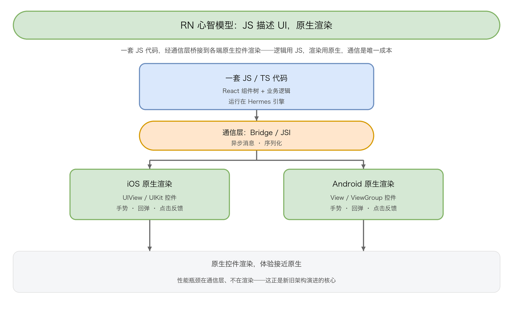
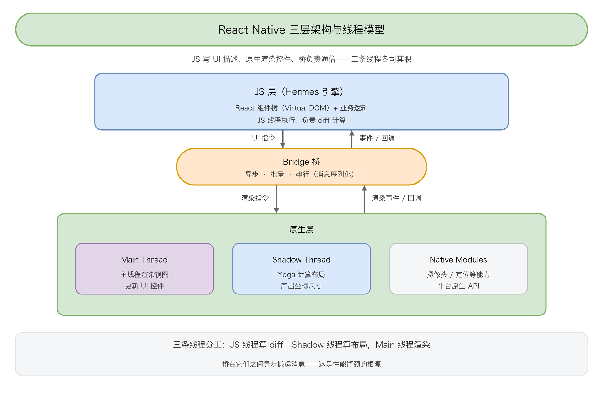
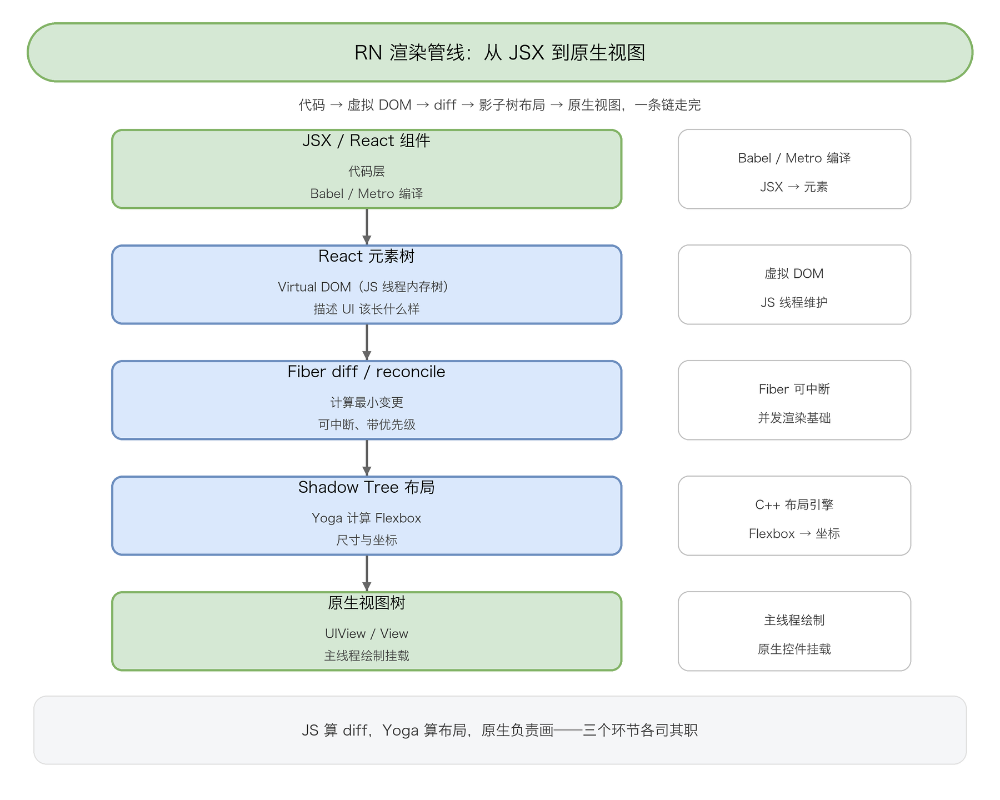
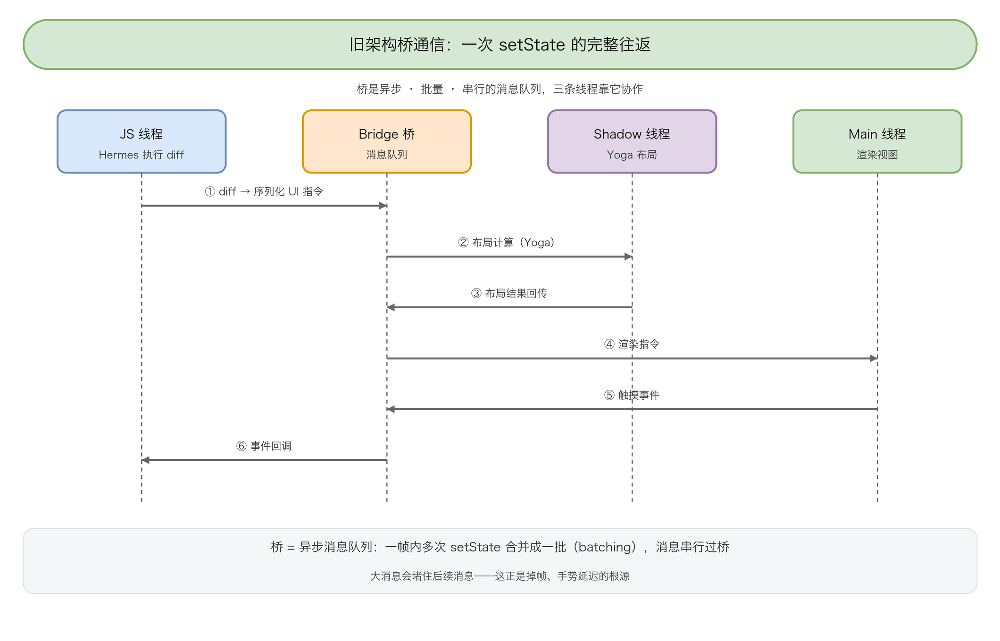
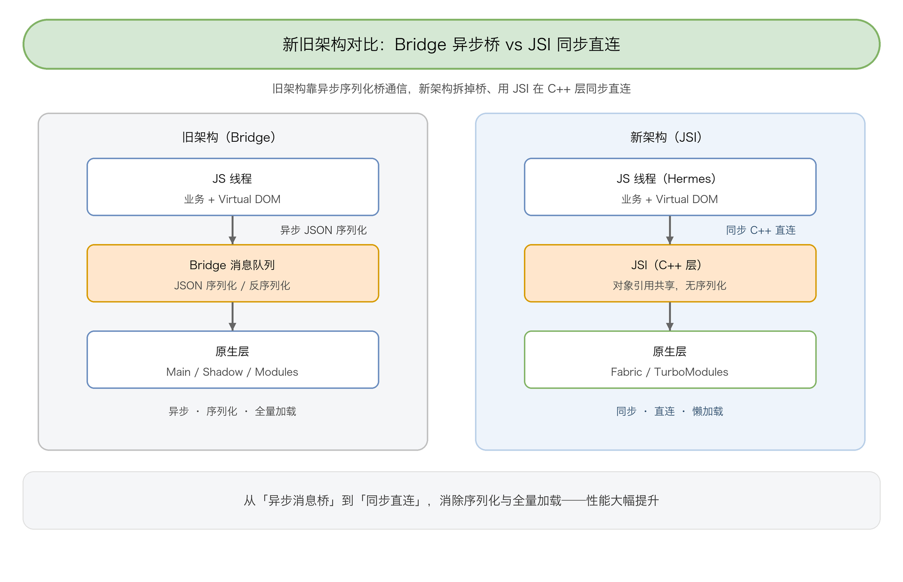
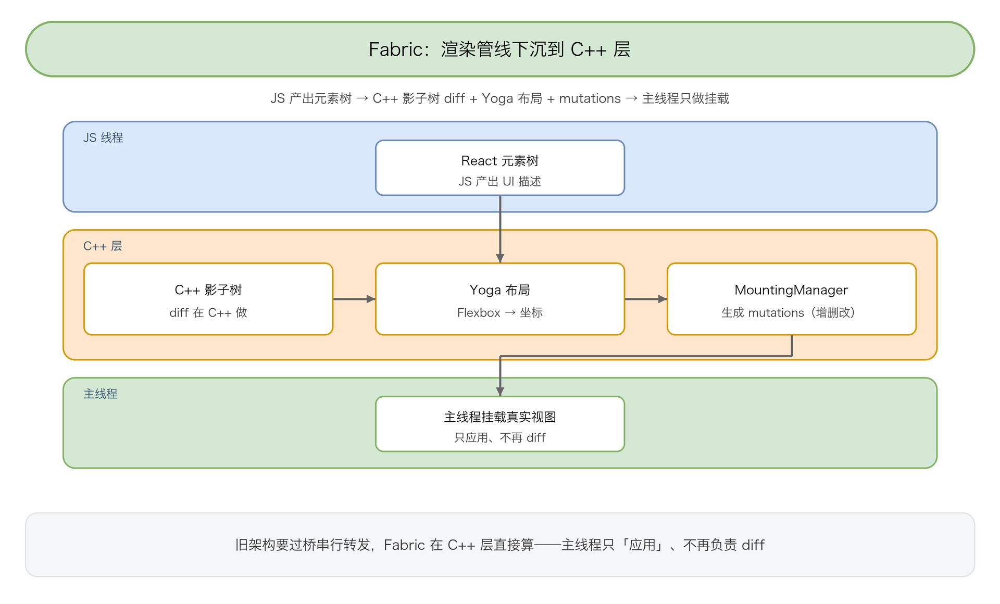
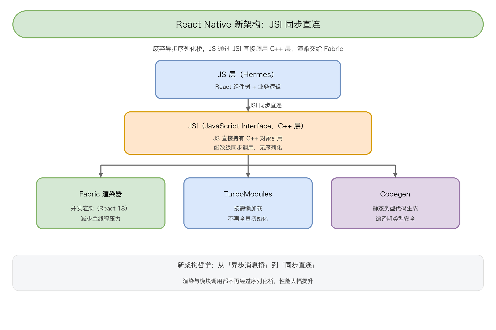
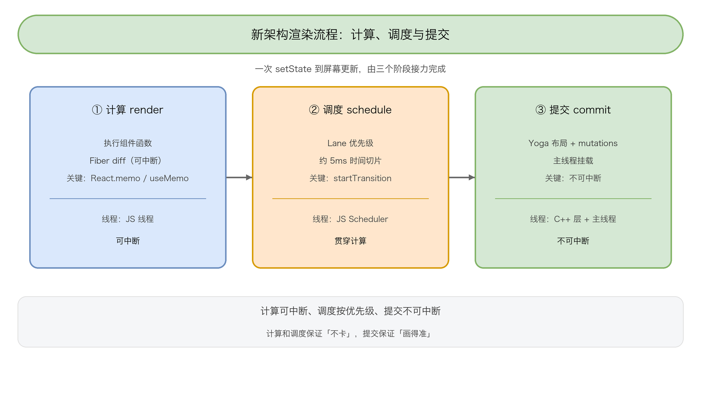

# React Native 跨平台

> React Native（RN）是 Meta 于 2015 年开源的跨平台方案，核心口号是 **Learn once, write anywhere**（学一次，到处写）：用 JavaScript/TypeScript 写业务逻辑和 UI 描述，渲染的却是**真正的原生控件**（iOS 是 UIView、Android 是 View），因此体验远好于 WebView 套壳的 Hybrid。本文按「定位 → 架构体系 → 渲染原理 → 旧架构桥 → 新架构 → 渲染流程 → 通信机制 → JS 引擎 → 工程生态 → 选型」的主线，把 RN 的完整体系与底层原理一次讲透，每个核心概念都深入原理、配图示与对比表格，读完你能真正理解「RN 是怎么把 JS 代码变成原生界面」的。

## 目录

- [一、RN 定位与核心理念](#一rn-定位与核心理念)
- [二、架构体系：三层架构与线程模型](#二架构体系三层架构与线程模型)
- [三、渲染原理：从 JSX 到原生视图](#三渲染原理从-jsx-到原生视图)
- [四、旧架构：Bridge 桥接机制](#四旧架构bridge-桥接机制)
- [五、新架构：JSI + Fabric + TurboModules + Codegen](#五新架构jsi--fabric--turbomodules--codegen)
- [六、新架构渲染流程：计算、调度与提交](#六新架构渲染流程计算调度与提交)
- [七、通信机制：Native Modules 与双向通信](#七通信机制native-modules-与双向通信)
- [八、JS 引擎：Hermes 与 AOT 字节码](#八js-引擎hermes-与-aot-字节码)
- [九、工程体系与生态](#九工程体系与生态)
- [十、优缺点与选型](#十优缺点与选型)
- [附：高频速记](#附高频速记)

---

## 一、RN 定位与核心理念

### 1.1 核心定位：Learn once, write anywhere

RN 的诞生，是为了解决 Hybrid（WebView 套壳）「体验不像原生」的痛点。它的定位用一句话概括：

> **用 JS/React 写 UI 描述，用原生控件渲染，中间靠通信层连接。**

三个关键词拆开看：

- **写的是「UI 描述」而非「渲染」**：JS 代码里写的是 `<View>`、`<Text>` 这样的声明式组件，它们映射到 iOS 的 `UIView`、Android 的 `View`，由原生真正画出来。
- **渲染的是「真原生控件」**：RN 的按钮就是真按钮、列表就是真列表，手势、惯性回弹、点击反馈都是原生的——这是它体验远好于 Hybrid 的根本原因。
- **通信层是「成本中心」**：JS 和原生是两个隔离的世界，所有交互都要穿过通信层，性能瓶颈几乎都出在这里。

注意一个关键区别：RN 的口号是「**学一次，到处写**」，**不是**「写一次到处跑」——因为要保留原生体验，UI 代码注定不能 100% 复用，两端仍要针对平台做适配。

**在跨平台谱系中的位置**

把 RN 放到整个跨平台技术谱系里看，它的定位更清晰：

| 维度 | Hybrid | React Native | Flutter | KMP |
| --- | --- | --- | --- | --- |
| 渲染什么 | WebView 里的 DOM | **原生控件** | 自绘引擎（Skia/Impeller） | 各端原生 UI |
| 逻辑语言 | JS | JS/TS | Dart | Kotlin |
| UI 是否跨端 | 是（H5） | 部分（需适配） | 是（自绘） | 否（各写原生） |
| 通信方式 | JSBridge | Bridge → JSI | 无桥（同进程） | 无桥（编译期） |
| 体验 | 差 | 接近原生 | 接近原生 | 完全原生 |

RN 处在「Hybrid 与 Flutter 之间」：比 Hybrid 更接近原生（渲染原生控件），比 Flutter 更贴近平台（用系统控件、不自绘）。这条演进线背后的趋势是——**渲染权越来越往框架自己手里收（浏览器 → 原生控件 → 自绘引擎），通信越来越往「编译期共享」走**。

### 1.2 一条贯穿全文的主线

RN 所有的技术演进，都围绕**一句话**展开：

> **JS 和原生是两个隔离的世界，性能瓶颈永远在「通信」和「渲染」之间。**

旧架构用「异步 Bridge + JSON 序列化」通信，成了性能软肋；新架构用「JSI 同步直连」拆掉了桥。理解了这条主线，全文每一章都能串起来。



---

## 二、架构体系：三层架构与线程模型

### 2.1 三层架构与线程模型

RN 的架构分三层，从旧架构到新架构这条分层始终不变：

- **JS 层**：跑在 JS 引擎（Hermes）上，负责 React 组件树、业务逻辑、Virtual DOM 的 diff 计算。
- **通信层**：旧架构是 Bridge（异步消息队列），新架构是 JSI（同步直连）。
- **原生层**：负责真正的 UI 渲染（UIView / View）和平台能力（相机、定位、存储等 Native Modules）。

**线程模型：三条线程 + 一个线程池**

三层落到具体线程上，是 RN 最容易被忽视、却最影响性能的细节。旧架构里 RN 用到三条关键线程：

| 线程 | 职责 | 关键点 |
| --- | --- | --- |
| **JS 线程** | 跑 JS 代码、算 diff、执行业务逻辑 | 单线程，阻塞它 = 界面卡死 |
| **Shadow 线程** | 维护「影子树」（Shadow Tree），用 **Yoga 引擎**算布局 | 布局计算不占主线程 |
| **Main 线程** | 原生 UI 渲染、手势、触摸、显示 | 相当于原生 App 的主线程 |
| **Native Modules 线程池** | 执行原生模块的耗时操作（相机、网络、存储） | 独立线程池，不阻塞 UI |

> **一句话理解**：JS 线程算 diff、Shadow 线程算布局、Main 线程渲染，三条线程靠通信层异步协作。**任何一条线程忙，都会表现为卡顿**，而通信层是它们之间唯一的通道。

### 2.2 为什么这样设计

这个线程模型的精妙之处在于**职责隔离**：

- 布局（纯计算、无副作用）被剥离到独立的 Shadow 线程，不占用宝贵的 Main 线程。
- 耗时原生操作被丢进 Native Modules 线程池，不阻塞 JS 和 Main。
- 代价是：**跨线程通信必须序列化、必须异步**——这就是旧架构 Bridge 性能开销的根源，也是新架构要解决的问题。



---

## 三、渲染原理：从 JSX 到原生视图

渲染是 RN 最核心的原理。一次渲染走完「代码 → 虚拟 DOM → diff → 影子树布局 → 原生视图」的完整链路。

### 3.1 从 JSX 到 Fiber：diff 的计算

JSX 不是真正的 JS 语法，它经 **Babel/Metro** 编译成 `React.createElement` 调用：

```jsx
<Text style={{color: 'red'}}>Hello</Text>
// 编译后等价于：
React.createElement(Text, { style: { color: 'red' } }, 'Hello')
```

运行时，这些调用构建出一棵 **Virtual DOM**——驻留在 JS 线程内存中的 JS 对象树，描述「UI 应该长什么样」。它和真实 DOM（Web）或原生视图（RN）是**分离**的，这是 React 高效更新的基础。

**Fiber 架构：可中断的协调（reconcile）**

状态变化时，React 用 **Fiber 架构**做 diff，这是理解 RN 渲染性能的关键：

- **Fiber 节点**：每个 React 元素对应一个 Fiber 节点，Fiber 通过 `child`/`sibling`/`return` 指针构成链表——**不是树，是可遍历的链表**。
- **双缓冲（double buffering）**：屏幕上的是 `current` 树，内存中构建的是 `workInProgress` 树。diff 在 `workInProgress` 上进行，完成后一次性切换——保证屏幕永远看到一致的状态。
- **可中断（interruptible）**：Fiber 把渲染工作拆成一个个小单元，用 **work loop** 循环处理，配合**时间切片（time slicing）**，高优先级更新（如用户输入）可以打断低优先级更新（如后台数据刷新）。
- **优先级（lane）**：不同更新被标记不同优先级，React 据此调度执行顺序。

> **一句话理解**：Fiber 让「渲染」从「一次不可中断的递归」变成了「可中断、可恢复、带优先级的小步快跑」，这是 React 18 并发渲染（concurrent rendering）的基础。

### 3.2 影子树布局与 commit

diff 得到的变更，提交到**影子树（Shadow Tree）**，由 **Yoga 引擎**做布局计算：

- **Yoga** 是 Facebook 开源、C++ 实现的 **Flexbox 布局引擎**。JS 里的 `flexDirection`、`justifyContent`、`alignItems` 等属性，由 Yoga 算出每个节点的**精确坐标和尺寸**。
- **为什么叫「影子树」**：它是原生视图树在 Shadow 线程里的一份「影子」——先在这里把布局算好，再把结果交给 Main 线程，避免布局计算卡主线程。
- **纯计算、无副作用**：布局是确定性的纯函数，不碰真实视图，所以能安全地放到独立线程（旧架构）或 C++ 层（新架构）执行。

```jsx
// Flexbox 布局示例：水平排列、居中对齐
<View style={{ flexDirection: 'row', justifyContent: 'center', alignItems: 'center' }}>
  <View style={{ width: 50, height: 50 }} />
  <View style={{ width: 50, height: 50 }} />
</View>
```

**commit 阶段与原生渲染**

布局完成后进入 **commit 阶段**——这是唯一**不可中断**的阶段，Main 线程根据布局结果创建/更新/删除真正的原生控件（UIView / View），最终显示在屏幕上。commit 分三个子阶段：before mutation（快照/清理）、mutation（真正操作原生视图）、layout（执行布局副作用）。

> **一句话理解**：JS 算 diff、Yoga 算布局、原生负责画——三个环节各司其职。渲染管线只有 commit 阶段不可中断，其余都可被打断。



---

## 四、旧架构：Bridge 桥接机制

### 4.1 桥的本质与消息结构

旧架构的核心是 **Bridge**。它的本质是一条**异步、批量、串行的消息队列**，连接 JS 和原生这两个「内存模型互不相通」的世界：

- **异步**：JS 发消息给原生，不能同步拿返回值，必须等回调回来。
- **序列化**：JS 对象和原生对象不互通，每次通信都要把参数序列化成中间格式，跨桥后再反序列化。
- **串行**：所有消息排进同一条队列，一条条过桥，同一时刻只处理一条。

桥不是一个单一的类，而是**双向两条通道**的组合：

| 通道 | 方向 | 承载内容 |
| --- | --- | --- |
| **JS → 原生** | JS 调用原生模块方法 | `NativeModules.xxx.foo()` 的调用指令 |
| **原生 → JS** | 原生回传结果 / 推送事件 | 回调、Promise resolve、事件分发 |

- iOS 侧，桥的实现是 `RCTBridge`，内部维护一条 `RCTMessageThread`（专用消息线程），所有跨桥消息都在这条线程上排队串行处理。
- Android 侧，桥拆成 `JsToNativeBridge` 和 `NativeToJsBridge` 两个对象，分别对应上述两条通道，各自跑在独立的 `MessageQueueThread` 上。

> **关键认知**：桥的「串行」是指**单条通道内串行**——同一时刻只处理一个消息。这换来了「无并发竞争」的简单性，但也埋下了性能天花板。

**消息结构：模块 ID + 方法 ID + 参数**

理解桥，先要看清一条消息长什么样。JS 调原生方法，不能直接传「方法名」，而是先查表拿到 **模块 ID 和方法 ID**：

```
[moduleId, methodId, args...]
```

- **moduleId**：模块的整数编号。JS 启动时，原生把所有 Native Module 的名字与 ID 整理成一份「模块配置表」（moduleConfig）发给 JS，JS 据此把 `NativeModules.DeviceModule` 映射成数字 ID。
- **methodId**：方法在模块内的整数编号，同样来自配置表。
- **args**：调用参数列表。

用 ID 而非名字，是为了**压缩过桥数据量**——整数 ID 比字符串方法名短得多，高频调用时能省下可观的序列化开销。代价是「可读性差」：调试时看到的常常是一串数字。

```js
// JS 侧看到的「人话」调用
NativeModules.DeviceModule.getDeviceName();

// 桥上实际传输的「机器话」
// [3, 1]  —— 第 3 个模块的第 1 个方法，无参数
```

### 4.2 序列化与批处理

序列化是桥最大的开销来源。JS 侧的对象传到原生前要变成中间格式，原生收到后再还原：

- **递归序列化**：深层对象要一层层展开，字段越多、层级越深，成本越高。
- **扁平化数组优化**：RN 对重复结构做了优化——一批消息里若含大量相同结构的对象，会展开成「字段名 + 值」交替的扁平数组，避免每条消息重复写字段名。
- **类型边界**：只有**可序列化的类型**能过桥——字符串、数字、布尔、null、数组、普通对象。而 `Date`、`Map`/`Set`、`Function`、TypedArray 等不能直接过桥，要么在 JS 侧提前转成普通对象，要么交给 `RCTConvert` 特殊处理。

```js
// 能过桥：普通对象 + 基础类型
NativeModules.LogModule.log({ level: 'info', tags: ['a', 'b'], count: 3 });

// 不能直接过桥：Date / Map / Function
NativeModules.LogModule.log(new Date());          // ✗ 需先 toISOString()
NativeModules.LogModule.log(new Map([['a', 1]])); // ✗ 需先转成普通对象
```

- **本质是「拷贝 + 解析」**：序列化意味着数据被完整复制一份、再解析一份，和 JSI 的「共享引用」形成鲜明对比（见 5.2）。

**batching：批处理机制**

为了减少过桥次数，RN 会把**一帧内的多次 `setState` 合并成一批消息**，一起过桥：

- **JS 侧合并**：多次 `setState` 触发多次 diff，但 React 只在帧末把 diff 结果「合批」成一次 UI 指令下发。
- **原生侧批量处理**：一次性收到一批指令，统一更新视图，而不是来一条刷新一次。
- **flush 时机**：JS 侧由 `requestAnimationFrame` 驱动，在每帧渲染时机把积攒的消息一次性 flush 过桥。

效果：把「N 次过桥」压成「1 次过桥」，大幅降低通信频率。这是旧架构「体验还能用」的关键——否则每次 `setState` 都过一次桥，早就卡死了。

### 4.3 一次 setState 的完整往返

以「点击按钮 → 界面更新」为例，消息在桥上的完整旅程：

1. **JS 线程**：计算 Virtual DOM 的 diff，得到变更（哪些节点新增/删除/改属性）。
2. **序列化下发**：变更序列化成 JSON，作为一批消息发到 Bridge。
3. **Shadow 线程**：Bridge 把消息转给 Shadow 线程，用 Yoga 算布局，产出「布局后的影子树」。
4. **布局回传**：布局结果回传给 Bridge，再转给 Main 线程。
5. **Main 线程**：执行真正的视图创建/更新（`UIView` 创建、frame 赋值）。
6. **事件回程**：用户的触摸事件又反向经过 Bridge 回传给 JS。



> 注意这张图里的**三次线程切换**：JS 线程 → Shadow 线程 → Main 线程。每一次切换都要排队、做上下文切换，这就是「桥很慢」的微观体现。

### 4.4 桥的三大性能瓶颈

桥是旧架构最大的软肋，瓶颈归纳成三点：

| 瓶颈 | 说明 | 后果 |
| --- | --- | --- |
| **异步过桥** | 哪怕本该同步拿的结果（如读一次布局宽高），也得走异步回调 | 代码复杂、时序难控 |
| **JSON 序列化税** | 每次跨边界调用都有 encode/decode 成本 | 高频调用（手势、动画、长列表）掉帧 |
| **全量模块预加载** | App 启动时一次性初始化所有 Native Modules | 拖慢冷启动 |

还有一个常被忽略的隐藏成本——**线程切换（thread hopping）**：一次完整 UI 更新要横跨 JS 线程 → Shadow 线程 → Main 线程，每次切换都有上下文开销。高频交互时，「序列化 + 排队 + 线程切换」三重成本叠加，桥必然成为瓶颈。

> **一句话总结**：高频交互时，三条线程通过一条「异步批量串行」的消息队列频繁往返，任何一次通信量大或频率高，队列就会堵——表现为滚动掉帧、手势延迟、动画卡顿。这正是 RN 社区长期诟病「桥性能问题」的根源。

---

## 五、新架构：JSI + Fabric + TurboModules + Codegen

### 5.1 为什么要重构

为了解决桥的瓶颈，RN 从 2018 年开始重构，核心思路一句话：**废弃「异步序列化桥」，让 JS 和原生通过 JSI 同步直连**。

新架构落地时间线：

| 版本 | 时间 | 状态 |
| --- | --- | --- |
| 0.68 | 2022 年 | 新架构 opt-in（实验） |
| 0.76 | 2024 年 10 月 | **新架构默认启用**（可 opt-out） |
| 0.78 | 2025 年 2 月 | React 19 落地，Bridgeless 模式默认 |
| 0.82 | 2025 年 10 月 | **旧架构彻底移除**，新架构唯一 |

新架构由四个组件构成，缺一不可，各司其职：

| 组件 | 定位 | 解决旧架构什么问题 |
| --- | --- | --- |
| **JSI** | 通信地基（C++ 层） | 桥的「异步 + 序列化」 |
| **Fabric** | 并发渲染器 | Paper 影子树「过桥串行」+ 无并发 |
| **TurboModules** | 原生模块 | NativeModules「全量预加载」 |
| **Codegen** | 类型契约 | 「运行时类型检查」 |

四个组件环环相扣：JSI 提供同步直连的地基，Fabric 和 TurboModules 都建在 JSI 之上，Codegen 则为它们生成类型安全的绑定代码。



### 5.2 JSI：同步直连的地基

**JSI（JavaScript Interface）** 是新架构的地基，它是一层 C++ API。三个关键点：

1. **同步调用**：旧桥是异步的，JSI 让 JS 调原生方法像调普通函数一样**原地拿到返回值**——`const w = nativeRef.getWidth()` 不再需要 await。
2. **共享对象引用**：旧桥每次通信都要序列化/反序列化，JSI 让 JS 和 C++ 直接持有**同一个对象的引用**（C++ 侧的 `jsi::HostObject`、`jsi::HostFunction` 可以被 JS 直接引用和调用），改它、调它都不再经过序列化中转。
3. **引擎解耦**：JSI 定义在 C++ 层，理论上可换掉 JS 引擎（Hermes、JSC、V8）而不影响上层代码。

> **底层机制**：JSI 本质是「JS 引擎的 C++ 接口」。传统引擎各自暴露私有 API，JSI 把它们统一成一套 C++ 抽象，于是 C++ 代码（如数据库、加密库）能被 JS 直接同步调用，绕过桥的损耗。

**JSI 的核心类型体系**：JSI 用 C++ 定义了一套统一的 JS 运行时抽象，核心类型如下：

| C++ 类型 | 对应 JS 类型 | 说明 |
| --- | --- | --- |
| `jsi::Runtime` | 运行时本身 | 创建值、执行脚本、GC、绑定线程 |
| `jsi::Value` | 任意值 | 所有值的基类 |
| `jsi::String` / `jsi::Object` / `jsi::Array` | 对应类型 | 引用类型句柄 |
| `jsi::Function` | 函数 | 可被调用 |
| `jsi::HostObject` | 自定义对象 | C++ 暴露给 JS 的对象 |
| `jsi::HostFunction` | 自定义函数 | C++ 暴露给 JS 的函数 |

**jsi::HostObject / HostFunction：C++ 反向暴露给 JS**。这是 JSI 最强大的能力——不只是 JS 调 C++，C++ 也能把自己的对象/函数「塞」给 JS 直接使用：

```cpp
// C++ 侧：定义一个暴露给 JS 的对象
class NativeRef : public jsi::HostObject {
 public:
  jsi::Value get(jsi::Runtime &rt, const jsi::PropNameID &name) override {
    if (name.utf8(rt) == "width") {
      return jsi::Value(getWidth());   // 同步返回原生宽度
    }
    return jsi::Value::undefined();
  }
 private:
  double getWidth() { return 375.0; }  // 实际查询原生视图
};

// 把对象塞进 JS 全局作用域
runtime.global().setProperty(runtime, "nativeRef",
    jsi::Object::createFromHostObject(runtime,
        std::make_shared<NativeRef>()));
```

```js
// JS 侧：直接同步访问 C++ 对象，无需 await、无序列化
const w = global.nativeRef.width;   // 375，原地拿到
```

`jsi::HostFunction` 同理——把 C++ 函数直接暴露成 JS 函数：

```cpp
// C++ 侧：暴露一个「原生加法」函数
auto add = jsi::Function::createFromHostFunction(
    runtime,
    jsi::PropNameID::forAscii(runtime, "nativeAdd"),
    2,   // 参数个数
    [](jsi::Runtime &rt, const jsi::Value &, const jsi::Value *args, size_t count) {
      double a = args[0].asNumber();
      double b = args[1].asNumber();
      return jsi::Value(a + b);   // 同步返回结果
    });

runtime.global().setProperty(runtime, "nativeAdd", std::move(add));
```

```js
// JS 侧：像调普通函数一样同步调用，拿到 5
const sum = global.nativeAdd(2, 3);
```

**一次同步调用到底快在哪**：旧桥里 `nativeRef.width` 要经历「JS 序列化 → 过桥 → 原生反序列化 → 查视图 → 结果再序列化 → 过桥 → JS 反序列化」七步往返；JSI 下是「JS 直接调用 C++ 虚函数 → C++ 查视图 → 原值返回」三步直连，中间的 encode/decode、排队、线程切换全部消失。这就是「同步直连」的性能含义。

**跨线程与内存管理**，两个容易被忽略的底层细节：

- **Runtime 非线程安全**：一个 `jsi::Runtime` 绑死一条线程，不能跨线程裸用。RN 用 **RuntimeScheduler / RuntimeExecutor** 把「在其他线程访问 Runtime」统一调度回正确线程执行。
- **引用计数**：`jsi::Object`、`jsi::Function` 都是引用计数的句柄，拷贝是「加引用」、析构是「减引用」；`HostObject` 用 `shared_ptr` 管理生命周期——只要 JS 侧还持有引用，C++ 对象就不会被释放。

### 5.3 Fabric：并发渲染器

**Fabric** 是新的 UI 渲染管线。旧架构里 Shadow Tree 的 diff 和布局要过桥串行转发，Fabric 则把渲染管线核心下沉到 **C++ 层**：

- **C++ 影子树**：布局计算、diff 都在 C++ 完成，不占 JS 线程、不占主线程。
- **支持 React 18 并发特性**：`useTransition`、`Suspense` 在 RN 真正可用，低优先级更新可被中断，UI 保持流畅。
- **同步 measure**：旧架构的 `measure()` 是异步回调，Fabric 下可直接同步拿到尺寸。
- **事件直通**：触摸事件不再过桥，直接派发到 JS。

**组件树的三层结构**：Fabric 用一套 C++ 对象描述 UI 树，每个原生组件对应一组对象：

| 概念 | 作用 |
| --- | --- |
| **ShadowNode** | 组件的「影子节点」，存布局结果、props |
| **ShadowNodeFamily** | 节点的「身份标识」，跨多次渲染提交保持不变，用于 diff |
| **Props / State** | 不可变的属性数据 / 可变的组件内部状态 |

**渲染管线四步**：JS 产出 React 元素树 → 同步到 C++ 影子树（diff 在 C++ 做）→ Yoga 布局 → **MountingManager 生成一批「mutations」（增删改指令）** → 主线程按 mutations 应用真实视图。



**mutations 的类型**：MountingManager 把「前后两棵影子树的差异」翻译成一组最小操作，主线程只执行这些操作：

| mutation | 含义 |
| --- | --- |
| `Create` | 创建新原生视图 |
| `Insert` | 把视图插入父视图 |
| `Update` | 更新视图属性（props） |
| `Remove` | 从父视图移除 |
| `Delete` | 销毁视图 |

这就是「增量更新」的本质——不是整棵树重建，而是把 diff 精确成几条原生操作。

**Surface**：每个渲染根（一个 RootView / 一个页面）是一个 Surface，独立管理自己的组件树与渲染流程，互不干扰。

**同步 measure 的原理**：旧架构 `measure()` 要过桥异步回调；Fabric 里 C++ 影子树**直接持有布局结果**，JS 通过 JSI 同步读取，不再往返桥。

**Paper vs Fabric 对比**：

| 维度 | Paper（旧渲染器） | Fabric（新渲染器） |
| --- | --- | --- |
| 影子树位置 | JS 侧 | C++ 侧 |
| diff / 布局 | JS 算完过桥 | C++ 直接算 |
| 并发渲染 | 不支持 | 支持（React 18 并发特性） |
| 线程切换 | JS→Shadow→Main 频繁跳 | 大幅减少 |
| 原生组件 | `RCTView` 等旧接口 | `ShadowNode` 新接口 |

**一次完整提交（render + commit）**：Fabric 下，React 的 `render`（产出新元素树）与 `commit`（应用到视图）仍是两个阶段，但中间多了 C++ 影子树的同步：

1. JS 线程执行 React render，产出新的 React 元素树。
2. 通过 JSI 把元素树同步到 C++ 影子树（这一步做了 props 的 diff）。
3. C++ 用 Yoga 对变化节点算布局。
4. MountingManager 生成 mutations。
5. 主线程执行 mutations，落到真实视图。

### 5.4 TurboModules：按需懒加载的原生模块

旧架构的 NativeModules 有个大问题：App 启动时**一次性初始化所有原生模块**。TurboModules 改成**按需懒加载**：

- **懒加载**：只有被 JS 访问的模块才初始化，冷启动明显变快。
- **JSI 直连**：模块方法通过 JSI 同步调用，不再走桥的序列化。
- **类型契约**：模块接口由 TypeScript/Flow 定义（见 5.5），编译期校验。

三个底层细节：

- **注册与缓存**：JS 通过 `TurboModuleRegistry.get<Spec>('DeviceModule')` 拿到模块，**第一次访问时才初始化并缓存**，之后再访问直接命中缓存，不再重复初始化。
- **方法查找**：Codegen 生成的模块绑定，把 JS 传入的方法名直接映射到 C++ 虚函数，省去旧架构「方法名字符串 → 反射查找」的开销。
- **生命周期**：模块初始化从「App 启动」推迟到「首次被访问」，这是冷启动提速的直接原因。

```js
// 新架构：按需拿到 TurboModule
import { TurboModuleRegistry } from 'react-native';
const Device = TurboModuleRegistry.get<Spec>('DeviceModule');
await Device.getDeviceName();
```

**同步方法 vs 异步方法**：TurboModule 的方法分两类——

- **同步方法**：返回非 Promise 类型，JS 调它**原地拿到结果**（如读一个配置常量）。这是旧架构完全做不到的。
- **异步方法**：返回 Promise，用于耗时操作（网络、磁盘、相机），避免阻塞 JS 线程。

```typescript
export interface Spec extends TurboModule {
  getDeviceName(): Promise<string>;   // 异步：耗时操作
  getAppVersion(): string;            // 同步：纯内存读取
}
```

**一次完整的 TurboModule 调用链路**，从 JS 到原生实现共三层：

1. **JS 层**：`TurboModuleRegistry.get<Spec>('DeviceModule')` 通过 JSI 拿到模块代理对象。
2. **C++ 绑定层**：Codegen 生成的 `DeviceModuleJSI.h` 把方法名映射到 C++ 虚函数，转发给 delegate。
3. **原生实现层**：开发者继承生成的基类实现业务逻辑。

> 关键区别：旧架构里 JS 拿到的 `NativeModules.DeviceModule` 是一个「通过桥发消息的代理」；新架构里它是一个「通过 JSI 直连 C++ 的代理」，调用语义从「发消息」变成了「直接函数调用」。

### 5.5 Codegen：编译期类型安全

**Codegen** 是自动化层，解决「JS 和原生接口类型不一致」的问题：

- 旧架构靠**运行期手动检查**类型，类型错误要到运行时才暴露。
- Codegen 读取 TypeScript（或 Flow）接口定义，**在编译期生成**原生绑定代码——生成 TurboModule 实现的 C++ 头文件、Fabric 组件的原生 prop 类型。
- 效果：类型不匹配变成**编译期报错**，而不是运行时崩溃。

Codegen 的工作流是「契约先行」的流水线：

1. **写契约**：用 TypeScript（或 Flow）写 `NativeSampleModule.ts`，定义模块方法签名、Fabric 组件的 props/state 类型。
2. **生成 schema**：编译时 Codegen 解析 spec，产出中间产物 `schema.json`（与语言无关的类型描述）。
3. **生成绑定代码**：根据 schema 生成各端代码——
   - C++：`NativeSampleModuleJSI.h`（JSI 绑定）、`NativeSampleModuleDelegate.h`（分发给实现）
   - Android：`NativeSampleModuleBase`（Kotlin/Java 基类，开发者继承实现）
   - iOS：协议（Protocol）定义
4. **开发者实现**：只写业务逻辑，方法签名、参数类型已被编译期锁定。

一份完整的 TurboModule spec 长这样：

```typescript
// NativeDeviceModule.ts
import { TurboModule, TurboModuleRegistry } from 'react-native';

export interface Spec extends TurboModule {
  getDeviceName(): Promise<string>;
  getAppVersion(): string;
}

export default TurboModuleRegistry.getEnforcing<Spec>('DeviceModule');
```

生成的 `schema.json`（与语言无关的类型描述）大致结构：

```json
{
  "modules": {
    "NativeDeviceModule": {
      "type": "TurboModule",
      "methods": [
        { "name": "getDeviceName", "returnType": "Promise<string>", "args": [] },
        { "name": "getAppVersion", "returnType": "string", "args": [] }
      ]
    }
  }
}
```

Codegen 据此生成 C++ 绑定（节选）：

```cpp
// DeviceModuleJSI.h（自动生成）
class JSI_EXPORT NativeDeviceModuleSpecJSI : public ObjCTurboModule {
  NativeDeviceModuleSpecJSI(...);

  // JS 方法名 → C++ 虚函数的映射
  facebook::jsi::Value getAppVersion(jsi::Runtime &rt);
};
```

**Codegen 支持的两类契约**：

- `@TurboModule` 系列：定义原生模块（TurboModule）的接口，对应 `TurboModuleRegistry.get<Spec>()`。
- `codegenNativeComponent`：定义 Fabric 原生组件的 props/state 类型，生成组件的原生绑定。

效果：类型不匹配变成**编译期报错**，而不是运行时崩溃；同时免去手写大量胶水代码。

**新旧架构总对比**

| 维度 | 旧架构（Bridge） | 新架构（JSI） |
| --- | --- | --- |
| JS ↔ 原生通信 | 异步 JSON 序列化桥 | JSI C++ 层同步直连 |
| UI 渲染 | Paper（JS 侧影子树） | Fabric（C++ 影子树，并发渲染） |
| 原生模块 | NativeModules 全量预加载 | TurboModules 按需懒加载 |
| 类型安全 | 运行期检查 | Codegen 编译期检查 |
| JS 引擎 | JSC 或 Hermes | **Hermes 强制** |
| Bridge 对象 | 存在 | 0.78+ Bridgeless 模式无桥 |



> **关键认知**：新架构不是「优化 Bridge」，而是**把 Bridge 拆了**。生产迁移数据显示：冷启动快约 43%、渲染快约 39%、内存低约 26%。

---

## 六、新架构渲染流程：计算、调度与提交

新架构下，一次 `setState` 到屏幕像素更新，本质是**计算、调度、提交**三个阶段接力完成的。本章把这条链路的每个环节拆开讲透——「算在哪、何时算、怎么画」。

### 6.1 总览：计算、调度、提交三阶段

一次完整渲染的三个阶段：

| 阶段 | 干什么 | 线程 | 是否可中断 |
| --- | --- | --- | --- |
| **计算（render）** | 执行组件函数、diff 出新元素树 | JS 线程 | 可中断 |
| **调度（schedule）** | 按优先级决定「何时算、可否插队」 | JS 线程 | 持续进行 |
| **提交（commit）** | Yoga 布局 + mutations + 挂载原生视图 | C++ 层 + 主线程 | 不可中断 |

核心思想一句话：**计算可中断、调度按优先级、提交不可中断**。前两者保证「不卡」，后者保证「画得准」。



### 6.2 计算阶段：render 与 diff（reconcile）

**计算阶段做什么**：React 从头执行组件函数，产出新的 React 元素树，再和旧的 Fiber 树 diff（reconcile），标记出哪些节点要增、删、改。

三个关键点：

- **可中断的递归**：Fiber 把整棵树的 diff 拆成一个个节点的小任务，用 work loop 逐个处理，随时能让出主线程（详见 6.3 调度）。
- **diff 策略**：reconcile 用「同层比较 + key 复用」——类型不同的节点直接替换、类型相同的节点复用并更新 props、列表用 key 精确定位。
- **计算的开销与优化**：每次 render 都要重新执行组件函数，成本 = 组件函数执行 + diff。优化手段：`React.memo`（props 未变则跳过）、`useMemo`/`useCallback`（缓存结果/函数）、`shouldComponentUpdate`。

**新架构的变化**：旧架构里 diff 全部在 JS 侧算完、再序列化过桥；Fabric 把「props 的 diff」下沉到 C++ 影子树——JS 只需把新元素树同步过去，C++ 自己比较新旧 props，JS 侧计算量进一步下降。

### 6.3 调度阶段：并发渲染与优先级

调度是新架构并发渲染的灵魂，解决「长计算阻塞 UI」的问题。

**为什么需要调度**：JS 是单线程，一次大 diff 若连续跑几十毫秒，期间用户点击、滑动都会被阻塞，表现为掉帧、无响应。调度的目标：**把长任务切成小片，让高优先级任务随时插队**。

**Lane 优先级模型**：React 18 用「lane（车道）」表示优先级——31 个二进制位，每个位代表一条车道，不同更新占用不同优先级：

| 优先级（从高到低） | 典型场景 | 能否被打断 |
| --- | --- | --- |
| 同步 SyncLane | `onChange`、受控输入 | 不可打断 |
| 连续事件 InputContinuousLane | 拖拽、滚动 | 可被打断 |
| 默认 DefaultLane | 普通 setState | 可被打断 |
| 过渡 TransitionLane | `startTransition` 包裹的更新 | 可被打断 |
| 空闲 IdleLane | 非紧急后台任务 | 可被打断 |

**时间切片（time slicing）**：React 自带的 **Scheduler** 包把渲染任务按「约 5ms 一片」切分——每执行一片就检查是否有更高优先级任务，有则让出主线程。底层用 `MessageChannel`（宏任务）实现，模拟 `requestIdleCallback` 的空闲调度。

**可中断与恢复**：work loop 维护一个全局指针，指向「当前渲染到哪个 Fiber 节点」。被打断时记录现场，高优先级任务完成后从断点**继续**渲染，而不是重头再来。

**startTransition 的底层**：`startTransition` 把回调里的更新标记为 TransitionLane（最低的「可被打断」优先级），于是紧急输入永远优先于这个后台更新，UI 保持流畅。

### 6.4 渲染阶段：commit 与原生挂载

**commit 是唯一不可中断的阶段**，把 diff 结果真正落到视图。三个子阶段：

| 子阶段 | 干什么 |
| --- | --- |
| before mutation | 读快照、清理副作用（getSnapshotBeforeUpdate） |
| mutation | 真正操作视图：创建/更新/删除原生控件 |
| layout | 执行布局副作用（useLayoutEffect、同步 measure） |

**Fabric 下的 commit 流程**：

1. JS 侧 render 完成，把新元素树通过 JSI 同步到 C++ 影子树。
2. C++ 对变化节点做 props diff + Yoga 布局。
3. MountingManager 生成一批 mutations（Create/Insert/Update/Remove/Delete）。
4. 主线程按序执行 mutations，落到真实 UIView/View。

**与旧架构 commit 的区别**：旧架构 commit 前要先「把 diff 结果序列化过桥」，且无并发能力；Fabric 下 commit 直接在 C++ 生成 mutations，主线程只做「应用」，不再负责 diff。

**三阶段的线程归属与协作**

把三个阶段放进线程模型看：

| 阶段 | 线程 | 关键组件 |
| --- | --- | --- |
| 计算（render） | JS 线程 | React Reconciler（Fiber） |
| 调度（schedule） | JS 线程 | Scheduler（优先级 + 时间切片） |
| 布局（layout） | C++ 层 | Yoga |
| 提交（commit） | C++ 层 + 主线程 | MountingManager + Fabric UIManager |

**协作流程**：JS 线程在 Scheduler 调度下分片执行 render → 每片结束让出主线程响应输入 → render 完成后 JSI 把结果同步给 C++ → C++ 做布局和 mutations → 主线程应用。

> **一句话总结整章**：新架构的渲染 = 「JS 侧**计算**（可中断的 diff）+ **调度**（优先级 + 时间切片）+ C++ 侧**提交**（布局 + mutations + 挂载）」。计算和调度保证「不卡」，提交保证「画得准」，三者接力完成一次像素更新。

---

## 七、通信机制：Native Modules 与双向通信

### 7.1 Native Modules：JS 调用原生能力

RN 把「平台能力」封装成 **Native Module**，JS 通过桥（旧）或 JSI（新）调用。以「获取设备名」为例：

```kotlin
// Android 侧（旧架构 NativeModule）
class DeviceModule(reactContext: ReactApplicationContext) :
    ReactContextBaseJavaModule(reactContext) {
    override fun getName() = "DeviceModule"

    @ReactMethod
    fun getDeviceName(promise: Promise) {
        promise.resolve(Build.MODEL)   // 回调给 JS
    }
}
```

```js
// JS 侧调用
import { NativeModules } from 'react-native';
const name = await NativeModules.DeviceModule.getDeviceName();
```

**模块如何被发现（注册表）**：JS 能调到 `NativeModules.DeviceModule`，前提是这个模块被「注册」。注册发生在 App 启动时：

- **Android**：所有模块打包进 `ReactPackage`，在 `getPackages()` 里返回；RN 启动时遍历所有 package，用 `@ReactModule(name = "DeviceModule")` 注解读取模块名，建立「名字 → 模块」的映射表。
- **iOS**：用 `RCT_EXPORT_MODULE()` 宏声明模块，RN 启动时通过 runtime 反射扫描所有带该宏的类，同样建立映射表。

```kotlin
// Android：注解声明模块名
@ReactModule(name = "DeviceModule")
class DeviceModule(reactContext: ReactApplicationContext) :
    ReactContextBaseJavaModule(reactContext) {
    override fun getName() = "DeviceModule"
    @ReactMethod
    fun getDeviceName(promise: Promise) { promise.resolve(Build.MODEL) }
}
```

```objc
// iOS：宏声明模块与方法
@implementation DeviceModule
RCT_EXPORT_MODULE();   // 模块名默认取类名 DeviceModule
RCT_EXPORT_METHOD(getDeviceName:(RCTPromiseResolveBlock)resolve
                  rejecter:(RCTPromiseRejectBlock)reject) {
  resolve([[UIDevice currentDevice] model]);
}
@end
```

新架构下改用 **TurboModule**，用 TypeScript 接口 + Codegen 定义契约：

```typescript
// 定义 TurboModule 契约（Codegen 据此生成 C++ 绑定）
export interface Spec extends TurboModule {
  getDeviceName(): Promise<string>;
}
```

### 7.2 双向通信：回调、Promise 与事件

通信是**双向**的——原生也能主动调 JS。常见三种方式：

| 方式 | 场景 | 说明 |
| --- | --- | --- |
| 回调（callback） | 单次返回 | 一次性调用，用完即弃 |
| Promise | 单次异步结果 | 比回调更清晰的 async/await |
| 事件（EventEmitter） | 持续推送 | 监听器模式，如监听网络状态、传感器 |

三种方式的底层实现差异：

- **回调（callback）**：JS 传一个函数过去，原生侧包装成 `Callback` 对象；调用时机与方法结果一起，通过桥的「原生→JS」通道回传。一次性，用完即弃。
- **Promise**：本质是「回调的语法糖」——RN 内部把 Promise 拆成 `resolve` + `reject` 两个回调（`PromiseImpl`），底层仍是两次回传。它比裸回调更清晰，且支持 `await`。
- **事件（EventEmitter）**：不依赖「这次调用」，而是建立一个**持续的监听关系**，原生随时推送。用 `addListener` 注册、`remove` 注销，避免内存泄漏。

```js
// 事件监听示例：持续接收原生推送
import { NativeEventEmitter, NativeModules } from 'react-native';
const emitter = new NativeEventEmitter(NativeModules.SensorModule);
emitter.addListener('onSensorChanged', (data) => console.log(data));
```

> **易错点**：回调、Promise、事件的回调都发生在**非主线程**，如果在回调里更新 UI，必须切回主线程。RN 内部通过线程调度处理了大部分场景，但自定义 Native Module 时要特别注意线程归属（详见 7.3）。

**原生反向调用 JS 的底层**

原生调 JS 的机制，旧架构下也是「过桥」：

- 原生侧通过 `RCTEventEmitter`（iOS）/ `DeviceEventManagerModule`（Android）构造消息，经桥的**反向通道**发到 JS 线程。
- JS 侧的事件分发器（EventDispatcher）收到后，按事件名匹配监听器执行。
- **事件也参与 batching**：一帧内多次原生事件会被合并批量发送，避免逐条过桥。

新架构下，原生可直接通过 JSI 持有 JS 函数引用，同步调用，省去事件分发和序列化。

**两种事件发射器**：`NativeEventEmitter` 用于**某个具体 Native Module** 的事件（需先拿到模块实例）；`DeviceEventEmitter` 用于**全局/设备级**事件（如 AppState），全局可直接使用。

### 7.3 线程模型与类型转换

Native Module 的方法可能跑在任意线程，开发者必须清楚「方法在哪个线程执行」。Android 用 `@ReactMethod` 的线程注解控制：

| 注解 | 执行线程 | 适用场景 |
| --- | --- | --- |
| 默认（无注解） | 原生模块队列线程（串行） | 通用逻辑 |
| `@UiThread` | 主线程 | 操作 UI、Toast、弹窗 |
| `@WorkerThread` | 后台线程池 | 耗时计算 |
| `@AnyThread` | 任意线程 | 无线程依赖的纯函数 |

iOS 侧所有 `RCT_EXPORT_METHOD` 默认在**串行的模块队列线程**执行，除非方法内手动 `dispatch_async(dispatch_get_main_queue())` 切主线程。

> **关键认知**：为什么 RN 要这么强调线程？因为 JS 线程、模块线程、主线程是**三条不同线程**。原生方法里拿到数据后要更新 UI，必须手动切到主线程，否则会触发「在非主线程更新 UI」的崩溃或警告。

**类型转换：RCTConvert**

跨语言传参绕不开**类型转换**。JS 的 `number`/`string`/`object` 到原生侧要变成 `NSNumber`/`NSString`/`NSDictionary`（iOS）或 `Double`/`String`/`ReadableMap`（Android）：

- **基础类型**：框架自动转换（number↔Double、string↔String、bool↔Boolean、array↔ReadableArray、object↔ReadableMap）。
- **复杂类型**：颜色、尺寸、枚举等需自定义转换。iOS 用 `RCTConvert` 的分类方法，Android 用 `ReadableMap` 手动解析。

```objc
// iOS：RN 自动把 JS 的 "#ff0000" 或数字转成 UIColor
RCT_EXPORT_METHOD(setColor:(UIColor *)color) { ... }
```

```kotlin
// Android：手动解析 ReadableMap
@ReactMethod
fun configure(options: ReadableMap) {
  val timeout = options.getInt("timeout")
  val url = options.getString("url")
}
```

> **易错点**：`ReadableMap`/`NSDictionary` 是不可变的，修改必须 copy；复杂结构建议在 JS 侧先序列化成简单结构再传原生，避免深度解析的开销。

---

## 八、JS 引擎：Hermes 与 AOT 字节码

### 8.1 为什么需要 Hermes 与 AOT 字节码

RN 的 JS 代码需要一个引擎执行。早期用的是 iOS 的 JavaScriptCore（JSC），但它存在**启动慢、内存占用大**的问题——尤其是中低端 Android 设备。于是 Meta 自研了 **Hermes**。

**Hermes 的核心：AOT 字节码**

Hermes 最大的特点是**不做 JIT（即时编译）**，而是把 JS **预编译成字节码（AOT，Ahead-Of-Time）**：

- **启动快**：启动时直接执行字节码，省去传统引擎的解析和 JIT 预热，冷启动显著更快。
- **内存低**：字节码体积小、无 JIT 的中间产物（机器码缓存），内存占用更低。
- **低端机友好**：在印度、巴西等中低端机主导的市场是巨大优势。

> **对比 JIT 与 AOT**：V8/JSC 用 JIT——边跑边把热点代码编译成机器码，首次运行慢但峰值快；Hermes 用 AOT——提前编译成字节码，启动快但峰值性能不如 JIT 优化后的机器码。对「启动快、省内存」更敏感的移动端，Hermes 的取舍更合理。

### 8.2 Hermes 的地位

Hermes 从 RN 0.70 起成为默认引擎，新架构下**强制使用 Hermes**——因为 JSI 依赖 Hermes 的字节码绑定，换 JSC 跑不了新架构。

---

## 九、工程体系与生态

### 9.1 打包与调试

**Metro** 是 RN 官方的 JS 打包器（bundler），负责把 JS 代码变成可运行的 bundle：

- **模块解析**：解析 `import`/`require`，构建模块依赖图。
- **bundle 生成**：把模块打包成一个（或多个）bundle 文件，供 App 加载。
- **开发热更新**：支持 HMR（热模块替换），改代码即时生效，不用重新编译原生。

**调试体系**

RN 的调试涉及 JS、C++、原生三层：

- **DevTools / React DevTools**：主流的调试入口，可断点调试 JS、检查组件树、查看 props/state。
- **Metro 日志**：打包和运行日志。
- **原生调试**：Android 用 Android Studio、iOS 用 Xcode 调试原生层。

> 注意：早期的 Flipper 调试工具已被官方弃用，新版本统一走 React Native DevTools。

### 9.2 Expo 与热更新

**Expo** 是基于 RN 的框架和工具平台，提供「托管工作流」：

- **免配置**：预置了大量常用库和构建配置，`npx create-expo-app` 即可开跑。
- **Expo Go**：扫码即预览，无需本地编译原生。
- **EAS Build/Update**：云构建 + 热更新。
- 代价：深度自定义原生代码时可能需要「预构建」（prebuild）弹出到裸 RN 工程。

**热更新：CodePush 原理**

RN 的一大优势是 **JS 代码可热更新**（因为 JS 是运行时加载的，不随原生二进制发布）：

- **CodePush**（微软）：把 JS bundle 下发到已安装的 App，绕开应用商店审核周期。
- **原理**：App 启动时检查远端是否有新 bundle，有则下载并替换本地 bundle，下次启动生效。
- **限制**：只能更新 JS 代码，**原生代码（Native Module、原生依赖）变更必须走应用商店发版**——这是热更新的边界。

---

## 十、优缺点与选型

### 10.1 优点与缺点

1. **原生控件渲染，体验接近原生**：手势、回弹、点击反馈都是真原生的。
2. **前端技术栈复用**：JS/TS + React 生态，Web 团队转型成本低。
3. **热更新能力**：JS 代码可动态下发，绕开应用商店审核周期。
4. **生态庞大**：npm 生态 + 大量成熟的 RN 组件库。
5. **新架构性能大幅提升**：JSI 消除序列化、Fabric 并发渲染、Hermes 提速。

**缺点**

1. **通信仍有成本**：新架构虽大幅优化，但 JS↔原生跨语言通信依然存在，不如 Flutter/KMP 彻底。
2. **平台差异仍在**：「学一次到处写」不等于「写一次到处跑」，两端 UI 仍需适配。
3. **原生能力依赖桥接封装**：新原生能力要等社区或自己封装 Native Module。
4. **升级成本高**：旧架构迁到新架构需重写部分 Native Module（社区约 85% 库已兼容）。
5. **调试链路长**：涉及 JS、C++、原生三层，问题排查比纯原生复杂。

### 10.2 选型结论

| 维度 | React Native | Flutter | KMP |
| --- | --- | --- | --- |
| 共享范围 | 逻辑 + UI（部分适配） | 逻辑 + UI | 逻辑 |
| 渲染 | 原生控件 | 自绘引擎 | 各端原生 |
| 语言 | JS/TS | Dart | Kotlin |
| 热更新 | 支持（JS 下发） | 受限 | 不支持 |
| 团队匹配 | 前端/JS 团队 | 独立团队 | Kotlin/原生团队 |

**一句话结论**：已有 **JS/React 团队**、看重**原生控件体验 + 热更新**、能接受一定桥接成本，选 **RN**；追求**极致渲染一致性 + 全栈跨端**选 **Flutter**；追求**逻辑复用 + 完全原生 UI**选 **KMP**。

---

## 附：高频速记

- **定位**：Learn once, write anywhere。JS 写 UI 描述，原生控件渲染，通信层连接。
- **三层架构**：JS 层（Hermes）→ 通信层（Bridge/JSI）→ 原生层（UIView/View + Native Modules）。
- **三线程**：JS 线程算 diff、Shadow 线程（Yoga）算布局、Main 线程渲染；任一线程忙都卡顿。
- **渲染管线**：JSX → Virtual DOM → Fiber diff（可中断、双缓冲、优先级）→ Shadow Tree（Yoga 布局）→ commit → 原生视图。
- **旧架构 Bridge**：异步、批量、串行的 JSON 消息队列；三大瓶颈——异步过桥、序列化税、全量模块预加载。
- **新架构四件套**：JSI（C++ 同步直连、HostObject 引用）、Fabric（并发渲染 + C++ 影子树）、TurboModules（懒加载）、Codegen（编译期类型安全）。
- **渲染流程三阶段**：计算（render/diff，可中断）→ 调度（Lane 优先级 + 约 5ms 时间切片）→ 提交（Yoga 布局 + mutations + 主线程挂载，不可中断）。
- **时间线**：0.76 新架构默认、0.82 旧架构移除、Hermes 强制（JSI 依赖）。
- **Hermes**：AOT 字节码、无 JIT，启动快、内存低，低端机友好。
- **通信方式**：回调（单次）/ Promise（异步）/ EventEmitter（持续推送）；回调发生在非主线程。
- **工程生态**：Metro 打包 + HMR、React Native DevTools 调试、Expo 托管工作流、CodePush 热更新（仅限 JS 代码）。
- **易错点**：桥回调切主线程、新架构迁移需审计第三方库兼容性、`setNativeProps` 已废弃改用状态驱动。
