# 01. 移动端主流架构思想概览

> 架构这个词被聊了二十多年，从 1979 年 Smalltalk 提出 MVC，到今天的 MVI、Clean Architecture、Compose/SwiftUI 声明式 UI，名字换了一茬又一茬，但内核始终是那三个问题：代码怎么分层、状态从哪来往哪去、依赖谁指向谁。这篇文章不追求「哪个架构最牛」，而是把 MVC、MVP、MVVM、MVI、Flux/Redux/Elm/TCA、Clean/洋葱/六边形、VIPER/RIBs 这些主流思想一个个拆开，讲清楚它们各自怎么实现、解决了什么、又带来了什么新麻烦。读完你会有一个判断框架：面对一个新项目，知道该从哪几个维度去选架构，而不是人云亦云。

## 目录

- [一、架构到底在解决什么](#一架构到底在解决什么)
- [二、MVC：一切架构的起点](#二mvc一切架构的起点)
- [三、MVP：把逻辑从 View 里拽出来](#三mvp把逻辑从-view-里拽出来)
- [四、MVVM：用数据绑定取代手写同步](#四mvvm用数据绑定取代手写同步)
- [五、MVI：单向数据流的移动端落地](#五mvi单向数据流的移动端落地)
- [六、单向数据流家族：Flux / Redux / Elm / TCA](#六单向数据流家族flux--redux--elm--tca)
- [七、Clean Architecture：横向分层的工程化答案](#七clean-architecture横向分层的工程化答案)
- [八、iOS 组件化：VIPER / VIP / RIBs](#八ios-组件化viper--vip--ribs)
- [九、容易被忽略的其他思想](#九容易被忽略的其他思想)
- [十、横向对比与选型建议](#十横向对比与选型建议)
- [附：高频速记](#附高频速记)

## 一、架构到底在解决什么

先把全景图摊开。这么多架构不是散落一地的名字，而是一条主线加三条支线：主线是 MVC 到 MVI 的「状态与职责」演进，三条支线分别是 iOS 的组件化、Web 的单向数据流、工程化的分层倒置。

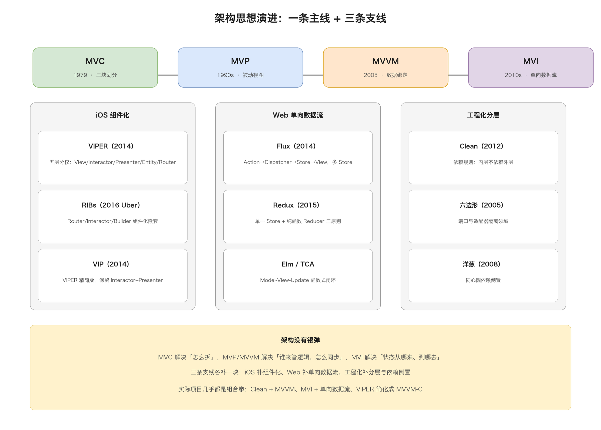

在聊具体架构之前，先想清楚「为什么需要架构」。一个没有架构的页面，通常是这样的：网络请求、JSON 解析、数据库读写、UI 刷新，全都堆在 Activity 或 UIViewController 里，一个类上千行。改一个字段要翻遍整个文件，测试只能靠人肉点，加个需求动一处崩三处。

架构要解决的，归根结底是四个问题：

1. 职责分离：界面展示、业务逻辑、数据访问，各自归位，互不越界。
2. 可测试性：逻辑部分能和 UI 框架脱钩，能跑单元测试。
3. 可维护性：改一处不影响别处，新成员能快速看懂代码地图。
4. 状态管理：数据怎么流动、谁有权改它、改了之后 UI 怎么跟上。

这四个问题背后，是几个反复出现的通用原则。单一职责原则（一个类只干一件事）、依赖倒置原则（依赖抽象而不是具体实现）、单向数据流（状态只能通过明确的动作变更）。你会发现，后面所有架构都是在这些原则之间做排列组合和取舍。

一个重要的认知前提：架构没有银弹。MVC 到 MVI，不是「越新越好」的线性升级，而是「复杂度换清晰度」的不断权衡。团队两个人写个小工具，MVC 完全够用；一个 50 人协作的 IM 模块，不引入 Clean + MVI 就等着被状态流淹死。选型永远先看规模、页面复杂度、团队习惯。

## 二、MVC：一切架构的起点

### 2.1 三个角色

MVC（Model-View-Controller）是 1979 年 Smalltalk 提出的，是所有架构思想的老祖宗。三个角色分工：

- Model：数据和业务逻辑。网络请求、数据库、领域规则都在这。
- View：界面展示，负责把数据画出来、把用户操作收集起来。
- Controller：中间协调者，接收 View 传来的用户输入，调 Model 改数据，再把结果反映到 View。

理论上的数据流是单向循环：View 接收用户输入 → 通知 Controller → Controller 更新 Model → Model 变化后通知 View 刷新。

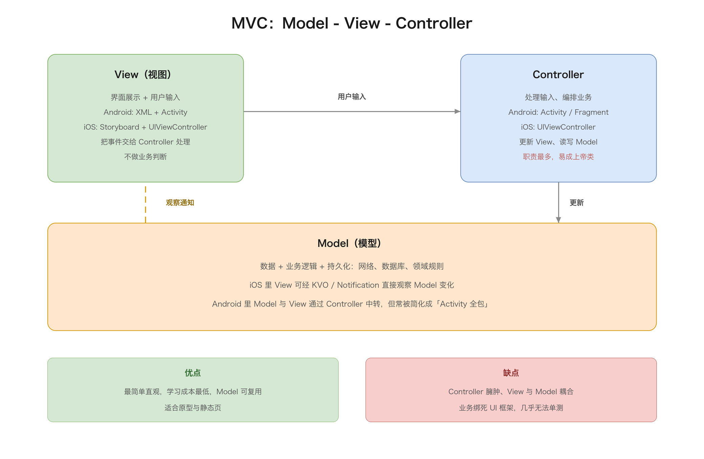

### 2.2 移动端的「变味」

MVC 在移动端落地时，几乎都变味了，而且 iOS 和 Android 还不太一样。

iOS 的 Cocoa MVC 有个著名的尴尬：View 和 Controller 被强行绑在同一个 UIViewController 里。苹果官方文档自己都承认，View 和 Controller 是「紧密耦合的兄弟」。实际项目里，UIViewController 既管布局又管业务又管跳转，动辄上千行，成了名副其实的「上帝类」。而 Model 倒是老老实实待在最底层，通过 KVO、Notification 或者 delegate 把变化通知给 View/Controller。

Android 的「MVC」更是只有形没有神。Activity/Fragment 是天然的 Controller，但它同时承担了 View 的一部分职责（findViewById、设置监听、手动更新控件）。XML 布局是 View，Model 是数据类加仓库。问题在于，Android 的 Activity 生命周期由系统接管，业务逻辑塞进去之后既难复用又难测试。

所以 MVC 在移动端的口碑普遍不好，不是 MVC 思想本身有错，而是「Controller」这个角色在移动端天生容易膨胀。Smalltalk 时代 Controller 只管输入转发，到了移动端，它把本该属于 View 和 Model 的活全揽了。

### 2.3 代码 demo

抛开 Activity/UIViewController，用最朴素的三个类看 MVC 的结构：

```kotlin
// Model：数据 + 业务规则
class CounterModel {
    var count = 0
        private set
    fun increment() { count++ }
}

// View：展示 + 收集输入，把输入转给 Controller
class CounterView {
    lateinit var controller: CounterController   // 和 Controller 双向引用，MVC 的典型特征
    fun onPlusClicked() = controller.onPlusClicked()
    fun render(count: Int) = println("显示：$count")
}

// Controller：中间协调者，双向都管
class CounterController(private val model: CounterModel) {
    lateinit var view: CounterView
    fun onPlusClicked() {
        model.increment()          // 1. 改数据
        view.render(model.count)   // 2. 手动把结果刷回 View
    }
}

// 组装：View 和 Controller 互相持有，需要手动接线
val model = CounterModel()
val controller = CounterController(model)
val view = CounterView()
controller.view = view
view.controller = controller
```

这段代码最值得看的是最后四行：View 和 Controller 互相持有引用，组装时得手动来回接线。这种「双向依赖 + 手动刷新」正是 MVC 在移动端容易失控的根源——Controller 既改 Model 又要手动刷 View，活一多就膨胀成上帝类。

### 2.4 优缺点

优点：

- 最简单直观，三块划分人人能懂，学习成本几乎为零。
- Model 与 View 分离，数据层可以被多个界面复用。
- 适合原型、demo、逻辑极少的静态页面。

缺点：

- Controller 承担过多，容易膨胀成上帝类。
- View 和 Controller 强耦合，View 直接依赖 Model，三者互相牵连，牵一发动全身。
- 业务逻辑和 UI 框架绑死，几乎无法单元测试，只能靠 UI 测试兜底。

一句话总结：MVC 是「能跑但不好维护」的架构，它适合快速起步，不适合长期演进。它的价值更多在于「提供了三块划分的心智模型」，后面的 MVP、MVVM 都是在它基础上的重新分权。

## 三、MVP：把逻辑从 View 里拽出来

### 3.1 核心思路

MVP（Model-View-Presenter）的诞生，就是为了解决 MVC 里 Controller 太肥、View 和 Model 纠缠不清的问题。它的核心改动就一个词：被动视图（Passive View）。

在 MVP 里：

- Model：还是数据和业务逻辑，和 MVC 一样。
- View：被彻底「驯化」成被动视图，它自己不做任何决定，只暴露「我能展示什么」的接口，比如 showLoading()、showList()、showError()。View 只干两件事：把用户操作转告 Presenter，按 Presenter 的指令刷新画面。
- Presenter：新加的角色，取代了 Controller。它承接 View 的所有事件，调 Model 取数，再把结果通过 View 接口回显。

关键区别在于，View 和 Model 之间不再有任何直接联系，全部通过 Presenter 中转。View 甚至不认识 Model，只知道「我把按钮点了，告诉 Presenter」。

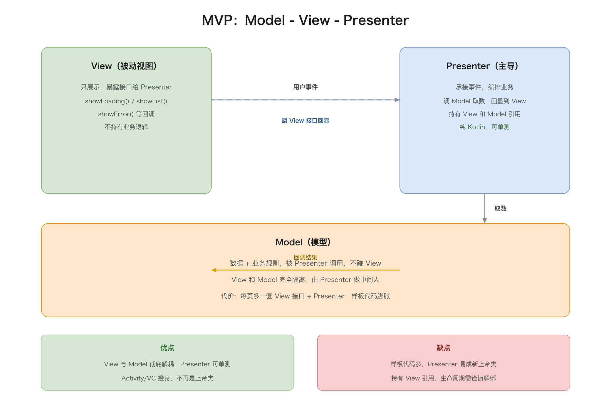

### 3.2 实现形态

抛开 Activity，用最朴素的三件套看 MVP 的结构——View 是一个接口（被动视图契约），Presenter 是纯逻辑类：

```kotlin
// View 契约：被动视图，只暴露「能展示什么」
interface CounterView {
    fun showCount(count: Int)
}

// Model：数据 + 业务规则
class CounterModel {
    var count = 0
        private set
    fun increment() { count++ }
}

// Presenter：纯逻辑，不依赖任何 UI 细节
class CounterPresenter(
    private val view: CounterView,
    private val model: CounterModel
) {
    fun onPlusClicked() {
        model.increment()
        view.showCount(model.count)
    }
}

// 某个 View 实现契约，只做展示
class CounterTextView : CounterView {
    override fun showCount(count: Int) = println("显示：$count")
}

// 组装：View 只认识 Presenter，不认识 Model
val model = CounterModel()
val view = CounterTextView()
val presenter = CounterPresenter(view, model)
```

注意 Presenter 不依赖任何界面细节，只面对 `CounterView` 接口和 `CounterModel`。测试时 mock 掉 `CounterView`，就能验证「点了加号，一定会调用 showCount 且值加一」。这是 MVP 相比 MVC 最大的进步：业务逻辑第一次变得可测试——Presenter 里没有任何 UI 框架的影子，跑在纯 JVM 上就能测。

iOS 里同样的结构：UIViewController 实现一个 protocol（View 契约），Presenter 是纯 Swift/OC 类，持有 View 的弱引用。

### 3.3 优缺点

优点：

- View 和 Model 彻底解耦，职责清晰，Presenter 可单测。
- 相比 MVC，Activity/ViewController 瘦下来了，不再是上帝类。

缺点：

- 样板代码暴涨。每多一个页面，就多一对 View 接口 + Presenter 实现，接口方法要一一对应，写起来烦。
- Presenter 反过来容易膨胀成新的上帝类——它要承接所有事件、编排所有逻辑、调所有 View 接口。
- 生命周期和内存要小心处理：Presenter 持有 View 引用，得及时解绑，否则容易泄漏。

MVP 在 2014-2017 年的 Android 圈火过一阵，后来被 MVVM + 架构组件的组合逐渐取代。但它的「被动视图 + 接口契约」思想，至今在很多老项目的架构里还能看到影子。

## 四、MVVM：用数据绑定取代手写同步

### 4.1 核心思路

MVP 解决了解耦，但留下一个烦人的问题：Presenter 每次都得手动调 View 接口来回显数据，状态一变就要写一堆同步代码。MVVM（Model-View-ViewModel）就是冲着「消灭手写同步」来的。

MVVM 的关键是引入 ViewModel 和数据绑定（Data Binding）：

- Model：数据和业务逻辑。
- ViewModel：状态源。它持有数据、处理逻辑、暴露可观察的状态，但它不持有 View 的引用，甚至不知道 View 长什么样。
- View：只负责声明式地绑定到 ViewModel 的状态，状态一变，UI 自动刷新。

View 和 ViewModel 之间不再需要接口契约，靠「数据绑定」这条隐形的线自动同步。用户操作发给 ViewModel，ViewModel 改状态，状态变化自动反映到 View。

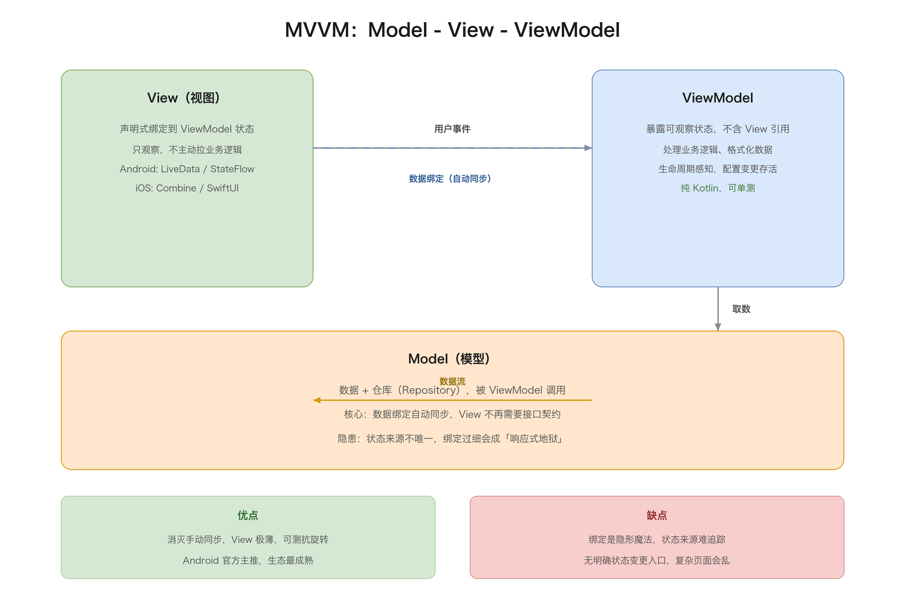

### 4.2 实现形态

抛开 Jetpack 的 ViewModel 和 StateFlow，用一个极简的 `Observable` 模拟「数据绑定」的本质——值一变，订阅者自动收到通知：

```kotlin
// 极简可观察值：set 时通知所有观察者，这是数据绑定的核心
class Observable<T>(initial: T) {
    private var value: T = initial
    private val listeners = mutableListOf<(T) -> Unit>()
    fun get() = value
    fun set(v: T) {
        value = v
        listeners.forEach { it(v) }
    }
    fun observe(listener: (T) -> Unit) {
        listeners.add(listener)
        listener(value)   // 立即回放当前值
    }
}

// ViewModel：暴露可观察状态，不持有 View 引用
class CounterViewModel {
    val count = Observable(0)
    fun onPlusClicked() = count.set(count.get() + 1)
}

// View：只做「绑定」，状态一变自动刷新，不再手动回显
class CounterView(private val vm: CounterViewModel) {
    init {
        vm.count.observe { c -> println("显示：$c") }
    }
    fun onPlusClicked() = vm.onPlusClicked()
}
```

对比 MVP 的 demo，最本质的变化在 View 那一侧：MVP 里 View 是被 Presenter 调用的 `showCount`，MVVM 里 View 是自己订阅 `count`，`count.set` 一执行，`observe` 的回调自动跑。View 和 ViewModel 之间不再需要接口契约，靠「订阅」这条隐形的线自动同步——这就是「消灭手写同步」的落点。

真实项目里，这个 `Observable` 的角色由 LiveData / StateFlow / Combine 的 `@Published` 承担，它们额外带来了生命周期感知、线程切换、防重复回放等能力。但架构层面的核心，始终是「ViewModel 暴露可观察状态，View 声明式订阅」这一条。

iOS 侧对应的是 SwiftUI 的 @StateObject/@ObservableObject + Combine，或者直接用 Observable 宏。本质一样：View 观察 ViewModel 的 @Published 属性，属性一变，SwiftUI 自动重算受影响的那部分视图。

### 4.3 优缺点

优点：

- 数据绑定消灭了大量手动同步代码，View 变得非常薄。
- ViewModel 无 UI 引用、生命周期感知，天然可测、天然抗旋转。
- 配合 Jetpack 架构组件，是 Android 官方主推、生态最成熟的一条路。

缺点：

- 数据绑定是「隐形魔法」，状态来源一旦多起来，debug 时很难追踪「这个值是谁、在哪一刻改的」。
- 双向绑定（DataBinding 的 @=）如果滥用，会造成状态到处飞、互相覆盖的「响应式地狱」。
- ViewModel 没有明确的状态变更入口，业务一复杂，状态管理还是会乱——这正是 MVI 要补的课。

MVVM 是当下移动端事实上的主流。但它的短板也很明确：它规范了「数据怎么从 ViewModel 到 View」，却没规范「状态怎么变更、怎么收敛」。当页面状态从一个简单布尔值膨胀成十几个字段时，MVVM 就开始力不从心。

## 五、MVI：单向数据流的移动端落地

### 5.1 核心思路

MVI（Model-View-Intent）是 Andre Staltz 在 2014 年提出的，后来在 Android 圈由 Cycle.js 和 Model-View-Intent 的实践普及开来。它解决的是 MVVM 遗留的「状态变更无入口、状态来源不唯一」的问题。

MVI 的关键是把状态管理收敛成一个严格的单向闭环：

- View：渲染 State，把用户操作转成 Intent 发出去。
- Intent：不是 Android 的 Intent，而是「用户意图」的语义化描述——LoadList、OnRefresh、OnItemClick。
- Model/Reducer：一个纯函数，输入（旧 State + Intent），输出新 State。
- State：不可变的页面状态快照，是唯一的数据源。

数据永远单向流动：View 产生 Intent → Reducer 产出新 State → State 渲染回 View，形成闭环。UI 永远不能直接改 State，State 永远只能被 Reducer 以「整体替换」的方式更新。

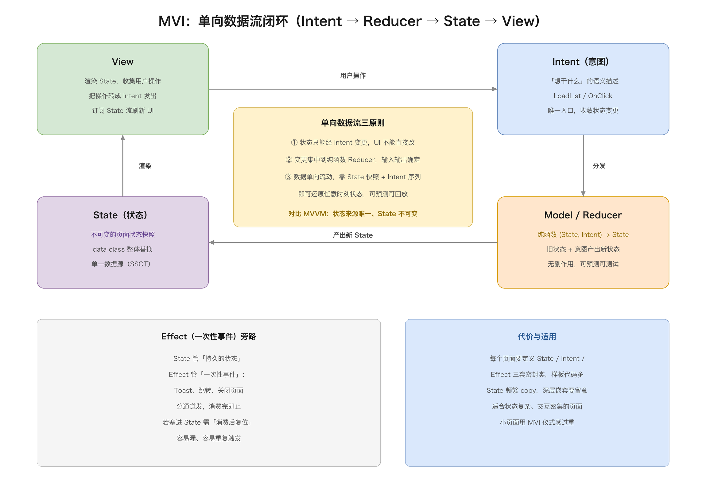

### 5.2 State 与 Effect 的区分

MVI 最有价值的设计之一是区分了 State 和 Effect（一次性事件）：

- State：持续存在的状态，比如列表数据、加载中标志、选中项。它属于「此刻页面是什么样」。
- Effect：一次性事件，比如 Toast、页面跳转、关闭键盘。它属于「刚刚发生了什么」。

为什么要区分？因为如果把「显示一次 Toast」这种一次性事件塞进 State，就会出现「状态变了但 UI 已经消费完，下次重组又重复触发」的经典 bug。MVI 用两条通道分开：State 走订阅流驱动渲染，Effect 走事件流驱动副作用，消费完即止。

```kotlin
data class NewsUiState(
    val isLoading: Boolean = false,
    val newsList: List<News> = emptyList(),
    val error: String? = null
)

sealed class NewsIntent {
    object Load : NewsIntent()
    object Refresh : NewsIntent()
    data class OnItemClick(val news: News) : NewsIntent()
}

sealed class NewsEffect {
    data class ShowToast(val msg: String) : NewsEffect()
    data class NavigateToDetail(val id: String) : NewsEffect()
}

fun reduce(state: NewsUiState, intent: NewsIntent): NewsUiState = when (intent) {
    is NewsIntent.Load -> state.copy(isLoading = true)
    is NewsIntent.Refresh -> state.copy(isLoading = true, error = null)
    is NewsIntent.OnItemClick -> state  // 点击通常只发 Effect，不改 State
}
```

Reducer 是纯函数：同样的输入永远得到同样的输出，没有副作用、没有隐藏状态。这让状态变更变得可预测、可回放、可测试——调试时只要看「当前 State + 触发了什么 Intent」，就能推演出发生了什么。

### 5.3 优缺点

优点：

- 状态单向流动、单一数据源，逻辑极其清晰，可预测、可测试。
- State 不可变，天然线程安全，配合协程/Combine 很顺。
- 调试体验好：记录 State 快照 + Intent 序列，几乎能还原任何 bug 现场。

缺点：

- 样板代码多：每个页面都要定义 State、Intent、Effect 三套密封类，小页面显得杀鸡用牛刀。
- State 不可变意味着频繁 copy，复杂 State 嵌套时性能要留意。
- 学习曲线陡，团队里理解「Intent 不是 Android Intent、State 要整体替换」需要时间。

MVI 适合状态复杂、交互密集、需要强可预测性的页面。如果只是一个静态展示页，MVI 的仪式感反而拖累开发效率。

## 六、单向数据流家族：Flux / Redux / Elm / TCA

MVI 不是凭空冒出来的，它背后是 Web 端和函数式编程领域一整套「单向数据流」的思想。这套家族谱系从 Facebook 的 Flux 起步，经过 Redux 的减法收敛，到 Elm 的函数式原教旨，最后在 TCA 手里回流到移动端。理解这套谱系，才能真正理解 MVI 的设计动机——MVI 的每个概念，都能在这个家族里找到原型。

先看全景图：三套思想各自的角色划分和数据流走向。

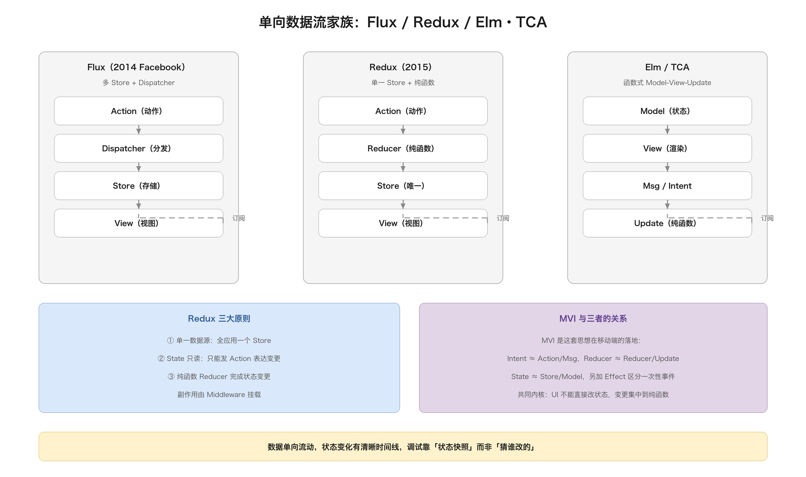

### 6.1 Flux：多 Store 的原型

#### 6.1.1 背景与动机

Flux 是 Facebook 在 2014 年提出的一套应用架构，导火索是当年 Messenger 的一个经典 bug：聊天列表里已经读过的消息，切到未读 tab 还会闪红点。当时的 Messenger 用的是典型的 MVC，View 和 Model 互相引用、双向更新，状态散落在各个组件里，改一处牵动多处，没人说得清「已读状态」到底存在哪、又是在哪一刻被谁改动的。

Flux 的答案很直接：砍掉所有「View 直接改 Model」的通路，让数据只能朝一个方向流。数据单向流动之后，「已读状态」只有一个写入入口，整条链路可追踪，这类 bug 自然就少了。这是单向数据流第一次以完整架构的面貌出现。

#### 6.1.2 四个角色与数据流

Flux 由四个角色组成：

- Action：描述「发生了什么」的普通对象，比如 `{ type: "INCREMENT" }`。它不包含任何逻辑，只是一条消息。
- Dispatcher：中央分发器，是整个系统的「总闸」。所有 Action 都要经过它，由它派发给注册过的 Store。
- Store：存放状态和变更逻辑，可以有多个。每个 Store 注册到 Dispatcher 上，收到自己关心的 Action 就更新自己的状态。
- View：订阅 Store，状态变化后重新渲染。View 不能直接改 Store，只能发 Action。

数据流是一条单行道：View 产生 Action → Dispatcher 分发 → Store 更新 → 通知 View 重新渲染。

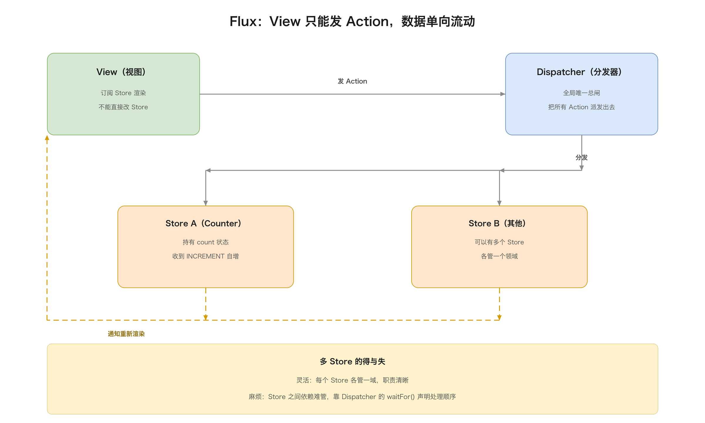

几个值得注意的细节：Dispatcher 是全局唯一的（整个应用一个总闸），Store 是多个的（每个领域一个）；View 可以同时订阅多个 Store；Store 之间不能互相调用，只能通过 Dispatcher 的 `waitFor()` 声明「我要等那个 Store 先处理完」。这套设计今天看略显笨重，但在 2014 年，它是第一个把「状态变更入口」明确收拢的架构。

#### 6.1.3 代码 demo

```kotlin
// Action：描述「发生了什么」，只是个数据包
data class Action(val type: String, val payload: Any? = null)

// Dispatcher：全局唯一的中央分发器
class Dispatcher {
    private val handlers = mutableListOf<(Action) -> Unit>()
    fun register(handler: (Action) -> Unit) { handlers.add(handler) }
    fun dispatch(action: Action) = handlers.forEach { it(action) }
}

// Store：可以有多个，各自持有状态，注册到 Dispatcher
class CounterStore(private val dispatcher: Dispatcher) {
    var count = 0; private set
    init {
        dispatcher.register { action ->
            if (action.type == "INCREMENT") { count++; emitChange() }
        }
    }
    private fun emitChange() { /* 通知订阅它的 View 重新渲染 */ }
}

// View：不能直接改 Store，只能发 Action
class CounterView(private val dispatcher: Dispatcher) {
    fun onPlusClicked() = dispatcher.dispatch(Action("INCREMENT"))
}
```

注意 `CounterStore` 里的变更逻辑是「收到 INCREMENT 就自增」，这看起来和直接改没区别，但关键区别在于：View 永远碰不到 `count` 字段，它只知道「发一个 Action」，改不改、怎么改，全由 Store 自己决定。状态变更的入口被收拢了。

#### 6.1.4 多 Store 的得失

Flux 允许多个 Store，这是它的灵活性，也是它的麻烦来源。灵活性在于每个 Store 只管自己那一亩三分地，职责清晰；麻烦在于 Store 一旦多起来，它们之间的依赖关系就难管了——A Store 要等 B Store 先更新怎么办？Flux 用 `waitFor()` 解决，但 `waitFor()` 写多了，依赖关系就变成一张谁也算不清的网。这正是 Redux 要下手的地方。

### 6.2 Redux：三大原则的收敛

#### 6.2.1 对 Flux 的「减法重构」

Redux 是 2015 年 Dan Abramov 对 Flux 的一次「减法重构」。Flux 的痛点是「多 Store + waitFor 依赖网」太自由、太难管，Redux 的解法是把它收敛成三条铁律：

1. 单一数据源：整个应用只有一个 Store，所有状态集中在一个对象里。
2. State 只读：不能直接改 State，只能发 Action 表达「我想改」。
3. 纯函数 Reducer：状态变更全部由纯函数 Reducer 完成，(prevState, action) -> newState。

这三条规则砍掉了 Flux 的灵活性，换来了极强的可预测性：状态只有一处、只能通过一种方式改、变更逻辑全部是纯函数。debug 时只要把「Action 序列」重放一遍，就能精确复现任何状态——这是 Redux 后来带火「时间旅行调试」的根基。

#### 6.2.2 数据流与 Middleware

Redux 的数据流是一条更严格、更单薄的单向链：View 发 Action → Store 交给 Reducer → Reducer 产出新 State → 通知 View 重渲染。

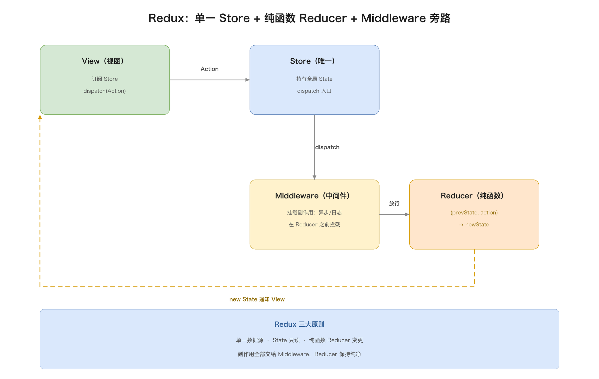

Redux 最大的增量是 Middleware（中间件）：它在「Action 到达 Reducer 之前」拦一道，用来挂载副作用——异步请求、日志、持久化、埋点。纯函数 Reducer 不能有副作用（不能发请求、不能写文件），这些脏活全部交给 Middleware，Redux 把 Middleware 串成一条链，让副作用有了干净的挂载点，同时不污染 Reducer 的纯度。这是 Redux 相比 Flux 在工程上最关键的一步：它第一次把「纯逻辑」和「副作用」清晰地分成了两个地方。

#### 6.2.3 代码 demo

```kotlin
// State：单一数据源，全应用一份
data class AppState(val count: Int = 0)

// Action：变更意图
sealed class Action {
    object Increment : Action()
    object Decrement : Action()
}

// Reducer：纯函数 (prevState, action) -> newState
fun reducer(state: AppState, action: Action): AppState = when (action) {
    Action.Increment -> state.copy(count = state.count + 1)
    Action.Decrement -> state.copy(count = state.count - 1)
}

// Store：全局唯一，封装 State + 订阅
class Store(private val reducer: (AppState, Action) -> AppState) {
    private var state = AppState()
    private val listeners = mutableListOf<() -> Unit>()
    fun getState() = state
    fun dispatch(action: Action) {
        state = reducer(state, action)   // 纯函数计算新状态
        listeners.forEach { it() }       // 通知订阅者
    }
    fun subscribe(listener: () -> Unit) { listeners.add(listener) }
}

// 使用：重放 Action 序列就能复现状态
val store = Store(::reducer)
store.subscribe { println("显示：${store.getState().count}") }
store.dispatch(Action.Increment)   // -> 1
store.dispatch(Action.Increment)   // -> 2
```

和 Flux 的 demo 对比，最直观的变化是：Dispatcher 没了，Store 只剩一个，状态变更被收进了一个叫 `reducer` 的纯函数里。`reducer` 不依赖任何全局状态、不做任何 IO，输入输出完全确定，这就是「可预测性」落到代码层面的样子。

### 6.3 Elm Architecture：函数式原教旨

#### 6.3.1 Model-View-Update 循环

Elm 是一门 2012 年诞生的函数式语言，Elm Architecture 是它内建的、唯一的架构，所以它比 Flux/Redux 都更「原教旨」。它的结构叫 Model-View-Update，三个纯函数加一个状态：

- Model：应用状态，一个不可变值。
- View：纯函数，Model -> Html，输入状态、输出界面描述。
- Msg：消息，对应 Redux 的 Action、MVI 的 Intent。
- Update：纯函数，(Msg, Model) -> Model，输入消息和旧状态、输出新状态。

它和 Redux 最大的不同在于：View 也是纯函数。Redux 里 View 是「订阅 Store 的组件」，有自己的渲染逻辑和副作用；Elm 里 View 是「Model 到界面描述的纯映射」，没有任何隐式状态。于是整个应用变成一个纯粹的「状态机」：运行时不停地 `Model -> view -> Html -> 用户交互 -> Msg -> update -> 新 Model`，循环往复，任何一步都是确定的。

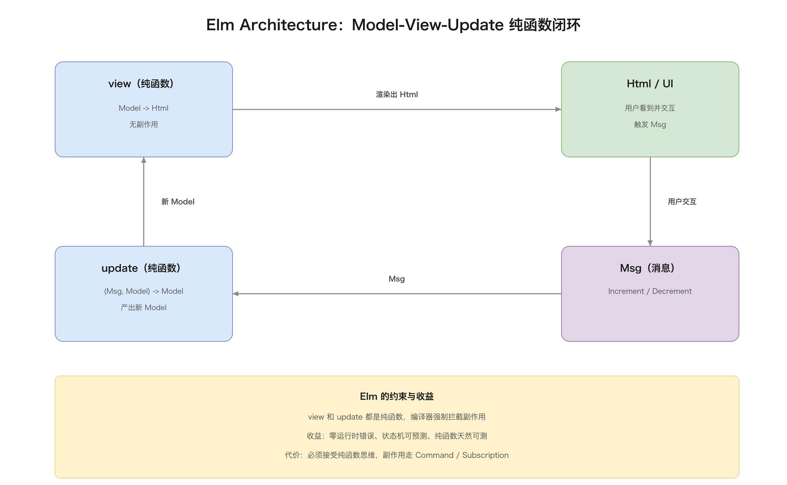

#### 6.3.2 代码 demo

用 Kotlin 表达 Elm 的 Model-View-Update 结构（真实 Elm 语法更简，这里借用 Kotlin 展示它的「全纯函数」本质）：

```kotlin
// Model：应用状态
typealias Model = Int

// Msg：消息
sealed class Msg {
    object Increment : Msg()
    object Decrement : Msg()
}

// init：初始状态
fun init(): Model = 0

// update：纯函数 (Msg, Model) -> Model，没有任何副作用
fun update(msg: Msg, model: Model): Model = when (msg) {
    Msg.Increment -> model + 1
    Msg.Decrement -> model - 1
}

// view：纯函数 Model -> 界面描述，同样没有副作用
fun view(model: Model): String = "Count: $model"

// 整个应用是一个状态机，运行时反复调用 update -> view
var model = init()
model = update(Msg.Increment, model)   // -> 1
println(view(model))                    // -> "Count: 1"
```

注意 `update` 和 `view` 都是纯函数：同样的输入永远得到同样的输出，不碰 IO、不碰全局变量。副作用被挡在门外——Elm 靠编译器强制这一点（这是它比 Redux 更进一步的地方，Redux 靠「约定」保持 Reducer 纯净，Elm 靠「类型系统」强制），Kotlin 这边只能靠自觉。

#### 6.3.3 Elm 的约束换来的收益

Elm 的强约束（纯函数、不可变、编译器拦截副作用）换来了几个实打实的好处：零运行时错误（著名的「Elm 程序不会崩溃」）、可预测到极致（状态机 + 纯函数，调试就是重放 Msg 序列）、天然可测试（纯函数输入输出明确）。代价是：你必须接受「一切皆纯函数」的思维方式，和外部世界（网络、时间、随机数）打交道得通过 Elm 的 Command/Subscription 机制，学习曲线陡。这套思想后来被 Swift 圈的 TCA 移植了过去。

### 6.4 TCA：Elm 的 Swift 移植

#### 6.4.1 Store / Reducer / Effect 三件套

TCA（The Composable Architecture）是 Point-Free 团队 2020 年开源、2023 年全面重写的 Swift 架构库，它把 Elm Architecture 完整搬进了 Swift，并针对「如何优雅地处理副作用」做了强化。核心是三个类型：

- Store：状态的容器，连接 Reducer 和 View。
- Reducer：纯函数，输入 State 和 Action，输出新 State。
- Effect：副作用的显式建模。Reducer 不直接执行副作用，而是把它作为返回值交给运行时执行。

这是 TCA 最精彩的设计：Effect 作为一等公民。在 Redux 里，副作用靠 Middleware 外挂；在 Elm 里，副作用靠 Command 外挂；TCA 则让 Reducer 的返回值本身就是 `(State, Effect)` 二元组——「新状态 + 要执行的副作用」。副作用不再是个隐晦的旁路，而是和状态一样，成为数据流里看得见的一部分。

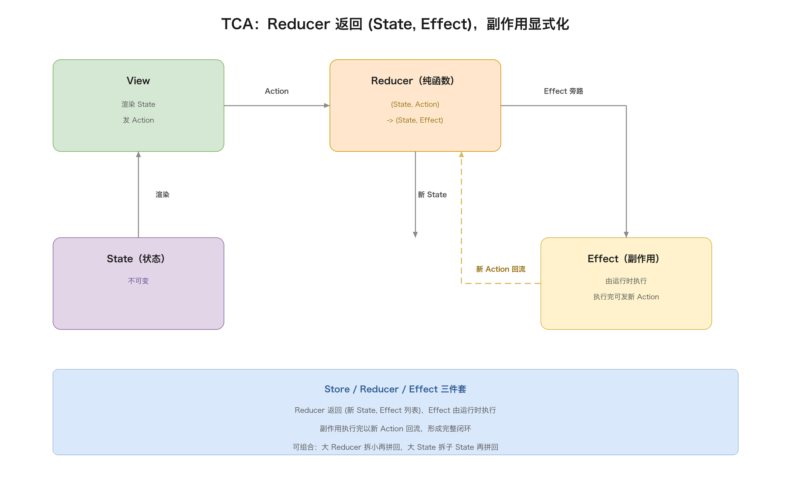

#### 6.4.2 代码 demo

用 Kotlin 表达 TCA 的核心结构（真实 TCA 是 Swift，这里借用 Kotlin 展示 Store/Reducer/Effect 三件套）：

```kotlin
// State
data class CounterState(val count: Int = 0)

// Action
sealed class CounterAction {
    object Plus : CounterAction()
    object Minus : CounterAction()
}

// Effect：副作用被显式建模，作为 Reducer 的返回值交给运行时执行
sealed class CounterEffect {
    data class Log(val msg: String) : CounterEffect()
}

// Reducer：纯函数，返回 (新 State, 要执行的副作用列表)
fun reducer(state: CounterState, action: CounterAction): Pair<CounterState, List<CounterEffect>> =
    when (action) {
        CounterAction.Plus  -> CounterState(state.count + 1) to listOf(CounterEffect.Log("+1"))
        CounterAction.Minus -> CounterState(state.count - 1) to listOf(CounterEffect.Log("-1"))
    }

// 运行时：先跑 Reducer 拿新状态，再执行 Effect（Effect 不参与状态计算）
var state = CounterState(0)
val (newState, effects) = reducer(state, CounterAction.Plus)
state = newState
effects.forEach { when (it) { is CounterEffect.Log -> println(it.msg) } }
```

关键点：Reducer 依然纯净——它不执行副作用，只是「声明」要执行哪些 Effect；真正执行副作用的是外层的运行时。副作用执行完，如果产生了新的用户可见结果，再以新的 Action 形式回流进 Reducer，形成完整闭环。这个「Effect 作为显式返回值」的设计，和 MVI 的 Effect 通道是同一个思路的不同表达。

#### 6.4.3 TCA 的「可组合」增量

TCA 相比 Elm 还多了一个词：Composable（可组合）。它提供了一整套工具，让你把大 Reducer 拆成小 Reducer、再组合回去；把大 State 拆成子 State、再拼起来。这解决了 Elm 里「应用一大，单个 Model 和 Update 就膨胀」的痛点。TCA 因此成了 Swift 圈 MVI 事实上的标准实现，iOS 端很多「MVI」项目底层其实就是 TCA。

### 6.5 与 MVI 的关系

把家族谱系摆在一起看，MVI 就是这套思想在移动端的本土化：

| 概念 | Flux | Redux | Elm | TCA | MVI |
| --- | --- | --- | --- | --- | --- |
| 用户意图 | Action | Action | Msg | Action | Intent |
| 状态变更 | Store 内逻辑 | Reducer | Update | Reducer | Reducer |
| 状态 | 多个 Store | 单一 Store | Model | State | State |
| 一次性事件 | — | Middleware | Command | Effect | Effect |

MVI 的贡献在于：针对移动端「页面级状态 + 一次性事件」的特点做了裁剪，用 State/Effect 双通道区分了「持续状态」和「转瞬事件」，比 Redux 更适合移动端的页面组织。可以说，MVI 是「Redux 的单一数据源 + Elm/TCA 的 Effect 显式化」在移动端的一次综合落地。

## 七、Clean Architecture：横向分层的工程化答案

### 7.1 依赖规则

前面聊的 MVC/MVP/MVVM/MVI 都在回答「一个页面内部怎么组织」，而 Clean Architecture（Robert Martin 2012 年提出）回答的是另一个维度的问题：整个应用怎么横向分层，让业务规则不依赖任何框架和平台。

Clean Architecture 的核心是一条铁律——依赖规则（Dependency Rule）：源代码的依赖只能由外向内指向，内层永远不知道外层的存在。

从内到外四个同心圆：

- Entities：企业级核心业务对象（最内层，最稳定）。
- Use Cases：应用业务规则，编排 Entities 完成具体用例。
- Interface Adapters：适配层，把外层的数据结构转换成内层想要的（Presenter、Controller、Gateway）。
- Frameworks & Drivers：最外层，UI 框架、数据库、Web、第三方 SDK。

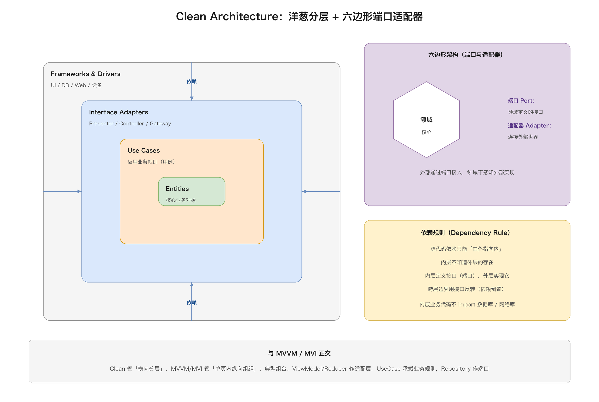

依赖倒置靠「接口反转」实现：内层的 Use Case 定义了它需要的数据接口（比如 UserRepository 协议），外层的数据库实现这个协议，通过依赖注入把实现传进去。于是内层的业务代码完全不 import 数据库、不 import 网络库，换个存储方案只动外层。

### 7.2 洋葱与六边形

Clean Architecture 不是孤立概念，它和更早的洋葱架构（Onion Architecture，2008）、六边形架构（Hexagonal Architecture / Ports and Adapters，2005）是同一族思想，都强调「领域核心独立于基础设施」。

六边形架构的表述最形象：把应用画成一个六边形，中心是领域逻辑，六条边是「端口」（Port，领域定义的接口），外部世界（数据库、UI、消息队列）通过「适配器」（Adapter）接到端口上。领域代码只面向端口编程，完全感知不到适配器背后是什么。

三者本质相同：用依赖倒置把「易变的框架」和「稳定的业务」隔离开。区别只是画法不同——洋葱是同心圆，六边形是端口视角，Clean 是两者的整合和推广。

### 7.3 与 MVVM/MVI 的组合

Clean Architecture 和 MVVM/MVI 不是二选一，而是正交的两个维度：Clean 管「横向分层」，MVVM/MVI 管「单页内的纵向组织」。实际项目里最常见的组合是：

- ViewModel（或 Reducer）作为 Interface Adapters 层，负责把 Use Case 的结果转成 UI 状态。
- Use Case 层承载业务规则，一个用例一个类，比如 GetUserProfileUseCase。
- Repository 作为端口（协议），数据层（网络/数据库）作为适配器实现它。

组合后的好处是：业务规则（Use Case）和 UI 框架完全解耦，可以针对 Use Case 写单元测试，甚至可以把整套业务逻辑拿到另一个平台复用。

代价是：层数变多、文件变多、样板代码变多。所以 Clean 不是每个项目都该上，它更适合「业务逻辑复杂、需要长期演进、多人协作」的中大型项目。

### 7.4 代码 demo

用计数器看 Clean 的分层和依赖方向（这里的关键不是功能，而是「谁依赖谁」）：

```kotlin
// 最内层 Entities：核心业务对象
data class Counter(val value: Int = 0) {
    fun incremented() = Counter(value + 1)
}

// Use Cases：应用业务规则，依赖 Entities，不依赖任何框架
class IncrementCounter {
    operator fun invoke(counter: Counter): Counter = counter.incremented()
}

// 端口（Port）：Use Case 层定义的接口，由外层实现
interface CounterRepository {
    fun load(): Counter
    fun save(counter: Counter)
}

// Interface Adapters：把 Use Case 和端口串起来（依赖注入）
class CounterController(
    private val increment: IncrementCounter,
    private val repo: CounterRepository
) {
    fun onPlusClicked() {
        val next = increment(repo.load())   // 读 -> 用 -> 写
        repo.save(next)
    }
}

// 最外层 Frameworks & Drivers：实现端口（这里用内存模拟，真实项目是数据库/网络）
class InMemoryCounterRepository : CounterRepository {
    private var counter = Counter()
    override fun load() = counter
    override fun save(counter: Counter) { this.counter = counter }
}

// 组装：外层把实现注入内层，内层完全不认识 InMemory 这个类
val controller = CounterController(IncrementCounter(), InMemoryCounterRepository())
```

这段代码最值得琢磨的是依赖方向：`CounterController` 依赖的是 `IncrementCounter`（Use Case）和 `CounterRepository`（端口接口），这两个都是「内层定义的东西」；`InMemoryCounterRepository` 在最外层实现端口，组装时才被塞进去。内层的 `IncrementCounter`、`CounterRepository` 从头到尾不认识 `InMemoryCounterRepository`——换个数据库实现，只动最外层那一个类。

## 八、iOS 组件化：VIPER / VIP / RIBs

### 8.1 VIPER：iOS 的「五层分权」

VIPER 是 iOS 圈对 Clean Architecture 的一次具体化落地（2014 年前后流行），它把一个模块拆成五个角色：

- View：展示，把用户事件转给 Presenter。
- Interactor：用例层，包含具体业务逻辑，操作 Entity。
- Presenter：编排逻辑，从 Interactor 拿结果，格式化后更新 View。
- Entity：纯数据模型。
- Router：导航（Wireframe），负责页面跳转和模块组装。

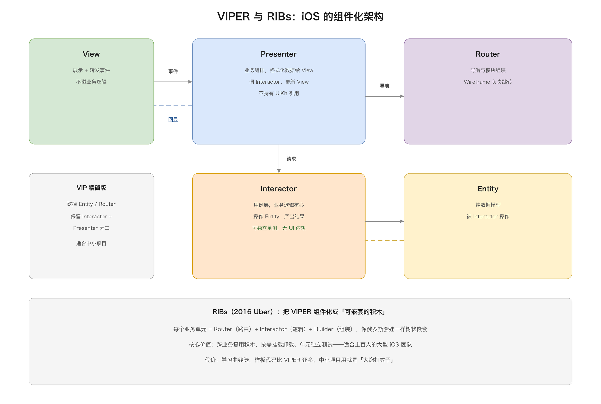

相比 MVVM，VIPER 把「业务逻辑」和「展示编排」拆成了 Interactor 和 Presenter 两个角色，把「导航」单独抽成 Router。这让职责更细，每个类的测试面更小，但也让「一个页面」变成了「五个文件加一堆协议」，样板代码是 MVVM 的两三倍。

```kotlin
// Entity：纯数据模型
data class CounterEntity(val count: Int = 0)

// Interactor：业务逻辑（用例），操作 Entity
class CounterInteractor {
    fun increment(entity: CounterEntity): CounterEntity = entity.copy(count = entity.count + 1)
}

// Presenter：编排，把 Entity 转成 View 要的字段
class CounterPresenter(private val interactor: CounterInteractor) {
    lateinit var view: CounterView
    fun onPlusClicked(current: CounterEntity) {
        val next = interactor.increment(current)
        view.showCount(next.count)
    }
}

// View：展示 + 转发事件
class CounterView(private val presenter: CounterPresenter) {
    fun onPlusClicked(current: CounterEntity) = presenter.onPlusClicked(current)
    fun showCount(count: Int) = println("显示：$count")
}

// Router：导航（这里无跳转，仅示意职责）
class CounterRouter {
    fun routeToDetail(id: Int) { /* 跳转到详情页 */ }
}
```

一个计数器都要五个角色，这就是 VIPER 的代价——职责确实拆得极细，但样板代码也随之暴涨。

### 8.2 VIP：VIPER 的精简版

VIP（View-Interactor-Presenter）是把 VIPER 里的 Entity 和 Router 砍掉后的精简版，在 Clean Swift 的实践里流行。它保留了「Interactor 管业务、Presenter 管展示」这个最有价值的分工，去掉了对中小项目收益不大的 Entity/Router 独立层。

```kotlin
// VIP：砍掉 Entity 和 Router，只剩三件套
class CounterInteractor {
    fun increment(count: Int): Int = count + 1
}

class CounterPresenter(private val interactor: CounterInteractor) {
    lateinit var view: CounterView
    fun onPlusClicked(count: Int) = view.showCount(interactor.increment(count))
}

class CounterView(private val presenter: CounterPresenter) {
    fun onPlusClicked(count: Int) = presenter.onPlusClicked(count)
    fun showCount(count: Int) = println("显示：$count")
}
```

### 8.3 RIBs：Uber 的组件化架构

RIBs 是 Uber 2016 年开源并大规模使用的架构，全称 Router-Interactor-Builder。它把 VIPER 的「页面」概念升级成「可嵌套的业务积木」：

- Router：负责路由和子模块挂载卸载。
- Interactor：业务逻辑，决策状态。
- Builder：负责组装模块、注入依赖。

RIBs 最大的特色是「树状嵌套」：一个 RIB 可以挂多个子 RIB，形成一棵组件树，登录 RIB 里挂着主页 RIB，主页 RIB 里又挂着列表 RIB。每个 RIB 独立开发、独立测试、独立上下线。这让 Uber 上百人的 iOS 团队能并行开发而不互相踩。

```kotlin
// Interactor：业务逻辑
class CounterInteractor {
    var count = 0; private set
    fun increment() { count++ }
}

// Router：管理子模块的挂载卸载
class CounterRouter(private val interactor: CounterInteractor) {
    private val children = mutableListOf<Any>()   // 子 RIB
    fun attachChild(rib: Any) = children.add(rib)
    fun detachChild(rib: Any) = children.remove(rib)
}

// Builder：组装模块、注入依赖
class CounterBuilder {
    fun build(): CounterRouter {
        val interactor = CounterInteractor()
        return CounterRouter(interactor)
    }
}

// 树状嵌套：Root 里挂 Counter，Counter 里还能挂子 RIB
val root = CounterBuilder().build()
```

Builder 负责「组装」，Router 负责「挂载卸载」，这两个角色让 RIB 可以像积木一样嵌套组合，这是它和 VIPER 最本质的区别。

代价也很明显：学习曲线陡，样板代码比 VIPER 还多，中小项目用 RIBs 基本是「用大炮打蚊子」。

一句话概括这条支线：iOS 因为长期缺官方架构指引，社区自己卷出了一套越来越细的分权方案，从 MVVM 到 VIPER 到 RIBs，职责越拆越细，收益递减、成本递增。

## 九、容易被忽略的其他思想

除了上面这些主流架构，还有几个思想值得知道，虽然移动端用得少，但能补全认知版图。

PAC（Presentation-Abstraction-Control）：分层架构的一种，把系统拆成「表现-抽象-控制」三级代理（Agent），每个 Agent 内部又嵌套同样的三级结构。适合分层明显的桌面应用和交互式系统，移动端少见。

```kotlin
// PAC：表现-抽象-控制 三级代理，层层嵌套
class Presentation { fun render(data: Any) = println(data) }
class Abstraction { fun load(): Any = "数据" }
class Control(private val p: Presentation, private val a: Abstraction) {
    fun handle() = p.render(a.load())
}
```

ADR（Action-Domain-Responder）：Paul M. Jones 提出的 Web 端架构，把 MVC 的 Model-View-Controller 换成 Action-Domain-Responder，强调「请求入口、领域逻辑、响应输出」三段。它是对 Web MVC 的反思，对移动端有启发但基本不直接用。

```kotlin
// ADR：Action 入口 -> Domain 领域 -> Responder 响应
class Action { fun run(input: Any) = Domain().execute(input) }
class Domain { fun execute(input: Any) = Responder().respond("结果") }
class Responder { fun respond(data: Any) = println(data) }
```

MVVM-C：MVVM 加一个 Coordinator 管导航。iOS 圈很流行的变体，因为 MVVM 本身不处理「页面之间怎么跳」，Coordinator 把导航职责从 ViewController 里抽出来，ViewController 只剩展示。

```kotlin
// MVVM-C：在 MVVM 基础上加 Coordinator 管导航
class Coordinator {
    fun showLogin() { /* 组装并展示登录页 */ }
    fun showHome() { /* 跳转主页 */ }
}
// ViewModel 通过回调把「导航意图」交给 Coordinator，而不是自己跳转
```

还有一条暗线值得单独说：Compose 和 SwiftUI 带来的「声明式 UI」冲击。声明式 UI 本身就内建了单向数据流（状态驱动重组），它其实在底层和 MVI 是天然的盟友——很多团队直接在 Compose/SwiftUI 上套 MVI 或 Redux，也有团队认为声明式 UI 已经解决了大部分状态问题，不再需要显式的架构仪式。这是当前架构讨论里最活跃的分歧点。

## 十、横向对比与选型建议

把主流架构放在一起横向看，差别集中在几个维度上：

| 架构 | 核心思想 | 状态管理 | 逻辑可测性 | 样板代码 | 适用场景 |
| --- | --- | --- | --- | --- | --- |
| MVC | 三块划分 | 无约束，View 直接碰 Model | 差 | 少 | 原型、静态页 |
| MVP | 被动视图 + 接口契约 | Presenter 集中管 | 中（Presenter 可测） | 中 | 中小编码量项目 |
| MVVM | 数据绑定自动同步 | ViewModel 暴露可观察状态 | 好 | 中 | 主流项目 |
| MVI | 单向数据流闭环 | State 不可变 + Reducer | 很好 | 多 | 状态复杂页面 |
| Clean | 分层 + 依赖倒置 | 与页面架构正交 | 很好（Use Case 可测） | 很多 | 中大型项目 |
| VIPER/RIBs | 五层/组件化分权 | 分散到 Interactor | 很好 | 极多 | 大型 iOS 团队 |

选型没有标准答案，但有几个可以落地的判断准则：

1. 看规模：小项目用 MVC/MVVM 起步，别一上来就 Clean + MVI，仪式感会吃掉开发效率。
2. 看状态复杂度：状态字段多、交互密集、需要回放调试的页面，MVI 的单向数据流收益最大。
3. 看团队：MVP/MVVM 学习成本低，MVI/RIBs 需要团队共识，别让架构成为新人的门槛。
4. 分层与页面架构分开想：Clean 管横向分层，MVVM/MVI 管页面组织，两者按需组合，不必绑死。
5. 优先解决真实痛点：架构是为了「改起来不痛苦」，不是为了「看起来专业」。哪里痛改哪里，比全套架构更重要。

一个务实的结论：大多数团队的最佳实践是「MVVM/MVI 管页面 + Clean 的分层思想管整体 + 声明式 UI 管渲染」。架构是手段，可维护、可测试、可演进才是目的。

## 附：高频速记

MVC：View 输入 → Controller 更新 → Model 通知 View；移动端 Controller 易膨胀，View 与 Model 耦合。

MVP：被动视图 + Presenter 中间人，View 只暴露接口不碰 Model；解耦但样板代码多。

MVVM：ViewModel 暴露可观察状态，View 数据绑定自动刷新；省同步代码但状态变更无约束。

MVI：Intent → Reducer → State → View 单向闭环，State 不可变 + Effect 一次性事件双通道；可预测但样板多。

单向数据流：Flux 多 Store、Redux 单 Store 三原则、Elm/TCA 函数式 Model-View-Update；MVI 是其在移动端的落地。

Clean/洋葱/六边形：依赖规则由外向内，内层不依赖外层，端口适配器倒置依赖；管横向分层，与页面架构正交。

VIPER/RIBs：五层分权/组件化嵌套，iOS 大团队专属；职责极细但样板代码极多。

选型口诀：看规模、看状态复杂度、看团队，分层与页面架构分开想，优先解决真实痛点。
