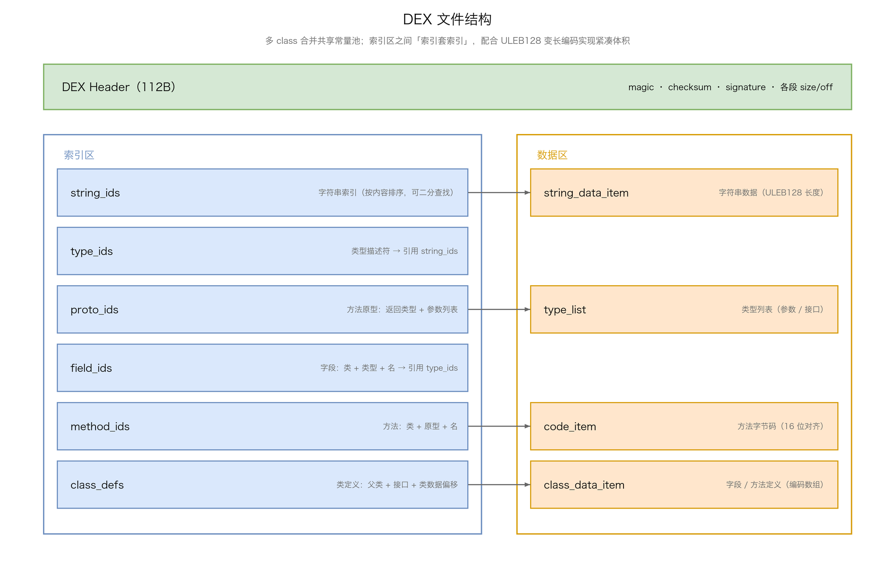
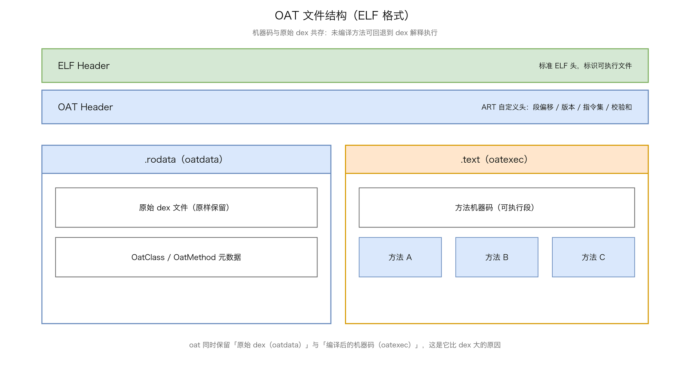
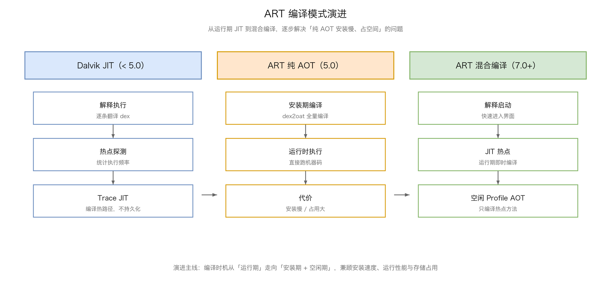
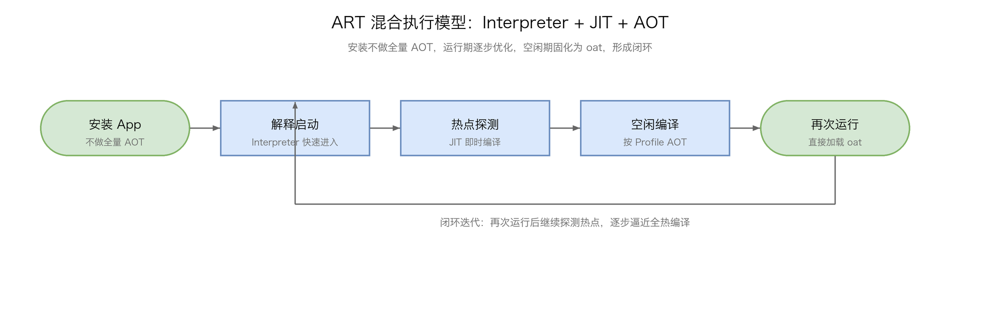
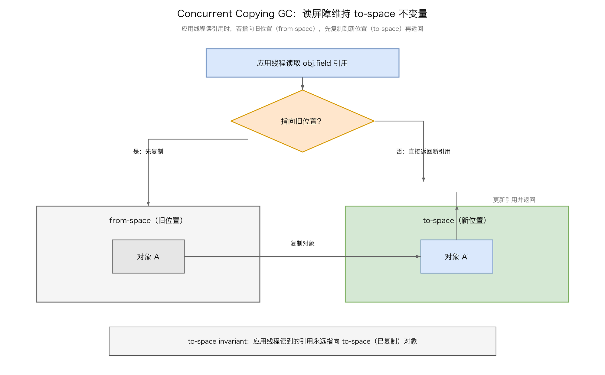

# ART 虚拟机分析

> 本文是 Android 虚拟机（ART，Android Runtime）的深度专文，也是 JVM 系列向 Android 落地的一篇承上启下之作。前面 9 篇讲的是标准 HotSpot JVM，这一篇回答一个绕不开的问题：**为什么 Android 不直接采用 HotSpot JVM，而要自研 Dalvik、ART？** 全文按八章展开：第一章厘清「不采用 HotSpot」的动机，并讲清 class 到 dex 的编译产物转变；第二章详细拆解 DEX 文件格式；第三章独立讲透 Dalvik 的关键技术；第四章独立讲透 ART 的整体架构；第五章聚焦 AOT 与 JIT 的编译原理；第六、七、八章分别深入 GC、ArtMethod 方法执行、类加载与 OAT 加载。重点内容均配图示。

## 目录

- [一、为什么 Android 不直接采用 HotSpot JVM](#一为什么-android-不直接采用-hotspot-jvm)
  - [1. 移动端的资源约束](#1-移动端的资源约束)
  - [2. 基于栈 vs 基于寄存器](#2-基于栈-vs-基于寄存器)
  - [3. 从 class 到 dex：编译产物的转变](#3-从-class-到-dex编译产物的转变)
- [二、DEX 文件格式](#二dex-文件格式)
  - [1. DEX 的由来](#1-dex-的由来)
  - [2. 整体结构与各区作用](#2-整体结构与各区作用)
  - [3. 文件头 Header](#3-文件头-header)
  - [4. 索引区](#4-索引区)
  - [5. 类定义区](#5-类定义区)
  - [6. 数据区](#6-数据区)
  - [7. 紧凑编码](#7-紧凑编码)
  - [8. 方法数上限](#8-方法数上限)
- [三、Dalvik 虚拟机：ART 的前身](#三dalvik-虚拟机art-的前身)
  - [1. Dalvik 的定位与设计目标](#1-dalvik-的定位与设计目标)
  - [2. 基于寄存器的执行模型](#2-基于寄存器的执行模型)
  - [3. 解释执行](#3-解释执行)
  - [4. Trace-based JIT](#4-trace-based-jit)
  - [5. Zygote 与共享内存](#5-zygote-与共享内存)
  - [6. odex 优化与验证（dexopt）](#6-odex-优化与验证dexopt)
  - [7. Dalvik 的局限](#7-dalvik-的局限)
- [四、ART 的整体架构与执行模型](#四art-的整体架构与执行模型)
  - [1. ART 运行时组成](#1-art-运行时组成)
  - [2. 三层执行模型](#2-三层执行模型)
  - [3. dex2oat 与 oat（ELF）](#3-dex2oat-与-oatelf)
  - [4. OAT 文件结构](#4-oat-文件结构)
  - [5. .vdex / .art / .odex 文件](#5-vdex--art--odex-文件)
  - [6. boot.art / boot.oat 与系统启动加速](#6-bootart--bootoat-与系统启动加速)
- [五、ART 的 AOT 与 JIT 编译原理](#五art-的-aot-与-jit-编译原理)
  - [1. AOT 编译：dex2oat 流程](#1-aot-编译dex2oat-流程)
  - [2. 编译过滤器 compiler filter](#2-编译过滤器-compiler-filter)
  - [3. Optimizing 编译器与优化 Pass](#3-optimizing-编译器与优化-pass)
  - [4. 编译模式演进](#4-编译模式演进)
  - [5. JIT 编译：Method-based](#5-jit-编译method-based)
  - [6. Profile Guided Compilation](#6-profile-guided-compilation)
- [六、ART 的垃圾回收 GC](#六art-的垃圾回收-gc)
  - [1. GC 演进路线](#1-gc-演进路线)
  - [2. Concurrent Copying GC 原理](#2-concurrent-copying-gc-原理)
  - [3. 读屏障 Read Barrier](#3-读屏障-read-barrier)
  - [4. Region Space 与 TLAB](#4-region-space-与-tlab)
  - [5. RosAlloc 线程局部分配](#5-rosalloc-线程局部分配)
  - [6. 与 JVM 分代 GC 的对比](#6-与-jvm-分代-gc-的对比)
- [七、方法执行与 ArtMethod](#七方法执行与-artmethod)
  - [1. ArtMethod 结构](#1-artmethod-结构)
  - [2. 编译器层级](#2-编译器层级)
  - [3. 方法调用与入口切换](#3-方法调用与入口切换)
  - [4. ArtMethod 与热修复](#4-artmethod-与热修复)
- [八、类加载与 OAT 加载](#八类加载与-oat-加载)
  - [1. ClassLinker](#1-classlinker)
  - [2. 类加载器](#2-类加载器)
  - [3. OAT 加载流程](#3-oat-加载流程)
- [附：高频速记](#附高频速记)
  - [ART 虚拟机速记](#art-虚拟机速记)

---

## 一、为什么 Android 不直接采用 HotSpot JVM

> **先厘清一个术语**：这里的「JVM」特指 Oracle 的标准 **HotSpot JVM**。Android 并非「不用 Java」，它照样运行 Java / Kotlin，只是跑在自研的 ART（及其前身 Dalvik）上——ART 广义上也是一种 Java 虚拟机。所以准确的问题是：**为什么不直接采用 HotSpot，而要自研一套虚拟机？**

### 1. 移动端的资源约束

Android 早期的技术选型有一个非常明确的约束：**手机是资源受限设备**。桌面 / 服务器的 HotSpot JVM 是「内存换性能」的思路——启动时预留大块内存做堆、方法区，JIT 编译器（C1/C2）运行时反复编译热点代码，这些都依赖充足的 CPU 和内存。手机不具备这些条件：

| 维度 | 桌面 / 服务器 | 移动设备 |
| --- | --- | --- |
| 内存 | GB 级，堆可开到几十 GB | 早期仅 512MB~1GB，堆被严格限制 |
| CPU | 多核高频，编译开销可接受 | 低功耗 ARM，编译是巨大功耗开销 |
| 电池 | 不敏感 | 功耗直接决定续航，运行期反复编译耗电 |
| 存储 | 大硬盘 | 早期 4~16GB，安装包体积敏感 |

因此 Android 不能直接照搬「Java 字节码 + HotSpot JVM 解释/JIT」这套，而是自己造了一条「**.class → .dex → 自有虚拟机**」的链路。

### 2. 基于栈 vs 基于寄存器

这是「JVM 的 class 和 Android 的 dex」最本质的指令集差异：

- **JVM 字节码是基于栈（stack-based）的**：操作数在操作数栈里，指令操作栈顶元素，指令短（多为 1 字节操作码）、但条数多。
- **Android 的 dex 字节码是基于寄存器（register-based）的**：操作数放在虚拟寄存器里，指令直接操作寄存器，单条指令更长（需显式指明寄存器编号）、但条数少。

同一段「计算 `a + b` 并把结果存进 `c`」的逻辑，两种指令集对比如下：

```java
// 源码
int c = a + b;
```

**JVM 字节码（基于栈，4 条指令）**：

```text
iload_0      // 把 a 压栈
iload_1      // 把 b 压栈
iadd         // 弹出栈顶两个数相加，结果压栈
istore_2     // 弹出结果，存入局部变量 c
```

**dex 字节码（基于寄存器，1 条指令）**：

```text
add-int v2, v0, v1    // v2 = v0 + v1，一条指令完成
```

对比结论：

| 对比项 | 基于栈（class） | 基于寄存器（dex） |
| --- | --- | --- |
| 指令条数 | 多（同一逻辑约多 1.5~2 倍） | 少 |
| 单条指令长度 | 短（1 字节操作码为主） | 长（需编码寄存器号） |
| 解释执行效率 | 低（频繁栈操作） | 高（减少数据搬运） |
| 移植性 | 好（不依赖物理寄存器数） | 依赖「虚拟寄存器」抽象，仍与硬件解耦 |

> **易错点**：基于寄存器并不意味着「直接操作 CPU 物理寄存器」。dex 的寄存器是**虚拟寄存器**，运行时才映射到物理寄存器或栈上，所以它依然是与硬件无关的可移植字节码，不能理解成「dex 就是机器码」。

### 3. 从 class 到 dex：编译产物的转变

javac / kotlinc 产出的 `.class` 是给 HotSpot JVM 执行的，而 Android 虚拟机执行的是 `.dex`。所以 Android 的编译终点不是 class，而是把一堆 class 合并、转换成一个或多个 dex 文件：

```text
.java / .kt  ──javac/kotlinc──▶  .class（JVM 字节码）
                                   │
                                   ▼
                           d8（或旧 dx）合并 + 转换
                                   │
                                   ▼
                               .dex（dex 字节码）
```

这个转变带来两个收益：**常量池合并**（多个 class 的重复字符串只存一份）和**基于寄存器的紧凑指令**。dex 文件格式的完整拆解见第二章。

---

## 二、DEX 文件格式

### 1. DEX 的由来

Android 虚拟机不直接跑 `.class`，而是把多个 class 合并转换成一个或多个 `.dex` 文件。核心收益是**常量池合并**——每个 class 都有自己的一套常量池，大量字符串（类名、方法名、字段名）在不同 class 间重复存储；dex 把它们合并成**一个共享常量池**，重复字符串只存一份，体积显著下降：

```text
多个 .class → 一个 .dex：
  A.class: 常量池 { "java/lang/String", "toString", ... }
  B.class: 常量池 { "java/lang/String", "toString", ... }   ← 重复
  C.class: 常量池 { "java/lang/String", "toString", ... }   ← 重复

  dex: 统一常量池 { "java/lang/String" 只存一次, "toString" 只存一次 }
```

### 2. 整体结构与各区作用

一个 dex 文件由「**文件头 + 索引区 + 数据区**」三部分组成。索引区存的是「指向数据区的偏移、或指向更底层索引的下标」，数据区才存放真正的字符串、类定义、方法代码等内容：



各区的主要作用一览：

| 区 | 主要作用 |
| --- | --- |
| Header | 文件头，标识文件、记录各区的位置与大小 |
| string_ids | 字符串索引，统一存放所有字符串 |
| type_ids | 类型索引，存放所有类型的描述符 |
| proto_ids | 方法原型，存放方法的签名（参数 + 返回值） |
| field_ids | 字段索引，存放字段的完整身份 |
| method_ids | 方法索引，存放方法的完整身份 |
| class_defs | 类定义，描述每个类的元信息 |
| data | 数据区，存放字符串、类数据、方法代码等实际内容 |

下面用一个 `Animal` 类贯穿讲解各区，先看源码：

```java
public class Animal {
    private String name;

    public Animal(String name) {
        this.name = name;
    }

    public void speak() {
        System.out.println(name);
    }
}
```

编译后（javac 产出 `.class`，再由 d8 合并进 `.dex`），这个类会被「拆散」存进各区，下面逐区来看。

### 3. 文件头 Header

**作用**：标识文件，并记录各区的位置与大小，是解析 dex 的入口。

Header 固定 **112 字节（0x70）**，核心字段：

- `magic`（8B）：魔数 `dex\n035\0`，`035` 为版本号（`037`/`038`/`039` 分别对应 Android 7/8/9）。
- `checksum`（4B）+ `signature`（20B）：Adler32 校验和与 SHA-1 签名，用于完整性校验。
- `file_size` / `header_size`：文件总大小、头大小。
- **成对的 `xxx_size` + `xxx_off`**：各区（string_ids、type_ids、proto_ids、field_ids、method_ids、class_defs、data）的「元素个数 + 绝对偏移」，据此定位每个区。

> **易错点**：`off` 是该区的**绝对偏移**，`size` 是**元素个数**（不是字节数）。解析时「用 size 循环、用 off 定位」，二者不能混用。

### 4. 索引区

索引区是 dex 的「符号引用层」，存的是「引用」，五个索引区各司其职。以 `Animal` 为例逐个看：

**string_ids —— 字符串**：**作用**是统一存放所有字符串。每个元素是一个 4 字节偏移，指向 data 区里的字符串数据；字符串**按内容排序**，运行期可用二分查找快速定位。`Animal` 里出现过的字符串都会进这里：

```text
"LAnimal;"  "Ljava/lang/String;"  "Ljava/lang/Object;"
"Ljava/io/PrintStream;"  "name"  "<init>"  "speak"
"(Ljava/lang/String;)V"  "()V"  "println"  "V"
```

**type_ids —— 类型**：**作用**是存放所有类型的描述符。每个元素指向 string_ids 的某个下标。`Animal` 涉及的类型：

```text
type_ids[0] = LAnimal;
type_ids[1] = Ljava/lang/String;
type_ids[2] = Ljava/io/PrintStream;
type_ids[3] = Ljava/lang/Object;
type_ids[4] = V            // void（speak 的返回值）
```

描述符规则：

```text
基本类型：V=void  Z=boolean  B=byte  S=short  C=char  I=int  J=long  F=float  D=double
对象类型：Ljava/lang/String;
数组类型：[I（int 数组）
```

**proto_ids —— 方法原型**：**作用**是存放方法签名（返回值 + 参数列表）。每个元素三个字段：`shorty_idx`（短描述符）、`return_type_idx`（返回类型）、`parameters_off`（参数列表偏移）。`Animal` 的方法原型：

```text
proto_ids[0] = (Ljava/lang/String;)V   // Animal 构造器
proto_ids[1] = ()V                      // speak()
proto_ids[2] = (Ljava/lang/String;)V   // println()
```

**field_ids —— 字段**：**作用**是存放字段的完整身份（所属类 + 类型 + 名字）。每个元素三个字段：`class_idx`、`type_idx`、`name_idx`。`Animal` 的字段：

```text
field_ids[0] = { class = type_ids[0]（LAnimal;）, type = type_ids[1]（String）, name = "name" }
```

**method_ids —— 方法**：**作用**是存放方法的完整身份（所属类 + 原型 + 名字）。每个元素三个字段：`class_idx`、`proto_idx`、`name_idx`。`Animal` 的方法：

```text
method_ids[0] = { class = type_ids[0], proto = proto_ids[0], name = "<init>" }
method_ids[1] = { class = type_ids[0], proto = proto_ids[1], name = "speak" }
method_ids[2] = { class = type_ids[2], proto = proto_ids[2], name = "println" }
```

> **关键理解**：索引区之间「**索引套索引**」——field_ids / method_ids 不直接存字符串，而是存指向 type_ids、proto_ids、string_ids 的下标。还原一个方法签名要经过 `method_ids → proto_ids / type_ids / string_ids` 多层间接，这正是 dex 紧凑的原因。

### 5. 类定义区

**作用**：描述每个类的元信息（是什么类、继承谁、有哪些字段和方法）。

- `class_defs` 每个元素描述一个类：类名、访问标志、父类、接口列表，以及 `class_data_off`（指向类的字段/方法具体定义）。
- `class_data_item` 才真正列出「这个类有哪些字段、哪些方法」，成员分四组：静态字段、实例字段、直接方法（构造器 / private / static）、虚方法。

`Animal` 对应的类定义：

```text
class_defs[0] = {
  class_idx       = type_ids[0]   // LAnimal;
  superclass_idx  = type_ids[3]   // Ljava/lang/Object;
  class_data_off  = → data 区的 class_data_item
}
```

> **易错点**：`class_data_off` 为 0 表示该类没有自定义字段和方法（如标记接口），别把「有类定义」和「有类数据」混为一谈。

### 6. 数据区

**作用**：存放 dex 里所有实际内容，是真正的「内容仓库」：

- `string_data_item`：字符串数据（ULEB128 长度 + 内容）。
- `type_list`：类型列表（如方法参数、接口列表）。
- `class_data_item`：类的字段 / 方法定义。
- `code_item`：方法实现（字节码），含寄存器数、入参数、指令数组等。
- `map_list`：整个文件的 section 布局表，用于快速校验和遍历。

`Animal` 落到数据区的内容：

```text
string_data_item  → 上面所有字符串的字节内容
class_data_item   → Animal 的成员清单：
                       instance_fields: [ name ]
                       direct_methods:  [ <init> ]
                       virtual_methods: [ speak ]
code_item         → <init> 和 speak 的字节码指令
```

到这里，一个类从源码到 dex 的落位就串起来了：`class_defs → class_data → method_ids → proto_ids / type_ids → string_ids`。

### 7. 紧凑编码

dex 的紧凑除了「共享常量池」，还靠两种编码手段：

**ULEB128 变长编码**：索引、偏移、长度等整数不用定长 4 字节，而是用 1~5 字节变长存——每字节低 7 位存数据，最高位标记「是否还有后续字节」，小端序：

```text
值 1   → 0x01
值 128 → 0x80 0x01
```

**基于寄存器的指令**：dex 指令以 16 位对齐，操作码在低 8 位，其余位编码寄存器和字面量，用「字母串」命名格式（`23x` = 2 寄存器无额外数据，`35c` = 最多 5 寄存器 + 常量池索引）：

```text
add-int v2, v0, v1            // 23x：v2 = v0 + v1
invoke-virtual {v0, v1}, LPrintStream;->println(...)V   // 35c：方法调用
```

### 8. 方法数上限

dex 里方法、字段、字符串的索引都是 **16 位**，所以单个 dex 的方法数最多 **65536** 个。超限时拆成「主 dex + 若干次 dex」：

- Android 5.0（ART）起原生支持多 dex，自动加载；
- 更早版本要靠 `multidex` 兼容库运行时动态加载次 dex。

```text
方法数 > 65536 时：
  classes.dex（主 dex）
  classes2.dex
  classes3.dex
```

---

## 三、Dalvik 虚拟机：ART 的前身

### 1. Dalvik 的定位与设计目标

Dalvik 是 Android 的第一代虚拟机，Android 1.0 到 4.4 的默认执行环境（5.0 起被 ART 取代）。名字里的「D」就来自 Dalvik——**D**alvik **EX**ecutable，即 `.dex` 文件。

Dalvik 的设计目标非常聚焦：**为内存和 CPU 都受限的移动设备，跑 Java/Kotlin 字节码**。围绕这个目标，它做了几个关键取舍——基于寄存器、解释执行起步、轻量 JIT、Zygote 共享内存、安装期轻量优化（odex）。

### 2. 基于寄存器的执行模型

Dalvik 采用**基于寄存器**的指令集（对比 HotSpot 的基于栈），这是它和 JVM 最本质的底层差异：

- 每个方法有一组**虚拟寄存器**（v0, v1, ...），前若干个用于接收**入参**，其余用于局部变量；
- 指令直接操作寄存器，避免了基于栈模型里频繁的「压栈/弹栈」数据搬运；
- 方法最多可用 65536 个寄存器（受 16 位编码限制）。

```text
方法调用约定（示例）：
  int add(int a, int b) {
      int c = a + b;
      return c;
  }

  // 虚拟寄存器布局：v0=a  v1=b  v2=c（前两个是入参）
  add-int v2, v0, v1     // v2 = v0 + v1
  return v2
```

### 3. 解释执行

Dalvik 起步阶段是**纯解释执行**：启动后逐条读取 dex 指令、翻译成内部操作执行。优点是**零预热、启动快**；缺点是**重复执行的代码每次都重新翻译**，热点代码效率低。因此后来引入了 JIT 来补足。

### 4. Trace-based JIT

Android 2.2 起 Dalvik 加入 JIT（Just-In-Time，即时编译）。注意它和后来 ART 的 JIT 不同，Dalvik 是 **Trace-based JIT**：

- **运行期统计**：解释器统计代码执行频率，识别热点。
- **编译单元是 Trace（热路径）**：一段连续执行的指令流，可能跨方法、也可能只是方法里的一个循环体，**不一定以方法为边界**。
- **编译与缓存**：把热路径编译成机器码缓存起来，下次命中直接执行；编译结果**不落盘**，进程退出即失效。

```text
Trace-based JIT 的编译单元是「热路径」：

  方法 foo() {
    语句1 ─┐
    循环 { 语句2 → 语句3 → 语句4 }  ← 这整段循环是一条 Trace，被单独编译
    语句5 ─┘
  }

  编译的粒度是「路径」，不是「整个 foo() 方法」
```

### 5. Zygote 与共享内存

Dalvik 时代的一个关键优化是 **Zygote 进程模型**：

- 系统启动时先起一个 **Zygote 进程**，它预先加载并初始化了常用的系统类、Framework 资源；
- 每个新 App 进程都由 Zygote **fork** 出来，通过 Linux 的 **COW（Copy-On-Write，写时复制）** 机制，子进程共享父进程已加载的类和数据页；
- 只有当某个进程真正修改共享页时才复制，因此多个 App 共享同一份预加载数据，**内存占用低、启动快**。

Zygote 模型后来也被 ART 继承，是 Android 进程快速孵化的基石。

### 6. odex 优化与验证（dexopt）

Dalvik 时代安装 App 时，系统会用 **dexopt** 对 dex 做一次**轻量优化**，产物叫 **odex（Optimized DEX）**：

- **验证**（verify）：校验 dex 格式、字节码合法性；
- **优化**（optimize）：做虚方法调用的间接性消除、字节码层面的小优化；
- **结果缓存**：odex 与 apk 分离存放，加载时直接用优化后的版本。

> 注意：Dalvik 的 odex 只是「优化过的 dex 字节码」，**并不是机器码**，与 ART 的 oat（真正机器码）有本质区别。

### 7. Dalvik 的局限

| 局限 | 说明 |
| --- | --- |
| 运行期才编译 | JIT 在运行期消耗 CPU 和电量，编译本身有开销，且每次冷启动都要重新解释 + 再编译 |
| Trace 粒度小 | 以热路径为单位，编译单元小，优化空间受限（难做跨 Trace 的全局优化、内联） |
| GC 能力弱 | 非移动 Mark-Sweep 为主，GC 暂停明显，卡顿（jank）常见 |
| 分配效率一般 | 对象分配需全局锁竞争，多线程分配效率不高 |
| 无法离线优化 | 没有「安装期 AOT」这一环，机器码无法持久化，每次都是「解释→JIT」从零开始 |

这些局限促使 Google 推出 ART——把「编译」这件事**从运行期搬到安装期**。

---

## 四、ART 的整体架构与执行模型

### 1. ART 运行时组成

ART（Android Runtime）是 Android 5.0 起全面取代 Dalvik 的虚拟机。它的运行时（Runtime）由多个子系统组成，核心组件如下：

| 组件 | 职责 |
| --- | --- |
| ClassLinker | 类加载、解析、链接，把 dex 里的类元数据装载进内存 |
| Heap | 堆管理，对象分配 |
| GC | 垃圾回收（多种 GC 实现） |
| Interpreter | 解释器，执行 dex 字节码（未编译方法） |
| JIT | 运行时热点编译 |
| Compiler（dex2oat） | AOT 编译，dex → oat |
| ArtMethod / ArtField / Class | 方法 / 字段 / 类的运行时表示 |

这些组件协同，支撑起 ART「**解释 + JIT + AOT 三层执行**」的核心模型。

### 2. 三层执行模型

ART 的一个方法可能处于三种执行态之一，ART 会根据「是否已编译、是否热点」动态切换：

| 执行态 | 入口 | 说明 |
| --- | --- | --- |
| 解释执行 | Interpreter 入口 | 未编译方法，逐条解释 dex 字节码 |
| JIT 执行 | JIT 机器码入口 | 运行期热点方法，即时编译后的机器码 |
| AOT 执行 | oat 机器码入口 | 安装期/空闲期预编译好的机器码，直接执行 |

三者的配合关系：**AOT 打底（安装期/空闲期预编译），解释器兜底（未编译的方法），JIT 补热（运行期发现的热点）**。方法从「解释态」升级到「机器码态」时，入口指针被原子替换（详见第七章）。

### 3. dex2oat 与 oat（ELF）

`dex2oat` 是 ART 的**预编译器**，作用是把 `.dex` 文件编译成本机可执行的机器码文件 `.oat`：

```text
.dex 文件  ──dex2oat 编译──▶  .oat 文件（ELF 格式的机器码 + 原始 dex）
```

`.oat` 本质是一个 **ELF 文件**（Linux 可执行文件格式），因为 Android 底层就是 Linux，CPU 直接认识 ELF 里的机器码。ART 运行时通过 `mmap` 把 `.oat` 映射进内存，从里面取机器码执行。

```bash
# 手动触发 dex2oat 编译的示例（了解即可，普通开发者很少直接用）
dex2oat --dex-file=app.dex --oat-file=app.oat --instruction-set=arm64
```

### 4. OAT 文件结构

`.oat` 文件是一个 ELF，内部主要分三个逻辑部分：

```text
┌─────────────────────────────┐
│  ELF Header                 │  标准 ELF 头，标识可执行文件
├─────────────────────────────┤
│  OAT Header                 │  ART 自定义头，记录各段偏移/校验信息
├─────────────────────────────┤
│  .rodata（oatdata）          │  原始 dex 文件 + 类/方法元数据（只读数据）
├─────────────────────────────┤
│  .text（oatexec）            │  dex2oat 编译出的机器码（可执行段）
└─────────────────────────────┘
```



- **OAT Header**：记录 oatdata、oatexec 段的偏移、版本、指令集、校验和等，运行时据此定位各段。
- **oatdata（.rodata）**：把**原始的 dex 文件原封不动**地打包进去，同时附带 ART 需要的元数据（如 OatClass、OatMethod 的描述信息）。
- **oatexec（.text）**：真正编译出来的机器码，对应 dex 里各方法的本地实现。

> **关键理解**：oat 文件里**既保留了原始 dex，又存了编译后的机器码**。为什么两者都要？因为 AOT 编译是「尽力而为」的——不是所有方法都一定被编译（有些方法可能因版本、兼容性跳过），未编译的方法运行时仍要回到 dex 字节码去解释执行，所以原始 dex 必须保留。这同时解释了为什么 `.oat` 会比 `.dex` 大很多。

### 5. .vdex / .art / .odex 文件

- **`.odex`**：旧时代的「优化版 dex」，早期 Dalvik 时代用，现在基本被 `.oat`/`.vdex` 取代。
- **`.vdex`**（Android 8.0 引入）：从 `.oat` 里把 **dex 的原始内容（未压缩的 dex + 校验数据）**抽离出来单独存放，让 oat 更纯粹地只放机器码，同时加快校验速度（vdex 里带了 dex 的校验结果，无需每次重新验证 dex）。
- **`.art`**：ART 的**运行时镜像**，最典型的是 `boot.art`——把系统常用类、对象的**堆镜像**（对象、类、方法、字符串等已初始化的数据）存成文件，启动时直接 `mmap` 进来，避免从零加载和初始化系统类，**极大加速系统启动**。

```text
Android 8.0+ 的产物分工：
  app.vdex  → 未压缩 dex + 校验数据（供 ClassLinker 用）
  app.oat   → 编译出的机器码（ELF）
  boot.art  → 系统类/对象堆镜像（加速启动）
```

### 6. boot.art / boot.oat 与系统启动加速

ART 为系统自身预生成了 `boot.oat`（系统类的机器码）和 `boot.art`（系统类的堆镜像）。设备启动时：

1. 系统直接 `mmap` 加载 `boot.oat` / `boot.art`；
2. 常用系统类、对象、字符串**已经初始化好**，无需再逐个加载、解析、初始化；
3. 极大缩短系统启动和 App 首帧时间。

这背后仍是 Zygote 模型：Zygote 预加载这些镜像，之后 fork 出的 App 进程通过 COW 共享，继承「已就绪」的运行态。

---

## 五、ART 的 AOT 与 JIT 编译原理

### 1. AOT 编译：dex2oat 流程

AOT（Ahead Of Time，预编译）是 ART 的核心编译方式，由 `dex2oat` 完成。整体流程：

```text
dex 文件
  │
  ├─ 解析 dex 结构（header / 索引区 / class_defs）
  │
  ├─ 为每个方法生成中间表示（IR）
  │
  ├─ 运行 Optimizing 编译器的一系列优化 Pass
  │
  ├─ 生成目标架构机器码（arm/arm64/x86/x86_64）
  │
  └─ 写入 oat（ELF）：oatdata 保留 dex，oatexec 存机器码
```

编译的时机有三处：**安装期**（全量或按 filter）、**空闲期**（结合 Profile 补热）、**运行期**（部分场景触发）。

### 2. 编译过滤器 compiler filter

`dex2oat` 支持多种编译过滤模式（compiler filter），控制「编译到什么程度」，常见几种：

| Filter | 含义 |
| --- | --- |
| verify | 只校验，不编译 |
| extract | 只提取 dex，不编译 |
| quicken | 少量优化（消除虚方法调用间接性等），不编译机器码 |
| speed / speed-profile | 按 Profile 全量 AOT（常用发布态） |
| everything | 全量 AOT（不管 Profile） |

**Profile 编译**（speed-profile）就是「只编译 Profile 里记录的热方法」，**everything** 则无视 Profile 全量编译。发布 App 时按 Profile 编译，能在「安装体验 / 运行性能 / 占用空间」之间取平衡。

### 3. Optimizing 编译器与优化 Pass

ART 的 AOT/JIT 编译器统称 **Optimizing 编译器**（替代早期较弱的 Quick 编译器）。它基于 **SSA（静态单赋值）中间表示**，跑一系列优化 Pass：

- **内联（Inlining）**：把小方法体直接嵌入调用点，消除调用开销（尤其对 getter/setter 收益大）；
- **死代码消除（DCE）**：删除不会被执行的代码；
- **常量折叠 / 传播**：编译期算好常量表达式；
- **寄存器分配**：把虚拟寄存器映射到真实寄存器，减少内存访问；
- **循环优化**、**空检查消除**、**逃逸分析**等。

优化 Pass 越多，编译越慢但机器码越优。Quick 与 Optimizing 的分工：

| 编译器 | 特点 |
| --- | --- |
| Quick | 编译快、优化浅（早期 AOT 默认） |
| Optimizing | 编译慢、优化深（内联/寄存器分配等，现行主流） |

### 4. 编译模式演进

ART 的编译策略经历了多次大改，这是理解「ART 为什么安装慢后来又变快」的主线：



**① 纯 AOT（Android 5.0）**：安装时 `dex2oat` 把**整个 dex 全部编译**成机器码。运行时零解释、零 JIT，执行快、省电，但**安装极慢、占用极大**（所有代码都编译，包括永远用不到的）。

**② AOT + JIT + Profile（Android 7.0）**：安装时不做（或少做）AOT，恢复运行期 JIT，再用 Profile 引导空闲期 AOT：



1. **安装 App**：不做全量 AOT，安装快；用 Interpreter 解释启动。
2. **解释启动**：Interpreter 解释执行，快速进入界面。
3. **热点探测**：运行中识别热点代码，JIT 即时编译并缓存机器码。
4. **空闲编译**：设备空闲（充电、锁屏）时，`dex2oat` 结合 JIT 记录的 Profile，只把**真正热的方法** AOT 编译成 oat。
5. **再次运行**：直接加载 oat 里的机器码执行。

这样既避免了「安装时全量编译」的慢和占空间，又能逐步把热点代码变成机器码，兼顾安装速度、运行速度与空间。

### 5. JIT 编译：Method-based

ART 的 JIT 是 **Method-based**：以**整个方法**为编译单元（而非 Dalvik 的 Trace 热路径）。当解释器发现某个方法被频繁调用（热度超过阈值），就把它整体编译成机器码，后续调用走机器码。方法级编译边界清晰、便于做内联等优化。

JIT 编译出的机器码缓存在 **JIT Code Cache** 里，进程存活期间复用；同时 JIT 会把「哪些方法热」记录进 Profile，供空闲期 AOT 参考。

### 6. Profile Guided Compilation

**Profile（编译配置文件，`profile.prof`）** 记录的是**运行期哪些代码是热的**，供空闲期 AOT 参考。典型内容包括：

- 被频繁调用的方法（hot methods）；
- 方法启动（冷/热启动）相关信息；
- 类加载、类初始化信息；
- 内联相关的调用点信息。

```text
Profile 的本质：JIT 边跑边记「谁热」，AOT 空闲时照着「谁热」精准编译，而不是盲目全量编译。
```

系统在设备空闲时（如充电、屏幕关闭），由 `BackgroundDexOptService` 触发 `dex2oat`，结合 Profile 对热点代码做 AOT，把之前 JIT 的成果「固化」成 oat，下次启动直接享用。这就是「**JIT 提速当下，AOT 固化未来**」的配合关系。

此外 Profile 还能**上传云端、跨设备共享**：Google Play 收集各设备上报的编译 Profile，聚合后分发给新装用户，让**新设备第一次安装就能拿到别人跑出来的热点信息，直接精准预编译**，缩短「冷启动 → 热」的周期。

---

## 六、ART 的垃圾回收 GC

### 1. GC 演进路线

ART 的 GC 经过了多代实现，目标一直是**降低暂停（jank）**：

```text
非移动 Mark-Sweep → CMS（并发标记清除）→ Semi-Space（半空间复制）
  → Concurrent Copying CC（并发复制，Android 8.0 默认）→ 分 Region 的 CC（Region Space）
```

| 阶段 | GC 类型 | 特点 |
| --- | --- | --- |
| 早期 | 非移动 Mark-Sweep | 标记-清除，不移动对象，但内存碎片化 |
| CMS | Concurrent Mark-Sweep | 并发标记，缩短暂停，仍不移动 |
| Semi-Space | 半空间复制 | 移动式，无碎片，但只有一半堆可用 |
| Concurrent Copying（CC） | 并发复制 | 移动式 + 并发，暂停极短，Android 8.0+ 默认 |
| Region-based | 分 Region 的 CC | 堆切成多个 region，回收更精细 |

### 2. Concurrent Copying GC 原理

CC GC 的核心是「**并发复制 + 读屏障**」。它把堆划分为 from-space 与 to-space（或更细的 region），GC 线程在**应用线程继续运行**的同时，把存活对象从 from-space 复制到 to-space，只有很短的暂停来做根扫描等不可并发阶段。

难点在于：应用线程在 GC 期间仍在读写对象，如何保证它看到的对象是「最新位置」的？答案就是**读屏障**。

### 3. 读屏障 Read Barrier

CC GC 采用 **Baker 读屏障（Baker's Read Barrier）**，维持一个核心不变量：**to-space invariant**——应用线程在任何时刻，通过读屏障读到的引用，都保证指向 to-space（已复制）的对象。

```text
读屏障的作用：当应用线程读取某个对象引用字段时，
  1. 检查该引用是否指向 from-space（旧位置）对象；
  2. 若是，先把它复制到 to-space，并把引用更新为新地址；
  3. 返回 to-space 的新引用。
```

这样应用线程「无感」地始终操作 to-space 对象，GC 线程可以放心地在 from-space 上并发回收，不需要长时间 STW。读屏障只是一次「判断 + 可能的分支跳转」，开销很小。



> **易错点**：读屏障是**读时**触发（load barrier），和 JVM 三色标记里用的**写屏障**（write barrier，G1 的 SATB / CMS 的增量更新）是两回事。ART 的 CC 用读屏障维护 to-space invariant，JVM 的并发标记用写屏障维护三色不变式，两者机制不同，别混为一谈。

### 4. Region Space 与 TLAB

CC GC 演进中引入了 **Region Space**：把堆切分成固定大小的 region（例如 256KB 的 RegionTLAB），对象按 region 管理，GC 可以以 region 为粒度并发地复制、回收，进一步提高并发度与回收灵活性。

同时，ART 和 JVM 一样有 **TLAB（Thread Local Allocation Buffer）**：每个线程从堆里预取一块线程私有的分配缓冲区，对象先在 TLAB 里用 bump pointer 快速分配，缓冲耗尽再向堆申请新块，避免多线程抢全局锁。

### 5. RosAlloc 线程局部分配

**RosAlloc（Rosenberg Allocator）** 是 ART 的对象分配器，核心思想是**线程本地分配 + size-class（按大小分桶）+ bump pointer**：

- 按对象大小分成多个 size-class，每个 class 有对应的空闲块链表；
- 每个线程有本地缓存（Thread-local runs），分配时优先从本地取空闲块；
- 大对象走单独的 Large Object Space。

相比 Dalvik 时代一把全局锁，RosAlloc 几乎无锁分配，多线程吞吐大幅提升。

### 6. 与 JVM 分代 GC 的对比

| 对比项 | HotSpot JVM | ART |
| --- | --- | --- |
| 主流 GC | G1 / ZGC / Shenandoah（分代或分区） | Concurrent Copying（非分代，region 化） |
| 屏障类型 | 写屏障（SATB / 增量更新）+ 读屏障（ZGC） | 读屏障（Baker） |
| 分代 | 强分代（新生代/老年代） | 传统上非分代（后续有分 region 演进） |
| 目标 | 吞吐 + 低延迟 | 低暂停（避免 UI 卡顿）优先 |

> 说明：ART 历史上走的是**非分代**的并发复制路线，与 JVM 强调分代的 G1 不同；但两者都追求「低暂停」，只是实现路径不同。面试时能说清「ART 用读屏障的 CC、JVM 用写屏障的 G1」即为亮点。

---

## 七、方法执行与 ArtMethod

### 1. ArtMethod 结构

ART 中每个 Java/Kotlin 方法在运行期都对应一个 `ArtMethod` 结构体，它是 ART 方法调用的核心数据单元（类比 JVM 里方法区的方法元数据 + 入口指针）：

```text
struct ArtMethod {
  GcRoot<mirror::Class> declaring_class_;  // 所属类
  uint32_t access_flags_;                  // 访问标志 public/static/...
  uint32_t dex_method_index_;              // 在 dex method 表中的索引
  uint16_t method_index_;                  // 方法索引
  ...
  void* entry_point_from_quick_compiled_code_;  // 方法入口（机器码地址）
  ...
};
```

其中 `entry_point_from_quick_compiled_code_` 最关键：它指向该方法的**可执行入口**——可能是解释器入口、JIT 机器码入口，或 AOT 机器码入口。

### 2. 编译器层级

一个方法在 ART 中可能处于不同「编译态」，入口指针随之变化：

| 编译态 | 入口 | 说明 |
| --- | --- | --- |
| 未编译 | Interpreter 入口 | 解释执行 dex 字节码 |
| Quick 编译 | Quick 机器码入口 | 快速但不激进的编译（早期） |
| Optimizing 编译 | Optimizing 机器码入口 | 优化更充分（内联、寄存器分配等） |
| JIT 编译 | JIT 机器码入口 | 运行期热点编译结果 |

### 3. 方法调用与入口切换

方法调用时，ART 通过 ArtMethod 找到 `entry_point_from_quick_compiled_code_` 跳转执行。当方法被 JIT 编译、或从解释态升级为机器码态时，入口指针会被**原子替换**成新入口，之后调用直接走更快的路径。这种「入口指针热切换」是 ART 方法执行高效的关键。

### 4. ArtMethod 与热修复

ArtMethod 结构也是 Android 热修复（如 AndFix、阿里 Sophix）的核心原理：热修通过**替换 ArtMethod 的入口指针**，把某个方法指向新的机器码实现，实现「无侵入地替换方法逻辑」，无需重启 App。

```text
热修复的 ArtMethod 入口替换思路：
  原 ArtMethod.entry_point ──▶ 旧实现机器码
                 │
                 └── 替换为 ──▶ 新补丁机器码（Bug 修复后的逻辑）
```

> 注意：这类「入口替换」方案依赖 ArtMethod 结构的稳定性，Android 版本升级一旦改动 ArtMethod 内存布局，热修方案就需要适配，这也是各热修框架要持续跟进系统版本的原因之一。

---

## 八、类加载与 OAT 加载

### 1. ClassLinker

ART 的类加载由 **ClassLinker** 负责，类比 JVM 的类加载器 + 连接阶段：它读取 dex/vdex 中的类定义，完成类的解析、链接、初始化（对应 JVM 的加载 → 验证 → 准备 → 解析 → 初始化）。

### 2. 类加载器

Android 的类加载器层次与 JVM 类似，但实现不同：

| 类加载器 | 说明 |
| --- | --- |
| BootClassLoader | 加载系统类（framework），由 Zygote 预加载 |
| PathClassLoader | 加载已安装 App 的 dex（`/data/app/...`） |
| DexClassLoader | 加载任意路径的 dex/jar（常用于热修、插件化） |
| BaseDexClassLoader | PathClassLoader / DexClassLoader 的共同父类，实际装载逻辑所在 |

这些类加载器最终都委托 ClassLinker 做实际装载。

### 3. OAT 加载流程

App 启动时 ART 加载 oat 的大致流程：

```text
1. 打开 .vdex/.oat 文件，mmap 映射进内存；
2. 读取 OAT Header，定位 oatdata / oatexec 段；
3. ClassLinker 从 oatdata 读取 dex 元数据，建立类/方法索引；
4. 为每个方法建立 ArtMethod，入口指针指向 oatexec 里对应机器码；
5. 应用线程调用方法时，经 ArtMethod 入口直接执行机器码。
```

---

## 附：高频速记

### ART 虚拟机速记

- Android 不直接采用 HotSpot JVM：移动端资源受限；class 基于栈、dex 基于寄存器，dex 合并常量池体积更小。
- dex 文件：Header（112B）+ string_ids/type_ids/proto_ids/field_ids/method_ids + class_defs + data；层层索引 + ULEB128 变长编码。
- 单 dex 方法数上限 65536（16 位索引），超限拆多 dex，ART 原生支持、旧版本靠 multidex。
- Dalvik（5.0 前）：基于寄存器 + 解释执行 + **Trace JIT**（编译热路径，非整方法）+ Zygote 共享 + dexopt 轻量优化。
- ART（5.0 起）：**AOT** 预编译，安装期 `dex2oat` 把 `.dex` → `.oat`（**ELF**），运行时直接跑机器码。
- Method-based > Trace-based：以方法为编译单元，优化更充分（内联、寄存器分配）。
- AOT 代价：**安装慢、占空间**（不管用不用都编译）。
- 混合编译（7.0 起）：**安装不做 AOT → 解释启动 → JIT 热点 → 空闲按 Profile AOT → 再运行直接跑 oat**。
- oat 结构：ELF Header + OAT Header + `.rodata`(oatdata=原始dex+元数据) + `.text`(oatexec=机器码)。
- 产物分工：`.vdex`（未压缩 dex+校验）、`.oat`（机器码）、`.art`（堆镜像，如 boot.art 加速启动）。
- 编译 filter：verify / extract / quicken / speed-profile / everything。
- Optimizing 编译器：基于 SSA，优化 Pass（内联、死代码消除、寄存器分配等）。
- Cloud Profile：Play 聚合各设备 Profile，新装设备直接精准预编译。
- GC 演进：Mark-Sweep → CMS → Semi-Space → **Concurrent Copying（CC，8.0 默认）**。
- CC GC 用 **Baker 读屏障**维护 **to-space invariant**：读引用时若指向 from-space 就先复制到 to-space。
- 对比 JVM：ART 读屏障 + 非分代 CC；JVM 写屏障（G1 SATB/增量更新）+ 分代。
- 对象分配：**RosAlloc**（线程本地 + size-class + bump pointer）+ **TLAB**。
- ArtMethod：方法运行时结构，`entry_point_from_quick_compiled_code_` 是方法入口；热修（AndFix/Sophix）靠换入口指针实现。
- 类加载：ClassLinker 负责；BootClassLoader/PathClassLoader/DexClassLoader；oat 加载走 mmap。
