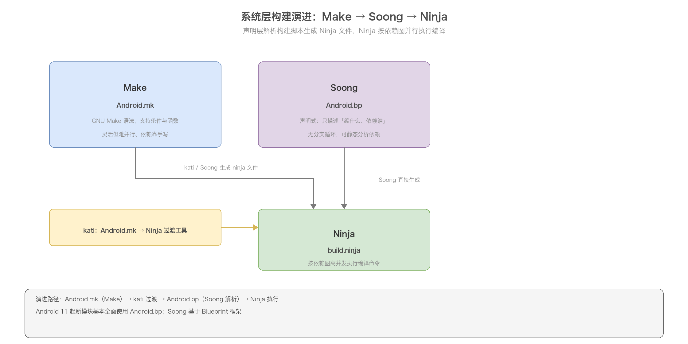
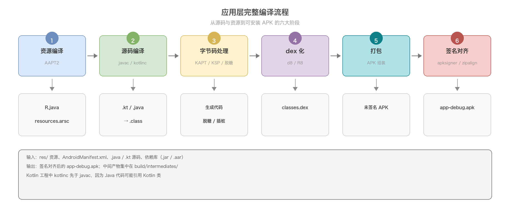
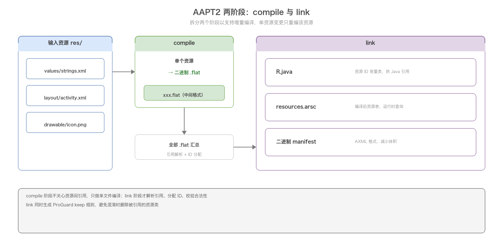
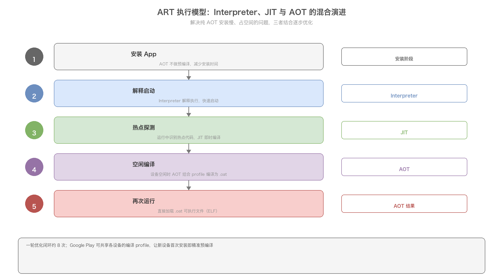
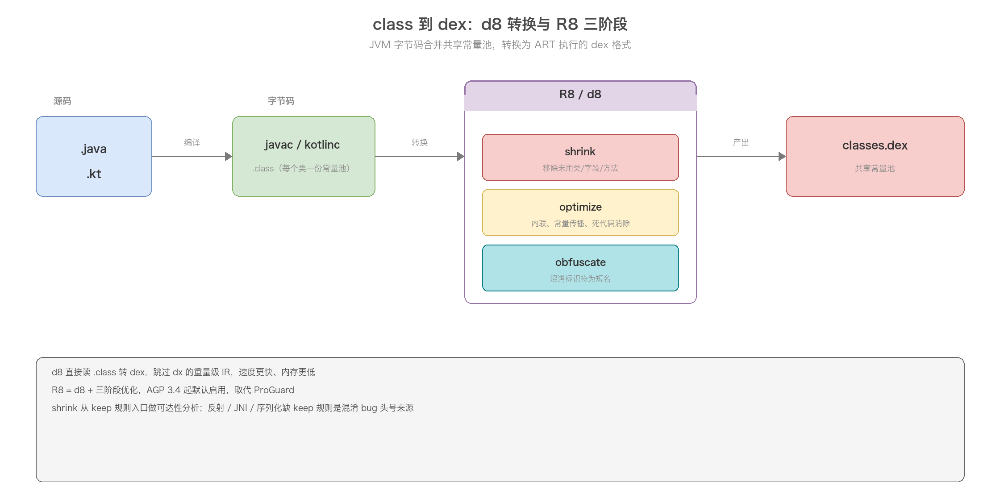

# 01. Android 编译流程解析

> 从一段 Java/Kotlin 源码到一个可安装运行的 APK，中间到底发生了什么；APK 装进手机后，又是怎么变成 CPU 能执行的机器码的。本文把「编译」和「执行」两条线串起来讲：编译侧覆盖 AAPT2 资源编译、javac/kotlinc 源码编译、d8/R8 的 dex 化、APK 打包、签名对齐，以及 AOSP 系统层的 Make/Soong/Ninja 构建；执行侧补充 Android 虚拟机 Dalvik 与 ART 的演进，解释为什么 Android 不用 JVM、AOT/JIT/Interpreter 各自在做什么。

## 目录

- [一、构建系统全景与演进](#一构建系统全景与演进)
  - [1.1 应用层构建：Gradle 与 AGP](#11-应用层构建gradle-与-agp)
  - [1.2 系统层构建：Make → Soong → Ninja](#12-系统层构建make--soong--ninja)
  - [1.3 两种构建体系对比](#13-两种构建体系对比)
- [二、应用层完整编译流程](#二应用层完整编译流程)
  - [2.1 六大阶段总览](#21-六大阶段总览)
  - [2.2 编译流程的演进](#22-编译流程的演进)
  - [2.3 各阶段产物清单](#23-各阶段产物清单)
- [三、资源编译：AAPT2](#三资源编译aapt2)
  - [3.1 AAPT2 的两阶段设计](#31-aapt2-的两阶段设计)
  - [3.2 compile 阶段：资源转 .flat](#32-compile-阶段资源转-flat)
  - [3.3 link 阶段：生成 R.java 与 resources.arsc](#33-link-阶段生成-rjava-与-resourcesarsc)
  - [3.4 resources.arsc 结构](#34-resourcesarsc-结构)
  - [3.5 R.java 与内联 R](#35-rjava-与内联-r)
- [四、源码编译：Java 与 Kotlin](#四源码编译java-与-kotlin)
  - [4.1 javac 生成 class](#41-javac-生成-class)
  - [4.2 kotlinc 生成 class](#42-kotlinc-生成-class)
  - [4.3 注解处理器：KAPT 与 KSP](#43-注解处理器kapt-与-ksp)
- [五、Android 虚拟机：Dalvik 与 ART](#五android-虚拟机dalvik-与-art)
  - [5.1 为什么 Android 不用 JVM](#51-为什么-android-不用-jvm)
  - [5.2 Dalvik 与 JIT](#52-dalvik-与-jit)
  - [5.3 ART 与 AOT](#53-art-与-aot)
  - [5.4 ART 的混合执行演进](#54-art-的混合执行演进)
- [六、字节码到 DEX：d8 与 R8](#六字节码到-dexd8-与-r8)
  - [6.1 dex 与 class 的本质差异](#61-dex-与-class-的本质差异)
  - [6.2 dx 与 d8](#62-dx-与-d8)
  - [6.3 dex 文件结构](#63-dex-文件结构)
  - [6.4 64K 方法数限制与 multidex](#64-64k-方法数限制与-multidex)
  - [6.5 R8 三阶段：shrink / optimize / obfuscate](#65-r8-三阶段shrink--optimize--obfuscate)
  - [6.6 desugar 脱糖](#66-desugar-脱糖)
- [七、APK 打包与结构](#七apk-打包与结构)
- [八、签名与对齐](#八签名与对齐)
  - [8.1 签名方案演进 v1 → v4](#81-签名方案演进-v1--v4)
  - [8.2 apksigner 与 zipalign](#82-apksigner-与-zipalign)
- [九、AOSP 系统层编译](#九aosp-系统层编译)
  - [9.1 Soong 与 Android.bp](#91-soong-与-androidbp)
  - [9.2 系统镜像产物](#92-系统镜像产物)
- [十、增量编译与构建加速](#十增量编译与构建加速)
- [附：高频速记](#附高频速记)

---

## 一、构建系统全景与演进

Android 的编译其实分成两套相对独立的体系：一套是应用开发者每天接触的 Gradle 构建，一套是系统工程师编译 AOSP 源码用的 Soong/Ninja 构建。两者面向的对象不同，产物也不同——前者产出 APK/AAB，后者产出 system.img 等系统镜像——但它们底层都要解决同一件事：把成千上万个源码和资源文件，按依赖顺序组织成最终产物。

### 1.1 应用层构建：Gradle 与 AGP

应用层构建的入口是 Gradle。Gradle 本身是个通用的构建工具，它自己并不懂 Android，真正干活的是一组插件——Android Gradle Plugin，简称 AGP。AGP 提供了 android 这个 DSL 块，声明编译 SDK 版本、applicationId、minSdk 等配置，同时注册了从资源编译到 APK 打包的一整串 task。

AGP 的版本与 Gradle 版本有严格的兼容关系，这也是新手最容易踩的坑：AGP 8.x 要求 Gradle 8.0+，AGP 7.x 要求 Gradle 7.0+，版本对不上会直接构建失败。AGP 的版本号还决定了它能用哪些新特性，比如 non-transitive R class 在 AGP 8.0 默认开启，Transform API 在 AGP 8.0 被移除。

Gradle 构建的脚本语言经历了 Groovy DSL 到 Kotlin DSL（build.gradle.kts）的迁移，Kotlin DSL 类型安全、有 IDE 补全，现在官方已经默认推荐。

### 1.2 系统层构建：Make → Soong → Ninja

AOSP 源码的构建则经历了三代演进：

- 最早用 Make，构建脚本写 Android.mk。Android.mk 是 GNU Make 语法，支持条件判断、函数、变量，灵活但难以并行化、依赖分析要靠手写。
- Android 7.0 引入了 Soong。Soong 解析声明式的 Android.bp，生成 Ninja 文件。Android.bp 是类 JSON 的语法，只描述「我要编译什么、依赖什么」，不描述「怎么编译」。
- Ninja 是真正的执行引擎，它读取 Soong 生成的 ninja 文件，按依赖图做高并发编译。

中间的过渡工具 kati 负责把老的 Android.mk 翻译成 Ninja 文件，让旧模块在新体系下也能编。到 Android 11 前后，新模块基本都用 Android.bp 了。

下面这张图展示了三种构建工具在系统层编译里的关系与演进：



### 1.3 两种构建体系对比

| 维度 | 应用层 Gradle | 系统层 Soong/Ninja |
|------|--------------|-------------------|
| 脚本语言 | Groovy / Kotlin DSL | Android.bp（类 JSON） |
| 构建工具 | Gradle + AGP | Soong（生成 Ninja）+ Ninja（执行） |
| 产物 | APK / AAB | system.img / vendor.img / boot.img |
| 依赖管理 | Maven 仓库（.jar / .aar） | 源码树内模块间依赖 |
| 典型命令 | `./gradlew assembleDebug` | `m` / `mma` / `make <target>` |
| 适用场景 | 三方应用、系统应用 | AOSP 整个系统 |

---

## 二、应用层完整编译流程

### 2.1 六大阶段总览

从一次 `./gradlew assembleDebug` 到产出 `app-debug.apk`，大致分六个阶段：

1. 资源编译：AAPT2 把 res/ 下的资源编译、链接，生成 R.java 和 resources.arsc。
2. 源码编译：Kotlin 先编译成 class，Java 再编译成 class（Kotlin 工程里 kotlinc 先于 javac，因为 Java 可能引用 Kotlin 类）。
3. 字节码处理：注解处理器、脱糖、自定义字节码插桩。
4. dex 化：d8/R8 把一堆 class 转成 classes.dex。
5. 打包：把 dex、resources.arsc、res/、manifest、lib、assets 组装成未签名 APK。
6. 签名与对齐：apksigner 签名、zipalign 对齐，产出最终 APK。

整体链路如下：



### 2.2 编译流程的演进

早期的 Android 编译流程要简单得多，只有四步：aapt 编译资源 → javac 编译 Java → dx 转 dex → apkbuilder 打包。这套流程在很长一段时间里就是「Android 编译」的标准答案，很多老文章讲的都是它。

现在的六阶段其实是这套流程的细化与演进：

| 早期四步 | 现在对应阶段 | 变化 |
|---------|-------------|------|
| aapt | AAPT2（compile + link） | 拆两阶段支持增量编译 |
| javac | javac + kotlinc + 注解处理 | 支持 Kotlin、KSP |
| dx | d8 / R8 | 更快，且整合了脱糖与优化 |
| apkbuilder | 打包 + apksigner + zipalign | 单独拆出签名与对齐 |

理解这点很重要：当你看到不同资料描述的「编译步骤」数量不一样时，不是谁错了，而是它们描述的 Android 版本和工具链年代不同。

### 2.3 各阶段产物清单

编译过程中间产物都落在 build/intermediates/ 目录下，这里列几个关键的：

| 阶段 | 输入 | 输出 |
|------|------|------|
| AAPT2 compile | res/ 下单个资源 | build/intermediates/packaged_res/ 下的 .flat |
| AAPT2 link | 全部 .flat + manifest | R.java、resources.arsc、二进制 manifest |
| kotlinc | .kt | .class（含 Kotlin 元数据） |
| javac | .java + R.java | .class |
| d8/R8 | 全部 .class + 依赖 | classes.dex |
| 打包 | dex + 资源 + manifest | 未签名 APK |
| 签名对齐 | 未签名 APK | 最终 APK |

一个容易被忽略的点：AAPT2 link 产出的 resources.arsc 是「编译后的资源表」，运行时 Activity 通过 Resources 查资源 ID 时读的就是它，而不是 res/ 里的原始文件。res/ 里的原始资源也会被打包，但只有被引用的资源才会进最终 APK——这就是资源 shrink（resource shrinking）的切入口。

---

## 三、资源编译：AAPT2

### 3.1 AAPT2 的两阶段设计

AAPT（Android Asset Packaging Tool）负责资源处理。第一代 aapt 是「一步到位」：直接读 res/ 编译并打包。AAPT2 把它拆成了 compile 和 link 两个独立阶段，这是为了支持增量编译——单个资源变了只重编那一个，不用整个重来。

两阶段的关系如下：



### 3.2 compile 阶段：资源转 .flat

compile 阶段把 res/ 下每一种资源文件（values 目录下的 xml、图片、布局等）单独编译成二进制中间格式 .flat（flat file）。命令形如：

```
aapt2 compile res/values/strings.xml -o build/compiled_res/
aapt2 compile res/layout/activity_main.xml -o build/compiled_res/
```

.flat 文件本质上是一个带头的序列化结构，把资源值和它的配置（config，比如屏幕密度、语言）一起编码，方便 link 阶段快速合并。这一步不关心资源之间的引用关系，只做单文件编译。

### 3.3 link 阶段：生成 R.java 与 resources.arsc

link 阶段汇总所有 .flat，做资源合并、引用解析、ID 分配，产出三个东西：

```
aapt2 link -o app-debug.apk \
  -I ~/Library/Android/sdk/platforms/android-34/android.jar \
  --manifest AndroidManifest.xml \
  -R build/compiled_res/*.flat \
  --java build/generated/source/r/ \
  --auto-add-overlay
```

- R.java：一个资源 ID 常量类，供 Java 代码引用资源。
- resources.arsc：资源表二进制文件，运行时按 ID 查资源值。
- 二进制 AndroidManifest.xml：manifest 被编译成 AXML 二进制格式，减小体积、加快解析。

link 阶段还会做资源引用合法性校验：如果某个布局引用了不存在的 @string/xxx，这里会直接报错。同时生成 ProGuard 的 keep 规则，避免混淆时把资源引用类删了。

### 3.4 resources.arsc 结构

resources.arsc 是资源表的二进制序列化，核心是几个表：

| 结构 | 作用 |
|------|------|
| ResTable_header | 文件头，记录包数量 |
| string pool | 字符串常量池，存所有字符串值 |
| package | 每个包（如 com.example.app）一张表 |
| type spec / type | 按资源类型（string/layout/drawable）组织 |
| entry | 具体资源，含配置与值 |

资源 ID 是 32 位整数，高 8 位是包 ID（package id，应用固定 0x7f，系统资源 0x01），接下来 8 位是类型 ID（type id），低 16 位是 entry id。所以同一个包里最多 2^16 种 entry，这也是资源 ID 溢出的边界。

### 3.5 R.java 与内联 R

传统模式下，所有 R 字段都定义在应用包名下的 R 类里，编译时统一生成。AGP 8.0 默认开启的 non-transitive R class（也叫内联 R）改变了这一点：每个模块用自己的 R 类，字段直接内联成常量值，跨模块不再引用同一个 R 类。

带来的好处：

- 减少 R 类字段的重复，减小 dex 体积。
- 编译更快，因为改动一个资源不需要重编所有依赖它的模块。

代价是 R 字段不再是 final 常量引用的统一入口，少数依赖反射读取 R 的场景要适配。

---

## 四、源码编译：Java 与 Kotlin

### 4.1 javac 生成 class

Java 源码经过 javac 编译成 JVM 字节码 .class 文件。这个阶段和纯 Java 后端项目没有本质区别，唯一的 Android 差异是：javac 编译时用的 bootclasspath 是 android.jar，而不是 JDK 的 rt.jar。android.jar 里只有 API 签名（stub），真正的实现是运行时由 ART 提供的，所以编译期能通过、运行时才抛异常（比如调了某个版本才有的 API）是常见现象。

### 4.2 kotlinc 生成 class

Kotlin 工程里，kotlinc 先于 javac 执行。Kotlin 编译成 class 时会额外注入 Kotlin 元数据（@Metadata 注解），记录协程、扩展函数、属性等 JVM 字节码里表达不出来的信息。这也是为什么 Kotlin 类即使字节码上看是普通 class，反射时仍能还原出 Kotlin 层面的结构。

Kotlin 与 Java 混编时，一个关键的顺序约束：如果 Java 代码引用了 Kotlin 类，就必须先编 Kotlin 再编 Java。AGP 会自动处理这个顺序。

### 4.3 注解处理器：KAPT 与 KSP

注解处理器在编译期生成额外代码（常见的有 Room、Dagger/Hilt、DataBinding）。

- Java 用 annotationProcessor，走 javax.annotation.processing 标准接口。
- Kotlin 早期用 kapt，本质是把 Kotlin 编译成 Java stub，再交给 Java 注解处理器处理，多了一次 stub 生成，编译慢。
- KSP（Kotlin Symbol Processing）是 Kotlin 原生方案，直接读 Kotlin 语法树，比 kapt 快很多，是现在的推荐方向。

三者对比：

| 方案 | 适用 | 特点 |
|------|------|------|
| annotationProcessor | Java 源码 | 标准 JSR 269 |
| kapt | Kotlin | 生成 Java stub 再处理，慢 |
| KSP | Kotlin | 原生读 Kotlin AST，快 |

---

## 五、Android 虚拟机：Dalvik 与 ART

要真正理解为什么 Android 的编译终点是 dex 而不是 class，就得先搞清楚 Android 的虚拟机。这也是「编译」这条线能落到「执行」的关键。

### 5.1 为什么 Android 不用 JVM

JVM 执行的是 .class 文件，Android 虚拟机执行的是 .dex 文件，两者不能混用。根本原因是移动设备的资源受限——电池、内存、CPU 运算能力和功耗都远不如桌面。

.class 和 .dex 有一个本质差异：class 的字节码是基于栈的（stack-based），dex 的字节码是基于寄存器的（register-based）。

- 基于栈：指令短，但完成同样的操作需要更多条指令，因为数据要先压栈、弹栈。
- 基于寄存器：指令长（要显式指定寄存器号），但指令条数少，执行更快，也更贴近真实 CPU 的工作方式。

移动端 CPU 相对弱，所以 Android 选择了寄存器式的 dex——用更大的指令体积换更少的执行次数。另一个差异是常量池：class 每个类自带一份常量池，重复严重；dex 把整个应用合并成一张共享常量池，去重后体积明显下降。

### 5.2 Dalvik 与 JIT

Dalvik 是 Android 第一代虚拟机，Android 5.0 之前是默认执行环境。dex 里的 D 就来自 Dalvik（Dalvik EXecutable）。

Dalvik 的执行方式是解释执行 + JIT 结合：首次运行某段代码时用 Interpreter（解释器）逐条翻译执行；当某段代码被频繁执行、被判定为热点代码（hot code）后，JIT（Just In Time）即时编译器把它编译成机器码，下次直接跑机器码。JIT 是 Android 2.2 加入的。

这套方式的优点是启动快（不用等编译），缺点是运行期边解释边编译，执行效率有限，这也是早期 Android 卡顿的技术根源之一。

### 5.3 ART 与 AOT

ART（Android Runtime）是 Android 5.0 起全面取代 Dalvik 的新虚拟机。它最大的改变是引入了 AOT（Ahead Of Time，预编译）：App 在安装时就把 .dex 编译成 .oat 文件，而不是等到运行时才处理。

.oat 本质是一个 ELF 文件，是当前设备可执行的原生格式。用户点击 App 图标时，ART 直接加载 .oat 执行，省去了运行时解释或即时编译的过程，启动和执行都更流畅。

AOT 也不是没有代价，知乎那篇《深入理解 Android 虚拟机及编译系统》里总结得很到位：

- 安装时间变长：多了一次预编译。
- 占用空间变大：设备上多存了一份 .oat，而且不管某段代码用不用得到，都一并编译了。

### 5.4 ART 的混合执行演进

为了解决纯 AOT 的这两个缺点，Google 把 Interpreter、JIT、AOT 三种技术揉在了一起，形成一个闭环：



1. 安装 App 时，AOT 不做预编译，省掉安装时间；用 Interpreter 解释启动。
2. 运行过程中探测到热点代码，用 JIT 即时编译。
3. JIT 编译出的机器码和编译配置文件（profile）缓存下来，加速后续访问。
4. 设备空闲时，AOT 编译器启动，结合 profile 把热点代码编译成 .oat。
5. 再次运行 App 时，ART 直接加载 .oat 执行。

这样一个 App 经过大约 8 轮运行就能优化得差不多。更进一步，Google 通过 Google Play 共享各设备上传的编译 profile，让新设备首次安装就能精准预编译，App 一装好就很流畅。

---

## 六、字节码到 DEX：d8 与 R8

### 6.1 dex 与 class 的本质差异

上一章讲了基于栈与基于寄存器的区别，这里从「编译产物」的角度再看一次。javac/kotlinc 产出的 .class 是给 JVM 执行的，而 Android 的 ART 执行的是 dex。所以编译的终点不是 class，而是把一堆 class 合并、转换成一个或多个 dex 文件。

dex 相比 class 最大的差异是「合并常量池」：class 文件每个类都有自己的常量池，大量重复；dex 把整个应用的所有类合并成一张共享的常量池（string_ids、type_ids、proto_ids 等），去重之后体积显著下降。

### 6.2 dx 与 d8

dx 是第一代 class → dex 转换工具，基于传统编译器的 IR（中间表示）设计。d8 是它的替代品（全称 Dope8），Android Studio 3.1 引入、AGP 3.2 默认启用。

| 维度 | dx | d8 |
|------|----|----|
| 转换路径 | .class → 内部 IR → dex | .class → dex（直接） |
| 速度 | 慢 | 快 |
| 内存占用 | 高 | 低 |
| 脱糖 | 单独一步（编译后再脱糖） | 内建，脱糖与 dex 化合并为一步 |
| 状态 | 已废弃 | 当前默认 |

d8 快的原因在于它跳过了 dx 那套重量级 IR，直接在字节码层面做转换，同时把脱糖能力内建进去了。老的流程是「编译 .class → 脱糖 → ProGuard → 转 dex」，d8 把「脱糖 + 转 dex」合并成一步。

### 6.3 dex 文件结构

dex 文件由 header 和一系列索引区、数据区组成。header 固定 112 字节，记录各区段的大小和偏移：

```
header：
  magic[8]        "dex\n035\0"
  checksum        文件校验和
  signature       SHA-1 签名
  file_size / header_size / endian_tag
  link_size / link_off
  map_off         区段映射表偏移
  string_ids_size / string_ids_off
  type_ids_size / type_ids_off
  proto_ids_size / proto_ids_off
  field_ids_size / field_ids_off
  method_ids_size / method_ids_off
  class_defs_size / class_defs_off
  data_size / data_off
```

各索引区按 ID 下标互相引用：type 引用 string 描述类型名，proto 描述方法签名，field/method 引用 type 和 string 描述成员。这种「全表共享 + 下标引用」的设计，就是 dex 体积小的来源。

### 6.4 64K 方法数限制与 multidex

dex 的 method_ids 用 16 位下标索引，最多 65536 个方法引用，这就是著名的 64K 方法数限制。单个 dex 超过这个数，编译期报「too many methods」。

解决方案是 multidex：把方法拆到主 dex + 若干次 dex。Android 5.0（API 21）起 ART 原生支持多 dex，无需额外处理；5.0 以下要靠 multidex 兼容库在运行时动态加载次 dex。

主 dex 里必须保留启动相关的类（Application、四大组件、启动路径上的类），所以即使开了 multidex，主 dex 仍然可能超限，需要配合 proguard/R8 裁剪或 keep 规则精细控制。

### 6.5 R8 三阶段：shrink / optimize / obfuscate

R8 是 d8 的增强版（AGP 3.4 默认启用），在 dex 转换的基础上增加了代码优化能力，取代了 ProGuard 的默认地位。R8 的三个阶段：

- shrink：移除未使用的类、字段、方法。从入口点（keep 规则指定的）出发做可达性分析，不可达的代码删掉。
- optimize：字节码级优化，内联、常量传播、死代码消除、删除无副作用调用等，这部分比 ProGuard 做得更激进。
- obfuscate：把类名、方法名、字段名混淆成 a/b/c 之类的短名，进一步减小体积、增加逆向难度。

下图展示了从 class 到 dex 的转换与 R8 三阶段的关系：



R8 依赖 keep 规则决定哪些不能动。反射调用的类、JNI 引用的 native 方法、序列化的字段，如果没配 keep 规则，混淆后运行期会 ClassNotFound 或字段丢失。这是混淆相关 bug 的头号来源。

R8 相比 ProGuard 还有一个 Android 生态特有的能力：根据目标设备的虚拟机和 API 版本来产生相应的 dex 字节码。这源于 Android 的碎片化——早期官方的 dx 编译器一直没有使用某些 Dalvik 指令（比如 not-int），于是很多厂商的虚拟机就懒得不支持这些指令；等 d8/R8 用上这些指令后，老设备反而会因为不认识而崩溃。所以 R8 要根据 minSdk 决定产生哪些字节码指令，向下兼容。

关于 ProGuard 和 R8 谁更强：纯粹比优化能力，ProGuard 有十几年社区积累，优化更成熟；但 R8 更快、更贴合 Android 生态，随着迭代在 Android 场景下会越来越合适。现在 AGP 默认就是 R8。

### 6.6 desugar 脱糖

脱糖（desugaring）是把 Java 8+ 的新语法和新 API 转换成老 Android 版本能运行的等价代码。它分两类：

- 语言特性脱糖：lambda、接口默认方法、方法引用、try-with-resources 等，还原成老式写法。AGP 3.0 起支持：

```
android {
    compileOptions {
        sourceCompatibility JavaVersion.VERSION_1_8
        targetCompatibility JavaVersion.VERSION_1_8
    }
}
```

- API 脱糖：java.util.stream、java.time 这类老版本 Android 的 jre 里根本没有的 API。d8/R8 直接帮你实现一套，打包进 dex 供代码使用。AGP 4.0 起支持，需引入脱糖库：

```
android {
    defaultConfig {
        multiDexEnabled true   // minSdk <= 20 时必需
    }
    compileOptions {
        coreLibraryDesugaringEnabled true
        sourceCompatibility JavaVersion.VERSION_1_8
        targetCompatibility JavaVersion.VERSION_1_8
    }
}
dependencies {
    coreLibraryDesugaring 'com.android.tools:desugar_jdk_libs:2.0.4'
}
```

这两类脱糖的区别值得记牢：语言特性脱糖是「改写你的代码」，API 脱糖是「补一个你代码里用到的库」。Kotlin 自身不依赖这套脱糖，因为 kotlinc 产出的字节码已经按目标版本处理过了。

---

## 七、APK 打包与结构

所有 dex、资源、manifest 就绪后，打包工具把它们组装成一个 ZIP 格式的 APK。APK 本质上就是个 ZIP 压缩包，解压后结构如下：

```
app-debug.apk
├── AndroidManifest.xml      # 二进制 AXML
├── classes.dex              # 主 dex（multidex 时还有 classes2.dex...）
├── resources.arsc           # 编译后的资源表
├── res/                     # 原始资源（图片、布局等）
├── lib/<abi>/               # native 库（arm64-v8a 等）
├── assets/                  # 原样打包的资产文件
├── META-INF/                # 签名信息（v1 方案）
└── kotlin/                  # Kotlin 元数据（如有）
```

打包流程的关键点是资源与代码的对应关系：代码里 R.id.xxx 引用的是一个 ID，运行时通过 resources.arsc 把这个 ID 映射到 res/ 里的实际资源。如果资源被资源 shrink 删掉了但代码还在引用，就会抛 Resources$NotFoundException。

一个区分：assets/ 里的文件是「原样打包」，不参与资源编译、没有资源 ID，只能通过 AssetManager 用文件名访问；res/ 里的资源会被编译、分配 ID，通过 Resources 访问。这是两者最本质的差别。

---

## 八、签名与对齐

### 8.1 签名方案演进 v1 → v4

APK 签名方案经历了四代：

| 方案 | 引入版本 | 机制 | 特点 |
|------|---------|------|------|
| v1 (JAR signing) | Android 1.0 | 对每个文件做 JAR 签名，写入 META-INF | 校验慢，需解压全部内容 |
| v2 (APK Signature Scheme) | Android 7.0 | 对整个 APK 分块哈希，签名写入 APK Signing Block | 校验快，覆盖除 block 外全部内容 |
| v3 | Android 9.0 | 在 v2 基础上支持密钥轮换 | 可平滑更换签名证书 |
| v4 | Android 11.0 | 独立 .idsig 文件 | 支持流式安装，免整包校验 |

v1 的致命弱点是「覆盖不完整」——签名在 META-INF 里，但 ZIP 里的其他文件可以被篡改而不破坏 JAR 签名。v2 引入了 APK Signing Block，对整个文件做哈希，任何篡改都会被检出。现代 apksigner 默认同时打 v1 + v2 + v3，兼顾老系统兼容和新系统校验速度。

### 8.2 apksigner 与 zipalign

签名用 apksigner（替代老的 jarsigner）：

```
apksigner sign --ks keystore.jks --out signed.apk unsigned.apk
apksigner verify --print-certs signed.apk
```

对齐用 zipalign，把未压缩的文件（主要是 .so）按 4 字节边界对齐：

```
zipalign -f -v 4 unsigned.apk aligned.apk
```

对齐的意义：native 库对齐后可以被 mmap 直接映射进内存，不用在内存里再做一份拷贝，省内存。所以标准顺序是「先 zipalign 再 apksigner」——因为签名后的 APK 再改动会破坏签名，而 v2 签名的 APK Signing Block 本身就要求对齐。

---

## 九、AOSP 系统层编译

### 9.1 Soong 与 Android.bp

系统层编译的核心输入是 Android.bp。一个典型模块声明长这样：

```
cc_library {
    name: "libfoo",
    srcs: ["foo.c", "bar.c"],
    shared_libs: ["liblog"],
    cflags: ["-Wall"],
}

java_library {
    name: "framework",
    srcs: ["core/**/*.java"],
    ...
}
```

Android.bp 是声明式的：只描述模块名、源码、依赖、编译选项，不写编译命令。Soong（基于 Blueprint 框架）解析这些声明，生成 Ninja 文件；Ninja 再按依赖图并行执行编译命令。

Android.bp 的一个硬约束是没有条件分支和循环（早期版本）。需要根据条件差异化时，只能用 Soong 的变量和 feature 标志（如 product 变量、arch 变量），把条件逻辑收敛到 Soong 层而不是脚本里。这保证了依赖关系可以被静态分析，是实现高并发编译的前提。

### 9.2 系统镜像产物

AOSP 编译完成后的产物是各种分区镜像：

| 镜像 | 内容 |
|------|------|
| boot.img | kernel + ramdisk（启动用） |
| system.img | 系统框架、system app、系统库 |
| vendor.img | 厂商硬件相关实现（HAL 等） |
| product.img / system_ext.img | 产品定制与扩展 |
| userdata.img | 用户数据分区 |

system 和 vendor 的拆分是 Project Treble 的成果，让厂商 HAL 实现与系统框架解耦，系统升级不需要厂商重做 vendor 部分。

---

## 十、增量编译与构建加速

编译慢是 Android 开发的老大难，构建加速主要靠几个层面：

- task 增量：Gradle 判断 task 的输入输出是否变化，没变就标记 up-to-date 跳过。这要求自定义 task 正确声明 @Input / @Output。
- 构建缓存（build cache）：把 task 输出按输入哈希缓存，换机器、换分支也能复用。本地在 ~/.gradle/caches，远程可配共享缓存。
- 配置缓存（configuration cache）：缓存配置阶段（脚本解析、task 图构建），跳过每次都重算的配置过程。
- R8 增量：配合 AGP 做增量 dex 化，只重编变化的类。
- AOSP 侧的 ccache / sccache：缓存 C/C++ 编译对象，Ninja 的并行 + 缓存是 AOSP 编译提速的关键。

这些手段的共性都是「只做必要的活」。理解编译流程后回头看，其实每一层加速都是在某一阶段做输入输出的哈希缓存。

---

## 附：高频速记

- 应用层构建 = Gradle + AGP，系统层构建 = Soong（Android.bp）+ Ninja，产物分别是 APK/AAB 和系统镜像。
- 应用编译六阶段：AAPT2 资源编译 → javac/kotlinc 源码编译 → 字节码处理 → d8/R8 dex 化 → 打包 → 签名对齐。
- AAPT2 两阶段：compile 单资源转 .flat，link 汇总生成 R.java、resources.arsc、二进制 manifest。
- 资源 ID 32 位：包 ID（8）+ 类型 ID（8）+ entry ID（16），应用包 ID 固定 0x7f。
- JVM 跑 .class（基于栈），ART 跑 .dex（基于寄存器）；dex 合并共享常量池，体积更小。
- Dalvik（5.0 前）解释执行 + JIT 热点；ART（5.0 起）AOT 预编译 .dex → .oat（ELF）。
- ART 混合执行 = Interpreter + JIT + AOT 结合，约 8 轮优化，Google Play 共享编译 profile。
- d8 替代 dx 做 class → dex，R8 = d8 + shrink/optimize/obfuscate 三阶段，替代 ProGuard 默认。
- dex 的 method_ids 16 位下标 → 64K 方法数限制 → multidex（5.0 起原生支持）。
- 脱糖两类：语言特性（lambda 等，改写代码）+ API（java.time 等，coreLibraryDesugaring 补库）。
- 签名 v1（JAR，慢、覆盖不全）/ v2（分块哈希，7.0+）/ v3（密钥轮换，9.0+）/ v4（.idsig，11.0+）。
- 打包顺序先 zipalign 再 apksigner；对齐让 .so 可 mmap，省内存。
- assets 原样打包无资源 ID，res 编译分配 ID，两者访问方式不同。
- 混淆 bug 头号来源：反射/JNI/序列化缺 keep 规则。
