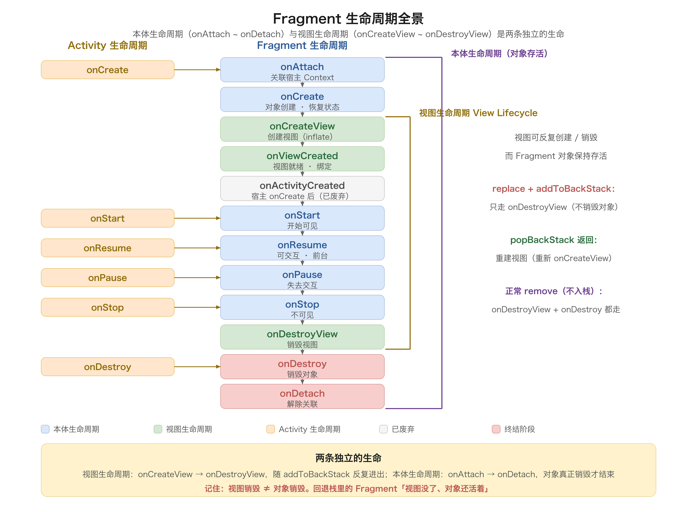
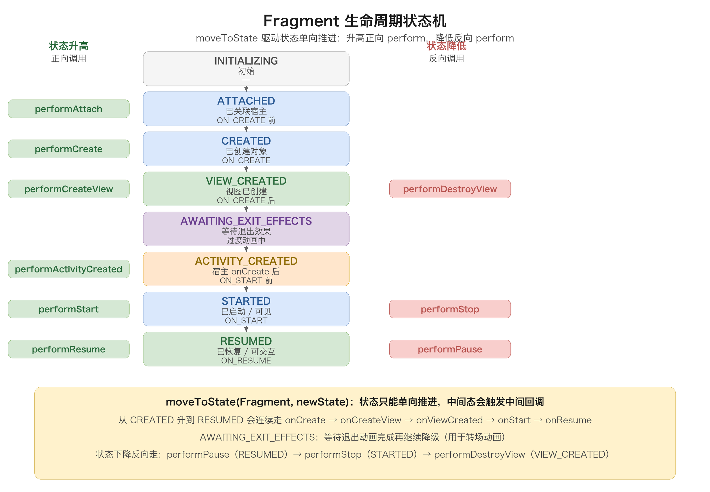
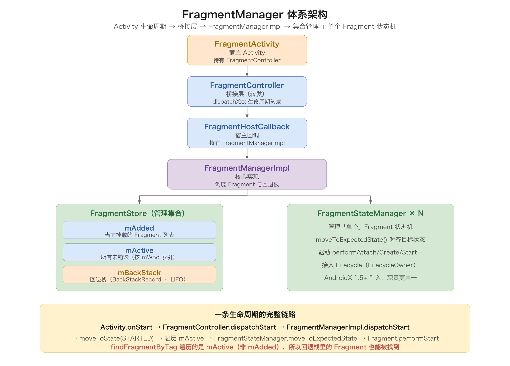
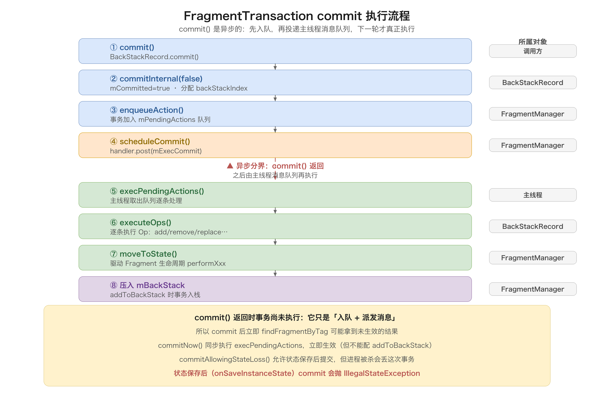
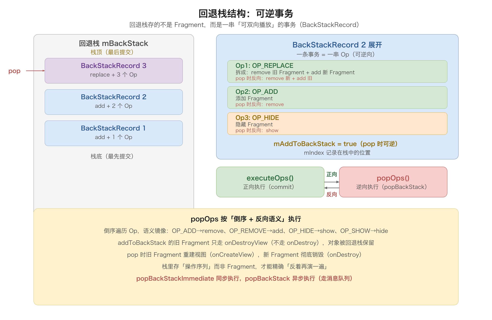

# 20. Fragment 总览与源码分析

> `Fragment` 是 Android 里「把 UI 和逻辑切成可复用模块」的核心组件：它寄生在 `Activity` 里，有自己独立的生命周期、视图和回退栈，但最终一切管理权都握在 `FragmentManager` 手里。这篇先讲概念（Fragment 是什么、为什么、和 Activity 什么关系），再系统梳理它的生命周期与使用方式，最后钻进源码，把 `FragmentManager` 体系、`FragmentTransaction` 的执行链路、回退栈（BackStack）、状态保存恢复、以及它和 `Activity` 之间那条「生命周期分发」的暗线彻底讲透。读完你会有一个判断：Fragment 的「乱」其实不是 Fragment 本身乱，而是它的生命周期、事务、状态恢复三者交织在一起，需要一张全局图才能看清。

## 目录

- [一、Fragment 概述](#一fragment-概述)
  - [1. 什么是 Fragment](#1-什么是-fragment)
  - [2. 为什么需要 Fragment](#2-为什么需要-fragment)
  - [3. Fragment 与 Activity 的关系](#3-fragment-与-activity-的关系)
  - [4. 版本演进：android.app 与 androidx](#4-版本演进androidapp-与-androidx)
- [二、Fragment 生命周期](#二fragment-生命周期)
  - [1. 生命周期方法全景](#1-生命周期方法全景)
  - [2. 与 Activity 生命周期的联动](#2-与-activity-生命周期的联动)
  - [3. 视图生命周期 View Lifecycle](#3-视图生命周期-view-lifecycle)
  - [4. 生命周期状态机](#4-生命周期状态机)
- [三、Fragment 的使用方式](#三fragment-的使用方式)
  - [1. 静态添加](#1-静态添加)
  - [2. 动态添加 FragmentTransaction](#2-动态添加-fragmenttransaction)
  - [3. 回退栈 addToBackStack](#3-回退栈-addtobackstack)
  - [4. 完整代码示例](#4-完整代码示例)
- [四、FragmentManager 体系源码分析](#四fragmentmanager-体系源码分析)
  - [1. 体系架构](#1-体系架构)
  - [2. 关键数据结构](#2-关键数据结构)
  - [3. 生命周期分发链路](#3-生命周期分发链路)
  - [4. FragmentStateManager](#4-fragmentstatemanager)
- [五、FragmentTransaction 源码分析](#五fragmenttransaction-源码分析)
  - [1. 事务与 Op](#1-事务与-op)
  - [2. commit 执行流程](#2-commit-执行流程)
  - [3. commit 三兄弟的区别](#3-commit-三兄弟的区别)
  - [4. 状态丢失问题](#4-状态丢失问题)
  - [5. setMaxLifecycle：精确控制生命周期](#5-setmaxlifecycle精确控制生命周期)
- [六、回退栈源码分析](#六回退栈源码分析)
  - [1. BackStackRecord 结构](#1-backstackrecord-结构)
  - [2. addToBackStack 原理](#2-addtobackstack-原理)
  - [3. popBackStack 流程](#3-popbackstack-流程)
- [七、Fragment 的状态保存与恢复](#七fragment-的状态保存与恢复)
  - [1. onSaveInstanceState](#1-onsaveinstancestate)
  - [2. FragmentState 保存](#2-fragmentstate-保存)
  - [3. 恢复流程](#3-恢复流程)
- [八、Fragment 通信](#八fragment-通信)
  - [1. Fragment 与 Activity 通信](#1-fragment-与-activity-通信)
  - [2. Fragment 之间通信 FragmentResult](#2-fragment-之间通信-fragmentresult)
  - [3. Fragment 间通信方案总览](#3-fragment-间通信方案总览)
  - [4. setArguments 传参](#4-setarguments-传参)
- [九、常见坑与易错点](#九常见坑与易错点)
- [十、Fragment 的现代化](#十fragment-的现代化)
  - [1. FragmentContainerView](#1-fragmentcontainerview)
  - [2. FragmentFactory 与依赖注入](#2-fragmentfactory-与依赖注入)
  - [3. 与 Navigation 组件](#3-与-navigation-组件)
- [十一、DialogFragment 与 ViewPager](#十一dialogfragment-与-viewpager)
  - [1. DialogFragment](#1-dialogfragment)
  - [2. ViewPager 与 Adapter](#2-viewpager-与-adapter)
  - [3. 懒加载的演进](#3-懒加载的演进)
- [十二、Fragment 与架构组件](#十二fragment-与架构组件)
  - [1. Fragment 与 ViewModel](#1-fragment-与-viewmodel)
  - [2. Fragment 的两个 LifecycleOwner](#2-fragment-的两个-lifecycleowner)
  - [3. LiveData 观察的正确姿势](#3-livedata-观察的正确姿势)
- [十三、Fragment 过渡动画与多重回退栈](#十三fragment-过渡动画与多重回退栈)
  - [1. 转场动画（Transition）](#1-转场动画transition)
  - [2. 共享元素过渡（Shared Element）](#2-共享元素过渡shared-element)
  - [3. 多重回退栈（Multiple Back Stack）](#3-多重回退栈multiple-back-stack)
- [附：高频速记](#附高频速记)

---

## 一、Fragment 概述

### 1. 什么是 Fragment

`Fragment` 是 Android 3.0（Honeycomb，2011）引入的一种**可复用的 UI 片段**。官方定义：一个 Fragment 代表 `Activity` 中的一段行为或一部分用户界面。一个 Activity 可以同时组合多个 Fragment，一个 Fragment 也可以被多个 Activity 复用。

它有几个核心特点：

- **寄生性**：Fragment 不能独立存在，必须挂靠在一个宿主 `Activity`（或 `FragmentActivity`）里，它有自己的布局、生命周期，但「活」在 Activity 的上下文里；
- **模块化**：把「一块界面 + 对应的逻辑」封装成独立单元，方便组合与复用；
- **独立生命周期**：Fragment 有自己的生命周期回调，和 Activity 的生命周期**部分对齐、部分独立**；
- **独立回退栈**：Fragment 可以被压入一个独立于 Activity 任务栈的返回栈，实现「返回上一屏」而不销毁整个 Activity；
- **运行时增删**：可以在运行时动态添加、替换、移除 Fragment，而不用重启 Activity。

一句话：**Fragment 是「Activity 里的子页面」**——它让一个 Activity 承载多块可独立管理、可自由组合、可压栈返回的界面。

### 2. 为什么需要 Fragment

在手机屏幕「一屏一界面」的年代，Fragment 的价值不明显；但当大屏、平板、折叠屏出现后，同一个界面经常要同时展示「列表 + 详情」两块内容，Fragment 的价值就凸显出来了：

1. **适配大屏**：手机上「列表页 → 详情页」是两屏跳转，平板上可以是「左列表右详情」一屏两块。用 Fragment 可以同一套逻辑，在不同尺寸下灵活布局，不必写两套 Activity；
2. **模块复用**：一个「评论列表」「播放器控制条」「表单」可以做成 Fragment，在多个 Activity 里复用；
3. **局部导航**：配合回退栈，Fragment 能做「页内导航」，返回只弹回上一块，不销毁宿主 Activity，减少重建开销；
4. **与 ViewPager 配合**：滑动页签（Tab）每一页就是一个 Fragment，这是早期最主流的用法；
5. **动态 UI**：运行时根据屏幕尺寸、方向、配置，动态组合不同的 Fragment 拼成界面。

### 3. Fragment 与 Activity 的关系

这是理解 Fragment 的第一性原理：**Fragment 是「客人」，Activity 是「宿主」，FragmentManager 是「管家」**。

| 维度 | Activity | Fragment |
| --- | --- | --- |
| 独立存在 | 能独立存在于系统，有窗口 | 不能独立，必须挂在 Activity 下 |
| 生命周期 | 由系统（AMS）驱动 | 由宿主 Activity + FragmentManager 驱动 |
| 上下文 | 自身就是 `Context` | 自身不是 `Context`，靠 `requireContext()` 拿宿主 |
| 回退栈 | 系统任务栈（Task） | FragmentManager 维护的 BackStack |
| 视图 | 一个 Window + 根 View | 一块可嵌入 Activity 视图树的 View |
| 通信 | 系统 Binder（跨进程） | 进程内直接引用 + FragmentResult |

它们之间的桥梁是 **`FragmentController` / `FragmentHostCallback`**（AndroidX 里的桥接层）：Activity 的每一次生命周期回调，都会先交给这个桥，再由桥转发给 `FragmentManager`，最后逐个分发给里面的 Fragment。这个「生命周期分发暗线」会在第四章源码里详细展开。

一个 Activity 内部维护着一个 **`FragmentManager`**，它管理着「当前 Activity 里的所有 Fragment + 一个回退栈」。Activity 的生命周期和 Fragment 的生命周期，就是通过这个 Manager 串起来的。

### 4. 版本演进：android.app 与 androidx

Fragment 有两套实现，历史上踩过不少坑，务必分清：

| 维度 | `android.app.Fragment`（平台版） | `androidx.fragment.app.Fragment`（AndroidX） |
| --- | --- | --- |
| 归属 | 系统 Framework 内置 | Jetpack 库，随 app 打包 |
| 更新 | 随系统版本更新，几乎停更 | 独立发版，持续迭代新特性 |
| 依赖 | 无 | `androidx.fragment:fragment` |
| 宿主 | `Activity` | `FragmentActivity` |
| 状态 | 已废弃（API 28 标记 deprecated） | 官方推荐，主流 |

平台版 `android.app.Fragment` 自 API 28 起被标记废弃，官方明确要求迁移到 AndroidX。**今天写代码一律用 `androidx.fragment.app.Fragment` + `FragmentActivity`（或 `AppCompatActivity`，它继承了 `FragmentActivity`）**。本文的源码分析也基于 AndroidX 的 `androidx.fragment` 实现。

AndroidX 的 Fragment 演进里，几个关键版本要记住：

- **Fragment 1.1.0**：引入 `FragmentContainerView`（官方推荐的 Fragment 容器，替代 `<fragment>` 标签和 FrameLayout）；
- **Fragment 1.2.0**：引入 `FragmentFactory` 与 `FragmentResult` API（替代已废弃的 `onActivityResult` 和 `setTargetFragment`）；
- **Fragment 1.3.0**：`onActivityCreated` 被废弃，改用 `onViewCreated` + Lifecycle；
- **Fragment 1.5.0**：开始逐步收紧「未使用 `FragmentContainerView`」的行为。

## 二、Fragment 生命周期

### 1. 生命周期方法全景

Fragment 的生命周期方法，按「从生到死」的完整顺序如下：

```
onAttach → onCreate → onCreateView → onViewCreated → onActivityCreated（已废弃）
→ onStart → onResume → onPause → onStop → onDestroyView → onDestroy → onDetach
```

一张图看清全貌（含与 Activity 生命周期的对应关系）：



逐个方法说清楚「它在做什么、应该做什么」：

| 回调 | 时机 | 典型用途 |
| --- | --- | --- |
| `onAttach(context)` | Fragment 首次关联宿主 | 拿到宿主引用，校验宿主是否实现某接口 |
| `onCreate(saved)` | Fragment 创建（可能还没视图） | 初始化非视图状态、恢复保存的状态 |
| `onCreateView()` | 首次创建 Fragment 视图 | inflate 布局，返回根 View |
| `onViewCreated()` | 视图创建完成后 | 绑定视图、findViewById、设置监听 |
| `onActivityCreated()` | 宿主 `onCreate` 之后（**已废弃**） | 历史遗留，现改用 onViewCreated |
| `onStart()` | Fragment 可见前 | 开始需要可见性的工作 |
| `onResume()` | Fragment 可交互 | 开始动画、相机、位置更新等前台工作 |
| `onPause()` | 失去交互 | 暂停动画、释放相机等前台资源 |
| `onStop()` | 不可见 | 停止耗时操作 |
| `onDestroyView()` | 视图被销毁（Fragment 本身还活着） | 清理视图引用，**防止 View 内存泄漏** |
| `onDestroy()` | Fragment 销毁 | 释放 Fragment 资源 |
| `onDetach()` | 与宿主解除关联 | 最后的清理，断开宿主引用 |

> **关键区分**：`onDestroyView` 和 `onDestroy` 是两个容易混淆的阶段。**视图（View）和 Fragment 本体是两条独立的生命**：当 Fragment 被 `replace` 或回退栈弹出时，可能只销毁视图（`onDestroyView`）而 Fragment 对象还活着（`onDestroy` 还没执行）；只有当 Fragment 被真正移除时，才会走到 `onDestroy`。所以「在 onDestroyView 里把 View 引用置空」是防止内存泄漏的关键动作。

下面把几个「容易踩坑」的方法再展开讲透：

**`onAttach(context)`**：Fragment 首次和宿主建立联系。注意 Android 26 之前它的参数是 `Activity`，之后统一改成了 `Context`（因为 Fragment 宿主可以是 `Context` 而不一定是 Activity）。这是 Fragment 生命周期里**第一个能拿到上下文**的方法，所以「校验宿主是否实现某接口」要在这里做（`context as? OnItemClick`），而不是在构造器里做。

**`onCreate(savedInstanceState)`**：Fragment 对象被创建，但**视图还没创建**。此时可以做「不依赖 View」的初始化：恢复保存的状态（`savedInstanceState`）、取 `arguments`、初始化 ViewModel 等。注意此时 `findViewById` 会拿到空，因为视图还不存在。

**`onCreateView` 与 `onViewCreated`**：`onCreateView` 负责 inflate 并返回根 View；`onViewCreated` 在「视图创建完成」后调用，这时才能安全地 findViewById、绑定监听。这里有个 `attachToRoot` 参数要理解——`inflater.inflate(layout, container, false)` 里的 `false` 表示「先别挂到父容器，由系统稍后处理」，传 `true` 会导致重复挂载报错。

**`onActivityCreated`（已废弃）**：历史上它在「宿主 Activity 的 onCreate 完成后」调用，开发者习惯在这里做「依赖宿主状态」的初始化。但因为它语义含糊（视图已创建、宿主 onCreate 也完了，但 Activity 还没到 STARTED），Fragment 1.3.0 起被废弃，官方建议用 `onViewCreated` + `Lifecycle` 替代。

**`onStart/onResume` 与可见性**：`onStart` 时 Fragment「开始可见」（但可能还在后台/被遮挡），`onResume` 时「真正可交互」。需要「前台资源」（相机、定位、动画）的工作放 `onResume`，`onPause` 时释放——这也是 Fragment 里相机、动画这些资源的正确挂载/释放时机。

**`onDestroyView` 的关键性**：这是 Fragment 最容易「内存泄漏」的环节。视图销毁后，如果 Fragment 还持有 `View`、`RecyclerView`、`TextView` 等视图引用，这些视图和它们关联的 Activity 就无法被 GC。所以**务必在 `onDestroyView` 里把所有 View 引用置 null**。同时，因为 `onCreateView` 可能被反复调用（回退栈弹出会重建视图），「视图的初始化」放 `onViewCreated` 而不是 `onCreate`，保证每次视图重建都能正确执行。

**懒加载（Lazy Load）**：Fragment 有个历史悠久的「懒加载」需求——「页面真正可见时才加载数据」。旧方案用 `setUserVisibleHint(boolean)`（配合 ViewPager），但这个方法在 Fragment 1.2.0 后被废弃；现代方案改用 `FragmentTransaction.setMaxLifecycle(fragment, Lifecycle.State.RESUMED)` 控制 Fragment 的生命周期上限，从而精确控制「何时开始加载」。这个演进体现了 Fragment 生命周期管理从「手动 hint」到「Lifecycle 统一建模」的转变。

### 2. 与 Activity 生命周期的联动

Fragment 寄生在 Activity 里，它的生命周期严格「跟随」宿主，但每个阶段都比宿主「晚一步开始、早一步结束」：

| Activity 生命周期 | 触发的 Fragment 生命周期 |
| --- | --- |
| `onCreate` | `onAttach → onCreate → onCreateView → onViewCreated` |
| `onStart` | `onStart` |
| `onResume` | `onResume` |
| `onPause` | `onPause` |
| `onStop` | `onStop` |
| `onDestroy` | `onDestroyView → onDestroy → onDetach` |

这里有个经典面试题：**Fragment 的 `onCreate` 和 Activity 的 `onCreate` 谁先执行？** 答案是 **Activity 先**。宿主 Activity 的 `onCreate` 先跑，跑到 `super.onCreate()` 时，`FragmentController` 才会分发 `onCreate` 给 Fragment，所以 Fragment 的 `onCreate` 一定晚于 Activity 的 `onCreate`。同理，Fragment 的 `onAttach` 也是 Activity `onCreate` 里 `attachHost` 之后才发生的。

### 3. 视图生命周期 View Lifecycle

Fragment 相比 Activity 多出来的、也是最容易出错的，是「**视图生命周期**」——`onCreateView` 到 `onDestroyView` 之间这段：

```
[Fragment 本体] onAttach ─ onCreate ──┬──────────────────────────────┬── onDestroy ─ onDetach
                                       │                              │
[视图 View]            onCreateView ─ onViewCreated ── ... ── onDestroyView
```

这段「视图生命周期」的存在意味着：**一个 Fragment 对象的视图可以被反复地创建和销毁，而 Fragment 对象本身保持存活**。典型场景：

- `addToBackStack` 的 Fragment 被 `replace` 后，走 `onDestroyView` 但不走 `onDestroy`，视图销毁、对象保留；
- 从回退栈 `popBackStack` 返回时，同一个 Fragment 对象会重新走 `onCreateView`，视图重建。

这带来两个直接的工程结论：

1. **View 引用要在 `onDestroyView` 里置空**，否则视图销毁后 Fragment 还持有旧 View 引用 → 内存泄漏；
2. **依赖 View 的初始化放 `onViewCreated`，不要放 `onCreate`**——`onCreate` 时视图还不存在，此时 findViewById 会拿到空。

### 4. 生命周期状态机

Fragment 内部有一个状态机，AndroidX 版本里 Fragment 的生命周期状态（`Fragment.State`）从低到高是：

```
INITIALIZING → ATTACHED → CREATED → VIEW_CREATED → AWAITING_EXIT_EFFECTS → ACTIVITY_CREATED → STARTED → RESUMED
```



`FragmentManager` 里有一个核心方法 **`moveToState(Fragment, newState)`**，它负责把一个 Fragment 从当前状态「推」到目标状态——状态升高时正向调用对应的生命周期回调（`performCreate`、`performStart` 等），状态降低时反向调用（`performStop`、`performDestroyView` 等）。所有 Fragment 的生命周期，本质上都是 `moveToState` 在状态机上的单向爬升或下降。

把「状态」和「此时能安全做什么」对应起来，是写对 Fragment 的实用索引：

| 状态 | 对应回调 | 此时能安全做的事 |
| --- | --- | --- |
| `CREATED` | `onCreate` 后 | 取 `arguments`、初始化 ViewModel、恢复状态 |
| `VIEW_CREATED` | `onViewCreated` 后 | `findViewById`、绑定监听、访问 `viewLifecycleOwner` |
| `STARTED` | `onStart` 后 | View 已可见（但可能被遮挡），可开始可见性工作 |
| `RESUMED` | `onResume` 后 | 可交互，开始相机/动画/定位等前台工作 |
| 回退到 `CREATED` | `onStop` 后 | View 不可见，应停掉耗时操作 |
| 回退到 `VIEW_CREATED` 前 | `onDestroyView` 后 | View 已销毁，**必须清空 View 引用** |

这张表的价值在于：**「一个操作该放在哪个回调」不是背出来的，而是由「它依赖的状态」决定的**。依赖 View 的操作放 `onViewCreated`，依赖「可见」的操作放 `onStart`，依赖「可交互」的操作放 `onResume`，释放资源的操作放在「状态回退」的对称回调里。抓住这条原则，就能在任意生命周期方法之间做出正确取舍。

## 三、Fragment 的使用方式

### 1. 静态添加

在 Activity 布局 XML 里直接写 `<fragment>` 标签（或 AndroidX 推荐的 `FragmentContainerView`）：

```xml
<!-- 旧式 <fragment> 标签 -->
<fragment
    android:id="@+id/header"
    android:name="com.example.MyFragment"
    android:layout_width="match_parent"
    android:layout_height="wrap_content" />

<!-- 推荐：FragmentContainerView -->
<androidx.fragment.app.FragmentContainerView
    android:id="@+id/fragment_container"
    android:name="com.example.MyFragment"
    android:layout_width="match_parent"
    android:layout_height="match_parent" />
```

静态添加的 Fragment 在 Activity 创建时就被系统实例化，**不能动态移除或替换**（它的生命周期完全跟随宿主 Activity）。这种方式适合「固定不变」的区块，比如页头、固定的侧边栏。

### 2. 动态添加 FragmentTransaction

运行时增删 Fragment，靠 `FragmentManager` 开启一个 **`FragmentTransaction`**：

```kotlin
supportFragmentManager.beginTransaction()
    .replace(R.id.fragment_container, MyFragment())
    .commit()
```

`FragmentTransaction` 提供的方法分三类：

| 类别 | 方法 | 作用 |
| --- | --- | --- |
| 添加/移除 | `add(containerId, fragment, tag)` | 往容器里加一个 Fragment |
| | `remove(fragment)` | 移除一个 Fragment（视图+对象都销毁） |
| | `replace(containerId, fragment)` | 等价于 remove 容器里旧的 + add 新的 |
| | `detach(fragment)` | 只摘掉视图（onDestroyView），对象保留 |
| | `attach(fragment)` | 重新挂上视图（onCreateView 重建） |
| 显隐 | `show(fragment)` / `hide(fragment)` | 切换可见性（不销毁视图，只切 View 的 visibility） |
| 回退栈 | `addToBackStack(name)` | 把本次事务压入回退栈 |
| 提交 | `commit()` / `commitNow()` / `commitAllowingStateLoss()` | 提交事务 |

几个操作的本质区别（高频易错点）：

| 操作 | onDestroyView | onDestroy | 视图 | 对象 |
| --- | --- | --- | --- | --- |
| `hide` | 否 | 否 | 仅 `View.GONE`，还在 | 存活 |
| `detach` | 是 | 否 | 销毁 | 存活 |
| `remove` | 是 | 是 | 销毁 | 销毁 |
| `replace` | 是（旧的） | 是（旧的） | 旧的销毁 | 旧的销毁 |

> `replace` 是 `remove` 旧 + `add` 新的「糖」，所以 `replace` 会把容器里旧 Fragment 彻底销毁（除非旧 Fragment 在回退栈里）。`hide/show` 则是「软切换」，代价最小，但要注意容器里的多个 Fragment 会同时存在、重叠布局。

### 3. 回退栈 addToBackStack

事务默认「不压栈」，即 commit 后按下返回键会直接退出 Activity。想让「返回键」回退到上一个 Fragment 状态，需要在 commit 前调用 `addToBackStack`：

```kotlin
supportFragmentManager.beginTransaction()
    .replace(R.id.fragment_container, DetailFragment())
    .addToBackStack("detail")   // 压入回退栈，返回键可回退
    .commit()
```

加了 `addToBackStack` 后，`replace` 里被移除的旧 Fragment 只会走 `onDestroyView` 而**不销毁对象**（对象被回退栈持有），返回时能「原样复活」。

### 4. 完整代码示例

一个「列表 → 详情」的双 Fragment 切换，带回退栈：

```kotlin
class MainActivity : AppCompatActivity() {
    override fun onCreate(savedInstanceState: Bundle?) {
        super.onCreate(savedInstanceState)
        setContentView(R.layout.activity_main)

        if (savedInstanceState == null) {
            // 首次进入才 add，避免旋转屏幕后重复 add 造成重叠
            supportFragmentManager.beginTransaction()
                .add(R.id.fragment_container, ListFragment())
                .commit()
        }
    }

    fun showDetail(id: String) {
        supportFragmentManager.beginTransaction()
            .replace(R.id.fragment_container, DetailFragment.newInstance(id))
            .addToBackStack("detail")
            .commit()
    }
}
```

> **注意**：示例里用 `if (savedInstanceState == null)` 包裹首次 add。因为 `FragmentManager` 会在 Activity 重建时自动恢复已存在的 Fragment，如果每次都无条件 `add`，旋转屏幕后就会出现「Fragment 重叠」——这是最常见的 Fragment bug 之一。

## 四、FragmentManager 体系源码分析

### 1. 体系架构

Fragment 的一切管理都发生在 `FragmentManager` 体系里。AndroidX 中这套体系由四层组成：



| 类 | 角色 |
| --- | --- |
| `FragmentActivity` | 宿主 Activity，持有 `FragmentController` |
| `FragmentController` | 桥接层，把 Activity 生命周期转给 `FragmentHostCallback` |
| `FragmentHostCallback` | 宿主回调，真正持有 `FragmentManagerImpl`，实现 `onGetFragmentManager` |
| `FragmentManagerImpl` | 具体实现，管理所有 Fragment 与回退栈 |
| `FragmentStateManager` | 管理**单个** Fragment 的状态（AndroidX 1.5+ 引入） |

关键源码链路（简化）：

```java
// FragmentActivity 里
final FragmentController mFragments = FragmentController.createController(new HostCallbacks());

class HostCallbacks extends FragmentHostCallback<FragmentActivity> {
    // 关键：把宿主 Activity 自己交给 FragmentHostCallback
    public HostCallbacks() {
        super(FragmentActivity.this);
    }
}
```

`FragmentController` 和 `FragmentHostCallback` 的职责分工：

```java
// FragmentController 只是一个转发器
public class FragmentController {
    private final FragmentHostCallback<?> mHost;

    public void dispatchCreate() {
        mHost.mFragmentManager.dispatchCreate();
    }
    // ... 其余 dispatchXxx 都是转发
}

// FragmentHostCallback 持有真正的 manager
public abstract class FragmentHostCallback<E> extends FragmentContainer {
    final FragmentManagerImpl mFragmentManager = new FragmentManagerImpl();

    // 子类必须返回宿主
    FragmentManagerImpl getFragmentManager() { return mFragmentManager; }
}
```

### 2. 关键数据结构

`FragmentManagerImpl` 里维护着管理 Fragment 的核心数据结构（AndroidX 新版本收敛到 `FragmentStore`）：

```java
class FragmentStore {
    // 所有「已添加」的 Fragment（有序），事务和回退栈都靠它
    ArrayList<Fragment> mAdded = new ArrayList<>();

    // 所有「活跃」的 Fragment，key 是 who（fragment 的唯一标识）
    HashMap<String, FragmentStateManager> mActive = new HashMap<>();

    // 回退栈：一串 BackStackRecord
    ArrayList<BackStackRecord> mBackStack = new ArrayList<>();
}
```

| 数据结构 | 含义 | 关键点 |
| --- | --- | --- |
| `mAdded` | 当前 Activity 里**实际展示/挂载**的 Fragment 列表 | 决定 UI 上的 Fragment 顺序 |
| `mActive` | 所有**还活着**（含仅保留状态）的 Fragment | 被 remove 但还在回退栈的 Fragment 也在这 |
| `mBackStack` | 回退栈，一串 `BackStackRecord` | 按提交顺序排列 |

> **mAdded 和 mActive 的区别**（经典面试题）：`mAdded` 只包含「当前被 add 到容器、正在参与布局」的 Fragment；`mActive` 则包含「所有还没有被完全销毁」的 Fragment。一个 Fragment 被 `remove` 且 `addToBackStack` 后，它会从 `mAdded` 移除，但**仍留在 `mActive`**（因为对象还活着、状态被保留），等回退栈弹出时才从 `mActive` 彻底清除。

#### Fragment 的创建与实例化

Fragment 对象是怎么「凭空出现」的？两个入口：

1. **代码里手动 new**：`MyFragment()`，这是最常见的方式；
2. **系统恢复时反射/Factory 创建**：进程重建、静态 `<fragment>` inflate、回退栈恢复时，系统需要根据「类名」重新实例化 Fragment。

第二种入口的关键源码是 `Fragment.instantiate`：

```java
public static Fragment instantiate(Context context, String fname, Bundle args) {
    try {
        // 通过 FragmentFactory（或反射）创建
        Class<?> clazz = FragmentFactory.loadFragmentClass(context.getClassLoader(), fname);
        Fragment f = (Fragment) clazz.getConstructor().newInstance();   // 无参构造器！
        if (args != null) {
            args.setClassLoader(f.getClass().getClassLoader());
            f.setArguments(args);
        }
        return f;
    } catch (Exception e) {
        throw new InstantiationException("Unable to instantiate fragment " + fname, e);
    }
}
```

看到 `getConstructor().newInstance()` 就明白了：**恢复时用的是无参构造器**。这直接推出三条铁律：

1. **Fragment 必须有 public 无参构造器**（否则 `newInstance()` 抛异常）；
2. **不要用带参构造器传参**（进程重建后参数丢失，因为恢复不走你的构造器）；
3. **传参一律用 `setArguments`**（arguments 会被序列化进 `FragmentState`，恢复时通过 `instantiate` 回填）。

`FragmentFactory` 则是这个反射入口的「可替换插槽」：你可以在 `FragmentManager` 上设置自定义 Factory，把「类名 → Fragment 实例」的映射接管过来，实现构造器依赖注入（详见第十章）。

#### findFragment 查找机制

`FragmentManager` 提供三种查找方式，对应三个索引：

```java
Fragment findFragmentById(int id);      // 按容器 view id 查
Fragment findFragmentByTag(String tag); // 按 tag 查
Fragment findFragmentByWho(String who); // 按唯一 who 查（内部用）
```

查找时遍历的是 **`mActive`**（不是 `mAdded`）——也就是说，一个「被 remove 但还在回退栈」的 Fragment，虽然不在界面上，但依然能通过 `findFragmentByTag` 找到。这正是「回退栈里的 Fragment 对象还活着」的直接体现。

`findFragmentByTag` 的源码实现（印证遍历 mActive）：

```java
Fragment findFragmentByTag(String tag) {
    // 先从「当前挂载的」里找，找不到再遍历 mActive
    for (Fragment f : mFragmentStore.getActiveFragments()) {
        if (f != null && tag.equals(f.mTag)) {
            return f;
        }
    }
    return null;
}
```

`getActiveFragments()` 返回的就是 `mActive.values()`。所以无论是「正在展示」还是「被回退栈保留」的 Fragment，只要对象还没销毁，都能被 `findFragmentByTag` / `findFragmentById` 命中。而 `who` 是 Fragment 内部生成的全局唯一字符串（形如 `android:fragment:0:...`），一般只在内部使用，开发者很少直接操作。

> **易错点**：`findFragmentById(R.id.container)` 查的是「**容器 View 的 id**」，不是 Fragment 自身的 id。当一个容器里 `replace` 了多个 Fragment 时，`findFragmentById(容器id)` 返回的是「当前挂在容器里、且在最上面的那一个」；要精确拿到某个，用 `findFragmentByTag` 配合 tag 更可靠。

### 3. 生命周期分发链路

Activity 生命周期如何「传导」到 Fragment，是 Fragment 机制的核心暗线。以 `onCreate` 为例的完整链路：

```
FragmentActivity.onCreate
    → FragmentController.dispatchCreate()
        → FragmentHostCallback.mFragmentManager.dispatchCreate()
            → FragmentManagerImpl.dispatchCreate()
                → moveToState(Fragment.CREATED)
                    → FragmentStateManager.create()
                        → Fragment.performCreate()
```

Activity 与 Fragment 生命周期回调的对应分发关系：

| Activity 回调 | FragmentManager 分发 | Fragment 收到的回调 |
| --- | --- | --- |
| `onCreate` | `dispatchCreate` | `onAttach → onCreate` |
| `onStart` | `dispatchStart` | `onStart` |
| `onResume` | `dispatchResume` | `onResume` |
| `onPause` | `dispatchPause` | `onPause` |
| `onStop` | `dispatchStop` | `onStop` |
| `onDestroy` | `dispatchDestroy` | `onDestroyView → onDestroy → onDetach` |

核心方法 `moveToState` 的简化逻辑：

```java
void moveToState(Fragment f, int newState) {
    // 状态只能单向推进：升高时按顺序 perform 生命周期
    if (newState > f.mState) {
        switch (newState) {
            case CREATED:      f.performCreate(); ...
            case VIEW_CREATED: f.performCreateView(); ...
            case STARTED:      f.performStart(); ...
            case RESUMED:      f.performResume(); ...
        }
    } else {
        // 降低时反向执行
        switch (newState) {
            case STARTED:      f.performPause(); ...
            case CREATED:      f.performStop(); ...
            case VIEW_CREATED: f.performDestroyView(); ...
        }
    }
    f.mState = newState;
}
```

上面的 `moveToState` 是「极简示意版」，真实源码远比这复杂。真实的 `FragmentManager` 状态推进有三个关键机制，是理解 Fragment 生命周期精妙之处的核心：

**机制一：目标状态是「算」出来的，不是 Activity 直接给的。**

Activity 回调传进来的是一个「目标状态」（如 `STARTED`），但每个 Fragment 实际的 `mState` 可能不同——回退栈里的 Fragment、被 `setMaxLifecycle` 限制的 Fragment、正在退出动画的 Fragment，各自的目标状态都不一样。所以 FragmentManager 会先算每个 Fragment 的「期望状态」，再逐一向它爬升/下降：

```java
// FragmentManager 里维护的「当前宿主状态」
int mCurState = Fragment.INITIALIZING;

// dispatch 系列方法做的事：更新 mCurState，然后对所有 active Fragment 对齐状态
void dispatchStart() {
    mCurState = Fragment.STARTED;
    moveToState(mCurState, true);   // 让所有 Fragment 对齐到 STARTED
}

// moveToState 会遍历所有 active Fragment，逐个「算期望状态 + 推进」
void moveToState(int newState, boolean always) {
    for (FragmentStateManager fsm : mFragmentStore.getActiveFragmentStateManagers()) {
        moveFragmentToExpectedState(fsm);   // 逐个对齐
    }
}

// 计算单个 Fragment 的期望状态
void moveFragmentToExpectedState(FragmentStateManager fsm) {
    Fragment f = fsm.getFragment();
    int nextState = mCurState;                       // 初始 = 宿主状态
    if (f.mMaxState != Lifecycle.State.RESUMED) {    // setMaxLifecycle 的限制
        nextState = Math.min(nextState, f.mMaxState.ordinal());
    }
    if (f.isHidden() && f.mView != null && ...) {    // 隐藏的 Fragment 降级
        nextState = Math.min(nextState, Fragment.STARTED);
    }
    fsm.moveToExpectedState(nextState);              // 最终推进
}
```

这段逻辑解释了三个「玄学」现象：

1. **为什么被 `setMaxLifecycle(STARTED)` 的 Fragment 不会 `onResume`**——它的期望状态被 `mMaxState` 钳制在 `STARTED`，宿主即使到了 `RESUMED`，它也停在 `STARTED`；
2. **为什么 `hide` 的 Fragment 会停在 `STARTED`**——`isHidden()` 会让期望状态降级，所以隐藏 Fragment 走不到 `RESUMED`；
3. **为什么回退栈里的 Fragment 不会乱跳生命周期**——它虽然「活着」但不在「当前展示」的路径上，期望状态被单独计算，通常停在 `CREATED`（视图已销毁）。

**机制二：状态推进是「逐级」的，中间态会触发中间回调。**

从 `CREATED` 升到 `RESUMED`，中间会依次经过 `VIEW_CREATED → ACTIVITY_CREATED → STARTED`，每一步都调用对应的 `performXxx`。所以「一个 Fragment 从无到 RESUMED」会一次性触发 `onCreate → onCreateView → onViewCreated → onStart → onResume` 一连串回调——这是同一轮消息里「连续」发生的，中间不会被其他代码打断。

**机制三：dispatch 方法不只一个，Activity 的每个阶段都有对应的 dispatch。**

完整的分发映射（含已废弃的 `dispatchActivityCreated`）：

```java
// FragmentActivity 的每个生命周期，都对应一次 dispatch
onCreate       → mFragments.dispatchCreate()          // → dispatchCreate → moveToState(CREATED)
onStart        → mFragments.dispatchStart()           // → dispatchStart  → moveToState(STARTED)
onResume       → mFragments.dispatchResume()          // → dispatchResume → moveToState(RESUMED)
onPause        → mFragments.dispatchPause()           // → dispatchPause  → moveToState(STARTED)
onStop         → mFragments.dispatchStop()            // → dispatchStop   → moveToState(CREATED)
onDestroy      → mFragments.dispatchDestroy()         // → dispatchDestroy→ moveToState(INITIALIZING)
```

> **易错点**：`onPause` 对应的是 `dispatchPause`，它把状态「降到 `STARTED`」，触发 Fragment 的 `onPause`；而 `onStop` 才是 `dispatchStop`、降到 `CREATED`、触发 `onStop`。很多开发者误以为「Activity onStop → Fragment onPause + onStop」，其实 `onPause` 是在 Activity `onPause` 阶段就同步触发了，`onStop` 才对应 `onStop`。这条「阶段对齐」关系一定要记牢。

### 4. FragmentStateManager

AndroidX 1.5.0 起，单个 Fragment 的生命周期管理被抽到 **`FragmentStateManager`** 里，`FragmentManagerImpl` 只管「集合和调度」，`FragmentStateManager` 管「单个 Fragment 的状态机」。

`FragmentStateManager` 持有：

- 一个 `Fragment` 实例；
- 一个 `FragmentLifecycleCallbacksDispatcher`（生命周期观察者分发器）；
- 一个 `mFragmentStateManager` 状态。

它的核心方法 `moveToExpectedState()` 会把当前 Fragment「对齐」到 FragmentManager 的目标状态，内部再调 `Fragment` 的 `performXxx` 方法。这个重构让 Fragment 的生命周期正式接入了 `Lifecycle` 体系——Fragment 现在是一个 `LifecycleOwner`，能用 `LifecycleObserver` 观察它的状态。

`moveToExpectedState` 的简化逻辑：

```java
void moveToExpectedState() {
    int nextState = mFragment.mMaxState;   // 期望状态（已被 manager 算好）

    // 状态升高：逐级向上 perform
    if (nextState > mFragment.mState) {
        switch (mFragment.mState) {
            case INITIALIZING:     mFragment.performAttach();   // fallthrough
            case ATTACHED:         mFragment.performCreate();   // fallthrough
            case CREATED:          mFragment.performCreateView();
            case VIEW_CREATED:     mFragment.performViewCreated();
            case ACTIVITY_CREATED: /* 已废弃的 onActivityCreated 相关 */
            case STARTED:          mFragment.performStart();
            // 最终 performResume
        }
    }
    // 状态下降：逐级向下 perform
    else if (nextState < mFragment.mState) {
        switch (mFragment.mState) {
            case RESUMED:          mFragment.performPause();     // fallthrough
            case STARTED:          mFragment.performStop();
            case VIEW_CREATED:     mFragment.performDestroyView();
            // 最终 performDestroy / performDetach
        }
    }
    mFragment.mState = nextState;
}
```

注意 `switch` 里的 **fallthrough（贯穿）**：从低状态升到高状态时，`case INITIALIZING` 执行完 `performAttach` 后**不 break**，继续往下执行 `performCreate`、`performCreateView`……一路「贯穿」到目标状态。这正是「Fragment 从无到 RESUMED 一次性连续走完所有回调」的源码依据。

`performXxx` 系列的另一个职责是**通知 Lifecycle 观察者**：

```java
// Fragment.performStart 简化
void performStart() {
    mState = STARTED;
    mOnStartListeners...;
    mLifecycleRegistry.handleLifecycleEvent(ON_START);   // 驱动 Lifecycle 状态机
}
```

所以 `Fragment` 里 `Lifecycle` 状态的推进（`ON_CREATE → ON_START → ON_RESUME`）和生命周期方法（`onCreate → onStart → onResume`）是「同源」的——都来自 `moveToExpectedState` 的推进。这也是为什么在 Fragment 上用 `lifecycleScope` 或 `LiveData.observe(viewLifecycleOwner)` 能精确地「在 onStart 启动、onStop 取消」。

## 五、FragmentTransaction 源码分析

### 1. 事务与 Op

`FragmentTransaction` 是一个抽象类，它的实现是内部类 **`BackStackRecord`**。你对 `add/replace/remove/hide/show` 的每一次调用，并不会立即执行，而是**先记录成一个 Op**：

```java
// BackStackRecord 内部
static final class Op {
    int mCmd;              // 命令类型：OP_ADD / OP_REPLACE / OP_REMOVE 等
    Fragment mFragment;    // 操作对象
    int mEnterAnim, mExitAnim, mPopEnterAnim, mPopExitAnim;
    int mContainerId;      // 容器 id
}

final class BackStackRecord extends FragmentTransaction {
    ArrayList<Op> mOps = new ArrayList<>();   // 一个事务 = 一串 Op
    boolean mAddToBackStack;                  // 是否压栈
    String mName;                             // 回退栈名字

    public FragmentTransaction add(...) {
        doAddOp(containerViewId, fragment, tag, OP_ADD);
        return this;
    }
    public FragmentTransaction remove(Fragment f) {
        addOp(new Op(OP_REMOVE, f));
        return this;
    }
    // ... replace 会拆成 remove 旧 + add 新
}
```

所以「一次 commit」本质是：**把一串 Op 打包成一条 `BackStackRecord`，交给 FragmentManager 调度执行**。

`doAddOp` 的源码印证了这一点：

```java
private void doAddOp(int containerViewId, Fragment fragment, String tag, int opcmd) {
    fragment.mFragmentManager = mManager;
    fragment.mTag = tag;
    fragment.mContainerId = containerViewId;
    addOp(new Op(opcmd, fragment));
}
```

注意 `replace` 的实现——它并不是一个独立的 `OP_REPLACE`，而是**拆解成「remove 容器里旧的 + add 新的」**：

```java
public FragmentTransaction replace(int containerViewId, Fragment fragment, String tag) {
    if (containerViewId == 0) throw new IllegalArgumentException("Must use non-zero containerViewId");
    doAddOp(containerViewId, fragment, tag, OP_REPLACE);   // 记录 OP_REPLACE
    return this;
}
```

真正执行时（`execPendingActions`），`OP_REPLACE` 会被展开：

```java
case OP_REPLACE: {
    Fragment f = op.mFragment;
    int containerId = f.mContainerId;
    // 先移除容器里所有旧的 Fragment
    for (Fragment old : mFragmentStore.getActiveFragments()) {
        if (old.mContainerId == containerId) {
            if (old == f) continue;
            // 旧的走 remove（是否彻底销毁取决于是否在回退栈）
            mFragmentStore.removeFragment(old);
        }
    }
    // 再 add 新的
    mFragmentStore.addFragment(f);
    break;
}
```

这段源码是理解 `replace` 行为的关键：**`replace` 会无条件移除容器里的所有旧 Fragment**。如果旧 Fragment 没有 `addToBackStack`，它会被彻底销毁（`onDestroy`）；如果有，它只销毁视图（`onDestroyView`）并留在 `mActive`。所以「replace + addToBackStack」是「页内导航」的标准组合，而「replace 不带 addToBackStack」则会真正销毁旧页面。

### 2. commit 执行流程

`commit()` 的完整执行链路：



关键源码链路：

```java
// 1. commit 只是把事务入队，并不立即执行
public int commit() {
    return commitInternal(false);
}

int commitInternal(boolean allowStateLoss) {
    if (mCommitted) throw new IllegalStateException("commit already called");
    mCommitted = true;
    if (mAddToBackStack) {
        mIndex = mManager.allocBackStackIndex();   // 分配回退栈下标
    }
    mManager.enqueueAction(this, allowStateLoss);  // 入队
    return mIndex;
}

// 2. enqueueAction 把事务投递到主线程队列
void enqueueAction(OpGenerator action, boolean allowStateLoss) {
    synchronized (mPendingActions) {
        mPendingActions.add(action);        // 加入待执行队列
        scheduleCommit();                    // 派发一个「执行」消息
    }
}

void scheduleCommit() {
    synchronized (mPendingActions) {
        boolean pendingReady = ...;
        if (pendingReady) {
            mHost.getHandler().removeCallbacks(mExecCommit);
            mHost.getHandler().post(mExecCommit);  // 主线程异步执行
        }
    }
}

// 3. 主线程真正执行事务
void execPendingActions() {
    while (generateOpsForPendingActions(...)) {
        mExecutingActions = true;
        // 逐条执行 Op
        for (Op op : record.mOps) {
            switch (op.mCmd) {
                case OP_ADD:    mFragmentStore.addFragment(op.mFragment); break;
                case OP_REMOVE: mFragmentStore.removeFragment(op.mFragment); break;
                case OP_HIDE:   setVisible(op.mFragment, false); break;
                // ...
            }
            moveToState(op.mFragment, mCurState);  // 驱动生命周期
        }
        // 如果压栈，把这条 record 加入 mBackStack
        if (record.mAddToBackStack) {
            mFragmentStore.addBackStackState(record);
        }
        mExecutingActions = false;
    }
}
```

> **核心结论：`commit()` 是异步的**。它不会立刻改变 Fragment 状态，而是把事务投递到主线程消息队列，等当前消息执行完、下一轮再真正执行 Op。所以 commit 之后马上 `findFragmentByTag` 或读 Fragment 状态，很可能拿到的是「未生效」的结果。

### 3. commit 三兄弟的区别

| 方法 | 同步/异步 | 能否在状态保存后调用 | 说明 |
| --- | --- | --- | --- |
| `commit()` | 异步 | 否（状态保存后调用会抛异常） | 最常用，安全 |
| `commitAllowingStateLoss()` | 异步 | 是 | 状态保存后仍可提交，但**状态丢失风险** |
| `commitNow()` | 同步 | 否 | 立即执行，**不能 addToBackStack** |

`commitNow()` 的源码会立即执行 `execPendingActions`，同步完成事务；代价是不能和 `addToBackStack` 一起用（回退栈的语义是「可延迟、可逆」，和「立即执行」矛盾），会直接抛异常。所以需要「立即拿到结果」且「不需要回退」时用 `commitNow`，需要回退栈时只能用异步的 `commit`。

### 4. 状态丢失问题

`commit()` 会抛一个经典异常：

```
java.lang.IllegalStateException: Can not perform this action after onSaveInstanceState
```

原因：Android 的 Activity 在 `onSaveInstanceState` 之后，系统可能随时销毁进程，此时提交的 Fragment 事务「来不及保存」，进程恢复后状态会不一致。所以 `FragmentManager` 会在状态保存后拒绝新的 `commit`。

**为什么 `onSaveInstanceState` 之前可以、之后不行？** 因为 Fragment 的回退栈和状态要和 Activity 的 `savedInstanceState` 一起序列化保存。如果在保存之后又改了事务，保存的内容就「过期」了，恢复时对不上，于是直接禁止。

解法有三：

1. **尽早 commit**，不要在异步回调（如网络返回）里提交——这是最推荐的做法；
2. 确实需要在异步里提交，用 `commitAllowingStateLoss()`，但要接受「进程被杀后这次事务丢失」的后果；
3. 把异步提交改成「先保存结果，等 Activity 恢复到 RESUMED 再提交」。

### 5. setMaxLifecycle：精确控制生命周期

`FragmentTransaction` 上还有一个「低调但关键」的方法 `setMaxLifecycle(Fragment, Lifecycle.State)`，它给某个 Fragment 设置「生命周期上限」，是懒加载和 ViewPager2 的核心机制：

```kotlin
supportFragmentManager.beginTransaction()
    .add(R.id.container, tab2Fragment)
    .setMaxLifecycle(tab2Fragment, Lifecycle.State.STARTED)   // 限制到 STARTED
    .commit()
```

它的作用：**让被限制的 Fragment 的 `mMaxState` 停在指定状态**。如上面的例子，即使宿主 Activity 到了 `RESUMED`，`tab2Fragment` 也只会走到 `STARTED`，永远进不了 `onResume`。

`setMaxLifecycle` 的源码极简——它只做一件事，就是给 Fragment 设上限：

```java
public FragmentTransaction setMaxLifecycle(Fragment fragment, Lifecycle.State state) {
    addOp(new Op(OP_SET_MAX_LIFECYCLE, fragment, state));
    return this;
}

// 执行时
case OP_SET_MAX_LIFECYCLE: {
    op.mFragment.setMaxLifecycle(op.mCurrentMaxState);   // 写入 mMaxState
    break;
}
```

而 `mMaxState` 会在 `moveFragmentToExpectedState` 里「钳制」期望状态（见第四章状态计算逻辑）：

```java
if (f.mMaxState != Lifecycle.State.RESUMED) {
    nextState = Math.min(nextState, f.mMaxState.ordinal());   // 状态被钳制
}
```

这个机制在工程上有两个典型用途：

| 用途 | 做法 | 效果 |
| --- | --- | --- |
| **懒加载** | 离屏 Fragment 设 `STARTED`，滑到可见时再设 `RESUMED` | 可见才 `onResume`，实现精确懒加载 |
| **ViewPager2 内部** | `FragmentStateAdapter` 自动给非当前页设 `STARTED` | 用户无感地获得懒加载能力 |

> **和 `hide/show` 的区别**：`hide/show` 只切换 `View` 的可见性（`VISIBLE/GONE`），**不改变生命周期**；`setMaxLifecycle` 则真正改变生命周期状态（`STARTED` 与 `RESUMED` 之间切换）。前者是「UI 层」的显隐，后者是「生命周期层」的升降——理解这一点，就不会把两者混为一谈。

---

## 六、回退栈源码分析

### 1. BackStackRecord 结构

回退栈（BackStack）是 Fragment 最精巧的设计之一：它让「一组 Fragment 操作」可以被整体地**撤销**。回退栈里存的是**事务（BackStackRecord）**，而不是单个 Fragment——这是理解回退栈的第一个关键点。

```java
// 回退栈本质是「一串可逆的事务」
ArrayList<BackStackRecord> mBackStack = new ArrayList<>();
```

每一条 `BackStackRecord` 除了正向执行外，还记录了自己「怎么撤销」。它通过 `Op` 的双向语义实现可逆：

| 正向 Op | 撤销时的逆向动作 |
| --- | --- |
| `OP_ADD` | 反向执行 = remove 该 Fragment |
| `OP_REMOVE` | 反向执行 = 重新 add 该 Fragment |
| `OP_HIDE` | 反向执行 = show |
| `OP_SHOW` | 反向执行 = hide |
| `OP_ATTACH` | 反向执行 = detach |
| `OP_DETACH` | 反向执行 = attach |

`BackStackRecord` 有两个核心执行方法：

- **`executeOps()`**：正向执行（commit 时走这条路）；
- **`popOps()`**：逆向执行（popBackStack 时走这条路）。

两者都遍历 `mOps`，只是「正向还是逆向」以及「动画正反」不同。

`executeOps` 与 `popOps` 的核心源码（关键在「反向」）：

```java
// 正向执行：按 Op 顺序正向走
void executeOps() {
    for (Op op : mOps) {
        switch (op.mCmd) {
            case OP_ADD:    mManager.addFragment(op.mFragment, false); break;
            case OP_REMOVE: mManager.removeFragment(op.mFragment);     break;
            case OP_HIDE:   mManager.hideFragment(op.mFragment);       break;
            case OP_SHOW:   mManager.showFragment(op.mFragment);       break;
            // ...
        }
    }
}

// 逆向执行：按 Op **倒序** + **反向语义** 走
void popOps() {
    for (int i = mOps.size() - 1; i >= 0; i--) {   // 倒序遍历！
        Op op = mOps.get(i);
        switch (op.mCmd) {
            case OP_ADD:    mManager.removeFragment(op.mFragment);     // add 变 remove
            case OP_REMOVE: mManager.addFragment(op.mFragment, false); // remove 变 add
            case OP_HIDE:   mManager.showFragment(op.mFragment);       // hide 变 show
            case OP_SHOW:   mManager.hideFragment(op.mFragment);       // show 变 hide
            // ...
        }
    }
}
```

这里有两个「精巧」之处：

1. **倒序遍历**：正向是「先 add A 再 replace B」，逆向必须「先撤销 B 再撤销 A」，所以 `popOps` 用 `for (i = size-1; i >= 0; i--)` 倒序执行——这是栈（LIFO）语义的必然要求；
2. **语义反转**：`OP_ADD` 的逆向是 `removeFragment`，`OP_HIDE` 的逆向是 `showFragment`……每个 Op 都有一个「镜像动作」。所以回退栈的本质是「**一串可双向播放的操作序列**」，`executeOps` 正放、`popOps` 倒放。

这也解释了为什么回退栈里存的是「事务」而不是「Fragment」：只有把「操作序列」存下来，才能精确地「反着再演一遍」，让界面回到事务发生前的样子。

### 2. addToBackStack 原理

`addToBackStack(name)` 只做了一件事：给这条 `BackStackRecord` 打上 `mAddToBackStack = true` 的标记（并记录名字）。

真正的「入栈」发生在事务执行完成时（`execPendingActions` 里）：

```java
// 事务执行完毕后
if (record.mAddToBackStack) {
    mFragmentStore.addBackStackState(record);   // 真正压入 mBackStack
}
```

`addToBackStack` 对 Fragment 生命周期的直接影响：**被 replace/remove 的旧 Fragment，不会走 `onDestroy`，只走 `onDestroyView`**。因为旧 Fragment 的「状态」还被回退栈里的这条事务「引用」着，FragmentManager 要保留它的对象，以便 pop 时原样恢复。



### 3. popBackStack 流程

按返回键（或手动调用 `popBackStack`）时，回退流程：

```java
// FragmentManager.popBackStack 的几种重载
popBackStack();                                  // 弹最上面一条
popBackStack(String name, int flags);            // 弹到指定名字
popBackStackImmediate(...);                      // 同步弹栈
```

pop 的核心是取出栈顶（或指定位置的）`BackStackRecord`，然后**逆向执行它的 Op**：

```java
void popBackStackState(...) {
    BackStackRecord record = mBackStack.remove(...);   // 1. 出栈
    record.popOps();                                    // 2. 逆向执行 Op
    // 3. 把 Fragment 状态回退到事务发生前
}
```

> **回退栈 + View 生命周期**（高频考点）：pop 一个「当时是 `replace` + `addToBackStack`」的事务时，被替换掉的旧 Fragment 会重新走 `onCreateView → onViewCreated`（视图重建），而「替换进去的那个」Fragment 会走 `onDestroyView → onDestroy → onDetach`（彻底销毁）。整个过程中，旧 Fragment 对象始终是「同一个实例」，它的成员变量（非视图部分）都还在。

`popBackStack` 的 flags 参数控制「弹到哪」：

| 调用 | 行为 |
| --- | --- |
| `popBackStack()` | 弹最上面一条事务 |
| `popBackStack(name, 0)` | 弹到名为 name 的事务**之上**（不含 name 本身） |
| `popBackStack(name, POP_BACK_STACK_INCLUSIVE)` | 弹到 name 事务，**包含** name 本身一起弹出 |

`POP_BACK_STACK_INCLUSIVE` 是容易被忽略的细节：不加它，`name` 对应的那条事务会「留在栈里」，视觉上会多停留一屏。典型场景是「回到首页」：把首页事务命名后，用 `POP_BACK_STACK_INCLUSIVE` 一次弹到首页，清空中间的栈。

## 七、Fragment 的状态保存与恢复

### 1. onSaveInstanceState

Fragment 有自己的 `onSaveInstanceState`，它和 Activity 的保存时机**同步**：当宿主 Activity 走到 `onSaveInstanceState` 时，会触发 `FragmentManager.dispatchSaveInstanceState`，逐个调用每个 Fragment 的 `onSaveInstanceState`。

保存的内容分两部分：

1. **Fragment 自己保存的业务状态**：你在 `onSaveInstanceState` 里手动 `put` 进去的键值对（存进 `mSavedFragmentState`）；
2. **FragmentManager 保存的「框架状态」**：每个 Fragment 的 `mWho`（唯一 id）、`mTag`、容器 id、是否隐藏、是否在回退栈等元信息，序列化成 `FragmentState`。

### 2. FragmentState 保存

系统保存时，`FragmentManager` 会把所有「活跃 Fragment」的元信息 + 状态，序列化成一串 `FragmentState` 存进 Activity 的 `savedInstanceState`：

```java
// 保存时（简化）
Parcelable saveAllState() {
    // 1. 逐个 Fragment 保存状态，生成 FragmentState 列表
    ArrayList<FragmentState> active = new ArrayList<>();
    for (Fragment f : mFragmentStore.getActiveFragments()) {
        FragmentState fs = new FragmentState(f);
        f.performSaveInstanceState(fs.mSavedFragmentState);
        active.add(fs);
    }
    // 2. 保存回退栈（一串 BackStackRecordState）
    int[] backStackIndexes = ...;
    // 3. 打包成 FragmentManagerState
    FragmentManagerState fms = new FragmentManagerState(active, backStackIndexes, ...);
    return fms;
}
```

`FragmentState` 序列化了 Fragment 的「全部框架元信息」，字段大致有：

| 字段 | 含义 |
| --- | --- |
| `mClassName` | Fragment 类名（恢复时反射用） |
| `mWho` | Fragment 的唯一标识 |
| `mTag` | 设置的 tag |
| `mContainerId` | 所在容器 view id |
| `mArguments` | setArguments 传的参数 |
| `mHidden` | 是否被 hide |
| `mFragmentId` | Fragment id |
| `mSavedFragmentState` | `onSaveInstanceState` 里保存的业务状态 |

看到 `mArguments` 和 `mSavedFragmentState` 都在保存列表里，就再次印证了前面的结论：**`arguments` 是「能跨进程重建」的传参方式，而构造器参数不能**。

### 3. 恢复流程

进程被杀后重启，Activity 的 `onCreate` 里会拿到之前保存的 `FragmentManagerState`，交给 `FragmentManager` 恢复：

```
FragmentManager.restoreSaveState(state)
    → 解析 FragmentState，逐个 new 出 Fragment（通过反射/Factory）
    → 把 mSavedFragmentState 回填给 Fragment（onCreate 的 savedInstanceState 参数）
    → 恢复回退栈结构
```

关键点：

- **恢复靠反射/Factory 实例化**：默认用 `Fragment.getInstantiationException` 反射创建，这也是为什么 **Fragment 必须有「无参构造器」**——否则恢复时会抛异常；
- **`onCreate(savedInstanceState)` 里的 `savedInstanceState` 就是恢复回来的状态**，Fragment 在这里做状态回填；
- **回退栈也会原样恢复**：进程重启后，之前的回退栈还在，用户还能继续「返回」。

恢复的核心源码（`restoreSaveState` 简化）：

```java
void restoreSaveState(FragmentManagerState state) {
    // 1. 逐个 FragmentState 重建 Fragment
    for (FragmentState fs : state.mActive) {
        Fragment f = fs.instantiate(mHost, mParent, ...);   // 反射/Factory 创建
        mFragmentStore.makeActive(f);                        // 重新挂进 mActive
    }
    // 2. 恢复回退栈（一串 BackStackRecordState）
    for (BackStackState bs : state.mBackStack) {
        BackStackRecord record = bs.instantiate(this);       // 重建事务
        mFragmentStore.addBackStackState(record);            // 重新压回 mBackStack
    }
    // 3. 恢复「当前展示状态」：谁在最上面、谁被 hide 等
    restoreAddedState(...);
}
```

这里有一个「时序」上的关键点：恢复发生在 Activity 的 `onCreate` 里、**早于** Fragment 正常走到 `onCreate` 之前。也就是说，进程重启后，Fragment 的「对象」先被 `instantiate` 出来（此时 Fragment 的 `onCreate` 还没执行），然后当 `FragmentManager.dispatchCreate` 推进状态时，Fragment 才依次走 `onAttach → onCreate`，而 `onCreate` 的 `savedInstanceState` 参数里就带着之前保存的状态。

这解释了为什么「恢复」和「正常创建」走的是**同一条生命周期路径**：恢复不是「跳过生命周期直接还原」，而是「先重建对象、再正常走一遍生命周期，只是在 onCreate 时把旧状态塞回去」。这也是为什么「无参构造器 + setArguments + onSaveInstanceState」这套约定能统一覆盖「正常创建」和「进程恢复」两种场景。

## 八、Fragment 通信

### 1. Fragment 与 Activity 通信

Fragment 拿宿主 Activity：

```kotlin
val activity = requireActivity()   // 拿不到会抛异常（推荐）
val ctx = requireContext()          // 拿不到会抛异常
val activity = activity             // 可能为 null（旧写法，已不推荐）
```

Activity 拿 Fragment：

```kotlin
val frag = supportFragmentManager.findFragmentById(R.id.container)
val frag = supportFragmentManager.findFragmentByTag("detail")
```

Fragment 回调 Activity 的经典模式是「接口回调」：

```kotlin
class ListFragment : Fragment() {
    interface OnItemClick { fun onItemClick(id: String) }
    override fun onAttach(context: Context) {
        super.onAttach(context)
        // 校验宿主是否实现了接口（onAttach 里做，因为此时上下文可用）
        listener = context as? OnItemClick
            ?: throw ClassCastException("宿主必须实现 OnItemClick")
    }
}
```

### 2. Fragment 之间通信 FragmentResult

旧版的 `setTargetFragment` + `onActivityResult` 已废弃，官方现在推荐 **`FragmentResult` API**（Fragment 1.2.0+）。它本质是一个「按 key 分发的消息总线」，解耦了发送方和接收方：

```kotlin
// 接收方（详情页）：注册监听
setFragmentResultListener("requestKey") { requestKey, bundle ->
    val data = bundle.getString("data")
}

// 发送方（列表页）：发结果
setFragmentResult("requestKey", bundleOf("data" to "hello"))
```

也可以用 `parentFragmentManager.setFragmentResultListener` 在「父级」做中转，实现两个兄弟 Fragment 之间通信。

`FragmentResult` 的底层实现值得一探：它本质是 FragmentManager 内部维护的一张「key → 监听器集合」的映射表，加上「结果会跨重建保存」的机制：

```java
// FragmentManager 内部（FragmentResultOwner 的实现）
final HashMap<String, Bundle> mResults = new HashMap<>();          // 已到达的结果
final HashMap<String, LifecycleAwareResultListener> mResultListeners = new HashMap<>();

void setFragmentResult(String requestKey, Bundle result) {
    // 1. 先看有没有已经注册的监听器，有就直接分发
    LifecycleAwareResultListener listener = mResultListeners.get(requestKey);
    if (listener != null) {
        listener.onFragmentResult(requestKey, result);
        return;
    }
    // 2. 没有监听器，就把结果先存起来（等监听器注册时再补发）
    mResults.put(requestKey, result);
}

void setFragmentResultListener(String requestKey, LifecycleOwner owner, FragmentResultListener listener) {
    // 3. 注册时，如果已有「迟到」的结果，立即补发
    if (mResults.containsKey(requestKey)) {
        listener.onFragmentResult(requestKey, mResults.get(requestKey));
        mResults.remove(requestKey);
    }
    // 4. 否则挂到监听器表，等 setFragmentResult 来触发
    mResultListeners.put(requestKey, new LifecycleAwareResultListener(owner, listener));
}
```

这段源码揭示了 FragmentResult 的三个精妙设计：

1. **「先发后收」也不会丢**：发送方 `setFragmentResult` 时如果接收方还没注册（比如接收方 Fragment 还没创建），结果会先存进 `mResults`，等接收方注册时**补发**——这是它比「接口回调」健壮的地方；
2. **生命周期感知**：监听器被 `LifecycleAwareResultListener` 包裹，绑定 `LifecycleOwner`，当 owner 销毁时监听器自动移除，避免「结果发给已销毁 Fragment」导致的泄漏；
3. **跨重建存活**：`mResults` 会被序列化保存进 `FragmentManagerState`，所以「屏幕旋转」后结果依然能送达。

### 3. Fragment 间通信方案总览

搞清了几种通信机制，用一张表做个「选型速查」（高频面试题）：

| 方案 | 适用场景 | 是否解耦 | 是否跨重建 |
| --- | --- | --- | --- |
| `setArguments` | 父 → 子的一次性传参 | 否（强耦合构造方） | 是 |
| 接口回调（onAttach 拿宿主） | Fragment → Activity 的事件上报 | 否（依赖宿主接口） | 否 |
| `FragmentResult` | Fragment → Fragment 的一次性结果回传 | 是 | 是 |
| `activityViewModels()` | 多个 Fragment 共享**持续状态** | 是 | 是 |
| `findFragmentByTag` + 直接调用 | 有明确引用时的直接调用 | 否（强耦合） | 否 |

> 选型口诀：**「一次性结果」用 FragmentResult，「持续共享状态」用 activityViewModels，「父传子参数」用 setArguments**。三者覆盖了绝大多数 Fragment 通信场景，旧的 `setTargetFragment` + `onActivityResult` 已被前两者取代，不要再用。

### 4. setArguments 传参

Fragment 传参的唯一推荐方式是 `setArguments`（构造器传参在「进程重建」时会丢，因为恢复靠无参构造器）：

```kotlin
class DetailFragment : Fragment() {
    companion object {
        fun newInstance(id: String): DetailFragment {
            val f = DetailFragment()
            f.arguments = bundleOf("id" to id)   // 参数进 arguments
            return f
        }
    }
    override fun onCreate(savedInstanceState: Bundle?) {
        super.onCreate(savedInstanceState)
        val id = arguments?.getString("id")      // onCreate 里取参数
    }
}
```

> **为什么不能用带参构造器传参？** 进程被杀后，Fragment 恢复靠「无参构造器 + 反射」重新实例化，构造器里的参数会丢失；而 `arguments` 会被序列化保存进 `FragmentState`，恢复时原样回来。所以「无参构造器 + setArguments」是唯一安全可靠的传参方式。

## 九、常见坑与易错点

把 Fragment 开发中最容易踩的坑集中列一下，每一条都是真实事故高发区：

| 坑 | 现象 | 根因与解法 |
| --- | --- | --- |
| **Fragment 重叠** | 旋转屏幕后界面重影/叠叠乐 | 未判断 `savedInstanceState == null` 就重复 add。解法：首次 add 前判空 |
| **getActivity 空指针** | `getActivity()` 返回 null 崩溃 | Fragment 已 detach 后仍访问宿主。解法：用 `requireActivity()` 尽早暴露，或判空 |
| **Not attached 异常** | `Fragment ... not attached to a context` | 异步回调里用了需要 context 的操作，回调时 Fragment 已 detach。解法：回调里判 `isAdded` |
| **状态丢失** | `Can not perform this action after onSaveInstanceState` | 状态保存后 commit。解法：尽早提交 / commitAllowingStateLoss / 等 RESUMED |
| **View 内存泄漏** | 视图销毁后仍被持有 | onDestroyView 里没把 View 引用置空 |
| **onActivityCreated 已废弃** | 用了报 warning | Fragment 1.3.0 起废弃，改用 onViewCreated |
| **构造器传参丢失** | 进程重建后参数没了 | 用带参构造器传参。解法：无参构造器 + setArguments |
| **commitNow 加回退栈崩溃** | `commitNow is not supported with addToBackStack` | commitNow 是同步执行，与回退栈矛盾 |
| **`<fragment>` 标签残留** | 布局替换异常 | 官方推荐改用 FragmentContainerView |
| **detach/remove 分不清** | 生命周期错乱 | detach 只毁视图、remove 毁对象（见三章对比表） |

其中「**状态丢失**」和「**Fragment 重叠**」是面试和线上事故的重灾区，务必吃透第五章和第三章的对应分析。

## 十、Fragment 的现代化

### 1. FragmentContainerView

`FragmentContainerView`（Fragment 1.1.0+）是官方推荐的 Fragment 容器，取代 `<fragment>` 标签和手写 FrameLayout：

```xml
<androidx.fragment.app.FragmentContainerView
    android:id="@+id/nav_host"
    android:name="androidx.navigation.fragment.NavHostFragment"
    android:layout_width="match_parent"
    android:layout_height="match_parent" />
```

它相比旧方案的改进：正确支持 `Fragment` 的 `z-index` 顺序、动画、以及 `Fragment` 进出时的 `Visibility` 处理，还能配合 Navigation 组件作为 `NavHostFragment` 的宿主。

### 2. FragmentFactory 与依赖注入

进程恢复时，系统默认用反射实例化 Fragment，这导致「需要构造器注入依赖」的 Fragment 无法恢复。`FragmentFactory` 解决了这个问题：

```kotlin
class MyFragmentFactory(private val repo: Repository) : FragmentFactory() {
    override fun instantiate(classLoader: ClassLoader, className: String): Fragment {
        return when (className) {
            DetailFragment::class.java.name -> DetailFragment(repo)  // 注入依赖
            else -> super.instantiate(classLoader, className)
        }
    }
}

// 在宿主里设置
supportFragmentManager.fragmentFactory = MyFragmentFactory(repo)
```

这样即使进程重建，Fragment 也能通过 Factory 拿到依赖，是 Fragment + DI 框架（Hilt/Dagger）协作的基础。

### 3. 与 Navigation 组件

Navigation 组件把「Fragment 跳转 + 回退栈 + 传参 + 转场动画」抽象成「导航图（Navigation Graph）」，底层仍然是 Fragment 和 FragmentTransaction，只是把繁琐的手写事务收敛成了声明式配置：

```kotlin
findNavController().navigate(R.id.action_list_to_detail, bundleOf("id" to id))
```

理解本文的 FragmentManager / 回退栈 / 状态保存原理后，再看 Navigation 就会发现它「并没有魔法」——它只是在 Fragment 之上封了一层更友好的导航模型，`NavController` 内部依然在操作 `FragmentManager` 和 `BackStackRecord`。

## 十一、DialogFragment 与 ViewPager

### 1. DialogFragment

`DialogFragment` 是 Fragment 的一个特殊子类，专门用来「以对话框形式展示 Fragment」。它的价值在于**把 Dialog 也纳入 Fragment 的生命周期和状态管理体系**：

- 普通 `AlertDialog` 在「屏幕旋转」时会丢失（需要自己保存状态），而 `DialogFragment` 的状态由 `FragmentManager` 管理，旋转后自动恢复；
- `DialogFragment` 既能 `show()` 成对话框，也能 `add()` 成一个普通的 Fragment 视图，两种形态可切换。

```kotlin
class MyDialogFragment : DialogFragment() {
    override fun onCreateDialog(savedInstanceState: Bundle?): Dialog {
        return AlertDialog.Builder(requireContext())
            .setTitle("提示")
            .setMessage("确定要删除吗？")
            .setPositiveButton("确定") { _, _ -> }
            .setNegativeButton("取消", null)
            .create()
    }
}

// 展示
MyDialogFragment().show(supportFragmentManager, "my_dialog")
```

`DialogFragment` 有两个回调：`onCreateDialog`（返回一个 Dialog 对象）和 `onCreateView`（返回普通视图）。二选一：实现 `onCreateDialog` 就是对话框形态，实现 `onCreateView` 就是普通视图形态。`show()` 内部本质是 `FragmentTransaction.add` + `commit`，所以它同样受「状态丢失」约束，异步回调里 `show` 也可能抛异常。

### 2. ViewPager 与 Adapter

Fragment 最经典的搭档是 `ViewPager`。两个 Adapter 的区别（高频考点）：

| 维度 | `FragmentPagerAdapter` | `FragmentStatePagerAdapter` |
| --- | --- | --- |
| 销毁策略 | 离屏页只 `detach`（毁视图、留对象） | 离屏页 `remove`（对象也销毁） |
| 内存占用 | 所有页对象常驻内存 | 只保留相邻几页，省内存 |
| 适用场景 | 页数少且固定（如 3~5 个 Tab） | 页数多、动态（如新闻流、图集） |
| 状态保存 | 不保存 | 用 `FragmentState` 保存并恢复 |

> 选择口诀：**页数少且固定用 `FragmentPagerAdapter`，页数多或内容动态用 `FragmentStatePagerAdapter`**。后者在页数很多时能显著省内存，代价是「滑远的页再回来」需要重建（走完整的 onCreateView）。

### 3. 懒加载的演进

Fragment 的懒加载经历了三代演进，反映了 Fragment 生命周期管理思想的变迁：

1. **第一代 `setUserVisibleHint`**：ViewPager 时代的手动方案，Fragment 里重写 `setUserVisibleHint(isVisible)`，在「真正可见」时加载。问题是它和 Fragment 生命周期脱节，时机不可靠，且 Fragment 1.2.0 后废弃；

2. **第二代 `FragmentTransaction.setMaxLifecycle`**：Fragment 1.1.0 引入，通过给离屏 Fragment 设置「生命周期上限」（如 `STARTED`），让它在「滑到可见」时才升到 `RESUMED`，从而在 `onResume` 里触发加载。这是官方推荐的手动方案；

3. **第三代 `ViewPager2` + `FragmentStateAdapter`**：`ViewPager2` 基于 `RecyclerView` 实现，配合 `FragmentStateAdapter`，天然支持「可见性驱动」的懒加载，且内部已用 `setMaxLifecycle` 管理，开发者几乎不用再手动处理。

这个演进的核心是：**懒加载从「手动 hint」逐步收敛到「Lifecycle 统一建模」**——用生命周期状态（而不是布尔标志）来表达「可见性」，让加载时机变得可预测、可观察。

## 十二、Fragment 与架构组件

Fragment 之所以能「长青」，一个重要原因是它和 Jetpack 架构组件（ViewModel、Lifecycle、LiveData）深度整合。理解它们的交互，是把 Fragment 用得「稳」的关键。

### 1. Fragment 与 ViewModel

`ViewModel` 的设计初衷就是「在配置变更（旋转屏幕）后仍存活」。而 Fragment 在旋转后「对象销毁、靠恢复重建」，两者天然互补：**把数据放进 ViewModel，旋转后数据不丢**。

```kotlin
class DetailFragment : Fragment() {
    // by viewModels() 委托：拿到「和这个 Fragment 绑定的」ViewModel
    private val vm: DetailViewModel by viewModels()

    override fun onViewCreated(view: View, savedInstanceState: Bundle?) {
        vm.data.observe(viewLifecycleOwner) { data ->
            // 更新 UI
        }
    }
}
```

这里有几个「作用域」概念必须分清（高频考点）：

| 作用域 | 获取方式 | ViewModel 存活范围 | 用途 |
| --- | --- | --- | --- |
| Fragment 自身 | `by viewModels()` | 跟随 Fragment（onDestroy 时清除） | 只属于这个 Fragment 的数据 |
| Activity 级别 | `by activityViewModels()` | 跟随 Activity | Fragment 之间**共享**数据 |
| 手动指定 | `ViewModelProvider(owner).get(...)` | 跟随指定 owner | 自定义作用域 |

**`by viewModels()` vs `by activityViewModels()` 是 Fragment 间共享数据的关键**：多个 Fragment 各自 `activityViewModels()` 拿到的是**同一个 ViewModel 实例**（挂在 Activity 上），因此一个 Fragment 改数据，另一个 Fragment 能观察到。这就是「Fragment 间通信」的另一种优雅方案（相比 FragmentResult，ViewModel 更适合「共享状态」而非「一次性结果」）。

底层原理：`Fragment` 实现了 `ViewModelStoreOwner`，它内部持有一个 `ViewModelStore`。当 Fragment 被销毁（非配置变更）时，`FragmentStateManager` 会调用 `mViewModelStore.clear()` 清空 ViewModel；而配置变更时 ViewModelStore 会被保留，所以 ViewModel 数据不丢。

### 2. Fragment 的两个 LifecycleOwner

这是最容易「内存泄漏」和「崩溃」的点：**一个 Fragment 有两个 LifecycleOwner**。

| LifecycleOwner | 含义 | 存活范围 |
| --- | --- | --- |
| `this`（Fragment 自己） | Fragment 本体的生命周期 | onAttach ~ onDetach |
| `viewLifecycleOwner` | **视图**的生命周期 | onCreateView ~ onDestroyView |

两者差异巨大：当 Fragment 被 `replace` 且 `addToBackStack` 时，视图销毁（`onDestroyView`）但 Fragment 本体还活着。此时：

- 如果你用 `observe(this)` 观察 LiveData，观察者是挂在 **Fragment 本体**上的——视图销毁了观察还「活着」，下次 `onCreateView` 又加一个观察者，**观察者会越积越多，导致重复更新甚至内存泄漏**；
- 如果你用 `observe(viewLifecycleOwner)`，观察者挂在**视图**上，视图销毁时自动移除，完美匹配「UI 数据只在视图存在时更新」。

所以有一条铁律：**「需要更新 UI」的 LiveData 观察，一律用 `viewLifecycleOwner`**；只有「不依赖视图的、跟随 Fragment 本体」的逻辑才用 `this`。`viewLifecycleOwner` 要在 `onCreateView` 之后、`onDestroyView` 之前访问，否则会抛 `IllegalStateException`。

### 3. LiveData 观察的正确姿势

结合上面两个 LifecycleOwner，标准写法：

```kotlin
override fun onViewCreated(view: View, savedInstanceState: Bundle?) {
    super.onViewCreated(view, savedInstanceState)
    // 正确：UI 数据用 viewLifecycleOwner
    viewModel.uiState.observe(viewLifecycleOwner) { state ->
        binding.textView.text = state.text   // 视图销毁后不会回调，避免泄漏
    }
}
```

> **易错点**：`viewLifecycleOwner` 不能在 `onCreate` 里用（此时视图还没创建）；在 `onDestroyView` 之后、`onCreateView` 之前访问也会崩溃。而 `lifecycleScope.launchWhenStarted` 这类协程，如果是更新 UI 的，也应该改用 `viewLifecycleOwner.lifecycleScope`，保证协程随视图销毁而取消。

## 十三、Fragment 过渡动画与多重回退栈

### 1. 转场动画（Transition）

Fragment 的转场动画有两套体系：**`setTransition`（旧）** 和 **`setCustomAnimations` / `setEnterTransition`（新）**。新体系基于 `Transition` 框架（`android.transition`），功能更强：

```kotlin
class DetailFragment : Fragment() {
    override fun onCreate(savedInstanceState: Bundle?) {
        super.onCreate(savedInstanceState)
        // 四种转场
        enterTransition = Fade()                 // 进入动画（首次添加时）
        exitTransition = Fade()                  // 退出动画（被移除时）
        returnTransition = Fade()                // 返回动画（回退栈 pop 回来时）
        reenterTransition = Fade()               // 重新进入动画（pop 后重新显示时）
    }
}
```

四种转场的触发时机（容易搞混，务必区分）：

| 转场 | 触发场景 |
| --- | --- |
| `enterTransition` | Fragment 首次进入（add） |
| `exitTransition` | Fragment 离开（被 remove/replace） |
| `returnTransition` | 回退栈弹出，Fragment **被移除**（pop 出去） |
| `reenterTransition` | 回退栈弹出，Fragment **重新出现**（pop 回来） |

也可以只用简单的 `setCustomAnimations` 设置四个资源动画：

```kotlin
supportFragmentManager.beginTransaction()
    .setCustomAnimations(
        R.anim.slide_in,    // enter
        R.anim.slide_out,   // exit
        R.anim.slide_in,    // popEnter（回退栈弹出时新页的进入）
        R.anim.slide_out    // popExit（回退栈弹出时旧页的退出）
    )
    .replace(R.id.container, DetailFragment())
    .addToBackStack(null)
    .commit()
```

> **注意**：`setCustomAnimations` 的四个参数和 `Transition` 四件套不是一一对应的「同义词」，前者是「资源动画」，后者是「Transition 对象」，且 pop 方向的两个参数在回退栈弹出时才生效。转场动画在 `commitNow` 里不生效（因为要「同步完成」，没有动画空间）。

### 2. 共享元素过渡（Shared Element）

「列表页点击图片 → 详情页大图」的连贯动画，靠共享元素过渡：

```kotlin
// 列表页：给两个 Fragment 的共享 View 设相同的 transitionName
view.transitionName = "shared_image"

// 跳转时指定共享元素
supportFragmentManager.beginTransaction()
    .addSharedElement(listImage, "shared_image")
    .replace(R.id.container, DetailFragment())
    .addToBackStack(null)
    .commit()
```

两个 Fragment 里 `transitionName` 相同的 View，会被 `FragmentTransition` 连接起来做「从一个位置平滑过渡到另一个位置」的动画。这是高端动效的常用手段，但配置繁琐、边界情况多（如列表复用时 transitionName 冲突），需要谨慎使用。

### 3. 多重回退栈（Multiple Back Stack）

传统 Fragment 的痛点：**底部导航栏多个 Tab 之间切换，回退栈是「全局一条」的**——切到 B 页按返回，会先回退 A 页的历史，体验割裂。Fragment 1.4.0 引入了多重回退栈解决这个问题：

```kotlin
// 切换 Tab 前，保存当前 Tab 的回退栈
supportFragmentManager.saveBackStack("tab_a")

// 切换到 Tab B 时，恢复 B 之前保存的回退栈
supportFragmentManager.restoreBackStack("tab_b")
```

| 方法 | 作用 |
| --- | --- |
| `saveBackStack(name)` | 把当前回退栈整体保存到 name 名下 |
| `restoreBackStack(name)` | 恢复 name 名下保存的回退栈 |

配合 Navigation 组件，底部导航能实现「每个 Tab 有独立的回退栈、切换 Tab 不互相干扰」的体验。这是 Fragment 较新的能力（1.4.0+），也体现了官方「继续强化 Fragment 导航能力」的方向。

> **小结**：本章的 ViewModel / LifecycleOwner / 过渡动画 / 多重回退栈，都是「Fragment 现代化」的延伸。它们共同说明一个趋势——Fragment 没有「过时」，而是在不断吸收架构组件的养分，把生命周期、状态、导航、动效统一到一套体系里。

## 附：高频速记

**Fragment 本质**：寄生在 Activity 里的可复用 UI 片段，有独立生命周期、视图和回退栈，管理权在 FragmentManager。

**生命周期**：`onAttach → onCreate → onCreateView → onViewCreated → (onActivityCreated 已废弃) → onStart → onResume → onPause → onStop → onDestroyView → onDestroy → onDetach`。

**与 Activity 联动**：Activity 生命周期驱动 Fragment 生命周期，Activity 的 `onCreate` 先于 Fragment 的 `onCreate`；分发靠 `FragmentController → FragmentHostCallback → FragmentManagerImpl`。

**两套生命周期**：Fragment 本体（onCreate~onDestroy）和视图（onCreateView~onDestroyView）是两条独立的生命，视图可反复重建而对象存活。

**FragmentManager 数据结构**：`mAdded`（当前挂载的）、`mActive`（所有未销毁的）、`mBackStack`（回退栈）；remove+addToBackStack 后从 mAdded 移除但留在 mActive。

**事务**：add/replace/remove 都是先记录成 Op，`commit()` 异步入队执行；`commitNow()` 同步执行但不可配回退栈；状态保存后 commit 会抛 `IllegalStateException`。

**回退栈**：存的是「可逆的事务（BackStackRecord）」不是单个 Fragment；`executeOps` 正向、`popOps` 逆向。

**状态恢复**：靠无参构造器 + 反射/Factory 实例化，所以 Fragment 必须有无参构造器、传参只能用 setArguments。

**通信**：与 Activity 靠接口回调；Fragment 间靠 FragmentResult（setFragmentResultListener / setFragmentResult）；传参靠 arguments。

**三大高频坑**：Fragment 重叠（未判 savedInstanceState）、状态丢失（onSaveInstanceState 后 commit）、View 内存泄漏（onDestroyView 未清引用）。

**两个 LifecycleOwner**：`this`（Fragment 本体，onAttach~onDetach）与 `viewLifecycleOwner`（视图，onCreateView~onDestroyView）；**更新 UI 的 LiveData 观察一律用 `viewLifecycleOwner`**，否则视图重建会重复观察导致泄漏。

**懒加载与 setMaxLifecycle**：`setUserVisibleHint`（旧）→ `setMaxLifecycle(STARTED/RESUMED)`（现）→ `ViewPager2 + FragmentStateAdapter`（内部已集成），核心是「用生命周期状态而非布尔标志表达可见性」。

**一句话**：Fragment 的复杂，是「生命周期 + 事务 + 回退栈 + 状态恢复」四者交织的结果；抓住 FragmentManager 这条主线，一切都能串起来。

