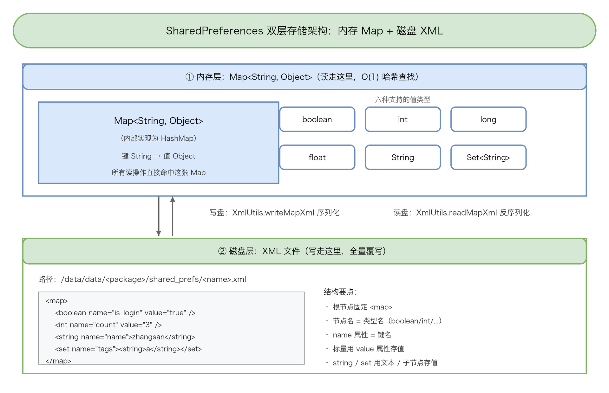
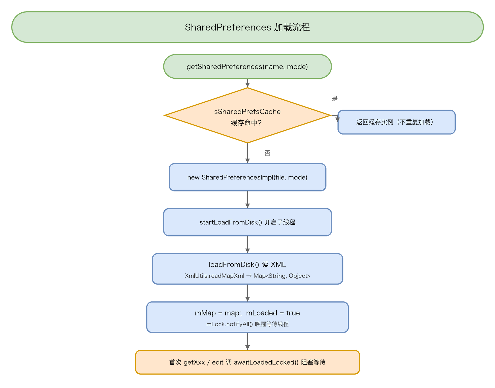
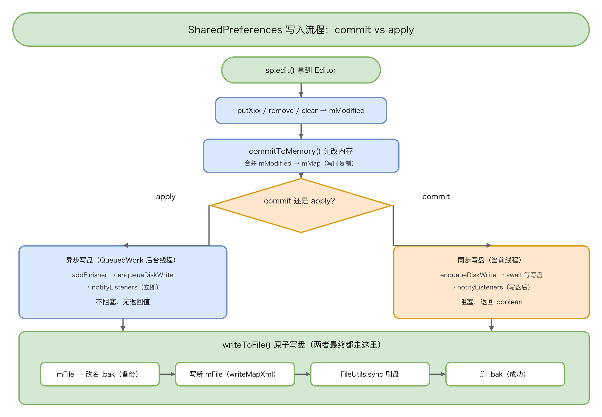

# 01. Android SharedPreferences 原理分析

> SharedPreferences（简称 SP）是 Android 最轻量的键值对持久化方案：内存里是一张 `Map<String, Object>`，磁盘上是一个 XML 文件，读写通过 `getSharedPreferences` + `edit/commit/apply` 完成。本文从源码出发，逐层拆解它的**数据存储形式**（内存 Map + 磁盘 XML）、**数据结构**（六种类型与节点组织）、加载/读取/写入全链路，并深入 `commit` 与 `apply` 的差异、多进程一致性问题、以及「apply 也会 ANR」这类高频面试题背后的源码依据。

## 目录

- [一、SharedPreferences 定位与存储体系](#一sharedpreferences-定位与存储体系)
  - [1.1 五种数据存储方式全景](#11-五种数据存储方式全景)
  - [1.2 什么是 SharedPreferences](#12-什么是-sharedpreferences)
  - [1.3 核心 API 与使用示例](#13-核心-api-与使用示例)
- [二、数据结构：内存与磁盘双层](#二数据结构内存与磁盘双层)
  - [2.1 内存结构：Map\<String, Object>](#21-内存结构mapstring-object)
  - [2.2 磁盘结构：XML 文件](#22-磁盘结构xml-文件)
  - [2.3 六种数据类型与节点结构](#23-六种数据类型与节点结构)
  - [2.4 存储位置与文件组织](#24-存储位置与文件组织)
- [三、获取流程：getSharedPreferences 源码](#三获取流程getsharedpreferences-源码)
  - [3.1 ContextImpl.getSharedPreferences](#31-contextimplgetsharedpreferences)
  - [3.2 进程内缓存 sSharedPrefsCache](#32-进程内缓存-ssharedprefscache)
  - [3.3 SharedPreferencesImpl 构造与磁盘加载](#33-sharedpreferencesimpl-构造与磁盘加载)
  - [3.4 加载阻塞与 ANR 隐患](#34-加载阻塞与-anr-隐患)
- [四、读取流程：从内存 Map 取值](#四读取流程从内存-map-取值)
  - [4.1 getXxx 源码](#41-getxxx-源码)
  - [4.2 contains 与 getAll](#42-contains-与-getall)
  - [4.3 变更监听](#43-变更监听)
- [五、写入流程：commit 与 apply](#五写入流程commit-与-apply)
  - [5.1 EditorImpl 与 mModified](#51-editorimpl-与-mmodified)
  - [5.2 commitToMemory：先改内存](#52-committomemory先改内存)
  - [5.3 commit：同步写盘](#53-commit同步写盘)
  - [5.4 apply：异步写盘 + QueuedWork](#54-apply异步写盘--queuedwork)
  - [5.5 commit vs apply 对比](#55-commit-vs-apply-对比)
- [六、磁盘写盘：XML 序列化与原子写入](#六磁盘写盘xml-序列化与原子写入)
  - [6.1 enqueueDiskWrite 与写盘线程](#61-enqueuediskwrite-与写盘线程)
  - [6.2 writeToFile：.bak 备份与原子写](#62-writetofilebak-备份与原子写)
  - [6.3 XmlUtils.writeMapXml 序列化](#63-xmlutilswritemapxml-序列化)
- [七、并发与多进程](#七并发与多进程)
  - [7.1 进程内线程安全](#71-进程内线程安全)
  - [7.2 多进程数据不一致](#72-多进程数据不一致)
  - [7.3 MODE\_MULTI\_PROCESS 已废弃](#73-mode_multi_process-已废弃)
- [八、性能问题与 ANR](#八性能问题与-anr)
  - [8.1 首次加载阻塞主线程](#81-首次加载阻塞主线程)
  - [8.2 apply 的 QueuedWork 阻塞](#82-apply-的-queuedwork-阻塞)
  - [8.3 大文件与频繁写入](#83-大文件与频繁写入)
  - [8.4 数据损坏与 .bak 恢复](#84-数据损坏与-bak-恢复)
- [九、最佳实践与替代方案](#九最佳实践与替代方案)
  - [9.1 使用建议](#91-使用建议)
  - [9.2 DataStore / MMKV 对比](#92-datastore--mmkv-对比)
- [附：高频速记](#附高频速记)

## 一、SharedPreferences 定位与存储体系

### 1.1 五种数据存储方式全景

Android 提供了多种持久化手段，SharedPreferences 只是其中一种，先看清它在整个存储体系里的位置：

| 存储方式                  | 载体          | 特点                | 适用场景          |
| --------------------- | ----------- | ----------------- | ------------- |
| **SharedPreferences** | XML 文件（键值对） | 轻量、API 简单、同步读/异步写 | 轻量配置、用户偏好、开关  |
| 内部存储（File）            | 私有文件        | 灵活、可存任意格式         | 大文件、二进制、序列化对象 |
| 外部存储（SD 卡）            | 公开文件        | 可共享、需权限、可被清理      | 大文件、需要用户可见    |
| SQLite / Room         | 数据库         | 结构化查询、事务、索引       | 大量结构化数据、复杂查询  |
| DataStore             | Protobuf/键值 | 协程友好、类型安全、异步      | 新一代键值/对象存储    |

SharedPreferences 的定位&#x662F;**「轻量级键值存储」**——它不是为了存大量结构化数据而设计，而是为「保存几个配置项」这种场景提供最简单可靠的方案。

### 1.2 什么是 SharedPreferences

`SharedPreferences` 是一个**接口**（`android.content.SharedPreferences`），真正的实现类是 `SharedPreferencesImpl`。它约定了一套「键值对」存取协议：

- **键**：`String`。
- **值**：仅支持 6 种类型——`boolean`、`int`、`long`、`float`、`String`、`Set<String>`。
- **写**：必须通过 `edit()` 拿到 `Editor`，修改后 `commit()`（同步）或 `apply()`（异步）提交。
- **持久化**：数据最终落盘为一个 XML 文件。

它的核心设计可以概括为一句：**「内存一份 Map 供快速读，磁盘一个 XML 供持久化，读走内存、写走『先改内存、再异步落盘』」**。

### 1.3 核心 API 与使用示例

```java
// 1. 获取（name 对应一个 XML 文件；mode 多为 MODE_PRIVATE）
SharedPreferences sp = context.getSharedPreferences("config", Context.MODE_PRIVATE);

// 2. 读（同步，从内存 Map 读取）
String name = sp.getString("name", "default");
boolean login = sp.getBoolean("is_login", false);
int count = sp.getInt("count", 0);
Set<String> tags = sp.getStringSet("tags", new HashSet<>());

// 3. 写（先 edit 拿到 Editor，修改后 apply/commit）
SharedPreferences.Editor editor = sp.edit();
editor.putString("name", "zhangsan")
      .putInt("count", 3)
      .remove("tags")
      .apply();   // 异步，推荐
// editor.commit(); // 同步，有返回值
```

> **易错点**：`getXxx` 是「读内存」，本身不触发磁盘 IO（首次获取时除外）；真正写盘发生在 `commit`/`apply`，而且 `apply` 是异步的。

## 二、数据结构：内存与磁盘双层

这是理解 SharedPreferences 的钥匙：**它在内存和磁盘各维护一份数据结构，二者形态不同、通过序列化/反序列化互相转换**。



### 2.1 内存结构：Map<String, Object>

在 `SharedPreferencesImpl` 内部，所有数据存在一个 `Map<String, Object>` 里： 

```java
// SharedPreferencesImpl.java
private Map<String, Object> mMap;   // 实际 new 出 HashMap
```

- 键是 `String`，值是 `Object`（实际是 6 种包装类型：`Boolean`/`Integer`/`Long`/`Float`/`String`/`HashSet<String>`）。
- **所有读操作都直接命中这张 Map**，读是 O(1) 的哈希查找，这也是 SP 读起来快的原因。
- 这张 Map 在进程内**只有一份**（配合下一章的缓存机制），是单例共享的。

### 2.2 磁盘结构：XML 文件

磁盘上，每个 SharedPreferences 对应**一个 XML 文件**。文件由 `android.util.XmlUtils` 生成，结构非常规整：

```xml
<?xml version='1.0' encoding='utf-8' standalone='yes' ?>
<map>
    <boolean name="is_login" value="true" />
    <int name="count" value="3" />
    <long name="last_time" value="1720000000000" />
    <float name="rate" value="0.5" />
    <string name="name">zhangsan</string>
    <set name="tags">
        <string>a</string>
        <string>b</string>
    </set>
</map>
```

结构要点：

- 根节点固定为 `<map>`。
- 每个键值对是 `<map>` 的一个**子节点**，节点名由类型决定（`boolean`/`int`/`long`/`float`/`string`/`set`），属性 `name` 存键名。
- 标量类型（boolean/int/long/float）用 `value` 属性存值；`string` 和 `set` 用**节点文本 / 子节点**存值。

### 2.3 六种数据类型与节点结构

XML 里六种类型的写法一一对应 Java 里的六种包装类型：

| Java 类型       | XML 节点      | 值存放方式                      | 示例                                       |
| ------------- | ----------- | -------------------------- | ---------------------------------------- |
| `boolean`     | `<boolean>` | `value` 属性（"true"/"false"） | `<boolean name="k" value="true" />`      |
| `int`         | `<int>`     | `value` 属性（十进制）            | `<int name="k" value="3" />`             |
| `long`        | `<long>`    | `value` 属性                 | `<long name="k" value="172..." />`       |
| `float`       | `<float>`   | `value` 属性                 | `<float name="k" value="0.5" />`         |
| `String`      | `<string>`  | 节点文本                       | `<string name="k">zhangsan</string>`     |
| `Set<String>` | `<set>`     | 多个 `<string>` 子节点          | `<set name="k"><string>a</string></set>` |

> **易错点**：`Set<String>` 在存入前会被 `Editor` 内部**拷贝成 `HashSet`**，读出来时也是**新 HashSet**，所以修改读出的集合**不会**反向影响 SP 里的数据，必须再 `putStringSet` 回去。

### 2.4 存储位置与文件组织

文件路径由 `ContextImpl` 决定，默认在应用私有数据目录下：

```
/data/data/<package_name>/shared_prefs/<name>.xml
```

```java
// ContextImpl.java
private File getPreferencesDir() {
    synchronized (mSync) {
        if (mPreferencesDir == null) {
            mPreferencesDir = new File(getDataDir(), "shared_prefs");
        }
        return mPreferencesDir;
    }
}
private File getSharedPreferencesPath(String name) {
    return makeFilename(getPreferencesDir(), name + ".xml");   // 自动补 .xml
}
```

- 传入的 `name` 会被自动拼上 `.xml` 后缀，所以 `getSharedPreferences("config", ...)` 对应 `config.xml`。
- 写盘过程中还会出现一个同名的 **`.bak` 备份文件**（详见 6.2）。
- 这个目录是应用私有目录，其他应用默认不可访问（除非 root 或同签名且指定了 sharedUserId，后者现代 Android 已不推荐）。

## 三、获取流程：getSharedPreferences 源码

### 3.1 ContextImpl.getSharedPreferences

`Context.getSharedPreferences` 的实现都在 `ContextImpl` 里，分两步：

```java
// ContextImpl.java
@Override
public SharedPreferences getSharedPreferences(String name, int mode) {
    File file;
    synchronized (ContextImpl.class) {
        if (mSharedPrefsPaths == null) {
            mSharedPrefsPaths = new ArrayMap<>();
        }
        file = mSharedPrefsPaths.get(name);
        if (file == null) {
            file = getSharedPreferencesPath(name);   // 拼出 /.../shared_prefs/name.xml
            mSharedPrefsPaths.put(name, file);
        }
    }
    return getSharedPreferences(file, mode);
}

@Override
public SharedPreferences getSharedPreferences(File file, int mode) {
    SharedPreferencesImpl sp;
    synchronized (ContextImpl.class) {
        final ArrayMap<File, SharedPreferencesImpl> cache = getSharedPreferencesCacheLocked();
        sp = cache.get(file);
        if (sp == null) {
            sp = new SharedPreferencesImpl(file, mode);   // 首次创建
            cache.put(file, sp);
            return sp;
        }
    }
    // 已存在：检查 mode 与是否跨进程，决定是否 reload
    if ((mode & MODE_MULTI_PROCESS) != 0 || getApplicationInfo().targetSdkVersion < Build.VERSION_CODES.HONEYCOMB) {
        sp.startReloadIfChangedUnexpectedly();
    }
    return sp;
}
```

### 3.2 进程内缓存 sSharedPrefsCache

关键点：SP 实例在**同一进程内是缓存的单例**，缓存的容器是静态的 `ArrayMap`：

```java
// ContextImpl.java
private static ArrayMap<String, ArrayMap<File, SharedPreferencesImpl>> sSharedPrefsCache;
```

结构是**两层 Map**：外层按包名（`String`）隔离，内层按文件（`File`）映射到 `SharedPreferencesImpl`。

- 好处：**同一个文件只会被加载一次**，多次 `getSharedPreferences` 拿到的是同一个实例，读写共享同一份内存 Map，避免重复 IO。
- 代价：**实例常驻内存**，加载进来的 Map 不会自动释放；`name` 越多、文件越大，内存占用越高（这也是 SP 不适合存大量数据的根源）。

> 注意区分两类容器：**缓存用 `ArrayMap`**（Android 为小数据量优化的双数组结构，节省内存），**数据本体用 `HashMap`**（`mMap`）。别把两者搞混。

### 3.3 SharedPreferencesImpl 构造与磁盘加载

第一次拿到某文件时，`new SharedPreferencesImpl(file, mode)` 会立即**开启子线程加载磁盘 XML**：

```java
// SharedPreferencesImpl.java
SharedPreferencesImpl(File file, int mode) {
    mFile = file;
    mBackupFile = makeBackupFile(file);   // name.xml.bak
    mMode = mode;
    mLoaded = false;
    mMap = null;
    startLoadFromDisk();                  // 关键：异步加载
}

private void startLoadFromDisk() {
    synchronized (mLock) {
        mLoaded = false;
    }
    new Thread("SharedPreferencesImpl-load") {
        public void run() { loadFromDisk(); }
    }.start();
}
```

`loadFromDisk()` 的要点：

1. **先处理 .bak 备份**：若备份文件存在，说明上次写盘中断，先删掉主文件、用备份回滚（详见 6.2）。
2. **读 XML 反序列化**：用 `XmlUtils.readMapXml` 把 XML 解析成 `Map<String, Object>`。
3. **写回内存**：加 `mLock` 锁，`mMap = map`（或 `new HashMap<>()`），置 `mLoaded = true`，然后 `mLock.notifyAll()` 唤醒所有等待加载的线程。

```java
private void loadFromDisk() {
    synchronized (mLock) {
        if (mLoaded) return;
        if (mBackupFile.exists()) {
            mFile.delete();
            mBackupFile.renameTo(mFile);   // 备份回滚
        }
    }
    Map<String, Object> map = null;
    try {
        BufferedInputStream str = new BufferedInputStream(new FileInputStream(mFile), 16 * 1024);
        map = (Map<String, Object>) XmlUtils.readMapXml(str);
    } catch (Exception e) {
        // 读失败 → map 为 null
    }
    synchronized (mLock) {
        mLoaded = true;
        mMap = (map != null) ? map : new HashMap<String, Object>();
        mLock.notifyAll();
    }
}
```

### 3.4 加载阻塞与 ANR 隐患

**这是 SP 第一个性能坑**：加载是异步的，但**第一次读取会阻塞等待加载完成**。

`getString` 等读方法，以及 `edit()` 内部，都会先调用 `awaitLoadedLocked()`：

```java
private void awaitLoadedLocked() {
    while (!mLoaded) {
        try {
            mLock.wait();   // 阻塞，直到 loadFromDisk 完成 notifyAll
        } catch (InterruptedException e) {
        }
    }
}
```


也就是说：**`getSharedPreferences` 本身不阻塞，但紧接着的第一次 `getXxx`/`edit` 会阻塞当前线程，直到 XML 读完**。如果这个调用发生在主线程，且 XML 文件很大，就会卡主线程 → 掉帧甚至 ANR。这也是「不要在主线程第一次读取大 SP 文件」的源码依据。



## 四、读取流程：从内存 Map 取值

### 4.1 getXxx 源码

加载完成后，读取就是「加锁 → 等加载 → 查 Map」，非常直接：

```java
// SharedPreferencesImpl.java
@Override
public String getString(String key, @Nullable String defValue) {
    synchronized (mLock) {
        awaitLoadedLocked();
        String v = (String) mMap.get(key);
        return v != null ? v : defValue;
    }
}

@Override
public boolean getBoolean(String key, boolean defValue) {
    synchronized (mLock) {
        awaitLoadedLocked();
        Boolean v = (Boolean) mMap.get(key);
        return v != null ? v : defValue;
    }
}
// getInt / getLong / getFloat 同理
```

要点：

- 读取**加锁**（`synchronized (mLock)`），保证与写入的内存修改互斥，读到的是一致快照。
- 返回 `defValue` 的判定是 **`v != null`**，而不是 `containsKey`：**如果存进去的值本身就是 null（即 remove 后）或不存在，都返回默认值**。注意 SP 不支持存 null 值——`putString(key, null)` 等价于 `remove(key)`。

### 4.2 contains 与 getAll

```java
public boolean contains(String key) {
    synchronized (mLock) {
        awaitLoadedLocked();
        return mMap.containsKey(key);
    }
}

public Map<String, ?> getAll() {
    synchronized (mLock) {
        awaitLoadedLocked();
        return new HashMap<String, Object>(mMap);   // 返回拷贝，防止外部修改内部 Map
    }
}
```

> **易错点**：`getAll()` 返回的是**新拷贝**，修改它不影响 SP 内部数据；同理 `getStringSet` 也返回新 Set。这是 SP 有意为之的「防御性拷贝」。

### 4.3 变更监听

SP 支持注册数据变更监听，用于「某个键被改后通知 UI 刷新」：

```java
sp.registerOnSharedPreferenceChangeListener(listener);
sp.unregisterOnSharedPreferenceChangeListener(listener);
```

内部维护一个 `WeakHashMap<OnSharedPreferenceChangeListener, Object> mListeners`：

- 监听器用 **WeakHashMap（弱引用）** 存，避免内存泄漏——**但前提是调用方自己也要持有 listener 的强引用**，否则 listener 会被 GC，导致「收不到回调」。
- 回调发生在**提交方线程**（commit/apply 调用 `notifyListeners` 的线程），**不是主线程**，回调里更新 UI 要切主线程。
- 只有通过 `Editor` 提交、且值确实发生了变化，才会触发对应 key 的回调。

## 五、写入流程：commit 与 apply

写入是 SP 最核心、也是面试最爱深挖的部分。整体分两阶段：**① 先改内存（commitToMemory）→ ② 再写磁盘（enqueueDiskWrite）**。`commit` 和 `apply` 的唯一区别在第二阶段（同步 vs 异步）。

### 5.1 EditorImpl 与 mModified

`edit()` 返回一个 `EditorImpl`，它维护一张**待提交的修改表** `mModified`：

```java
public final class EditorImpl implements Editor {
    private final Object mEditorLock = new Object();
    private final Map<String, Object> mModified = new HashMap<>();   // 本次修改的键值
    private boolean mClear = false;                                  // 是否 clear

    @Override
    public Editor putString(String key, @Nullable String value) {
        synchronized (mEditorLock) {
            mModified.put(key, value);
            return this;
        }
    }
    @Override
    public Editor remove(String key) {
        synchronized (mEditorLock) {
            mModified.put(key, this);   // 用 this 作为「删除」的哨兵值
            return this;
        }
    }
    @Override
    public Editor clear() {
        synchronized (mEditorLock) {
            mClear = true;
            return this;
        }
    }
}
```

|   |   |   |
| - | - | - |

> 关键设计：`remove` 用 `this`（EditorImpl 自身）作为**哨兵值**存入 `mModified`，`commitToMemory` 里判断 `v == this || v == null` 就执行删除。这样「删除」和「新增」统一在一张 Map 里表达。

### 5.2 commitToMemory：先改内存

`commit` 和 `apply` 都会先调用 `commitToMemory()`，把 `mModified` 合并进真正的 `mMap`，并返回一个 `MemoryCommitResult`：

```java
private MemoryCommitResult commitToMemory() {
    long memoryStateGeneration;
    List<String> keysModified = null;
    Set<OnSharedPreferenceChangeListener> listeners = null;
    Map<String, Object> mapToWriteToDisk;

    synchronized (SharedPreferencesImpl.this.mLock) {
        if (mDiskWritesInFlight > 0) {
            // 有写盘任务在飞，为避免写盘读到被改的 mMap，拷贝一份快照
            mMap = new HashMap<String, Object>(mMap);
        }
        mapToWriteToDisk = mMap;
        mDiskWritesInFlight++;
        // ... 收集监听器
        synchronized (mEditorLock) {
            boolean changesMade = false;
            if (mClear) {
                if (!mapToWriteToDisk.isEmpty()) { changesMade = true; mapToWriteToDisk.clear(); }
                mClear = false;
            }
            for (Map.Entry<String, Object> e : mModified.entrySet()) {
                String k = e.getKey();
                Object v = e.getValue();
                if (v == this || v == null) {          // remove：删除
                    if (!mapToWriteToDisk.containsKey(k)) continue;
                    mapToWriteToDisk.remove(k);
                } else {                                // put：更新或新增
                    if (mapToWriteToDisk.containsKey(k)) {
                        Object existing = mapToWriteToDisk.get(k);
                        if (existing != null && existing.equals(v)) continue;  // 值没变，跳过
                    }
                    mapToWriteToDisk.put(k, v);
                }
                changesMade = true;
                if (hasListeners) keysModified.add(k);
            }
            mModified.clear();
        }
    }
    return new MemoryCommitResult(memoryStateGeneration, keysModified, listeners, mapToWriteToDisk);
}
```

这段有三个值得记住的点：

1. **写时复制（Copy-on-Write）**：若 `mDiskWritesInFlight > 0`（有写盘任务还没完成），就先把 `mMap` 拷贝一份再改。因为写盘线程读的是 `mapToWriteToDisk` 引用，如果不拷贝，写盘过程中内存又被改，会写出不一致的数据。
2. **幂等优化**：值没变化（`existing.equals(v)`）就不算修改、不触发监听。
3. **内存先行**：这一步结束后，**内存 `mMap` 已经是最新值**，后续读取立即能看到新数据——这也是 `apply` 返回后立刻 `get` 能读到新值的原因（内存已改，只是磁盘还没落）。

### 5.3 commit：同步写盘

```java
@Override
public boolean commit() {
    MemoryCommitResult mcr = commitToMemory();
    SharedPreferencesImpl.this.enqueueDiskWrite(mcr, null);   // null → 同步
    try {
        mcr.writtenToDiskLatch.await();   // 阻塞等待写盘完成
    } catch (InterruptedException e) {
        return false;
    }
    notifyListeners(mcr);
    return mcr.writeToDiskResult;         // 返回是否写盘成功
}
```

- `enqueueDiskWrite(mcr, null)` 里 `postWriteRunnable == null` 表示**同步模式**，会**在当前线程直接执行写盘**。
- 通过 `CountDownLatch.await()` 阻塞，直到写盘线程把结果写入 `writtenToDiskLatch`。
- **有返回值**：`true`/`false` 表示写盘成功与否，调用方可据此做逻辑（如「保存失败则提示」）。
- **会阻塞当前线程**：如果在主线程调用 `commit()`，会卡主线程写盘 → 有 ANR 风险。

### 5.4 apply：异步写盘 + QueuedWork

```java
@Override
public void apply() {
    final MemoryCommitResult mcr = commitToMemory();
    final Runnable awaitCommit = new Runnable() {
        public void run() {
            try {
                mcr.writtenToDiskLatch.await();   // 等待写盘完成
            } catch (InterruptedException ignored) {}
        }
    };
    QueuedWork.addFinisher(awaitCommit);          // ① 注册「收尾任务」

    Runnable postWriteRunnable = new Runnable() {
        public void run() {
            awaitCommit.run();
            QueuedWork.removeFinisher(awaitCommit);  // ② 写盘完成后移除收尾任务
        }
    };
    SharedPreferencesImpl.this.enqueueDiskWrite(mcr, postWriteRunnable);
    notifyListeners(mcr);                          // ③ 立即通知监听器（不等磁盘）
}
```

- `apply` 把写盘任务交给**后台线程**（见 6.1），**不阻塞当前线程、无返回值**。
- 关键机制在 **`QueuedWork`**：
  - `QueuedWork.addFinisher(awaitCommit)` 注册一个「收尾任务」，它内部 `await()` 等待写盘完成。
  - `Activity`/`Service` 在 `onPause`/`onStop` 等生命周期里会调用 **`QueuedWork.waitToFinish()`**，等待所有 pending 的 `apply` 写盘任务真正落盘——**保证组件退到后台前数据不丢**。
  - 这既是 `apply` 的「安全性保障」，也是它 **ANR 的根源**（见 8.2）。

### 5.5 commit vs apply 对比

| 维度     | commit()          | apply()                  |
| ------ | ----------------- | ------------------------ |
| 同步/异步  | 同步，当前线程写盘         | 异步，后台线程写盘                |
| 阻塞     | 阻塞调用线程            | 不阻塞（但生命周期会 waitToFinish） |
| 返回值    | `boolean`（写盘是否成功） | 无（`void`）                |
| 内存更新   | 立即                | 立即                       |
| 监听回调时机 | 写盘后               | 内存更新后立即（不等写盘）            |
| ANR 风险 | 主线程调用直接卡主线程       | 生命周期 waitToFinish 可能卡主线程 |
| 官方建议   | 少用，需返回值时用         | 默认首选                     |

> 一句话：**`apply` 内存同步、磁盘异步；`commit` 内存和磁盘都同步**。绝大多数场景用 `apply`；只有「必须知道写盘结果」时才用 `commit`，且要放到后台线程。



## 六、磁盘写盘：XML 序列化与原子写入

### 6.1 enqueueDiskWrite 与写盘线程

```java
private void enqueueDiskWrite(final MemoryCommitResult mcr, final Runnable postWriteRunnable) {
    final boolean isFromSyncCommit = (postWriteRunnable == null);   // null 即 commit

    final Runnable writeToDiskRunnable = new Runnable() {
        public void run() {
            synchronized (mWritingToDiskLock) {   // 串行化写盘，避免并发写同一文件
                writeToFile(mcr, isFromSyncCommit);
            }
            synchronized (mLock) {
                mDiskWritesInFlight--;
            }
            if (postWriteRunnable != null) {
                postWriteRunnable.run();
            }
        }
    };

    if (isFromSyncCommit) {
        // commit：若没有其他写盘在飞，直接当前线程写
        boolean wasEmpty = false;
        synchronized (mLock) {
            wasEmpty = (mDiskWritesInFlight == 1);
        }
        if (wasEmpty) {
            writeToDiskRunnable.run();   // 当前线程直接写盘
            return;
        }
    }
    // apply（或 commit 且有写盘在飞）：丢到单线程队列串行执行
    QueuedWork.queue(writeToDiskRunnable, !isFromSyncCommit);
}
```

要点：

- 所有写盘最终被 `mWritingToDiskLock` **串行化**，同一文件的写盘不会并发。
- `QueuedWork.queue` 内部用 **HandlerThread（`QueuedWorkHandler`）** 提供单线程消息队列，`apply` 的写盘任务在这里排队串行执行。
- `mDiskWritesInFlight` 是「在飞写盘计数」，用于 5.2 的写时复制判断。

### 6.2 writeToFile：.bak 备份与原子写

SP 的写盘用「**先写备份、再换主文件**」的方式实现**原子性**，避免写一半崩溃导致数据损坏：

```java
private void writeToFile(MemoryCommitResult mcr, boolean isFromSyncCommit) {
    // ① 若没有实际变化，直接标记成功返回
    if (mFile.exists()) {
        if (!mcr.changesMade) {
            mcr.setDiskWriteResult(false, true);
            return;
        }
        // ② 把当前主文件改名成 .bak（作为备份）
        if (!mBackupFile.exists()) {
            if (!mFile.renameTo(mBackupFile)) {
                mcr.setDiskWriteResult(false, false);
                return;
            }
        } else {
            mFile.delete();
        }
    }

    // ③ 写全新的主文件
    try {
        FileOutputStream str = createFileOutputStream(mFile);
        if (str == null) {
            mcr.setDiskWriteResult(false, false);
            return;
        }
        XmlUtils.writeMapXml(mcr.mapToWriteToDisk, str);   // 序列化整个 Map 为 XML
        FileUtils.sync(str);                                // 强制刷盘
        str.close();

        // ④ 成功：删除备份文件
        mBackupFile.delete();
        mcr.setDiskWriteResult(true, true);
    } catch (Exception e) {
        // 失败：保留 .bak，下次加载时回滚
        mcr.setDiskWriteResult(false, false);
    }
}
```

完整流程：**`mFile → 改名 mBackupFile → 写新 mFile → 删 mBackupFile`**。

- 若第 ③ 步写新文件失败/中断，`.bak` 还在，下次 `loadFromDisk` 发现 `.bak` 就回滚（删主文件、`.bak` 改名回主文件），保证数据不丢。
- `FileUtils.sync(str)` 调用 `FileOutputStream.getFD().sync()`，把数据强制刷到物理磁盘，防止系统缓存丢失。


### 6.3 XmlUtils.writeMapXml 序列化

写盘时整个 Map 被 `XmlUtils.writeMapXml` 序列化成 XML。核心逻辑是遍历 Map，按值的运行时类型写出对应节点：

```java
// XmlUtils.java（简化的类型分发）
public static void writeValueXml(Object v, String name, XmlSerializer out) throws ... {
    if (v == null) {
        out.startTag(null, "null");
        out.endTag(null, "null");
        return;
    } else if (v instanceof String) {
        out.startTag(null, "string");
        if (name != null) out.attribute(null, "name", name);
        out.text(v.toString());
        out.endTag(null, "string");
    } else if (v instanceof Integer) {
        out.startTag(null, "int");
        if (name != null) out.attribute(null, "name", name);
        out.attribute(null, "value", Integer.toString((Integer) v));
        out.endTag(null, "int");
    } else if (v instanceof Long) { ... }
    else if (v instanceof Float) { ... }
    else if (v instanceof Boolean) { ... }
    else if (v instanceof Set) {   // 遍历集合写多个 <string>
        out.startTag(null, "set");
        if (name != null) out.attribute(null, "name", name);
        for (Object e : (Set) v) {
            out.startTag(null, "string");
            out.attribute(null, "value", (String) e);
            out.endTag(null, "string");
        }
        out.endTag(null, "set");
    }
}
```

> 这是理解「XML 结构为何长这样」的源码源头：**节点名 = 运行时类型名，`name` 属性 = 键名，`value` 属性或文本 = 值**。写入时用 `XmlSerializer`（`FastXmlSerializer`）流式输出，避免一次性拼大字符串。

## 七、并发与多进程

### 7.1 进程内线程安全

SP 在**单进程内是线程安全的**，靠三把锁协作：

| 锁 | 作用域 | 保护什么 |
| --- | --- | --- |
| `mLock` | SharedPreferencesImpl | 内存 `mMap` 的读写、加载状态 `mLoaded` |
| `mEditorLock` | EditorImpl | 单次编辑的 `mModified` |
| `mWritingToDiskLock` | SharedPreferencesImpl | 磁盘文件写入的串行化 |

- 读和「改内存」用同一把 `mLock`，保证读到的是一致快照。
- 写盘用独立的 `mWritingToDiskLock` 串行化，配合写时复制，保证写盘不干扰内存读写。

### 7.2 多进程数据不一致

SP 的线程安全**只限单进程**，**跨进程不保证一致**，这是它最著名的坑：

- 每个进程加载 SP 后，都把数据缓存在**自己进程的内存 Map**里，之后读写都只操作本进程内存。
- 进程 A `apply` 改了值，进程 B 的**内存不会自动同步**，进程 B 读到的仍是旧值——直到进程 B 的进程被杀重启、重新加载 XML 才看到新值。
- 即使进程 B 恰好读文件，也可能读到进程 A 正在写、还没落盘完成的中间态。

**结论**：**SharedPreferences 不适合跨进程通信**。跨进程共享配置应改用 ContentProvider、文件锁、数据库，或专门的跨进程存储方案（如 MMKV 的多进程模式）。

### 7.3 MODE_MULTI_PROCESS 已废弃

`MODE_MULTI_PROCESS` 曾经试图缓解多进程问题，但从 **API 23 起被标记废弃**（`@Deprecated`）。它的行为是：`getSharedPreferences` 时若发现文件被其他进程修改过，就重新加载。但它有三个致命缺陷：

1. **只对读有效**：写操作仍无跨进程同步。
2. **非实时**：只有「再次调用 getSharedPreferences」时才检查文件是否变化，无法主动通知。
3. **有竞态**：检查和加载之间文件可能又被改，且频繁 reload 反而更慢。

所以官方废弃它，明确告知「不要再依赖 SP 做多进程」。

## 八、性能问题与 ANR

### 8.1 首次加载阻塞主线程

如 3.4 所述：首次 `getXxx`/`edit` 会 `awaitLoadedLocked()` 阻塞等待子线程读完 XML。**文件越大，阻塞越久**。若在主线程首次读取大 SP，会卡主线程。常见缓解：

- 避免用 SP 存大块数据（大 JSON、Base64 图片等）。
- 应用启动时在后台线程提前「预热」SP（`getString` 一下触发加载）。
- 拆分成多个小 SP 文件，而不是一个大文件。

### 8.2 apply 的 QueuedWork 阻塞

这是「**apply 也会 ANR**」的反直觉知识点。链路如下：

1. `apply` 时 `QueuedWork.addFinisher(awaitCommit)` 注册收尾任务。
2. `Activity` 的 `onPause` / `Service` 的 `onStop` 会调用 `QueuedWork.waitToFinish()`，**同步等待所有 pending 的写盘任务完成**。
3. 如果此刻有大量/大文件的 `apply` 排队写盘，主线程就被卡在 `waitToFinish` → ANR。

```java
// ActivityThread.java（伪代码示意）
case ON_PAUSE:
    ...
    QueuedWork.waitToFinish();   // 主线程等待 apply 落盘
    handlePauseActivity(...);
    break;
```

> 为什么要有这个设计？为了保证「组件进入后台时数据已持久化」，否则进程被系统杀死可能丢数据。代价就是写盘慢时会拖垮生命周期。

**缓解**：
- 控制单个 SP 文件大小、减少 `apply` 频率（合并多次修改为一次）。
- 关键、大数据不要走 SP，改用数据库/文件。
- 留意「在 `onPause` 附近批量 `apply`」这类坏味道。

### 8.3 大文件与频繁写入

- **全量覆写**：每次写盘都是**把整个 Map 重新序列化写一遍**（不是增量更新）。Map 越大，每次写盘越慢、IO 越多。
- **频繁写入放大**：高频 `apply` 会导致大量排队写盘，进一步加剧 8.2 的问题。
- **内存常驻**：所有数据常驻内存 Map，且实例在进程内缓存不释放。

### 8.4 数据损坏与 .bak 恢复

- 写盘过程中的**意外断电/崩溃**可能留下损坏的主文件；`.bak` 机制能在下次加载时回滚到上一份完整数据（见 6.2）。
- 但若 `.bak` 也被破坏，或主文件被外部篡改，加载时会抛异常，`loadFromDisk` 捕获后把 `mMap` 置空，数据会丢失（读到默认值）。

## 九、最佳实践与替代方案

### 9.1 使用建议

1. **只存轻量、简单的配置**（开关、版本号、用户偏好），不存大数据、不存复杂结构。
2. **写用 `apply`，读同步**；只有必须拿结果才用 `commit` 且放后台线程。
3. **避免主线程首次读取大 SP**；启动时后台预热。
4. **控制文件数量与大小**，一个文件对应一个业务域，别塞成一个巨型文件。
5. **别跨进程用 SP**。
6. **监听器记得持有强引用**（WeakHashMap 会回收弱引用 listener）。

### 9.2 DataStore / MMKV 对比

| 维度 | SharedPreferences | DataStore | MMKV |
| --- | --- | --- | --- |
| 底层存储 | XML（全量覆写） | Protobuf/键值 | mmap 内存映射 |
| 异步 | 读同步、写可异步 | 全程异步（协程/Flow） | 同步/异步均可 |
| 类型安全 | 弱（Object 强转） | 强（类型化） | 键值强类型 |
| 多进程 | 不支持 | 不支持 | 支持 |
| 性能 | 一般（全量写） | 好（增量/事务） | 最优（mmap + 增量） |
| 一致性保证 | 无 | 事务/原子 | 原子 |
| 适用 | 轻量配置（存量项目） | 新项目首选（Kotlin） | 高性能/多进程场景 |

> 结论：**新项目（尤其 Kotlin）优先 DataStore，需要高性能或多进程用 MMKV，SharedPreferences 作为存量/轻量场景的默认方案理解其原理即可**。

## 附：高频速记

### 一句话记忆

- **存储形式**：内存一张 `Map<String, Object>`（HashMap），磁盘一个 XML 文件（`<map>` 根节点 + 六种类型节点）。
- **读**：加载完成后走内存 Map，O(1)，`getAll`/`getStringSet` 返回拷贝。
- **写**：`edit → commitToMemory（先改内存）→ enqueueDiskWrite（再写盘）`；`commit` 同步有返回值，`apply` 异步 + QueuedWork 收尾。
- **原子写**：`mFile → .bak → 写新 mFile → 删 .bak`，失败靠 .bak 回滚。
- **两大坑**：① 首次读取阻塞主线程；② apply 的 `QueuedWork.waitToFinish` 在 onPause 卡主线程；③ 多进程不一致。

### 核心对比表

| 项 | commit | apply |
| --- | --- | --- |
| 是否阻塞 | 阻塞调用线程 | 不阻塞 |
| 返回值 | boolean | void |
| 落盘 | 当前线程同步写 | 后台 QueuedWork 异步写 |
| 监听回调 | 写盘后 | 内存更新后立即 |
| 适用 | 需结果时（放后台线程） | 默认 |

### 面试必背要点

1. **双层结构**：内存 `Map<String, Object>`（HashMap）+ 磁盘 XML；缓存容器用 ArrayMap（`sSharedPrefsCache`）。
2. **六种类型**：boolean/int/long/float/String/Set\<String\>；XML 节点名即类型名，标量用 `value` 属性，String/Set 用文本/子节点。
3. **加载**：构造时 `startLoadFromDisk` 子线程读 XML，首次 `get`/`edit` 走 `awaitLoadedLocked` 阻塞等待。
4. **写时复制**：`mDiskWritesInFlight > 0` 时拷贝 `mMap` 再改，保证写盘读到的快照不被污染。
5. **remove 哨兵**：`remove(key)` 用 `this` 当哨兵值存入 `mModified`。
6. **QueuedWork**：apply 注册 finisher，onPause 时 `waitToFinish` 等落盘，是 apply ANR 的根源。
7. **多进程**：SP 不跨进程同步，`MODE_MULTI_PROCESS` 已废弃（只对读有效、非实时）。
8. **原子写**：`.bak` 备份回滚机制 + `FileUtils.sync` 强制刷盘。
