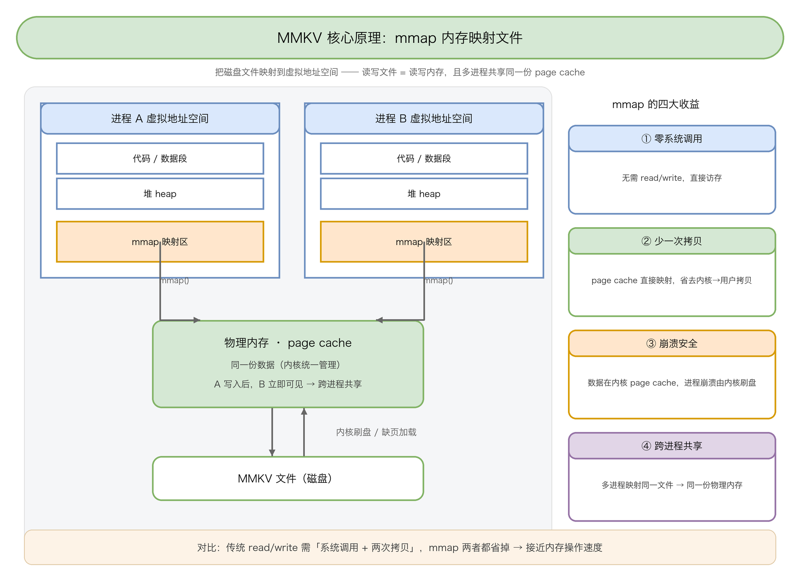
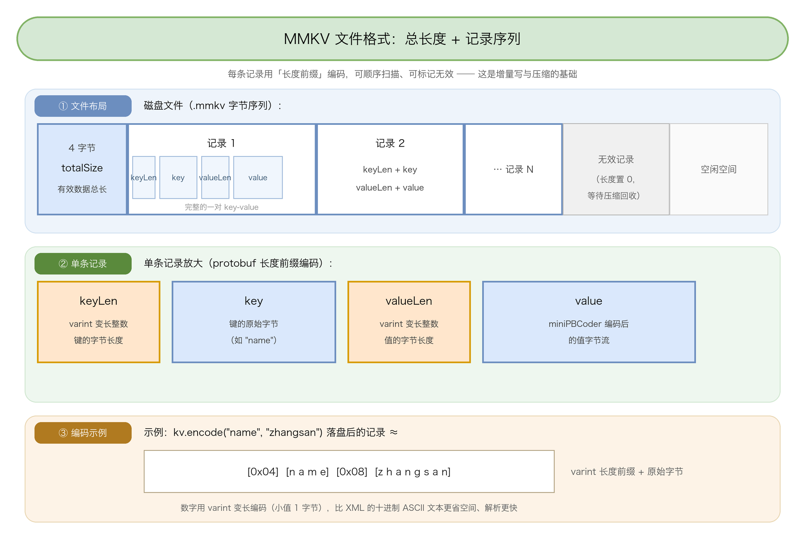
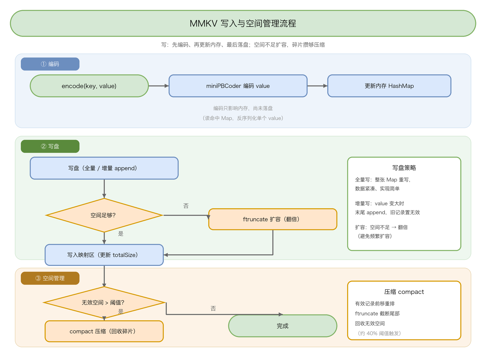

# 02. Android MMKV 原理与使用

> MMKV 是腾讯开源的键值存储库，底层用 **mmap（内存映射文件）+ protobuf（紧凑二进制编码）** 实现，性能远高于 SharedPreferences，且天然支持多进程。本文从「为什么 SP 不够快」讲起，拆解 mmap 与 protobuf 两大核心原理、文件格式与数据结构、读写/扩容/压缩全流程、多进程机制，最后落到完整使用方式与选型对比。读完你会掌握「MMKV 为什么快、为什么能跨进程、以及它的数据增长与压缩策略」。

## 目录

- [一、MMKV 定位与背景](#一mmkv-定位与背景)
  - [1.1 SharedPreferences 的三大痛点](#11-sharedpreferences-的三大痛点)
  - [1.2 什么是 MMKV](#12-什么是-mmkv)
- [二、两大核心：mmap + protobuf](#二两大核心mmap--protobuf)
  - [2.1 mmap：内存映射文件](#21-mmap内存映射文件)
  - [2.2 protobuf：紧凑二进制编码](#22-protobuf紧凑二进制编码)
  - [2.3 为什么这两者组合会快](#23-为什么这两者组合会快)
- [三、数据结构与文件格式](#三数据结构与文件格式)
  - [3.1 内存结构：HashMap](#31-内存结构hashmap)
  - [3.2 文件整体格式](#32-文件整体格式)
  - [3.3 单条记录格式](#33-单条记录格式)
  - [3.4 数据增长的扩容与压缩](#34-数据增长的扩容与压缩)
- [四、读写流程](#四读写流程)
  - [4.1 初始化与加载](#41-初始化与加载)
  - [4.2 写入流程](#42-写入流程)
  - [4.3 读取流程](#43-读取流程)
  - [4.4 扩容与压缩](#44-扩容与压缩)
- [五、多进程与线程安全](#五多进程与线程安全)
  - [5.1 多进程共享原理](#51-多进程共享原理)
  - [5.2 进程锁与线程安全](#52-进程锁与线程安全)
- [六、使用方式](#六使用方式)
  - [6.1 依赖与初始化](#61-依赖与初始化)
  - [6.2 获取实例](#62-获取实例)
  - [6.3 支持的类型与 API](#63-支持的类型与-api)
  - [6.4 多进程模式与加密](#64-多进程模式与加密)
- [七、与 SharedPreferences 对比](#七与-sharedpreferences-对比)
- [八、适用场景与注意事项](#八适用场景与注意事项)
- [附：高频速记](#附高频速记)

## 一、MMKV 定位与背景

### 1.1 SharedPreferences 的三大痛点

上一篇我们分析了 SharedPreferences，它的设计导致三个难以根治的问题：

1. **全量 XML 序列化**：每次写盘都把整个 Map 重新序列化成 XML 文本，Map 越大、写盘越慢。
2. **不支持多进程**：每个进程各自缓存一份内存 Map，跨进程数据不实时同步。
3. **加载阻塞**：首次读取要等子线程读完整个 XML，大文件会卡主线程（ANR）。

MMKV 正是冲着这三个痛点来的：**用二进制协议替换 XML、用 mmap 替换 read/write、用 mmap 的共享性天然支持多进程**。

### 1.2 什么是 MMKV

MMKV 是腾讯微信团队开源的通用 key-value 组件，名字即核心：**Memory Mapped Key-Value（内存映射键值对）**。它的定位和 SharedPreferences 一样是「轻量键值存储」，但实现思路完全不同：

| 维度   | SharedPreferences | MMKV                |
| ---- | ----------------- | ------------------- |
| 磁盘格式 | XML 文本            | protobuf 二进制        |
| 读写方式 | read/write 系统调用   | mmap 内存映射           |
| 写盘策略 | 全量覆写              | 全量 + 增量（append）+ 压缩 |
| 多进程  | 不支持               | 天然支持                |

一句话：**MMKV 用「mmap 让它读写像操作内存一样快」，用「protobuf 让数据更紧凑」，用「增量写 + 定期压缩」避免每次全量覆写**。

关键源码——MMKV 的 Java 门面类（`MMKV.java`），它只是 native 层的薄封装，几乎所有操作都直接委托到 JNI：

```java
// MMKV.java —— Java 层是 native 的薄封装
public class MMKV implements SharedPreferences, SharedPreferences.Editor {
    private long nativeHandle;   // native 层对象指针

    // 获取（或复用）一个 MMKV 实例
    public static MMKV mmkvWithID(String mmapID, int mode, String cryptKey, String rootPath) {
        long handle = getMMKVWithID(mmapID, mode, cryptKey, rootPath);
        return new MMKV(handle);
    }
    private static native long getMMKVWithID(String mmapID, int mode, String cryptKey, String rootPath);

    // 写：Java 直接委托 native，无中间序列化层
    public boolean encode(String key, String value) {
        return encodeString(nativeHandle, key, value);
    }
    private native boolean encodeString(long handle, String key, String value);

    // 读
    public String decodeString(String key, String defaultValue) {
        return decodeString(nativeHandle, key, defaultValue);
    }
    private native String decodeString(long handle, String key, String defaultValue);
}
```

> 关键点：**真正的实现全在 native（C++）层**，Java 层只负责「类型转换 + 委托」。所以理解 MMKV 要往下追 C++ 源码，而不是停在 Java API。

## 二、两大核心：mmap + protobuf

### 2.1 mmap：内存映射文件

mmap（Memory-Mapped File）是操作系统提供的机制：**把磁盘文件的一段内容，映射到进程的虚拟地址空间**。映射完成后，进程读写这段虚拟地址，就等于直接读写文件，由内核的 **page cache** 负责与磁盘同步。



它的关键收益：

| 收益     | 说明                                                                   |
| ------ | -------------------------------------------------------------------- |
| 减少系统调用 | 传统读文件要 `read()` 系统调用（用户态↔内核态切换）；mmap 后直接访问内存地址，**零系统调用**             |
| 减少数据拷贝 | 传统读写要「磁盘 → 内核 buffer → 用户 buffer」两次拷贝；mmap 直接映射 page cache，**少一次拷贝** |
| 崩溃安全   | 数据写在 page cache，进程崩溃后由**内核**负责刷回磁盘，数据不丢（不像用户态 buffer 会随进程消失）         |
| 跨进程共享  | 不同进程映射**同一个文件**时，指向同一份物理内存（page cache），天然实现进程间数据共享                   |

> **易错点**：mmap 不是「把整个文件读进内存」，而是建立「虚拟地址 ↔ 文件偏移」的映射，实际数据按需加载（缺页中断触发），且由内核统一管理刷盘时机。文件可以比内存大得多。

关键源码——打开文件并建立映射（native 层 `MemoryFile.cpp`）：

```cpp
// MemoryFile.cpp —— 打开文件并 mmap 映射
MemoryFile::MemoryFile(const MMKVPath_t &path) {
    m_fd = ::open(path.c_str(), O_RDWR | O_CREAT, S_IRUSR | S_IWUSR);
    // 把整个文件映射到进程虚拟地址空间
    m_ptr = (char *) ::mmap(nullptr, m_size, PROT_READ | PROT_WRITE,
                            MAP_SHARED, m_fd, 0);
    if (m_ptr == MAP_FAILED) {
        m_ptr = nullptr;
    }
}
```

> 两个参数是灵魂：`PROT_READ | PROT_WRITE` 允许直接读写映射区；**`MAP_SHARED`** 让写操作对映射同一文件的其他进程立即可见——这是 MMKV 多进程能力的真正来源。

### 2.2 protobuf：紧凑二进制编码

protobuf（Protocol Buffers）是 Google 的二进制序列化协议，MMKV 用它来编码 key 和 value。相比 XML 文本，它有两个优势：

1. **体积小**：用 varint（可变长整数）编码数字——小整数用 1 字节，而 XML 里一个 `int` 要写成一串十进制 ASCII（如 `value="1234567"` 是 9 字节）。
2. **解析快**：二进制按字段号/长度前缀直接定位，不用做 XML 的标签匹配和字符串转数字。

MMKV 内部用 `miniPBCoder`（一个轻量的 protobuf 编码器）把 Java 的 `int`/`long`/`String`/`byte[]` 等类型编码成紧凑的字节流。

关键源码——varint 变长整数编码（native 层 `MiniPBCoder.cpp`）：

```cpp
// MiniPBCoder.cpp —— varint 变长整数编码
// 每字节低 7 位存数据，最高位是「后面还有字节」的标记
uint8_t *writeVarint(uint64_t value, uint8_t *ptr) {
    while (value >= 0x80) {
        *ptr++ = (uint8_t) (value | 0x80);   // 高位置 1：后面还有字节
        value >>= 7;
    }
    *ptr++ = (uint8_t) value;                // 最后一个字节，高位为 0
    return ptr;
}
```

> 例：值 `0x08` 只需 1 字节 `08`；值 `300` 需 2 字节 `AC 02`。小整数占 1 字节，而 XML 里同样一个 `int` 要写成一串十进制 ASCII，这就是「体积小」的来源。

### 2.3 为什么这两者组合会快

把两者叠加，性能优势就出来了：

- **写**：序列化快（protobuf）+ 写盘快（mmap 直接写内存地址，无系统调用、无拷贝）。
- **读**：反序列化快（protobuf）+ 读快（mmap 直接读内存地址）。
- **多进程**：mmap 让「写进映射区」立刻对「映射同一文件的其他进程」可见，天然跨进程。

一句话：**mmap 解决了「IO 慢」，protobuf 解决了「序列化慢」，两者一起把 MMKV 的性能拉到接近内存操作的水平**。

## 三、数据结构与文件格式

### 3.1 内存结构：HashMap

和 SharedPreferences 类似，MMKV 在内存里也维护一张 Map，用于快速查找：

```text
HashMap<String, MMKV.MemoryBuffer>  // key → 编码后的字节缓冲
```

- key 是 `String`，value 是**编码后的二进制缓冲**（不是原始 Object）。
- 读写都先经过这张 Map：读命中直接反序列化返回，写先更新 Map 再落盘。
- 因为是「按需反序列化」，读时才解码，比 SP 的「全量存 Object」更省内存。

关键源码——内存字典的真实形态（native 层 `MMKV.cpp`），value 只存「位置」而非「数据」：

```cpp
// MMKV.cpp —— 内存字典：key → 记录位置（偏移 + 大小）
std::unordered_map<std::string, KeyValueHolder> m_dic;

struct KeyValueHolder {
    uint32_t offset;   // 该 value 在 mmap 内存里的偏移
    uint32_t size;     // 该 value 的字节长度
    uint32_t keySize;  // key 的字节长度
};
```

> 关键点：`m_dic` 的 value 是 `KeyValueHolder`（偏移 + 大小），**不是解码后的对象**。读取时才按 offset/size 从 mmap 内存取出字节并反序列化，所以内存占用远小于「把每个值都反序列化成 Object」的方案。

### 3.2 文件整体格式

磁盘上每个 MMKV 实例对应一个文件，整体结构是「**一个总长度 + 一串记录**」：

```text
+----------------+--------------------------------------------------+
| 4 字节 totalSize | 记录1 | 记录2 | ... | 记录N |（空闲空间） |
+----------------+--------------------------------------------------+
```

- 文件开头 **4 字节**存 `totalSize`（有效数据的总长度）。
- 之后是**连续拼接**的多条 key-value 记录。
- 记录末尾到文件末尾之间可能还有**未使用的空闲空间**（预分配/扩容留下的）。



### 3.3 单条记录格式

每条记录是一个「key-value 对」，用 protobuf 的长度前缀编码组织：

```text
+---------------+------------+---------------+------------+
| keyLen(varint) | key 数据   | valueLen(varint)| value 数据  |
+---------------+------------+---------------+------------+
```

- `keyLen`/`valueLen` 都是 **varint（可变长整数）**，长度不固定，小值省字节。
- `value 数据` 内部是 `miniPBCoder` 序列化后的字节流，具体类型信息也在编码里（类似 protobuf 的 wire type）。

> 因为 key 和 value 都带「长度前缀」，所以**能顺序扫描定位每一条记录**，也能在文件里**跳过无效记录**（这是增量写和压缩的基础）。

关键源码——写一条记录（native 层 `MMKV.cpp` 的 `appendDataWithKey`）：

```cpp
// MMKV.cpp —— 写一条记录 = keyLen + key + valueLen + value
bool MMKV::appendDataWithKey(MMBuffer &data, KeyValueHolder &kv) {
    size_t size = kv.keySize + data.length() + 2 * 4;  // 两个长度前缀各算 4 字节
    if (!ensureMemorySize(size)) return false;          // 空间不足先扩容

    // ① 写 keyLen（varint）+ key
    writeActualSize(kv.keySize, m_ptr + m_actualSize);
    memcpy(m_ptr + m_actualSize + varintSize, keyData, kv.keySize);

    // ② 写 valueLen（varint）+ value
    writeActualSize(data.length(), m_ptr + ...);
    memcpy(..., data.getPtr(), data.length());

    m_actualSize += ...;   // ③ 推进有效长度
    return true;
}
```

> `writeActualSize` 就是上一节的 varint 编码，用于写长度前缀；value 数据则直接 `memcpy` 到映射区。整条记录写进 mmap 内存后，内核负责刷盘。

### 3.4 数据增长的扩容与压缩

MMKV 文件不会无限增长，靠「扩容 + 压缩」两个机制管理空间：

- **扩容（expand）**：写不下时用 `ftruncate` 把文件变大（**默认翻倍**），映射区也随之扩大。
- **无效空间**：更新/删除时，旧记录**不会被立即覆盖**，而是被标记为「无效」（长度置 0），形成碎片。
- **压缩（compact）**：当**无效空间占比超过阈值**（约 40%），触发压缩——把有效记录**向前紧凑排列**，再 `ftruncate` 把文件尾部截断，回收无效空间。

> 这个「append 追加 + 定期压缩」是理解 MMKV 写盘策略的关键：**它优先追求「写得快」（追加），牺牲「空间不浪费」，攒够了再一次性整理**。

关键源码——扩容（native 层 `MMKV.cpp` 的 `ensureMemorySize`）：

```cpp
// MMKV.cpp —— 扩容：写不下时 ftruncate 翻倍
bool MMKV::ensureMemorySize(size_t newSize) {
    if (newSize >= m_size) {
        size_t newFileSize = m_size * 2;          // 翻倍，避免频繁扩容
        if (!m_file->truncate(newFileSize)) return false;
        m_size = newFileSize;
    }
    return true;
}
```

> 扩容用 `ftruncate` 把文件变大，然后重新 `mmap` 映射扩大后的空间。翻倍策略是为了「少扩几次」，用空间换时间。

## 四、读写流程

### 4.1 初始化与加载

加载分「全局初始化」和「实例加载」两层。

**第一步：全局初始化 `MMKV.initialize()`**，它做三件事——加载 native 库、准备根目录、初始化全局实例表：

```java
// MMKV.java —— initialize 内部（简化）
public static String initialize(Context context) {
    System.loadLibrary("mmkv");                                          // ① 加载 native 库
    String rootDir = context.getFilesDir().getAbsolutePath() + "/mmkv"; // ② 根目录
    jniInitialize(rootDir);                                              // ③ native 初始化
    return rootDir;
}
```

**第二步：实例加载 `MMKV.mmkvWithID(id)`**，首次调用时：

1. 先在 native 的全局实例表 `g_instanceDic` 查这个 `mmapID`，**命中则直接复用**（同一进程内同一 ID 永远同一个实例）。
2. 未命中才创建：打开（或创建）对应文件 → `mmap` 映射 → 读 `totalSize` → 顺序解析记录构建 `m_dic`。

实例复用的 native 源码：

```cpp
// MMKV.cpp —— 全局实例表：同 mmapID 复用同一实例
std::unordered_map<std::string, MMKV *> g_instanceDic;

MMKV *MMKV::mmkvWithID(const std::string &mmapID, MMKVMode_t mode, ...) {
    auto itr = g_instanceDic.find(mmapID);
    if (itr != g_instanceDic.end()) {
        return itr->second;                    // 已存在 → 直接复用
    }
    MMKV *kv = new MMKV(mmapID, mode, ...);    // 首次 → 创建并加载
    g_instanceDic[mmapID] = kv;
    return kv;
}
```

> 和 SharedPreferences 一样，MMKV 实例在进程内也是**单例复用**的；区别是 SP 用 Java 层的 `sSharedPrefsCache`，MMKV 用 native 层的 `g_instanceDic`。

因为映射后数据就在内存里，这个「加载」比 SP 的「读文件 + 反序列化 XML」快得多；而且 MMKV 是**懒加载/按需解码**，不会一次性把所有 value 都反序列化。

关键源码——加载（native 层 `MMKV.cpp` 的 `loadFromFile`）：

```cpp
// MMKV.cpp —— 加载：顺序解析记录，构建 m_dic（只记偏移，不立即解码）
void MMKV::loadFromFile() {
    // ① 读文件头 4 字节 totalSize
    memcpy(&m_actualSize, m_ptr, MMKV_HEADER_SIZE);

    // ② 顺序扫描所有记录
    char *ptr = m_ptr + MMKV_HEADER_SIZE;
    while (ptr < m_ptr + m_actualSize) {
        uint32_t keyLen   = readActualSize(ptr);  ptr += varintLen;   // keyLen
        std::string key(ptr, keyLen);             ptr += keyLen;       // key
        uint32_t valueLen = readActualSize(ptr);  ptr += varintLen;   // valueLen
        m_dic[key] = { (uint32_t)(ptr - m_ptr), valueLen };           // 只记位置
        ptr += valueLen;                                                // 跳过 value
    }
}
```


> 加载阶段只「扫一遍记录、记下每条的偏移和大小」，value 字节并不立即解码——这就是「懒加载」：真正读某个 key 时才反序列化它。

### 4.2 写入流程

先从 Java 层看起——业务代码调用 `kv.encode(key, value)` 时，Java 层做了什么：

```java
// MMKV.java —— 每种类型一个 encode，全部委托给 native（JNI）
public boolean encode(String key, boolean v) { return encodeBool(nativeHandle, key, v); }
public boolean encode(String key, int v)      { return encodeInt(nativeHandle, key, v); }
public boolean encode(String key, long v)     { return encodeLong(nativeHandle, key, v); }
public boolean encode(String key, String v)   { return encodeString(nativeHandle, key, v); }
public boolean encode(String key, byte[] v)   { return encodeBytes(nativeHandle, key, v); }
private native boolean encodeInt(long handle, String key, int value);
private native boolean encodeString(long handle, String key, String value);
// ... 其余类型同理
```

> 可以看到：**Java 层 encode 本身不序列化、不写盘，只是把 Java 类型原样丢给 JNI**，真正的工作都在 native。

唯一的例外是 `Parcelable`——它没法直接过 JNI，所以 Java 层要先把它拍平成字节数组：

```java
// MMKV.java —— Parcelable 在 Java 层先序列化成 byte[]
public boolean encode(String key, Parcelable value) {
    Parcel source = Parcel.obtain();
    value.writeToParcel(source, 0);          // 对象 → Parcel
    byte[] bytes = source.marshall();         // Parcel → byte[]
    source.recycle();
    return encodeBytes(nativeHandle, key, bytes);
}
```

> 另外 Java 层的 `encode`/`decode` 都包了一层 `synchronized`（配合 native 锁保证线程安全），所以多线程读写同一个 MMKV 实例是安全的。

写一个 key-value 的流程：

1. **编码**：把 value 用 `miniPBCoder` 编码成字节流。
2. **更新内存**：把 `key → 编码结果` 写入 HashMap。
3. **写盘**（这一步区分策略）：
   - **全量写（默认）**：把整个 HashMap 重新序列化成完整记录序列，写回映射区（`totalSize` 更新）。逻辑简单、数据紧凑，但大 dict 时开销高。
   - **增量写（append）**：当 `value` 长度**增长**时，MMKV 会在文件**末尾追加**新记录，把旧记录标记为无效，避免整体重写。
4. **扩容**：映射区剩余空间不足时，先 `ftruncate` 扩容再写。

```text
encode(key, value)
   │
   ├─ miniPBCoder 编码 value
   ├─ 更新内存 HashMap
   └─ 写盘（全量 or 增量 append）
        ├─ 空间足够 → 直接写
        └─ 空间不足 → ftruncate 扩容 → 再写
```



关键源码——写入口与写盘（native 层 `MMKV.cpp`）：

```cpp
// MMKV.cpp —— 写入口：更新内存字典 → 追加写盘
bool MMKV::setDataForKey(MMBuffer &&data, const std::string &key) {
    // ① 更新内存字典（记录新的位置/大小）
    auto &holder = m_dic[key];
    if (holder.size > 0 && data.length() > holder.size) {
        // value 变大：旧记录置为无效（长度置 0），走增量 append
        holder.offset = 0;
    }
    // ② 追加写盘
    return appendDataWithKey(data, holder);
}
```

> 写盘分两种策略：**全量写**把整张 `m_dic` 重排落盘；**增量 append** 只在文件末尾追加新记录、旧记录标记无效。两者最终都通过 `appendDataWithKey` 把字节写进 mmap 映射区。

> 更精确地拆，MMKV 的写盘其实有**三条路径**，判定条件各不相同：

| 路径        | 触发条件                    | 动作                     |
| --------- | ----------------------- | ---------------------- |
| 原地覆盖      | 新 value 长度 ≤ 旧 value 长度 | 直接覆盖旧位置，`totalSize` 不变 |
| 增量 append | 新 key，或 value 变大放不下     | 文件末尾追加，旧记录置无效          |
| 全量重写      | 触发压缩 / 空间整理             | 整张 `m_dic` 紧凑重排落盘      |

判定逻辑的源码（简化）：

```cpp
bool MMKV::setDataForKey(MMBuffer &&data, KeyValueHolder &kv) {
    if (kv.offset > 0 && data.length() <= kv.size) {
        return writeToOffset(kv, data);   // 新值更短/等长 → 原地覆盖
    }
    return appendDataWithKey(data, kv);    // 新值更长 / 新 key → 追加
}
```

> **易错点**：删除 key 不会立刻回收空间，只是把旧记录标记为「无效」，等压缩才回收——所以「删了数据文件却不变小」是正常现象。

### 4.3 读取流程

读一个 key：

1. 在内存 HashMap 里查 `key`。
2. 命中 → 把编码后的字节流用 `miniPBCoder` **反序列化**成目标类型返回。
3. 未命中 → 返回默认值。

因为 HashMap 查找是 O(1)，反序列化只针对**单个 value**（不是全文件），所以读极快。mmap 的数据本身就在内存，读取连文件 IO 都没有。

关键源码——读（native 层 `MMKV.cpp` 的 `getDataForKey`）：

```cpp
// MMKV.cpp —— 读：查字典 → 直接从 mmap 内存取出 → 反序列化
MMBuffer MMKV::getDataForKey(const std::string &key) {
    auto itr = m_dic.find(key);
    if (itr == m_dic.end()) {
        return MMBuffer();   // 未命中，返回空，上层填默认值
    }
    // 直接从映射内存里按「偏移 + 大小」取出字节，无文件 IO
    return MMBuffer(m_ptr + itr->second.offset, itr->second.size);
}
```

> 读路径全程只碰内存：`m_dic` 查表是 O(1)，取字节是「指针 + 偏移」直接定位。这也是为什么 MMKV 读性能接近内存操作。

> 但「取出字节」只是第一步，还要经过 **JNI → MiniPBCoder** 反序列化成目标类型：

```java
// Java 层：decodeInt 委托 native
public int decodeInt(String key, int defaultValue) {
    return decodeInt(nativeHandle, key, defaultValue);
}
private native int decodeInt(long handle, String key, int defaultValue);
```

```cpp
// native 层：取出字节 → 按类型解码
int32_t MMKV::getInt32(const std::string &key, int32_t def) {
    MMBuffer data = getDataForKey(key);
    if (data.length() == 0) return def;           // 未命中 → 默认值
    return MiniPBCoder::decodeInt32(data);        // 反序列化
}
```

> 关于「类型不匹配」：value 的编码里带类型信息，用 `decodeInt` 去读一个存成 `String` 的 key，会**返回默认值而非崩溃**（解码器识别出类型不符就放弃）。所以读的类型必须和写的一致，否则静默拿到默认值——这是个隐蔽的坑。

Java 层的 `decode` 方法族和 `encode` 一一对应，同样只是 JNI 转发：

```java
// MMKV.java —— decode 方法族（全部 native）
public boolean decodeBool(String key, boolean def) { return decodeBool(nativeHandle, key, def); }
public int     decodeInt(String key, int def)       { return decodeInt(nativeHandle, key, def); }
public String  decodeString(String key, String def) { return decodeString(nativeHandle, key, def); }
public byte[]  decodeBytes(String key, byte[] def)  { return decodeBytes(nativeHandle, key, def); }
```

而 `Parcelable` 的读，是「写」的逆过程，同样在 Java 层完成 `byte[] → Parcel → 对象`：

```java
// MMKV.java —— Parcelable 反序列化：byte[] → Parcel → 对象
public <T extends Parcelable> T decodeParcelable(String key, Class<T> tClass) {
    byte[] bytes = decodeBytes(nativeHandle, key, null);
    if (bytes == null || bytes.length == 0) return null;
    Parcel dest = Parcel.obtain();
    dest.unmarshall(bytes, 0, bytes.length);   // byte[] → Parcel
    dest.setDataPosition(0);
    T result = dest.readParcelable(tClass.getClassLoader());
    dest.recycle();
    return result;
}
```

> 所以 Parcelable 的读写是「**Java 层两次转换**」：写 `对象→Parcel→byte[]`，读 `byte[]→Parcel→对象`；而基本类型则是「**一次 JNI 直接转发**」。这就是 Parcelable 比基本类型多一层开销的原因。

### 4.4 扩容与压缩

- **扩容时机**：`ensureMemorySize` 检测到「需要写入的大小 > 剩余空间」时，调用 `ftruncate` 扩容（默认翻倍，避免频繁扩容）。
- **压缩时机**：删除/更新产生的无效空间累计超过阈值（约 40%）时，触发 `compact`——把有效记录紧凑重排到文件前部，`ftruncate` 截断尾部，释放无效空间。
- 压缩通常发生在**写入路径**上，是一次性的整理动作，用「空间换时间」的延迟策略。

关键源码——压缩（native 层 `MMKV.cpp` 的 `fullWriteback`）：

```cpp
// MMKV.cpp —— 压缩：有效记录前移重排，截断尾部回收碎片
bool MMKV::fullWriteback() {
    // ① 遍历 m_dic，把所有有效记录紧凑写到文件头部
    char *dst = m_ptr + MMKV_HEADER_SIZE;
    for (auto &kv : m_dic) {
        memcpy(dst, /* keyLen+key+valueLen+value */ ...);
        dst += /* 该记录长度 */ ...;
    }
    // ② 更新 totalSize，截断尾部
    m_actualSize = (uint32_t)(dst - m_ptr);
    return m_file->truncate(m_actualSize);
}
```

> 压缩把有效数据「挤到前面」，再 `ftruncate` 把文件尾巴砍掉，回收之前积攒的无效空间。它发生在写入路径上，阈值约 40% 才触发一次。

> 补充两个容易被追问的细节：

**① 压缩的触发条件**——无效空间累计到一定程度才整理（不是每次删都压缩）：

```cpp
// MMKV.cpp —— 写入路径上检查是否该压缩
if (m_invalidSize >= m_actualSize) {
    fullWriteback();   // 无效空间 ≥ 有效空间（约一半浪费）才整理
}
```

**② 扩容的精确动作**——`ftruncate` 后要**重新 mmap** 才能用新增的空间：

```cpp
// MemoryFile.cpp —— 扩容并重新映射
bool MemoryFile::truncate(size_t size) {
    if (::ftruncate(m_fd, (off_t) size) != 0) return false;
    m_ptr = (char *) ::mmap(nullptr, size, PROT_READ | PROT_WRITE, MAP_SHARED, m_fd, 0);
    m_size = size;
    return true;
}
```

> 因为 mmap 映射的是「文件当前大小」，文件变大后必须重新映射，进程才能访问新增的空间。

## 五、多进程与线程安全

### 5.1 多进程共享原理

MMKV 多进程能力**直接来自 mmap 的语义**：

- 多个进程各自 `mmap` 同一个文件，映射到**同一份物理内存（page cache）**。
- 进程 A 写入映射区，进程 B 立刻能从自己的映射区读到最新数据（内核保证 page cache 一致性）。
- 因此 MMKV **不需要 ContentProvider / 广播 / 文件监听**，就能让跨进程数据「实时可见」。

这就是它和 SP 最本质的差异：**SP 每个进程缓存一份独立内存、互不相通；MMKV 靠 mmap 让所有进程共享同一块内存**。

### 5.2 进程锁与线程安全

共享内存带来「并发写」的竞争问题，MMKV 用锁解决：

| 层面    | 机制                                                        |
| ----- | --------------------------------------------------------- |
| 进程间   | 每个 MMKV 实例绑定一个**文件锁/信号量**（`flock`），写入前加锁，写完释放，保证多进程写不互相覆盖 |
| 进程内线程 | 加锁（`synchronized` / `ReentrantLock`）保证线程安全                |

> **易错点**：多进程模式要显式用 `MMKV.MULTI_PROCESS_MODE` 打开，且多进程模式有额外锁开销；单进程用默认模式即可。**读不需要加锁**（mmap 直接读内存），只有**写**才涉及锁，这也是它读性能好的原因。

关键源码——进程锁（native 层 `InterProcessLock.cpp`）：

```cpp
// InterProcessLock.cpp —— 文件锁（flock）保证多进程写互斥
class FileLock {
    int m_fd;
public:
    bool lock() {
        // LOCK_EX 独占锁，阻塞直到拿到锁
        return flock(m_fd, LOCK_EX) == 0;
    }
    void unlock() {
        flock(m_fd, LOCK_UN);
    }
};
```

> 写一条数据前的加锁序列：`lock()` → 写 mmap → `unlock()`。因为锁挂在文件描述符上，跨进程也能互斥，保证多个进程不会同时写坏同一份数据。

## 六、使用方式

### 6.1 依赖与初始化

```groovy
// build.gradle
dependencies {
    implementation 'com.tencent:mmkv:1.3.9'
}
```

```java
// Application.onCreate() 里初始化一次
MMKV.initialize(this);
```

> 初始化必须在**使用任何 MMKV 之前**完成，通常放 `Application.onCreate`；它会加载 native 库、准备根目录（默认 `/data/data/<package>/files/mmkv`）。

> 两个容易踩的细节：

1. **多进程应用每个进程都要 `initialize`**：native 库和根目录是「进程级」的，每个进程都得各自初始化一次。因为 `Application.onCreate` 在每个进程启动时都会执行，所以放这里天然覆盖了所有进程。
2. **自定义根目录**：`initialize` 有重载可传入 `rootDir`，把数据放到指定位置；但多进程共享时必须保证各进程用**同一个 rootDir**，否则映射不到同一份文件。

### 6.2 获取实例

```java
// 全局默认实例
MMKV kv = MMKV.defaultMMKV();

// 按业务隔离的独立实例（对应独立的文件）
MMKV userKv = MMKV.mmkvWithID("user_config");
MMKV cacheKv = MMKV.mmkvWithID("cache", MMKV.SINGLE_PROCESS_MODE);
```

每个 `mmapID` 对应一个独立的存储文件，建议**按业务域拆分**，而不是全部塞进 default。

关键源码——`mmkvWithID` 的完整实现（`MMKV.java`），看它是怎么落到 native 的：

```java
// MMKV.java —— mmkvWithID 完整实现（简化）
public static MMKV mmkvWithID(String mmapID, int mode, String cryptKey, String rootPath) {
    if (rootPath == null || rootPath.isEmpty()) {
        rootPath = DEFAULT_ROOT;   // 默认 /data/data/<pkg>/files/mmkv
    }
    if (mmapID == null) {
        throw new IllegalArgumentException("mmapID is null");
    }
    // native 创建（或复用已有）MMKV 实例，返回 native 句柄
    long handle = getMMKVWithID(mmapID, mode, cryptKey, rootPath);
    return new MMKV(handle);
}
```

> 每个 `mmapID` 在 native 层对应一个「独立文件 + 独立 `m_dic` + 独立锁」，所以按业务拆分实例，就自然实现了数据隔离。

> 补充两点：

- `defaultMMKV()` 本质就是 `mmkvWithID("mmkv.default")`，只是固定 ID 的语法糖。
- **同一个 `mmapID` 在进程内永远返回同一个实例**（native 的 `g_instanceDic` 保证），所以在不同地方多次 `mmkvWithID("user_config")` 不会重复加载文件，可以放心缓存实例引用。

### 6.3 支持的类型与 API

MMKV 支持的类型比 SP 更丰富（多了 `double`、`byte[]`、`Parcelable`）：

| 类型          | 写入                   | 读取                           |
| ----------- | -------------------- | ---------------------------- |
| String      | `encode(key, value)` | `decodeString(key, def)`     |
| int         | `encode(key, value)` | `decodeInt(key, def)`        |
| long        | `encode(key, value)` | `decodeLong(key, def)`       |
| float       | `encode(key, value)` | `decodeFloat(key, def)`      |
| double      | `encode(key, value)` | `decodeDouble(key, def)`     |
| boolean     | `encode(key, value)` | `decodeBool(key, def)`       |
| byte[]      | `encode(key, value)` | `decodeBytes(key, def)`      |
| Set<String> | `encode(key, set)`   | `decodeStringSet(key, def)`  |
| Parcelable  | `encode(key, p)`     | `decodeParcelable(key, cls)` |


```java
// 写
kv.encode("name", "zhangsan");
kv.encode("count", 3);
kv.encode("isLogin", true);
kv.encode("tags", new HashSet<>(Arrays.asList("a", "b")));
kv.encode("bytes", new byte[]{1, 2, 3});

// 读
String name = kv.decodeString("name", "default");
int count = kv.decodeInt("count", 0);
boolean login = kv.decodeBool("isLogin", false);

// 删除
kv.removeValueForKey("name");
kv.removeValuesForKeys(new String[]{"a", "b"});
kv.clearAll();

// 手动同步（mmap 一般无需手动，但提供此接口兜底）
kv.sync();
```

> 除了基础的 encode/decode，还有几个常用但容易忽略的 API：

```java
// 存在性 / 统计
boolean has = kv.containsKey("name");
int total = kv.count();                 // 键总数
long bytes = kv.totalSize();            // 当前文件有效字节数
String[] keys = kv.allKeys();           // 所有键

// 清除内存缓存（不删磁盘，下次读会重新加载）
kv.clearMemoryCache();

// 存对象（Parcelable）
kv.encode("user", new User("zhangsan", 20));
User u = kv.decodeParcelable("user", User.class);

// 从 SharedPreferences 一键迁移
int imported = kv.importFromSharedPreferences(oldSp);
```

> `importFromSharedPreferences` 是存量项目从 SP 迁移到 MMKV 的利器：遍历 SP 的所有键值（按类型）一次性导入 MMKV。

### 6.4 多进程模式与加密

```java
// 多进程模式
MMKV multiKv = MMKV.mmkvWithID("shared_data", MMKV.MULTI_PROCESS_MODE);

// 加密（第三个参数是 AES 密钥，长度需合法）
MMKV cryptKv = MMKV.mmkvWithID("secure_data", MMKV.SINGLE_PROCESS_MODE, "my_crypt_key_16B");
```

- **多进程模式**：`MULTI_PROCESS_MODE`，需要跨进程共享时用，有锁开销。
- **加密**：传入密钥后，写入的数据用 AES 加密落盘，适合存敏感信息。
- 两种能力可组合：`MMKV.mmkvWithID(id, MMKV.MULTI_PROCESS_MODE, key)`。

> 两个延伸点：

1. **加密原理**：密钥通过 `cryptKey` 传入，MMKV 用 **AES** 对 value 加密后再落盘（key 本身不加密）。密钥长度决定加密强度——16/24/32 字节分别对应 AES-128/192/256。注意**密钥硬编码在客户端**只能防「文件被直接读取」，防不了逆向，敏感数据仍需服务端加密。
2. **多进程模式注意**：`MULTI_PROCESS_MODE` 下每次写都走文件锁，有额外开销；多进程共享时**每个进程必须用同一个 `mmapID` 和 `rootDir`** 才能映射到同一份文件。多进程 + 加密组合使用时，各进程的 `cryptKey` 也必须一致，否则互相读不出。

## 七、与 SharedPreferences 对比

| 维度   | SharedPreferences               | MMKV                           |
| ---- | ------------------------------- | ------------------------------ |
| 磁盘格式 | XML 文本                          | protobuf 二进制                   |
| 读写方式 | read/write 系统调用                 | mmap 内存映射                      |
| 写盘策略 | 每次全量覆写                          | 全量 + 增量 append + 压缩            |
| 多进程  | 不支持（已废弃 MODE_MULTI_PROCESS）     | 天然支持（mmap 共享）                  |
| 加载   | 首次读取阻塞读全文件                      | 映射即用、按需解码                      |
| 类型   | 6 种（无 double/byte[]/Parcelable） | 更多（含 double/byte[]/Parcelable） |
| 性能   | 一般（大文件明显慢）                      | 优（接近内存操作）                      |
| 依赖   | 系统自带                            | 需引入第三方库                        |
| 加密   | 不支持                             | 支持 AES 加密                      |

> 结论：**追求性能、多进程、大 key-value 用 MMKV；追求零依赖、极致简单、仅存少量配置的存量场景，SP 依然够用**。新项目（尤其 Kotlin）也可考虑 Jetpack DataStore（类型安全 + 协程），但 DataStore 不支持多进程，这一点 MMKV 不可替代。

## 八、适用场景与注意事项

### 8.1 适用场景

- 需要**高性能**读写的配置、缓存、状态。
- 需要**多进程**共享数据的场景（如主进程与推送进程共享开关）。
- 需要存**二进制**（byte[]）、Parcelable、加密数据的场景。
- 对启动速度、首屏耗时敏感的应用（MMKV 加载快，可替代 SP 做启动配置）。

### 8.2 注意事项 / 坑

1. **必须初始化**：忘了 `MMKV.initialize(this)` 会直接崩（native 未加载）。
2. **单条 value 不宜过大**：MMKV 适合存「小而多」的键值，超大 value（几 MB 的图/文件）不合适，应存文件路径或走文件存储。
3. **多进程模式有代价**：锁开销 + 需注意进程间一致性语义，非必要别开多进程模式。
4. **增量写与压缩**：频繁增删会产生碎片，触发压缩时有一次性开销，极端场景可评估对卡顿的影响（一般可忽略）。
5. **native 依赖**：引入 MMKV 会增大包体积（含 native so），对包体敏感时需权衡。
6. **不要和 SP 混用同一份数据**：两者文件格式不同，不能互相读写同一个文件。

## 附：高频速记

### 一句话记忆

- **MMKV = mmap + protobuf**：mmap 让读写像内存操作（零系统调用、少拷贝、崩溃安全、跨进程），protobuf 让数据紧凑、序列化快。
- **写策略**：默认全量写，value 增长时增量 append，空间不足 ftruncate 翻倍扩容，无效空间超阈值触发 compact 压缩。
- **多进程**：靠 mmap 共享同一份物理内存天然跨进程；写加文件锁，读无锁。

### 核心对比速记

| 问题        | 答案                                               |
| --------- | ------------------------------------------------ |
| 为什么比 SP 快 | 二进制替换 XML + mmap 替换 read/write + 增量写替换全量覆写       |
| 为什么能跨进程   | mmap 让多进程映射同一份 page cache，写后其他进程立即可见             |
| 文件格式      | 4 字节 totalSize + 一串「keyLen+key+valueLen+value」记录 |
| 扩容        | ftruncate 翻倍                                     |
| 压缩        | 无效空间 > 阈值，重排有效记录 + 截断尾部                          |
| 支持类型      | SP 的 6 种 + double/byte[]/Parcelable，可加密、可多进程     |

### 面试必背要点

1. **mmap 四大收益**：零系统调用、少一次拷贝、崩溃安全、跨进程共享。
2. **protobuf 优势**：varint 省空间、二进制按长度前缀定位、解析快。
3. **写盘三策略**：全量写（默认）、增量 append（value 变大时）、compact 压缩（碎片回收）。
4. **扩容与压缩**：ftruncate 翻倍扩容；无效空间约 40% 触发压缩。
5. **多进程**：mmap 共享 page cache 天然可见，写用文件锁保证不冲突，读无锁。
6. **使用要点**：先 `MMKV.initialize`；`mmkvWithID` 按业务拆分；多进程用 `MULTI_PROCESS_MODE`；加密传密钥。
