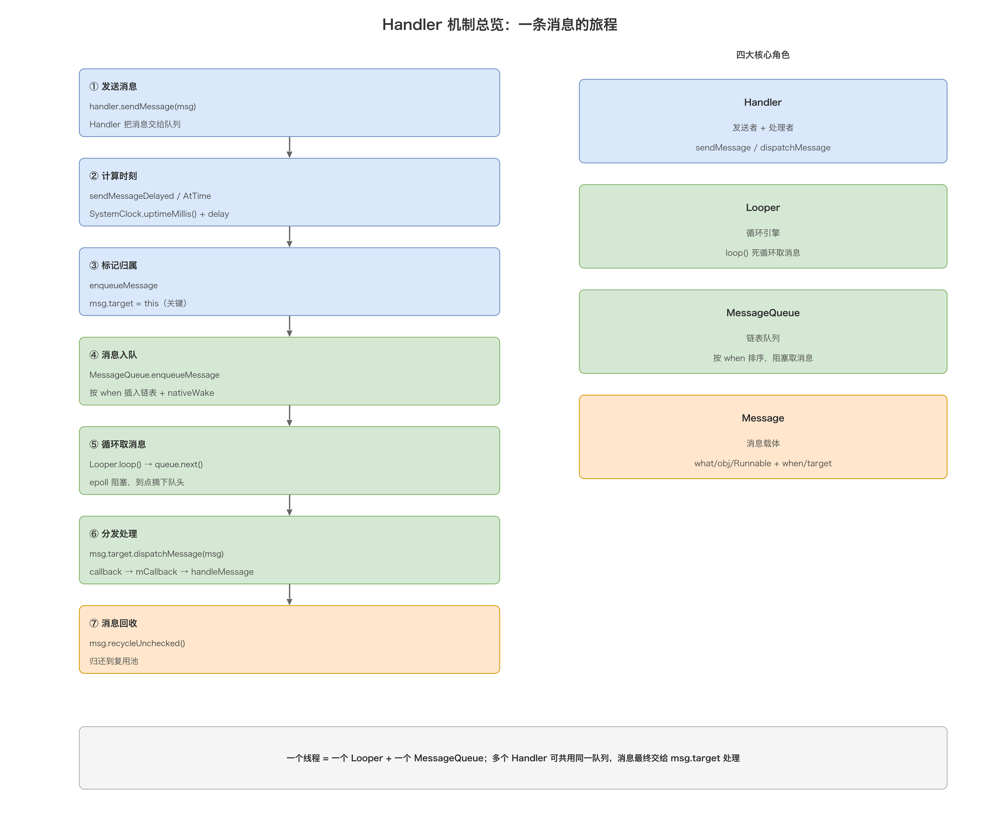
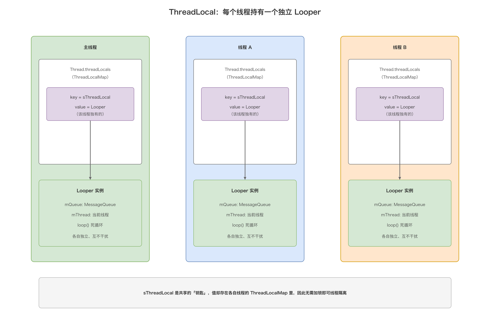
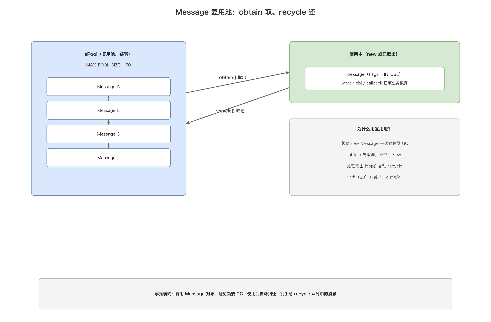
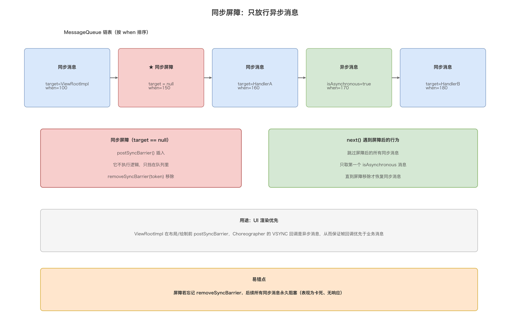
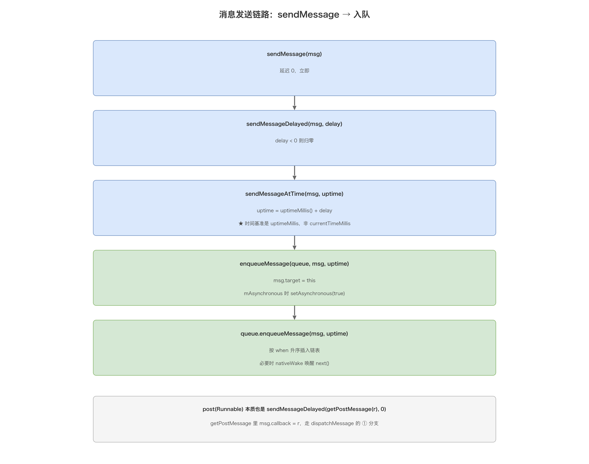
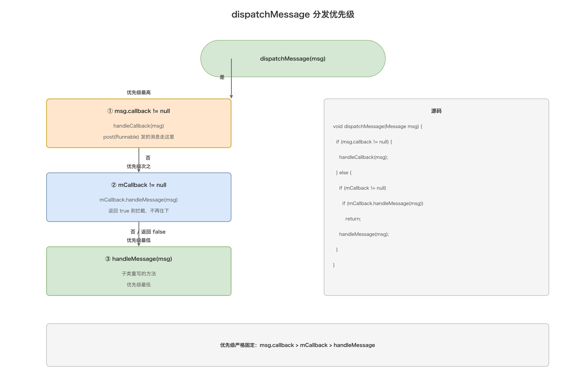
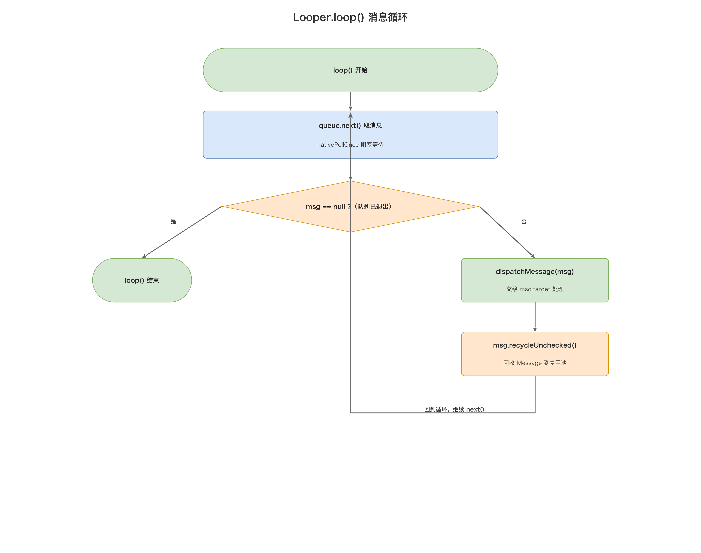
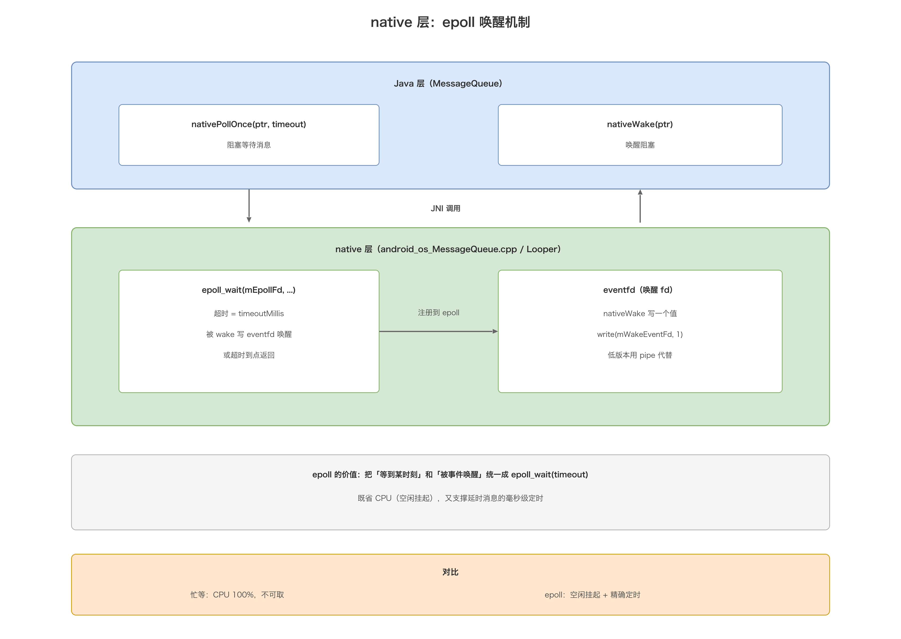

# 01. Android Handler 机制详解

> Handler 是 Android 消息驱动模型的「总闸」：它把「在哪个线程、什么时候、执行什么」这三件事统一成一条消息链。本文从源码出发，逐层拆解 `Handler` / `Looper` / `MessageQueue` / `Message` 四大核心类，并一路追到 native 层的 epoll 唤醒机制，最后落到内存泄漏与最佳实践。读完你会掌握「消息从发送到被处理」的每一步，以及「为什么主线程死循环却不 ANR」这类面试高频题的底层答案。

## 目录

- [一、Handler 机制全景](#一handler-机制全景)
  - [1.1 为什么需要 Handler](#11-为什么需要-handler)
  - [1.2 四大核心角色](#12-四大核心角色)
  - [1.3 一条消息的一生](#13-一条消息的一生)
- [二、ThreadLocal：Looper 的线程隔离](#二threadlocallooper-的线程隔离)
  - [2.1 ThreadLocal 的原理](#21-threadlocal-的原理)
  - [2.2 Looper.prepare 与 myLooper](#22-looperprepare-与-mylooper)
  - [2.3 主线程 Looper 的诞生](#23-主线程-looper-的诞生)
- [三、Message 与复用池](#三message-与复用池)
  - [3.1 Message 的字段](#31-message-的字段)
  - [3.2 obtain 复用池](#32-obtain-复用池)
  - [3.3 recycle 归还](#33-recycle-归还)
- [四、MessageQueue：消息队列与循环](#四messagequeue消息队列与循环)
  - [4.1 优先级链表结构](#41-优先级链表结构)
  - [4.2 enqueueMessage 入队](#42-enqueuemessage-入队)
  - [4.3 next 取消息](#43-next-取消息)
  - [4.4 同步屏障与异步消息](#44-同步屏障与异步消息)
  - [4.5 IdleHandler](#45-idlehandler)
- [五、Handler：消息的发送与分发](#五handler消息的发送与分发)
  - [5.1 构造与 Looper 绑定](#51-构造与-looper-绑定)
  - [5.2 发送消息的完整链路](#52-发送消息的完整链路)
  - [5.3 消息分发优先级](#53-消息分发优先级)
- [六、Looper：消息循环引擎](#六looper消息循环引擎)
  - [6.1 loop 死循环](#61-loop-死循环)
  - [6.2 quit 与 quitSafely](#62-quit-与-quitsafely)
  - [6.3 为什么主线程死循环不 ANR](#63-为什么主线程死循环不-anr)
- [七、HandlerThread：自带 Looper 的线程](#七handlerthread自带-looper-的线程)
- [八、native 层：epoll 唤醒机制](#八native-层epoll-唤醒机制)
  - [8.1 Java 层的 nativePollOnce / nativeWake](#81-java-层的-nativepollonce--nativewake)
  - [8.2 native 层的 epoll 实现](#82-native-层的-epoll-实现)
  - [8.3 为什么用 epoll 而不是忙等](#83-为什么用-epoll-而不是忙等)
- [九、内存泄漏与最佳实践](#九内存泄漏与最佳实践)
  - [9.1 泄漏原理](#91-泄漏原理)
  - [9.2 解决方案对比](#92-解决方案对比)
- [附：高频速记](#附高频速记)

## 一、Handler 机制全景

### 1.1 为什么需要 Handler

Android 规定**子线程不能直接更新 UI**（`ViewRootImpl.checkThread()` 会抛 `CalledFromWrongThreadException`），同时主线程又不能被耗时操作阻塞（否则 ANR）。于是需要一个机制：**子线程把「要做什么」包装成消息丢给主线程，主线程在自己的消息循环里排队执行**。这就是 Handler。

它要解决三个问题：

| 问题 | Handler 的答案 |
| --- | --- |
| 在哪个线程执行 | 消息进入目标线程的 `MessageQueue`，由该线程的 `Looper` 取出执行 |
| 什么时候执行 | `Message.when` 时间戳 + 延时/定时 |
| 执行什么 | `Message` 携带 `what`/`obj`/`Runnable` 等载荷 |

> 本质：Handler 是 Android 的**消息驱动（Message-Driven）**模型，而非抢占式多线程模型。它把并发问题收敛为「单线程内顺序消费消息」，从根上避免了 UI 操作的数据竞争。

### 1.2 四大核心角色

Handler 机制由四个类分工协作，缺一不可：

| 角色 | 职责 | 关键点 |
| --- | --- | --- |
| `Handler` | 消息的**发送者**与**处理者** | 持有 `Looper` 和 `MessageQueue`，`dispatchMessage` 分发 |
| `Looper` | 消息**循环引擎** | `loop()` 死循环取消息，`ThreadLocal` 保证每线程一个 |
| `MessageQueue` | 消息**队列** | 按 `when` 排序的链表，`next()` 阻塞取消息 |
| `Message` | 消息**载体** | `what`/`obj`/`Runnable` 载荷 + `when`/`target`/`next` |



一句话串起来：**Handler 把 Message 丢进 Looper 所属的 MessageQueue；Looper.loop() 不断从队列里 next() 取消息，取到后交给消息的 target（Handler）去 dispatchMessage 处理**。一个线程只有一个 Looper、一个 MessageQueue，但可以有多个 Handler。

### 1.3 一条消息的一生

以「子线程通过 Handler 通知主线程更新 TextView」为例：

```
子线程                                    主线程
  │                                         │
  │  mHandler.sendMessage(msg)              │
  │    → enqueueMessage: msg.target = handler│
  │    → MessageQueue.enqueueMessage        │
  │        (按 when 插入链表 + nativeWake)   │
  │                                         │  ← Looper.loop() 正在 next() 阻塞等待
  │                                         │  nativeWake 唤醒 epoll_wait
  │                                         │  next() 返回 msg
  │                                         │  msg.target.dispatchMessage(msg)
  │                                         │    → handleMessage(msg) 更新 UI
  │                                         │  msg.recycleUnchecked() 回收
```

这一条链路，就是贯穿全文的主线。后面几章分别放大其中的一环。

## 二、ThreadLocal：Looper 的线程隔离

### 2.1 ThreadLocal 的原理

`Looper` 之所以能「每个线程一个、互不干扰」，靠的是 `ThreadLocal`。它的核心是 `Thread` 对象内部的一个 `ThreadLocalMap`（`Thread.threadLocals` 字段）：

| 概念 | 说明 |
| --- | --- |
| `ThreadLocal` | 只是一个「钥匙」，本身不存值 |
| `ThreadLocalMap` | 存在**每个 Thread 内部**，key 是 ThreadLocal 实例的弱引用 |
| `set(v)` | 往「当前线程」的 map 里放 `(this, v)` |
| `get()` | 从「当前线程」的 map 里按 `this` 取值 |

```java
// ThreadLocal 核心（简化）
public T get() {
    Thread t = Thread.currentThread();
    ThreadLocalMap map = getMap(t);
    if (map != null) {
        ThreadLocalMap.Entry e = map.getEntry(this);
        if (e != null) return (T) e.value;
    }
    return setInitialValue();
}
```

关键点：**值永远存在「当前线程」里，所以天然线程隔离**，不需要加锁。这是 `Looper.sThreadLocal` 能「各线程各持一个 Looper」的底层原因。

### 2.2 Looper.prepare 与 myLooper

```java
public final class Looper {
    static final ThreadLocal<Looper> sThreadLocal = new ThreadLocal<Looper>();
    final MessageQueue mQueue;
    final Thread mThread;
    ...

    public static void prepare() {
        prepare(true);   // true 表示允许 quit
    }

    private static void prepare(boolean quitAllowed) {
        if (sThreadLocal.get() != null) {
            throw new RuntimeException("Only one Looper may be created per thread");
        }
        sThreadLocal.set(new Looper(quitAllowed));
    }

    public static Looper myLooper() {
        return sThreadLocal.get();
    }
}
```

`Looper` 构造时会同时创建属于自己的 `MessageQueue`：

```java
private Looper(boolean quitAllowed) {
    mQueue = new MessageQueue(quitAllowed);
    mThread = Thread.currentThread();
}
```

> 易错点：**一个线程只能 `prepare()` 一次**，重复调用会抛 `Only one Looper may be created per thread`。而 `myLooper()` 若在未 `prepare()` 的线程里调用，返回 `null`。

### 2.3 主线程 Looper 的诞生

主线程的 Looper 不是 `prepare()` 出来的，而是 `ActivityThread.main()` 里调用 `prepareMainLooper()`：

```java
public static void prepareMainLooper() {
    prepare(false);   // quitAllowed = false，主线程 Looper 不允许 quit
    synchronized (Looper.class) {
        if (sMainLooper != null) {
            throw new IllegalStateException("The main Looper has already been prepared.");
        }
        sMainLooper = myLooper();
    }
}
```

| 对比 | `prepare()` | `prepareMainLooper()` |
| --- | --- | --- |
| 调用者 | 任意线程（HandlerThread 等） | 仅主线程 `ActivityThread.main()` |
| `quitAllowed` | `true`（可退出） | `false`（不可退出，退出即崩溃风险） |
| 记录到 `sMainLooper` | 否 | 是 |



## 三、Message 与复用池

### 3.1 Message 的字段

`Message` 是消息载体，字段分三类：

```java
public final class Message implements Parcelable {
    public int what;          // 消息类型标识
    public int arg1;          // 轻量 int 参数
    public int arg2;          // 轻量 int 参数
    public Object obj;        // 任意对象参数
    public long when;         // 期望执行时刻（uptimeMillis）
    Handler target;           // 由谁处理（发送时被 enqueueMessage 设置）
    Runnable callback;        // post(Runnable) 时复用此字段
    Message next;             // 链表的 next 指针
    Bundle data;              // 复杂数据
    int flags;                // FLAG_IN_USE / FLAG_ASYNCHRONOUS
    ...
}
```

> 易错点：`arg1`/`arg2` 是 `int`，`obj` 是对象，`data` 是 `Bundle`——**别把大对象塞进 `arg1`，也别把简单 int 塞进 `Bundle`**。`obj` 适合传单个对象，跨进程才需要 `Bundle`（`setData`）。

### 3.2 obtain 复用池

频繁 `new Message()` 会触发大量 GC，所以 `Message` 用**享元模式（Flyweight）**做了对象池：

```java
private static final Object sPoolSync = new Object();
private static Message sPool;              // 池的链表头
private static int sPoolSize = 0;
private static final int MAX_POOL_SIZE = 50;

public static Message obtain() {
    synchronized (sPoolSync) {
        if (sPool != null) {
            Message m = sPool;
            sPool = m.next;
            m.next = null;
            m.flags = 0;      // 清 in-use 标记
            sPoolSize--;
            return m;
        }
    }
    return new Message();    // 池空则 new
}
```

`obtain()` 还有多个重载（`obtain(Handler)`、`obtain(what)`、`obtain(h, what, obj)` 等），本质都是先取池、再填字段，避免重复写初始化代码。



### 3.3 recycle 归还

```java
void recycleUnchecked() {
    flags = FLAG_IN_USE;
    what = 0; arg1 = 0; arg2 = 0; obj = null; replyTo = null;
    sendingUid = -1; when = 0; target = null; callback = null; data = null;
    synchronized (sPoolSync) {
        if (sPoolSize < MAX_POOL_SIZE) {
            next = sPool;
            sPool = this;
            sPoolSize++;
        }
    }
}
```

| 对比 | `new Message()` | `Message.obtain()` |
| --- | --- | --- |
| 分配 | 每次都 new | 先取池，池空才 new |
| GC 压力 | 高（消息频繁时明显） | 低 |
| 池上限 | — | 50（`MAX_POOL_SIZE`） |

> 易错点：**消息处理完后会被 `Looper.loop()` 自动 `recycleUnchecked()`**，所以别在 `handleMessage` 之后再去用这个 Message 的字段，也别手动 `recycle()` 一个还在队列里的消息（会污染复用池）。

## 四、MessageQueue：消息队列与循环

### 4.1 优先级链表结构

`MessageQueue` 内部并不是 `java.util.Queue`，而是一条**单向链表**，按 `Message.when`（执行时刻）**升序**排列，`mMessages` 指向队头：

```
mMessages
   │
   ▼
 [msg A: when=100] → [msg B: when=200] → [msg C: when=200] → null
   ▲ 队头（最早执行）
```

- 相同 `when` 时按入队先后（`enqueueMessage` 用 `when < p.when` 严格比较，等于时不插前面）。
- 这种结构让「取最早到期的消息」变成 O(1)，「插入」最坏 O(n)。

### 4.2 enqueueMessage 入队

```java
boolean enqueueMessage(Message msg, long when) {
    if (msg.target == null) {
        throw new IllegalArgumentException("Message must have a target.");
    }
    if (msg.isInUse()) {
        throw new IllegalStateException(msg + " This message is already in use.");
    }
    synchronized (this) {
        if (mQuitting) {
            msg.recycle();
            return false;
        }
        msg.markInUse();
        msg.when = when;
        Message p = mMessages;
        boolean needWake;
        if (p == null || when == 0 || when < p.when) {
            // 队列空 / 立即执行 / 比队头更早 → 插到队头
            msg.next = p;
            mMessages = msg;
            needWake = mBlocked;   // 若 next() 正在阻塞，需要唤醒
        } else {
            needWake = mBlocked && p.target == null && msg.isAsynchronous();
            Message prev;
            for (;;) {             // 找到插入位置
                prev = p;
                p = p.next;
                if (p == null || when < p.when) break;
                if (needWake && p.isAsynchronous()) needWake = false;
            }
            msg.next = p;
            prev.next = msg;
        }
        if (needWake) {
            nativeWake(mPtr);      // 唤醒阻塞中的 epoll_wait
        }
    }
    return true;
}
```

两个关键判断：

- **`needWake` 的精细计算**：只有当「队列头被替换」或「插入了队头之后的异步消息」且 next() 正在阻塞时，才需要 `nativeWake`。插入一个更晚的普通消息时，next() 会按现有超时自己醒来，无需唤醒。
- **同步锁**：整个入队 `synchronized(this)`，与 `next()` 互斥，保证链表并发安全。

### 4.3 next 取消息

`next()` 是整个机制的心脏，它**阻塞**等消息，返回最早到期的、且「越过同步屏障」的消息：

```java
Message next() {
    int nextPollTimeoutMillis = 0;
    for (;;) {
        nativePollOnce(ptr, nextPollTimeoutMillis);   // 阻塞等待（epoll）
        synchronized (this) {
            final long now = SystemClock.uptimeMillis();
            Message prevMsg = null;
            Message msg = mMessages;

            // ① 同步屏障：跳过所有同步消息，找第一个异步消息
            if (msg != null && msg.target == null) {
                do {
                    prevMsg = msg;
                    msg = msg.next;
                } while (msg != null && !msg.isAsynchronous());
            }

            if (msg != null) {
                if (now < msg.when) {
                    // ② 还没到点：算一个超时，回去继续睡
                    nextPollTimeoutMillis = (int) Math.min(msg.when - now, Integer.MAX_VALUE);
                } else {
                    // ③ 到点了：摘下并返回
                    mBlocked = false;
                    if (prevMsg != null) prevMsg.next = msg.next;
                    else mMessages = msg.next;
                    msg.next = null;
                    msg.markInUse();
                    return msg;
                }
            } else {
                // ④ 队列空：无限等待（timeout = -1）
                nextPollTimeoutMillis = -1;
            }

            if (mQuitting) { dispose(); return null; }   // ⑤ 退出

            // ⑥ IdleHandler 逻辑（见 4.5）
            ...
        }
    }
}
```

> 易错点：`nativePollOnce` 的 `nextPollTimeoutMillis` 语义——`0` 立即返回、`>0` 睡这么久、`-1` 无限睡。它决定了「延时消息」的精度：**睡到最近一条消息到期为止**。

### 4.4 同步屏障与异步消息

「同步屏障（Sync Barrier）」是一类特殊的 Message：**它的 `target == null`**。它不执行任何逻辑，只像一堵墙挡在队列里：

- 屏障之后，`next()` 只取**异步消息**（`isAsynchronous() == true`），普通同步消息全部被跳过；
- 直到调用 `removeSyncBarrier(token)` 移除屏障，同步消息才恢复处理。

```java
public int postSyncBarrier() {
    return postSyncBarrier(SystemClock.uptimeMillis());
}
// 返回的 token 用于 removeSyncBarrier(token)
```

| 消息类型 | `target` | `isAsynchronous` | 能否越过屏障 |
| --- | --- | --- | --- |
| 同步消息（默认） | 非空 | false | 否 |
| 异步消息 | 非空 | true | 是 |
| 同步屏障 | **null** | — | 屏障本身 |

用途：**UI 渲染优先**。`ViewRootImpl` 在请求布局/绘制时 `postSyncBarrier`，而 `Choreographer` 的 VSYNC 回调消息是异步消息，从而保证「帧回调优先于业务消息」被处理，减少卡顿。

```java
// 发送异步消息
Message msg = Message.obtain();
msg.setAsynchronous(true);
handler.sendMessage(msg);
```

> 易错点：屏障若忘记 `removeSyncBarrier`，会导致后续**所有同步消息永久阻塞**（表现为界面卡死、事件无响应）。这是系统内部极谨慎使用的原因。



### 4.5 IdleHandler

当队列「暂时没有消息要处理」时，`next()` 会顺带执行 `IdleHandler`，用于「空闲时做点低优先级的事」：

```java
public interface IdleHandler {
    boolean queueIdle();   // 返回 true 表示保留（下次空闲再执行），false 表示移除
}
```

典型场景：`ActivityThread` 用它做 GC、`LeakCanary` 用它做空闲检测。

> 易错点：`IdleHandler.queueIdle()` 里**不能做耗时操作**，因为它会阻塞 `next()` 的返回，间接阻塞消息循环；返回 `true` 则会被反复触发。

## 五、Handler：消息的发送与分发

### 5.1 构造与 Looper 绑定

```java
public Handler() {
    this(null, false);
}

public Handler(Callback callback, boolean async) {
    mLooper = Looper.myLooper();
    if (mLooper == null) {
        throw new RuntimeException(
            "Can't create handler inside thread that has not called Looper.prepare()");
    }
    mQueue = mLooper.mQueue;
    mCallback = callback;
    mAsynchronous = async;
}
```

| 构造方式 | 绑定 Looper |
| --- | --- |
| `new Handler()` | 当前线程的 `Looper.myLooper()` |
| `new Handler(Looper.getMainLooper())` | 主线程 Looper |
| `new Handler(looper)` | 指定 Looper（如 HandlerThread 的） |
| `new Handler(callback)` | 当前线程 + 处理回调 `mCallback` |

> 易错点：在**没有 Looper 的普通子线程**里 `new Handler()` 会抛 `RuntimeException`——这正是「Can't create handler inside thread that has not called Looper.prepare()」的来源。

### 5.2 发送消息的完整链路

从 `sendMessage` 到真正入队，是一条层层转发的调用链：

```java
public final boolean sendMessage(Message msg) {
    return sendMessageDelayed(msg, 0);
}

public final boolean sendMessageDelayed(Message msg, long delayMillis) {
    if (delayMillis < 0) delayMillis = 0;
    return sendMessageAtTime(msg, SystemClock.uptimeMillis() + delayMillis);
}

public boolean sendMessageAtTime(Message msg, long uptimeMillis) {
    MessageQueue queue = mQueue;
    if (queue == null) return false;
    return enqueueMessage(queue, msg, uptimeMillis);
}

private boolean enqueueMessage(MessageQueue queue, Message msg, long uptimeMillis) {
    msg.target = this;                       // ★ 关键：把 target 指向自己
    if (mAsynchronous) msg.setAsynchronous(true);
    return queue.enqueueMessage(msg, uptimeMillis);
}
```

要点：

- 时间基准是 `SystemClock.uptimeMillis()`（**开机到现在的毫秒数，不含深睡**），不是 `System.currentTimeMillis()`（墙上时钟）。
- `msg.target = this` 是整条链路的关键一环：它让 `Looper.loop()` 知道「这条消息该交给哪个 Handler 处理」。

`post(Runnable)` 本质也是发消息，只是把 Runnable 塞进 `Message.callback`：

```java
public final boolean post(Runnable r) {
    return sendMessageDelayed(getPostMessage(r), 0);
}
private static Message getPostMessage(Runnable r) {
    Message m = Message.obtain();
    m.callback = r;
    return m;
}
```



### 5.3 消息分发优先级

`dispatchMessage` 是消息的「最终落脚点」，优先级严格固定：

```java
public void dispatchMessage(Message msg) {
    if (msg.callback != null) {
        handleCallback(msg);                 // ① 最高：post(Runnable)
    } else {
        if (mCallback != null) {
            if (mCallback.handleMessage(msg)) {
                return;                      // ② 次之：构造传入的 Callback（返回 true 则拦截）
            }
        }
        handleMessage(msg);                  // ③ 最低：子类重写
    }
}
```

| 优先级 | 来源 | 说明 |
| :---: | --- | --- |
| ① 最高 | `msg.callback` | `post(Runnable)` 发的消息 |
| ② 次之 | `mCallback` | 构造 `Handler(Callback)` 时传入 |
| ③ 最低 | `handleMessage` | 继承 Handler 重写的方法 |



> 易错点：如果 `mCallback.handleMessage(msg)` 返回 `true`，则 `handleMessage` 不会被调用——`Callback` 接口适合「多个 Handler 共用一套处理逻辑、避免子类膨胀」的场景。

## 六、Looper：消息循环引擎

### 6.1 loop 死循环

```java
public static void loop() {
    final Looper me = myLooper();
    if (me == null) {
        throw new RuntimeException("No Looper; Looper.prepare() wasn't called on this thread.");
    }
    final MessageQueue queue = me.mQueue;
    ...
    for (;;) {
        Message msg = queue.next();          // 可能阻塞
        if (msg == null) {
            return;                          // 队列退出，循环结束
        }
        ...
        msg.target.dispatchMessage(msg);     // 交给 target 处理
        ...
        msg.recycleUnchecked();              // 处理完回收
    }
}
```

`loop()` 返回的唯一途径是 `queue.next()` 返回 `null`（即 `mQuitting == true`）。



### 6.2 quit 与 quitSafely

| 方法 | 行为 | 安全性 |
| --- | --- | --- |
| `quit()` | 立即退出，**丢弃队列里所有未处理消息** | 可能丢消息 |
| `quitSafely()` | 处理完**当前时间点之前**到期的消息后再退出 | 更安全 |
| `quitSafely()` + 同步屏障 | 屏障后的同步消息仍可能被丢弃 | 注意屏障 |

两者最终都会让 `MessageQueue.mQuitting = true`，使 `next()` 返回 `null`、`loop()` 退出。

> 易错点：**主线程的 Looper 是 `quitAllowed = false`**，调用 `quit()` 会抛异常（不同版本表现不同）。业务线程退出前记得 `quitSafely()`，避免 HandlerThread 泄漏。

### 6.3 为什么主线程死循环不 ANR

这是面试高频题。答案分两层：

1. **循环不等于忙等**：`loop()` 空闲时阻塞在 `nativePollOnce` → `epoll_wait`，**线程挂起、不占 CPU**。有消息/IO 事件才被唤醒。
2. **ANR 是「消息处理超时」，不是「循环本身」**：主线程的每件事（Activity 生命周期、触摸、绘制）都是一条消息。某条消息执行超过阈值（如 input 5s、broadcast 10s），才会触发 ANR。循环本身是「一直有空就干、没空就睡」的正常状态。

```java
// ActivityThread.main() 的经典收尾
Looper.prepareMainLooper();
...
Looper.loop();   // 从这里开始，主线程进入消息驱动的一生
```

> 关键理解：**主线程不是「因为 loop() 而忙」，而是「通过 loop() 才能干活」**。杀掉 loop() 反而让主线程什么也做不了。

## 七、HandlerThread：自带 Looper 的线程

普通 `Thread` 没有 Looper，无法直接用 Handler。`HandlerThread` 就是「帮你准备好 Looper 的线程」：

```java
public class HandlerThread extends Thread {
    Looper mLooper;

    @Override
    public void run() {
        Looper.prepare();                    // ① 准备 Looper
        synchronized (this) {
            mLooper = Looper.myLooper();
            notifyAll();                     // ② 通知等待者「Looper 已就绪」
        }
        onLooperPrepared();
        Looper.loop();                       // ③ 进入循环
    }

    public Looper getLooper() {
        synchronized (this) {
            while (isAlive() && mLooper == null) {
                try { wait(); } catch (InterruptedException e) {}
            }
        }
        return mLooper;
    }
}
```

| 对比 | 普通 Thread | HandlerThread |
| --- | --- | --- |
| 有 Looper | 否，需手动 `prepare()` | 是，`run()` 内自动 |
| 用法 | `new Thread{}.start()` | `new HandlerThread("x").start()` + `new Handler(thread.getLooper())` |
| 退出 | 自然结束 | 需 `quit()` / `quitSafely()` |

> 易错点：`getLooper()` 用了 `wait/notify` 解决「Looper 未初始化就调用」的竞态；用完记得 `quitSafely()`，否则线程常驻不退。

## 八、native 层：epoll 唤醒机制

### 8.1 Java 层的 nativePollOnce / nativeWake

`MessageQueue` 里有两个 native 方法，是「Java 消息队列」与「Linux IO 多路复用」的桥：

```java
private native void nativePollOnce(long ptr, int timeoutMillis);
private native void nativeWake(long ptr);
```

- `nativePollOnce`：阻塞等待，等价于「让线程睡到有消息/事件为止」。
- `nativeWake`：唤醒 `nativePollOnce` 的阻塞。

### 8.2 native 层的 epoll 实现

`native` 层（`android_os_MessageQueue.cpp`）里，`NativeMessageQueue` 内部持有一个 `Looper`（native 的 `utils/Looper.h`），核心是 **epoll**：

```cpp
// 初始化（简化）
mWakeEventFd = eventfd(0, EFD_NONBLOCK | EFD_CLOEXEC);  // 创建一个 eventfd
mEpollFd = epoll_create(EPOLL_SIZE_HINT);
epoll_ctl(mEpollFd, EPOLL_CTL_ADD, mWakeEventFd, &eventItem);

// nativeWake：往 eventfd 写一个值，epoll_wait 立即返回
void NativeMessageQueue::wake() {
    uint64_t inc = 1;
    write(mWakeEventFd, &inc, sizeof(uint64_t));
}

// nativePollOnce：epoll_wait 阻塞，被 wake 写 eventfd 唤醒
int Looper::pollOnce(int timeoutMillis, ...) {
    ...
    epoll_wait(mEpollFd, eventItems, EPOLL_MAX_EVENTS, timeoutMillis);
    ...
}
```

| 版本 | 唤醒 fd | 说明 |
| --- | --- | --- |
| Android 5.0+ | `eventfd` | 轻量、计数、无需维护缓冲区 |
| 旧版本 | `pipe` | 写端写字节唤醒读端 |



### 8.3 为什么用 epoll 而不是忙等

| 方案 | CPU 占用 | 说明 |
| --- | --- | --- |
| 忙等（while 空转） | 100% | 空转烧 CPU，不可接受 |
| `wait/notify` | 低 | 只能「阻塞/唤醒」，无法精确「睡到某时刻」 |
| `epoll` + 超时 | 低 | 既能被 `nativeWake` 立即唤醒，又能「精确睡到消息到期时刻」 |

epoll 的价值在于：**把「等到某时刻」和「被事件唤醒」统一成一个 `epoll_wait(timeout)` 调用**，既省 CPU，又支撑了延时消息的毫秒级定时。

## 九、内存泄漏与最佳实践

### 9.1 泄漏原理

经典泄漏链：**Activity →（内部类）Handler → 未处理的 Message → MessageQueue → 主线程 Looper（静态、常驻）**。

因为 `Message.target` 强引用 `Handler`，`Handler` 是 Activity 的非静态内部类（隐式持有 Activity），所以一条**延时消息**没被处理前，Activity 就始终无法被回收。

```
主线程 Looper(静态) → MessageQueue → Message(延时未处理) → Handler → Activity
```

### 9.2 解决方案对比

| 方案 | 做法 | 优点 | 缺点 |
| --- | --- | --- | --- |
| 静态内部类 + 弱引用 | `static class H extends Handler` + `WeakReference<Activity>` | 彻底断引用 | 代码稍繁琐 |
| 移除消息 | `onDestroy` 里 `handler.removeCallbacksAndMessages(null)` | 简单直接 | 容易遗漏 |
| `Lifecycle` 感知 | 结合 `LifecycleOwner` 自动清理 | 优雅 | 依赖 lifecycle 库 |

```java
// 推荐写法：静态内部类 + 弱引用
static class MyHandler extends Handler {
    private final WeakReference<Activity> ref;
    MyHandler(Activity a) { ref = new WeakReference<>(a); }
    @Override public void handleMessage(Message msg) {
        Activity a = ref.get();
        if (a != null) { /* 更新 UI */ }
    }
}
```

## 附：高频速记

1. **四大件**：`Handler`（发送+处理）、`Looper`（循环）、`MessageQueue`（链表队列）、`Message`（载体）。
2. **线程绑定**：`Looper.sThreadLocal` + `Thread.threadLocals`，一个线程最多一个 Looper；主线程由 `prepareMainLooper()` 创建且 `quitAllowed=false`。
3. **发送链路**：`sendMessage → sendMessageDelayed → sendMessageAtTime → enqueueMessage`，时间基准 `SystemClock.uptimeMillis()`。
4. **入队关键**：`msg.target = this`；按 `when` 升序插入；必要时 `nativeWake` 唤醒。
5. **取消息**：`next()` 阻塞在 `nativePollOnce`（epoll_wait），到点摘队头返回；队列空则无限等。
6. **分发优先级**：`msg.callback` > `mCallback` > `handleMessage`。
7. **同步屏障**：`target == null` 的消息，屏障后只放行异步消息；`ViewRootImpl` 用它保证 UI 渲染优先。
8. **复用池**：`Message.obtain()` 取池（`sPool`，上限 50），处理完自动 `recycleUnchecked()`。
9. **主线程不死循环 ANR**：空闲时 epoll 挂起不占 CPU；ANR 是「消息处理超时」而非循环本身。
10. **内存泄漏**：延时消息 `target` 强引用 Handler 再链到 Activity，用「静态内部类 + 弱引用 + 移除消息」三连解决。
