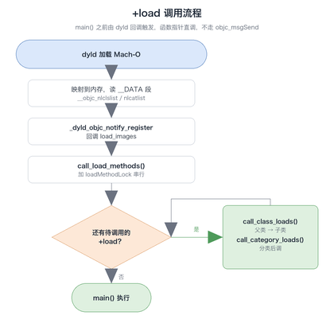
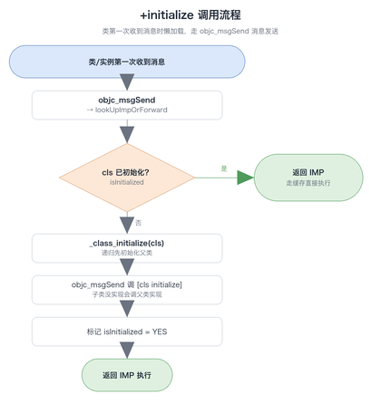

# 08. load 与 initialize 分析

> `+load` 和 `+initialize` 是 OC 中两个会被 Runtime 自动调用的特殊类方法，但两者的调用时机、调用方式和行为差异很大：`+load` 在 main() 之前由 dyld 回调触发、函数指针直调，`+initialize` 在类第一次收到消息时走 `objc_msgSend` 惰性触发。这篇从两者的调用时机与底层源码讲起，逐一分析调用顺序、Category 与继承下的行为差异、`+initialize` 被调用多次的问题、Method Swizzling 应该放在哪里执行，最后落到启动性能的影响与使用场景。消息发送机制的底层细节见《03-Runtime机制分析》，本文聚焦这两个特殊方法本身。

## 目录

- [一、基本定义与核心区别](#一基本定义与核心区别)
- [二、+load 深入分析](#二load-深入分析)
- [三、+initialize 深入分析](#三initialize-深入分析)
- [四、+initialize 的多次调用问题](#四initialize-的多次调用问题)
- [五、Category 与继承下的行为差异](#五category-与继承下的行为差异)
- [六、Method Swizzling 的执行时机](#六method-swizzling-的执行时机)
- [七、load 与 initialize 的作用](#七load-与-initialize-的作用)
- [八、性能影响与启动优化](#八性能影响与启动优化)
- [九、常见面试问题](#九常见面试问题)
- [附：高频速记](#附高频速记)

---

## 一、基本定义与核心区别

### 1. 两个方法是什么

`+load` 在类被加载进内存时由 Runtime 自动调用，发生在 main() 函数执行之前：

```objc
@implementation MyClass
+ (void)load {
    NSLog(@"MyClass loaded");
}
@end
```

`+initialize` 在类第一次收到消息时由 Runtime 自动调用，是一种懒加载机制：

```objc
@implementation MyClass
+ (void)initialize {
    NSLog(@"MyClass initialized");
}
@end
```

第一次调用类方法 `[MyClass someMethod]`、或者第一次创建实例 `[[MyClass alloc] init]`，都会触发 `+initialize`。如果一个类从头到尾没被使用过，它的 `+initialize` 永远不会执行。

### 2. 核心区别对比表

| 特性 | +load | +initialize |
| ---- | ----- | ----------- |
| 调用时机 | main() 之前，类/分类加载进内存时 | 类第一次收到消息时 |
| 调用方式 | 直接通过函数指针调用 | 走 `objc_msgSend` 消息发送 |
| 调用次数 | 每个类/分类恰好一次 | 可能被调用多次 |
| 是否惰性 | 否，只要编译进可执行文件就必被调用 | 是，用到才调 |
| 是否阻塞启动 | 是 | 否 |
| Category 的行为 | 主类和所有分类的 +load 都会被调用 | 分类实现会覆盖主类实现 |
| 继承行为 | 不继承（子类没写就不会调） | 子类没实现会调父类的实现 |
| 线程安全 | 是（loadMethodLock 保护下串行） | 是（内部有锁） |
| 消息转发 | 不触发 | 遵循完整消息发送流程 |

---

## 二、+load 深入分析

### 1. 调用时机：dyld 加载流程

`+load` 的调用发生在 dyld 加载镜像（image）的过程中，整个链路是：



对应到文字流程：

1. dyld 加载 Mach-O 可执行文件和动态库，映射到内存；
2. 读取 `__DATA` 段中的 `__objc_nlclslist`（non-lazy class，非懒加载类列表）和 `__objc_nlcatlist`（non-lazy category，非懒加载分类列表）；
3. dyld 通过 `_dyld_objc_notify_register` 注册的回调通知 objc Runtime，触发 `load_images`；
4. Runtime 调用 `call_load_methods()`，先调用所有类的 `+load`，再调用所有分类的 `+load`；
5. 所有 `+load` 执行完毕后，main() 才开始执行。

> **懒加载类 vs 非懒加载类**：实现了 `+load` 方法的类会被编译器写进 `__objc_nlclslist`，成为「非懒加载类」，在启动时就会被加载和初始化；没实现 `+load` 的类是「懒加载类」，只有第一次收到消息时才加载。这也是为什么实现 `+load` 本身就会拖慢启动——它把整个类的加载从惰性变成了急切。

### 2. 调用方式：函数指针直调

Runtime 调用 `+load` 时不经过 `objc_msgSend`，而是取出 IMP 直接调用：

```c
// Runtime 源码简化（objc-runtime-new.mm）
typedef void(*load_method_t)(id, SEL);
load_method_t load_method = (load_method_t)method_getImplementation(m);
load_method((id)cls, @selector(load));
```

直接调用带来两个必然结果：

- 不走方法查找，也就不会触发消息转发；
- 调用哪个 IMP 在编译期就已经确定，所以分类的 `+load` 不会「覆盖」主类的 `+load`——Runtime 会把主类和每个分类的 `+load` 分别记录下来逐个调用。

### 3. 调用顺序规则

`+load` 的调用顺序有四条规则：

1. **父类先于子类**：Runtime 保证调用子类的 `+load` 之前，其父类的 `+load` 已经执行完毕；
2. **类先于分类**：所有类的 `+load` 执行完，才轮到分类的 `+load`；
3. **同级别按编译顺序**：没有继承关系的类之间按 Compile Sources 中的编译顺序执行，多个分类之间也按编译顺序；
4. **不同镜像按依赖关系**：被依赖的动态库中的 `+load` 先执行。

```objc
@implementation SuperClass
+ (void)load { NSLog(@"1. SuperClass +load"); }
@end

@implementation SubClass : SuperClass
+ (void)load { NSLog(@"2. SubClass +load"); }
@end

@implementation SubClass (Category)
+ (void)load { NSLog(@"3. SubClass+Category +load"); }
@end

// 输出：
// 1. SuperClass +load
// 2. SubClass +load
// 3. SubClass+Category +load
```

### 4. 底层实现：call_load_methods

Runtime 在 `load_images` 里调用 `call_load_methods()`，实现逻辑分两步：先消费类的 `+load` 列表，再消费分类的 `+load` 列表：

```c
void call_load_methods(void)
{
    bool more_categories;
    void *pool = objc_autoreleasePoolPush();

    // 1. 反复调用所有类的 +load，直到列表为空
    while (loadable_classes_used > 0) {
        call_class_loads();
    }

    // 2. 调用所有分类的 +load（过程中可能新增可加载的类）
    more_categories = call_category_loads();

    // 3. 兜底：跑一遍刚才新出现的类
    if (loadable_classes_used > 0 || more_categories) {
        call_class_loads();
    }

    objc_autoreleasePoolPop(pool);
}
```

`call_class_loads` 内部按逆序遍历 `loadable_classes` 数组（保证父类先于子类），对每个类取出 `+load` 的 IMP 直接调用：

```c
static void call_class_loads(void)
{
    for (int i = 0; i < loadable_classes_used; i++) {
        Class cls = loadable_classes[i].cls;
        // 取出 +load 的 IMP
        Method m = lookup_method(cls, sel_registerName("load"), ...);
        if (m && m->imp) {
            load_method_t load_method = (load_method_t)m->imp;
            // 函数指针直调，不走 objc_msgSend
            load_method(loadable_classes[i].cls, @selector(load));
        }
    }
}
```

整个过程由 `loadMethodLock` 递归锁保护，`+load` 串行执行，天然线程安全，且每个类的 `+load` 实现恰好被调用一次。

---

## 三、+initialize 深入分析

### 1. 调用时机：首次收到消息

`+initialize` 是惰性的：类第一次收到消息（不管是类方法还是实例方法）时才触发。下图是完整的调用流程：



### 2. 调用方式：objc_msgSend

`+initialize` 通过 `objc_msgSend` 调用，遵循完整的消息发送机制（方法查找、缓存、转发）：

```c
// Runtime 源码简化
void _class_initialize(Class cls) {
    // ...
    ((void(*)(Class, SEL))objc_msgSend)((id)cls, @selector(initialize));
}
```

走消息发送的直接结果是：分类的 `+initialize` 会像其他方法一样「覆盖」主类的 `+initialize`——消息查找时分类方法排在方法列表前面，找到分类的实现就直接调用，主类的版本永远不会被调到。

### 3. 底层实现：lookUpImpOrForward 触发

`+initialize` 的触发点在方法查找函数 `lookUpImpOrForward` 里：每次查找 IMP 之前，先检查类是否已初始化，没初始化就先调 `_class_initialize`：

```c
IMP lookUpImpOrForward(Class cls, SEL sel, ...) {
    // 检查类是否已初始化
    if (!cls->isInitialized()) {
        _class_initialize(cls);
    }
    // 继续查找方法实现...
}
```

`_class_initialize` 的核心逻辑是「先父后子」的递归初始化：

```c
void _class_initialize(Class cls) {
    // 1. 递归先初始化父类，保证父类的 +initialize 先执行
    Class supercls;
    BOOL needsInitialize = YES;
    supercls = cls->getSuperclass();
    if (supercls && !supercls->isInitialized()) {
        _class_initialize(supercls);
    }

    // 2. 加锁，标记正在初始化（防止其他线程重复进入）
    //    classInitLock / initializing 标志位

    // 3. 通过 objc_msgSend 调用 +initialize
    //    注意：走消息发送，子类没实现会查到父类的实现
    ((void(*)(Class, SEL))objc_msgSend)((id)cls, @selector(initialize));

    // 4. 标记初始化完成，唤醒等待线程
    //    isInitialized = YES
}
```

### 4. 线程安全与死锁

`+initialize` 的线程安全由 Runtime 保证：

- 初始化过程中类的状态被标记为「初始化中」，其他线程同时对同一个类发消息会阻塞等待，不会重复执行 `+initialize`；
- 父类初始化完成后，子类的初始化才会继续。

但要注意潜在的死锁场景：如果类 A 的 `+initialize` 里触发了类 B 的首次消息发送，Runtime 会嵌套进入 B 的 `_class_initialize`；此时如果另一个线程正在初始化 B、又在等 A，就可能形成锁等待环。所以 `+initialize` 里尽量不要做跨类的复杂初始化逻辑。

---

## 四、+initialize 的多次调用问题

### 1. 问题复现：父类实现可能被执行多次

`+initialize` 走消息发送，如果子类没有实现 `+initialize`，子类首次收到消息时会通过继承链查到父类的实现并调用。这意味着父类的 `+initialize` 可能因为不同子类的初始化被执行多次：

```objc
@implementation SuperClass
+ (void)initialize {
    NSLog(@"SuperClass +initialize, self = %@", self);
}
@end

@implementation SubClass : SuperClass
// 没有实现 +initialize
@end

// 分别触发两个类的首次消息
[SuperClass new];   // SuperClass +initialize, self = SuperClass
[SubClass new];     // SuperClass +initialize, self = SubClass
                    // 注意：父类实现被执行了两次，且 self 不同！
```

第二行输出里的 `self` 是 `SubClass`——因为这次是子类发起的消息发送，`objc_msgSend(SubClass, @selector(initialize))` 沿继承链找到父类实现，传入的接收者还是子类。如果父类的 `+initialize` 里做了单例创建、静态变量初始化这类「只能做一次」的事，就会被重复执行。

### 2. 两种解决方案

方案一：`dispatch_once` 保护，无论 self 是谁，初始化逻辑只执行一次：

```objc
+ (void)initialize {
    static dispatch_once_t onceToken;
    dispatch_once(&onceToken, ^{
        [self setupSomething];
    });
}
```

方案二：类型检查，只有 self 是本类时才执行，子类触发的调用直接跳过：

```objc
+ (void)initialize {
    if (self == [SuperClass class]) {
        [self setupSomething];
    }
}
```

两种方案的差别：`dispatch_once` 保证「逻辑只跑一次」，但子类仍然会进入父类的 `+initialize`；类型检查保证「只有本类初始化才跑」，子类不进入。多数场景推荐类型检查，语义更清晰；如果有子类也需要这段初始化逻辑（且希望每个子类各跑一次），不加保护反而是对的——此时每次调用传入的 self 不同，逻辑天然按类隔离。

---

## 五、Category 与继承下的行为差异

### 1. Category 的 +load：全部调用

分类的 `+load` 不会覆盖主类的 `+load`，主类和每个分类的 `+load` 都会被调用：

```objc
@implementation MyClass
+ (void)load { NSLog(@"MyClass +load"); }
@end

@implementation MyClass (CategoryA)
+ (void)load { NSLog(@"MyClass+CategoryA +load"); }
@end

@implementation MyClass (CategoryB)
+ (void)load { NSLog(@"MyClass+CategoryB +load"); }
@end

// 输出（三个都会调用，分类之间按编译顺序）：
// MyClass +load
// MyClass+CategoryA +load
// MyClass+CategoryB +load
```

原因是 `+load` 是函数指针直调：Runtime 在准备阶段把主类和各分类的 `+load` IMP 分别收集进 `loadable_classes` 和 `loadable_categories`，逐个调用，不存在方法查找和覆盖。

### 2. Category 的 +initialize：覆盖主类

分类实现了 `+initialize` 时，只有分类的版本会被调用：

```objc
@implementation MyClass
+ (void)initialize { NSLog(@"MyClass +initialize"); }
@end

@implementation MyClass (Category)
+ (void)initialize { NSLog(@"MyClass+Category +initialize"); }
@end

// 输出（只有分类的会被调用）：
// MyClass+Category +initialize
```

原因是 `+initialize` 走 `objc_msgSend`：消息查找时分类方法排在主类方法前面，查到分类的实现就直接返回，主类的实现永远没机会执行。这和普通方法在分类中的覆盖行为一致。

### 3. 继承行为的差异

`+load` 不继承：子类没有实现 `+load`，Runtime 就不会为它调用任何 `+load`（不会去调父类的）。因为直调列表里只有「自己实现了 `+load`」的类。

`+initialize` 继承：子类没实现时，会通过消息发送的继承链调用父类的实现——这就是第四节多次调用问题的根源。

两者的差异本质上是「直调 vs 消息发送」这一个决定派生出来的：直调绕过了方法查找，自然也没有继承查找和覆盖；消息发送的所有特性（继承、覆盖、转发）都会作用于 `+initialize`。

---

## 六、Method Swizzling 的执行时机

Method Swizzling 应该在 `+load` 还是 `+initialize` 中执行？结论是 `+load`，原因有三点。

### 1. 推荐 +load 的三个原因

第一，`+load` 天然只执行一次。Runtime 保证每个类的 `+load` 只被调用一次，且在 `loadMethodLock` 保护下串行执行，不需要额外的防重复措施。常见的在 `+load` 里包一层 `dispatch_once` 的写法实际上是多余的，属于防御性编程习惯。

第二，线程安全。Swizzling 操作（`class_addMethod` + `method_exchangeImplementations`）涉及多个步骤，不是原子操作。`+load` 在加锁环境下串行执行，天然避免了与其他线程的竞争；而 `+initialize` 可能在多线程下被触发，即使入口用 `dispatch_once` 保护，swizzling 内部多步操作之间仍存在竞争窗口。

第三，调用顺序有保证。Runtime 保证父类的 `+load` 先于子类执行，这对继承链上的 swizzle 很重要——如果父类和子类分别 swizzle 同一个方法，顺序错了方法查找链会出问题。`+initialize` 的调用时机取决于「哪个类先收到消息」，不可控。

```objc
+ (void)load {
    static dispatch_once_t onceToken;
    dispatch_once(&onceToken, ^{
        Class cls = [self class];
        Method original = class_getInstanceMethod(cls, @selector(viewDidLoad));
        Method swizzled = class_getInstanceMethod(cls, @selector(xxx_viewDidLoad));
        // 先 add 再 exchange，防止 originalSel 是父类方法时把交换污染到父类
        BOOL didAdd = class_addMethod(cls,
                                      original.method_getName(),
                                      method_getImplementation(swizzled),
                                      method_getTypeEncoding(original));
        if (didAdd) {
            class_replaceMethod(cls,
                                swizzled.method_getName(),
                                method_getImplementation(original),
                                method_getTypeEncoding(original));
        } else {
            method_exchangeImplementations(original, swizzled);
        }
    });
}
```

### 2. 不推荐 +initialize 的三个问题

第一，子类继承导致多次调用。如果子类没实现 `+initialize`，父类的实现会被多次调用。多次执行 `method_exchangeImplementations` 会把方法换回去再换过来，swizzle 直接失效。必须用 `dispatch_once` 或类型检查保护，仅用类型检查在并发场景下也不够安全。

第二，swizzling 的多步操作非原子，`+initialize` 的调用线程不可控，存在竞争窗口。

第三，潜在死锁风险。`+initialize` 内部有初始化锁，复杂场景下（比如 A 类的 `+initialize` 触发 B 类的初始化）可能产生锁等待环。swizzling 逻辑越复杂，风险越高。

---

## 七、load 与 initialize 的作用

两者的本质都是「Runtime 自动调用的钩子」，但分工不同：`+load` 是启动期的确定性钩子，解决「必须赶在一切业务代码之前就绪」的问题；`+initialize` 是惰性钩子，解决「类级别、只需一次、但不想拖慢启动」的问题。

### 1. +load 的作用

`+load` 的价值浓缩成三个词：够早、只一次、串行安全。围绕这三个特性，它承担三类职责。

**(1) Method Swizzling（最常见、几乎唯一非用不可的场景）**

Swizzling 必须在任何被交换的方法被调用之前完成，否则交换前已经跑过的调用不受影响。`+load` 在 main() 之前执行，是所有业务代码的天然分界线；同时它只执行一次、串行加锁，恰好匹配 Swizzling「一次到位、避免竞争」的要求。详细取舍见第六章。

```objc
+ (void)load {
    static dispatch_once_t onceToken;
    dispatch_once(&onceToken, ^{
        Class cls = [self class];
        Method original = class_getInstanceMethod(cls, @selector(viewDidLoad));
        Method swizzled = class_getInstanceMethod(cls, @selector(xxx_viewDidLoad));
        // 先 add 再 exchange，防父类未实现时污染
        BOOL didAdd = class_addMethod(cls,
                                      original.method_getName(),
                                      method_getImplementation(swizzled),
                                      method_getTypeEncoding(original));
        if (didAdd) {
            class_replaceMethod(cls, swizzled.method_getName(),
                                method_getImplementation(original),
                                method_getTypeEncoding(original));
        } else {
            method_exchangeImplementations(original, swizzled);
        }
    });
}
```

**(2) 框架/组件的自动注册**

很多框架要求在最早的时机把自己注册进全局表，`+load` 提供了这个时机：

- 路由框架：在 `+load` 里把页面类注册进路由表，完成「字符串 → 类」的映射；
- 埋点/AOP 框架：在 `+load` 里对目标方法做 swizzle 注入统计代码；
- 依赖注入容器：在 `+load` 里注册类型到实现的映射。

```objc
// 路由注册
+ (void)load {
    [[Router shared] registerURL:@"app://detail" toClass:[self class]];
}
```

**(3) 需要在类加载时就绪的配置**

少数配置必须在类被使用之前就位，例如给类关联一个全局唯一标识、注册系统通知等，这类需求在 `+load` 里做最稳妥。

需要提醒的是：`+load` 能做的，多数也能在 `+initialize` 或别处完成，`+load` 只是提供「更早」这个选择，代价是拖慢启动。所以只有当「时机早」是硬性要求时才选它，否则优先考虑 `+initialize`。

### 2. +initialize 的作用

`+initialize` 的价值是「惰性 + 线程安全 + 按类隔离」，它解决「类级别、只需一次」的初始化，同时把成本推迟到首次使用、不拖慢启动。

**(1) 类级静态变量的惰性初始化**

类的 `static` 变量如果用 `+load` 初始化会拖慢启动；改在 `+initialize` 里做，就延迟到类第一次被使用才执行。NSDateFormatter 创建开销大、常被多个对象共享，用「静态变量 + `+initialize`」是经典做法：

```objc
static NSDateFormatter *sharedFormatter;

+ (void)initialize {
    if (self == [MyClass class]) {
        sharedFormatter = [[NSDateFormatter alloc] init];
        sharedFormatter.dateFormat = @"yyyy-MM-dd";
    }
}
```

**(2) 类级别的默认配置**

给类设置默认值、默认行为，在类首次使用时生效，而不是启动时就执行：

```objc
+ (void)initialize {
    if (self == [MyClass class]) {
        [self setDefaultConfiguration];
    }
}
```

**(3) 单例的延迟初始化入口**

单例最常见的是在 getter 里用 `dispatch_once`，但 `+initialize` 也能作为单例初始化的一个自动入口——类第一次被使用时 Runtime 自动触发，天然延迟到真正需要时才执行。需要注意的是这里同样要处理第四节讲的「多次调用」问题。

### 3. 作用分工速查

| 需求 | 选谁 | 原因 |
| ---- | ---- | ---- |
| Method Swizzling | `+load` | 必须赶在调用前，且只一次、串行安全 |
| 框架自动注册 | `+load` | 需要最早时机写入全局表 |
| 静态变量初始化 | `+initialize` | 惰性，不拖慢启动 |
| 类级默认配置 | `+initialize` | 首次使用时才需要生效 |
| 单例延迟初始化 | `+initialize` 或 getter `dispatch_once` | 惰性，二者择一即可 |

---

## 八、性能影响与启动优化

### 1. +load 对启动的影响

所有 `+load` 在 main() 之前同步串行执行，`+load` 越多、越重，冷启动越慢。即使方法体为空，加载整个类的开销也存在（实现 `+load` 会让类变成非懒加载类，启动时就完成类加载和初始化）。

优化建议：

1. 减少 `+load` 的使用，评估是否真的需要在启动时执行；
2. 把非必要的初始化迁移到 `+initialize`，延迟到首次使用；
3. 用编译时配置替代运行时注册；
4. Swift 没有 `+load` 机制，纯 Swift 代码天然避免这个问题。

---

## 九、常见面试问题

### Q1：+load 和 +initialize 的主要区别是什么？

按五个维度回答：

1. 调用时机：`+load` 在 main() 之前由 dyld 加载镜像时自动调用，只要类编译进项目就必被调用；`+initialize` 在类第一次收到消息时调用（懒加载），类从未被使用就永远不执行。
2. 调用方式：`+load` 由 Runtime 函数指针直调，不经过 `objc_msgSend`，不触发消息转发；`+initialize` 通过 `objc_msgSend` 调用，遵循完整消息发送机制。
3. Category 行为：`+load` 主类和所有分类都执行、互不覆盖；`+initialize` 分类实现覆盖主类。
4. 继承行为：`+load` 不继承，子类没实现就不会调；`+initialize` 继承，子类没实现会调父类的，可能导致父类实现被多次调用。
5. 启动性能：`+load` 阻塞启动，多了会显著拖慢冷启动；`+initialize` 惰性执行，不影响启动。

### Q2：+load 的执行顺序是怎样的？

四条规则：父类先于子类（Runtime 保证调用子类 `+load` 前所有父类的已执行完）；类先于分类（所有类的 `+load` 执行完才轮到分类）；同级别按编译顺序（Compile Sources 顺序，分类之间也是）；不同镜像按依赖关系（被依赖的库先执行）。

### Q3：+initialize 可能被调用多次吗？

可能。子类没实现 `+initialize` 时，子类首次收到消息会沿继承链调用父类的实现，父类的 `+initialize` 就可能被多个子类多次触发（且每次 self 不同）。需要用 `dispatch_once` 或 `self == [本类 class]` 类型检查保护一次性初始化逻辑。

### Q4：Method Swizzling 应该在 +load 还是 +initialize 中执行？

`+load`。原因：一是 `+load` 天然只执行一次且串行加锁，不需要 `dispatch_once` 保护（而 `+initialize` 因继承可能多次调用，多次 `method_exchangeImplementations` 会让交换失效）；二是 swizzling 多步操作非原子，`+load` 的串行环境天然避免竞争，`+initialize` 的调用线程不可控；三是 `+load` 保证父类先于子类执行，继承链上的 swizzle 顺序有保证，`+initialize` 的时机取决于谁先收到消息，不可控。

---

## 附：高频速记

- **+load 时机**：main() 之前，dyld 加载镜像回调 `load_images` 时；实现了 `+load` 的类是「非懒加载类」，启动即加载
- **+load 调用方式**：函数指针直调，不走 `objc_msgSend`，不触发消息查找/转发，分类不覆盖主类
- **+load 顺序**：父类 → 子类 → 分类；同级按编译顺序；跨镜像按依赖关系
- **+load 次数**：每个类/分类恰好一次，`loadMethodLock` 串行保护，天然线程安全
- **+initialize 时机**：类第一次收到消息时，`lookUpImpOrForward` 检查 `isInitialized` 后触发 `_class_initialize`
- **+initialize 调用方式**：走 `objc_msgSend`，分类实现会覆盖主类（与普通方法一致）
- **+initialize 顺序**：`_class_initialize` 递归先初始化父类，父类先执行
- **+initialize 多次调用**：子类没实现时沿继承链调父类实现，父类实现可能被执行多次且 self 不同；用 `dispatch_once` 或 `self == [本类 class]` 保护
- **Swizzling 放 +load**：只执行一次 + 串行线程安全 + 父先子后顺序保证；放 `+initialize` 有多次调用、竞争窗口、死锁三个风险
- **+load 拖慢启动**：非懒加载类启动即加载 + `+load` 串行执行；优化方向是迁移到 `+initialize` 或编译期配置
- **作用分工**：`+load` 用于「必须最早」的 Swizzling / 框架自动注册；`+initialize` 用于「惰性」的静态变量 / 默认配置 / 单例延迟初始化
- **本质一句话**：`+load` 是「直调」所以一切都确定（都调用、不覆盖、只一次）；`+initialize` 是「消息发送」所以一切按消息规则来（可覆盖、可继承、可多次）
