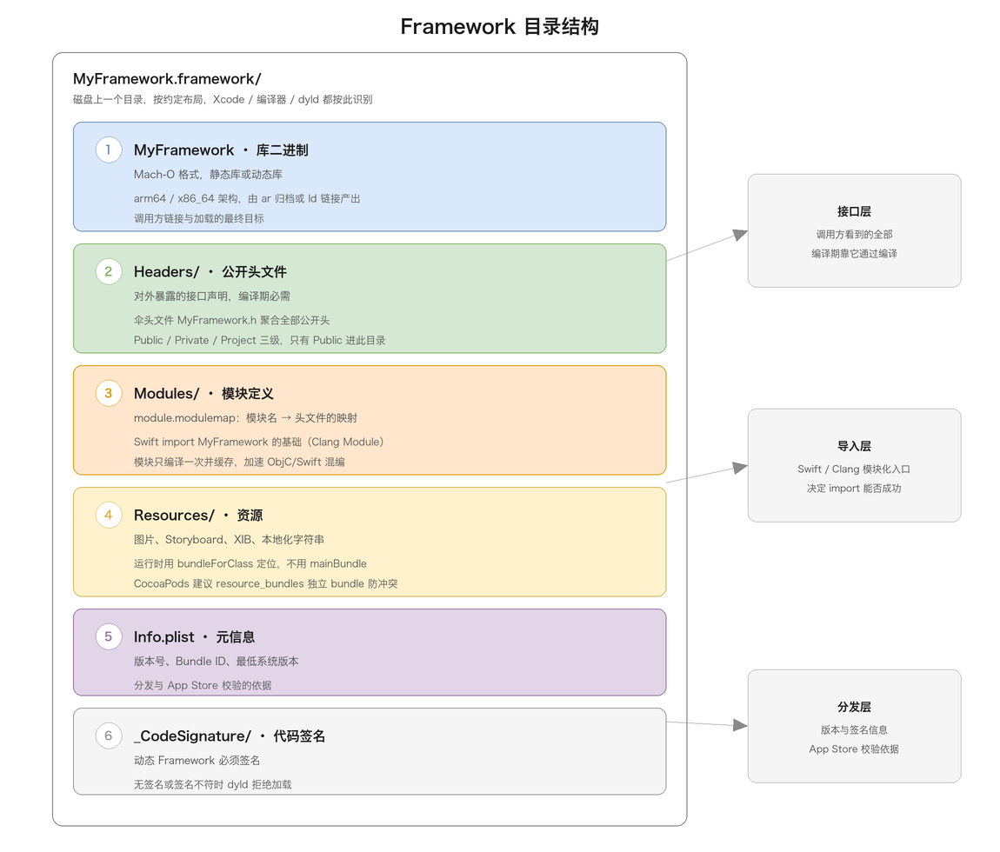
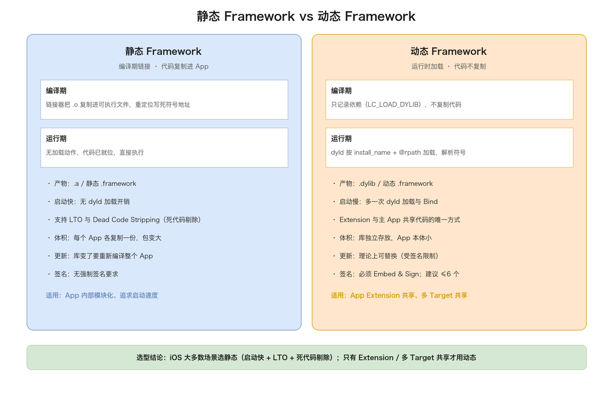
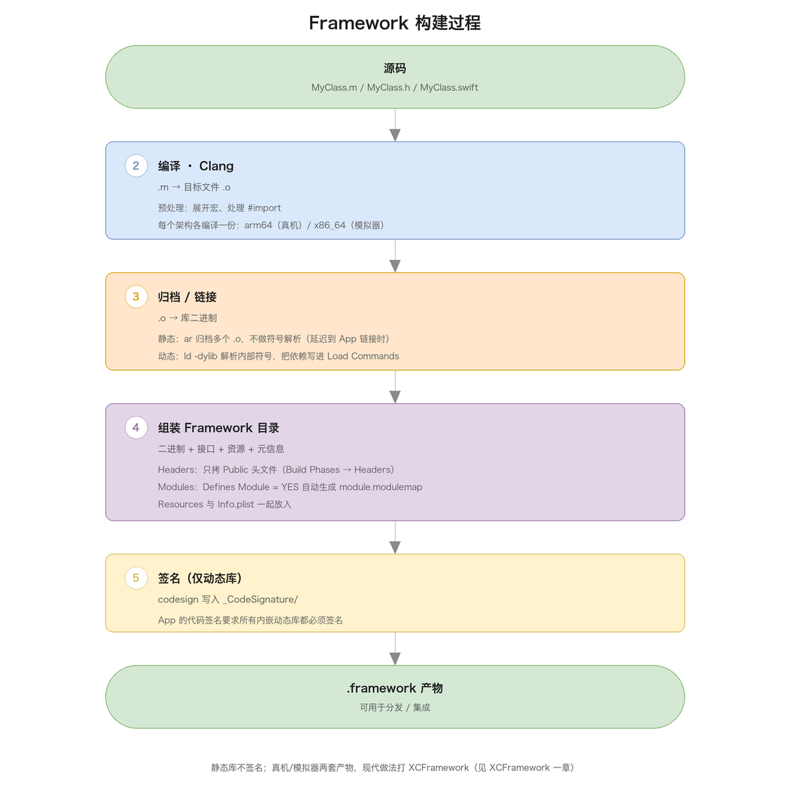
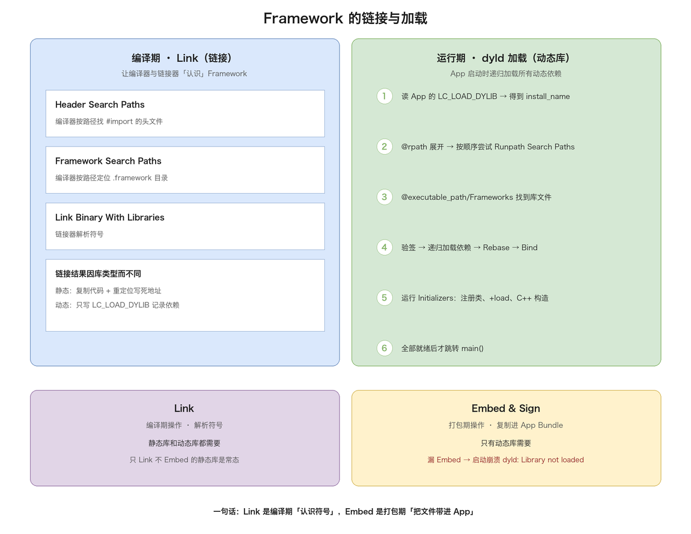
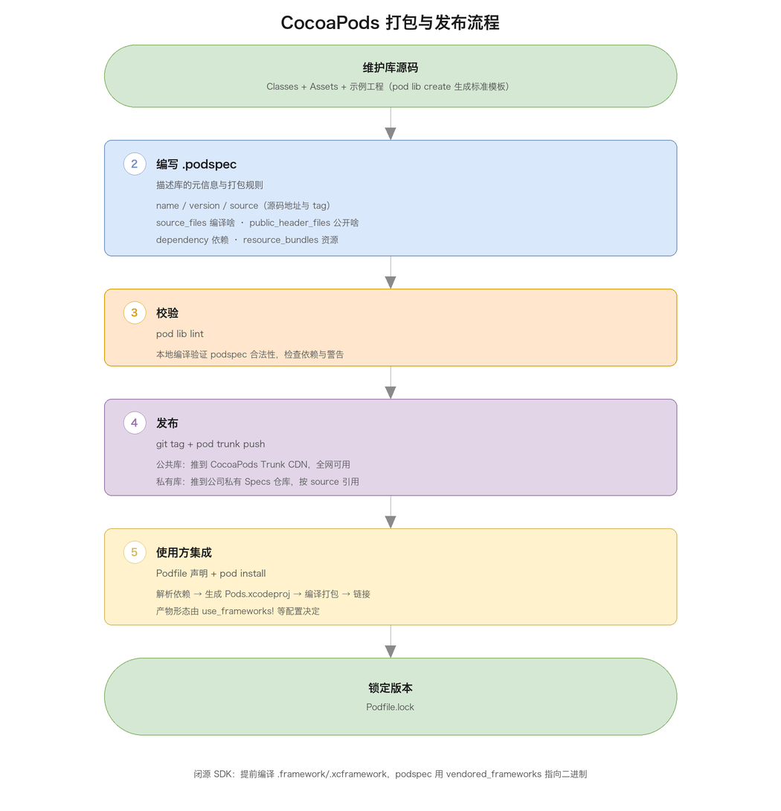
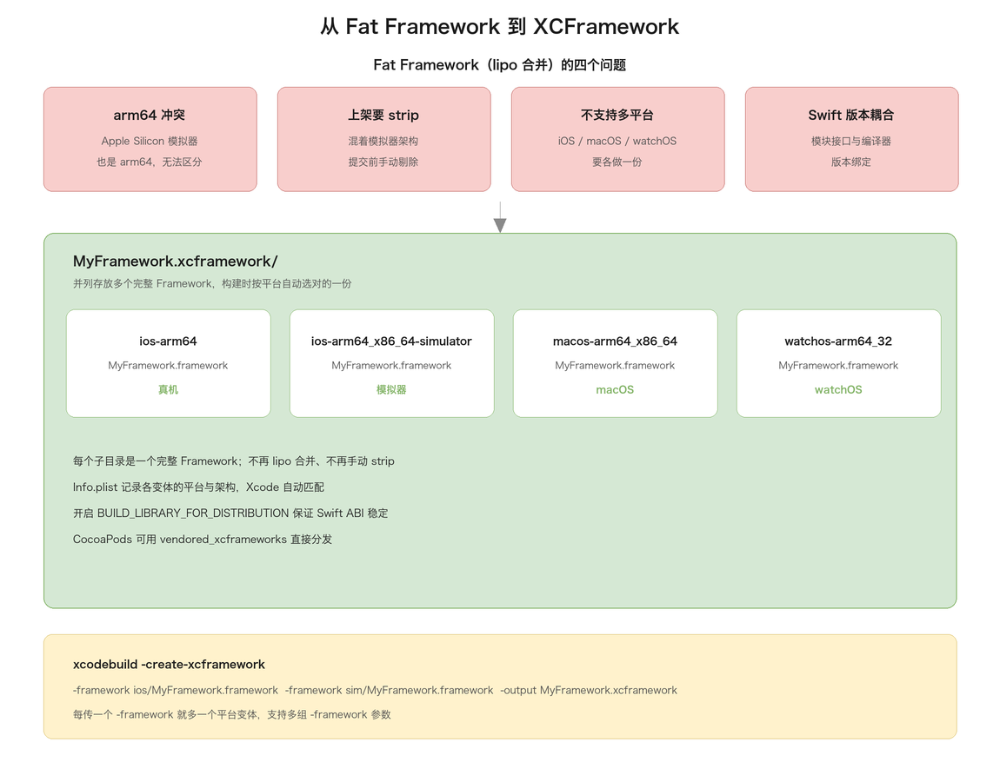

# 09. Framework 详解

> Framework 是 Apple 平台组织、分发、复用代码的标准封装：把库二进制、头文件、模块定义、资源打包进一个 `.framework`（或 `.xcframework`）目录，是 iOS 模块化、SDK 分发、CocoaPods 打包的基石。本文从「是什么」讲起，拆目录结构与头文件管理，对比静态/动态，讲清构建、链接加载、签名，再落到 CocoaPods、XCFramework、二进制兼容与问题排查。

## 目录

- [一、Framework 是什么](#一framework-是什么)
- [二、Framework 的目录结构](#二framework-的目录结构)
- [三、Umbrella Header 与头文件管理](#三umbrella-header-与头文件管理)
- [四、Clang Module 与 module.modulemap](#四clang-module-与-modulemodulemap)
- [五、Swift Framework 与混编](#五swift-framework-与混编)
- [六、静态 Framework vs 动态 Framework](#六静态-framework-vs-动态-framework)
- [七、Framework 的构建过程](#七framework-的构建过程)
- [八、Framework 的链接与加载](#八framework-的链接与加载)
- [九、代码签名与 Framework](#九代码签名与-framework)
- [十、CocoaPods 打包与发布](#十cocoapods-打包与发布)
- [十一、XCFramework](#十一xcframework)
- [十二、二进制兼容性](#十二二进制兼容性)
- [十三、常见面试问题](#十三常见面试问题)
- [附：高频速记](#附高频速记)
- [附：术语对照](#附术语对照)

---

## 一、Framework 是什么

**定义与历史**

Framework 本质上是「库二进制 + 头文件 + 模块定义 + 资源 + 元信息」打包在一起的一个目录，扩展名为 `.framework`。它不是一个单一文件，而是遵循特定布局的文件夹，Xcode、编译器、链接器、dyld 都按这套约定识别它。一个 Framework 至少包含：库二进制（Mach-O 格式的可执行代码）、公开头文件（Headers）、模块定义（Modules）、元信息（Info.plist），可选地包含资源（Resources）和代码签名（_CodeSignature）。这一套东西合起来，把「别人使用你的代码」从「手动拷贝一堆 .h/.a、手动配搜索路径」变成「拖进一个 .framework 就能用」——相当于库的发行版安装包：裸的 `.a`/`.dylib` 只是散装文件，Framework 则是带接口清单、带资源、带版本号的完整安装包。

这套机制源自 NeXTSTEP（1980 年代末）的 bundle 概念——把可执行代码、资源、接口定义按目录约定组织。Apple 收购 NeXT 后演化为 macOS 的 Framework，Cocoa 的 AppKit、Foundation 等系统库全以 Framework 形式存在，还带 `Versions/` 多版本目录。iOS 砍掉了多版本机制，且 iOS 8 之前禁止第三方动态库，所有第三方代码只能静态链接进 App，直到 App Extension 需要主 App 与扩展进程共享代码，才开放嵌入式动态 Framework。此后的演进主线是：2019 年 Xcode 11 引入 XCFramework 解决多平台分发、2020 年 Apple Silicon 让 Fat Framework 退场、CocoaPods 1.9 支持静态 Framework 后选型又从动态回摆到静态。

**五大作用**

1. 代码复用与模块化：把网络层、数据库层、UI 组件库各自打包，多 App/Target 复用，业务层只依赖公开接口，实现关注点分离与增量编译——改了网络层实现、接口不变，业务层不用重编译，Framework 边界也给了 code review 与单元测试天然的分界线；
2. 封装与命名空间隔离：把实现细节藏起来、只暴露头文件里的公开接口，调用方看不到私有实现、避免直接依赖内部结构；通过 Modules 提供模块级导入语义（`import MyFramework`），配合头文件可见性控制，边界比静态库「平铺符号」更干净；
3. 资源统一管理：图片、Storyboard、本地化字符串随库分发，框架内部用 Bundle 定位，避免调用方手动拷贝资源与资源同名冲突——每个 Framework 是独立 bundle，各自的 `images/icon.png` 互不干扰；
4. 依赖与版本管理：Info.plist 与 Load Commands 记录依赖与版本，分发时随包携带，调用方明确知道用哪个版本；XCFramework 的外层 Info.plist 还会记录每个变体的平台与架构，供构建系统自动匹配；
5. 二进制分发（闭源 SDK）：把编译好的二进制 + 公开头发给客户，接口与实现分离，客户「能用但看不到」——微信、友盟、Firebase 的 iOS 版本都是这种形式，这是 Framework 最重要的商业价值。

**与 .a/.dylib 的关系**

`.a`（静态）和 `.dylib`（动态）是「裸二进制」，Framework 是「带包装的二进制」：

| 形式 | 本质 | 是否带资源/头文件 | 使用方式 |
| ---- | ---- | ---------------- | -------- |
| `.a` | 静态库裸二进制（.o 归档） | 否，需手动配头文件 | 链接进可执行文件 |
| `.dylib` | 动态库裸二进制 | 否 | 运行时加载 |
| `.framework` | 打包目录（可静态可动态） | 是，含 Headers/Resources/Modules | 整体引入 |

简单说，Framework 是 `.a`/`.dylib` 加上「头文件、模块定义、资源、版本信息」的标准化封装。静态 Framework 内部装静态库、动态 Framework 内部装动态库，对外统一叫 `.framework`。注意裸 `.a` 没有 modulemap，Swift 无法 import，这是「Swift 项目必须 use_frameworks!」的根源（见第四章）。

---

## 二、Framework 的目录结构

**标准结构**

一个标准 Framework 目录布局：



```
MyFramework.framework/
├── MyFramework                # 库二进制（Mach-O 格式）
├── Headers/
│   ├── MyFramework.h          # 伞头文件（Umbrella Header）
│   └── MyClass.h              # 各公开类的头文件
├── Modules/
│   └── module.modulemap       # 模块映射，供 Swift/Clang 模块导入
├── Resources/                 # 可选，资源文件
├── Info.plist                 # 元信息
└── _CodeSignature/            # 代码签名（动态 Framework 需要）
```

整个目录是一个 bundle，`Info.plist` 里 `CFBundlePackageType=FMWK` 让系统识别它为 Framework。

**库二进制（MyFramework）**

核心是一个与 Framework 同名的 Mach-O 文件：静态 Framework 里是 `.o` 归档（file 显示 current ar archive），只供链接器取用；动态 Framework 里是 `MH_DYLIB`，可被 dyld 加载。判断动静最直接的办法：

```bash
file MyFramework.framework/MyFramework
# current ar archive → 静态库
# Mach-O 64-bit ... shared library arm64 → 动态库
```

也可以用 `otool -l` 看 Load Commands：动态库有 `LC_ID_DYLIB`（install_name）和 `LC_LOAD_DYLIB`（依赖），静态库没有。

**Headers/ 公开头文件与 Modules**

Headers 里只放公开接口，调用方要 `#import` 它们才能编译；私有头不进此目录（三级划分见第三章）。伞头文件（与 Framework 同名）把模块内公开头 import 一遍，调用方只需 `#import <MyFramework/MyFramework.h>` 一条语句，同时它是 module.modulemap 里 `umbrella header` 的入口。

`Modules/module.modulemap` 描述「模块名 → 头文件集合」：

```
framework module MyFramework {
    umbrella header "MyFramework.h"
    export *
    module * { export * }
}
```

它让 Swift 能 `import MyFramework`、让 Clang 走模块化导入（模块只编译一次并缓存），是 Swift 混编的基础，语法见第四章。

**Resources/ 资源与 bundle 定位**

图片、Storyboard、XIB、音频、本地化文件原样打进 Framework，框架内通过 Bundle 定位：

```objc
NSBundle *bundle = [NSBundle bundleForClass:[self class]];
NSURL *url = [bundle URLForResource:@"icon" withExtension:@"png"];
```

关键是用 `bundleForClass:` 而非 `mainBundle`：代码链接进 App 后 mainBundle 指向 App 本体，只有「类所在的 bundle」才是 Framework 自己的包。字符串本地化同理要用 `NSLocalizedStringFromTableInBundle`，Assets.car 用 `imageNamed:inBundle:` 传 Framework 的 bundle。XIB/Storyboard 里的图片引用也是同样的道理：XIB 加载时按「XIB 所在 bundle」找图，从 Framework 里加载 XIB 时要显式传 bundle 参数，否则会回到 mainBundle 找图、加载失败。

**Info.plist、代码签名与 Versions**

Info.plist 记录版本号（CFBundleShortVersionString）、Bundle ID、最低系统版本；XCFramework 的外层 Info.plist 还承担「变体清单」角色，记录各子目录的平台与架构。`_CodeSignature/` 存放签名信息，动态 Framework 必须签名，否则 dyld 拒绝加载（见第九章）。

macOS 上用 Xcode 建的 Framework 默认带 `Versions/` 结构：

```
MyFramework.framework/
└── Versions/
    ├── A/
    │   ├── MyFramework
    │   ├── Headers/
    │   └── Resources/
    └── Current -> A
# framework 根下还有 MyFramework -> Versions/Current/MyFramework 等符号链接
```

`Versions/A` 是真正的内容目录，`Current` 符号链接指向当前版本，根目录下的 `MyFramework`、`Headers`、`Resources` 都是指向 `Versions/Current/...` 的符号链接。多版本共存的设计让系统升级 Framework 时能保留旧版本、保证依赖旧接口的程序仍能运行。iOS 没有这套机制，Xcode 为 iOS target 构建的 Framework 直接是扁平结构。做 shell 脚本处理 Framework 时要注意：如果脚本假设 `Headers/` 一定真实存在而不是符号链接，在 macOS 产物上可能出问题。

**bundle 本质与资源定位原理**

bundle 是「按约定组织的目录包」，Framework 本身就是一种 bundle（CFBundlePackageType=FMWK），App 也是 bundle（APPL），NSBundle 是对这个目录的运行时抽象，资源的定位全靠它。三个 API 的语义要分清：

- `[NSBundle mainBundle]`：固定指向 App 本体的目录，无论当前代码来自哪里；
- `[NSBundle bundleForClass:]`：通过类的元数据找到「这个类来自哪个镜像」，再从镜像路径向上定位到包含它的 bundle——类来自 App 就等价 mainBundle，来自 Framework 就是该 Framework 的目录，这是 Framework 资源加载的标准入口；
- `[NSBundle bundleWithURL:]`：从目录 URL 构造 bundle，用于访问 resource_bundles 生成的 `.bundle`。

一个常见误区是「Framework 的 Assets.car 会和 App 的合并」——不会，各 bundle 的 car 独立存在、各自加载各自的资源，这正是 bundle 隔离防冲突的价值所在。

---

## 三、Umbrella Header 与头文件管理

**伞头文件机制与三级可见性**

伞头文件（`MyFramework.h`）把模块内所有公开头 import 一遍，形成完整入口：

```objc
// MyFramework.h —— 伞头文件
#import <Foundation/Foundation.h>
FOUNDATION_EXPORT double MyFrameworkVersionNumber;
FOUNDATION_EXPORT const unsigned char MyFrameworkVersionString[];
#import <MyFramework/MyClass.h>
#import <MyFramework/MyHelper.h>
#import <MyFramework/MyConfig.h>
```

它有三重身份：

- ObjC 侧一条 `#import <MyFramework/MyFramework.h>` 引入全部接口；
- modulemap 的 `umbrella header` 以它为根聚合模块——**伞头文件没 import 的头不属于模块**，Swift 看不到；
- Xcode 的「umbrella header not found」「header not part of module」报错都围绕它。

写伞头文件要 import 完整、克制宏定义（它会被所有使用者展开）。

Xcode 的 Build Phases → Headers 把每个头归入三级：

| 级别 | 去向 | 谁能看见 |
| ---- | ---- | -------- |
| Public | 拷贝进 `Headers/` | 所有使用者 |
| Private | 拷贝进 `PrivateHeaders/` | 技术上能 import，但不承诺稳定 |
| Project | 不拷贝 | 只有 Framework 自己可见 |

注意 "Private" 并非「外部不可见」——Apple 的命名有误导性，真正完全隐藏的是 Project 级；只有 Public 参与 umbrella 聚合，Swift 侧无法 import Private。头文件忘设 Public 是 file not found / cannot find type 的常见来源；反过来把只想内部用的头设成 Public 会导致接口暴露、伞头膨胀。

**#import 成本、前置声明与废弃管理**

传统预处理模型下 `#import` 会反复展开头文件全文，大型工程里一个 `.m` 展开后可能几十万行，是编译慢的根源。两个缓解手段：前置声明（`.h` 里用 `@class MyClass;` 代替 import，只在 `.m` 里真正 import，切断头文件依赖链）：

```objc
// MyManager.h —— 只声明类型存在，不 import
@class MyNetworkClient;
@interface MyManager : NSObject
@property (nonatomic, strong) MyNetworkClient *client;
@end
```

以及模块化导入（`CLANG_ENABLE_MODULES` 把框架导入改走模块缓存，见第四章）。两者不冲突：前置声明解决「工程内部头文件互相依赖」，模块化解决「系统框架与 Framework 的导入成本」。

公开头是「对外契约」，废弃接口用 DEPRECATED 宏标记，编译期给调用方警告但保持可用：

```objc
- (void)oldFetch DEPRECATED_MSGATTRIBUTE("改用 -fetchWithCompletion:");
// 或老写法：
- (void)oldFetch __attribute__((deprecated("改用 -fetchWithCompletion:")));
```

Swift 侧对应 `@available(*, deprecated, renamed: "fetch(completion:)", message: "2026 年底移除")`。配套的纪律是废弃分三步走——先加标记（旧接口仍在、只是告警）→ 过一两个大版本确认无调用 → 删除接口。直接删公开接口是破坏性变更，需升主版本号并写迁移说明。SemVer 规则（主版本可破坏、次版本只新增、修订只修 bug）正是 podspec `~>` 约束的设计基础——理解了它，就知道为什么 `~> 1.0.0` 不接受 2.0：主版本可能破坏兼容。

---

## 四、Clang Module 与 module.modulemap

**为什么需要 Module 与 modulemap 语法**

没有 Module 时，`#import <UIKit/UIKit.h>` 是纯文本展开——编译器看到这条语句，就把 UIKit 的伞头文件整个展开，再递归展开其中每个头文件。这带来三个问题：

- 编译慢：同样的头文件文本在成百上千个 `.m` 里反复展开；
- 脆弱：宏污染——头文件里定义的宏会影响后续所有代码，导入顺序不同可能编译结果不同；
- 无法跨语言：Swift 编译器不认识「头文件」这种 C 家族概念，需要一种结构化的方式知道「UIKit 这个模块有哪些接口」。Clang Modules 把「一堆头文件」抽象成有名字、有接口集合、一次性编译成 AST 缓存的模块，之后导入直接读缓存。

modulemap 是描述模块的文本文件：

```
framework module MyFramework {
    umbrella header "MyFramework.h"   # 以伞头为根聚合头文件
    export *                          # 导入即导出依赖符号
    module * { export * }             # 每个子头生成同名子模块
    link "MyFramework"                # import 时自动链接二进制
    link framework "Foundation"
}
```

modulemap 逐条拆解：

- `framework module MyFramework`：声明「framework 型模块」，编译器据此去 `.framework` 目录的约定位置找头文件和二进制；
- `umbrella header "MyFramework.h"`：以伞头为根递归聚合，相对的是 `umbrella "Headers"` 按目录聚合、逐个 `header "xxx.h"` 声明；
- `export *`：导入本模块即导出依赖符号，使用者无需再 import 依赖模块；
- `module * { export * }`：为每个子头生成同名子模块，支持 `#import <MyFramework/MyClass.h>` 单头导入仍走模块路径；
- `link "MyFramework"`：告诉链接器模块对应的二进制名，`import MyFramework` 时自动链接（等价自动加 `-framework MyFramework`）。

Swift Framework 会多一条 `module MyFramework.Swift { umbrella header "MyFramework-Swift.h" }`，让 ObjC 反向使用 Swift 类。

**模块缓存、编译加速与 Swift 互操作**

模块第一次编译时把语法树序列化成 `.pcm` 二进制缓存放进 DerivedData 的模块缓存目录，后续 import 直接 mmap，跳过展开与词法语法分析，系统框架缓存还能跨工程复用，这是「开启模块后编译明显变快」的直接原因。

附带两个工程实践要点：

- 宏污染被天然隔离——模块的接口以语义（AST）形式提供，宏不再泄漏到导入方，头文件导入顺序不再影响语义；
- `@import MyFramework;` 与 `#import <MyFramework/MyFramework.h>` 在开启模块后等价，Xcode 默认把后者的框架导入自动映射到模块（Automatic Module Loading）。

Swift 编译器完全建立在 Clang Module 上——`import MyFramework` 读 modulemap 拿到接口信息，没有 modulemap 就没有 Swift/ObjC 互操作。这也解释了裸 `.a` 无法被 Swift import、CocoaPods 的 `use_modular_headers!` 本质是「给静态库补 modulemap」。

高频坑是模块完整性校验：伞头 import 了非 Public 头、或 Public 头 import 了 Project 私有头，会报 `include of non-modular header inside framework module`——模块接口必须自洽，依赖链上不能有模块外的东西。处理办法是把缺失的头设为 Public，或对第三方库设置 `CLANG_ALLOW_NON_MODULAR_INCLUDES_IN_FRAMEWORK_MODULES`（治标）。

---

## 五、Swift Framework 与混编

**目录差异与双向桥接**

Swift Framework 在标准五件套之上多两样东西，产物目录里能看到：

```
MyFramework.framework/
├── Modules/
│   ├── module.modulemap
│   └── MyFramework.swiftmodule/     # Swift 模块接口
│       ├── MyFramework.swiftmodule  # 二进制接口（同版本编译器读取）
│       ├── MyFramework.swiftdoc     # 接口的文档信息
│       └── MyFramework.swiftinterface  # 文本接口（开模块稳定时生成）
├── Headers/
│   ├── MyFramework-Swift.h          # 自动生成的 ObjC 接口头
│   └── MyFramework.h
└── ...
```

`.swiftmodule` / `.swiftinterface` 是 Swift 编译器 import 时读的东西，不是头文件；二进制 swiftmodule 只能被相同（或兼容）版本编译器读取，文本 swiftinterface 任何版本都能读（配合 BUILD_LIBRARY_FOR_DISTRIBUTION，见第十一章）。`MyFramework-Swift.h` 是 Xcode 把 Swift 类转译成 ObjC 接口的生成文件，ObjC 代码 `#import` 它就能调用 Framework 里的 Swift 类，modulemap 里为它单独声明了 `MyFramework.Swift` 子模块。

Swift → ObjC：类继承 NSObject、成员用 `@objc` 标注（`@objcMembers` 批量标注），`@objc(MyManager)` 可指定 ObjC 侧类名去掉模块前缀：

```swift
@objc(MyManager)   // 指定 ObjC 侧类名，去掉模块前缀
public class MyManager: NSObject {
    @objc public func fetch(_ url: URL,
                            completion: @escaping (Data?) -> Void)
}
```

`@objcMembers` 标在类上，让所有具备暴露条件的成员自动转 ObjC、省逐个标注的功夫，代价是符号表变大。Swift 独有特性无法转译：

- 泛型方法、struct、非 @objc 协议关联的声明都不会出现在 -Swift.h 里，公开 API 尽量用能转译的形态设计；
- 枚举需 `@objc enum` 且限 Int 原始值。

反向 ObjC → Swift 没有 bridging header（那是 App target 机制），靠伞头文件：要给 Swift 用的 ObjC 头必须是 Public 且被伞头 import，Clang Importer 自动转译——再次印证「伞头没 import 的头 Swift 看不见」。

**@objc 动态性与静态 Swift 注意点**

@objc 不只是让 ObjC 能调用，还改变了派发：Swift 方法默认 vtable 静态派发（编译器可能进一步内联），@objc 方法走 runtime 消息派发。依赖 KVC/KVO、Target-Action、#selector、方法交换、NSCoding 的能力都要求 @objc，所以「给外部用的类」基本绕不开 @objc/@objcMembers，这也是 Swift Framework 二进制普遍比同功能 ObjC 大的原因（符号与元数据更重）。

静态 Swift Framework 在 Xcode 12.4（Swift 5.3.2）后才真正可用。早期工具链对「静态 + Swift」支持很差：swiftmodule 里记录了编译器版本与路径信息，静态库场景下模块缓存频繁失效。实践注意点：

- CocoaPods 的 `use_frameworks! :linkage => :static` 已处理大部分细节，但资源 bundle、-Swift.h 的生成时机仍偶发问题，升级 CocoaPods 版本能解掉一批；
- 混编工程里 ObjC Pod 依赖 Swift Pod 时，需要 modular headers 或 Framework 形态，纯 .a 场景依然不通；
- 静态 Swift Framework 的 swiftmodule 与编译器版本强绑定，团队要统一 Xcode 版本，或开 BUILD_LIBRARY_FOR_DISTRIBUTION 做模块稳定（见第十一章）。

---

## 六、静态 Framework vs 动态 Framework

**链接原理与系统对比**

静态链接是「编译期把代码拷进可执行文件」，动态链接是「运行时才加载，代码不拷贝」：



静态 Framework 链接时，链接器从归档取出被引用的 `.o` 复制进可执行文件、重定位写死符号地址；动态 Framework 只在 Load Commands 写一条 `LC_LOAD_DYLIB` 记录依赖，运行时 dyld 找库、映射、解析绑定符号。

| 特性 | 静态 | 动态 |
| ---- | ---- | ---- |
| 链接时机 | 编译期复制进 App | 运行时 dyld 加载 |
| 文件体积 | 增大 App 体积 | 不增 App 体积（库独立） |
| 内存占用 | 每个 App 各一份 | 系统库共享；内嵌库不共享 |
| 启动速度 | 快 | 慢（有加载开销） |
| 优化空间 | 支持 LTO、死代码剔除 | 链接期优化基本不适用 |
| 更新方式 | 重新编译 App | 替换库文件（受签名限制） |
| 代码签名 | 不强制 | 必须 Embed & Sign |
| 数量限制 | 无 | 建议 ≤6 |
| 典型用途 | App 内部模块化 | Extension 共享、多 Target 共享 |

其中「动态库省内存」是错觉：进程间共享只对系统库成立（在 dyld shared cache 里），App 内嵌动态库跨 App 仍是各自一份。文件体积也有一层反差：静态链接增大 App 体积（代码拷进去了），动态库不增 App 体积（库独立），但「省内存」和「省体积」是两个维度，别混为一谈——体积省了不代表内存省。

**LTO 与 Dead Code Stripping**

静态库有动态库难享的两项链接期优化：

- Dead Code Stripping：链接器以 `.o` 为最小单位，只取被引用的 `.o`，配 `-dead_strip` 还能函数级裁剪——一个 2MB 的库如果 App 只用 30% 的功能，实际进包可能只有 600KB；动态库要独立完整存在，符号没人用也得带着。
- LTO（链接时优化）：把优化从「每个 `.o` 单独优化」推迟到「链接期全局优化」，链接器看到所有代码的完整调用关系，能做跨编译单元内联、跨模块死代码消除、更激进的常量传播。静态链接是 LTO 的前提——代码要「进」同一个链接过程才能被全局优化，动态库的边界天然切断了这种全局视野。代价是编译时间显著变长，一般只在 Release 打包时开（`LLVM_LTO=YES` 或 `YES_THIN`，Thin LTO 并行优化、时间开销小很多）。

**动态库的代价与如何选择**

动态 Framework 的代价在启动：dyld 对每个库做「读 Load Commands → 递归加载 → mmap → 验签 → Rebase → Bind」，库越多 pre-main 越长。系统库靠共享缓存（dyld shared cache）把所有系统 Framework 预链接合并成一个只读大文件，之后每个进程启动直接映射同一份、__TEXT 段全局唯一、物理内存只有一份，一次 mmap 全部就绪，开销很小。第三方动态库没有这个待遇，每个都要走完整流程。

更不划算的是内存分类：动态库的 __DATA 段在运行时被写脏后变成 dirty memory，而 dirty memory 在 iOS 上是内存告警时的重点回收对象，动态库数量多会显著推高它；静态链接的代码合并进主二进制，少了每个库独立数据段、独立映射的页对齐开销，整体内存布局更紧凑。这是官方建议「自定义动态库 ≤6 个」的又一层性能理由。

选型：iOS 上大多数场景推荐静态 Framework——追求启动速度时静态库无运行时加载开销、且支持 LTO 和更彻底的 Dead Code Stripping；App 内部模块化把业务拆成多个静态 Framework，模块化又不牺牲启动速度，是当前主流做法。

只有少数场景需要动态 Framework：

- App Extension 与主 App 共享代码：扩展和主 App 是独立进程，要共享代码只能靠动态库，扩展的可执行文件极小、重活都由共享的动态库干；
- 多 Target 共享：多个 Target 复用同一份动态库，不用各自打一份；
- 超大型 App 按需加载：把不常用功能做成动态库，用到时再 dlopen，配合动态下发，但受签名与审核约束。这个取舍也解释了为什么 CocoaPods 从 1.9 开始默认用静态库——启动速度和 LTO 的收益在大多数 App 里比动态库的「可共享」更实在。

---

## 七、Framework 的构建过程

**构建流程总览与编译归档**

从源码到 `.framework` 分四步：编译 `.o` → 归档/链接 → 组装目录 → 签名（动态库）：



编译阶段与普通 App 无异（`.m` 经 Clang 成 `.o`），区别在归档/链接：

```bash
# 静态库：ar 归档，不做符号解析（允许未定义符号，延迟到 App 链接）
ar -rcs libMyFramework.a MyClass.o MyHelper.o

# 动态库：ld 链接，解析内部符号、记录依赖与 install_name
ld -dylib -install_name @rpath/MyFramework.framework/MyFramework \
   -o MyFramework MyClass.o MyHelper.o -framework Foundation
```

`ar` 只是把 `.o` 打包，不做符号解析，所以静态库允许「未定义符号」存在——归档里的代码可以引用 Foundation 或另一个库的符号，只要最终 App 链接时都能找到即可；动态库链接时则要解析内部符号、把外部依赖记进 `LC_LOAD_DYLIB`，不允许存在未解析的外部符号，dyld 加载时缺一个就崩。

组装这步没有编译行为，纯「按约定放文件」：

```bash
mkdir -p MyFramework.framework/Headers MyFramework.framework/Modules
cp libMyFramework.a MyFramework.framework/MyFramework
cp *.h MyFramework.framework/Headers/
cp module.modulemap MyFramework.framework/Modules/
cp Info.plist MyFramework.framework/
```

**Xcode 与命令行构建**

Xcode 里建 Framework 工程（File → New → Project → Framework）自动完成上述流程，关键配置：

- Mach-O Type 设为 Static Library（静态）或 Dynamic Library（动态），决定产物是静态还是动态、是最重要的开关；
- Build Phases → Headers 把头文件归到 Public/Private/Project 三类、Public 才进 Headers/ 目录；
- Build Settings → Defines Module 设为 YES 自动生成 module.modulemap（Swift 项目强制 YES）；
- Skip Install 做静态 Framework 时通常设 NO 以便产出完整产物（设 YES 会在归档时跳过把产物放入安装目录，导致 Archive 出的包里没有 Framework）；
- Other Linker Flags 依赖 Category 的静态库要加 `-ObjC`。

CI 里用 xcodebuild 完成：

```bash
xcodebuild -scheme MyFramework -sdk iphoneos -configuration Release \
  BUILD_LIBRARY_FOR_DISTRIBUTION=YES -derivedDataPath build
# 模拟器版本换 -sdk iphonesimulator 再编一份
```

产物在 `build/Build/Products/Release-iphoneos/MyFramework.framework`。

**Fat Framework 与脚本打包**

真机是 arm64、模拟器在 Intel Mac 是 x86_64、Apple Silicon 是 arm64，历史上用 lipo 合并成 Fat Framework：

```bash
lipo -create Release-iphoneos/MyFramework.framework/MyFramework \
  Release-iphonesimulator/MyFramework.framework/MyFramework \
  -output MyFramework.framework/MyFramework
```

`lipo` 把多个单架构 Mach-O 拼成 Fat 二进制，运行时按 CPU 架构选切片。但 lipo 有硬伤：

- Apple Silicon 模拟器与真机同为 arm64 无法靠架构字段区分（lipo 直接拒绝合并）；
- 上架前要手动 `lipo -remove` strip；
- 无法跨平台（lipo 只能合并同平台不同架构）。

现代做法是 `-create-xcframework`（见第十一章）。

CI 上自动化打 Framework 的脚本骨架，把本章知识串起来：

```bash
#!/bin/bash
set -e
FMK_NAME=MyFramework
BUILD_DIR=build

# 1. 真机与模拟器各编一份（Release）
xcodebuild -scheme $FMK_NAME -sdk iphoneos \
  -configuration Release BUILD_LIBRARY_FOR_DISTRIBUTION=YES \
  -derivedDataPath $BUILD_DIR
xcodebuild -scheme $FMK_NAME -sdk iphonesimulator \
  -configuration Release BUILD_LIBRARY_FOR_DISTRIBUTION=YES \
  -derivedDataPath $BUILD_DIR

# 2. 合并为 XCFramework
rm -rf $FMK_NAME.xcframework
xcodebuild -create-xcframework \
  -framework $BUILD_DIR/Build/Products/Release-iphoneos/$FMK_NAME.framework \
  -framework $BUILD_DIR/Build/Products/Release-iphonesimulator/$FMK_NAME.framework \
  -output $FMK_NAME.xcframework

# 3. 自检：架构、类型、签名
file $FMK_NAME.xcframework/ios-arm64/$FMK_NAME.framework/$FMK_NAME
lipo -info $FMK_NAME.xcframework/ios-arm64/$FMK_NAME.framework/$FMK_NAME
```

骨架三个关键点：

- `BUILD_LIBRARY_FOR_DISTRIBUTION` 开在两个构建命令上（漏一个变体就等于没开）；
- `-create-xcframework` 前先删旧产物（追加会报变体冲突）；
- 打包后立即用 file/lipo 自检，让错误在最早一步暴露。

老 Fat 脚本迁移就是把「lipo + strip」替换成一条 `-create-xcframework`，同时删掉所有「上架前 strip 模拟器架构」的补丁逻辑——那些脚本在 XCFramework 体系下不再需要。

---

## 八、Framework 的链接与加载

**Link 与 Embed**

调用方编译期要「看见」Framework，靠三项配置：Header Search Paths（找头文件）、Framework Search Paths（定位 .framework）、Link Binary With Libraries（解析符号）：



静态链接即复制，动态只写 `LC_LOAD_DYLIB`。动态 Framework 还要在运行时加载，配置 Embed & Sign：Embed 打包期把库复制进 App 的 `Frameworks/`，Sign 给它签名。一句话：Link 是编译期「认识符号」，Embed 是打包期「把文件带进 App」：

| 操作 | 时机 | 作用 | 针对 |
| ---- | ---- | ---- | ---- |
| Link | 编译期 | 让链接器解析符号 | 静态和动态都要 |
| Embed | 打包期 | 把库文件复制进 App Bundle | 只动态库需要 |

静态库只需 Link，动态库要 Link + Embed，漏 Embed 启动崩 dyld: Library not loaded。还有两种组合容易困惑：「Link 了静态库但不打包」正是静态库的常态，产物里没有任何库文件痕迹（代码已融入可执行文件），不需要 Embed；反过来「Embed 了但没 Link」会直接链接报 symbol not found，编译期就暴露。

**install_name 与 @rpath**

dyld 靠库编译时写进 Mach-O 的 install_name（存于 `LC_ID_DYLIB`）找库文件，调用方把它记录进 `LC_LOAD_DYLIB`。三个路径占位符：

| 占位符 | 含义 | 典型展开 |
| ------ | ---- | -------- |
| `@executable_path` | 主可执行文件所在目录 | `xxx.app/` |
| `@loader_path` | 当前加载的 Mach-O 所在目录 | 对 App 主程序是 `xxx.app/`；对 Framework 是 `xxx.app/Frameworks/MyFramework.framework/` |
| `@rpath` | 按调用方 Runpath Search Paths 列表逐个尝试 | 通常包含 `@executable_path/Frameworks` |

`@rpath` 与前两者区别在于「谁决定路径」：它是变量，值由依赖方在 Runpath Search Paths 配置，dyld 按列表顺序逐个展开、找到第一个存在的文件为止。这套机制让编译期记录路径与实际嵌入位置解耦——库既能被 App 直接嵌入（`@executable_path/Frameworks`），也能被另一个 Framework 嵌套依赖（`@loader_path/Frameworks`），无需重新编译。install_name 对不上就报 `dyld: Library not loaded`。

**dyld 加载链路与 dlopen**

动态库运行时加载的完整链路（以 App 内嵌动态库为例）：

1. 内核加载 App 主程序，主程序 Load Commands 里有多条 `LC_LOAD_DYLIB`；
2. dyld 读每条 `LC_LOAD_DYLIB` 拿到 install_name（如 `@rpath/MyFramework.framework/MyFramework`）；
3. 把 `@rpath` 按主程序 Runpath Search Paths 逐个展开，通常是 `@executable_path/Frameworks` → `MyApp.app/Frameworks/MyFramework.framework/MyFramework`；
4. 找到文件后校验代码签名，通过则 mmap 映射进内存；
5. 递归处理该 Framework 自己的 `LC_LOAD_DYLIB`（嵌套依赖）；
6. Rebase：修正镜像内部所有指针（ASLR 后的实际地址 = 编译地址 + slide）；
7. Bind：把外部符号引用绑定到实际地址（如对 Foundation 符号的引用）；
8. 运行 Initializers：各镜像的 `+load`、C++ 全局构造、`__attribute__((constructor))` 依次执行；
9. 全部就绪后 dyld 跳转 main()，进入 main 之后的世界。

这套流程对应了「动态库越多启动越慢」的每一个环节，也解释了 `+load` 为什么先于 main 执行——它属于第 8 步的 Initializers。

除启动自动加载，还可用 dlopen 运行时手动加载，把加载时机推迟到调用处实现按需加载：

```c
void *handle = dlopen("@rpath/MyFramework.framework/MyFramework", RTLD_LAZY);
if (handle) {
    Class cls = (__bridge Class)dlsym(handle, "OBJC_CLASS_$_MyPlugin");
}
```

dlopen 触发的加载流程与启动加载相同（验签、mmap、Rebase、Bind、Initializers），差别只是时机推迟到调用处。ObjC 侧更常见的写法是 NSBundle：`[[NSBundle bundleWithURL:...] load]`，内部即 dlopen。但要认清现实约束：正常签名体系下，能被 dlopen 的二进制必须已签名且打进 App Bundle 随包分发——运行时从网络下载的可执行代码无法通过签名校验，审核条款也明确禁止下载执行代码。所以 dlopen 在 iOS 上的实际用途主要是「包内延迟加载」：把不常用功能的动态库推迟到首次使用时加载，而不是热更新。JS 侧的动态化走 JavaScriptCore 解释执行，是另一条合规路径。

落到启动优化，动态库治理是 pre-main 阶段收益最大的方向之一：盘点内嵌库（解包 ipa 看 `Frameworks/` 目录，Instruments 的 App Launch 模板能直接看到 dyld 加载各库耗时）→ 能静态的改静态（动态 Framework 改 Mach-O Type 为 Static Library 重新集成，CocoaPods 项目就是从 `use_frameworks!` 切到 `:linkage => :static`）→ 合并小库（三个各 200KB 的动态库不如合并成一个——每个库的加载开销是固定的，验签、页映射、元数据初始化，数量比体积更伤启动）→ 保留必须动态的并收敛嵌套依赖（嵌套动态依赖让 dyld 递归加载链路变长）→ 用 MetricKit/Instruments 监控 pre-main，防止治理成果被新依赖悄悄吃回去。官方经验值是每个自定义动态库约 2~10ms 启动开销，几十个库的 App 就是几百毫秒起步，这也是大型 App 把「动态库数量」当核心治理指标的原因。

---

## 九、代码签名与 Framework

**为什么必须签名与 codesign 做了什么**

iOS 安全模型建立在代码签名链上：App 的每一页可执行代码都要能追溯到可信来源。App 主二进制有签名，而动态 Framework 是磁盘上独立的 Mach-O，运行时被映射进进程——如果允许无签名（或签名不符）的代码进进程，签名体系就有洞。所以 dyld 规则很直接：内嵌动态库无签名、签名损坏、或与 App 签名链不一致时拒绝加载，进程启动即崩溃。静态 Framework 不参与运行时加载，不需要签名——它的代码在链接期就已复制进 App 主二进制，跟着主二进制的签名走。

Xcode 归档（或 Embed）动态 Framework 时自动执行 codesign，也可以手动执行：

```bash
codesign --force --sign "iPhone Distribution: xxx" MyFramework.framework
```

签名过程：计算 Mach-O 每页哈希写入 CodeDirectory，把 entitlements 摘要、证书链、资源清单封进 `_CodeSignature/` 与 Mach-O 的签名段，内核与 dyld 校验时重算页哈希比对，任何一处被篡改都能发现。Embed & Sign 的完整动作是「复制进 Frameworks/ → 对库 codesign → 对整个 App codesign」（App 的签名清单里包含内嵌的所有 Framework），所以改包后手动压缩 ipa 会因签名失效而无法安装。

**签名相关高频问题**

- 改了内嵌库二进制或 Info.plist 后启动崩（code signature invalid）→ 重签整个 App；
- 越狱机能加载无签名库、真机不行（越狱 patch 了 amfid）；
- 企业分发报 invalid signature → re-sign 时 Framework 没重签或 entitlements 混用；
- 运行时下载可执行代码被禁（JS 解释执行除外）。

---

## 十、CocoaPods 打包与发布

**四种链接方式**

CocoaPods 把每个 Pod 编译成产物并链接进 App，形态由配置决定：

| 配置 | 产物形态 | Module | Swift 支持 | 启动速度 |
| ---- | -------- | ------ | ---------- | -------- |
| 默认 | 静态库 `.a` | 无 | 不支持 | 最快 |
| `use_frameworks!` | 动态 Framework | 有 | 支持 | 慢 |
| `use_frameworks! :linkage => :static` | 静态 Framework | 有 | 支持 | 快 |
| `use_modular_headers!` | 静态库 + modulemap | 有 | 支持 | 最快 |

演进：1.9 之前用 Swift 必须 `use_frameworks!`（Swift 需要 modulemap，只有 Framework 自带），1.9 后 `:linkage => :static` 和 `use_modular_headers!` 都能「给静态库补模块定义」，让 Swift 用上静态链接。两者目的相同、路径不同——前者给库套 Framework 外壳，后者只补模块定义。现在多数项目推荐静态 Framework 或 modular headers。

**podspec 字段详解**

`.podspec` 描述 Pod 的元信息，字段按「控制构建的哪个环节」分组：

```ruby
Pod::Spec.new do |s|
  s.name = 'MyLibrary'; s.version = '1.0.0'
  s.summary = '一句话描述'; s.homepage = 'https://github.com/xxx/MyLibrary'
  s.license = { :type => 'MIT', :file => 'LICENSE' }
  s.author = { 'YourName' => 'you@example.com' }
  s.source = { :git => 'https://github.com/xxx/MyLibrary.git', :tag => s.version.to_s }
  s.ios.deployment_target = '12.0'
  s.source_files = 'MyLibrary/Classes/**/*'       # 编译哪些 .m/.swift
  s.public_header_files = 'MyLibrary/Classes/**/*.h'  # Headers 放什么
  s.dependency 'AFNetworking', '~> 4.0'           # 依赖
  s.resource_bundles = { 'MyLibrary' => ['MyLibrary/Assets/*.png'] }  # 资源
end
```

字段分组理解：

- 身份与来源：`name`/`version`/`source` 决定去哪下载哪个版本；
- 编译范围：`source_files` 决定库二进制里有什么、`public_header_files` 决定 Headers 放什么；
- 依赖：`dependency` 递归解析依赖树；
- 资源：`resource_bundles` 打进独立 `.bundle`；
- 二进制分发：`vendored_frameworks`/`vendored_libraries`/`vendored_xcframeworks`，闭源 SDK 专用；
- 编译配置：`compiler_flags`、`pod_target_xcconfig` 注入编译设置。

版本约束 `~> 1.0.0` 锁定到次版本（>= 1.0.0 且 < 1.1.0）、`~> 1.0` 锁定到主版本（< 2.0），写错一个点可能引入不兼容升级。

**打包发布流程与版本锁定**



开发发布：维护源码、写 podspec（`pod lib create` 生成模板，`pod lib lint` 本地校验）；「打包」发生在使用方 `pod install` 时（动态生成 Pods.xcodeproj 编译），发布阶段只发「源码 + 描述文件」——这和闭源 SDK「提前编好二进制」是两种完全不同的分发模型；发布用 `git tag` + `pod trunk push`（公共 Trunk CDN）或 `pod repo push`（私有 Specs），注意打 tag 必须在 push 之前完成。使用方在 Podfile 声明依赖后 `pod install`。

`pod install` 生成 `Podfile.lock` 锁定各 Pod 具体版本，保证团队与 CI 可复现。两者行为差异：

| 命令 | 行为 | 适用 |
| ---- | ---- | ---- |
| `pod install` | 按 Podfile.lock 安装；lock 里没有的新 Pod 按 Podfile 约束解析 | 日常集成、CI |
| `pod update` | 忽略 lock，重新解析依赖升级到最新兼容版本 | 主动升级某个库 |
| `pod update AFNetworking` | 只重新解析指定 Pod，其他保持 lock | 精准升级单个库 |

团队常规做法是「改 Podfile 用 install，主动升级用 update，然后提交 lock 变更」，CI 上如果看到「pod update 后构建产物变了」的事故，根因几乎都是误用 update 覆盖了 lock。

**模块裁剪、资源处理与闭源分发**

subspec 把大库拆成子模块按需引入，让一个大型库能被精细裁剪——默认只打包 Core，需要网络功能再挂 Networking，用不到的功能不增加二进制体积：

```ruby
s.default_subspecs = 'Core'

s.subspec 'Core' do |core|
  core.source_files = 'MyLibrary/Core/**/*'
end

s.subspec 'Networking' do |net|
  net.source_files = 'MyLibrary/Networking/**/*'
  net.dependency 'MyLibrary/Core'
end
```

subspec 之间可以声明依赖（`net.dependency 'MyLibrary/Core'`），形成库内部的模块拓扑；使用方 `pod 'MyLibrary/Networking'` 只引 Networking 及其依赖的 Core，`pod 'MyLibrary'` 则引入全部 subspec。大厂常用手法是把 monorepo 里几十个业务模块做成同一个私有 Pod 的 subspec，按需引用。

资源两种方式，行为差异很大：

| 方式 | 产物 | 冲突风险 | 访问方式 |
| ---- | ---- | -------- | -------- |
| `s.resources` | 资源平铺进主 App bundle | 高，同名文件互相覆盖 | mainBundle 直接取 |
| `s.resource_bundles` | 每个库独立 `xxx.bundle` | 无，各自独立 bundle | 先取库自己的 bundle 再取资源 |

`resources` 的冲突在多 Pod 工程里是真实事故来源：两个库都带 `icon_close.png`，后打包的覆盖先打包的，界面随机显示错的图。`resource_bundles` 通过独立 bundle 隔离，是现在的事实标准，代价是访问代码要多一步定位：

```objc
// resource_bundles 方式：先拿到库自己的 bundle
NSURL *bundleURL = [[NSBundle bundleForClass:[self class]]
    URLForResource:@"MyLibrary" withExtension:@"bundle"];
NSBundle *bundle = [NSBundle bundleWithURL:bundleURL];
UIImage *img = [UIImage imageNamed:@"icon_close" inBundle:bundle
              compatibleWithTraitCollection:nil];
```

闭源 SDK 用 `vendored_frameworks` 指向预编译产物，源码仓库只放二进制不放 `.m`：

```ruby
s.vendored_frameworks = 'Products/MyLibrary.xcframework'
```

使用者 `pod install` 时不再编译源码，直接链接预编译产物，能集成调用但拿不到实现。注意二进制要与使用方的架构、Swift 版本兼容（开 `BUILD_LIBRARY_FOR_DISTRIBUTION`），所以现代闭源 SDK 都用 XCFramework。公司内部库不适合发布到公共 Trunk，做法是自建私有 Specs 仓库（一个只存 podspec 的 git 仓库）：

```bash
# 添加私有仓库源（一次）
pod repo add company-specs https://git.company.com/ios/specs.git
# 发布私有库
pod repo push company-specs MyLibrary.podspec
# Podfile 里声明源
source 'https://git.company.com/ios/specs.git'
source 'https://cdn.cocoapods.org/'
```

`pod repo push` 会校验 podspec 并把它推到私有仓库，之后团队内 `pod 'MyLibrary'` 即可引用。Podfile 里多个 source 并存时，CocoaPods 按声明顺序检索 Pod 名。私有源 + 内部 git 托管源码，是公司级组件化的标准基础设施。

**产物结构与 SPM 现状**

pod install 后的关键产物：

```
MyApp.xcworkspace          # 取代 xcodeproj 成为主要入口
Pods/
├── MyLibrary/             # 下载下来的源码
├── Pods.xcodeproj
├── Target Support Files/
│   ├── Pods-MyApp/
│   │   ├── Pods-MyApp-frameworks.sh   # Embed 阶段执行：拷贝动态 Framework 并签名
│   │   ├── Pods-MyApp-resources.sh    # 资源拷贝脚本
│   │   └── Pods-MyApp-*.xcconfig      # 注入 Search Paths、OTHER_LDFLAGS
│   └── MyLibrary/
│       └── MyLibrary.modulemap 等
└── Manifest.lock          # 与 Podfile.lock 的校验副本
```

几个关键机制：xcconfig 是 CocoaPods 不改工程配置、而是生成 xcconfig 注入 Header/Framework Search Paths 与链接参数——这就是「什么都不配置 #import 也能找到头」的原因；frameworks.sh / resources.sh 挂在 Build Phases 阶段执行，动态 Framework 的 Embed & Sign、资源 bundle 的拷贝都由脚本完成，排查「资源没打进包」先看这个脚本是否被正确执行；Manifest.lock 是 Podfile.lock 的副本，pod install 时先比对两者，不一致提示 The sandbox is not in sync with the Podfile.lock——这就是「拉了代码编译报错要先 pod install」的来源。

SPM 与 CocoaPods 的差异，按打包模型逐条看：

- 源码分发：SPM 的编译产物由 Xcode 统一决定、库作者不控制形态，集成后与 App 一起构建，天然享受同一编译器、同一优化配置，不存在「二进制与使用方 Swift 版本不匹配」的问题；
- 二进制分发：SPM 的 binaryTarget 只接受 XCFramework，逼着二进制库走上「XCFramework + BUILD_LIBRARY_FOR_DISTRIBUTION」的标准化路径；
- 资源：SPM 用 `.assetCatalog`/`.process` 声明、进入生成的 resource bundle，思路与 resource_bundles 一致；
- 私有分发：私有 git 仓库 + Package.swift 的 url/version 声明即可，不再需要 Specs 仓库这类「描述文件仓库」——podspec 的角色被 Package.swift 取代。

新库「SPM 优先」已是社区共识，存量项目两者混用（Podfile + Package.swift 并存）常见；库作者现实策略是源码库两种描述文件都维护，二进制闭源库直接只发 XCFramework、两种工具都能消费。

---

## 十一、XCFramework

**Fat Framework 的问题与结构**

传统 Framework 要么只支持真机（arm64）、要么只支持模拟器（x86_64），要么 lipo 合并成 Fat Framework。Fat 带来四个问题：

- Apple Silicon 模拟器与真机同为 arm64 无法区分（lipo 直接拒绝合并）；
- 上架前要手动 strip；
- 无法跨平台（lipo 只能合并同平台不同架构）；
- Swift 版本耦合（两个架构的模块接口必须同版本编译器生成）。

XCFramework（Xcode 11）把不同平台/架构的 Framework「并列存放」而非合并，构建时按目标平台自动选对的那一份：



```
MyFramework.xcframework/
├── Info.plist
├── ios-arm64/                          # 真机
├── ios-arm64_x86_64-simulator/         # 模拟器
└── macos-arm64_x86_64/                 # macOS
```

每个子目录是完整 Framework，外层 Info.plist 是变体清单（记录平台、架构、是否模拟器变体）。目录名的 `-simulator` 后缀正是区分「真机 arm64」与「Apple Silicon 模拟器 arm64」的机制——xcodebuild 靠目录名而非架构字段选变体。

**创建与 Swift ABI 稳定**

```bash
xcodebuild -create-xcframework \
  -framework build/ios/MyFramework.framework \
  -framework build/simulator/MyFramework.framework \
  -output MyFramework.xcframework
```

每传一个 `-framework` 多一个变体，同平台真机与模拟器可一起传，xcodebuild 自动识别归入对应变体，创建时会校验各变体的模块接口一致性。Swift 模块接口与编译器版本强相关，跨版本 import 必须开 `BUILD_LIBRARY_FOR_DISTRIBUTION=YES`：它开启 ABI 稳定模式（依赖 Swift 5.1+ 稳定 ABI，运行时由系统 libswiftCore 兼容多版本）并生成 `.swiftinterface` 文本接口，让任意 Swift 版本都能 import（代价是限制部分语言特性、接口面收窄）。闭源 SDK 标准配置就是 XCFramework + 该开关。

CocoaPods 用 `vendored_xcframeworks` 分发，SPM 用 `.binaryTarget(name:url:checksum:)` 声明远程 XCFramework，两者都无需脚本拆分真机/模拟器。

---

## 十二、二进制兼容性

**API 兼容、ABI 兼容与符号可见性**

- API 兼容（源码级）：使用方代码不改就能编译通过；改动接口签名、删公开类都破坏它。
- ABI 兼容（二进制级）：使用方不用重编译、直接替换旧版二进制也能跑，涉及符号布局、调用约定、内存布局。

静态 Framework 分发在编译期，只要 API 兼容；动态 Framework 要求 ABI 兼容（老 App 配新库要能跑）。ObjC 动态消息对 ABI 友好（方法查找走 runtime），Swift 的内联/泛型/布局依赖编译器细节，ABI 稳定难得多——Swift 5 才宣布稳定。

静态库默认导出所有符号，链接时全部进入调用方符号表。这有两个问题：一是包体积（无用符号占空间，虽然有 dead strip 兜底），二是符号冲突（两个库导出同名 C 函数，链接期 duplicate symbol 报错）。控制符号可见性的手段：

```bash
# 隐藏所有符号，只导出显式标记的
-fvisibility=hidden
-fvisibility-inlines-hidden
```

ObjC 类的符号管理特殊一些：类符号不走 visibility 控制，由 linker flag 决定——`-all_load`/`-force_load` 强制加载归档里所有 `.o`（解决 Category 丢失），但会放大符号冲突；`-ObjC` 是折中，加载所有含 ObjC 代码的 `.o`。所以 ObjC 世界避免符号冲突的惯例是前缀命名，而不是靠 visibility。

**Swift 稳定性与两级命名空间**

Swift Framework 有两个「稳定」：ABI 稳定（Swift 5 起，libswiftCore 兼容多版本，App 不再捆绑运行时）与模块稳定（需开 BUILD_LIBRARY_FOR_DISTRIBUTION，`.swiftinterface` 让不同编译器读同一份描述）。不开模块稳定会报 `module compiled with Swift x cannot be imported by Swift y`。

Mach-O 的符号引用默认采用 two-level namespace：链接时每个符号除了符号名，还记录「它来自哪个库」，运行时 dyld 只在记录的那个库里查找绑定、不会全镜像乱搜。这避免了早期 flat namespace「多个库有同名符号、按加载顺序随机绑定」的行为，也是动态库之间同名符号冲突比静态库少的原因。副作用是「同一符号来自不同库会被视为不同符号」：一个符号在 A 库和 B 库都存在，调用方编译时记录的是 A，运行时 B 先加载也不会误绑到 B。排查「为什么这个调用绑到了那个实现」时，用 nm/otool 观察符号所属库，理解的就是这条机制。

---

## 十三、常见面试问题

**Q1：Framework 和 .a 有什么区别？** Framework 是「带包装的库」，把库二进制 + 头文件 + 模块定义 + 资源 + 元信息打包成一个 `.framework` 目录，对外使用体验是「一个目录全搞定」；`.a` 只是裸的静态库二进制，头文件要单独配置、资源要单独管理。另外 `.a` 没有 modulemap，Swift 无法直接 import，Framework（或 modular headers）才有模块化能力。

**Q2：静态和动态怎么选？** 大多数 iOS 项目选静态（启动快、支持 LTO 与死代码剔除、无签名负担）；需要 App Extension 与主 App 共享代码、或多 Target 共享时选动态。动态库还要注意签名（Embed & Sign）和数量限制（建议 ≤6 个）。「动态库省内存」对第三方 App 是误区，进程间共享只发生在系统库的共享缓存里。

**Q3：Link 和 Embed 的区别？** Link 是编译期操作，让链接器解析 Framework 的符号；Embed 是打包期操作，把动态 Framework 文件复制进 App Bundle 并签名。静态库只需 Link，动态库要 Link + Embed。漏 Embed 会启动崩溃报 dyld: Library not loaded。

**Q4：为什么 Swift 项目以前必须 use_frameworks!？** Swift 编译器需要 modulemap 才能导入一个库，而 1.9 之前的 CocoaPods 只有 Framework 形态自带 Modules/module.modulemap。CocoaPods 1.9 之后静态 Framework（`use_frameworks! :linkage => :static`）和 `use_modular_headers!` 都能给静态库补上模块定义，Swift 项目就能用静态链接了。

**Q5：module.modulemap 是干什么的？** 定义模块名到头文件的映射，让 Clang/Swift 支持模块化导入（`import MyFramework`）。模块只编译一次并缓存成二进制 AST，替代逐字文本展开，提升编译速度、隔离宏污染，是 Swift 混编和静态库支持 Swift 的基础。

**Q6：XCFramework 解决了什么问题？** 解决 Fat Framework 的四个问题：真机/模拟器 arm64 冲突（靠目录变体区分）、上架需手动 strip（按平台自动选择）、不支持多平台（iOS/macOS/watchOS 各放一个变体）、Swift 版本耦合（配合 .swiftinterface）。做法是把多个完整 Framework 并列存放而不是 lipo 合并。

**Q7：闭源 SDK 怎么用 CocoaPods 分发？** 提前用 xcodebuild 编译出 `.framework`/`.xcframework`（开 BUILD_LIBRARY_FOR_DISTRIBUTION），podspec 里用 `vendored_frameworks`/`vendored_xcframeworks` 指向二进制，仓库只放二进制和头文件、不放源码。使用者 `pod install` 时不再编译源码，直接链接预编译产物。

**Q8：Framework 里的资源怎么加载？** 框架内部用 `[NSBundle bundleForClass:[self class]]` 定位自己所在的 Bundle，再从里面取资源，而不是用 mainBundle。CocoaPods `resource_bundles` 方式还要再进一层取 `.bundle`。`imageNamed:` 只查 mainBundle，是这类问题的常见错误来源。

**Q9：静态库的 Category 为什么会丢失？** Category 不引入新符号，链接器以 `.o` 为单位、按「是否被引用」决定是否加载，没人引用的 Category 所在 `.o` 直接被丢弃，症状是「方法找不到 unrecognized selector」。加 `-ObjC` 强制加载含 ObjC 代码的 `.o` 即可解决；`-all_load`/`-force_load` 是冲突风险更高的兜底。

**Q10：动态库加载的完整流程是什么？** dyld 读主程序 LC_LOAD_DYLIB → @rpath 按 Runpath 列表展开定位文件 → 签名校验 → mmap 映射 → 递归加载嵌套依赖 → Rebase（修正 ASLR 偏移）→ Bind（绑定外部符号）→ 运行 Initializers（+load、C++ 构造）→ 跳转 main()。`+load` 先于 main 执行的根源就在 Initializers 阶段。

**Q11：静态 Framework 和直接用源码（Pods 源码集成）有什么区别？** 产物形态上，静态 Framework 多了 Headers/Modules/Resources 的标准封装，资源与接口随包走；源码集成则每次构建都重新编译、接口改动即时生效。性能上两者最终都是静态链接、启动无差别。工程上静态 Framework 适合「接口相对稳定、需要分发或隔离构建」的模块，频繁联调的业务模块用源码集成更顺手。

**Q12：为什么要给 Framework 做符号隐藏？** 一是减小体积，未引用的符号可以被链接器更彻底地剔除；二是避免冲突，两个库导出同名 C 符号会在链接期 duplicate symbol，把不对外符号 `-fvisibility=hidden` 藏起来、只暴露公开接口，冲突面就小得多。ObjC 类不走 visibility 控制，所以 ObjC 世界的惯例是用前缀命名避免冲突。

---

## 附：高频速记

- Framework 本质：库二进制 + Headers + Modules + Resources + Info.plist 打包成的目录，CFBundlePackageType=FMWK
- vs .a/.dylib：Framework 是「带包装的库」，.a/.dylib 是裸二进制；.a 无 modulemap，Swift 无法 import
- 目录五件套：二进制（file 判动静）/ Headers（伞头）/ Modules（modulemap）/ Resources / Info.plist
- 头文件三级：Public 进 Headers、Private 进 PrivateHeaders、Project 完全私有；只有 Public 进模块
- Clang Module：模块一次编译成 AST 缓存，替代 #import 展开；umbrella header 决定模块边界
- 静态 vs 动态：静态编译期复制（快、LTO、死代码剔除）；动态运行时 dyld 加载（可共享、慢、需签名、≤6 个）
- 动态库共享内存只对系统库成立，内嵌库不共享
- 构建：编译 .o → 归档(ar)/链接(ld -dylib) → 组装目录 → 动态库 codesign
- Link vs Embed：Link 编译期解析符号，Embed 打包期复制文件；动态库两个都要，漏 Embed 崩 dyld
- 路径三占位符：@executable_path（主程序目录）/ @loader_path（当前 Mach-O 目录）/ @rpath（Runpath 逐个尝试）
- dyld 链路：LC_LOAD_DYLIB → @rpath 展开 → 验签 → mmap → 递归依赖 → Rebase → Bind → Initializers(+load) → main()
- CocoaPods 四形态：默认 .a / use_frameworks!（动态）/ :linkage => :static（静态，推荐）/ use_modular_headers!
- podspec 关键字段：source_files / public_header_files / dependency / resource_bundles / vendored_frameworks
- 资源选 resource_bundles 不选 resources（独立 bundle 防冲突）；发布 pod lib lint → tag → trunk push，install 尊重 lock、update 升级
- XCFramework：并列存放多平台变体（-simulator 后缀区分 arm64），解决 arm64 冲突 / strip / 多平台 / Swift 版本
- Swift 分发：BUILD_LIBRARY_FOR_DISTRIBUTION=YES 生成 .swiftinterface 实现模块稳定
- Category 丢失加 -ObjC；资源加载用 bundleForClass 不用 mainBundle

---

## 附：术语对照

| 术语 | 一句话解释 |
| ---- | ---------- |
| Framework | 库二进制 + 头文件 + 模块定义 + 资源 + 元信息的目录封装 |
| Umbrella Header | 与 Framework 同名的聚合头，决定模块接口 |
| module.modulemap | 模块名到头文件集合的映射，模块化导入依据 |
| Clang Module | 以 AST 缓存提供的模块化导入，替代 #import 展开 |
| Mach-O Type | 构建设置，决定 Framework 装静态还是动态库 |
| ar / ld -dylib | 归档静态库 / 链接动态库 |
| install_name | 动态库自我声明路径，存于 LC_ID_DYLIB |
| @rpath | 运行时路径占位符，按 Runpath 逐个展开 |
| dyld | 动态链接器，负责加载、验签、Rebase、Bind |
| Dead Code Stripping / LTO | 链接期死代码剔除 / 链接时优化，静态库红利 |
| Embed & Sign | 打包期复制动态库进 App 并签名 |
| XCFramework | 并列存放多平台变体的分发格式 |
| Podfile.lock | 版本锁文件，保证构建可复现 |
| subspec / vendored_frameworks | Pod 子模块 / 指向预编译二进制 |
| BUILD_LIBRARY_FOR_DISTRIBUTION | 生成 swiftinterface 实现模块稳定 |
| API / ABI 兼容 | 源码级 / 二进制级兼容 |
| two-level namespace | 符号引用记录所属库，避免同名冲突 |
| -ObjC / -all_load | 链接 flag，救 Category |
