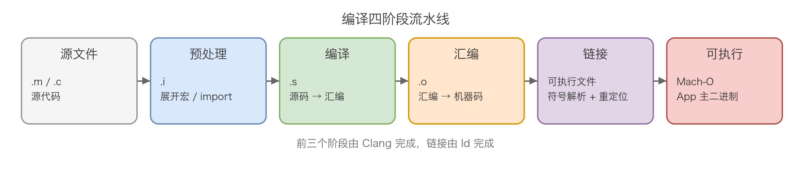
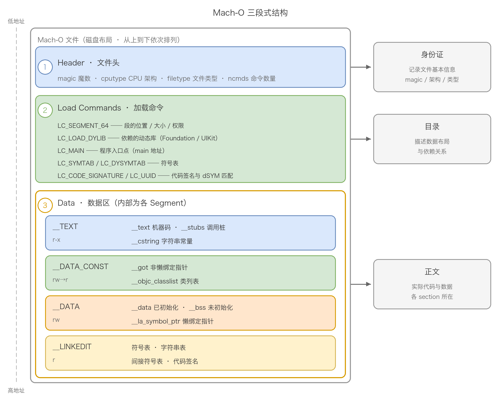
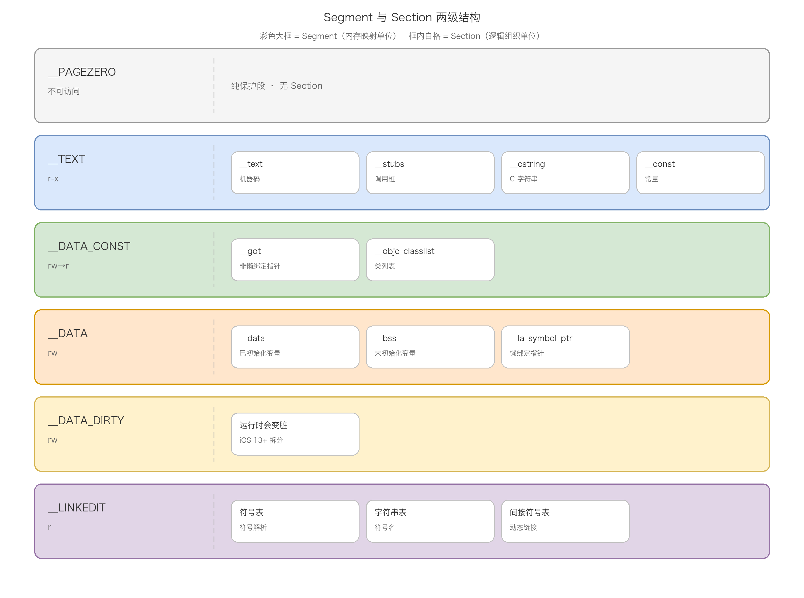
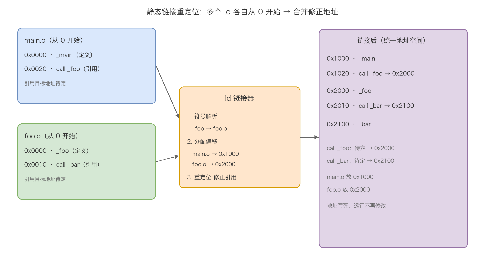
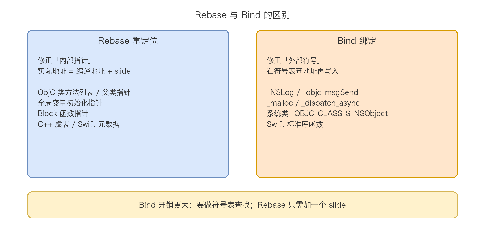

# 03. Mach-O 文件格式分析

> Mach-O（Mach Object）是 Apple 平台（macOS / iOS / watchOS / tvOS）通用的可执行文件格式，对标 Windows 的 PE 和 Linux 的 ELF。它是编译链接的产物，也是 dyld 装载执行的输入——理解 Mach-O，就串起了「源码 → 目标文件 → 可执行文件 → 进程内存」的整条链路。本文从编译链接流水线讲起，讲清符号与链接的本质；再拆解 Mach-O 的三段式结构（Header / Load Commands / Data）与 Segment/Section 两级组织，逐个段、逐个关键 Section 讲透；然后对比静态库的链接与动态库的装载（ASLR / Rebase / Bind / Lazy Binding）；随后补上符号名修饰、符号可见性、Two-Level Namespace、代码签名等容易被深挖的细节；最后落到启动优化与常见面试题。相比常见的 Mach-O 讲解，本文额外补充了 LTO、Dead Code Stripping、代码签名、TBD、Swift ABI 稳定性、链接器选项等容易被忽略的知识点。

## 目录

- [一、基础概念：从源代码到可执行文件](#一基础概念从源代码到可执行文件)
- [二、Mach-O 文件格式](#二mach-o-文件格式)
- [三、静态库与静态链接](#三静态库与静态链接)
- [四、动态库与运行时装载](#四动态库与运行时装载)
- [五、符号进阶](#五符号进阶)
- [六、代码签名与启动优化](#六代码签名与启动优化)
- [七、常见面试问题](#七常见面试问题)
- [附：高频速记](#附高频速记)

---

## 一、基础概念：从源代码到可执行文件

### 1. 编译四阶段

一段源代码要变成可执行文件，需要经历四个阶段：

| 阶段  | 输入 → 输出          | 工作内容                           |
| --- | ---------------- | ------------------------------ |
| 预处理 | `.m/.c` → `.i`   | 展开宏、处理 `#import/#include`、条件编译 |
| 编译  | `.i` → `.s`      | 源码翻译成汇编代码                      |
| 汇编  | `.s` → `.o`      | 汇编代码翻译成机器码目标文件                 |
| 链接  | `.o` + 库 → 可执行文件 | 符号解析 + 重定位，合并成完整文件             |



前三个阶段由 Clang 完成（预处理 → 编译 → 汇编），第四个阶段由链接器 ld 完成。可以用 `clang -ccc-print-phases main.m` 打印出完整的编译阶段。这四个阶段里，链接是理解 Mach-O 的关键——前三个阶段只关心「单个文件」，链接才开始处理「文件之间」的符号关系。

### 2. 符号（Symbol）

符号是程序中函数、变量、类等实体的名称标识。当你写下一个函数调用时，编译器需要知道这个函数在哪里，符号就是用来定位它的。

```objc
void myFunction(void) {          // 定义了符号 _myFunction
    NSLog(@"Hello");             // 引用了外部符号 _NSLog
}
int globalVar = 10;              // 定义了符号 _globalVar
```

符号分为两类：

- **已定义符号**：在当前编译单元（即当前源文件编译生成的 `.o` 文件）中有具体代码或数据定义的符号，如上例的 `_myFunction` 和 `_globalVar`；
- **未定义符号**：当前编译单元只是引用、实际定义在其他编译单元或库中的符号，如上例的 `_NSLog`，需要在链接时解析。

注意 C 语言函数在符号表里会加一个下划线前缀，所以源码里的 `myFunction` 对应符号 `_myFunction`。区分「已定义/未定义」是理解链接一切行为的前提：链接出错（`Undefined symbol` / `Duplicate symbol`）本质上就是这两类符号的匹配出了问题。

### 3. 链接（Linking）与符号解析

链接是把多个目标文件（`.o`）组合成一个可执行文件的过程。链接器的核心工作是符号解析——把所有「未定义符号」与其他编译单元中的「已定义符号」关联起来。

链接器遍历所有输入的目标文件和库，执行以下步骤：

1. **收集符号信息**：扫描每个 `.o` 文件的符号表，记录所有已定义符号和未定义符号；
2. **匹配符号**：对每个未定义符号，在其他编译单元或库里查找同名的已定义符号；
3. **记录引用关系**：建立符号引用与符号定义之间的对应关系；
4. **检查错误**：
   - 某个未定义符号找不到定义 → 链接错误 `Undefined symbol: _xxx`；
   - 同一个符号有多个定义 → 链接错误 `Duplicate symbol: _xxx`。

```text
Undefined symbols for architecture arm64:
  "_myFunction", referenced from:
      _main in main.o
ld: symbol(s) not found for architecture arm64

duplicate symbol '_globalVar' in:
    foo.o
    bar.o
```

符号解析完成后，链接器知道了每个符号引用应该指向哪个地址，接下来要把地址信息写入代码。这一步的处理方式决定了链接的两种方式：

- **静态链接**：执行重定位（Relocation），直接把地址写入可执行文件；
- **动态链接**：记录符号引用信息，运行时由 dyld 执行 Bind 操作填入实际地址。

### 4. 静态链接 vs 动态链接

两种方式的本质区别不在「链接」本身——它们都要做符号解析——而在于**库代码何时进入最终程序、符号地址何时被写死**：静态链接在编译期把库代码拷进来、把地址算死；动态链接把库代码留在外部文件里，地址留到运行期由 dyld 现填。

**静态链接做了什么**：链接器把库中的目标文件（`.o`）直接复制进可执行文件，符号解析完成后执行重定位（Relocation），把每个符号引用的地址改写成最终地址。生成的文件自包含，运行时不再依赖任何外部库。

```text
main.o ─┐
foo.o  ─┤  符号解析 + 重定位（地址写死）
lib.a  ─┘
              │
              ▼
    可执行文件（自包含，拷走即可运行）
```

**动态链接做了什么**：链接器不复制库代码，只在可执行文件里记录两件事——依赖了哪些动态库（`LC_LOAD_DYLIB`）、引用了哪些外部符号（绑定信息）。生成的文件不自包含，运行时由 dyld 把库加载进内存、再修正符号地址。

```text
main.o ─┐
foo.o  ─┤  符号解析（只记录引用，不写入最终地址）
         │
         ▼
    可执行文件（含「待绑定」的符号引用）
         │  运行时
         ▼
    dyld 加载 lib.dylib → 查符号 → 填入地址
```

**关键差异：地址何时确定**。这是理解两种链接方式的核心。静态链接时，链接器知道所有代码最终要合并进同一个文件，所以能算出每个符号的最终地址，重定位一次就写死——`.o` 编译时地址都从 0 开始，链接器给每个 `.o` 分配起始地址，把引用处改写成合并后的最终值。动态链接则做不到：链接时动态库还没加载，链接器不知道它会被映射到哪个地址，尤其 ASLR（地址空间布局随机化）让动态库每次启动的加载地址都不同。所以链接器只能记录「`_NSLog` 这个符号在 Foundation 库中」，在可执行文件里留一个占位，等运行期 dyld 把 Foundation 加载进来、查到 `_NSLog` 的真实地址再填进去（Bind）。同一个符号，静态链接编译期一次算死，动态链接每次启动都要重新解析一遍。

**详细对比**：

| 维度      | 静态链接                    | 动态链接                             |
| ------- | ----------------------- | -------------------------------- |
| 链接时机    | 编译 / 链接期                | 运行期                              |
| 库代码位置   | 复制进可执行文件                | 保留在独立 `.dylib`                   |
| 地址确定时机  | 编译期重定位写死                | 运行期 dyld 做 Rebase / Bind         |
| 执行者     | 静态链接器 ld                | 动态链接器 dyld                       |
| 文件体积    | 大（每个 App 自带一份库）         | 小（只记录引用关系）                       |
| 内存占用    | 每个进程各占一份                | 多进程共享一份（dyld shared cache）       |
| 启动速度    | 快（无运行时加载与解析）            | 慢（加载库 + Rebase/Bind 有开销）         |
| 更新方式    | 重新编译整个 App              | 替换 `.dylib` 即可                   |
| 部署风险    | 无（自包含）                  | 有（缺库 / 版本不符会启动失败）                |
| 符号冲突    | 链接期报 `Duplicate symbol` | 运行期才暴露，或用 Two-Level Namespace 隔离 |
| ASLR 配合 | 相对地址仍可配合，整体布局较固定        | 天然配合，每次启动随机化                     |

**各自的取舍**。静态链接的优点集中在「快」和「省心」：程序自包含，拷一个文件就能跑，没有运行时加载和符号解析的开销，也不存在「依赖的库版本不对」这类问题。代价是体积大、内存浪费——多个进程各自拷贝一份相同的库代码，而且库每更新一次，就要把整个 App 重新编译发布。动态链接的优点集中在「共享」和「可更新」：库独立成文件，多个进程共享同一份内存映射，系统库升级不用重新编译依赖它的程序，App 体积也更小。代价是启动慢——加载库、Rebase、Bind 都要在 `main()` 之前完成，这正是 iOS 启动优化里反复出现的耗时点；此外还引入了依赖风险，缺库或版本不匹配会导致程序启动即崩溃。

**为什么需要动态链接**。早期 Unix 程序几乎全是静态链接，动态链接被引入主要有两个动机：一是内存与磁盘共享——C 标准库、系统调用封装这类库几乎每个程序都要用，静态链接意味着每个程序塞一份，浪费严重；二是库可独立更新——库修一个 bug，静态链接要重新编译所有依赖它的程序，动态链接只替换库文件即可。iOS 把这两点做到了极致：Foundation、UIKit 等系统框架全部动态链接，并集中放进 dyld shared cache，一份系统库代码被所有 App 共享，同时由系统统一签名、统一更新。第三方库则是两种方式并存——CocoaPods 默认把 Pod 编成静态库（`.a`）静态链接，`use_frameworks!` 则编成动态 framework 动态链接，各有取舍，具体在第六节展开。

一句话总结：静态链接是「编译期把地址算死」的重定位，动态链接是「运行期由 dyld 现填地址」的 Rebase/Bind。第三章展开静态库的链接细节，第四章展开动态库的装载与地址修正。

---

## 二、Mach-O 文件格式

无论是可执行文件、动态库还是静态库里的目标文件，都是 Mach-O 格式。

### 1. 什么是 Mach-O 与文件类型

Mach-O（Mach Object）是 Apple 平台的可执行文件格式，类似 Windows 的 PE、Linux 的 ELF。按 `filetype` 字段，常见类型：

| filetype | 宏             | 含义                       |
| -------- | ------------- | ------------------------ |
| 可执行文件    | `MH_EXECUTE`  | App 的主二进制                |
| 动态库      | `MH_DYLIB`    | `.dylib`、动态 `.framework` |
| 目标文件     | `MH_OBJECT`   | `.o`，静态库里的单元             |
| 动态链接器    | `MH_DYLINKER` | dyld 本身                  |
| 插件       | `MH_BUNDLE`   | Bundle 插件                |
| 调试符号     | `MH_DSYM`     | dSYM 文件                  |

用 `file /bin/ls` 可以快速看文件类型，输出类似 `Mach-O universal binary with 2 architectures`（universal binary 指包含多架构的 fat 文件）。

### 2. 三段式结构

Mach-O 由三部分组成，可以类比成一本书：

- **Header（身份证）**：记录文件基本信息，如魔数、CPU 架构、文件类型；
- **Load Commands（目录）**：记录各段、各依赖库、符号表等的位置和属性；
- **Data（正文）**：真正的代码和数据，被 Load Commands 描述。



### 3. Header 详解

Header 是 Mach-O 文件最开头的一段，长度固定——32 位文件 28 字节、64 位文件 32 字节。它像文件的「身份证」，告诉系统这个文件是什么格式、给哪个 CPU 架构用、后面跟着哪些内容，是 dyld 解析整个文件的起点。64 位的 `mach_header_64` 结构体定义：

```c
struct mach_header_64 {           // 64 位，8 个 uint32_t = 32 字节
    uint32_t      magic;         // 魔数，标识文件格式与字节序
    cpu_type_t    cputype;       // CPU 类型：ARM64, X86_64
    cpu_subtype_t cpusubtype;    // CPU 子类型
    uint32_t      filetype;      // 文件类型：可执行文件、动态库等
    uint32_t      ncmds;         // Load Commands 的数量
    uint32_t      sizeofcmds;    // Load Commands 的总大小
    uint32_t      flags;         // 特性标志，如 MH_PIE（支持地址随机化）
    uint32_t      reserved;      // 保留字段
};
```

32 位的 `mach_header` 少一个 `reserved` 字段，其余一致：

```c
struct mach_header {              // 32 位，7 个 uint32_t = 28 字节
    uint32_t      magic;
    cpu_type_t    cputype;
    cpu_subtype_t cpusubtype;
    uint32_t      filetype;
    uint32_t      ncmds;
    uint32_t      sizeofcmds;
    uint32_t      flags;
};
```

**magic：魔数**。这是 Header 的第一个字段，也是最容易被认出的一个。它有四个取值，一次性回答三个问题——是不是 Mach-O、32 位还是 64 位、大端还是小端：

| 魔数            | 十六进制         | 含义             |
| ------------- | ------------ | -------------- |
| `MH_MAGIC`    | `0xfeedface` | 32 位 Mach-O，大端 |
| `MH_CIGAM`    | `0xcefaedfe` | 32 位 Mach-O，小端 |
| `MH_MAGIC_64` | `0xfeedfacf` | 64 位 Mach-O，大端 |
| `MH_CIGAM_64` | `0xcffaedfe` | 64 位 Mach-O，小端 |

`feedface` 本身是「feed face」的文字游戏，64 位版本把结尾的 `e` 换成了 `f`。`CIGAM` 是 `MAGIC` 反过来拼（`M-A-G-I-C` → `C-I-G-A-M`），表示「字节序反转」的魔数——同一个文件在小端机器上读取时，`0xfeedface` 的字节会倒过来变成 `0xcefaedfe`。用 `xxd` 看一个 Mach-O 文件的开头，前四个字节就是它：

```bash
$ xxd -l 4 main
00000000: cffa edfe                                ....
# cffaedfe 在小端读取 = 0xfeedfacf = MH_MAGIC_64，即 64 位 Mach-O
```

**cputype / cpusubtype：CPU 架构**。`cputype` 指明这个文件为哪个 CPU 架构编译，常见值 `CPU_TYPE_X86_64`（`0x01000007`）、`CPU_TYPE_ARM64`（`0x0100000C`）。注意高位字节 `0x01` 是 `CPU_ARCH_ABI64` 标志位，表示 64 位 ABI，去掉它就是纯架构号。`cpusubtype` 进一步区分子类型，比如同为 ARM64 的 `arm64` 和 `arm64e`（带指针认证的版本）就在这一层区分。

**filetype：文件类型**。这个字段决定 dyld 拿到文件后如何对待它——`MH_EXECUTE` 是主程序，`MH_DYLIB` 是要加载的动态库，`MH_OBJECT` 是还没链接的目标文件。具体取值上一节已列过，这里记住一句话：filetype 不同，dyld 的装载策略就不同。

**ncmds / sizeofcmds：Load Commands 的索引**。`ncmds` 是紧跟 Header 后面的 Load Command 条数，`sizeofcmds` 是所有 Load Command 占用的总字节数。dyld 读到这里，就知道该在 Header 之后遍历多少条、读多少字节，从而找到每个段、每个依赖库、符号表的位置。两个字段缺一不可——只有数量不知道总长，或只有总长不知道边界，都无法正确解析。

**flags：特性标志**。这是一个位掩码，每个 bit 代表一个特性，dyld 和内核据此调整装载行为。常用的几个：

| 标志                         | 含义                         |
| -------------------------- | -------------------------- |
| `MH_NOUNDEFS`              | 目标文件没有未定义符号                |
| `MH_DYLDLINK`              | 文件需要动态链接（可执行文件、动态库都置位）     |
| `MH_TWOLEVEL`              | 使用二级命名空间（现代 macOS/iOS 都启用） |
| `MH_PIE`                   | 位置无关可执行，配合 ASLR 随机化加载地址    |
| `MH_BINDS_TO_WEAK`         | 允许绑定弱符号                    |
| `MH_ALLOW_STACK_EXECUTION` | 允许栈上执行代码（一般应关闭）            |
| `MH_NO_HEAP_EXECUTION`     | 禁止堆上执行代码（iOS 强制置位）         |

其中 `MH_PIE` 和 ASLR 直接相关——iOS 的可执行文件必须带这个标志，内核才会给进程随机化加载地址；`MH_TWOLEVEL` 关系到符号查找方式，在第五章展开。

**reserved：保留字段**。只有 64 位 header 才有，目前恒为 0，保留给未来扩展。

**通用二进制（Fat / Universal Binary）**。一个 App 要同时支持模拟器和真机，或发布时兼容多架构，就会用到通用二进制——它不是 Mach-O，而是一个「外壳」，把多个架构的 Mach-O 拼在一起。它的头部是 `fat_header`，后面跟着若干 `fat_arch` 描述每个架构的位置：

```c
struct fat_header {
    uint32_t magic;        // FAT_MAGIC = 0xcafebabe（或 FAT_CIGAM = 0xbebafeca）
    uint32_t nfat_arch;    // 包含的架构数量
};

struct fat_arch {
    cpu_type_t    cputype;
    cpu_subtype_t cpusubtype;
    uint32_t      offset;   // 该架构的 Mach-O 在文件中的偏移
    uint32_t      size;     // 该架构的 Mach-O 大小
    uint32_t      align;    // 对齐值
};
```

`fat_header.magic` 是 `0xcafebabe`（「cafe babe」文字游戏），和 Mach-O 的 `0xfeedface` 区分开来——dyld 读前 4 字节就能判断：是 fat 文件（`cafebabe`）还是单一 Mach-O（`feedfacf`）。64 位 fat 文件用 `fat_arch_64`，`offset`/`size` 扩展为 `uint64_t` 以支持更大的偏移。查看一个文件包含哪些架构：

```bash
$ lipo -info main
Architectures in the fat file: main are: arm64 x86_64
```

Xcode 默认给 Debug 构建多架构 fat 包方便真机和模拟器通用，Release 提交 App Store 时再按目标设备瘦身（配合 App Thinning），只保留需要的架构。

**常用查看命令汇总**：

```bash
otool -h main        # 查看 Mach-O header（-hv 附带解析出字段名）
lipo -info main      # 查看 fat 文件包含的架构
xxd -l 32 main       # 直接看前 32 字节的原始十六进制
```

一句话记住 Header：前 4 字节 `magic` 识别格式与架构，`cputype` 定 CPU，`filetype` 定文件角色，`ncmds`/`sizeofcmds` 给 Load Commands 导航，`flags` 开关装载特性。

### 4. Load Commands 详解

**Load Commands 是干什么的**。Data 区的代码和数据本身没有任何自描述能力——一堆字节里，哪段该映射到内存的哪个地址、允许读还是写、依赖了谁、入口在哪、符号表和签名在哪个位置，全都不知道。Load Commands 就是解决这个问题的：它是 Mach-O 的「目录 / 元数据」，dyld 和内核照着它，才能把文件正确装进内存。没有它，Data 区就是一堆无意义的 0/1。

具体来说，Load Commands 回答了四类问题：

1. **内存布局**：文件里有哪些段（Segment），每个段映射到哪个虚拟地址、多大、什么读写执行权限；
2. **依赖关系**：这个文件依赖哪些动态库；
3. **入口与链接**：程序入口在哪、符号表 / 动态链接信息 / 代码签名在文件的哪个位置；
4. **版本与元信息**：最低系统版本、UUID、构建信息等。

**通用结构**。每条 Load Command 都以同一个 8 字节的 `load_command` 头开头，后面跟各自特有的数据：


```c
struct load_command {
    uint32_t cmd;        // 命令类型，如 LC_SEGMENT_64
    uint32_t cmdsize;    // 这条命令的总字节数（含本结构 8 字节）
};
```

`cmd` 告诉 dyld 这是哪种命令，`cmdsize` 告诉 dyld 这条命令占多少字节。dyld 解析时从 Header 之后开始，读 `cmd`/`cmdsize`，跳到下一条，直到遍历完 `Header.ncmds` 条。`cmdsize` 在 64 位下要求 8 字节对齐。

**命令分类**。常见的 Load Command 按作用可以分成几组：

| 类别      | 命令                       | 作用                            |
| ------- | ------------------------ | ----------------------------- |
| 段映射     | `LC_SEGMENT_64`          | 声明一个段的虚拟地址、大小、权限，内存映射的根据      |
| 依赖库     | `LC_LOAD_DYLIB`          | 声明依赖的动态库（Foundation、UIKit）    |
| 依赖库     | `LC_LOAD_WEAK_DYLIB`     | 弱依赖，库缺失时不报错                   |
| 依赖库     | `LC_REEXPORT_DYLIB`      | 再导出，把所依赖库的符号转发给调用方            |
| 入口      | `LC_MAIN`                | 指定 main 入口偏移与初始栈大小            |
| 入口      | `LC_UNIXTHREAD`          | 老式入口指定方式，通过线程状态寄存器定位          |
| 符号 / 链接 | `LC_SYMTAB`              | 符号表位置                         |
| 符号 / 链接 | `LC_DYSYMTAB`            | 间接符号表位置                       |
| 符号 / 链接 | `LC_DYLD_INFO`           | rebase / bind 偏移表（dyld 2 / 3） |
| 符号 / 链接 | `LC_DYLD_CHAINED_FIXUPS` | 链式 fixups（dyld 4）             |
| 元信息     | `LC_UUID`                | 二进制唯一标识，匹配 dSYM               |
| 元信息     | `LC_CODE_SIGNATURE`      | 代码签名 blob 的位置                 |
| 元信息     | `LC_FUNCTION_STARTS`     | 函数起始地址表（崩溃符号化需要）              |
| 元信息     | `LC_DATA_IN_CODE`        | 代码段内嵌的数据标记                    |
| 元信息     | `LC_BUILD_VERSION`       | 构建平台与版本号                      |
| 元信息     | `LC_VERSION_MIN_*`       | 最低部署系统版本                      |
| 运行时路径   | `LC_RPATH`               | 追加动态库搜索路径                     |
| 运行时路径   | `LC_LOAD_DYLINKER`       | 指定动态链接器（dyld）路径               |
| 运行时路径   | `LC_ID_DYLIB`            | 动态库自身的安装名（install name）       |

**几个关键命令展开**。

`LC_SEGMENT_64` 是最重要的一条——每个段对应一条，它直接决定「文件里的哪个区间、映射到内存的哪个区间、什么权限」：

```c
struct segment_command_64 {
    uint32_t   cmd;           // LC_SEGMENT_64
    uint32_t   cmdsize;
    char       segname[16];   // 段名，如 __TEXT、__DATA
    uint64_t   vmaddr;        // 映射到的虚拟地址
    uint64_t   vmsize;        // 占用的虚拟内存大小
    uint64_t   fileoff;       // 在文件中的偏移
    uint64_t   filesize;      // 在文件中占的大小
    vm_prot_t  maxprot;       // 最大允许权限
    vm_prot_t  initprot;      // 初始权限
    uint32_t   nsects;        // 该段包含的 Section 数量
    uint32_t   flags;
};
```

`vmaddr`/`vmsize` 描述内存侧，`fileoff`/`filesize` 描述文件侧，两者共同构成「文件 → 内存」的映射；`initprot` 决定这个段初始是只读可执行（`r-x`）还是可读写（`rw-`）。`nsects` 说明这个段里还装着多少个 Section，Section 的具体内容紧跟这条命令之后排列——这就是下一节要讲的两级结构。

`LC_MAIN` 告诉 dyld 程序入口是 main 函数，它比老的 `LC_UNIXTHREAD`（通过线程状态寄存器跳转）简洁得多：

```c
struct entry_point_command {
    uint32_t cmd;           // LC_MAIN
    uint32_t cmdsize;
    uint64_t entryoff;      // main 入口相对 __TEXT 段的偏移
    uint64_t stacksize;     // 初始栈大小
};
```

`LC_LOAD_DYLIB` 声明依赖库及其版本：

```c
struct dylib_command {
    uint32_t cmd;           // LC_LOAD_DYLIB / LC_ID_DYLIB / ...
    uint32_t cmdsize;
    struct dylib {
        uint32_t name_offset;            // 库路径字符串相对本命令的偏移
        uint32_t timestamp;
        uint32_t current_version;        // 当前版本
        uint32_t compatibility_version;  // 兼容版本
    } dylib;
};
```

`LC_DYLD_INFO` 和 `LC_DYLD_CHAINED_FIXUPS` 都存动态链接要用的地址修正信息，区别是代际：dyld 2 / 3 用 `LC_DYLD_INFO` 单独存 rebase / bind 的偏移表，dyld 4 改成 `LC_DYLD_CHAINED_FIXUPS`，把修正信息直接内联进被修正的指针里，省内存、启动更快。

**为什么 Mach-O 用 Load Commands**。Mach-O 把「装载视图」和「链接视图」合并到了 Load Commands 一处——它既描述段如何映射进内存（装载），又描述符号表、重定位信息在哪（链接）。对比 ELF，这两件事是分开的：Program Header Table 管装载、Section Header Table 管链接。所以 Mach-O 的 Load Commands 同时承担了「怎么映射进内存」和「符号 / 重定位信息在哪」两件事。

**实际查看**。`otool -l` 会逐条列出所有 Load Command 及其字段值，是理解一个二进制布局最快的入口：

```bash
otool -l main        # -l 即 load commands
# 输出节选：
# Load command 0
#       cmd LC_SEGMENT_64
#   cmdsize 552
#   segname __TEXT
#    vmaddr 0x0000000100000000
#    nsects 6
# ...

otool -L main        # 只看依赖了哪些动态库
```

一句话：Load Commands 是 Data 区的「使用说明书」，dyld 照着它才能把文件正确装进内存。

### 5. Segment 与 Section 两级结构

先厘清 Data 区是干什么的。Mach-O 三段式里，Header 是「身份证」、Load Commands 是「目录」，这两者都是描述性元信息，本身不参与运行；真正被 CPU 执行、被程序读写的实际内容，全部落在 Data 区——它是 Mach-O 的「正文」。源代码编译出的机器码、程序里的全局变量、常量、字符串字面量、符号表、代码签名数据，这些实实在在的东西都在 Data 区里。

这里顺带区分一个容易混的概念：Mach-O 三段式里的第三段叫 Data（数据区），指「除 Header 和 Load Commands 之外的全部内容」；而后面要讲的 `__DATA` 是 Data 区内部的一个具体 Segment，专指可读写的那块数据，两者不在一个层级。

Data 区装载进内存时，不能整块无差别处理——不同数据对「读 / 写 / 执行」权限的要求不同，而操作系统做内存保护的最小单位是「页」（iOS 上是 16KB），只能按页设权限。所以链接器把「权限相同、用途相近」的数据归成一块块映射单元，这就是 Segment（段）；段内部再按数据类型细分，就是 Section（节）。于是 Data 区形成「段（Segment）→ 节（Section）」两级组织：

| 层级      | 作用                     | 对齐        |
| ------- | ---------------------- | --------- |
| Segment | 内存映射与管理的基本单位，定义权限和映射方式 | 页对齐（16KB） |
| Section | 逻辑组织单位，区分不同类型的数据       | 按需        |

以 `__TEXT` 为例，`__text`（机器码）、`__stubs`（调用桩）、`__cstring`（C 字符串）、`__const`（常量）这些 Section 都继承 `__TEXT` 的权限：可读、可执行、不可写。



为什么需要两级结构？三个原因：

- **安全性**：操作系统按 Segment 设置内存保护，防止代码被修改（W^X 原则，同一段不能既写又执行）；
- **灵活性**：链接器可以按 Section 精细操作，比如合并多个目标文件的同名 Section；
- **效率**：运行时只需按 Segment 整页映射，不必逐 Section 处理权限。

### 6. 各 Segment 详解

Mach-O 常见的 Segment 及权限：

| Segment        | 权限   | 说明                  |
| -------------- | ---- | ------------------- |
| `__PAGEZERO`   | 不可访问 | 空指针陷阱区，捕获 NULL 解引用  |
| `__TEXT`       | r-x  | 代码与只读数据             |
| `__DATA_CONST` | rw→r | 启动后转为只读的常量（iOS 13+） |
| `__DATA`       | rw   | 可读写数据               |
| `__DATA_DIRTY` | rw   | 一定会被修改的数据（iOS 13+）  |
| `__LINKEDIT`   | r    | 链接器使用的元信息           |

**`__PAGEZERO`**：位于虚拟地址空间最开头（地址 0x0），是不可读、不可写、不可执行的保护段，64 位下大小通常 4GB。它的核心作用是捕获空指针访问：C/ObjC 的 NULL 指针值为 0，任何对 NULL 的解引用都会落到这段范围，因为不可访问，系统立即产生段错误（`SIGSEGV`/`EXC_BAD_ACCESS`），而不是让程序带着野指针继续跑。

```objc
NSString *str = nil;
NSLog(@"%c", str[0]);        // 访问地址 0x0，崩溃

int *ptr = NULL;
*ptr = 42;                   // 写入地址 0x0，崩溃

char *p = (char *)0x1000;
*p = 'a';                    // 偏移后仍在 __PAGEZERO 范围内，崩溃
```

**`__TEXT`**：存放代码和只读数据，关键 Section：

```text
__TEXT Segment（可读、可执行）
├── __text           编译后的机器码
├── __stubs          动态库函数调用的桩代码
├── __stub_helper    辅助延迟绑定的代码
├── __cstring        C 字符串常量 "Hello World"
├── __const          const 修饰的常量
├── [ObjC] __objc_methname / __objc_classname / __objc_methtype
└── [Swift] __swift5_typeref / __swift5_reflstr / __swift5_entry
```

**`__DATA_CONST`**（iOS 13+，启动后变只读）：`__got`（非懒绑定符号指针）、`__const`（运行时常量）、`__objc_classlist`（类列表）、`__objc_protolist`（协议列表）、`__objc_imageinfo`，以及 Swift 的 `__swift5_proto`/`__swift5_types`。

**`__DATA`**（可读写）：`__la_symbol_ptr`（懒绑定符号指针）、`__data`（已初始化全局/静态变量）、`__bss`（未初始化全局/静态变量）、`__common`（未初始化外部变量）、`__objc_ivar`，以及 Swift 的 `__swift5_fieldmd`/`__swift5_assocty`/`__swift5_protos`。

**`__DATA_DIRTY`**：运行时一定会被修改的数据，单独分页以优化 COW（Copy-On-Write）。

**`__LINKEDIT`**：存放静态链接器（ld）和动态链接器（dyld）使用的元信息——符号表、字符串表、间接符号表、重定位信息、代码签名、函数起始地址表。

### 7. 为什么 iOS 13+ 拆分 \_\_DATA

iOS 13 前，整个 `__DATA` 段都是可读写，不能跨进程共享（因为进程会写脏页面）。问题在于，`__DATA` 里混着两类数据：`__got`、`__objc_classlist` 这类「启动时写入一次之后就不变」的数据，和 `__la_symbol_ptr`、`__data` 这类「运行时会改」的数据。前者被迫跟着后者一起变成不可共享的脏页。

iOS 13 起把它们拆开：

- `__DATA_CONST`：启动后置为只读，可被多个进程共享物理页；
- `__DATA_DIRTY`：明确会变的数据，单独成段。

这样 `__DATA_CONST` 在启动完成后能被多个进程共享，减少内存占用。本质是「让更多页面能被系统复用」。

### 8. 代码签名（Code Signature）

代码签名放在 `__LINKEDIT` 段，由 `LC_CODE_SIGNATURE` 指向。它把整个二进制（含 Header、Load Commands、代码、数据）逐页做哈希，生成一份签名的 seal：

- **页哈希验证**：每个代码页单独哈希，运行时按页验证，改一页只影响一页；
- **防篡改**：保证二进制自签名后未被修改，是 App Store 审核、设备运行、沙盒信任的基础；
- **dSYM 匹配**：`LC_UUID` 是二进制与 dSYM 关联的凭据，符号化崩溃日志靠它。

这也是「iOS 不能 dlopen 任意动态库」的根因——没有签名的库无法通过验证。

### 9. 查看 Mach-O 的常用工具

```bash
otool -L MyApp      # 查看依赖的动态库
otool -l MyApp      # 查看所有 Load Commands
otool -hv MyApp     # 查看 Header
nm -m MyApp         # 查看符号表
xcrun dyldinfo -rebase MyApp    # 查看 rebase 信息
xcrun dyldinfo -bind MyApp      # 查看 bind 信息
file MyApp          # 快速判断文件类型与架构
lipo -info MyApp    # 查看 fat 二进制包含的架构
```

`nm -m` 的输出里，`(undefined) external _NSLog` 表示未定义、需从 Foundation 导入的符号；`(__TEXT,__text) external _main` 表示定义在代码段的外部可见符号。

---

## 三、静态库与静态链接

### 1. 什么是静态库

静态库是目标文件（`.o`）的打包集合。链接阶段，链接器从静态库里提取需要的目标文件，把代码复制进最终可执行文件，链接完成后可执行文件就自包含了，运行时不再依赖这个库。

**静态库的作用**。为什么要把代码打成静态库，而不是把 `.m`/`.c` 源码直接丢进每个项目里一起编译？主要有四点：

1. **代码复用**：把常用功能（网络层、工具类、算法库）封装成库，多个项目直接链接复用，不必复制源码；
2. **模块化与独立维护**：库作为独立单元单独开发、测试、发版本，调用方和实现解耦；
3. **编译加速**：库已经编译成 `.o`，链接时直接取用，省去重复编译源码的时间，大型依赖库尤其明显；
4. **闭源分发**：商业 SDK 以「`.a` + 头文件」的形式交付，调用方拿到二进制和接口声明，看不到实现源码——这是静态库在商业场景里最重要的价值。

静态库有三种常见形式：

- `.a`：传统 Archive 归档（`ar` 打包），最纯粹的 `.o` 集合；
- `.framework`：静态库形式的 Framework（二进制 + 头文件 + 资源，打包成一个目录）；
- `.xcframework`：多平台多架构的现代分发格式（真机 arm64 + 模拟器 x86_64 等）。

```bash
# 静态库本质是 .o 的归档
$ ar -t libMyStatic.a
MyClass.o
MyHelper.o
MyUtils.o
```

**静态库的内部结构**。`.a` 不是新格式，它就是一个 `ar` 归档文件：开头是归档魔数 `!<arch>\n`，后面把一个个 `.o` 成员原样串起来，每个成员带一个文件头（文件名、大小、时间戳）。链接器遍历归档时，靠每个成员自己的符号表判断该 `.o` 里定义了哪些符号。此外归档里还有一个由 `ranlib` 生成的符号索引表（成员名 `__.SYMDEF`），记录「哪个符号 → 定义在哪个 `.o` 成员里」，让链接器不用逐个扫描就能快速定位符号——这也是 `ar` 打包后通常还要 `ranlib`（或 `ar s`）的原因。

### 2. 静态库的链接过程

静态库的链接不是「整库打包」，而是**按需提取**。以 `main.o` 链接 `libStatic.a`（内含 `foo.o`、`bar.o`、`unused.o`）为例，假设 `main.o` 引用了 `_foo`、`foo.o` 引用了 `_bar`、`bar.o` 无外部引用、`unused.o` 没被任何符号引用，链接器的工作过程是：

1. **收集未定义符号**：读 `main.o` 的符号表，得到未定义符号 `_foo`；
2. **查索引定位**：在静态库的符号索引表（`__.SYMDEF`）里查到 `_foo` 定义在 `foo.o`，把 `foo.o` 提取出来；
3. **递归解析**：`foo.o` 里又出现了未定义符号 `_bar`，继续查索引，定位到 `bar.o` 并提取；
4. **收敛**：`bar.o` 没有再引入新符号，解析结束；`unused.o` 全程无人引用，始终不被提取；
5. **重定位 + 合并**：把 `main.o`、`foo.o`、`bar.o` 做重定位（下一节），合并成可执行文件。

这个「按需提取」带来两个直接后果：

- **以 `.o` 为最小单元**。只要一个 `.o` 里有一个符号被引用，整个 `.o` 都会被提进来——因为 `.o` 是最小链接单元，不能只取半个。完全没被引用的 `.o`（如 `unused.o`）则彻底不进最终产物，不增加体积；
- **链接顺序敏感**。Unix 链接器从左到右单遍扫描，`main.o` 引用了 `_foo`，定义 `_foo` 的库就必须出现在 `main.o` 之后；如果两个静态库互相依赖（A 引用了 B 的符号、B 也引用了 A 的符号），单遍扫描会漏掉，需要在命令行重复写库名，或用 `-Wl,--start-group A.a B.a --end-group` 把库圈起来让链接器反复扫描，直到没有新增符号为止。

### 3. 静态链接中的重定位（Relocation）

每个 `.o` 编译时都假设自己的代码从地址 0 开始，多个 `.o` 合并到统一地址空间时，会被放到不同地址，因此要修正代码里的地址引用，这就是重定位。



```text
编译时（各自从 0 开始）：
main.o:                      foo.o:
0x0000: _main               0x0000: _foo
0x0020: call _foo           0x0010: call _bar

链接后（合并到统一地址空间）：
0x1000: _main
0x1020: call _foo   → 修正为 call 0x2000
0x2000: _foo
0x2010: call _bar   → 修正为 call 0x2100
0x2100: _bar
```

### 4. 静态库的优缺点与创建

| 优点            | 缺点               |
| ------------- | ---------------- |
| 运行时无需额外加载，启动快 | 增大可执行文件体积        |
| 部署简单，无依赖问题    | 多个 App 重复占用磁盘和内存 |
| 支持链接时优化（LTO）  | 更新需重新编译整个 App    |

**打包过程**。做出一个静态库分三步——编译、归档、建索引：

```bash
# ① 编译：每个源文件单独编译成目标文件（-c 只编译不链接）
clang -c MyClass.m -o MyClass.o
clang -c MyHelper.m -o MyHelper.o
clang -c MyUtils.m -o MyUtils.o

# ② 归档：用 ar 把多个 .o 打包成一个 .a
#    r = 插入/替换成员，c = 归档不存在则创建，s = 写符号索引表
ar rcs libMyStatic.a MyClass.o MyHelper.o MyUtils.o

# ③ 建索引：ranlib 生成符号索引（ar 的 s 选项内部就是调它）
ranlib libMyStatic.a
```

`ar` 的三个高频选项正好对应打包的三个动作：`r`（replace，把 `.o` 插入归档，同名则替换）、`c`（create，归档不存在时创建）、`s`（symbol table，生成符号索引表）。符号索引表是静态库能被高效链接的前提——没有它，链接器只能线性扫描每个成员，效率低很多。

打包完成后用库链接：

```bash
clang main.m -L. -lMyStatic -o main
# -L 指定库搜索路径（这里是当前目录）
# -l 指定库名（libMyStatic.a 对应 -lMyStatic，链接器自动补 lib 前缀和 .a 后缀）
```

链接器查找静态库的规则：`-lMyStatic` 会在 `-L` 指定的路径下找 `libMyStatic.a`（若同目录还有 `libMyStatic.dylib`，默认优先动态库）。找不到会报 `ld: library not found for -lMyStatic`。


### 5. 链接器优化选项

链接器有几个高频选项，直接关系静态库能否被正确链接：

| 选项                  | 作用                       |
| ------------------- | ------------------------ |
| `-ObjC`             | 加载静态库中所有 ObjC 类/Category |
| `-all_load`         | 强制加载静态库所有目标文件            |
| `-force_load lib.a` | 只强制加载指定库的所有目标文件          |
| `-dead_strip`       | 删除未使用的代码和数据              |

一个经典坑：静态库里只有 Category 被 App 引用时，链接器默认按符号可达性把它当「无引用」剪掉，导致运行时找不到方法，必须加 `-ObjC` 或 `-all_load` 显式保留。

### 6. LTO 链接时优化

LTO（Link Time Optimization）把优化推迟到链接期，让链接器看到全程序的中间表示（LLVM bitcode），从而做跨编译单元的优化：

- **传统流程**：每个 `.o` 在编译期独立优化，链接器只能看到机器码，无法跨文件内联或消除死代码；
- **LTO 流程**：`.o` 里存的是 bitcode（而非纯机器码），链接期统一优化后再生成机器码。

收益是内联、死代码消除能跨文件生效，体积和性能更好；代价是编译和链接时间变长。静态库的「支持 LTO」优点正来源于此。

### 7. Dead Code Stripping

死代码剥离是链接器的体积优化：符号解析后，从入口（`main` 或 `LC_MAIN`）出发做可达性分析，把没有任何调用链引用到的函数/数据从最终产物删除。Xcode 默认开启，可用 `-dead_strip` 显式控制。这也是 `-ObjC` 存在的原因——ObjC 的类和方法通过 runtime 字符串引用，静态可达性分析看不到，需要显式保留。

---

## 四、动态库与运行时装载

### 1. 什么是动态库

动态库在程序运行时才被加载，代码不被复制进可执行文件，由动态链接器 dyld 装载。形式：

- `.dylib`：传统动态库；
- `.framework`：动态库形式 Framework（可含资源）；
- `.xcframework`：多平台分发；
- `.tbd`：文本存根，只含符号信息不含实现，链接期用。

`.tbd` 是「text-based stub」：链接器只需要知道符号、不需要真实代码，Apple 用 `.tbd` 分发系统库符号，既保护实现又能链接。

**动态库的作用**。为什么要用动态库，而不是把代码静态链接进 App？相对静态库，动态库的核心价值有三点：

1. **内存共享**：多个进程加载同一个动态库时，操作系统只保留一份物理内存映射——动态库的代码段只读，可被各进程的虚拟地址映射到同一块物理页。这对「几乎所有程序都要用」的系统库意义重大：如果 C 标准库、Foundation、UIKit 都静态链接，每个 App 各塞一份，磁盘和内存的浪费不可接受；
2. **独立更新**：库修 bug、发新版本，替换库文件即可，不用重新编译依赖它的所有程序。iOS 上系统库随系统版本一起升级，App 无需改动就能用上新系统能力；
3. **按需加载与插件化**：通过 `dlopen` 在运行时才加载库，可以做到启动时只加载核心库、用到某个功能模块时再懒加载，也能实现插件式架构（主程序 + 若干动态插件）。

代价是启动更慢（dyld 加载 + Rebase + Bind）、有依赖风险（缺库或版本不符启动即崩）。iOS 上系统库全部动态链接并集中在 dyld shared cache，但第三方库因沙盒隔离无法跨 App 共享内存，动态的「共享」优势被削弱，所以 iOS 第三方库更多用静态。

**动态库的打包**。用 Clang 打出一个动态库分三步：

```bash
# ① 编译成动态库：-dynamiclib 是关键，生成 MH_DYLIB 类型的 Mach-O
clang -dynamiclib Foo.m -o libFoo.dylib

# ② 指定安装名（install name）：库被引用时的标识，写入库自己的 LC_ID_DYLIB
clang -dynamiclib Foo.m -install_name @rpath/libFoo.dylib -o libFoo.dylib

# ③ 链接使用
clang main.m -L. -lFoo -o main
```

`-dynamiclib` 让链接器产出动态库而不是可执行文件；`-install_name` 设置的是这个库的「安装名」，它记录在库自己的 `LC_ID_DYLIB` Load Command 里，是链接器和 dyld 识别、查找这个库的依据。调用方链接时，`LC_LOAD_DYLIB` 里记录的就是这个 install name。

动态库的查找路径用三个占位符表达，配合 `LC_RPATH` 灵活定位：

| 占位符 | 展开为 | 典型用途 |
|--------|--------|---------|
| `@executable_path` | 可执行文件所在目录 | 库和可执行文件放一起 |
| `@loader_path` | 加载者（引用它的那个二进制）所在目录 | Framework 内嵌依赖 |
| `@rpath` | Runpath Search Paths（`LC_RPATH` 指定的一组目录） | Xcode 默认，最灵活 |

Xcode 里对应的设置是 `Runpath Search Paths`（默认 `@executable_path/Frameworks`、`@loader_path/Frameworks`）。打包成 Framework 时，install name 通常设为 `@rpath/MyFramework.framework/MyFramework`，再把头文件、`Info.plist`、资源一起塞进 `.framework` 目录。

动态库的依赖关系用 `otool -L` 查看：

```bash
$ otool -L libFoo.dylib
libFoo.dylib:
    @rpath/libFoo.dylib (compatibility version 1.0.0, current version 1.0.0)
    /usr/lib/libobjc.A.dylib (compatibility version 1.0.0, current version 228.0.0)
```

第一行是它自己的 install name（`@rpath/libFoo.dylib`），下面列出它依赖的其他库。

### 2. Rebase 修正内部指针

**为什么需要 Rebase：ASLR**。ASLR（Address Space Layout Randomization）是一种安全机制，每次启动随机选择镜像的加载基地址，防止攻击者预测代码位置。编译时假设的基地址（如 `0x100000000`）在运行时是错的，实际地址要加一个随机偏移，这个偏移叫 slide：

```text
编译时假设基地址：0x100000000
第一次运行：实际加载 = 0x100000000 + 0x5000
第二次运行：实际加载 = 0x100000000 + 0x8000
```

镜像被加载到新地址后，里面那些「指向镜像自身」的指针就全错了——它们编译时按 `0x100000000` 为基准写死，现在镜像被挪到了 `0x100005000`，指针却还指着老地址，一用就崩。这就是 Rebase 要解决的问题。

**Rebase 的作用与目的**。Rebase 修复的正是这些「内部指针」：把镜像里所有指向自身的指针统一加上 slide，让它们重新指向正确的运行时位置。名字也由此而来——re-base，重新设定基准地址。它的适用对象是「编译时地址已知、但被 ASLR 改掉」的指针，特点在于**新地址 = 旧地址 + slide**，slide 全程固定不变，所以 Rebase 本质是「批量加一个固定偏移」，不需要任何符号查找，开销很小。

需要 Rebase 的指针类型（都指向镜像内部）：

- ObjC 类的方法列表指针（指向 `__TEXT` 的方法名）；
- ObjC 类的父类指针（指向父类 Class 结构）；
- 全局变量的初始化指针（如 `NSString *str = @"hello"` 里的字符串地址）；
- Block 的函数指针（指向 invoke 函数）；
- C++ 虚函数表指针；
- Swift 类型元数据指针。

**修正过程**。dyld 执行 Rebase 分四步：

1. **读取修正信息**：dyld 2/3 从 `LC_DYLD_INFO` 里的 rebase 段读出一串「rebase 指令流」（opcode），每条指令描述「哪些位置有内部指针、怎么修」；dyld 4 改用 chained fixups，把修正信息直接编进每个指针本身；
2. **逐指针定位**：按指令流逐个找到需要修正的指针地址，这些指针大多集中在 `__DATA` 段（如 `__objc_superrefs` 存父类指针、`__objc_classrefs` 存类引用）；
3. **加 slide**：读出指针旧值（编译时地址），加上本次启动的 slide；
4. **写回**：把新值写回原指针位置。

```text
slide = 实际加载地址 - 编译时基地址

示例：编译基地址 0x100000000，实际加载 0x100005000 → slide = 0x5000

某 ObjC 类的父类指针（存于 __DATA,__objc_superrefs）：
  编译时值   0x100001000   （父类 Class 的编译地址）
  Rebase 后  0x100001000 + 0x5000 = 0x100006000
```

整个过程不查符号表、不做字符串比较，只是「读旧值 + 加 slide + 写回」，所以 Rebase 比 Bind（下一节）快得多。

### 3. Bind：修正外部符号

**为什么需要 Bind：外部符号**。Rebase 只解决「镜像被挪动后，指向自己内部的指针」的问题，但一个程序不可能只引用自己，它还要调用系统库、第三方库里的函数和类。这些「指向 Mach-O 外部」的符号，编译时根本无法知道地址——它们的代码在别的动态库（Foundation、libSystem 等）里，地址要等运行时 dyld 把依赖库加载进内存之后才能确定。所以编译期链接器只能把「符号名 + 归属哪个库」记下来，在可执行文件里留一个待填的坑，运行时由 dyld 把这个坑填上真实地址，这个过程就是 Bind。

**Bind 的作用与目的**。Bind（绑定）修正的正是这些「外部指针」：运行时查符号表，把外部符号的真实地址填进 `__DATA` 段里预留好的指针槽位（GOT 或 `__la_symbol_ptr`）。它和 Rebase 的区别在于：Rebase 是「加一个已知的固定偏移」就能算出来，Bind 则必须「查符号表」——拿着符号名去目标库的符号表里搜索，找到之后才能得到地址，所以要做字符串比较，开销远大于 Rebase。

需要 Bind 的指针类型（都指向 Mach-O 外部）：

- 系统函数（`_NSLog`、`_objc_msgSend`、`_malloc`、`_dispatch_async`）；
- 系统类（`_OBJC_CLASS_$_NSObject`、`_OBJC_CLASS_$_UIView`）；
- 其他动态库的全局变量；
- Swift 标准库函数。

**绑定信息的存储**。和 Rebase 一样，Bind 的修正信息也由 dyld 读取：

- dyld 2/3：从 `LC_DYLD_INFO` 的 bind 段读绑定指令流（opcode），每条指令描述「符号名、目标库、要写的槽位」；
- dyld 4：用 chained fixups 把绑定信息直接编码进指针本身，省掉一张单独的表。

绑定指令流是一串紧凑的字节码，常见的几条：

| 指令 | 作用 |
|------|------|
| `BIND_OPCODE_SET_DYLIB_ORDINAL` | 指定目标库（用序号，不用完整路径） |
| `BIND_OPCODE_SET_SYMBOL_TRAILING_FLAGS_IMM` | 指定符号名（字符串紧跟其后，故叫 trailing） |
| `BIND_OPCODE_SET_TYPE_IMM` | 指定指针类型（普通指针 / 弱引用） |
| `BIND_OPCODE_SET_ADDEND_SLEB` | 指定加数（addend，指针值要额外加的值） |
| `BIND_OPCODE_DO_BIND` | 把当前符号地址 + addend 写入当前槽位，再移到下一个槽位 |

opcode 流如此紧凑，是为了压缩 Mach-O 体积：不存一张完整的地址表，只存「增量指令」，一个槽位往往只需一条 `DO_BIND` 就能复用前面设好的库和符号名。

**Bind 的解析过程**。dyld 执行 Bind 大致分四步：

```text
1. dyld 读取绑定指令流，得到符号名（"_NSLog"）和目标库（Foundation）
2. 在目标库符号表中查找该符号的地址
3. 把查到的地址（+ addend）写入对应槽位（__DATA 的 __got 或 __la_symbol_ptr）
4. 继续下一条指令，直到指令流结束

示例：
符号名 _NSLog，目标库 Foundation
查找结果 0x7FFF20123456
写入位置 __DATA,__got 中的 _NSLog 条目
```



**非惰性绑定与惰性绑定**。Bind 按「何时解析」分两种：

1. **非惰性绑定（non-lazy）**：启动时就把地址解析好。数据符号（全局变量）必须在启动时绑定，因为程序可能一开始就要读它；被取地址的函数（`&func`）、弱符号也走非惰性。它们的槽位放在 `__DATA,__got`（Global Offset Table，全局偏移表）里；
2. **惰性绑定（lazy）**：函数调用默认惰性，只在首次被调用时才解析，用来加快启动。它们的槽位放在 `__DATA,__la_symbol_ptr` 里。

**Lazy Binding 延迟绑定**。为了加快启动，大部分外部函数用延迟绑定——首次调用才解析。首次调用 `NSLog` 的流程：

```text
1. 代码调用 _NSLog 桩（__TEXT,__stubs 里的 jmp 指令），间接跳转到 _NSLog_ptr
2. _NSLog_ptr 初始指向桩助手（__TEXT,__stub_helper），还没真实地址
3. 桩助手把符号信息压栈，跳进 dyld_stub_binder
4. dyld_stub_binder 在 Foundation 符号表查 _NSLog 真实地址，写回 _NSLog_ptr
5. 后续调用直接经 _NSLog_ptr 跳到 _NSLog，跳过解析
```

三个段配合完成惰性绑定：`__TEXT,__stubs` 存跳转桩（每个外部函数一条 `jmp`）、`__TEXT,__stub_helper` 存调用 binder 的辅助代码、`__DATA,__la_symbol_ptr` 存指针槽位。`la` 是 lazy 的缩写，槽位初始指向 `stub_helper`，解析后指向真实函数。

```bash
xcrun dyldinfo -lazy_bind MyApp
# __DATA  __la_symbol_ptr  0x100008100  Foundation  _NSLog
```

惰性绑定的代价是首次调用有一次额外的跳转和符号查找，但换来更快的启动——绝大多数函数可能压根没被调用过，就永远不用解析。

### 4. Rebase/Bind vs 静态重定位

**重定位是「填地址」这件事**。不管是静态链接还是动态链接，编译出来的代码里总有一堆「当时还不知道地址」的引用——`.o` 里调用别的 `.o` 的函数、程序里调用系统库的函数，编译期都不知道它们最终会落在内存哪里。把「不知道的地址」变成「正确的地址」这件事，统一叫重定位（Relocation）。区别只在于：谁来填、什么时候填、填的依据是什么。

**静态重定位：链接期一次填完**。静态链接时，链接器 ld 把多个 `.o` 合并成一个可执行文件，各 `.o` 的相对位置都确定了，于是它把每个待定的引用都填成最终虚拟地址，直接写进文件。第三章讲过这个过程——符号解析、分配地址、重定位写死。填完之后地址就固定了，程序运行时直接拿来用，不再改。

**Rebase/Bind：运行期每次重填**。动态链接的问题在于地址没法在链接期确定：一是 ASLR 让镜像基地址每次启动随机，二是外部符号在别的动态库里、地址要等加载后才知道。所以这两类地址引用只能留到运行时，交给 dyld 现填——Rebase 填内部指针（加 slide），Bind 填外部符号（查符号表）。这也是前两节讲的内容。

| 特性 | 静态重定位（Relocation） | Rebase | Bind |
|------|------------------------|--------|------|
| 执行时机 | 链接期 | 运行期（加载时） | 运行期（加载时或首次调用） |
| 执行者 | 链接器 ld | dyld | dyld |
| 修正对象 | `.o` 之间的地址引用 | 指向镜像内部的指针 | 指向镜像外部的符号 |
| 地址如何得到 | 各 `.o` 相对位置已定，直接算 | 旧地址 + 固定 slide | 查目标库符号表 |
| 是否需要符号表 | 需要（解析 `.o` 间符号） | 不需要（只加偏移） | 需要（字符串匹配） |
| 持久性 | 一次性，写入文件 | 每次启动重做 | 每次启动重做 |
| 开销 | 链接期一次，运行期零 | 小（机械加偏移） | 大（符号查找） |
| 与 ASLR 的关系 | 与 ASLR 无关 | 因 ASLR 而存在 | 因动态库地址不确定而存在 |

**两者不互斥，反而常共存**。一个进程里可以同时存在两种重定位：静态库里的代码经静态重定位写死地址，动态库里的代码经 Rebase/Bind 运行时修正，各管各的，互不干扰。更进一步，现代 macOS/iOS 的可执行文件默认都是 PIE（位置无关，Header 带 `MH_PIE` 标志），所以即便是「静态链接」进主程序的代码，运行时主程序被 ASLR 挪动后，它内部的指针也照样要 Rebase——静态重定位填的是「基于默认基地址 `0x100000000` 算出来的地址」，ASLR 一改基地址，这些值又错了，还得 Rebase 加一遍 slide。所以严格说，静态重定位解决的是「多个 `.o` 之间怎么拼」，Rebase 解决的是「整个镜像被挪了之后怎么办」，两者针对不同层面，不是替代关系。

**一句话总结**：静态重定位是「链接时把地址一次算死」，Rebase/Bind 是「运行时把地址现算现填」；前者省启动时间，后者换来 ASLR 安全和动态库共享。现代程序两者都用：静态库走前者，动态库走后者。

---

## 五、符号进阶

### 1. 符号名修饰（Name Mangling）

不同语言对符号名的修饰规则不同：

| 语言    | 源码                                  | 符号                                   |
| ----- | ----------------------------------- | ------------------------------------ |
| C     | `void foo()`                        | `_foo`                               |
| ObjC  | `+[MyClass doSomething]`            | `+[MyClass doSomething]`             |
| C++   | `void foo(int)` / `void foo(float)` | `__Z3fooi` / `__Z3foof`（编码参数类型以支持重载） |
| Swift | `func foo()`                        | `$s4Main3fooyyF`                     |

**ObjC 符号的全局命名空间问题**：ObjC 符号不含模块信息，类名直接作为符号名的一部分。这意味着整个 App（含所有链接的库）不能有同名 ObjC 类，即使它们在不同的 Clang Module 里。两个库都定义 `MyClass`，都会产生 `_OBJC_CLASS_$_MyClass`，冲突发生在两个阶段：

- **静态链接时**：链接器报 `duplicate symbol '_OBJC_CLASS_$_MyClass'`；
- **运行时**（动态库）：ObjC Runtime 注册类时发现同名，行为未定义。

这就是 ObjC 社区类名前缀约定的由来（`NS`、`UI`、`AF`、`SD`）。相比之下 Swift 符号含模块名，不同模块可以有同名类型。

Swift 用复杂 mangling 编码完整类型信息，可用 `swift demangle` 还原：

```bash
$ swift demangle '$s4Main3fooyyF'
$s4Main3fooyyF ---> Main.foo() -> ()

$ swift demangle '$s4Main6PersonC4name3ageSSSi_tcfc'
... ---> Main.Person.init(name: String, age: Int)
```

### 2. 符号可见性

符号可见性控制符号是否导出到动态库符号表。`default` 导出（外部可见），`hidden` 不导出（仅内部可见）。控制可见性的原因：导出符号越多，`__LINKEDIT` 的符号表越大、dyld 的 Bind 越重、暴露的内部实现越多、公开 API 越难改动。

C/ObjC 三种控制方法：

```objc
// 方法1：attribute
__attribute__((visibility("hidden"))) void privateFunction(void);

// 方法2：宏简化
#define MY_HIDDEN __attribute__((visibility("hidden")))
MY_HIDDEN void internalHelper(void);

// 方法3：Xcode Build Settings → Symbols Hidden by Default = YES
```

推荐「默认隐藏，显式导出」。Swift 用 `public`/`open`（导出）vs `internal`/`private`（不导出）自动管理。`nm -gU` 看导出符号，`nm -a` 看全部；`nm` 输出里符号类型大写（`T`/`D`）表示导出，小写（`t`/`d`）表示未导出。

### 3. Two-Level Namespace

Apple 用 Two-Level Namespace 避免符号冲突：符号 = 库名 + 符号名。传统 Unix 的 Flat Namespace 把所有动态库符号放同一命名空间，可能冲突；Two-Level 下 `_NSLog@Foundation` 和 `_NSLog@MyLibrary` 不冲突。

但它解决不了 ObjC 类名冲突——Two-Level Namespace 工作在 dyld 层，解决「从哪个库导入符号」；而 ObjC 类名冲突发生在 Runtime 层（注册全局类表时按类名为 key），`objc_getClass("MyClass")` 无法指定来自哪个库。所以 ObjC 仍要靠类名前缀。

---

## 六、代码签名与启动优化

### 1. Mach-O 装载与冷启动

冷启动的 Pre-main 阶段，Mach-O 装载开销集中在：递归加载动态库、Rebase、Bind、运行 initializers（含 `+load`）。其中 Bind 因要做符号查找，比 Rebase 更重；`+load` 因为把类变成非懒加载类，也会拖慢启动。

### 2. 启动优化手段

- **减少自定义动态库**：库越多，装载与 Bind 越重；
- **精简导出符号**：用 `-exported_symbols_list` 只导出必要符号，减少 Bind 工作量；
- **减少 `+load`**：迁移到 `+initialize` 或编译期配置；
- **Order File（二进制重排）**：把启动路径上的符号排到连续内存，减少 Page Fault；
- **App Thinning**：缩小二进制，减少装载体积。

### 3. Swift ABI 稳定性

Swift 5.0 起 ABI 稳定：系统库（含 Swift 标准库）以稳定 ABI 内置在系统里，App 不必再打包 Swift runtime。这依赖两个机制——ABI Stability（类型布局、调用约定稳定）和 Module Stability（模块用 `swiftmodule` 稳定格式分发，跨编译器版本可用）。这也是 `BUILD_LIBRARY_FOR_DISTRIBUTION` 的底层意义。

---

## 七、常见面试问题

**Q1：Mach-O 文件由哪几部分组成？**  
Header + Load Commands + Data。Header 记录魔数/CPU/文件类型/Load Commands 数量；Load Commands 描述段、依赖库、符号表等的位置和属性；Data 是实际代码数据，按 Segment/Section 两级组织。

**Q2：Segment 和 Section 是什么关系？**  
Segment 是 Section 的容器，是内存映射基本单位（页对齐、定义权限）；Section 是数据组织的逻辑单位，同一 Segment 内多个 Section 共享内存属性。

**Q3：为什么 iOS App 不能 dlopen 任意动态库？**  
代码签名机制要求所有可执行代码签名验证，App 只能加载系统库或嵌入 Bundle 的已签名动态库。

**Q4：Rebase 和 Bind 哪个开销更大？**  
Bind 更大，因为要做符号表查找和字符串比较；Rebase 只需加一个 slide。

**Q5：ObjC 和 Swift 符号名有什么区别？**  
ObjC 符号无模块信息（全局类名空间，靠前缀避免冲突），Swift 符号含模块信息（mangling 编码模块、类型、签名）。

**Q6：XCFramework 解决了什么问题？**  
Fat Framework 的架构冲突、多平台分发、自动选架构。

**Q7：CocoaPods 有哪些链接方式？**  
默认静态库、`use_frameworks!`、`use_frameworks! :linkage => :static`、`use_modular_headers!` 四种。

**Q8：静态链接和动态链接有什么区别？**  
链接时机、符号解析方式、代码位置、内存占用、启动速度五方面不同。

**Q9：为什么静态库只有 Category 时可能找不到方法？**  
链接器按符号可达性裁剪，Category 的 ObjC 方法通过 runtime 字符串引用，静态分析看不到，需 `-ObjC`/`-all_load` 强制加载。

**Q10：dyld 3 的 Launch Closure 缓存了什么？**  
缓存解析元数据的结果（rebase/bind 位置、依赖加载顺序、initializer 顺序），不缓存 slide 和最终指针值。

---

## 附：高频速记

- **编译四阶段**：预处理 → 编译 → 汇编 → 链接（前三个 Clang，第四个 ld）。
- **符号**：已定义 vs 未定义；链接就是符号解析，报错 `Undefined symbol` / `Duplicate symbol`。
- **Mach-O 三段式**：Header（身份证）+ Load Commands（目录）+ Data（正文）。
- **两级结构**：Segment 内存映射单位（页对齐、权限），Section 逻辑组织单位。
- **关键段**：`__TEXT`(r-x) / `__DATA`(rw) / `__DATA_CONST`(rw→r) / `__DATA_DIRTY`(rw) / `__LINKEDIT`(r) / `__PAGEZERO`(陷阱)。
- **iOS 13 拆分 \_\_DATA**：把「不变」与「会变」分开，提升内存共享。
- **静态链接**：编译期复制代码 + 重定位（Relocation），`.o` 从 0 起合并修正地址。
- **动态链接**：运行期 dyld 装载，Rebase（内部指针加 slide）+ Bind（外部符号查表）。
- **Rebase vs Bind**：Bind 更重（符号表查找）；Lazy Binding 首次调用才解析。
- **链接器选项**：`-ObjC`（保 ObjC 代码）/ `-all_load`（全加载）/ `-dead_strip`（死代码剥离）。
- **代码签名**：`__LINKEDIT` + `LC_CODE_SIGNATURE`，页哈希验证，限制 dlopen。
- **符号名**：C `_foo`，C++ `__Z3fooi`，Swift `$s...`，ObjC 无模块信息需前缀。
- **启动优化**：少动态库、少 `+load`、控制导出符号、Order File 重排、App Thinning。
- **本质一句话**：静态链接「编译期把地址算死」，动态链接「运行时由 dyld 修正地址」。
