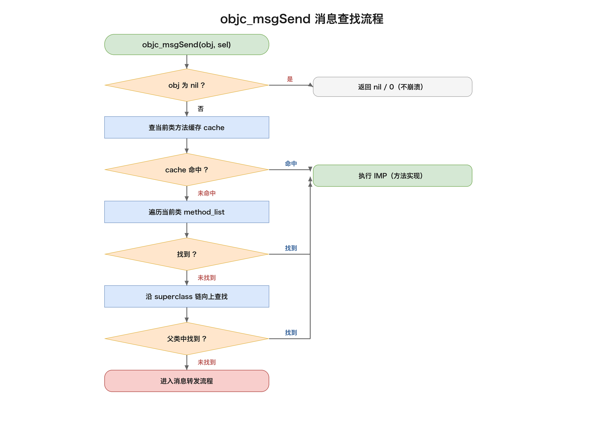
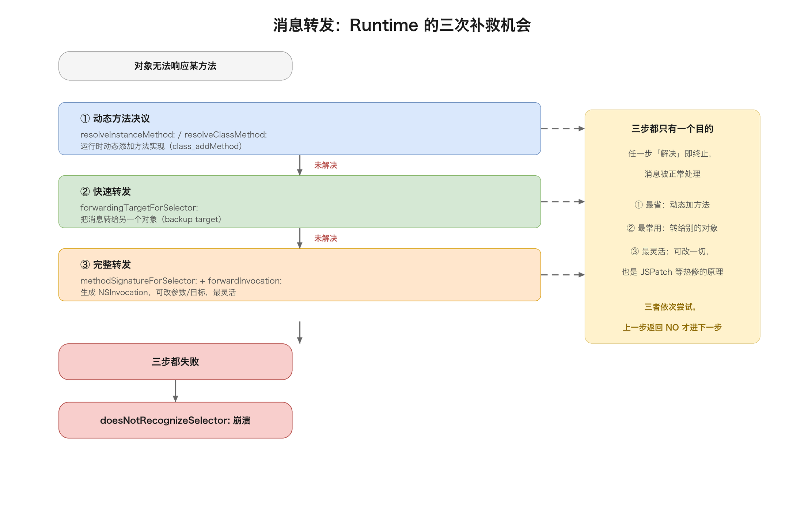
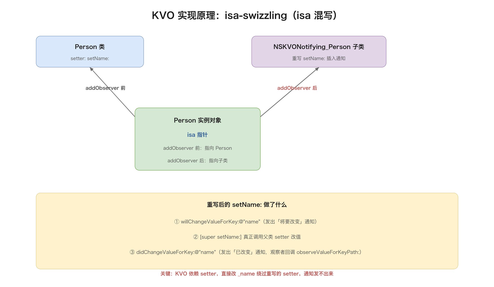

# 01-OC基础语法

> Objective-C（简称 OC）是 C 语言的超集，在 C 之上增加了面向对象与消息传递机制，是 iOS / macOS 开发的基石语言。本文按知识点全覆盖梳理 OC 基础语法，配合代码示例与对比表格，兼顾 MRC 与 ARC 两套内存管理模型。

## 目录

- [一、语言概述](#一语言概述)
- [二、程序结构与编译](#二程序结构与编译)
- [三、数据类型与字面量](#三数据类型与字面量)
- [四、类与对象](#四类与对象)
- [五、属性与内存管理](#五属性与内存管理)
- [六、消息传递机制](#六消息传递机制)
- [七、协议与委托](#七协议与委托)
- [八、Category 与 Extension](#八category-与-extension)
- [九、Block](#九block)
- [十、KVC 与 KVO](#十kvc-与-kvo)
- [十一、常用集合类](#十一常用集合类)
- [十二、错误处理](#十二错误处理)
- [十三、常用设计模式](#十三常用设计模式)
- [十四、与 Swift 互操作要点](#十四与-swift-互操作要点)

---

## 一、语言概述

### 1. OC 与 C 的关系

OC 是 **C 的严格超集**：任何合法的 C 代码都是合法的 OC 代码。在 C 的基础上，OC 通过一套运行时（Runtime）增加了：

- 面向对象（类、对象、继承、多态）；
- 消息传递（区别于 C++ 的虚函数表调用）；
- 动态特性（运行时增删方法、动态类型判断）。

```c
// OC 文件里可以混写 C 代码
#include <stdio.h>
int add(int a, int b) { return a + b; }

// 也可以写 OC 代码
#import <Foundation/Foundation.h>
NSString *s = @"hello";
```

「超集」不只是语法兼容这么简单，更重要的是 C 的内存模型在 OC 里原样保留——指针、`malloc/free`、结构体、函数指针全都能直接用。这意味着写 OC 的人随时可以「下沉」到 C 层去手动管理内存、调底层系统 API，iOS 里大量底层框架（CoreFoundation 就是纯 C 写的）正是这样被 OC 直接复用的。混编最典型的场景，是把现成的 C/C++ 库（zlib、sqlite、OpenCV 这类）直接接进来，这也是 `.mm` 文件存在的意义。

顺便把三个扩展名说清楚：`.m` 是纯 OC 源文件，`.mm` 是 OC 与 C++ 混编文件（走 Clang 的 Objective-C++ 模式），`.h` 是头文件。区分 `.m` 和 `.mm` 很重要——编译器看到 `.mm` 才会开 C++ 语法，往 `.m` 里塞 C++ 代码会直接编译报错。

### 2. OC 与 C++ / Swift 的定位对比

| 维度   | C++                      | Objective-C    | Swift          |
| ---- | ------------------------ | -------------- | -------------- |
| 编程范式 | 多范式（强静态）                 | 面向对象 + 动态消息    | 多范式（协议导向）      |
| 类型系统 | 静态强类型                    | 动态类型（id）+ 静态可选 | 静态强类型          |
| 方法调用 | 虚函数表（编译期绑定）              | 消息传递（运行时绑定）    | 直接调用 + 动态派发    |
| 内存管理 | new/delete / RAII / 智能指针 | MRC / ARC      | ARC            |
| 编译产物 | 机器码                      | 机器码（经 Runtime） | 机器码（经 Runtime） |

这张表最关键的一列是「方法调用」：C++ 在编译期就把虚函数表定死了，OC 却把方法查找留到运行期。这个差异决定了两种语言的气质——C++ 追求「编译期做尽可能多的事」，换零开销抽象和极致性能；OC 追求「运行期保持灵活」，换 KVO、Method Swizzling、热修复这类动态能力，代价是每次方法调用都要走一遍查找（虽有方法缓存兜底）。Swift 夹在中间，默认静态派发，需要动态能力时用 `@objc dynamic` 显式打开。

### 3. 编译流程

OC 的编译从 `.m` 源码到可执行文件，关键在 **Clang 前端**把 OC 语法翻译成 C 的 Runtime 调用：

```text
.m / .mm 源文件
   │  Clang 前端（OC 语法 → C + objc_msgSend 调用）
   ▼
C / IR 中间表示
   │  LLVM 后端
   ▼
机器码 + Mach-O
```

> `.m` 是纯 OC 源文件，`.mm` 是 OC/C++ 混编源文件，`.h` 是头文件。

实际编译一条龙是四步：预处理（展开宏、处理 `#import`）→ 编译（Clang 把 OC 语法降级成 C 和 `objc_msgSend` 调用）→ 汇编（生成目标文件 `.o`）→ 链接（把 `.o` 和 Foundation 等库合成 Mach-O）。理解的关键在第二步：OC 的面向对象语法全是「糖」，Clang 会把 `@interface`、`@property`、`[obj method]` 统统翻译成 C 结构体和函数调用，真正干活的是 Runtime 那套 C 函数库。这也是 OC 能逆向、能被 Method Swizzling 折腾的根源——运行期有一份完整的类元数据躺在 Mach-O 里。

### 4. OC 的核心特性：动态性

OC 最大的特点是**运行时动态性**——很多「编译期必须确定」的事，在 OC 里可以推迟到运行期：

| 动态特性 | 说明 | 示例 |
|---------|------|------|
| 动态类型 | 用 `id` 表示任意对象，类型在运行期才确定 | `id obj = [[Person alloc] init];` |
| 动态绑定 | 方法调用在运行期才查找具体实现 | `[obj eat];` 运行期才确定调哪个实现 |
| 动态加载 | 运行期按名字创建类、加载模块 | `NSClassFromString(@"Person")` |
| 动态方法决议 | 运行期动态添加/替换方法 | `class_addMethod(...)` |

```objc
// 动态类型 + 动态创建：编译器不知道 obj 的类型，也不生成固定的方法调用
Class cls = NSClassFromString(@"Person");   // 运行期拿类
id obj = [[cls alloc] init];                // 动态创建实例
[obj performSelector:@selector(eat)];       // 动态发消息
```

动态性不是免费的，它带来三个成本：一是性能，每次消息发送都要走查找流程；二是安全性，编译期查不出的错误（比如给对象发一个不存在的方法）会推迟到运行期才暴露；三是可读性，`id` 类型让代码失去静态类型的自文档能力。所以现代 OC 的实践是「能静态就静态」——能用具体类型就不用 `id`，能靠编译检查就不靠运行期，把动态性留给真正需要它的地方（KVO、运行时反射、热修复）。

### 5. 为什么需要 Runtime

OC 的面向对象能力几乎全部由 **Runtime**（一套 C 语言库，`<objc/runtime.h>`）在**运行期**提供，而非编译期固化：

- 编译器把 `[obj eat]` 翻译成 `objc_msgSend(obj, @selector(eat))`；
- 类的结构（方法列表、属性、协议）以元数据形式存在 Mach-O 的 `__DATA` 段；
- Runtime 在运行期读取这些元数据，动态构建类、查找方法、实现消息转发。

> 理解 OC 的关键一句话：**语法是编译期的糖，能力是运行期的 Runtime**。这正是 OC 比 C++ 更灵活（也更"难优化"）的根源。

Runtime 这套 C 库大致分几块：对象模型（`objc_object`、`objc_class`、isa 链）、消息机制（`objc_msgSend`、消息转发）、方法操作（`class_addMethod`、`method_exchangeImplementations`）、关联对象、运行时类型信息（`objc_getClass`、`class_copyMethodList`）。苹果开源了这部分源码（objc4），它是理解 OC 一切「魔法」的入口——KVC、KVO、Category、Method Swizzling 全建立在这套 API 之上。所以「会写 OC」和「懂 OC」的分水岭，基本就是有没有把这层 Runtime 摸清楚。

---

## 二、程序结构与编译

### 1. 文件结构

一个 OC 类通常由头文件（`.h`）与实现文件（`.m`）组成：

**Person.h（接口声明）**

```objc
#import <Foundation/Foundation.h>

@interface Person : NSObject {
    // 实例变量（ivar）可写在这里
    NSString *_name;   // 现代 OC 更推荐写在 @implementation 中
}

// 属性声明
@property (nonatomic, copy) NSString *name;
@property (nonatomic, assign) NSInteger age;

// 方法声明
- (instancetype)initWithName:(NSString *)name age:(NSInteger)age;
- (void)sayHello;
+ (instancetype)personWithName:(NSString *)name;

@end
```

**Person.m（实现）**

```objc
#import "Person.h"

@implementation Person

- (instancetype)initWithName:(NSString *)name age:(NSInteger)age {
    self = [super init];
    if (self) {
        _name = [name copy];
        _age = age;
    }
    return self;
}

- (void)sayHello {
    NSLog(@"Hello, I'm %@", self.name);
}

+ (instancetype)personWithName:(NSString *)name {
    return [[self alloc] initWithName:name age:0];
}

@end
```

`.h` 和 `.m` 的分工本质是「接口」和「实现」的分离：`.h` 只暴露别人需要知道的东西（属性、方法签名），`.m` 藏着具体实现。这么分有两个好处：一是编译单元之间只依赖头文件，改实现不改接口时，引用方不用重新编译；二是隐私，实例变量和私有方法都藏在 `.m` 里，外部看不到。现代 OC 推荐把 ivar 写在 `@implementation` 而不是 `@interface` 的大括号里，正是为了把「内部细节」从公开头文件里彻底拿走。

### 2. #import 与 #include

| 指令         | 行为                              |
| ---------- | ------------------------------- |
| `#include` | C 风格头文件包含，可能重复包含                |
| `#import`  | 自动去重，同一头文件只包含一次（OC 推荐）          |
| `@class`   | 前置声明，只告诉编译器「这是类」，不导入头文件，可减少编译依赖 |

```objc
@class Person;   // 前置声明，仅在 .h 中用到指针时可用
#import "Person.h"  // 真正需要访问其成员时才导入
```

`@class` 前置声明只在「只用指针、不访问成员」时够用。一旦要继承这个类、实现它的协议、或访问它的属性/方法，就必须 `#import` 完整头文件。所以常见做法是：`.h` 里能 `@class` 就 `@class`（减依赖），真正需要的地方（`.m` 里）再 `#import`。这样能明显减少头文件变动引发的连锁重编译。

### 3. 方法定义与调用

OC 的方法签名由**多段冒号参数**组成，调用方式为**方括号消息传递**：

```objc
// 方法声明：3 个参数，每个参数前有标签
- (void)setName:(NSString *)name age:(NSInteger)age city:(NSString *)city;

// 调用
[person setName:@"Tom" age:20 city:@"Shanghai"];
```

方法类型前缀：

| 前缀  | 含义   | 调用者  |
| --- | ---- | ---- |
| `-` | 实例方法 | 对象实例 |
| `+` | 类方法  | 类本身  |

OC 方法签名的「多段冒号」看着啰嗦，其实是刻意的设计——它让方法调用读起来像一句带填空的句子。`[person setName:@"Tom" age:20 city:@"Shanghai"]` 一眼就知道每个参数是什么意思，不像 C 的 `setPerson(person, "Tom", 20, "Shanghai")` 得去查函数定义。这种自文档性，也是 OC 代码即使不写注释也相对好读的原因。

### 4. 命名约定

- 类名：首字母大写的驼峰（`Person`、`UIViewController`）；
- 方法/变量：首字母小写驼峰（`sayHello`、`userName`）；
- 常量：`k` 前缀或全大写（`kMaxCount`）；
- 类名 2~3 个字母前缀避免符号冲突（`NS`、`UI`、自定义 `XX`）。

前缀不是可有可无的装饰。OC 没有 C++ 那种命名空间，所有类都塞在同一个全局符号表里，第三方库的类名很容易撞车。苹果自己用 `NS`（Foundation）、`UI`（UIKit）、`CA`（CoreAnimation），社区约定开发者用 2~3 个字母的公司或项目缩写（比如 `AF`、`SD`）。不写前缀的后果是：两个库都定义了 `Manager` 类，链接期直接报符号冲突，还很难排查。

### 5. @interface 的完整结构

`@interface` 块可以包含五部分：类名与父类、遵守的协议、实例变量区、属性声明、方法声明：

```objc
@interface Person : NSObject <NSCopying, NSCoding>  // 类名 : 父类 <协议列表>
{
    // ① 实例变量区（可省略，现代 OC 移到 @implementation）
    NSString *_name;
    NSInteger _age;
}

// ② 属性声明（自动生成 ivar + getter/setter）
@property (nonatomic, copy) NSString *name;
@property (nonatomic, assign) NSInteger age;

// ③ 方法声明
- (instancetype)initWithName:(NSString *)name;   // 实例方法
+ (instancetype)person;                          // 类方法

@end
```

把 ivar 挪进 `@implementation` 的一个直接好处是封装：这些变量成了「实现细节」，头文件里干净得只剩 `@property` 和公开方法。另一个好处和编译有关——ivar 一旦写进 `@interface`，子类和外部都依赖这个内存布局，改了 ivar 就要重编译所有引用方；写进 `@implementation` 后，布局变化只影响本文件。不过要小心：用 `@property` 自动合成的 ivar 默认是 `_` 前缀的私有变量，不能跨类访问；需要公开访问的变量才在 `@interface` 里手动声明。

### 6. 编译命令与预处理

**编译单个文件**（Clang 编译器）：

```bash
# 编译 .m 为可执行文件（链接 Foundation 框架）
clang -fobjc-arc Person.m main.m -framework Foundation -o app

# 只编译不链接，生成目标文件
clang -c Person.m -o Person.o
```

**预处理指令**（OC 继承 C 全部预处理能力）：

```objc
#define MAX_COUNT 100          // 宏定义
#ifdef DEBUG                  // 条件编译
    NSLog(@"debug mode");
#endif

#define SQUARE(x) ((x) * (x)) // 带参宏（注意括号防优先级问题）
```

> **头文件循环依赖**：`.h` 里能用 `@class` 前置声明就用 `@class`，只有真正需要（继承、实现协议、访问成员）才 `#import`，可显著减少编译依赖与编译时间。

`-fobjc-arc` 是打开 ARC 的编译开关（Xcode 工程默认开启），去掉它就回到 MRC 模式，这也是早期项目的 `.m` 里要手写 `[obj release]` 的原因。`-framework Foundation` 是在链接阶段告诉链接器去链接 Foundation 框架，链多个框架就写多个 `-framework`。预处理里那个 `SQUARE(x)` 的括号是经典坑：`#define SQUARE(x) x*x` 遇到 `SQUARE(1+2)` 会展开成 `1+2*1+2` 得到 5，所以宏的参数和整体都得加括号。

---

## 三、数据类型与字面量

### 1. 基本类型

OC 完整继承 C 的基本类型，并补充了 Foundation 的封装类型：

| 类型                                | 说明                        | 字面量                  |
| --------------------------------- | ------------------------- | -------------------- |
| `int` / `long` / `short` / `char` | C 整型                      | `42`                 |
| `float` / `double`                | 浮点                        | `3.14`               |
| `BOOL`                            | 布尔（YES/NO，本质 signed char） | `YES` / `NO`         |
| `NSInteger` / `NSUInteger`        | 平台自适应整型（32/64 位自动）        | `42`                 |
| `CGFloat`                         | 平台自适应浮点                   | `3.14`               |
| `NSString`                        | 字符串                       | `@"hello"`           |
| `NSNumber`                        | 数值对象                      | `@42`、`@3.14`、`@YES` |
| `id`                              | 任意对象类型                    | `nil`                |

```objc
BOOL flag = YES;                 // YES == 1
NSInteger i = 100;
CGFloat f = 3.14;
NSNumber *num = @42;             // 装箱
int raw = num.intValue;          // 拆箱
```

`NSInteger`/`CGFloat` 是「平台自适应」类型：32 位设备上 `NSInteger` 是 `int`（4 字节），64 位上是 `long`（8 字节），`CGFloat` 同理在 32 位是 `float`、64 位是 `double`。苹果建议只要和系统 API 交互的整型、浮点，统一用这两个，避免位数切换时溢出或精度丢失。`BOOL` 的本质是 `signed char`，所以 `YES` 其实是 1；但很多历史代码会把任意非零值当「真」用，判断时最好写 `if (flag)` 而不是 `if (flag == YES)`，因为一旦 `flag` 被赋了 `2`，`== YES` 反而判为假。

### 2. 字符串 NSString

OC 字符串以 `@` 前缀表示，是 Foundation 的类（非 C 字符串）：

```objc
NSString *s1 = @"hello";
NSString *s2 = [NSString stringWithFormat:@"value = %d", 42];
NSMutableString *ms = [@"hello" mutableCopy];
[ms appendString:@" world"];     // 可变字符串拼接
```

常用操作：

```objc
NSString *s = @"Hello, Objective-C";
NSUInteger len = s.length;                              // 长度
NSString *sub = [s substringToIndex:5];                 // 截取
BOOL has = [s hasPrefix:@"Hello"];                      // 前缀判断
NSRange r = [s rangeOfString:@"Obj"];                   // 查找
NSArray *parts = [s componentsSeparatedByString:@", "]; // 分割
NSString *joined = [parts componentsJoinedByString:@"-"]; // 拼接
```

`NSString` 是「不可变」的，所有「修改」操作其实都返回一个新字符串，原对象不动；要原地拼接、替换得用 `NSMutableString`。判断两个字符串内容是否相等，一定用 `isEqualToString:` 而不是 `==`——`==` 比的是指针地址，两个内容相同但内存不同的字符串会被判成不相等。另外 `NSString` 属性几乎都用 `copy` 修饰，防止外部传入一个 `NSMutableString` 后被偷偷改内容。

### 3. 数组 NSArray

```objc
// 不可变数组
NSArray *arr = @[@"a", @"b", @"c"];     // 字面量
NSString *first = arr[0];               // 下标访问
NSInteger count = arr.count;

// 可变数组
NSMutableArray *marr = [@[@"a"] mutableCopy];
[marr addObject:@"b"];
[marr insertObject:@"x" atIndex:0];
[marr removeObject:@"a"];
```

`NSArray` 只能存对象，不能存 `int`、`BOOL` 这些基本类型，要存先装箱成 `NSNumber`。也不能存 `nil`——`nil` 在数组里是「结束标记」，用字面量 `@[a, b, c]` 时只要有一个元素是 nil 就会在运行期直接崩溃。访问越界（`arr[100]`）会抛异常，所以取下标前要确认 `index < count`。

### 4. 字典 NSDictionary

```objc
NSDictionary *dict = @{@"name": @"Tom", @"age": @20};
NSString *name = dict[@"name"];         // 下标访问

NSMutableDictionary *mdict = [@{} mutableCopy];
mdict[@"city"] = @"Shanghai";
[mdict removeObjectForKey:@"city"];
```

`NSDictionary` 的 key 必须遵守 `NSCopying` 协议（`NSString`、`NSNumber` 都满足），因为字典内部会 copy key，防止它被外部修改；拿一个可变对象当 key 会出问题。取值 `dict[@"name"]` 在 key 不存在时返回 nil，所以拿到值后通常要判空。value 同样不能是 nil，需要「空值」时用 `NSNull` 占位。

### 5. 集合 NSSet / 常用类

```objc
NSSet *set = [NSSet setWithObjects:@"a", @"b", @"c", nil];
BOOL contains = [set containsObject:@"a"];

// 其他常用：NSDate、NSData、NSValue、NSNull
NSDate *now = [NSDate date];
NSData *data = [s1 dataUsingEncoding:NSUTF8StringEncoding];
NSNull *null = [NSNull null];   // 集合中不能存 nil，用 NSNull 占位
```

`NSSet` 无序、元素唯一，查找（`containsObject:`）比数组快，适合「判断是否存在」的场景。它内部靠哈希实现，所以元素必须正确实现 `hash` 和 `isEqual:`，否则去重和查找会出错。`NSCountedSet` 是它的变体，能统计每个元素出现的次数。

### 6. 字面量语法汇总

| 类型   | 字面量写法                 |
| ---- | --------------------- |
| 字符串  | `@"text"`             |
| 数值   | `@42`、`@3.14f`、`@YES` |
| 数组   | `@[a, b, c]`          |
| 字典   | `@{key: value}`       |
| 下标访问 | `arr[i]`、`dict[key]`  |

字面量语法本质是「编译期的糖」：`@42` 编译成 `[NSNumber numberWithInt:42]`，`@[a, b, c]` 编译成 `[NSArray arrayWithObjects:a, b, c, nil]`，`arr[i]` 编译成 `[arr objectAtIndexedSubscript:i]`。所以它和传统写法在功能上等价，但有个行为差异要留意：字面量数组/字典遇到 nil 会直接崩溃，而老的 `arrayWithObjects:` 遇到 nil 是「提前终止」——两者混用时别搞混。

### 7. NSNumber 装箱与拆箱详解

`NSNumber` 是「数值 → 对象」的桥，用于把基本类型放进集合（`NSArray`/`NSDictionary` 只能存对象）：

```objc
// 装箱（基本类型 → NSNumber）
NSNumber *intNum   = @42;
NSNumber *floatNum = @3.14f;
NSNumber *doubleNum= @3.1415926;
NSNumber *boolNum  = @YES;
NSNumber *charNum  = @'A';

// 拆箱（NSNumber → 基本类型）
int i   = intNum.intValue;
float f = floatNum.floatValue;
BOOL b  = boolNum.boolValue;

// 判断类型与比较
NSString *type = intNum.objCType;                 // "i" 类型编码
NSComparisonResult r = [intNum compare:@100];      // 数值比较
BOOL equal = [intNum isEqualToNumber:@42];         // 相等判断
```

`@42` 这种字面量是语法糖，底层仍是 `[NSNumber numberWithInt:42]`，和 `intNum.intValue` 拆箱是相反方向。`NSNumber` 是不可变的，没有 `NSMutableNumber` 这种东西，改数值就是新造一个对象。比较两个 `NSNumber` 用 `isEqualToNumber:` 或 `compare:`，别直接 `==`（那比的是指针）。

### 8. 类型转换与格式化

```objc
// 字符串 ↔ 数值
NSString *numStr = @"123";
int parsed = numStr.intValue;                    // 字符串转整数
NSString *back = [NSString stringWithFormat:@"%d", parsed];  // 数值转字符串

// NSLog 常用格式化占位符
// %@ 对象   %d/%ld 整数   %f 浮点   %p 指针地址   %c 字符
NSLog(@"name=%@ age=%ld score=%.2f ptr=%p", name, (long)age, 3.14159, obj);

// C 字符串 ↔ NSString
const char *cstr = [s UTF8String];               // NSString → C 字符串
NSString *ocstr = [NSString stringWithUTF8String:cstr];  // C → NSString
```

> **易错点**：`NSInteger` 在 32/64 位平台上位数不同，`NSLog` 打印时用 `%ld` 并强转 `(long)`，避免 `%d` 在 64 位下截断告警。

字符串和数值互转时，`intValue` 这类方法对非法字符串很宽容——`@"abc".intValue` 返回 0 而不是报错。所以解析用户输入或网络数据时，不能只靠 `intValue` 判断是否成功，要配合 `NSScanner` 或正则做校验。`%p` 打印对象地址，在调试「两个变量是否指向同一对象」时很有用。

---

## 四、类与对象

### 1. 类的完整定义

```objc
@interface Animal : NSObject
@property (nonatomic, copy) NSString *name;
- (void)eat;
@end

@implementation Animal
- (void)eat {
    NSLog(@"%@ is eating", self.name);
}
@end
```

一个类至少要有 `@interface`（声明）和 `@implementation`（实现）两块，缺一不可——只有声明没实现，链接期会报「未定义的符号」；只有实现没声明，外部根本看不到这个类。`@interface` 里声明的公开方法，`@implementation` 里必须逐个实现，漏实现时编译器会给警告。

### 2. 继承与多态

- OC **单继承**（一个类只能有一个父类），根类通常是 `NSObject`；
- 多态通过**消息传递**实现：同一方法名，不同对象响应不同实现。

```objc
@interface Dog : Animal
- (void)eat;   // 重写父类方法
@end

@implementation Dog
- (void)eat {
    NSLog(@"Dog %@ eats bone", self.name);
}
@end

// 多态调用
Animal *a = [[Dog alloc] init];
[a eat];   // 运行时动态绑定到 Dog 的 eat
```

OC 的单继承意味着「一个类只能有一个父类」，但可以遵守多个协议（`@protocol`）来补足能力，这算是单继承下的一种「多继承替代方案」。多态的关键在「消息传递」：`Animal *a` 指针实际指向 Dog 实例，`[a eat]` 会沿 isa 找到 Dog 类的方法列表，命中 Dog 重写的 `eat`——这和 C++ 的虚函数表是两套机制，效果类似，但 OC 是运行期动态查找。

### 3. 对象创建

```objc
// 两段式创建：alloc 分配内存 + init 初始化
Person *p1 = [[Person alloc] init];
Person *p2 = [[Person alloc] initWithName:@"Tom" age:20];

// new = alloc + init 的简写（无法传自定义 init 参数）
Person *p3 = [Person new];

// 便利构造器（类方法）
Person *p4 = [Person personWithName:@"Jerry"];
```

两段式 `alloc + init` 是 OC 创建对象的标准姿势：`alloc` 只负责从堆上划一块内存并把 isa 指到类对象，`init` 才负责初始化实例变量。所以严格说 `alloc` 出来的对象「还没准备好」，别单独使用。`new` 是 `alloc + init` 的简写，但它没法传自定义参数，实际开发里几乎都用 `alloc initWith...`。

### 4. 指定初始化器（Designated Initializer）

```objc
// 指定初始化器：参数最全、子类必须调用的那个
- (instancetype)initWithName:(NSString *)name age:(NSInteger)age {
    self = [super init];
    if (self) {
        _name = [name copy];
        _age = age;
    }
    return self;
}

// 次级初始化器：收敛到指定初始化器
- (instancetype)init {
    return [self initWithName:@"Unknown" age:0];
}
```

> 初始化器链：次级初始化器最终调用指定初始化器；子类的指定初始化器必须调用父类的指定初始化器。

指定初始化器（Designated Initializer）的意义在于「收敛」：一个类不管有多少个初始化入口，最终都归到那一个「参数最全、逻辑最完整」的方法上，初始化规则只需写一处。次级初始化器通过调指定初始化器来复用逻辑。子类重写时，必须先 `[super init...]` 把父类初始化干净，再初始化自己的部分，顺序不能反。

### 5. self 与 super

| 关键字     | 含义                                       |
| ------- | ---------------------------------------- |
| `self`  | 当前对象的指针（可用于调用自己方法）                       |
| `super` | 编译器标记，从父类开始查找方法实现（调用父类方法用 `[super xxx]`） |

```objc
- (void)viewDidLoad {
    [super viewDidLoad];   // 先调用父类实现
    [self setupUI];        // 再调用自己的方法
}
```

`self` 和 `super` 看着像两个对象，其实是同一个接收者。区别只在「方法查找起点」：`self` 从当前类开始查，`super` 从父类开始查（编译成 `objc_msgSendSuper`，底层传一个 `objc_super` 结构体，receiver 还是 self）。这个细节在写 KVO、Method Swizzling 时很重要——搞错 receiver 会导致观察或转发行为异常。

### 6. 实例变量与可见性

```objc
@interface Demo : NSObject {
    @public    NSString *pubVar;   // 所有可访问
    @protected NSString *protVar;  // 本类 + 子类（默认）
    @private   NSString *privVar;  // 仅本类
    @package   NSString *pkgVar;   // 同 framework 可访问
}
@end
```

现代 OC 推荐把实例变量写在 `@implementation` 里，配合 `@property` 自动生成：

```objc
@implementation Demo {
    NSString *_privateIvar;   // 私有实例变量
}
@end
```

`@public`、`@protected`、`@private`、`@package` 这四种可见性，只对「直接访问 ivar」有约束，对方法调用没约束——OC 里没有 C++ 那种 `private:` 方法，想隐藏方法只能靠「不声明在 .h 里」。`@package` 比较特殊，限制在同一个 framework/镜像内可访问，跨 framework 不可见，主要给系统框架自己用。实际开发里直接访问 ivar 是反模式，都应该走 `@property` 的 getter/setter。

### 7. isa 指针：对象与类的桥梁

每个 OC 对象的内存布局，第一个成员都是一个 `isa` 指针，指向它所属的**类对象**：

```text
对象实例（内存布局）
┌─────────────────┐
│  isa 指针        │  ← 指向 Person 类对象
├─────────────────┤
│  _name           │  ← 实例变量
├─────────────────┤
│  _age            │
└─────────────────┘
```

- 对象的方法调用通过 `isa` 找到类对象，再从类的方法列表中查找；
- 类对象里存的是**类方法 + 实例方法列表**，类对象本身也有 `isa`，指向**元类（Meta Class）**；
- 元类的 `isa` 最终指向**根元类**（NSObject 的元类），根元类的 `isa` 指向自己，形成闭环。

```text
实例对象 --isa--> 类对象(Person) --isa--> 元类(Person Meta)
                                              │
                    实例方法在这里查找        类方法在这里查找
```

`isa` 是 OC 对象模型的核心：它把「对象」和「它属于哪个类」连起来，让方法派发成为可能。isa 指向的类对象里存着这个类的实例方法列表、属性信息、协议信息；类对象自己也是个对象（也有 isa），它的 isa 指向元类，元类里存的是类方法。这条「实例 → 类 → 元类 → 根元类 → 自己」的链，就是 OC 方法查找的完整路径。ARM64 上苹果还做了 isa 优化（non-pointer isa），用 isa 指针里剩余的位去存引用计数、是否含弱引用等附加信息，不再是一个纯粹的指针。

### 8. 类对象与元类（Meta Class）

| 概念 | 说明 | 获取方式 |
|------|------|---------|
| 实例对象 | 类的具体实例 | `[[Person alloc] init]` |
| 类对象 | 描述类的「对象」，存实例方法 | `[Person class]` / `obj.class` |
| 元类 | 描述类对象的「类」，存类方法 | `object_getClass([Person class])` |

```objc
Person *p = [[Person alloc] init];

Class cls1 = [p class];                    // Person 类对象
Class cls2 = object_getClass(p);           // 也是 Person 类对象
Class meta = object_getClass(cls1);        // Person 元类
BOOL isMeta = class_isMetaClass(meta);     // YES

// 类方法其实存在元类里
[Person sayHello];   // 运行期通过类对象的 isa 找到元类，查类方法
```

> 面试常考：**类方法存在元类里，实例方法存在类对象里**；类对象与实例对象一样有 `isa`。

`[p class]` 和 `object_getClass(p)` 对「实例」返回的都是类对象；但对「类对象」本身，`[Person class]` 返回的还是 Person（`class` 这个方法被系统重写了，返回自己），`object_getClass([Person class])` 才返回元类——这是新手常搞混的地方。`class_isMetaClass` 用来判断一个 Class 是不是元类。理解实例/类/元类这三层，是后面看懂 Method Swizzling、KVO 的 isa-swizzling 的前提。

---

## 五、属性与内存管理

### 1. @property 属性声明

```objc
@property (nonatomic, strong) NSString *name;   // 对象强引用
@property (nonatomic, copy)   NSString *title;  // 拷贝语义（字符串常用）
@property (nonatomic, assign) NSInteger age;    // 基本类型直接赋值
@property (nonatomic, weak)   id<Delegate> delegate;  // 弱引用（防循环）
@property (nonatomic, readonly) NSString *uid;  // 只读
```

`@property` 一行声明，编译器自动帮你做三件事：生成一个 `_name` 开头的实例变量、一个 getter、一个 setter。所以 `@property (nonatomic, strong) NSString *name;` 之后，你既能 `self.name` 访问，也能 `_name` 直接访问（后者绕过 setter 逻辑，一般不推荐）。`nonatomic` 几乎必写——`atomic` 会加锁保证 getter/setter 原子性，但 iOS 上大部分场景用不上还拖性能，除非明确要线程安全。

### 2. 属性修饰符全解

**所有权修饰符**（决定内存语义）：

| 修饰符                 | 语义                      | 适用                     |
| ------------------- | ----------------------- | ---------------------- |
| `strong`            | 强引用，持有对象（引用计数 +1）       | 对象类型（ARC 默认）           |
| `weak`              | 弱引用，不持有，对象释放后自动置 nil    | 委托、避免循环引用              |
| `copy`              | 赋值时拷贝一份新对象              | NSString、Block、NSArray |
| `assign`            | 直接赋值，不管理引用计数            | 基本类型、id（MRC 下）         |
| `retain`            | MRC 下的强引用（ARC 用 strong） | MRC 对象类型               |
| `unsafe_unretained` | 不持有也不置 nil（悬垂风险）        | 极少用                    |

**读写修饰符**：

| 修饰符         | 说明            |
| ----------- | ------------- |
| `readwrite` | 可读可写（默认）      |
| `readonly`  | 只读，只生成 getter |

**原子性修饰符**：

| 修饰符         | 说明                              |
| ----------- | ------------------------------- |
| `atomic`    | 原子性（默认，加锁保证 getter/setter 原子操作） |
| `nonatomic` | 非原子（性能更好，iOS 开发几乎都用它）           |

**其他**：

```objc
@property (nonatomic, strong, getter=isFinished) BOOL finished;  // 自定义 getter
@property (nonatomic, copy, setter=setDisplayName:) NSString *name; // 自定义 setter
```

几个修饰符容易混的点：`copy` 和 `strong` 的区别在于——`strong` 只持有传入的对象本身，`copy` 会先拷贝一份新的再持有。所以属性指向一个可变对象（`NSMutableString`、`NSMutableArray`）时，用 `strong` 外部改了它你也会跟着变，用 `copy` 则拿到的是当时的快照，这也是字符串/数组属性推荐 `copy` 的原因。`assign` 用在对象上会导致悬垂指针（对象释放后指针还指着已回收的内存），所以对象一律不用 `assign`，只有基本类型才用它。

### 3. 属性自动合成

编译器为 `@property` 自动生成：

1. 实例变量（默认名 `_propertyName`）；
2. getter 方法；
3. setter 方法。

可用 `@synthesize` / `@dynamic` 干预：

```objc
@implementation Demo
@synthesize name = _myName;   // 手动指定底层 ivar 名
// @dynamic name;             // 告诉编译器「我自己实现/运行时提供」，不做自动合成
@end
```

`@synthesize` 在现代 OC 里几乎不用了，因为编译器会自动合成；只有想改 ivar 名（如 `@synthesize name = _myName`）时才需要。`@dynamic` 则告诉编译器「别自动合成，getter/setter 我自己实现或在运行期提供」——Core Data 的 `@dynamic` 属性、以及手动 KVC 的场景会用到。如果你既没实现也没在运行期提供，调用时就会崩。

### 4. MRC 手动引用计数

MRC（Manual Reference Counting）需手动管理对象生命周期：

```objc
// MRC 环境
NSString *s = [[NSString alloc] init];  // 引用计数 = 1
NSString *t = [s retain];               // 计数 = 2
[s release];                            // 计数 = 1
[t release];                            // 计数 = 0，对象被销毁

NSString *tmp = [NSString stringWithFormat:@"%d", 42];  // autorelease 对象
[tmp retain];   // 需要持有的话先 retain
```

**MRC 黄金法则**：谁 `alloc/new/copy/mutableCopy/retain`，谁 `release`。

```objc
@property (nonatomic, retain) NSString *name;   // MRC 下用 retain
- (void)dealloc {
    [_name release];   // MRC 下必须手动释放 ivar
    [super dealloc];
}
```

### 5. ARC 自动引用计数

ARC（Automatic Reference Counting）由编译器自动插入 `retain/release`，开发者只关注**引用关系**：

```objc
// ARC 环境（默认）
NSString *s = [[NSString alloc] init];  // 无需手动 release
// 离开作用域自动释放
```

ARC 规则：

- 不能手动调用 `retain/release/autorelease/dealloc`；
- 用 `strong`/`weak`/`copy`/`assign` 表达所有权；
- 对象释放时自动调用 `dealloc`（可重写做清理，但不能再调 `[super dealloc]`）。

ARC 不是垃圾回收，它本质还是引用计数，只是 `retain/release` 由编译器在编译期自动插入。所以 ARC 下依然存在循环引用、依然有内存峰值问题，它解决的只是「忘记 release」这一类人为错误。这也是为什么即便用 ARC，`weak`、`__weak`、`@autoreleasepool` 这些概念一个都不能少。

### 6. 循环引用与打破

对象 A 强引用 B、B 强引用 A，形成循环引用导致内存泄漏：

```objc
@interface Person : NSObject
@property (nonatomic, strong) Pet *pet;
@end

@interface Pet : NSObject
@property (nonatomic, weak) Person *owner;   // 用 weak 打破循环
@end
```

Block 中的循环引用（详见 Block 章节）：

```objc
__weak typeof(self) weakSelf = self;
self.completion = ^{
    [weakSelf doSomething];   // 弱引用捕获，避免循环
};
```

判断循环引用就一个原则：谁「拥有」谁，谁就用 strong；谁「被通知/被回调」，谁就用 weak。delegate 用 weak、block 捕获 self 用 `__weak`、父子关系里父 strong 子、子 weak 父，都是这个原则的落地。除了 weak，`__unsafe_unretained` 也能打破循环，但它不自动置 nil，对象释放后再访问就是野指针，只在极老的系统或明确知道安全时才用。

### 7. autoreleasepool

自动释放池延迟对象的释放时机，RunLoop 每个循环都包一层：

```objc
@autoreleasepool {
    NSString *s = [NSString stringWithFormat:@"temp %d", 1];  // 加入池
    // 离开作用域时池 drain，s 被 release
}
```

`@autoreleasepool` 的典型价值在「大量临时对象」的场景：比如循环里拼接字符串、处理大图。这些对象如果等 RunLoop 结束才释放，峰值内存会飙得很高；包一层 autoreleasepool 让它们在每轮循环结束就释放，内存曲线就平了。主线程的 RunLoop 已经自动包了池，子线程和自写的长循环才需要手动加。

### 8. 引用计数原理

每个 OC 对象内部维护一个引用计数（`retainCount`），核心规则：

- `alloc/new/copy/mutableCopy` 创建的对象计数为 1；
- `retain` 计数 +1，`release` 计数 -1；
- 计数归 0 时，`dealloc` 被调用，内存回收。

```objc
// 引用计数变化示意（MRC 下可观察）
NSString *s = [[NSString alloc] init];  // retainCount = 1
[s retain];                             // retainCount = 2
[s release];                            // retainCount = 1
[s release];                            // retainCount = 0 → dealloc
```

> 现代 OC 用**散列表（SideTable）**管理引用计数，而非简单的对象内整型字段；ARC 下 `retainCount` 已无实际意义，不要依赖它做逻辑判断。

早年 `retainCount` 是对象里的一个整型，后来为了支持弱引用、线程安全，苹果把引用计数和 weak 表一起挪进了 SideTable（一个全局散列表，按对象地址分桶加锁）。这也解释了为什么 ARC 下 `[obj retainCount]` 的值会「不准」甚至看起来没变——中间可能经过 autoreleasepool、Tagged Pointer 等优化，读它没有意义，纯属调试参考。

### 9. weak 表的实现

`weak` 修饰的指针不增加引用计数，但对象释放后要能自动置 nil，靠的是 Runtime 维护的 **weak 表**：

```text
对象 Person(地址 0x1000)
      │
      ▼
weak 表（SideTable）
┌──────────────────────────────┐
│ 0x1000 → [weakPtr1, weakPtr2]│  ← 记录所有指向该对象的 weak 指针
└──────────────────────────────┘
```

- 对象被 `release` 到计数为 0 时，Runtime 遍历 weak 表，把所有指向它的 weak 指针置为 `nil`；
- 这也是 `weak` 比 `assign`（悬垂指针，不置 nil）更安全的原因。

```objc
__weak NSString *weakStr = nil;
{
    NSString *s = [[NSString alloc] init];
    weakStr = s;          // weak 表记录 weakStr
}
// s 释放后，weakStr 自动置 nil
NSLog(@"%@", weakStr);    // (null)
```

weak 的自动置 nil 是它和 `assign` 的本质区别：`assign` 不参与引用计数管理，对象释放后指针悬垂，再访问就是野指针崩溃；weak 被 Runtime 登记在 weak 表里，对象 dealloc 时会遍历这张表把对应指针置 nil。代价是 weak 有轻微性能开销（读写都要查表），所以「能用 strong 就不用 weak」仍然成立，只在 delegate、block、父子引用这些需要打破循环的地方用。

### 10. autorelease 的底层机制

`autorelease` 对象不是立即释放，而是登记到**自动释放池**，等池 `drain` 时统一 `release`：

```objc
// MRC 下 autorelease 的等价行为
NSString *s = [[NSString alloc] init];
[s autorelease];   // 登记到当前 autoreleasepool，稍后统一 release
return s;          // 调用方拿到的仍是有用的对象
```

- **池是栈结构**：`@autoreleasepool { ... }` 每进入一层压栈，离开时出栈并 drain；
- **主线程 RunLoop** 每个事件循环前后会自动创建/释放一个池，`autorelease` 对象在循环结束时释放；
- **子线程**需手动加 `@autoreleasepool`，否则 autorelease 对象会累积（如循环里大量创建临时对象）。

```objc
// 子线程/循环里显式加池，避免峰值内存过高
for (int i = 0; i < 100000; i++) {
    @autoreleasepool {
        NSString *tmp = [NSString stringWithFormat:@"%d", i];
        // tmp 在每次循环结束时及时释放
    }
}
```

autorelease 对象最常见的来源是「非 alloc/new/copy 开头的类方法」，比如 `[NSString stringWithFormat:]`、`[NSArray array]`，它们内部 `alloc` 后 `autorelease` 再返回，语义是「对象的所有权不交给调用者，调用者要持有得自己 retain」。ARC 下这个过程被编译器透明处理了，但理解「池 drain 才真正 release」这个延迟，是搞懂内存峰值、以及为什么循环里要加池的关键。

---

## 六、消息传递机制

### 1. 消息传递本质

OC 方法调用 `[obj method]` 本质是发送消息，编译成 C 函数：

```objc
[obj methodWithArg:x];
// 等价于
objc_msgSend(obj, @selector(methodWithArg:), x);
```



> **给 nil 发消息不崩溃**：`objc_msgSend` 对 nil 直接返回 0/nil，这是 OC 与 Java/C++ 的重要区别。

`objc_msgSend` 的完整流程是：先取接收者的 isa 找到类对象 → 查方法缓存 → 缓存未命中就遍历方法列表（沿继承链往上）→ 找到就调 IMP，找不到就进入消息转发流程。这个「给 nil 发消息返回 0」的特性是把双刃剑：一方面省去大量判空代码，另一方面也会掩盖 bug——本该有对象的地方传了 nil，代码不崩但静默地「什么都没做」，排查起来反而更难。

### 2. SEL 与 IMP

| 概念       | 含义                                 |
| -------- | ---------------------------------- |
| `SEL`    | 方法选择器（方法名的唯一编号）`@selector(method)` |
| `IMP`    | 方法实现的函数指针                          |
| `Method` | SEL + IMP 的封装                      |

```objc
SEL sel = @selector(sayHello);
BOOL responds = [obj respondsToSelector:sel];   // 判断是否能响应
IMP imp = [obj methodForSelector:sel];          // 取函数指针
```

`SEL` 是方法名的唯一标识，本质上是一个字符串（`"sayHello"`）的哈希/编号，`@selector(sayHello)` 就是拿这个编号；`IMP` 是真正指向函数实现的指针。同名的 `SEL` 在整个进程里是全局唯一的，不同类的同名方法共享同一个 SEL，但 IMP 各不同——这是 Method Swizzling 能「换实现」的前提：SEL 不动，只把对应的 IMP 换掉。

### 3. 消息转发（三步）

当对象无法响应某方法时，Runtime 提供三次补救机会：



```objc
// 第一步：动态方法决议
+ (BOOL)resolveInstanceMethod:(SEL)sel {
    if (sel == @selector(dynamicMethod)) {
        class_addMethod(self, sel, (IMP)myDynamicIMP, "v@:");
        return YES;
    }
    return [super resolveInstanceMethod:sel];
}

// 第二步：快速转发
- (id)forwardingTargetForSelector:(SEL)aSelector {
    if ([self.backupTarget respondsToSelector:aSelector]) {
        return self.backupTarget;   // 转给别人
    }
    return [super forwardingTargetForSelector:aSelector];
}

// 第三步：完整转发
- (NSMethodSignature *)methodSignatureForSelector:(SEL)aSelector {
    return [NSMethodSignature signatureWithObjCTypes:"v@:"];
}
- (void)forwardInvocation:(NSInvocation *)anInvocation {
    if ([self.backupTarget respondsToSelector:anInvocation.selector]) {
        [anInvocation invokeWithTarget:self.backupTarget];
    } else {
        [super forwardInvocation:anInvocation];
    }
}
```

三步转发的顺序是「给机会自救 → 交给别人 → 完整转发」，每一步都拦不住才走下一步，全走完还不行就抛 `unrecognized selector` 崩溃。实际开发里最常用的是第二步 `forwardingTargetForSelector:`——一句话就把消息甩给另一个对象，成本低、好理解。第三步 `forwardInvocation:` 最灵活但也最重，要手动构造 `NSMethodSignature`，一般用在做「消息代理」「动态 AOP」这类场景。

### 4. 动态类型判断

```objc
BOOL isKind = [obj isKindOfClass:[Person class]];   // 是否本类或子类实例
BOOL isMember = [obj isMemberOfClass:[Person class]]; // 是否恰好本类实例
BOOL responds = [obj respondsToSelector:@selector(foo)]; // 能否响应方法
BOOL conforms = [obj conformsToProtocol:@protocol(P)];   // 是否遵守协议
Class cls = [obj class];      // 获取类
Class superCls = [obj superclass]; // 获取父类
```

这几个判断方法别搞混：`isKindOfClass:` 是「本类或子类」都算，`isMemberOfClass:` 是「恰好本类」才算，所以 `isMemberOfClass:` 对子类实例返回 NO。`respondsToSelector:` 判断实例能不能响应某方法，`conformsToProtocol:` 判断是否遵守协议——这俩是 OC 里「安全调用」的两道保险，配合动态类型使用。

### 5. 方法缓存 cache：查找加速

每次都遍历方法列表太慢，所以每个类都带一个**方法缓存 `cache`**（哈希表，key 是 SEL，value 是 IMP）：

```text
类对象
├── isa
├── superclass
├── cache        ← 方法缓存（SEL → IMP 哈希表）
├── methodList   ← 方法列表（Method 数组）
└── ...
```

**查找流程**：先查 cache（O(1)），未命中再遍历 methodList，命中后**把结果写入 cache**，下次直接命中：

```objc
// 第一次调用：查 methodList 找到，写入 cache
[obj eat];
// 第二次调用：直接从 cache 命中，跳过遍历
[obj eat];
```

> 这是 OC 方法调用在「动态派发」前提下仍能保持不错性能的关键——热点方法走缓存。

缓存还有一个容易被忽略的细节：子类不会继承父类的缓存，每个类自己的 cache 是独立的。所以首次调用某个继承来的方法时，还是要走一遍「子类缓存未命中 → 子类方法列表 → 父类缓存 → 父类方法列表」的查找，命中后才写进自己的缓存。这也是为什么「热点方法尽量就近实现」能带来一点性能收益。

### 6. super 的底层实现

`[super eat]` 不是「父类对象发消息」，而是**告诉编译器从父类开始查找**，实现是 `objc_msgSendSuper`：

```objc
// [super eat] 等价于
struct objc_super superInfo = {
    .receiver = self,              // 消息接收者仍是 self
    .super_class = [self superclass]  // 但从父类开始查找
};
objc_msgSendSuper(&superInfo, @selector(eat));
```

关键点：

- **接收者仍是 `self`**（对象没变），只是方法查找的起点从父类开始；
- 用于子类重写方法时调用父类实现，避免递归调用自己。

```objc
@implementation Dog
- (void)eat {
    [super eat];     // 从父类 Animal 开始查找 eat，接收者还是这个 Dog 实例
    NSLog(@"dog extra");
}
@end
```

`[super eat]` 和 `[self eat]` 的区别只在一个字节码：前者编译成 `objc_msgSendSuper`，多传一个 `super_class` 指针，让查找从父类开始。但接收者（receiver）永远是 self 这个实例。这个区分在 Method Swizzling 里特别关键——如果你 swizzle 了父类的方法，子类里 `[super eat]` 走的是父类原始实现还是被 swizzle 后的实现，取决于你 swizzle 的是哪个类的方法，理解 receiver 和查找起点才能算清楚。

---

## 七、协议与委托

### 1. 协议定义

```objc
@protocol AnimalBehavior <NSObject>   // 可继承协议
@required
- (void)eat;                          // 必须实现
- (void)sleep;

@optional
- (void)play;                         // 可选实现
@end
```

`@required`（默认）的方法遵守者必须实现，漏了编译器会警告；`@optional` 的方法可选择性实现。协议本身可以继承其他协议（`<NSObject>` 是最常见的基协议，继承了它，遵守者就自动获得 `isEqual:`、`hash` 等 NSObject 方法）。一个协议里既能声明实例方法，也能声明类方法（`+` 开头）。

### 2. 遵守协议

```objc
@interface Dog : NSObject <AnimalBehavior>
@end

@implementation Dog
- (void)eat { NSLog(@"eat"); }
- (void)sleep { NSLog(@"sleep"); }
// play 可选，可不实现
@end
```

遵守协议写在 `@interface` 的尖括号里，一个类可以同时遵守多个协议（逗号分隔），这是单继承下获得「多能力」的主要手段。`@required` 方法漏实现是编译警告不是错误，但运行期调用会崩，所以正式项目里别忽略这类警告，最好把警告当错误处理。

### 3. 委托模式（Delegate）

iOS 最核心的设计模式——对象把「该怎么做」交给委托对象：

```objc
// 协议 + 委托属性（weak 防循环引用）
@protocol TableViewDelegate <NSObject>
- (void)didSelectRowAtIndex:(NSInteger)index;
@optional
- (void)didScroll;
@end

@interface TableView : NSObject
@property (nonatomic, weak) id<TableViewDelegate> delegate;
@end

@implementation TableView
- (void)userDidTapRow:(NSInteger)index {
    if ([self.delegate respondsToSelector:@selector(didSelectRowAtIndex:)]) {
        [self.delegate didSelectRowAtIndex:index];   // 回调委托
    }
}
@end
```

> **为何 delegate 用 weak**：委托方（如 VC）通常持有着被委托方（如 TableView），若 TableView 再强引用 delegate 会形成循环引用，故 delegate 必须 weak。

委托模式的精髓是「把决策权交出去」：TableView 自己不关心「点这行要干嘛」，只负责在合适的时机问 delegate「你要不要处理」。这让组件保持通用、可复用。回调前用 `respondsToSelector:` 判断一下是必须的，因为 `@optional` 方法对方可能没实现，直接调用会崩。这也是 delegate 和 block 回调最大的风格差异——delegate 适合「一对多、可协商」的场景，block 适合「一次性、简短」的回调。

### 4. 协议继承与组合

协议可以「继承」多个协议，也可以用一个协议「组合」多个协议：

```objc
// 协议继承：子协议包含父协议的全部方法
@protocol BaseProtocol <NSObject>
- (void)base;
@end

@protocol SubProtocol <BaseProtocol>   // SubProtocol 继承 BaseProtocol
- (void)sub;
@end

// 协议组合：要求同时遵守多个协议
@protocol A <NSObject> @end
@protocol B <NSObject> @end
- (void)doSomething:(id<A, B>)obj;   // obj 需同时遵守 A 和 B
```

协议组合 `id<A, B>` 常在方法参数里出现，表示「传进来的对象得同时满足 A、B 两个协议」，编译期就能检查，比用 `id` 裸指针安全得多。组合不限数量，可以 `id<A, B, C>`。这种「类型约束」能力让 OC 在没有强类型泛型的年代，也能写出相对安全的接口。

### 5. 协议在 Runtime 中的存储

协议在编译期被记录到 Mach-O 的 `__objc_protolist` 段，运行期由 Runtime 读取并建立 `protocol_t` 结构：

```objc
#import <objc/runtime.h>

Protocol *proto = @protocol(AnimalBehavior);
const char *name = protocol_getName(proto);         // 协议名
unsigned int count = 0;
struct objc_method_description *methods =
    protocol_copyMethodDescriptionList(proto, YES, YES, &count);  // 协议方法列表

// 运行时动态创建遵守协议的类
Class cls = objc_allocateClassPair([NSObject class], "NewClass", 0);
class_addProtocol(cls, proto);
objc_registerClassPair(cls);
```

协议在运行期也有完整元数据（`protocol_t`），所以可以动态查询一个协议有哪些方法、一个类遵守了哪些协议。`class_addProtocol`、`objc_allocateClassPair` 这些 API 说明「类」和「协议」都能在运行期动态创建——这是 OC 动态性的又一体现，也是很多「动态化」「热修复」方案的底层基础。

### 6. 调用可选方法前的安全判断

`@optional` 方法可能未被实现，直接调用会崩溃，必须先判断：

```objc
// 方式一：respondsToSelector 判断
if ([self.delegate respondsToSelector:@selector(didScroll)]) {
    [self.delegate didScroll];
}

// 方式二：instancesRespondToSelector（类级别判断，不创建实例）
if ([[self.delegate class] instancesRespondToSelector:@selector(didScroll)]) {
    [self.delegate didScroll];
}
```

两种判断方式的区别：`respondsToSelector:` 是「实例级别」判断，需要一个实例；`instancesRespondToSelector:` 是「类级别」判断，不创建实例，直接问类「你的实例能不能响应」。当对象可能为 nil 时，给 nil 发 `respondsToSelector:` 返回 NO（因为给 nil 发消息返回 0），所以 `if ([obj respondsToSelector:...])` 天然是安全的。频繁调用的可选方法，可以先判断一次缓存结果，避免每次都走一遍消息查找。

---

## 八、Category 与 Extension

### 1. Category（分类）

在**不修改原类、无需子类化**的情况下，给已有类（包括系统类）扩展方法：

```objc
// NSString+Util.h
@interface NSString (Util)
- (BOOL)isNotEmpty;
@end

// NSString+Util.m
@implementation NSString (Util)
- (BOOL)isNotEmpty {
    return self.length > 0;
}
@end

// 使用
BOOL b = [@"abc" isNotEmpty];
```

**Category 的特点与限制**：

| 能力     | 是否支持                         |
| ------ | ---------------------------- |
| 添加实例方法 | ✅                            |
| 添加类方法  | ✅                            |
| 添加实例变量 | ❌（需用关联对象）                    |
| 添加属性   | ⚠️ 只生成声明，需手动实现 getter/setter |

**关联对象**给 Category 补属性：

```objc
#import <objc/runtime.h>

@implementation NSString (Util)
static const void *kTagKey = &kTagKey;
- (void)setTag:(NSString *)tag {
    objc_setAssociatedObject(self, kTagKey, tag, OBJC_ASSOCIATION_COPY_NONATOMIC);
}
- (NSString *)tag {
    return objc_getAssociatedObject(self, kTagKey);
}
@end
```

> **风险**：Category 方法会「覆盖」原类同名方法（实际是插入到方法列表头部，优先命中）。多个 Category 同名方法时，编译顺序靠后的生效，行为不可预期，需谨慎。

Category 的典型用途是「拆分大文件」和「给系统类加能力」——比如一个 `UIViewController` 写了上千行，可以按功能拆成 `VC+TableView`、`VC+Networking` 几个分类，逻辑更清晰。但它加不了实例变量，这是很多人踩的第一个坑：在 Category 里声明 `@property`，编译器只给声明不合成 ivar，直接 `self.xxx` 会崩，必须配合关联对象手动实现 getter/setter。

### 2. Extension（类扩展）

`@interface ClassName ()` 匿名分类，写在 `.m` 里，是**编译期**能力，比 Category 更强：

```objc
// Person.m 内部
@interface Person () <PrivateDelegate>   // 私有协议
@property (nonatomic, strong) NSString *privateProp;   // 私有属性
@end

@implementation Person
// ...
@end
```

**Category 与 Extension 对比**：

| 维度     | Category   | Extension |
| ------ | ---------- | --------- |
| 时机     | 运行时        | 编译期       |
| 添加实例变量 | ❌          | ✅         |
| 添加属性   | 需关联对象      | ✅（自动合成）   |
| 作用范围   | 全局可用       | 仅本文件      |
| 常见用途   | 拆分大文件、扩系统类 | 声明私有成员    |

一句话区分：Extension 是「编译期把成员真正并进类」，Category 是「运行期把方法挂到类上」。所以 Extension 能加 ivar、能自动合成属性，Category 不行。Extension 只能写在 `.m` 里（它是编译期的东西，头文件里声明了别的文件也看不到实现），通常用来放「私有的」属性和方法——这也是 iOS 里「私有属性」的标准做法。

### 3. Category 的底层结构（category_t）

每个 Category 在 Mach-O 里是一个 `category_t` 结构体，存方法/属性/协议的**独立列表**：

```c
// objc-runtime 中的结构（简化）
typedef struct category_t {
    const char *name;                       // 分类名 "Util"
    classref_t cls;                         // 目标类
    struct method_list_t *instanceMethods;  // 实例方法列表
    struct method_list_t *classMethods;     // 类方法列表
    struct protocol_list_t *protocols;      // 协议列表
    struct property_list_t *instanceProperties; // 属性列表
} category_t;
```

运行期 `_read_images` 阶段，Runtime 把这些列表**合并**到目标类：方法插入到类方法列表**头部**（所以 Category 方法「覆盖」原方法），属性只有声明、需手动实现。

「插入头部」这个细节解释了 Category 的覆盖行为：方法查找是从列表头往后遍历，Category 的方法排在最前面，所以先命中，看起来就像「覆盖」了原方法。但原方法并没有消失，只是被「遮住」了，运行时仍能通过 `class_copyMethodList` 看到两个同名方法。多个 Category 同名方法谁生效，取决于编译链接顺序（`_read_images` 处理的先后），这就是「行为不可预期」的来源。

### 4. 关联对象的底层实现

Category 无法直接加实例变量，但可以通过**关联对象**（Associated Object）变相实现——本质是一个全局的哈希表：

```text
AssociationsManager（全局单例）
  └── 哈希表
        key: 对象地址（伪装成指针的地址）
        value: 该对象的所有关联对象
                 └── 以「void* 常量键」为 key 的字典
```

```objc
#import <objc/runtime.h>

// 关联策略（内存语义）对照表
// OBJC_ASSOCIATION_ASSIGN            = 相当于 assign（弱，不持有）
// OBJC_ASSOCIATION_RETAIN_NONATOMIC  = 相当于 strong, nonatomic
// OBJC_ASSOCIATION_COPY_NONATOMIC    = 相当于 copy, nonatomic
// OBJC_ASSOCIATION_RETAIN            = 相当于 strong, atomic
// OBJC_ASSOCIATION_COPY              = 相当于 copy, atomic

objc_setAssociatedObject(obj, &key, value, OBJC_ASSOCIATION_RETAIN_NONATOMIC);
id v = objc_getAssociatedObject(obj, &key);
objc_removeAssociatedObjects(obj);   // 移除全部（慎用，会清掉别人加的）
```

> **注意**：关联对象的 `key` 通常用「静态变量自身的地址」`&key`，保证全局唯一；策略要与属性的内存语义匹配（如字符串用 COPY）。

关联对象的内存语义由 `objc_AssociationPolicy` 决定，它和属性的修饰符一一对应（ASSIGN/strong/copy，是否 nonatomic）。要注意关联对象是「绑定在对象实例上」的，对象销毁时会一起清理，但不会自动参与 ARC 引用计数——如果关联了一个对象，要用 RETAIN 策略才能保证它在宿主存活期间不被释放。`objc_removeAssociatedObjects` 会清掉这个对象的所有关联，包括别人加的，所以基本只在 `dealloc` 里用，平时慎用。

---

## 九、Block

Block 是 OC 的匿名函数（闭包），可捕获上下文变量。

### 1. 基本语法

```objc
// 定义：^返回值类型(参数列表){ 实现 }
int (^sumBlock)(int, int) = ^int(int a, int b) {
    return a + b;
};
int r = sumBlock(3, 4);   // 7

// 无参无返回
void (^hello)(void) = ^{
    NSLog(@"hello");
};
hello();
```

Block 语法最容易看懵的是声明部分：`返回值类型 (^名字)(参数列表)`，尖号 `^` 是 Block 的标志。读一个 Block 变量声明，先找 `^` 确定「这是个 block」，再看左边返回值、右边参数。实际写的时候用 `typedef` 把类型别名化，可读性会好很多。

### 2. typedef 简化

```objc
typedef void (^CompletionBlock)(BOOL success, id result);

- (void)loadDataWithCompletion:(CompletionBlock)completion {
    // ...
    if (completion) completion(YES, data);
}
```

用 `typedef` 给 Block 起别名后，`CompletionBlock` 就能像普通类型一样用在属性、方法参数、返回值里。注意 typedef 里写的是「类型」而不是「变量」，所以是 `typedef void (^CompletionBlock)(BOOL, id)`，尖号后面跟的是类型名而不是变量名——这是新手最容易写错的地方。

### 3. 变量捕获规则

| 变量类型           | 捕获方式            |
| -------------- | --------------- |
| 局部变量           | 值拷贝（const，不可修改） |
| `__block` 局部变量 | 引用捕获（可修改）       |
| 静态/全局变量        | 直接访问（不捕获）       |
| `self` / 对象    | 强引用捕获（需注意循环引用）  |

```objc
NSInteger local = 10;
__block NSInteger mutable = 10;

void (^block)(void) = ^{
    // local = 20;        // 编译错误：局部变量默认只读
    NSLog(@"%ld", (long)local);   // 读到拷贝值 10
    mutable = 20;         // __block 可修改
};
local = 99;               // block 内读到的仍是捕获时的 10
block();                  // 打印 10，mutable 变 20
```

捕获规则要分清「值拷贝」和「引用」：普通局部变量是拷贝一份快照进去，所以 block 外再改它，block 里读到的还是旧值；加 `__block` 后 block 里外读写的才是同一份。静态变量、全局变量不捕获，直接访问（因为它们本来就不在栈上）。`self` 和对象指针是强引用捕获，这正是循环引用的来源。

### 4. Block 内存管理（栈 → 堆）

Block 默认在**栈**上，只有被 **copy** 后才移到堆上（ARC 下大多数场景编译器自动 copy）：

```objc
// MRC 下 Block 属性必须用 copy
@property (nonatomic, copy) void (^completion)(void);

// ARC 下同样用 copy 语义（保证 Block 在堆上）
```

栈 Block 的生命周期跟局部变量一样，出了作用域就可能被回收，所以「要长期保存的 Block」（存属性、放进容器、异步回调）必须 copy 到堆。ARC 下编译器会在这些场景自动插入 copy，但 MRC 下必须手动 `[block copy]` 或属性声明成 `copy`。这也是为什么 Block 属性永远用 `copy` 而不是 `strong` 的历史原因。

### 5. Block 循环引用与解决

Block 强捕获 `self`，而 `self` 强持有 block 属性时，形成循环引用：

```objc
// 错误：self → completion → self
self.completion = ^{
    [self refresh];
};

// 正确：weak-strong dance
__weak typeof(self) weakSelf = self;
self.completion = ^{
    __strong typeof(weakSelf) strongSelf = weakSelf;  // 执行期间强持有，防止中途释放
    [strongSelf refresh];
};
```

weak-strong dance 里那个 `__strong` 不是多余的：如果 block 里只有 `weakSelf`，执行到一半 weakSelf 可能被释放变成 nil，导致逻辑中断；先用 `__strong` 把 weakSelf 在 block 执行期间「钉住」，保证整个 block 内对象都在，block 结束后自动释放。但注意，如果对象已经释放了，`strongSelf` 就是 nil，所以用之前还是要判空。

### 6. Block 常见用途

- 异步回调、动画完成回调；
- 数组/字典遍历（enumerateObjectsUsingBlock）；
- GCD 任务封装。

```objc
[array enumerateObjectsUsingBlock:^(id obj, NSUInteger idx, BOOL *stop) {
    if (/* 条件 */) *stop = YES;   // 提前终止
}];
```

Block 作为回调的黄金法则是「先判空再调用」：`if (completion) completion(...)`，因为调用方可能没传。`enumerateObjectsUsingBlock` 里那个 `BOOL *stop` 是提前终止的开关，置 `*stop = YES` 就停止遍历，比 for 循环里 `break` 更优雅。

### 7. Block 底层结构

Block 本质是一个**结构体对象**（含 `isa` 指针，故 Block 也是 OC 对象），核心结构（简化）：

```c
struct __block_impl {
    void *isa;              // isa 指针（指向 _NSConcreteStackBlock 等）
    int Flags;
    int Reserved;
    void *FuncPtr;          // 函数指针，指向 block 的实际代码
};

// 捕获了变量的 block，编译器会生成一个「包装结构体」
struct __Person_block_impl_0 {
    struct __block_impl impl;         // 通用部分
    struct __Person_block_desc_0 *Desc;
    NSInteger local;                  // 捕获的局部变量（值拷贝）
    // __block 变量则存指针
};
```

所以 Block 本质是「一个对象 + 一段函数」：结构体里 isa 让它能像对象一样被 retain/release，FuncPtr 指向真正的代码，Desc 和捕获的变量一起组成完整的闭包。理解了这层，就明白为什么 Block 能当参数传递、能存进数组——它本来就是个 OC 对象。

### 8. 三类 Block

| 类型 | isa 指向 | 存放位置 | 何时产生 |
|------|---------|---------|---------|
| `__NSGlobalBlock__` | 全局区 | 数据段 | 不捕获任何变量 |
| `__NSStackBlock__` | 栈区 | 栈 | 捕获变量但未 copy（MRC 下） |
| `__NSMallocBlock__` | 堆区 | 堆 | 栈 Block 被 copy 后 |

```objc
// 不捕获变量 → 全局 Block
void (^g)(void) = ^{ NSLog(@"global"); };
NSLog(@"%@", g);   // __NSGlobalBlock__

// ARC 下捕获变量 → 编译器自动 copy 到堆
int x = 1;
void (^m)(void) = ^{ NSLog(@"%d", x); };
NSLog(@"%@", m);   // __NSMallocBlock__
```

> MRC 下栈 Block 出了作用域就失效，作为属性必须 `copy` 到堆；ARC 下大多数场景编译器已自动 copy，但仍建议 Block 属性用 `copy` 语义。

三类 Block 的区分点是「是否捕获变量」和「是否 copy」：不捕获变量的是 Global（全局唯一、永不销毁），捕获变量但没 copy 的是 Stack，copy 后变 Malloc。ARC 下你几乎看不到 Stack Block——编译器在「赋值给强指针、作为参数传出」时都会自动 copy，所以打印出来基本都是 Malloc。要刻意观察三类，得用 MRC 环境或 `Block_copy`。

### 9. __block 的底层实现

普通局部变量在 block 里是「值拷贝」；加了 `__block` 后，编译器把变量**包装成一个结构体**，block 捕获的是指向它的指针，因此能修改：

```c
// __block NSInteger mutable = 10;  编译后等价于：
struct __Block_byref_mutable_0 {
    void *__isa;
    struct __Block_byref_mutable_0 *__forwarding;  // 指向自身（跨栈堆转发）
    int __flags;
    int __size;
    NSInteger mutable;    // 真正的值存这里
};
```

- block 内读写 `mutable` 实际是通过 `__forwarding` 指针间接访问；
- 栈 Block 被 copy 到堆时，`__forwarding` 会指向堆上的副本，保证栈/堆两份指向同一份数据。

`__forwarding` 指针是 `__block` 变量的精髓：变量在栈和堆上各有一份结构体，但 `__forwarding` 都指向「当前有效的那份」。栈 Block 被 copy 到堆时，会把栈上那份的 `__forwarding` 改成指向堆上的，这样无论从栈还是堆访问，拿到的都是同一个值，避免了「两份数据不一致」。这也是为什么 `__block` 变量能在 block 内外共享修改。

---

## 十、KVC 与 KVO

### 1. KVC（键值编码）

通过字符串 key 间接访问属性：

```objc
Person *p = [[Person alloc] init];
[p setValue:@"Tom" forKey:@"name"];        // 等价 p.name = @"Tom"
NSString *name = [p valueForKey:@"name"];  // 等价 p.name

[p setValue:@"Shanghai" forKeyPath:@"address.city"];  // 键路径访问嵌套
```

**KVC 查找顺序**：`setValue:forKey:` 依次找 `set<Key>:`、`_key`、`key`、`setIs<Key>:`，都找不到则抛 `NSUnknownKeyException`。

KVC 的威力在于「字符串驱动访问」，这让它天然适合做数据绑定、字典转模型、动态表单这类场景——key 可以在运行期才确定，这是编译期静态属性访问做不到的。但它也有代价：一是绕过类型检查，写错 key 名编译器不报，运行期才抛异常；二是性能比直接访问差，因为要走字符串匹配和查找。所以 KVC 别滥用，只在需要动态性的地方用。

### 2. KVO（键值观察）

监听对象属性变化：

```objc
// 注册观察者
[p addObserver:self forKeyPath:@"name"
        options:NSKeyValueObservingOptionNew | NSKeyValueObservingOptionOld
        context:nil];

// 回调
- (void)observeValueForKeyPath:(NSString *)keyPath
                      ofObject:(id)object
                        change:(NSDictionary *)change
                       context:(void *)context {
    if ([keyPath isEqualToString:@"name"]) {
        NSLog(@"name changed: %@ -> %@", change[NSKeyValueChangeOldKey],
              change[NSKeyValueChangeNewKey]);
    }
}

// 移除观察者（必须，否则崩溃）
[p removeObserver:self forKeyPath:@"name"];
```

KVO 的两个硬规则：一是 `addObserver` 和 `removeObserver` 必须成对，漏了 remove 会导致对象释放后观察者还在、或重复移除时崩溃；二是观察者必须实现 `observeValueForKeyPath:` 回调，否则没反应。`options` 里的 `NSKeyValueObservingOptionNew/Old` 决定回调里能拿到新值还是旧值（或都要）。context 参数是「观察者身份标识」，用来在多个观察场景里区分是谁的回调，建议传一个静态指针常量而不是 nil。

### 3. KVO 实现原理

KVO 通过 **isa-swizzling（isa 混写）** 实现：



> 关键点：① KVO 依赖 setter，直接改 ivar 不会触发；② 手动 KVO 需 `willChangeValueForKey:` / `didChangeValueForKey:` 配合；③ 一定要成对 `removeObserver`。

isa-swizzling 的完整过程是：第一次 addObserver 时，Runtime 动态创建一个 Person 的子类（如 `NSKVONotifying_Person`），把被观察对象的 isa 从 Person 的 isa 改成这个子类的 isa，再重写被观察属性的 setter，在 setter 里插入 `willChangeValueForKey:`/`didChangeValueForKey:` 调用。所以「对象还是那个对象，但它的 isa 已经偷偷指向了另一个类」——用 `object_getClass` 看会发现类名变了。这也是 KVO 为什么依赖 setter：直接改 `_name` 绕过了重写的 setter，通知自然发不出来。

### 4. KVC 查找顺序详解

**`setValue:forKey:` 的查找顺序**（依次尝试）：

```text
1. set<Key>:           → 优先找标准 setter
2. _set<Key>:          → 找带下划线的 setter
3. 直接访问 _key       → 若 +accessInstanceVariablesDirectly 返回 YES
4. 直接访问 key        → 实例变量
5. 都找不到           → 抛 NSUnknownKeyException
```

**`valueForKey:` 的查找顺序**（依次尝试）：

```text
1. get<Key> / <key> / is<Key>   → getter 系列
2. _<key> / _is<Key> / <key>    → 实例变量系列
3. 都找不到 → 抛 NSUnknownKeyException
```

```objc
// 关闭「直接访问实例变量」后，KVC 只能走 setter/getter
+ (BOOL)accessInstanceVariablesDirectly {
    return NO;
}
```

`accessInstanceVariablesDirectly` 这个开关控制的是「找不到 setter/getter 时，能不能直接摸实例变量」。默认 YES，KVC 会兜底去找 `_key`/`key` 实例变量；设为 NO 后，KVC 只认 setter/getter，找不到就抛异常。这个开关常用于「想让 KVC 严格走属性访问、屏蔽底层 ivar」的场景，比如防止外部通过 KVC 绕过业务逻辑直接改内部状态。

### 5. 手动触发 KVO

某些场景（如直接改 ivar、批量更新）需要手动通知观察者：

```objc
- (void)updateNameWithoutSetter:(NSString *)newName {
    [self willChangeValueForKey:@"name"];   // 通知「即将改变」
    _name = [newName copy];                 // 直接改 ivar
    [self didChangeValueForKey:@"name"];    // 通知「已改变」，触发观察回调
}
```

手动触发 KVO 的典型场景：一是直接改了 ivar（没走 setter）；二是想批量更新多个属性，只发一次通知而非每改一个发一次。原理就是手动调 `willChangeValueForKey:` 和 `didChangeValueForKey:` 把「变化」包起来，Runtime 会在 did 之后通知观察者。两个调用必须成对，只调一个会导致观察者收不到完整通知或状态错乱。

### 6. 集合类型 KVO

监听 `NSMutableArray` 等集合的增删，不能用普通 setter 方式，需用**可变集合的 KVO 方法**：

```objc
// 集合代理方法：返回被观察的可变集合
- (NSMutableArray *)items {
    return [self mutableArrayValueForKey:@"items"];
}

// 通过代理方法操作，才会触发 KVO
[[self mutableArrayValueForKey:@"items"] addObject:newItem];  // 触发
[[self mutableArrayValueForKey:@"items"] removeObjectAtIndex:0]; // 触发
```

> 直接用 `_items` 数组的 `addObject:` 不会触发 KVO——必须走 `mutableArrayValueForKey:` 返回的代理集合。

集合 KVO 的坑在于：普通的 setter 是「整体替换」，而 `NSMutableArray` 的增删是「原地修改」，根本没触发 setter，所以 KVO 感知不到。`mutableArrayValueForKey:` 返回的是一个「KVO 代理集合」，对它做 `addObject:`/`removeObject:` 时，代理会插入 `willChange:`/`didChange:` 通知，观察者就能收到带 `NSKeyValueChangeKindKey`（增/删/改类型）的 change 字典，还能拿到 `NSKeyValueChangeIndexesKey` 知道具体改了哪些下标。

---

## 十一、常用集合类

### 1. 集合体系

| 类型             | 可变版                   | 特点         |
| -------------- | --------------------- | ---------- |
| `NSArray`      | `NSMutableArray`      | 有序、可重复     |
| `NSDictionary` | `NSMutableDictionary` | 键值对、键唯一    |
| `NSSet`        | `NSMutableSet`        | 无序、不重复     |
| `NSCountedSet` | —                     | 可统计重复次数的集合 |

选集合类的原则很简单：需要顺序、可能重复 → `NSArray`；需要按键取值 → `NSDictionary`；只关心「在不在」、不关心顺序 → `NSSet`（查找最快）。`NSCountedSet` 是 `NSMutableSet` 的子类，专门用来做「统计频次」，比如统计日志里每个错误码出现几次。

### 2. 遍历方式

```objc
NSArray *arr = @[@"a", @"b", @"c"];

// 1. for 循环
for (NSInteger i = 0; i < arr.count; i++) { NSLog(@"%@", arr[i]); }

// 2. for-in 快速枚举
for (NSString *s in arr) { NSLog(@"%@", s); }

// 3. Block 枚举（可拿到下标、可提前终止）
[arr enumerateObjectsUsingBlock:^(id obj, NSUInteger idx, BOOL *stop) {
    NSLog(@"%lu: %@", (unsigned long)idx, obj);
    if (idx == 1) *stop = YES;
}];
```

三种遍历方式各有适用场景：`for` 循环能拿下标、能控制步长，但代码啰嗦；`for-in` 最简洁，但拿不到下标，且遍历中不能改集合（会抛「集合在枚举时被修改」异常）；Block 枚举既拿下标又能用 `*stop` 提前终止，功能最全。需要边遍历边删除时，要么倒序遍历（`for (NSInteger i = arr.count-1; i >= 0; i--)`），要么先收集要删的再统一删。

### 3. 排序与过滤

```objc
NSArray *nums = @[@3, @1, @2];

// 升序排序
NSArray *sorted = [nums sortedArrayUsingComparator:^NSComparisonResult(id a, id b) {
    return [a compare:b];
}];

// 谓词过滤
NSPredicate *pred = [NSPredicate predicateWithFormat:@"self > %@", @1];
NSArray *filtered = [nums filteredArrayUsingPredicate:pred];
```

`sortedArrayUsingComparator:` 返回新数组、原数组不变；`sortUsingComparator:` 原地排序，需要可变数组。comparator 返回 `NSComparisonResult`（NSOrderedAscending/Descending/Same）。`NSPredicate` 是 OC 的「查询语言」，`predicateWithFormat:` 里能写 `self > %@`、`name CONTAINS '王'` 这类表达式，配合 `SELF` 关键字对数组元素本身做判断，是从数组里筛数据的利器。

### 4. 深拷贝与浅拷贝

```objc
NSArray *a = @[@1, @2];
NSArray *shallow = [a copy];          // 浅拷贝：数组新对象，元素共享
NSArray *deep = [a mutableCopy];      // 可变拷贝（元素仍是浅拷贝）
// 真正的深拷贝需 archivedDataWithRootObject 或逐元素 copy
```

「浅拷贝」和「深拷贝」的区别在元素：`copy`/`mutableCopy` 只复制容器本身，容器里的元素还是同一批对象——改了浅拷贝里的可变元素，原数组也会跟着变。真正意义上的深拷贝要连元素一起复制，成本高、也要求元素遵守 `NSCoding` 或 `NSCopying`，所以默认的 `copy` 都是浅拷贝，深拷贝要显式做。

### 5. 深拷贝的两种实现

```objc
// 方式一：归档/反归档（要求元素遵守 NSCoding）
NSData *data = [NSKeyedArchiver archivedDataWithRootObject:a];
NSArray *deep = [NSKeyedUnarchiver unarchiveObjectWithData:data];

// 方式二：集合的初始化方法（只深拷贝一层）
NSArray *deep2 = [[NSArray alloc] initWithArray:a copyItems:YES];
```

归档/反归档是最彻底的深拷贝（整棵树全复制），但要求元素都遵守 `NSCoding`，而且有序列化/反序列化的开销，适合低频操作。`initWithArray:copyItems:YES` 只「深一层」——复制了第一层元素，如果元素本身还嵌套着集合，里层仍是共享的，严格说不是完整深拷贝。用哪个看需求：真需要彻底隔离就用归档，只复制一层就够就用 copyItems。

### 6. NSCountedSet 与快速枚举底层

`NSCountedSet` 统计元素出现次数：

```objc
NSCountedSet *cs = [NSCountedSet set];
[cs addObject:@"a"];
[cs addObject:@"a"];
[cs addObject:@"b"];
NSUInteger countOfA = [cs countForObject:@"a"];   // 2
```

`for-in` 快速枚举的底层依赖 `NSFastEnumeration` 协议：

```objc
// 快速枚举本质是调用 countByEnumeratingWithState:
// for (id obj in arr) { ... }
//   ↓ 等价于
NSFastEnumerationState state = {0};
id buffer[16];
id *items;
NSUInteger count = [arr countByEnumeratingWithState:&state
                                            objects:buffer count:16];
```

> 遍历可变集合时，若在遍历中修改集合会抛异常；需要边遍历边删除时，用倒序遍历或先收集再删。

快速枚举的 `countByEnumeratingWithState:objects:count:` 是 `NSFastEnumeration` 协议的方法，编译器把 `for-in` 翻译成对它的调用，一次拿一批元素（缓冲区 16 个）减少消息发送次数。这也是为什么 `for-in` 比逐条发 `objectAtIndex:` 的 `for` 循环快——批量取比逐个取省开销。

---

## 十二、错误处理

### 1. NSError（推荐方式）

OC 用 `NSError` 通过指针参数回传错误，而不是抛异常：

```objc
NSError *error = nil;
NSString *content = [NSString stringWithContentsOfFile:@"path"
                                              encoding:NSUTF8StringEncoding
                                                 error:&error];
if (error) {
    NSLog(@"错误码: %ld, 描述: %@", (long)error.code, error.localizedDescription);
}
```

NSError 的「指针传参」模式是 OC 处理可恢复错误的惯例：方法通过 `NSError **error` 这个二级指针把错误「输出」给调用者，返回值（BOOL/对象/nil）表示成功与否。判断是否出错有两种写法：一是看返回值（`if (!content)`），二是看 error 是否非 nil——但注意，只有「出错时 error 才被赋值」，成功时 error 可能还是 nil 或没变，所以严谨的做法是看返回值，别只依赖 error。

### 2. 异常 NSException（用于致命错误）

OC 异常仅用于**可恢复的编程错误**（如数组越界、未实现方法），iOS 上不建议用异常做流程控制：

```objc
@try {
    id obj = arr[100];   // 越界
}
@catch (NSException *exception) {
    NSLog(@"异常: %@", exception.reason);
}
@finally {
    // 无论如何都执行
}
```

OC 的异常和 Java 完全不同：Java 用异常做常规流程控制，OC 里异常只代表「编程错误」（越界、未实现方法、KVO 不匹配），一旦抛出基本意味着程序有 bug，捕获它只是「体面地崩溃」而非恢复。所以 iOS 开发里 `@try/@catch` 很少用，大量 catch 会掩盖问题还拖性能。真正要处理的错误走 NSError，真正的编程错误让它崩溃暴露出来。

### 3. NSError 的 domain 与 code

`NSError` 用 `domain`（错误域）+ `code`（错误码）分类错误：

```objc
// 系统常见错误域
// NSCocoaErrorDomain          Cocoa 通用错误
// NSURLErrorDomain            网络错误
// NSPOSIXErrorDomain          底层 POSIX 错误

NSError *err = nil;
NSData *d = [NSData dataWithContentsOfFile:@"path" options:0 error:&err];
if (err) {
    NSString *domain = err.domain;                 // NSCocoaErrorDomain
    NSInteger code = err.code;                     // 具体错误码
    NSDictionary *info = err.userInfo;             // 附加信息
    NSString *reason = err.localizedDescription;   // 本地化描述
}
```

`domain` 是「错误来自哪个模块」，`code` 是「这个模块里的第几种错误」，两者合起来才唯一确定一个错误。比如同样是 code=1，在 `NSCocoaErrorDomain` 和 `NSURLErrorDomain` 里是完全不同的意思。系统预定义了几大 error domain，自己写代码时也应该定义自己的 domain 常量，别用魔法字符串。

### 4. 自定义错误

```objc
// 定义错误域和错误码
static NSString *const MyErrorDomain = @"com.example.app";
typedef NS_ENUM(NSInteger, MyErrorCode) {
    MyErrorCodeNetworkFailed = 1001,
    MyErrorCodeDataInvalid   = 1002,
};

// 构造 NSError
NSError *myErr = [NSError errorWithDomain:MyErrorDomain
                                    code:MyErrorCodeNetworkFailed
                                userInfo:@{NSLocalizedDescriptionKey: @"网络请求失败"}];

// 通过 NSError ** 回传
- (BOOL)doSomething:(NSError **)error {
    if (/* 失败 */) {
        if (error) {
            *error = [NSError errorWithDomain:MyErrorDomain
                                        code:MyErrorCodeNetworkFailed
                                    userInfo:nil];
        }
        return NO;
    }
    return YES;
}
```

自定义错误的标准姿势是「typedef NS_ENUM 定义错误码 + 常量定义 domain + errorWithDomain 构造」。用 `NS_ENUM` 而不是裸 `enum` 是为了类型安全和 Swift 互操作（`NS_ENUM` 会被 Swift 识别成枚举）。`NSError **` 那个二级指针要判空再赋值（`if (error) *error = ...`），因为调用方可能传 nil 表示「不关心错误」。

---

## 十三、常用设计模式

### 1. 单例（dispatch_once）

```objc
@implementation ConfigManager

+ (instancetype)sharedInstance {
    static ConfigManager *instance = nil;
    static dispatch_once_t onceToken;
    dispatch_once(&onceToken, ^{
        instance = [[self alloc] init];
    });
    return instance;
}

@end
```

> `dispatch_once` 保证线程安全且只执行一次，是 OC 单例的标准写法。若要防 `alloc` 绕过，可重写 `allocWithZone:` 与 `copyWithZone:`。

`dispatch_once` 的原理是 GCD 的一次性执行：`onceToken` 是标记，第一个线程进入时执行 block，其他线程等待，block 执行完把 token 标记为「已执行」，之后再进就直接跳过。它比老式的「加锁 + 判空」双重检查锁更简洁也更安全（不用自己处理锁和内存屏障）。`static` 局部变量保证 instance 在整个进程生命周期里只初始化一次。

### 2. 工厂方法 / 便利构造器

```objc
+ (instancetype)buttonWithTitle:(NSString *)title {
    UIButton *btn = [self buttonWithType:UIButtonTypeSystem];
    [btn setTitle:title forState:UIControlStateNormal];
    return btn;
}
```

工厂方法/便利构造器的价值是「封装复杂的创建逻辑」：调用方一句 `[ConfigManager managerWithConfig:dict]` 就拿到配置好的对象，不用关心内部怎么解析、怎么初始化。命名约定上，便利构造器多以类名开头（`buttonWithTitle:`、`personWithName:`），返回 `instancetype`（表示「返回当前类类型」，子类调用时返回子类，比 `id` 更类型安全）。

### 3. 观察者（NSNotificationCenter）

```objc
// 注册
[[NSNotificationCenter defaultCenter] addObserver:self
                                         selector:@selector(handleNoti:)
                                             name:@"MyNotification"
                                           object:nil];
// 发送
[[NSNotificationCenter defaultCenter] postNotificationName:@"MyNotification"
                                                    object:nil];
// 移除
[[NSNotificationCenter defaultCenter] removeObserver:self];
```

通知是「广播」模型：发送者不关心谁在听，观察者不关心谁发的，双方通过通知名（和可选的 object）解耦。适合「一对多、无直接引用」的场景，比如「用户登录成功」要通知好几个模块刷新。缺点是可读性差（跳转靠字符串）、难追踪调用链，所以现代 iOS 越来越多用 block 回调、KVO、delegate 替代，通知留给真正的全局广播。

### 4. 单例的完整防御实现

基础 `dispatch_once` 单例仍可被 `alloc` / `copy` 绕过，严谨的单例要一并重写：

```objc
@implementation ConfigManager

+ (instancetype)sharedInstance {
    static ConfigManager *instance = nil;
    static dispatch_once_t onceToken;
    dispatch_once(&onceToken, ^{
        instance = [[super allocWithZone:NULL] init];  // 注意调 super，防递归
    });
    return instance;
}

// 防 alloc / allocWithZone 绕过
+ (instancetype)allocWithZone:(struct _NSZone *)zone {
    return [self sharedInstance];
}

// 防 copy 绕过
- (id)copyWithZone:(NSZone *)zone {
    return self;
}

// 防 mutableCopy 绕过
- (id)mutableCopyWithZone:(NSZone *)zone {
    return self;
}

@end
```

> MRC 下还要重写 `retain`/`release`/`autorelease`/`retainCount` 返回固定值，ARC 下无需。

完整防御的本质是堵住所有「能造出第二个实例」的口子：`allocWithZone:` 兜住 alloc、`copyWithZone:` 兜住 copy、`mutableCopyWithZone:` 兜住 mutableCopy。注意 `sharedInstance` 里要写 `[[super allocWithZone:NULL] init]` 而不是 `[[self alloc] init]`——因为 `allocWithZone:` 已经被重写指向 `sharedInstance`，再调 `[self alloc]` 会无限递归。

### 5. 通知的细节

- `name` + `object` 两者都匹配才收到通知（`object:nil` 表示不限定对象）；
- 通知是**同步**发送的：`postNotification` 会阻塞直到所有观察者处理完；
- 频繁事件（如键盘、输入）可改用 `addObserverForName:object:queue:usingBlock:`，用队列异步处理。

```objc
// Block 方式注册（注意移除时用返回的 observer token）
id token = [[NSNotificationCenter defaultCenter]
            addObserverForName:@"MyNotification" object:nil queue:nil
            usingBlock:^(NSNotification *note) {
                // 处理通知
            }];
[[NSNotificationCenter defaultCenter] removeObserver:token];
```

用 block 方式注册通知时，`addObserverForName:object:queue:usingBlock:` 返回的 token 才是真正的「观察者」，remove 时要 remove 这个 token，而不是 self。还要注意 block 里会强引用 self，如果 token 又存在 self 的属性里，就会形成循环引用，需要用 `__weak` 打破。`queue` 参数传 `[NSOperationQueue mainQueue]` 让回调在主线程执行，传 nil 则在发送通知的线程执行。

---

## 十四、与 Swift 互操作要点

### 1. OC 调 Swift

在 OC 文件中 `#import "ModuleName-Swift.h"`，即可使用 Swift 类（Swift 类需继承 NSObject 或标记 `@objc`）。

```objc
#import "MyApp-Swift.h"
SwiftClass *obj = [[SwiftClass alloc] init];
```

`ModuleName-Swift.h` 是 Xcode 自动生成的桥接头文件，不需要手动创建。Swift 类要能被 OC 调用，必须满足两个条件之一：继承自 `NSObject`，或用 `@objc` 标记。纯 Swift 类型（struct、enum、不含 NSObject 的 class）不会被暴露到这个头文件里，OC 也用不了——这是 OC/Swift 混编时最常见的「找不到类」原因。

### 2. Swift 调 OC

通过 **Bridging Header**（桥接头文件）导入 OC 头文件：

```swift
// 桥接头文件里
#import "Person.h"
// Swift 中直接使用
let p = Person(name: "Tom", age: 20)
```

Bridging Header 是「OC 暴露给 Swift」的入口，需要手动配置：在 Target 的 Build Settings 里设置 `Objective-C Bridging Header` 路径，把要用的 OC 头文件 `#import` 进去，Swift 里就能直接用了。反过来，`ModuleName-Swift.h` 是「Swift 暴露给 OC」的入口，自动生成。两个方向、两个文件，别记反。

### 3. 关键差异速查

| 特性   | Objective-C                 | Swift           |
| ---- | --------------------------- | --------------- |
| 可空性  | 默认允许 nil                    | 默认非空，`?`/`!` 显式 |
| 泛型   | 轻量泛型（`NSArray<NSString *>`） | 完整泛型            |
| 方法调用 | 消息传递                        | 直接调用            |
| 内存管理 | ARC（对象）/ 手动（C 指针）           | ARC             |
| 命名   | 多段参数标签                      | 外部/内部参数名        |

这张表里最影响日常开发的是「可空性」：OC 默认所有指针都可能为 nil，Swift 默认非空。所以 OC 代码不标注 nullability 时，Swift 里全被当成 `String!`（隐式解包可选），容易在运行期踩空。给 OC 头文件补上 `nullable`/`nonnull` 标注后，Swift 才能正确推断成 `String?` 或 `String`，这是混编项目提升安全性的第一步。

### 4. @objc 与 NS_SWIFT_NAME

控制 OC 代码在 Swift 中的可见性与命名：

```objc
// @objc：让 Swift 类/成员暴露给 OC Runtime（KVO、Selector 等需要）
// NS_SWIFT_NAME：自定义在 Swift 中的名字
- (void)setName:(NSString *)name NS_SWIFT_NAME(setName(_:));

// 让某个 OC 方法在 Swift 中不暴露
- (void)internalMethod NS_SWIFT_UNAVAILABLE("请使用新方法");
```

```objc
// 标记可空性，Swift 才能正确推断 Optional
- (nullable NSString *)maybeString;   // 对应 Swift 的 String?
- (nonnull NSString *)requiredString; // 对应 Swift 的 String
- (instancetype _Nullable)initWithName:(NSString *)name;
```

`NS_SWIFT_NAME` 能改变 OC 方法在 Swift 里的签名，常用来把 OC 的「多段参数」翻译成更 Swift 风格的命名，或者解决命名冲突。`NS_SWIFT_UNAVAILABLE` 则是在 Swift 里隐藏某个 OC API，强制开发者用替代方法。这些宏让 OC 头文件可以「面向两种语言各自优化」，是成熟的混编 SDK 必备技巧。

### 5. Nullability 标注

OC 默认所有指针「可能为 nil」，为让 Swift 正确生成 Optional，用可空性标注：

| 宏 | 含义 | Swift 对应 |
|----|------|-----------|
| `nullable` | 可能为 nil | `String?` |
| `nonnull` | 不可能为 nil | `String` |
| `null_unspecified` | 未指定（默认） | `String?` |
| `null_resettable` | set 可为 nil，get 非 nil | — |

```objc
// 区块级标注：整个区域默认 nonnull
NS_ASSUME_NONNULL_BEGIN
@interface Person : NSObject
@property (nonatomic, copy) NSString *name;      // 默认 nonnull
@property (nonatomic, copy, nullable) NSString *nickname; // 显式 nullable
@end
NS_ASSUME_NONNULL_END
```

`NS_ASSUME_NONNULL_BEGIN/END` 是「区块级」标注，包在中间的代码默认全 nonnull，只有显式写 `nullable` 的才允许为 nil。这比自己逐个标注省事得多，也是新写 OC 头文件的标准做法。`null_resettable` 比较特殊：setter 可以传 nil（重置为默认值），但 getter 永远返回非 nil，常见于系统控件属性。

---

## 附：高频速记

- **给 nil 发消息不崩溃**，返回值默认 0 / nil。
- **`copy` 用于 NSString / Block / NSArray**，`strong` 用于普通对象，`weak` 用于 delegate 与打破循环引用，`assign` 用于基本类型。
- **delegate 必须 weak**，否则循环引用。
- **Category 不能加 ivar**，要加属性得用关联对象；Extension 能加。
- **Block 捕获局部变量是值拷贝**，要改加 `__block`；Block 属性用 `copy`；防循环引用用 `__weak`。
- **KVO 靠 setter 触发**，直接改 ivar 不触发；要成对 `removeObserver`。
- **OC 异常仅用于致命错误**，日常错误用 `NSError`。
- **`dispatch_once`** 是线程安全单例的标准实现。
