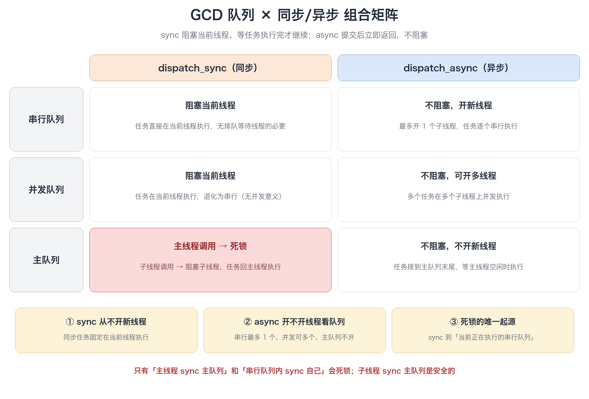
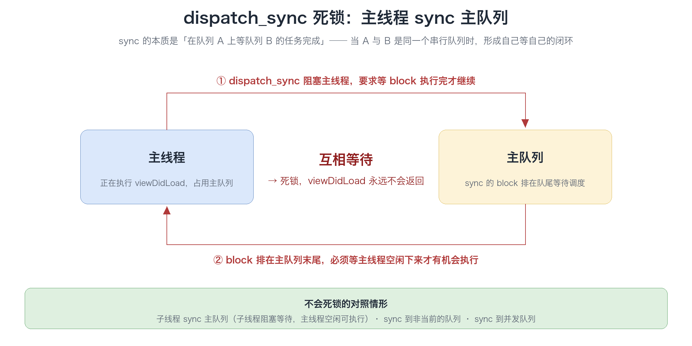
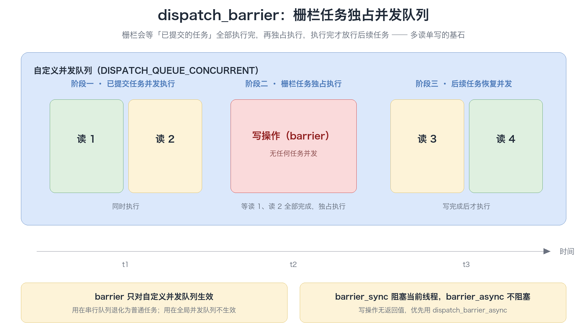
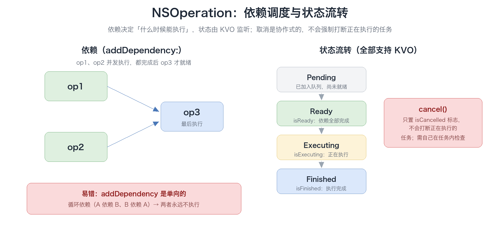
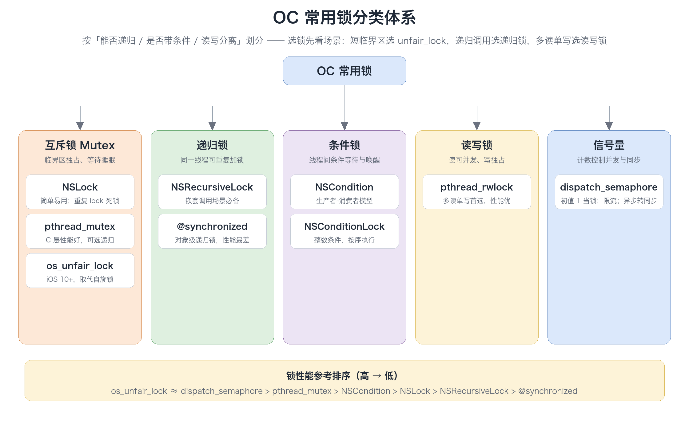

# 02. Objective-C 多线程

> 多线程是 iOS / macOS 开发绕不开的核心能力：从最底层的 `NSThread`，到抽象度更高的 GCD 与 `NSOperationQueue`，再到保证数据一致性的锁与「多读单写」方案，构成了完整的并发编程技术栈。本文按「为什么 → 是什么 → 怎么用 → 踩什么坑」的脉络，覆盖原理、API、对比与易错点。

## 目录

- [一、多线程基础](#一多线程基础)
- [二、NSThread](#二nsthread)
- [三、GCD（Grand Central Dispatch）](#三gcdgrand-central-dispatch)
- [四、NSOperation / NSOperationQueue](#四nsoperation--nsoperationqueue)
- [五、锁与线程安全](#五锁与线程安全)
- [六、多读单写](#六多读单写)
- [七、RunLoop 与线程保活](#七runloop-与线程保活)
- [八、常见问题与最佳实践](#八常见问题与最佳实践)
- [附：高频速记](#附高频速记)

---

## 一、多线程基础

### 1. 进程与线程

| 概念 | 说明 | 关键点 |
|------|------|--------|
| 进程（Process） | 资源分配的基本单位，有独立地址空间 | 进程间内存隔离，通信需 IPC |
| 线程（Thread） | CPU 调度的基本单位，共享进程地址空间 | 同进程线程共享堆、全局变量，**栈私有** |

iOS 中每个 App 是一个进程，主线程（Main Thread）负责 UI，也叫 UI 线程。**所有 UIKit 操作必须在主线程执行**，这是 iOS 开发的第一条铁律。

从内存布局看，同进程的线程共享代码段、全局变量和堆，但每个线程有私有的栈（iOS 主线程默认 1MB，子线程默认 512KB，可通过 `stackSize` 调整，必须是 4KB 的倍数）和寄存器上下文。正因为「共享堆、私有栈」，多线程访问同一块堆内存不需要任何额外机制，而各自的函数调用与局部变量天然隔离——竞态条件几乎都发生在共享的堆上。

再往下挖一层，iOS 里的线程其实分三个层次：最底层是 Mach 线程（内核调度单位），`pthread` 是对 Mach 线程的 POSIX 标准封装，`NSThread` 又是对 `pthread` 的面向对象封装。三层之间可以互相转换——`NSThread` 拿到底层 pthread 句柄、`pthread_from_mach_thread_np` 从 Mach 线程拿 pthread，调试崩溃堆栈时经常要在这几个概念之间跳。主线程之所以特殊，不只是因为它管 UI，还因为它是进程里**唯一由系统自动创建并挂上 RunLoop** 的线程：RunLoop 让主线程「有事件就处理、没事件就休眠」，而不是一路跑到底退出，这决定了主线程能长期存活并随时响应触摸、定时器、网络回调。

### 2. 并发与并行

这两个词常被混用，本质不同：

| 概念 | 含义 | 类比 |
|------|------|------|
| 并发（Concurrency） | 逻辑上「同时」处理多件事，宏观并行、微观可能串行 | 一个人同时接多个项目，来回切换 |
| 并行（Parallelism） | 物理上真正同时执行，需要多核 CPU | 多个人各自做各自的事 |

> 单核 CPU 只有并发没有并行；多核 CPU 才能真并行。GCD 让你只关心「并发」，至于是否「并行」由系统按核数调度。

更准确地说：并发是一种设计与组织能力（把任务拆开、交错推进），并行是一种硬件执行能力（多核同时计算）。GCD 的价值正在于此——开发者只声明「哪些任务可以并发」，系统根据核数决定要不要并行、怎么并行，代码从单核机器搬到八核机器不需要任何改动。

单核上所谓的「同时」，本质是操作系统做的时间片轮转：CPU 以毫秒级的时间片在多个线程之间快速切换，每个线程都「感觉」自己在连续运行，但任意一个瞬间只有一个线程真正占用 CPU。理解了这一点，就理解了为什么并发不等于快——如果任务是纯计算、又只有一个核，拆成十个线程反而因为切换开销更慢；并发真正受益的是「有等待」的场景（等网络、等磁盘），一个线程等的时候 CPU 可以切去干别的。

### 3. 同步 / 异步、串行 / 并发

这是 GCD 的两个正交维度，必须彻底分清：

- **同步（sync）**：调用方必须等任务执行完才能继续；阻塞当前线程。
- **异步（async）**：任务提交后立即返回，调用方不等待；不阻塞当前线程。
- **串行（Serial）**：同一时刻只执行一个任务，前一个完成才执行下一个。
- **并发（Concurrent）**：可以同时执行多个任务。

常见误区是把「是否阻塞当前线程」和「是否开启新线程」混为一谈：sync/async 决定的是前者，serial/concurrent 决定的是任务的排队方式，「开不开线程」是这两者与队列类型共同作用的结果，没有必然联系。

用一段代码把这两个维度钉死：

```objc
dispatch_queue_t serial = dispatch_queue_create("s", DISPATCH_QUEUE_SERIAL);
dispatch_queue_t concur = dispatch_queue_create("c", DISPATCH_QUEUE_CONCURRENT);

// async 到并发队列：不阻塞 + 可并发（多个任务同时跑在多个线程）
for (int i = 0; i < 3; i++) {
    dispatch_async(concur, ^{
        NSLog(@"并发 %d 在 %@", i, [NSThread currentThread]);
    });
}
// 三个 block 的 currentThread 通常是不同线程，且顺序不保证

// async 到串行队列：不阻塞，但任务排队，一个接一个
for (int i = 0; i < 3; i++) {
    dispatch_async(serial, ^{
        NSLog(@"串行 %d 在 %@", i, [NSThread currentThread]);
    });
}
// 输出顺序固定 0、1、2，currentThread 可能是同一个子线程
```

两两组合出四种行为，见下文「三、GCD」的组合矩阵。这里只需要先建立一个直觉：sync/async 管「当前这条线程要不要停下来等」，serial/concurrent 管「队列里的任务是一字排开还是并行推进」，两者各自独立、互不隶属。

### 4. 线程开销与上下文切换

创建线程不是免费的：

- 每开一个线程都要占用内核栈空间（iOS 主线程约 1MB，子线程默认 512KB）；
- **上下文切换（Context Switch）**：CPU 在多个线程间切换时，要保存/恢复寄存器、栈指针等现场，切换本身有成本；
- 线程过多会导致「切换开销 > 实际计算」，性能反而下降。

量化感受一下：创建一个线程涉及内核数据结构分配、栈空间映射、调度登记，成本远高于一次普通函数调用；上下文切换通常在微秒级，单看不大，但高频切换会累积，而且每次切换都会打断 CPU 缓存的局部性（Cache 需要重新预热），实际损失被放大。GCD 的线程池把线程数量控制在核数量级、让任务在线程上排队复用，正是为了把这笔固定开销摊薄。

上下文切换到底切换了什么，值得展开：CPU 要把当前线程的寄存器（程序计数器、栈指针、通用寄存器等）保存到它的内核栈，再把下一个线程的现场从它的内核栈恢复进寄存器，中间还可能触发 TLB（页表缓存）刷新和 CPU 缓存失效。这一套动作本身没有产出任何业务结果，纯粹是「调度税」。线程数远大于核数时，CPU 大量时间花在「保存现场、恢复现场」上，真正干活的占比下降，于是出现「线程越多越慢」的反直觉现象。经验上，CPU 密集型任务的最佳线程数大致等于核数，I/O 密集型可以多开一些（等待期间 CPU 是闲的）。

这也是为什么不推荐大量使用 `NSThread` 手动管理线程，而应使用 GCD 的线程池复用机制。

### 5. 多线程带来的三大问题

| 问题 | 表现 | 解决思路 |
|------|------|---------|
| 竞态条件（Race Condition） | 多线程同时读写共享变量，结果不确定 | 加锁、原子操作、串行队列 |
| 死锁（Deadlock） | 线程互相等待对方释放资源，永久阻塞 | 按序加锁、避免嵌套 sync |
| 资源消耗 / 线程爆炸 | 线程数过多拖垮性能 | 用 GCD 队列、限制并发数 |

拿最典型的 `count++` 举例：它不是一步操作，而是「读内存 → 寄存器加一 → 写回内存」三步，两个线程交错执行时可能出现各加一次、总数只加一的丢失更新。

```objc
// 两个线程各自对同一个计数器加一万次，理想结果是 20000
__block int counter = 0;
dispatch_queue_t q = dispatch_get_global_queue(0, 0);
for (int t = 0; t < 2; t++) {
    dispatch_async(q, ^{
        for (int i = 0; i < 10000; i++) {
            counter++;   // 读-改-写三步，线程交错时部分「加一」被覆盖
        }
    });
}
// 最终 counter 往往小于 20000，且每次运行结果都可能不同
```

竞态条件背后其实是并发编程的三个经典问题——原子性、可见性、有序性：`counter++` 违反原子性（三步被拆开）；一个线程写的结果另一个线程未必立刻「看得见」是可见性问题（缓存与指令重排）；编译器/CPU 打乱指令执行顺序是有序性问题。这三者就是第五章各种锁和内存屏障要解决的对象。此外还有一个隐蔽问题——优先级反转：低优先级线程持有高优先级线程需要的锁，中等优先级线程又不断抢占低优先级线程的 CPU 时间，导致高优先级线程被「间接」卡死，后文 `OSSpinLock` 被废弃就是这个原因。与之相对的还有活锁（两个线程都在「谦让」，谁也不推进）和饥饿（低优先级线程永远抢不到资源），都属于并发中的极端情况。

---

## 二、NSThread

`NSThread` 是 OC 对 POSIX 线程（`pthread`）的面向对象封装，是**最底层、最原始**的多线程方案。一般只有需要精细控制线程生命周期时才用，日常开发优先 GCD / NSOperation。

### 1. 三种创建方式

```objc
// 方式一：alloc / init + start（可拿到 thread 对象，最常用）
NSThread *thread = [[NSThread alloc] initWithTarget:self
                                           selector:@selector(doWork:)
                                             object:nil];
thread.name = @"com.demo.worker";   // 便于调试
[thread start];

// 方式二：类方法直接分离出一个线程（拿不到对象）
[NSThread detachNewThreadSelector:@selector(doWork:)
                         toTarget:self
                       withObject:nil];

// 方式三：NSObject 分类方法（隐式创建后台线程）
[self performSelectorInBackground:@selector(doWork:) withObject:nil];
```

三种方式的对比如下：

| 方式 | 能否拿到 thread 对象 | 何时启动 | 适用场景 |
|------|--------------------|---------|---------|
| `alloc/initWithTarget` + `start` | 能 | 手动 `start` | 需要设置 name/stackSize、需要持有线程引用、线程保活 |
| `detachNewThreadSelector:` | 否 | 立即分离 | 一次性后台任务，跑完即弃 |
| `performSelectorInBackground:` | 否 | 立即创建 | 最简写法，偶尔用一下 |

方式一因为能拿到对象，才可以做后文两件方式二/三做不到的事：`start` 之前设 `stackSize`、之后用 `cancel` 协作式停止。方式二、三拿到不引用，无法取消、无法精细控制，属于「发了就忘」。

### 2. 生命周期与状态

创建线程后还可以调整栈大小、携带数据：`thread.stackSize = 16 << 20`（必须是 4KB 的倍数，且必须在 `start` 之前设置）；`thread.threadDictionary` 是一个「线程私有」的字典，可以挂当前处理的上下文对象（如请求参数），避免层层传参。调试时给 `thread.name` 赋反向域名，崩溃日志和 Instruments 里一眼就能认出这条线程。

线程有创建、就绪、运行、阻塞、死亡等状态，`NSThread` 提供几个常用属性：

| 属性 / 方法 | 说明 |
|------------|------|
| `thread.isExecuting` | 是否正在执行 |
| `thread.isFinished` | 是否已结束 |
| `thread.isCancelled` | 是否被标记取消（**只是标记，不会真正停止线程**） |
| `+[NSThread mainThread]` | 主线程对象 |
| `+[NSThread currentThread]` | 当前线程对象 |
| `+[NSThread isMainThread]` | 当前是否主线程 |
| `+[NSThread sleepForTimeInterval:]` | 让当前线程休眠 |

> `cancel` 只置标志位，线程代码必须自己检查 `isCancelled` 来配合退出，这是与 `NSOperation.cancel` 一样的「协作式取消」模型。

还要注意线程的「终点」：入口方法执行完毕，线程就随之退出，`isFinished` 变为 YES。所以 `detachNewThreadSelector:` 创建的线程是一次性的，想复用就要把入口方法写成「循环 + RunLoop 保活」（见第七章）。`cancel` 之后线程不会自动结束，入口方法必须自行检查 `isCancelled` 并尽快返回，这就是协作式取消的代价。

配合取消标志，一个「能安全退出」的后台线程通常写成这样：

```objc
- (void)run {
    while (!self.thread.isCancelled) {   // 自己检查标志，实现协作式退出
        // ... 处理一个任务单元
        // 任务较久时，可在内部再穿插 isCancelled 检查，尽快响应取消
    }
    // 退出循环后，线程入口返回，线程自然结束
}
```

从内核看，一个线程的完整生命周期是「创建（new）→ 就绪（runnable）→ 运行（running）→ 阻塞（blocked）/ 终止（terminated）」，`NSThread` 暴露的 `isExecuting` / `isFinished` 只是这套内核状态的一个粗粒度投影。`cancel` 做的只是把内部一个布尔标志置真，既不影响内核的调度状态，也不会中断正在运行的代码——所有「停止」都得靠线程自己配合，这正是它与 `NSOperation.cancel` 共享的「协作式取消」模型。

### 3. 线程间通信

```objc
// 子线程做完事，回到主线程更新 UI
- (void)doWork:(id)sender {
    @autoreleasepool {                    // 子线程必须手动管理自动释放池
        // ... 耗时操作
        [self performSelectorOnMainThread:@selector(updateUI:)
                               withObject:result
                            waitUntilDone:NO];   // NO = 异步，不阻塞子线程
    }
}

// 也可以往任意线程发消息
[self performSelector:@selector(handle) onThread:otherThread withObject:nil waitUntilDone:NO];
```

`performSelector` 家族还有几个变体：`performSelectorOnMainThread:`（回主线程）、`performSelector:onThread:`（指定线程）、`waitUntilDone:` 参数控制是否同步等待。注意这些方法要求目标线程有活跃的 RunLoop，否则消息没有调度时机，往没有 RunLoop 的线程发消息会静默失败。同理 `NSTimer` 也依赖 RunLoop，子线程用定时器时需要先启动该线程的 RunLoop。

`waitUntilDone:` 的两个取值需要分清：传 YES 时当前线程会阻塞，直到目标线程把那个方法执行完才返回（等价于一次跨线程的同步调用，要小心目标线程反过来又在等当前线程，形成死锁）；传 NO 则是投递后立即返回，目标线程有空时再执行。日常回主线程刷新 UI 一律传 NO，避免子线程被主线程的繁忙卡住，也避免不必要的阻塞。

### 4. NSThread 的局限

- 需要手动管理线程生命周期与 `@autoreleasepool`；
- 无法控制并发数量，容易线程爆炸；
- 无任务依赖、取消、优先级队列等高级能力。

结论：**NSThread 只适合需要显式持有线程、或做线程保活（配合 RunLoop）的场景**，其余用 GCD / NSOperation。

---

## 三、GCD（Grand Central Dispatch）

GCD 是 Apple 官方力推的并发方案，基于 C 语言、以 **队列 + 任务** 为模型，底层用**线程池**自动复用线程，屏蔽了线程创建/销毁的开销。

### 1. 核心概念：队列与任务

- **任务**：一段要执行的代码，即一个 `block`。
- **队列（Dispatch Queue）**：遵循 FIFO 规则管理任务的数据结构。

GCD 把「要做什么」（任务）与「怎么调度」（队列 + 同步/异步）解耦，你只需决定两件事：**任务放哪个队列、同步还是异步执行**。

这个解耦是 GCD 设计里最关键的一步。传统的 `NSThread` 把「任务」和「线程」绑死——创建线程、在它的入口方法里写代码，任务和承载它的线程是一体的；GCD 则把任务抽成一个独立对象 `dispatch_block_t`，往队列里投递，由系统决定「这个任务最后跑在哪个线程上」。你不再直接操作线程，线程只是队列背后的执行资源。好处显而易见：同一个队列里的任务由线程池复用线程，任务排队、线程复用、负载均衡全都交给系统，开发者从「管线程」退化成「管任务」。

顺带一个术语：GCD 的「任务」在 block 基础上还有一个增强类型 `dispatch_block_t`，除了执行代码，还支持 `dispatch_block_cancel`（取消未执行的任务）、`dispatch_block_wait`（等待完成）、`dispatch_block_notify`（完成回调）等，比裸 block 多一点控制能力。

### 2. 四种队列

| 队列 | 获取方式 | 性质 | 用途 |
|------|---------|------|------|
| 主队列 | `dispatch_get_main_queue()` | **串行**，与主线程绑定 | UI 更新、需要在主线程执行的任务 |
| 全局并发队列 | `dispatch_get_global_queue(优先级, 0)` | **并发**，系统提供 | 大多数后台任务 |
| 自定义串行队列 | `dispatch_queue_create("id", DISPATCH_QUEUE_SERIAL)` | 串行 | 顺序执行、做「锁」、隔离数据 |
| 自定义并发队列 | `dispatch_queue_create("id", DISPATCH_QUEUE_CONCURRENT)` | 并发 | 配合 barrier 实现多读单写 |

> `dispatch_queue_create` 的队列标签（第一个参数）建议用**反向域名**命名，便于崩溃日志 / Instruments 里定位。iOS 6+ 用 ARC 管理，无需 `dispatch_release`。

全局并发队列的优先级参数对应 QoS（Quality of Service）五个等级：`userInteractive`（UI 相关、立即响应）→ `userInitiated`（用户触发、等结果）→ `default` → `utility`（长任务、进度可见）→ `background`（用户无感、可慢）。QoS 影响 CPU 调度、I/O 优先级与线程池分配，比手动设置线程优先级更系统化，是 Apple 推荐的优先级表达方式；NSOperation 的 `qualityOfService` 共用同一套语义。

四种队列里有几个细节值得单独拎出来说。主队列是「特殊中的特殊」：它是串行队列，且与主线程强绑定——投递到主队列的任务一定在主线程执行，反过来主线程当前正在执行的代码也一定「占用」着主队列，这正是主队列上 sync 会死锁的根源。全局并发队列是系统预置的四条（对应四个 QoS，外加一条默认），拿到的都是同一批共享队列，不要在它们上面用 barrier（独占保证不成立）。自定义队列分串行/并发两种，标签建议反向域名，并且可以通过 `dispatch_queue_create` 的第二个参数 `attr` 传 `DISPATCH_QUEUE_SERIAL` 或 `DISPATCH_QUEUE_CONCURRENT`——传 NULL 历史默认是串行。这四种队列内部通过 target queue 串成一棵树（见第 10 节），QoS 就是靠这条链从叶子往根传递生效的。

### 3. 同步 sync 与异步 async

```objc
// 同步：阻塞当前线程，等 block 执行完才继续
dispatch_sync(queue, ^{
    NSLog(@"sync 任务");
});
NSLog(@"这行一定在 sync 任务之后执行");

// 异步：立即返回，block 在队列调度后执行
dispatch_async(queue, ^{
    NSLog(@"async 任务");
});
NSLog(@"这行通常先执行");
```

一个容易忽略的细节：sync 任务「在当前线程执行」不代表「在当前队列执行」。`dispatch_sync` 做的是把任务压入目标队列、阻塞当前线程等它完成，任务被派发后通常仍在当前线程上跑——这就是「sync 不开新线程」的由来。判断死锁看的是队列层面「谁在等谁」，不是线程。

### 4. 队列 × 同步/异步 组合矩阵（重点）

这是 GCD 面试与实战的核心，必须滚瓜烂熟：

| 队列类型 | `dispatch_sync`（同步） | `dispatch_async`（异步） |
|---------|------------------------|------------------------|
| **串行队列** | 阻塞当前线程，任务在**当前线程**执行；逐个串行 | 不阻塞，任务在**新线程**逐个串行执行 |
| **并发队列** | 阻塞当前线程，任务在**当前线程**执行（此时退化为串行，无并发意义） | 不阻塞，任务在**多个线程**并发执行 |
| **主队列** | 若在**主线程**调用 → **死锁**；若在子线程调用 → 阻塞子线程、任务回到主线程执行 | 不阻塞，任务排到主线程队列末尾，等主线程空闲执行 |

记忆要点：

1. **sync 不开启新线程**：同步任务直接在当前线程执行（并发队列下 sync 也因此退化为串行）。
2. **async 是否开新线程取决于队列**：串行队列 async 最多开一个子线程；并发队列 async 会开多个子线程；主队列 async 不开新线程（回到主线程）。
3. **「死锁」只发生在 sync 到当前线程正在执行的串行队列**（见下文）。



### 5. dispatch_sync 与死锁（必考）

`dispatch_sync` 的本质是「在队列 A 上等待队列 B 的任务执行完成」。当 A 与 B 是**同一个串行队列**（含主队列）时，形成「自己等自己」，必然死锁。

**死锁场景一：主线程 sync 主队列**

```objc
- (void)viewDidLoad {
    [super viewDidLoad];
    // 主线程执行到这里，主队列正在被主线程占用
    dispatch_sync(dispatch_get_main_queue(), ^{
        // sync 要求主线程「停下来等 block 执行完」
        // 但 block 要排到主队列，必须等主线程「空出来」才能执行
        // 互相等待 → 死锁
        NSLog(@"永远不会执行");
    });
}
```

**死锁场景二：串行队列内 sync 自己**

```objc
dispatch_queue_t q = dispatch_queue_create("com.demo.serial", DISPATCH_QUEUE_SERIAL);
dispatch_async(q, ^{
    // 队列 q 此刻正在串行执行本 block
    dispatch_sync(q, ^{
        // 又往 q 提交一个同步任务，要求等它执行完
        // 但 q 要等当前 block 执行完才会轮到新任务 → 死锁
        NSLog(@"永远不会执行");
    });
});
```

**不会死锁的情况**：子线程 sync 主队列、sync 到「非当前」的队列、sync 到并发队列，都不会死锁。

```objc
// 子线程 sync 主队列：安全（子线程阻塞等待，主线程能执行 block）
dispatch_async(dispatch_get_global_queue(0, 0), ^{
    dispatch_sync(dispatch_get_main_queue(), ^{
        NSLog(@"在主线程执行，安全");
    });
});
```

> 死锁的本质是「**串行队列上的相互等待**」。避免口诀：**不要在同一个串行队列里 sync 它自己；主线程别 sync 主队列**。



补充一个为什么：sync 到并发队列不会死锁，是因为并发队列不独占执行权——新任务不需要等当前任务结束就能被派发（换到别的线程执行），sync 的等待可以正常结束。死锁的必要条件是「队列必须等当前任务完成才能派发新任务」，只有串行队列满足这一点。

### 6. 常用 API

```objc
// dispatch_once：保证 block 只执行一次，线程安全（单例经典用法）
static dispatch_once_t onceToken;
dispatch_once(&onceToken, ^{
    // 只执行一次
});

// dispatch_after：延迟执行（不是精确的定时器，是「延迟提交到队列」）
dispatch_after(dispatch_time(DISPATCH_TIME_NOW, (int64_t)(2 * NSEC_PER_SEC)),
               dispatch_get_main_queue(), ^{
    NSLog(@"2 秒后在主线程执行");
});

// dispatch_apply：并发迭代（类似 for 循环，但并发执行，顺序不保证）
dispatch_apply(10, dispatch_get_global_queue(0, 0), ^(size_t idx) {
    NSLog(@"处理第 %zu 个", idx);
});
// 注意：dispatch_apply 是同步的，会等所有迭代完成才返回
```

`dispatch_once` 为什么线程安全：内部用一个状态值（未开始 / 进行中 / 已完成）配合原子操作与内存屏障，第一个抢到执行权的线程把状态改为「进行中」，其他线程等待或直接返回；执行完置「已完成」，之后的调用全部跳过。它同时保证了「只执行一次」和「执行结果对所有线程可见」，这也是单例推荐用它而不是手写 if + 加锁判断的原因。

> `dispatch_after` 的 2 秒不是「精确 2 秒后执行」，而是「2 秒后把任务提交到队列」，实际执行时间取决于队列繁忙程度。

`dispatch_after` 底层其实是「往队列里塞一个延迟触发的 timer source」：到点后任务才被投递进队列，之后还要排队、等前面的任务执行完才轮到它。所以它既不精确（受 runloop/队列繁忙影响），也不适合做高频定时器——真要做定时任务，要么用 `dispatch_source` 的 timer 类型（更精确、可挂起/恢复/取消），要么用 `NSTimer`，但两者都依赖 RunLoop 或事件循环。`dispatch_apply` 则要记住它是同步的：调用会阻塞当前线程直到所有迭代完成，而且只是「分发到队列并发执行」，并不保证迭代顺序，所以循环体里不能有依赖迭代顺序的逻辑；它适合「把一个大循环拆成可并发的独立小块」，但注意别在循环体里再做 dispatch_apply 形成递归投递。

### 7. dispatch_group：任务编组

用于「多个异步任务全部完成后」再执行某件事，解决「并发任务汇总」问题。

```objc
dispatch_group_t group = dispatch_group_create();
dispatch_queue_t q = dispatch_get_global_queue(0, 0);

// 方式一：dispatch_group_async（自动 enter/leave）
dispatch_group_async(group, q, ^{ [self task1]; });
dispatch_group_async(group, q, ^{ [self task2]; });

// 方式二：enter / leave（手动配对，适合任务里有异步回调的场景）
dispatch_group_enter(group);
[self asyncRequestWithCompletion:^{
    dispatch_group_leave(group);
}];

// 全部完成后通知（可指定回到主线程）
dispatch_group_notify(group, dispatch_get_main_queue(), ^{
    NSLog(@"所有任务完成，刷新 UI");
});

// 或同步等待（阻塞当前线程，慎用）
// dispatch_group_wait(group, DISPATCH_TIME_FOREVER);
```

**易错点**：`enter` 与 `leave` 必须**严格配对**。`leave` 次数多于 `enter` 会导致崩溃（`Unbalanced call to dispatch_group_leave`）；少了则 `notify` 永不触发。

`enter/leave` 的本质是一个内部计数器：enter 加一，leave 减一，计数归零时触发 notify——`dispatch_group_async` 只是「enter + 执行 + leave」的封装。需要超时控制时用 `dispatch_group_wait(group, timeout)`：返回 0 表示完成、非 0 表示超时，超时后任务仍会继续执行，只是不再等待。

### 8. dispatch_barrier：栅栏（多读单写基石）

`dispatch_barrier_async` 提交到**并发队列**时，会等待「已提交的任务」全部执行完，再**独占**执行栅栏任务，执行完才继续后续任务：

```objc
dispatch_queue_t q = dispatch_queue_create("com.demo.concurrent", DISPATCH_QUEUE_CONCURRENT);

dispatch_async(q, ^{ /* 读 1 */ });
dispatch_async(q, ^{ /* 读 2 */ });
dispatch_barrier_async(q, ^{
    // 栅栏：等读 1、读 2 都执行完，独占执行写操作
    // 写操作期间，不会有其他任务并发
    NSLog(@"写操作");
});
dispatch_async(q, ^{ /* 读 3，等写操作完成才执行 */ });
```



**易错点**：

- `dispatch_barrier_*` **必须用在自定义并发队列**上；用在串行队列上退化为普通串行任务，用在全局并发队列上**不生效**（因为全局队列可能被系统内部共用，不能保证独占）；
- `dispatch_barrier_sync` 会阻塞当前线程；`dispatch_barrier_async` 不阻塞，优先用 async。

### 9. dispatch_semaphore：信号量

信号量用于**控制并发数量**、**实现线程同步**、**把异步变同步**。

```objc
// 创建信号量，初始值 = 最大并发数
dispatch_semaphore_t sem = dispatch_semaphore_create(3);

for (int i = 0; i < 10; i++) {
    dispatch_async(dispatch_get_global_queue(0, 0), ^{
        dispatch_semaphore_wait(sem, DISPATCH_TIME_FOREVER); // 信号量 -1，为 0 则等待
        // 最多 3 个任务同时进入这里
        [self doTask:i];
        dispatch_semaphore_signal(sem);                     // 信号量 +1，唤醒等待者
    });
}
```

```objc
// 信号量把异步操作变成同步等待（常用于依赖时序）
dispatch_semaphore_t sem = dispatch_semaphore_create(0);
[self asyncRequestWithCompletion:^{
    dispatch_semaphore_signal(sem);
}];
dispatch_semaphore_wait(sem, DISPATCH_TIME_FOREVER); // 阻塞直到回调完成
```

> `dispatch_semaphore_wait` 会阻塞当前线程，若在主线程调用且信号量始终不被 signal，会卡死 UI。

`dispatch_semaphore` 的底层是内核维护的计数器加等待队列：wait 时计数减一，减到负数就把当前线程挂到等待队列休眠（不占 CPU）；signal 时计数加一并唤醒队首线程。因为等待是睡眠而非忙等，信号量既是并发控制工具，也是一把轻量锁——初始值为 1 时语义上就等价于互斥锁。

### 10. 队列底层：线程池与 target queue

GCD 的并发队列底层共享一个**线程池**，系统按任务数量与 CPU 核数动态增减线程，所以「并发队列 + async」能避免线程爆炸。所有队列内部通过 `target queue` 串成树状结构，最终汇入根队列（如 `com.apple.root.default-qos`），这是理解 QoS 优先级如何生效的关键。

这一节是 GCD 的「内功」，把 libdispatch 的骨架理清楚，前面很多现象都有了解释。

先看线程池。GCD 并不为每个任务新建线程，而是维护一组可复用的工作线程：任务投递到并发队列后，系统从线程池里取空闲线程来执行，任务做完线程回到池子里等下一个任务；池子大小会根据任务积压程度和 CPU 核数动态伸缩，但会设一个上限（不同系统约在 64 个左右），超出上限的任务就在队列里排队等。这一机制直接解释了第 1.4 节的问题——「并发队列 + async」为什么不会线程爆炸：线程数有天花板，任务再多也只是排队，而不是无限开线程。反观 `NSThread` 每 detach 一次就真开一条线程，没有任何复用和上限，这才是线程爆炸的温床。

再看队列树与 target queue。GCD 里几乎每个队列都有一个 `target queue`（目标队列），默认指向对应 QoS 的根队列；自定义队列可以调用 `dispatch_set_target_queue` 显式指定自己的 target。任务的执行优先级、过载时的压流、以及串行队列「同一时刻只执行一个」的约束，本质上都是通过这条 target 链实现的——把自定义队列挂到某个根队列上，就继承了那个根队列的 QoS。所以全局并发队列其实就是「直接挂在四个 QoS 根队列上的公开队列」，而根队列才是真正连接线程池、决定线程如何分派的枢纽。理解这一点，就明白了为什么说 GCD 的队列是「树状结构」、为什么 QoS 能层层生效。

用一句话收口：任务 → 队列 →（target 链）→ 根队列 → 线程池 → 工作线程。你操作的是最左端的「任务」，系统调度的是最右端的「线程」，中间这条链就是 GCD 替你搭好的调度通路。

---

## 四、NSOperation / NSOperationQueue

`NSOperation` 是**面向对象**的并发抽象，底层封装了 GCD，但额外提供 GCD 没有的高级能力：**依赖、取消、优先级、最大并发数、KVO 状态监听**。

### 1. 与 GCD 对比

| 维度 | GCD | NSOperation |
|------|-----|-------------|
| 抽象层级 | C 语言 API，轻量 | OC 对象，重量 |
| 依赖关系 | 无（需手动用 group/semaphore 模拟） | `addDependency:` 原生支持 |
| 取消 | 无（block 无法取消） | `cancel`（协作式） |
| 最大并发数 | 无（信号量模拟） | `maxConcurrentOperationCount` 直接设置 |
| 优先级 | 队列 QoS | `queuePriority` + `qualityOfService` |
| 状态监听 | 无 | KVO 监听 `isExecuting/isFinished/isCancelled` |

**结论**：简单一次性任务用 GCD；需要**依赖、取消、控制并发数、监控状态**的复杂任务用 NSOperation。

### 2. NSOperation 的三种子类

```objc
// ① NSInvocationOperation：调用一个方法（已不推荐，功能弱）
NSInvocationOperation *inv = [[NSInvocationOperation alloc]
                              initWithTarget:self selector:@selector(doWork) object:nil];

// ② NSBlockOperation：执行 block，可用 addExecutionBlock 追加任务
NSBlockOperation *op = [NSBlockOperation blockOperationWithBlock:^{
    NSLog(@"主 block");
}];
[op addExecutionBlock:^{ NSLog(@"追加 block 1"); }];
// 注意：NSBlockOperation 的多个 block 会「并发」执行（非串行）

// ③ 自定义子类：重写 main 或 start（见下）
```

`NSInvocationOperation` 现在基本不推荐：它只是把一次方法调用包成操作，既没有 block 的灵活性，也不支持 Swift（Swift 没有动态消息转发的 invocation 机制），新代码用 `NSBlockOperation` 或自定义子类即可。三种子类的取舍是：`NSBlockOperation` 覆盖九成场景（尤其能 `addExecutionBlock:` 追加任务）；`NSInvocationOperation` 属于历史遗留；自定义子类只在需要精确控制生命周期、或封装异步任务时才用。

NSBlockOperation 的「多 block 并发」有个容易踩的细节：主 block 与 `addExecutionBlock:` 追加的 block 可能并发执行（是否并发取决于系统调度），要等**全部** block 执行完 `isFinished` 才为 YES，因此追加的 block 之间不能有共享可变状态的假设。另外 `addExecutionBlock:` 必须在 `start` 之前调用，start 之后再加会抛异常。

### 3. 自定义 NSOperation

```objc
@interface MyOperation : NSOperation
@end

@implementation MyOperation
- (void)main {
    // 只适合「同步任务」：重写 main，自动管理 isExecuting/isFinished
    // 必须主动检查取消标志
    if (self.isCancelled) return;
    // ... 执行任务
    if (self.isCancelled) return;   // 任务较长时，中途多次检查
}
@end
```

若要封装「异步任务」（如网络请求），需重写 `start` 并手动维护 `isExecuting / isFinished / isCancelled` 的 KVO，复杂度较高，一般用 `NSBlockOperation` + 信号量，或直接 GCD 更省事。

但异步 NSOperation 是面试高频点，原理必须吃透。核心难点在于：`main` 方法是「同步」模型——`main` 一返回，系统就认为操作结束了；而异步任务（网络回调）恰恰是 `main` 返回后任务才真正开始。所以要改成「异步操作」，就不能再用 `main`，而要重写 `start` 自己接管生命周期，并且手动发 KVO 通知，让队列知道操作「还在执行、还没结束」：

```objc
@interface AsyncOperation : NSOperation
@end

@implementation AsyncOperation {
    BOOL _executing;
    BOOL _finished;
}

- (BOOL)isAsynchronous { return YES; }   // 声明自己是异步操作

- (BOOL)isExecuting { return _executing; }
- (BOOL)isFinished  { return _finished; }

// 手动实现这四个属性的 KVO，是异步操作能工作的关键
+ (BOOL)automaticallyNotifiesObserversForKey:(NSString *)key { return NO; }

- (void)start {
    if (self.isCancelled) {             // 已取消：直接置为完成，不执行
        [self willChangeValueForKey:@"isFinished"];
        _finished = YES;
        [self didChangeValueForKey:@"isFinished"];
        return;
    }
    [self willChangeValueForKey:@"isExecuting"];
    _executing = YES;
    [self didChangeValueForKey:@"isExecuting"];

    // ... 发起真正的异步任务
    [self doAsyncWorkWithCompletion:^{
        [self willChangeValueForKey:@"isExecuting"];
        _executing = NO;
        [self didChangeValueForKey:@"isExecuting"];
        [self willChangeValueForKey:@"isFinished"];
        _finished = YES;
        [self didChangeValueForKey:@"isFinished"];
    }];
}
@end
```

关键点有三个：第一，`isAsynchronous` 返回 YES，告诉队列「这不是一个 start 返回就结束的操作」；第二，`automaticallyNotifiesObserversForKey:` 返回 NO，把 KVO 通知改为手动触发，这样才能在 `_executing/_finished` 真正变化时精准通知；第三，`start` 返回前必须把 `isExecuting` 置 YES，异步回调完成后把它置回 NO、把 `isFinished` 置 YES——队列正是靠监听这两个属性的变化，才知道操作何时算真正完成，从而调度依赖它的后续操作。漏掉任何一次 `willChange/didChange` 通知，队列就感知不到状态变化，依赖链会卡死。

### 4. NSOperationQueue 关键属性

```objc
NSOperationQueue *queue = [[NSOperationQueue alloc] init];
queue.maxConcurrentOperationCount = 3;   // 最大并发数；=1 时退化为串行队列
queue.qualityOfService = NSQualityOfServiceUserInitiated; // QoS

[queue addOperation:op];                          // 加入即开始调度
[queue addOperationWithBlock:^{ /* 快速任务 */ }];
[queue addOperations:@[op1, op2] waitUntilFinished:NO];
```

`maxConcurrentOperationCount` 设 1 即可当串行队列用；设大值可并发。注意它限制的是「同时执行的操作数」，不是线程数。

还有两个实用能力：`queue.suspended = YES` 可以暂停调度，只对还没开始的任务生效，正在执行的不受影响，恢复设回 NO 即可；每个 NSOperation 都有 `completionBlock`，在任务 `isFinished` 后回调一次，适合做「完成后通知」，但不要在里面做耗时工作，且回调所在线程不确定。

`maxConcurrentOperationCount` 值得多讲一句它的「松耦合」特性：它限制的是队列里「同一时刻正在执行的操作数」，不是线程数，也不保证 FIFO 顺序。即使设为 1，当有依赖关系的多个操作入队时，队列会按「就绪（isReady）状态」而非「入队顺序」来挑下一个执行——依赖没满足的操作即使排在前面也会被跳过，等它的依赖完成、自己 ready 了才会被调度。这也是 NSOperationQueue 比单纯串行队列更「聪明」的地方：顺序由依赖图驱动，而不是入队先后。

### 5. 依赖（Dependency）

```objc
NSOperation *op1 = [NSBlockOperation blockOperationWithBlock:^{ NSLog(@"1"); }];
NSOperation *op2 = [NSBlockOperation blockOperationWithBlock:^{ NSLog(@"2"); }];
NSOperation *op3 = [NSBlockOperation blockOperationWithBlock:^{ NSLog(@"3"); }];

[op3 addDependency:op1];   // op3 依赖 op1：op1 完成才执行 op3
[op3 addDependency:op2];

[queue addOperations:@[op1, op2, op3] waitUntilFinished:NO];
// op1、op2 并发执行，都完成后 op3 才执行
```



**易错点**：`addDependency:` 是单向的，**小心循环依赖**（A 依赖 B、B 依赖 A → 两者永远不执行）。

依赖还有一个常被问到的点：它不要求依赖双方在同一个队列。op3 和 op1、op2 可以分别加到不同的 NSOperationQueue 里，`addDependency:` 建立的是「操作对象之间」的关系，跨队列依然生效——队列调度 op3 时会检查它的所有依赖是否已经 `isFinished`，不管那些依赖跑在哪个队列。这也再次印证了第 4.4 节的结论：依赖驱动的核心是操作状态（isFinished），而不是队列归属。另一个细节是「依赖 + 取消」的组合：如果 op1 被 cancel 掉了，它的 `isFinished` 依然会变成 YES（只是没执行），所以依赖 op1 的 op3 会被正常「放行」去执行，不会因为依赖被取消就卡住。

### 6. 取消（Cancel）

```objc
[op cancel];                    // 标记取消，不会强制停止
[queue cancelAllOperations];    // 取消队列里所有操作
```

取消是**协作式**的：正在执行的操作不会被打断，必须自己检查 `isCancelled` 来决定是否提前退出；尚未开始的操作被取消后，队列会直接跳过不执行。

### 7. KVO 监听状态

```objc
[op addObserver:self forKeyPath:@"isFinished"
         options:NSKeyValueObservingOptionNew context:nil];

- (void)observeValueForKeyPath:(NSString *)keyPath ofObject:(id)object
                        change:(NSDictionary *)change context:(void *)context {
    if ([keyPath isEqualToString:@"isFinished"] && [(NSOperation *)object isFinished]) {
        // 操作完成
    }
}
```

> `NSOperation` 的状态属性（`isReady/isExecuting/isFinished/isCancelled`）都支持 KVO，这是它能做「完成回调」「依赖驱动」的底层机制。

顺带点破一层：NSOperationQueue 的依赖调度，底层就是监听每个操作的 `isFinished` KVO——依赖的操作全部 Finished，自己的 `isReady` 才会被置为 YES 进入调度。理解了这一点，「依赖不能成环」就很好解释：互相等对方的 isFinished，谁也等不来。

---

## 五、锁与线程安全

### 1. 为什么需要锁

多线程同时读写共享资源（如 `NSMutableArray`、对象属性）会产生**竞态条件**，导致数据错乱甚至崩溃。锁的作用是**把临界区串行化**，保证同一时刻只有一个线程访问共享资源。

为什么一段代码会被多个线程同时跑出问题，要回到 1.5 节埋下的三要素：原子性、可见性、有序性。锁首先要解决的是原子性——把「读-改-写」这种非原子的复合操作，通过加锁变成互斥的临界区，让别的线程要么在临界区之前、要么在之后进入，永远看不到中间状态。其次锁也在一定程度上约束可见性：加锁/解锁会插入内存屏障（memory barrier），保证临界区里的写对后续拿到锁的线程可见，不会被 CPU 缓存或指令重排「吞掉」。第三是有序性，锁强制临界区内的操作不会被重排到临界区外。所以「加锁」不只是「挡一挡并发」这么简单，它同时在做「原子 + 可见 + 有序」三件事，这也是为什么无锁编程那么难——你得自己用原子操作和内存屏障把这三件事重新拼出来。

临界区的粒度直接影响锁的收益：临界区越大，串行化的范围越大、并发度越低；临界区过小、边界划分错误，又会漏保护。判断标准是「所有访问同一份共享可变状态的代码，必须在同一把锁的保护下」，少一处就前功尽弃。

### 2. 各类锁对比总览

| 锁 | 类型 | 是否递归 | 特点 |
|----|------|---------|------|
| `@synchronized` | 互斥锁 | 是 | 语法简洁，自动加/解锁，性能较差 |
| `NSLock` | 互斥锁 | 否 | 简单易用；重复 lock 会死锁 |
| `NSRecursiveLock` | 递归锁 | 是 | 允许同一线程重复加锁 |
| `NSCondition` | 条件锁 | 是 | 生产者-消费者模型 |
| `NSConditionLock` | 条件锁 | 否 | 带条件值（如按序执行） |
| `pthread_mutex` | 互斥锁 | 可选 | 底层 C 锁，性能好 |
| `pthread_rwlock` | 读写锁 | 否 | 读可并发、写独占，多读单写首选 |
| `os_unfair_lock` | 互斥锁 | 否 | 取代 OSSpinLock，性能优秀，不可递归 |
| `dispatch_semaphore` | 信号量 | 否 | 可当锁用，性能好 |



实际选型除了语义匹配还要看性能：基准测试下 `os_unfair_lock` 与 `dispatch_semaphore` 最快，`@synchronized` 因哈希查找与异常兜底开销垫底，高频路径避免使用。

### 3. @synchronized

```objc
- (void)addObject:(id)obj {
    @synchronized (self) {
        [self.array addObject:obj];
    }
}
```

- 加锁对象可以是任意对象，通常用 `self` 或专门的数据对象；
- 底层是一个「对象 → 递归锁」的哈希表，同一对象重入不会死锁；
- 语法糖，自动 `lock/unlock`，异常时也能正确解锁；
- **性能最差**，适合低频、简单场景。

它的底层是 objc4 源码里的 `objc_sync_enter / objc_sync_exit`：以加锁对象为 key 查一张全局哈希表，取出对应的递归锁加解锁；传 nil 相当于不加锁，`@synchronized(nil)` 是无效的。性能差就差在「每次都要哈希查找 + 异常兜底（确保异常时也能解锁）」，所以只适合低频场景。

### 4. NSLock 与 NSRecursiveLock

```objc
NSLock *lock = [[NSLock alloc] init];
[lock lock];
// 临界区
[lock unlock];
```

```objc
NSRecursiveLock *lock = [[NSRecursiveLock alloc] init];

- (void)methodA {
    [lock lock];
    [self methodB];   // 递归锁：同一线程可重复加锁
    [lock unlock];
}
- (void)methodB {
    [lock lock];
    // ...
    [lock unlock];
}
```

**易错点**：`NSLock` **不可递归**——同一线程对同一个 `NSLock` 连续 `lock` 两次会**死锁**。有递归调用场景必须用 `NSRecursiveLock` 或 `@synchronized`。

`NSLock` 本身并不是一个独立的锁实现，它底层就是 `pthread_mutex`（默认类型，不带递归属性）的一层 OC 封装。`NSRecursiveLock` 同理，只是底层用了 `PTHREAD_MUTEX_RECURSIVE` 类型，内部记录「当前持有线程 + 加锁次数」，同一线程重复 lock 只是计数加一，真正释放要 unlock 同样多次。此外 NSLock 还有两个实用变体：`tryLock`（不阻塞，抢不到锁立即返回 NO，适合「抢不到就干别的」的场景）和 `lockBeforeDate:`（限时等待，超时返回 NO，避免无限阻塞）。

从性能角度看，`NSLock` 因为多了 OC 消息发送、异常处理等包装层，比直接调 `pthread_mutex` 略慢，但差异不大；真正拉开差距的是 `@synchronized`（哈希查找 + 异常兜底）和 `os_unfair_lock`（无分配、无系统调用的快速路径），所以在高频加解锁的短临界区里，`os_unfair_lock` 才是首选。

### 5. NSCondition 与 NSConditionLock

`NSCondition` 适合**生产者-消费者**：一个线程生产数据，另一个线程等待数据。

```objc
NSCondition *cond = [[NSCondition alloc] init];
NSMutableArray *products = [NSMutableArray array];

// 生产者
- (void)produce {
    [cond lock];
    [products addObject:@1];
    [cond signal];       // 唤醒一个等待线程
    [cond unlock];
}

// 消费者
- (void)consume {
    [cond lock];
    while (products.count == 0) {
        [cond wait];     // 等待条件满足（会释放锁，被唤醒后重新加锁）
    }
    [products removeLastObject];
    [cond unlock];
}
```

**易错点**：`wait` 后要用 `while` 判断条件而不是 `if`，因为线程被唤醒时条件可能已被其他线程改变（虚假唤醒）。

这里补一下 `NSCondition` 的语义细节：它本质是「一把锁 + 一个条件变量」的组合。`lock/unlock` 管互斥，`wait` 做的是三件事——原子地释放锁、把当前线程挂起到等待队列、被唤醒后重新获取锁再返回。所以 `wait` 必须在持锁状态下调用，且调用期间锁是暂时放开的，别的线程才有机会进入临界区改变条件。`signal` 唤醒一个等待线程，`broadcast` 唤醒全部，但唤醒不代表条件一定满足（可能有多个消费者同时醒来竞争同一份数据），因此正确的姿势永远是「在 while 里重新检查条件」——这就是「虚假唤醒」防御，即便系统理论上不会假醒，多线程竞争下条件也可能在「被唤醒」和「真正拿到锁」之间被别的线程改掉。

`NSConditionLock` 则是把「条件」具象成一个整数：`lockWhenCondition:` 会阻塞直到锁的 condition 等于指定值，`unlockWithCondition:` 在解锁的同时设置新的 condition，天然适合「按固定顺序执行」的流水线（线程 1 做完设 1，线程 2 等 1 做、做完设 2，依此类推）。相比 `NSCondition` 要自己维护条件变量，`NSConditionLock` 把条件编码进锁本身，代码更干净。

`NSConditionLock` 带一个整数条件，适合**按序执行**：

```objc
NSConditionLock *lock = [[NSConditionLock alloc] initWithCondition:0];

// 线程 A：等条件变为 1
[lock lockWhenCondition:1];
// ... 执行
[lock unlockWithCondition:2];

// 主线程：满足条件 1
[lock lock];
[lock unlockWithCondition:1];   // 释放并让条件 = 1，唤醒 A
```

### 6. pthread_mutex 与 pthread_rwlock

C 层锁，性能好、可控性强，多读单写常用 `pthread_rwlock`：

```objc
#import <pthread.h>

// 互斥锁
pthread_mutex_t mutex;
pthread_mutex_init(&mutex, NULL);
pthread_mutex_lock(&mutex);
// 临界区
pthread_mutex_unlock(&mutex);
pthread_mutex_destroy(&mutex);

// 读写锁
pthread_rwlock_t rwlock;
pthread_rwlock_init(&rwlock, NULL);
pthread_rwlock_rdlock(&rwlock);    // 读锁：多个线程可同时持有
// 读操作
pthread_rwlock_unlock(&rwlock);
pthread_rwlock_wrlock(&rwlock);    // 写锁：独占，等所有读锁释放
// 写操作
pthread_rwlock_unlock(&rwlock);
pthread_rwlock_destroy(&rwlock);
```

`pthread_mutex` 是 C 层最通用的锁，`pthread_mutex_init` 的第二个参数是属性对象，可以指定类型：`PTHREAD_MUTEX_NORMAL`（普通互斥，重复 lock 死锁）、`PTHREAD_MUTEX_RECURSIVE`（递归，等价于 `NSRecursiveLock`）、`PTHREAD_MUTEX_ERRORCHECK`（重复 lock 直接报错而不是死锁，便于排查）。所以「互斥锁能不能递归」本质上不是锁的固有属性，而是创建时选的类型。`pthread_rwlock` 则进一步区分读锁和写锁：多个线程可以同时持读锁（`rdlock`），但写锁（`wrlock`）必须独占，且写锁要等所有读锁释放才能获得——读多写少的场景下并发读的吞吐远高于互斥锁。注意读写锁有一个「写饥饿」风险：如果读请求源源不断，写锁可能迟迟拿不到，实现上通常会让写锁优先于后续读锁排队来缓解。

### 7. os_unfair_lock（自旋锁的继任者）

`OSSpinLock` 是经典自旋锁（忙等，不睡眠），但因**优先级反转**问题已被废弃，iOS 10 起用 `os_unfair_lock` 替代：

```objc
#import <os/lock.h>

os_unfair_lock lock = OS_UNFAIR_LOCK_INIT;
os_unfair_lock_lock(&lock);
// 临界区
os_unfair_lock_unlock(&lock);
```

- 性能接近 OSSpinLock，但等待时会睡眠而非忙等，避免优先级反转；
- **不可递归**，重复 lock 会死锁；
- 适合极短临界区、高频加解锁。

展开说一下 OSSpinLock 被废弃的原因——优先级反转：自旋锁忙等时线程保持可运行状态、不释放 CPU。低优先级线程拿到锁后，若被中优先级线程持续抢占 CPU，持锁的低优先级线程得不到调度；而高优先级线程在原地自旋等锁、又不让出 CPU，形成一个死结。`os_unfair_lock` 等待时改为睡眠、不再空耗 CPU，从机制上消除了这个问题。

### 8. dispatch_semaphore 当锁用

信号量初始值为 1 时，就是一个高效的互斥锁：

```objc
dispatch_semaphore_t sem = dispatch_semaphore_create(1);
dispatch_semaphore_wait(sem, DISPATCH_TIME_FOREVER);
// 临界区
dispatch_semaphore_signal(sem);
```

### 9. atomic 与 nonatomic（属性原子性）

| 修饰符 | 行为 | 代价 |
|--------|------|------|
| `atomic` | 属性的 getter/setter 内部加锁，保证单次读写原子性 | 有性能开销，iOS 默认 atomic |
| `nonatomic` | 不加锁，读写最快 | iOS 开发**通常用 nonatomic** |

**关键误区**：`atomic` 只保证「单次 get/set 的原子性」，**不能保证线程安全**。比如「先读再改」这种复合操作（`self.count++`），`atomic` 依然会竞态。真正的线程安全要靠上文的各种锁 + 正确的临界区设计。

```objc
@property (atomic, assign) NSInteger count;   // 单次读写安全
// self.count = self.count + 1;  // 读+算+写 三步，仍不安全！
```

从 objc4 源码看，atomic 的 getter/setter 内部只锁一把轻量锁（旧版本自旋锁，新版本 `os_unfair_lock`），保证「单次读写」不被打断。它对「读-改-写」这类复合操作无能为力——两次调用之间的锁早已释放，这正是 atomic ≠ 线程安全的根源。系统默认 atomic 更多是历史兼容，实际项目普遍显式写 nonatomic，把线程安全交给上层设计。

### 10. 死锁

**死锁产生的四个必要条件**：

1. **互斥**：资源一次只能被一个线程占用；
2. **占有并等待**：持有资源的同时等待其他资源；
3. **不可剥夺**：资源只能被持有者主动释放；
4. **循环等待**：线程间形成「A 等 B、B 等 C、C 等 A」的环。

只要破坏其一即可避免。常见死锁场景与对策：

| 场景 | 原因 | 对策 |
|------|------|------|
| 主线程 `dispatch_sync` 主队列 | 串行队列自己等自己 | 改用 `dispatch_async` |
| 串行队列内 `sync` 自己 | 同上 | 改用 async，或换队列 |
| 嵌套加锁顺序不一致 | 循环等待 | **全局统一加锁顺序** |
| `NSLock` 重复 lock | 不可重入 | 用 `NSRecursiveLock` |
| 依赖成环 | A 等 B、B 等 A | 检查依赖图，避免环 |

与 GCD 死锁的区别值得记一笔：GCD 的死锁是「队列层面的自己等自己」，两个线程、两把锁的死锁是「资源层面的循环等待」——前者靠不嵌套 sync 避免，后者靠统一加锁顺序避免。

多把锁按不同顺序加锁，是死锁最经典的成因，看一段代码：

```objc
// 线程 1：先拿 lockA 再拿 lockB
[lockA lock]; [lockB lock];   // ... [lockB unlock]; [lockA unlock];

// 线程 2：先拿 lockB 再拿 lockA（顺序相反！）
[lockB lock]; [lockA lock];   // ... [lockA unlock]; [lockB unlock];
// 线程1 持有 A 等 B，线程2 持有 B 等 A → 循环等待 → 死锁
```

两个线程各自按相反顺序拿两把锁，一旦交错（线程 1 拿到 A、线程 2 拿到 B，然后互相等另一把），就永久卡死。对策就是「全局统一加锁顺序」——所有线程都按 lockA → lockB 的固定顺序加锁，循环等待的环就断开了。

理论上死锁有完整的检测与避免手段：操作系统层面可以用「资源分配图」检测是否成环，用银行家算法（预分配前判断系统是否仍处于安全状态）来避免死锁。但移动端开发很少用到这些，工程上更实用的还是那三板斧——统一加锁顺序、尽量只持一把锁、降低锁的粒度，把死锁的可能性从源头压下去。顺便区分三个容易混的词：死锁是互相等待都不放；活锁是都在「谦让」、谁也没真正推进；饥饿是某个线程永远得不到资源。后两者不致命但同样拖垮系统，排查时别只盯着死锁。

---

## 六、多读单写

**场景**：一个数据（如缓存字典）被频繁读、偶尔写。若读也加互斥锁，读读之间也会被串行化，浪费并发能力。多读单写（Multiple Readers, Single Writer）的目标是：**读可以并发，写必须独占，且写时不能有读**。

### 1. 方案一：dispatch_barrier（推荐，最简洁）

用自定义并发队列 + 栅栏：

```objc
@interface DataStore : NSObject
@property (nonatomic, strong) dispatch_queue_t queue;
@property (nonatomic, strong) NSMutableDictionary *dict;
@end

@implementation DataStore
- (instancetype)init {
    if (self = [super init]) {
        // 关键：必须是「自定义并发队列」
        _queue = dispatch_queue_create("com.demo.datastore", DISPATCH_QUEUE_CONCURRENT);
        _dict = [NSMutableDictionary dictionary];
    }
    return self;
}

// 读：并发执行，多个读可同时进行
- (id)objectForKey:(NSString *)key {
    __block id obj = nil;
    dispatch_sync(self.queue, ^{
        obj = [self.dict objectForKey:key];
    });
    return obj;
}

// 写：栅栏，独占执行
- (void)setObject:(id)obj forKey:(NSString *)key {
    dispatch_barrier_async(self.queue, ^{
        [self.dict setObject:obj forKey:key];
    });
}
@end
```

**要点**：

- 读用 `dispatch_sync` 是为了「读操作有返回值，需要阻塞等待拿到结果」；
- 写用 `dispatch_barrier_async`：写不需要立即返回，异步 + 栅栏独占；
- 队列必须是 `DISPATCH_QUEUE_CONCURRENT`，否则 barrier 失效。

barrier 之所以能在并发队列上实现「读读并发、写独占」，靠的是队列内部的调度机制：普通任务按 FIFO 一个个派发到线程池并发执行；而 barrier 任务投递进来后，队列会在它前面「插一道闸」——不再派发新的任务，等已经派发出去的任务（读 1、读 2）全部执行完，才独占执行 barrier 本身（写）；写完这道闸才重新打开，继续派发后续任务（读 3）。所以 barrier 的语义是「对队列上的一个时间点做全序化」：栅栏之前的任务对栅栏之后的全部可见且有序，这正是「写操作的结果能被后续读看到」的保证。理解了这道「闸」，就理解了为什么 barrier 必须用在自定义并发队列——全局并发队列被系统大量共用，不可能为你一个人把整条队列「闸住」，那会拖垮其他所有用到它的人。

### 2. 方案二：pthread_rwlock（性能更优）

```objc
pthread_rwlock_t rwlock;
pthread_rwlock_init(&rwlock, NULL);

- (id)objectForKey:(NSString *)key {
    pthread_rwlock_rdlock(&rwlock);
    id obj = [self.dict objectForKey:key];
    pthread_rwlock_unlock(&rwlock);
    return obj;
}

- (void)setObject:(id)obj forKey:(NSString *)key {
    pthread_rwlock_wrlock(&rwlock);
    [self.dict setObject:obj forKey:key];
    pthread_rwlock_unlock(&rwlock);
}
```

### 3. 方案对比

| 维度 | dispatch_barrier | pthread_rwlock |
|------|-----------------|----------------|
| 实现复杂度 | 低（纯 GCD API） | 低（C API） |
| 性能 | 略低于 rwlock | 更高 |
| 易用性 | 高，无配对风险 | 需手动 init/destroy |
| 适用 | 日常项目首选 | 对性能极致追求时 |

其实还有最朴素的方案三：干脆用一个自定义串行队列，读写都派发到它上面，天然安全、代码最少，代价是读读之间也被串行化，读多写少的场景会浪费并发能力，性能不如前两者。选型顺序：日常用 barrier，极致性能用 rwlock，数据量小、读写都低频用串行队列即可。

---

## 七、RunLoop 与线程保活

### 1. RunLoop 与线程的关系

- 每个线程**默认没有 RunLoop**，主线程除外（系统自动创建）；
- RunLoop 与线程一一对应，线程结束后 RunLoop 也随之销毁；
- 有了 RunLoop，线程才能「在有任务时处理、无任务时休眠」，而不是跑完就退出。

RunLoop 本质是一个「事件循环 + 休眠机制」：它维护一批输入源，循环地「取事件 → 处理事件 → 取事件」，没有事件时不是空转，而是进入休眠（mach 层的 `mach_msg` 等待），有事件到达时被内核唤醒。输入源分两大类：Source0（非基于端口的源，需要手动唤醒，如触摸事件、`performSelector`）、Source1（基于端口的源，内核直接唤醒，如 mach port）、以及 Timer 和 Observer。一个 RunLoop 之所以能同时管这么多来源，是因为它每次循环里按固定顺序走一遍「通知 Observer 即将进入 → 处理 Timer → 处理 Source0 → 处理 Source1 → 通知 Observer 即将休眠 → 休眠 → 被唤醒」，这套顺序保证了「UI 渲染在 RunLoop 空闲时统一进行」这类时机约定。

主线程的 RunLoop 由系统在进程启动时自动创建并驱动，所以主线程天然「长期存活 + 随叫随到」；而子线程的 RunLoop 默认不存在，第一次访问 `[NSRunLoop currentRunLoop]` 时才懒加载创建，且必须手动 `run` 起来才会跑。这就是「线程保活」的全部秘密——给一个本来跑完就退出的子线程挂上 RunLoop，让它进入「有事做事、没事睡觉」的常驻状态。

### 2. 常驻线程实现

```objc
@interface ResidentThread : NSObject
@property (nonatomic, strong) NSThread *thread;
@end

@implementation ResidentThread
- (instancetype)init {
    if (self = [super init]) {
        self.thread = [[NSThread alloc] initWithTarget:self
                                              selector:@selector(run)
                                                object:nil];
        [self.thread start];
    }
    return self;
}

- (void)run {
    @autoreleasepool {
        // 为线程创建并开启 RunLoop
        [[NSRunLoop currentRunLoop] addPort:[NSPort port]
                                    forMode:NSDefaultRunLoopMode]; // 关键：必须加 source/port，否则 RunLoop 立即退出
        [[NSRunLoop currentRunLoop] run];
    }
}

- (void)doSomething {
    [self performSelector:@selector(action) onThread:self.thread
               withObject:nil waitUntilDone:NO];
}
- (void)action {
    NSLog(@"在常驻线程执行");
}
@end
```

**易错点**：`[[NSRunLoop currentRunLoop] run]` 之前**必须给 RunLoop 添加至少一个输入源（port/timer/source）**，否则 RunLoop 没有「事做」会立刻退出，线程保活失败。

再补一点退出姿势：`[runLoop run]` 是无条件运行，没有配套的安全退出 API；需要可控退出时用 `runMode:beforeDate:`，外层包一个 while 循环判断退出标志位，每次处理完一个事件就回来判断要不要继续。另外上面代码里 `@autoreleasepool` 包住整个 `run` 方法，是为了让每次事件处理产生的临时对象都能及时释放，否则常驻线程的内存会持续增长。

---

## 八、常见问题与最佳实践

### 1. 常见崩溃与坑

| 坑 | 说明 |
|----|------|
| 子线程操作 UIKit | 必须在主线程更新 UI，否则崩溃或渲染异常 |
| `dispatch_group` enter/leave 不配对 | leave 多于 enter 直接崩溃 |
| barrier 用在全局队列 | 不生效，写操作可能与其他读写并发 |
| `NSLock` 重复 lock | 死锁 |
| 循环依赖（NSOperation / 信号量） | 任务永不执行 / 永久等待 |
| 子线程忘写 `@autoreleasepool` | 内存暴涨（大量临时对象不释放） |
| 在 dealloc 里用锁/队列 | 对象即将释放，可能访问已释放内存 |

几个高频坑再展开一下。子线程操作 UIKit 不只是「可能渲染异常」，更多时候是直接崩溃：UIKit 的绝大多数类（`UIView`、`UIViewController` 等）内部有主线程断言，非主线程调用会触发异常或被系统强制报错；即便是「侥幸没崩」，也会因为渲染和布局不同步出现白屏、闪烁、错位这些难以复现的毛病。另一个常见的是 `NSMutableArray` / `NSMutableDictionary` 这类可变容器——它们本身不是线程安全的，两个线程同时 `addObject:` 可能触发内部内存管理错乱直接崩，所以共享的可变容器要么用锁包起来，要么用串行队列隔离，要么换成线程安全的并发容器或「不可变快照 + 整体替换」的模式。

排查手段上：主线程断言在 OC 里直接 `assert([NSThread isMainThread])`，比事后查日志高效；线程相关的卡顿用 Instruments 的 System Trace / Time Profiler 看上下文切换与线程状态（Running / Blocked / Waiting），一眼定位「谁在等谁」。

### 2. 最佳实践清单

1. **UI 永远主线程**：子线程完成工作后 `dispatch_async` 回主队列刷新；
2. **优先 GCD/NSOperation，少用 NSThread**；
3. **需要依赖/取消/并发控制 → NSOperation**，其余 → GCD；
4. **共享可变数据 → 加锁或串行队列隔离**，属性用 `nonatomic` + 显式锁，别迷信 `atomic`；
5. **多读单写 → dispatch_barrier + 自定义并发队列**；
6. **避免嵌套 sync**，尤其主线程 sync 主队列；
7. **锁的粒度尽量小**，临界区代码越短越好；
8. **统一加锁顺序**，避免死锁；
9. **子线程长任务记得 `@autoreleasepool`**；
10. **控制并发数量**：用 `dispatch_semaphore` 或 `maxConcurrentOperationCount`。

---

## 附：高频速记

- **并发 vs 并行**：并发是逻辑同时（切换），并行是物理同时（多核）。
- **sync 不开新线程**，阻塞当前线程；**async 是否开线程看队列**。
- **串行队列**：一个接一个；**并发队列**：可同时执行。
- **主线程 sync 主队列 → 死锁**；串行队列内 sync 自己 → 死锁。
- **barrier 只对自定义并发队列生效**，用于多读单写。
- **信号量**：`wait` 减一、`signal` 加一；初始值 = 最大并发数。
- **enter/leave 必须配对**。
- **atomic 只保证单次读写原子，不保证线程安全**。
- **NSLock 不可重入**；递归用 `NSRecursiveLock` 或 `@synchronized`。
- **NSOperation 强于 GCD 的三点**：依赖、取消、最大并发数。
- **NSOperation 取消是协作式**：要自己检查 `isCancelled`。
- **线程保活**：RunLoop + 至少一个 port/source。
- **QoS 五级**：userInteractive > userInitiated > default > utility > background，全局队列与 NSOperation 的 qualityOfService 共用这套语义。
- **NSOperation 附加能力**：completionBlock 在 isFinished 后回调一次；suspended 暂停只拦未开始的任务。
- **并发三要素**：原子性（读-改-写被打断）、可见性（写对其他线程不可见）、有序性（指令重排）——锁同时解决这三件事。
- **异步 NSOperation 三关键**：`isAsynchronous` 返回 YES + 关闭自动 KVO 手动发通知 + `start` 里维护 `isExecuting/isFinished`。
- **GCD 调度链路**：任务 → 队列 →（target 链）→ 根队列 → 线程池 → 工作线程；barrier 是在队列上插一道「闸」做全序化。
