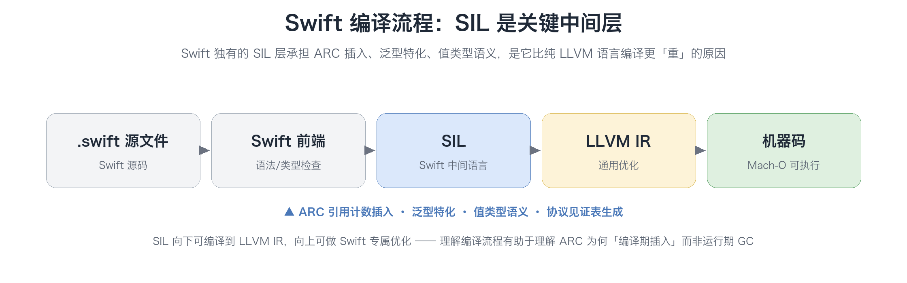
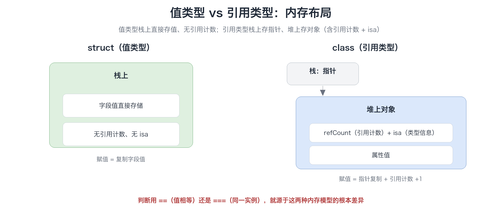
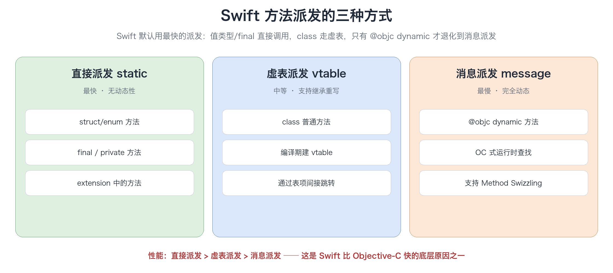
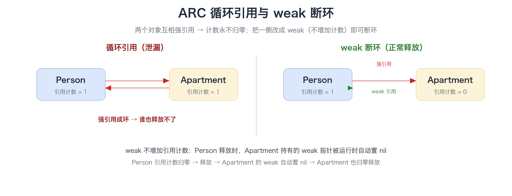
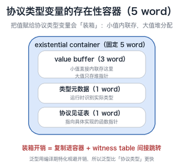

# 01. Swift 基础语法

> Swift 是 Apple 于 2014 年推出的现代编程语言，用于 iOS / macOS / watchOS / tvOS 全平台开发。它结合了类型安全、值语义、协议导向编程与函数式特性，旨在取代 Objective-C 又与之平滑互操作。本文按知识点全覆盖梳理 Swift 基础语法，每个知识点都尽量追到底层实现，配合代码示例、结构图与对比表格。

## 目录

- [一、语言概述](#一语言概述)
- [二、基础语法](#二基础语法)
- [三、基本数据类型](#三基本数据类型)
- [四、可选类型 Optionals](#四可选类型-optionals)
- [五、集合类型](#五集合类型)
- [六、控制流](#六控制流)
- [七、函数与闭包](#七函数与闭包)
- [八、枚举](#八枚举)
- [九、类与结构体](#九类与结构体)
- [十、属性](#十属性)
- [十一、方法](#十一方法)
- [十二、继承与构造](#十二继承与构造)
- [十三、ARC 内存管理](#十三arc-内存管理)
- [十四、可选链与类型转换](#十四可选链与类型转换)
- [十五、扩展、协议与泛型](#十五扩展协议与泛型)
- [十六、错误处理](#十六错误处理)
- [十七、访问控制](#十七访问控制)
- [十八、与 Objective-C 互操作](#十八与-objective-c-互操作)
- [附：高频速记](#附高频速记)

---

## 一、语言概述

### 1. Swift 的设计初衷

Objective-C 的灵活性来自运行时动态派发，代价是大量错误只能推迟到运行期才暴露——空指针、类型不符、方法未实现，都可能在线上崩溃。Swift 的设计目标很明确：**把尽可能多的错误从运行期提前到编译期**。手段就是静态类型系统、可选类型、内存所有权这三板斧。

### 2. Swift 与 Objective-C / C++ 对比

| 维度 | Objective-C | Swift | C++ |
|------|-------------|-------|-----|
| 类型系统 | 动态（id）+ 静态可选 | 静态强类型 + 类型推断 | 静态强类型 |
| 方法派发 | 消息传递（运行时查找） | 直接调用 + 虚表 + 消息派发 | 虚函数表 |
| 空值处理 | nil 可赋给任何对象 | **可选类型显式区分** | `std::optional` |
| 值类型 | 仅少量结构体 | **struct/enum 广泛使用** | struct/class |
| 内存管理 | MRC / ARC | ARC（强/弱/无主） | RAII / 智能指针 |

### 3. 编译流程



> **SIL（Swift Intermediate Language）** 是 Swift 编译的关键中间产物：ARC 的引用计数插入、泛型特化、值类型语义、协议见证表生成，大量工作在 SIL 层完成。这也是 Swift 编译比纯 LLVM 语言更「重」的原因。

### 4. 三大核心特性

| 设计 | 解决的问题 | 体现 |
|------|-----------|------|
| 静态类型 + 类型推断 | 类型错误运行时才暴露 | 编译期检查，`let x = 42` 自动推断 |
| 可选类型 | OC 的空指针崩溃 | 把「可能没值」建模成类型的一部分 |
| 值类型优先 | 共享可变状态导致的并发 bug | struct/enum 默认值语义 |

---

## 二、基础语法

### 1. let 与 var：不可变优先的哲学

```swift
let maxCount = 10      // 常量：一旦绑定值就不能再改
var current = 0        // 变量：可反复修改
current = 5
```

`let` / `var` 背后是 Swift 的一个核心倾向——**不可变优先**，原因有三：

1. **可读性**：看到 `let` 就知道这个值全程不变，读代码的人不用追踪它的变化；
2. **安全性**：不可变对象天然线程安全，没有「被意外修改」的风险；
3. **性能**：编译器对 `let` 有更多优化空间。

> 默认规则：**能用 `let` 就不用 `var`**，只有当确需修改时才放宽成 `var`。

### 2. 类型推断与类型标注

```swift
let a = 42          // 推断 Int
let b = 3.14        // 推断 Double
let c: Float = 3.14 // 显式 Float
```

编译器在编译期从字面量推导类型，大多数情况无需写类型。但当字面量有歧义（`3.14` 既可是 `Float` 也可是 `Double`），或为了代码清晰，就需显式标注。

### 3. 语句与注释

- 语句末尾分号可省略，只有一行内写多条语句时才需分号分隔；
- 命名几乎可包含任意 Unicode 字符（含中文），但数字不能开头、不能含空白。

### 4. 运算符重载

```swift
struct Vector2D { var x = 0.0, y = 0.0 }

static func + (lhs: Vector2D, rhs: Vector2D) -> Vector2D {
    Vector2D(x: lhs.x + rhs.x, y: lhs.y + rhs.y)
}

let v = Vector2D(x: 1, y: 2) + Vector2D(x: 3, y: 4)   // (4, 6)
```

运算符本质是特殊名字的函数：自定义类型重载运算符，要在类型内声明 `static func`，参数习惯命名 `lhs / rhs`（左右操作数）。`==` 这类要求「值比较语义」的运算符，通常通过遵守 `Equatable` 让编译器自动合成。Swift 也允许定义全新运算符（如 `operator +++`），但可读性代价大，日常慎用。

### 5. typealias 与嵌套类型

```swift
typealias Handler = (Int) -> String        // 给复杂类型起个短名
typealias Grid = [[Int]]

struct ChessGame {
    enum Player { case black, white }      // 嵌套类型：类型里的类型
    struct Position { var row: Int; var col: Int }
}
let p = ChessGame.Player.white             // 用外层类型限定访问
```

typealias 是「类型别名」，给冗长的函数类型、泛型类型起个可读的名字，它不是新类型，别名和原类型完全等价、可互换。嵌套类型把「只在某个上下文里有意义」的类型收进外层类型里，避免全局命名污染——`ChessGame.Player` 比一个游离的 `Player` 更清晰地表达了归属关系。

### 6. 断言 assert / precondition

```swift
assert(age >= 0, "年龄不能为负")     // 只在 Debug 生效，Release 编译时被优化掉
precondition(index >= 0, "越界")    // Debug / Release 都生效
```

两者都用于「程序员的逻辑错误」，不是「可恢复的异常」（那是 throw 的职责）。区别在发布行为：`assert` 只在调试期检查，发布版被整段编译掉、零开销；`precondition` 永远生效，用于「不满足就说明程序有 bug」的关键前置条件。用它们比「让错误静默传播」更容易在开发期暴露问题。

### 7. 版本判断 #available

```swift
if #available(iOS 15.0, *) {
    useNewAPI()   // 只有 iOS 15+ 才走这里
} else {
    fallback()    // 低版本走兜底实现
}
```

iOS 系统 API 会随版本增减，老系统上调新 API 会直接崩溃。`#available` 是「编译期 + 运行期双重检查」：编译器知道某 API 的最低系统版本，`#available` 包裹的代码只在运行期确认系统版本达标后才执行，`else` 分支则给低版本兜底。它是做系统兼容、渐进升级的标准手段。`@available` 是它的「声明版」——标注某个类/方法自身的最低系统版本，让编译器在别处调用时自动提示。

---

## 三、基本数据类型

### 1. 数值类型全解

| 类型 | 位数 | 说明 |
|------|------|------|
| `Int` | 与平台字长一致 | 首选，日常都用它 |
| `UInt` | 同 Int | 无符号，仅在确实需要时用 |
| `Int8/16/32/64` | 定长 | 处理二进制、协议、性能敏感场景 |
| `UInt8/16/32/64` | 定长 | 无符号定长 |
| `Double` | 64 | **默认浮点类型**，15 位精度 |
| `Float` | 32 | 6 位精度，需显式声明 |

### 2. 类型安全：Swift 没有隐式类型转换

```swift
let i = 42
let d = 3.14
// let sum = i + d      // ❌ 编译错误
let sum = Double(i) + d // ✅ 必须显式转换
```

> **关键设计**：隐式类型转换是大量 bug 的来源（精度丢失、溢出、符号翻转）。Swift 宁可让你多写一个 `Double(i)`，也要保证「类型转换」这个动作显式、可见、可审计。

### 3. 字面量可读性

```swift
let million = 1_000_000   // 下划线分隔
let hex = 0xFF            // 十六进制
let binary = 0b1010       // 二进制
```

### 4. Bool：严格布尔

Swift 的 `if` 只接受 `Bool`，`if 1` 会报错——C 语言「非 0 即真」的模糊语义在 Swift 里被彻底废除。

### 5. 元组 Tuple：轻量复合值

```swift
let person = (name: "Tom", age: 18, "male")
print(person.name)     // 按名字
print(person.0)        // 按下标
let (n, a, _) = person // 解构，_ 忽略某元素
```

> 判断标准：**元组是临时的，结构体是正式的**。数据需要被反复使用、携带逻辑时，升级成 `struct`。

### 6. String：字符串

```swift
let name = "Tom"
let greeting = "Hello, \(name)"     // 字符串插值
let multi = """
    多行字符串字面量，
    以结束符的缩进为基准对齐
    """
for ch in "abc" { print(ch) }       // 逐字符遍历（Character）
```

String 是值类型（struct），赋值即拷贝，同样享受 COW 优化，用法上和集合一致。它把 Unicode 当一等公民：`count` 数的是「字素簇」（grapheme cluster）而非字节，一个 emoji 也算 1 个字符。这与 NSString 按 UTF-16 编码单元计数不同——桥接后 `nsString.length` 和 `string.count` 可能不相等，混编时留意这个差异。字符串插值 `\(expr)` 在编译期展开，支持任意表达式，比手拼 `%@` / `format` 更安全（类型由编译器检查）。

```swift
let s = "Hello, Swift"
s.hasPrefix("Hello")        // true
s.hasSuffix("Swift")        // true
s.split(separator: ",")     // ["Hello", " Swift"]，返回 Substring
s.prefix(5)                 // "Hello" 类型的 Substring
```

几个常用操作里藏着一个容易忽略的点：`split` / `prefix` / `suffix` 返回的是 `Substring`，不是 `String`。Substring 是与原字符串共享底层存储的轻量视图，好处是切片零拷贝、性能好；代价是它会「钉住」原字符串的内存，长期持有子串（比如存进数组当 key 用）要显式 `String(sub)` 转回 String，否则原字符串的内存迟迟得不到释放。

---

## 四、可选类型 Optionals

可选类型是理解 Swift 的钥匙，值得单独讲透，包括它的底层。

### 1. 问题：OC 的 nil 之痛

OC 里任何对象类型都可能是 `nil`，「这个值到底会不会是空」只有开发者心里清楚、编译器完全不管。Swift 用类型系统来解决：**把「可能为 nil」和「不可能为 nil」拆成两种不同的类型**。

```swift
var name: String? = nil    // String? 是「可选 String」
var title: String = "Hi"   // String 是「非空 String」
```

`String` 和 `String?` 是**两个不同的类型**，不能直接混用。

### 2. Optional 的本质：一个泛型枚举

```swift
enum Optional<Wrapped> {
    case none          // 无值，即 nil
    case some(Wrapped) // 有值
}
```

`String?` 是 `Optional<String>` 的语法糖。两个推论：

1. `nil` 不是指针，而是枚举的一个 case——所以 `Int?` 这样的值类型也能表示「无值」；
2. 想拿 `some` 里的值必须「解包」，编译器强制显式化。

### 3. Optional 的内存布局（底层）

`Optional<Wrapped>` 的内存大小取决于 `Wrapped` 是否有「多余的位」来表示 nil：

```text
Optional<Int>（Int 无空闲位）
┌──────────────┬───────────┐
│  值（8 字节） │ 标志位（1B）│   ← 多占一个字节表示 nil
└──────────────┴───────────┘

Optional<SomeClass>（引用类型有空闲位）
┌───────────────────────────┐
│  指针（8 字节，nil = 全 0） │   ← 与 SomeClass 同大小
└───────────────────────────┘
```

> **关键优化**：引用类型的指针有「全 0」这个无效地址可用，所以 `Optional<Class>` 不额外占空间，nil 直接用空指针表示；而 `Int` 所有位都是有效值，`Optional<Int>` 必须额外用一个字节标志位。这是 Swift 的「可空性优化」。

### 4. 解包方式全解

```swift
let name: String? = "Tom"

// ① 强制解包 !：危险，nil 时崩溃
print(name!)

// ② if let：解包成功才进入
if let n = name { print(n) }

// ③ guard let：失败提前退出，成功后变量在后续作用域可用
func greet(_ name: String?) {
    guard let n = name else { return }
    print(n)
}

// ④ nil 合并 ??
let display = name ?? "匿名"

// ⑤ 隐式解析可选 !（类型声明用）
var phone: String! = "138..."
```

| 方式 | 适用场景 | 风险 |
|------|---------|------|
| 强制解包 `!` | 100% 确定有值 | 判断错就崩溃 |
| `if let` | 失败有另一条正常路径 | 无 |
| `guard let` | 失败无法继续，提前退出 | 无 |
| `??` | 提供默认值 | 无 |
| 隐式解析 `String!` | 初始化后必定有值（如 @IBOutlet） | 赋值前访问崩溃 |

> **口诀**：`!` 是「危险逃生舱」，正道是 `if let` / `guard let` / `??`。滥用 `!` 等于回到 OC 时代「错了就崩」。

### 5. 可选上的 map / flatMap

```swift
let opt: Int? = 5
opt.map { $0 * 2 }        // Int? = 10，有值就变换、nil 就保持 nil

let nested: Int?? = 5
nested.flatMap { $0 }     // Int? = 5，展平一层
```

可选的 map / flatMap 与集合上的语义完全一致：有值就对包裹的值应用闭包、返回仍是可选，nil 则整个表达式短路为 nil。`if let` 是「解包后手动处理」，`map` 是「声明式地变换」，配合 `??` 能写成一条链式流水线：`user.profile.map { $0.name } ?? "未设置"`。

---

## 五、集合类型

### 1. 集合都是值类型

`Array` / `Set` / `Dictionary` 底层都是 **struct（值类型）**，赋值和传参会「拷贝」：

```swift
var a = [1, 2, 3]
let b = a        // b 是 a 的副本
a.append(4)
print(b)         // [1,2,3]，b 不受影响
```

### 2. Copy-on-Write 底层机制（关键）

值类型「处处拷贝」听起来昂贵，但 Swift 用 **COW（写时复制）** 优化。以 Array 为例，其结构是「结构体 + 堆上缓冲区」：

```text
Array 结构体（栈上）
┌──────────────┐
│ isa          │
├──────────────┤
│ buffer 指针  │──→ 堆上缓冲区（真正存元素）
├──────────────┤
│ count        │
├──────────────┤
│ capacity     │
└──────────────┘
```

- **拷贝时**：只复制结构体（指针指向同一个缓冲区），不复制元素；
- **写入时**：先检查缓冲区的引用计数，若 >1（被多个变量共享）才真正复制缓冲区，再写入。

> **要点**：COW 让值类型「既安全又不慢」——赋值是 O(1) 的指针复制，只有真正写入才付出复制代价。这也是 Swift 敢把集合设计成值类型的底气。

### 3. Array / Set / Dictionary

```swift
var arr = [1, 2, 3]
arr.append(4)
arr.remove(at: 2)
let first = arr.first     // 返回可选，数组可能为空

var set: Set = [1, 2, 3]  // 无序、去重
set.contains(2)

var dict = ["a": 1]
dict["b"] = 2
let v = dict["a"]         // 返回 Int?，键不存在时为 nil
```

> **易错点**：字典下标取值、`arr.first` 都返回**可选类型**——因为它们可能「不存在」，Swift 用可选类型把这个不确定性显式化。

---

## 六、控制流

### 1. for-in 与区间运算符

```swift
for i in 0..<5 { print(i) }   // 0 到 4，左闭右开
for i in 1...5 { print(i) }   // 1 到 5，闭区间
```

| 运算符 | 含义 |
|--------|------|
| `a...b` | 闭区间，含 a 和 b |
| `a..<b` | 半开区间，含 a 不含 b |
| `...b` / `a...` | 单侧区间 |

区间运算符 `..<` 天然排除了「多 1 少 1」的经典 off-by-one 错误。

### 2. switch：默认不贯穿

```swift
switch x {
case 0: print("零")
case 1, 2: print("一或二")
case 3...9: print("3 到 9")
default: print("其他")
}
```

Swift switch 颠覆 C 直觉的三个设计：

1. **默认不贯穿**：每个 case 执行完自动退出，无需 `break`——C 里忘 break 导致「穿透」的 bug 从语法层根除；
2. **必须穷尽**：所有可能的值都要有对应 case，否则要有 `default`——编译器帮你保证不漏；
3. **匹配能力极强**：支持区间、元组、值绑定、`where` 条件：

```swift
let point = (0, 0)
switch point {
case (0, 0): print("原点")
case (_, 0): print("x 轴")
case (let x, let y) where x == y: print("对角线")
default: break
}
```

若确需贯穿，用 `fallthrough` 显式声明。

### 3. guard：提前退出

```swift
func process(_ input: String?) {
    guard let text = input, !text.isEmpty else { return }  // 不满足就退出
    // text 在后续代码中可直接使用（已解包）
}
```

guard 与 if let 的区别不只是「正反写」：guard 的 else 分支**必须退出当前作用域**（return / throw / continue / break），编译器强制执行，保证了「不满足条件的路径不会泄漏到后续代码」；且解包后的变量在 guard 之后的整个作用域可用，比 if let 的大括号作用域更宽。深层嵌套的场景用它做「卫语句」——把所有不合法情况排在函数开头逐个拦截，主逻辑保持零缩进。

### 4. 模式匹配的更多形态

```swift
enum Result { case success(Int); case failure(Error) }
let r = Result.success(42)

if case .success(let value) = r { print(value) }   // if case：单分支匹配

let list: [Int?] = [1, nil, 3, nil]
for case let .some(v) in list { print(v) }          // for case：只遍历匹配项
```

switch 之外，`if case` 和 `for case` 把「模式匹配」带进了单分支场景：`if case` 相当于「只有一个 case 的 switch」，`for case` 则让循环只处理符合某形状的元素（上面自动跳过了所有 nil）。配合 `where` 还能进一步过滤，适合写「只关心某种形态」的精简逻辑。

---

## 七、函数与闭包

### 1. 函数：参数标签的巧思

```swift
func move(from start: Point, to end: Point) { ... }
move(from: p1, to: p2)
```

Swift 函数参数有两个名字：**参数标签**（调用时用）和**参数名**（函数体内用）。`move(from:to:)` 读起来像一句英文。用 `_` 省略标签，适用于 `add(1, 2)` 这类不言自明的场景。

### 2. 默认值、可变参数、inout

```swift
func sum(_ numbers: Int...) -> Int { numbers.reduce(0, +) }

func swap(_ a: inout Int, _ b: inout Int) { let t = a; a = b; b = t }
var x = 1, y = 2
swap(&x, &y)     // inout 引用传递，调用处用 & 显式标注
```

> `inout` 的意义是**显式化**：看到 `&`，读者就知道「这个参数会被函数修改」，副作用一目了然。

### 3. 闭包：从繁到简

```swift
let nums = [3, 1, 4, 2]

nums.sorted(by: { (a: Int, b: Int) -> Bool in return a < b })
nums.sorted(by: { a, b in a < b })   // 类型推断 + 隐式返回
nums.sorted(by: { $0 < $1 })         // 参数缩写
nums.sorted { $0 < $1 }              // 尾随闭包
```

### 4. 闭包的捕获机制（底层）

```swift
func makeIncrementer(by n: Int) -> () -> Int {
    var total = 0
    return { total += n; return total }   // 捕获 total 和 n
}
let inc = makeIncrementer(by: 10)
inc()  // 10
inc()  // 20
```

**关键点**：闭包捕获的是**变量的引用**，不是拷贝——所以 `total` 在多次调用间累加。闭包是**引用类型**，捕获的变量存在堆上的「闭包上下文」里：

```text
闭包（堆上）
┌──────────────────┐
│ 函数指针          │
├──────────────────┤
│ 捕获上下文        │ ← total、n 的引用存这里
│  ├── total ──→ 堆 │
│  └── n     ──→ 值 │
└──────────────────┘
```

这也是闭包循环引用的根源（见第十三章）。

### 5. 逃逸闭包 @escaping

```swift
var handlers: [() -> Void] = []
func register(handler: @escaping () -> Void) {
    handlers.append(handler)   // 函数返回后闭包才调用，必须标 @escaping
}
```

`@escaping` 不是可有可无的注解：它告诉编译器「闭包会逃出函数作用域、返回后才执行」，编译器据此做不同的生命周期管理，也让「闭包可能持有 self 更久」在签名里显式可见。

### 6. 高阶函数：map / filter / reduce

```swift
let nums = [1, 2, 3, 4, 5]

nums.map { $0 * 2 }                     // [2,4,6,8,10]   一一变换
nums.filter { $0 % 2 == 0 }             // [2,4]          筛选
nums.reduce(0, +)                       // 15             聚合
nums.compactMap { $0 > 3 ? $0 : nil }   // [4,5]          变换并去掉 nil
```

这四个函数是 Swift 函数式的日常入口，底层都是 for 循环的封装，但把「怎么遍历」和「对每个元素做什么」解耦：map 管变换、filter 管筛选、reduce 管聚合，组合起来像一条数据流的管道，比嵌套 for 循环更接近意图本身。易混点有两个：可选数组做变换要去 nil 用 `compactMap`；`flatMap` 用在「集合的集合扁平化」和「可选的可选展平」，语义和 compactMap 不同别混用。它们都是对集合的不可变操作——返回新集合、不动原集合，和值类型的哲学一致。

### 7. 自动闭包 @autoclosure

```swift
func myAssert(_ condition: @autoclosure () -> Bool) {
    if debugEnabled && !condition() { fatalError() }
}
myAssert(2 > 1)   // 调用处不用写花括号，表达式被自动包成闭包
```

`@autoclosure` 让调用方省去闭包的花括号，参数表达式被编译器自动包装成闭包、延迟到真正调用时才求值。好处有两个：一是调用点更干净（`myAssert(2 > 1)` 而不是 `myAssert({ 2 > 1 })`）；二是延迟求值——`condition()` 只在函数体内被调用时才计算，`&&` / `||` 的短路、`assert` 在 Release 下「不求值」都是靠它实现的。代价是「求值时机被隐藏」，滥用会让人误以为参数在传入那一刻就算好了。

### 8. 可丢弃返回值 @discardableResult

```swift
@discardableResult
func appendLog(_ line: String) -> Bool { ... }

appendLog("x")   // 不接收返回值也不警告
```

有的函数返回值「顺便给你，但大多数调用者不在乎」（比如返回是否成功的 Bool）。默认情况下忽略返回值会触发编译警告，`@discardableResult` 告诉编译器「这个返回值允许被丢弃」，忽略它时不再告警。它常见于返回 `@discardableResult func` 的链式 API（如 UI 布局、配置方法），让调用方「想用返回值就用、不想用就无视」。

---

## 八、枚举

Swift 枚举远比 C 的「整数常量」强大。

### 1. 关联值：让枚举携带数据

```swift
enum Barcode {
    case upc(Int, Int, Int, Int)
    case qrCode(String)
}
let code = Barcode.qrCode("ABC")

switch code {
case .upc(let a, let b, let c, let d): print(a)
case .qrCode(let text): print(text)
}
```

这是 Swift 实现「**代数数据类型**」的方式：一个值要么是这种形态、要么是那种形态，每种形态携带不同数据。配合 switch 的模式匹配，编译器**强制穷尽**——漏掉任何一种形态都编译不过。

### 2. 原始值 rawValue

```swift
enum Planet: Int { case mercury = 1, venus, earth }   // venus=2, earth=3
let p = Planet(rawValue: 2)    // 返回 Planet?，rawValue 不存在时为 nil
```

`rawValue` 是**编译期固定**的，关联值是**运行期携带**的——两者不可同时使用，语义不同。

### 3. 枚举的底层存储

关联值的枚举，内存大小 = 最大 case 的大小 + 一个区分 case 的标签：

```text
enum Barcode 的内存
┌────────────────┬──────────────┐
│ 数据区          │ case 标签     │
│（最大 case 大小）│（区分 upc/qr）│
└────────────────┴──────────────┘
```

> 枚举常被用来做**状态机**：case 穷举状态、关联值携带状态数据、switch 驱动状态转移，编译器的穷尽检查保证「不漏处理某个状态」。

### 4. 递归枚举 indirect

```swift
indirect enum ArithmeticExpression {
    case number(Int)
    case addition(ArithmeticExpression, ArithmeticExpression)   // case 关联自身类型
}

func evaluate(_ e: ArithmeticExpression) -> Int {
    switch e {
    case .number(let n): return n
    case .addition(let a, let b): return evaluate(a) + evaluate(b)
    }
}
```

枚举是值类型，大小由「最大的 case」决定；一旦 case 的关联值又包含自己（如表达式树的节点包含子节点），就会陷入「无限大小」的矛盾。`indirect`（可加在枚举整体或单个 case 前）告诉编译器：这个 case 的值放到堆上、通过指针间接引用，于是「树」结构就能被枚举表示出来。递归枚举是构建 AST、表达式求值器这类树形结构的惯用手法。

---

## 九、类与结构体

这是 Swift 最核心、也最易与 OC/C++ 直觉冲突的部分。

### 1. 值类型与引用类型：两条根本不同的道路

```swift
struct S { var n = 0 }
var s1 = S(); let s2 = s1
s1.n = 10
print(s2.n)   // 0 —— s2 是独立副本

class C { var n = 0 }
let c1 = C(); let c2 = c1
c1.n = 10
print(c2.n)   // 10 —— c1/c2 指向同一实例
```

| 维度 | struct（值类型） | class（引用类型） |
|------|-----------------|------------------|
| 赋值/传参 | 拷贝出独立副本 | 传递同一实例的引用 |
| 共享可变状态 | 无（各改各的） | 有（一处改处处改） |
| 恒等判断 | `==`（值相等） | `===`（同一实例） |
| 继承 | 不支持 | 支持 |
| 内存位置 | 优先栈（快） | 堆（需引用计数） |

### 2. 内存布局（底层）



- 值类型直接存值，**无引用计数、无堆分配**（小对象），拷贝即复制字段；
- 引用类型栈上存指针，堆上存对象（含引用计数 + isa），赋值是「指针复制 + 计数 +1」。

### 3. 为什么 Swift 推崇值类型

引用类型的「共享可变状态」是并发 bug 和「幽灵修改」的温床。值类型通过「每个持有者拥有独立副本」从根源上消灭了共享可变状态，让代码具备**局部推理**能力——看一段代码时，不用担心别的线程/调用方偷偷改了你手里的数据。

### 4. 什么时候用 class

- 需要**继承**、多态；
- 对象代表**唯一的外部资源**（文件句柄、连接），副本没有意义；
- 需要**共享可变状态**。

> **经验法则**：默认用 struct，确需引用语义或继承时才用 class。

补两个和「同一性」相关的点。`===` 判断「两个引用指向同一个堆实例」（引用相等），`==` 判断「值相等」（内容相等），类默认不实现 `==`、struct 也不自动实现 `==`（需遵守 `Equatable`，Swift 4.1 起对 struct 可自动合成）。另外「不可变性」在两类类型上的含义不同：`let` 声明的 class 实例，属性依然能改——因为 let 锁住的是「引用不可再指向别的实例」，不锁实例内部状态；而 `let` 的 struct 实例整体不可变，任何属性都不能改。这正是「值类型更容易推理」的体现之一。

---

## 十、属性

### 1. 存储属性 vs 计算属性

```swift
struct Circle {
    var radius: Double        // 存储属性：实实在在存一个值
    var area: Double {        // 计算属性：不存值，每次访问实时算
        .pi * radius * radius
    }
}
```

两者的本质区别：存储属性占内存，计算属性只是「按需求值」的逻辑。`area` 由 `radius` 唯一决定，存下来反而要维护一致性，用计算属性从根上避免「冗余数据不同步」。

### 2. 懒加载 lazy

```swift
lazy var heavyData = loadData()   // 首次访问才执行，只执行一次
```

适合开销大、或依赖其他属性值（初始化时还不知道）的属性。`lazy` 必须是 `var`——「延迟初始化」本质是可变状态。

### 3. 属性观察器 willSet / didSet

```swift
var steps = 0 {
    willSet { print("即将设为 \(newValue)") }
    didSet { print("从 \(oldValue) 变为 \(steps)") }
}
```

让「值变化」这个事件可被监听。注意 `didSet` 里 `steps` 已是新值，`oldValue` 才是旧值。一个经典易错点：**属性观察器在初始化期间不触发**——构造器里给存储属性赋初值，不会走 `willSet` / `didSet`。因为那时对象还没完全初始化，观察器也还没「上岗」。想让「初始化时也做一次同样的处理」，得把那段逻辑抽成方法，在构造器里显式调用一次。同理，`lazy` 属性第一次被访问赋值时会触发观察器（因为那发生在对象初始化完成之后）。

### 4. 类型属性

```swift
struct S { static let shared = "s" }   // static 类型属性
class C { class var shared: String { "c" } }  // class 可被子类重写
```

类型属性（static / class）属于类型本身而非实例，所有实例共享一份。`static` 和 `class` 的区别：`class` 只能用在 class 里，且**允许子类重写**（配合 `class func` 实现「类级多态」）；`static` 不允许重写。类型属性是「懒加载」的——首次访问才初始化，且线程安全，常用来做单例：`static let shared = S()`。

### 5. 属性包装器 @propertyWrapper

```swift
@propertyWrapper
struct Clamped {
    private var value: Int
    private let range: ClosedRange<Int>
    init(wrappedValue: Int, _ range: ClosedRange<Int>) {
        self.range = range
        self.value = min(max(wrappedValue, range.lowerBound), range.upperBound)
    }
    var wrappedValue: Int {
        get { value }
        set { value = min(max(newValue, range.lowerBound), range.upperBound) }
    }
}

struct Player {
    @Clamped(wrappedValue: 0, 0...100) var hp: Int
    // 读写 hp 时自动把值钳制到 0...100
}
```

属性包装器把「属性读写时的一段通用逻辑」（这里是范围钳制）抽成可复用的类型，用 `@包装器名` 标注到属性上，读写该属性时自动套用这段逻辑。它的价值是消灭「多个属性共享同一种存取行为」的重复代码——SwiftUI 的 `@State`、`@Published`、`@EnvironmentObject` 全都是属性包装器。包装器的核心是 `wrappedValue`（被包装的值）和可选的 `projectedValue`（`$属性名` 拿到的投影值）。

### 6. KeyPath 键路径

```swift
struct Person { var name: String; var age: Int }
let nameKey = \Person.name            // KeyPath<Person, String>
let p = Person(name: "Tom", age: 18)
let n = p[keyPath: nameKey]           // "Tom"

[person1, person2].sorted(by: \.age)  // 键路径当比较器
```

KeyPath 把「访问某个属性」这件事本身变成一个**值**，可以存起来、传出去、当参数。它对应 OC 的 KVC，但类型安全——编译器知道键路径两端的类型，写错属性名直接编译报错（KVC 用字符串 key 是运行期才崩）。日常用途：`sorted(by: \.age)` 用键路径做排序、数据映射、以及 KVO 的现代 API（见十八章）。

---

## 十一、方法

### 1. mutating 的设计逻辑

```swift
struct Counter {
    var count = 0
    mutating func increment() { count += 1 }   // 修改自身属性必须标 mutating
}
```

`mutating` 是值类型语义的诚实表达：值类型方法默认**不能修改 self**（self 是被拷贝进来的副本）。`mutating` 相当于「生成新 self 并替换回去」，把「这个方法有副作用」写进签名。class 是引用类型，self 本来就可改，不需要 mutating。

### 2. 方法派发的三种方式（底层，面试常考）

Swift 的方法调用分三种派发，性能与灵活性各不相同：

| 派发方式 | 适用场景 | 性能 | 动态性 |
|---------|---------|------|--------|
| 直接派发（static） | struct/enum、final、private、extension 方法 | 最快 | 无 |
| 虚表派发（vtable） | class 普通方法 | 中 | 支持继承重写 |
| 消息派发（message） | `@objc` / `dynamic` 方法 | 最慢 | 完全动态（OC 式） |

```swift
struct Shape { func area() -> Double { ... } }   // 直接派发
class Animal { func eat() {} }                    // 虚表派发
class Dog: Animal { @objc dynamic func bark() {} }// 消息派发
```

> **理解要点**：Swift 默认用「最快的派发」——值类型和 final 方法直接调用，class 普通方法走虚表（编译期建 vtable），只有显式 `@objc dynamic` 才退化到 OC 的消息派发（支持运行时替换）。这就是 Swift 比 OC 快的原因之一。



### 3. subscript 下标

```swift
struct Matrix {
    var grid: [[Int]]
    subscript(row: Int, col: Int) -> Int {
        get { grid[row][col] }
        set { grid[row][col] = newValue }
    }
}
let v = matrix[0, 1]
```

下标本质是「带参数的计算属性」。

---

## 十二、继承与构造

### 1. 继承与 override

```swift
class Vehicle {
    func describe() -> String { "vehicle" }
}
class Car: Vehicle {
    override func describe() -> String { "car" }   // 重写必须显式 override
}
```

> **为什么强制 `override`**：C++ 的经典坑是「本想重写却写错签名，编译器静默当成新方法」。Swift 里漏写 `override` 或写错签名都编译报错。

### 2. 两段式构造：为什么「先初始化自己」

```swift
class Dog: Animal {
    var breed: String
    init(breed: String) {
        self.breed = breed   // ① 先把自己的存储属性都初始化
        super.init()         // ② 再调用父类构造
        self.makeSound()     // ③ 之后才允许访问 self
    }
}
```

Swift 强制两段式：**先确保自己的属性都有初值 → 调父类构造 → 之后才能用 self**。目的是保证任何时刻对象都「完全初始化」——不会出现「父类方法被调时，子类属性还是未初始化内存」的半成品对象。

### 3. 指定构造器与便利构造器

```swift
class Person {
    var name: String
    init(name: String) { self.name = name }   // 指定构造器
    convenience init() { self.init(name: "匿名") }   // 便利构造器，必须委托指定构造器
}
```

构造器还可能是「失败」的：`init?` 表示初始化可能不成功，失败时返回 nil。典型场景如 `Int("abc")` 返回 `Int?`、`Planet(rawValue: 99)` 返回 nil。可失败构造器内部用 `return nil` 表示失败，它与可选类型天然衔接——「可能构造不出来」被显式建模进了类型系统，调用方被迫处理 nil 分支，而不是拿到一个半成品对象。

### 4. 析构器 deinit

```swift
class Resource {
    deinit {        // 实例销毁前自动调用，清理资源
        print("释放资源")
    }
}
```

### 5. required init

```swift
class Base {
    required init() {}   // 要求所有子类都必须实现这个构造器
}
class Sub: Base {
    required init() {}   // 子类实现时必须同样写 required 呼应
}
```

`required` 标记的构造器强制「每个子类都必须实现它」（子类实现时也要写 `required`，除非类本身已经是 `final`）。它常用于「协议要求构造器」或「工厂模式想用基类类型统一创建实例」的场景，保证沿继承链的每一层都能用这个签名构造。

---

## 十三、ARC 内存管理

### 1. 引用计数原理

ARC 的核心是计数器：强引用指向对象时计数 +1，引用消失时 -1，归零时对象释放。它不需要手动 free，但代价是——**循环引用让计数永远不归零**。

### 2. 循环引用的产生

```swift
class Person { var apartment: Apartment? }
class Apartment { var tenant: Person? }

let p = Person(); let a = Apartment()
p.apartment = a   // Person 强引用 Apartment
a.tenant = p      // Apartment 强引用 Person
// 互相强引用 → 环 → 谁都无法释放
```

引用计数只能处理「树形」引用关系，对象图一旦出现**环**，计数就失效。Swift 的解法是 `weak` 和 `unowned` 两种「不增加计数」的引用来主动断环。



### 3. weak 与 unowned

| 修饰符 | 语义 | 选择依据 |
|--------|------|---------|
| `weak` | 弱引用；对象释放后**自动置 nil** | 引用对象**可能**为 nil |
| `unowned` | 无主引用；释放后**不置 nil**，访问会崩溃 | 引用对象**保证**非 nil |

```swift
class Apartment { weak var tenant: Person? }        // 房客可搬走 → weak
class CreditCard { unowned let customer: Customer } // 卡必有主 → unowned
```

> **选择核心**：「被引用对象会不会先于引用者销毁？」会 → `weak`；不会 → `unowned`。`unowned` 省去置 nil 检查（略快），但用错就访问野指针崩溃，拿不准时 `weak` 更安全。

### 4. weak 的实现机制（底层）

`weak` 引用不直接指向对象，而是通过 **side table（弱引用表）** 管理：

```text
堆对象（含引用计数）
   │
   ▼
SideTable
┌──────────────────────────┐
│ 引用计数（强 + 弱）        │
├──────────────────────────┤
│ weak 指针列表             │ ← 记录所有指向该对象的 weak 指针
└──────────────────────────┘
```

对象销毁时，运行时遍历 weak 指针列表，统一置 nil。这也解释了为什么 weak 只能用于 class（值类型没有独立的堆对象和 side table）。

### 5. 闭包的循环引用与捕获列表

```swift
class ViewController {
    var closure: (() -> Void)?
    func setup() {
        closure = {
            print(self.name)   // 闭包强捕获 self → 循环引用
        }
    }
}
```

用捕获列表断环：

```swift
closure = { [weak self] in
    print(self?.name ?? "")   // self 被弱捕获
}
```

> **捕获列表本质**：在闭包创建时，指定「用哪种引用方式捕获变量」。`[weak self]` 最常用——即使 self 已销毁也只会得到 nil，不会崩溃。

捕获列表不止 weak 一种写法，它的完整形态是：

```swift
closure = { [weak self, unowned owner] in ... }          // 可同时捕获多个、各自指定修饰
let n = 10
closure = { [n] in print(n) }                            // 按值捕获：拷贝当前值，之后外部改动不影响
closure = { [weak weakSelf = self] in print(weakSelf?.name) }  // 重命名
```

按值捕获 `[n]` 是把「闭包创建那一刻的值」拷进去，之后外部变量再怎么变都不影响闭包内；重命名 `[weak weakSelf = self]` 解决「可选绑定的 self 在闭包里要强制解包」的尴尬。理解捕获列表的这几种形式，就掌握了处理闭包引用关系的全部工具。

---

## 十四、可选链与类型转换

### 1. 可选链 `?.`

```swift
let addr = person.residence?.address
```

可选链把「逐级判空」压缩成一个点。OC 里访问多层嵌套要写一堆 `if (a && a.b && a.b.c)`，Swift 的 `?.` 任意一环为 nil 时整个表达式直接返回 nil，优雅且不崩。

### 2. 类型转换 is / as

| 运算符 | 用途 | 失败行为 |
|--------|------|---------|
| `is` | 判断类型 | 返回 Bool |
| `as` | 向上转型 | 编译期确定成功 |
| `as?` | 安全向下转型 | 返回可选，失败为 nil |
| `as!` | 强制向下转型 | 失败崩溃 |

向下转型之所以「不安全」，是因为「父类引用指向的对象」未必是目标子类型——类型系统无法在编译期保证。`as?` 用可选类型显式化，`as!` 是「我确定」的强制断言。

### 3. Any 与 AnyObject

```swift
var anything: Any = 42       // 任何类型（含值类型、函数、闭包）
anything = "text"
anything = SomeStruct()

var objects: [AnyObject] = [] // 只能装引用类型（class 实例）
objects.append(MyClass())
```

`Any` 是所有类型的「公共超类型」——值类型、引用类型、函数、闭包都能装进去；`AnyObject` 则只接受 class 实例，对应 OC 的 `id`。两者都抹掉了具体类型，拿回原值必须用 `as?` / `as!` 转回。它们属于「逃逸类型系统的后门」，用于 JSON 解析、动态容器这类「运行期才知道类型」的场景，代价是失去编译期类型检查——能用泛型表达的地方就别退回 `Any`。

---

## 十五、扩展、协议与泛型

### 1. 扩展 extension

```swift
extension Int {
    var squared: Int { self * self }
}
let n = 3.squared   // 9
```

扩展可给任何类型（含系统类型）加方法、计算属性，但**不能加存储属性、不能重写已有实现**——保证扩展是「纯粹的增量」。

### 2. 协议与协议导向编程（POP）

```swift
protocol Shape {
    var area: Double { get }
    func draw()
}

extension Shape {
    func describe() { print("面积 \(area)") }   // 默认实现
}
```

**POP 核心**：用「协议 + 协议扩展的默认实现」替代继承做复用。继承是「单线」的（一个类只能一个父类，被迫继承所有状态）；协议是「组合」的（一个类型可遵守多个协议，各取所需）。struct 不能继承，却可通过协议获得复用能力。

### 3. 协议存在性容器（底层，面试常考）

一个「协议类型」的变量，底层是一个 **existential container（存在性容器）**，固定 5 个 word：



> **要点**：把值赋给协议类型变量会「装箱」（包装进容器），调用协议方法时通过 witness table 间接派发。这就是为什么「协议类型」的方法调用比「具体类型」慢一点，也是「泛型」比「协议」性能更好的原因（见下）。

### 4. 泛型：编译期特化

```swift
func swap<T>(_ a: inout T, _ b: inout T) { ... }
struct Stack<Element> { var items: [Element] = [] }
```

Swift 泛型是**编译期特化**的：`swap<Int>` 和 `swap<String>` 分别生成具体实现，性能等同手写，无运行期装箱开销——这是泛型优于协议类型的关键。

### 5. 关联类型 associatedtype

```swift
protocol Container {
    associatedtype Item      // 协议里「占位」的类型
    mutating func append(_ item: Item)
}
```

关联类型解决「协议想引用一个『由遵守者决定』的类型」的问题，是泛型协议的基础。

### 6. 不透明类型 some

```swift
func makeShape() -> some Shape { return Circle() }   // 返回「某个遵守 Shape 的具体类型」
```

`some Shape` 表示「返回某个遵守 Shape 的具体类型，但调用方不用知道具体是哪个」——编译器在内部知道真实类型（所以能优化、能返回带关联类型的协议），调用方只看到 Shape 接口。它解决了「协议带 associatedtype 时不能直接拿协议当返回类型」的限制（`-> Shape` 会报错，`-> some Shape` 可以）。SwiftUI 的 `some View` 就是最典型的应用：一个返回 `some View` 的 body，编译期知道它到底是个 VStack 还是别的，运行期对调用方保持抽象。

### 7. 泛型约束 where

```swift
func allMatch<T: Sequence>(_ seq: T) -> Bool where T.Element: Equatable { ... }

extension Array where Element: Equatable { ... }   // 只对「元素可判等」的数组生效
```

`where` 给泛型加「更复杂的、尖括号里写不下」的约束——比如约束 `T.Element` 遵守某协议、约束两个类型参数相等（`T.Item == U.Item`）等。它最常见的用法是协议扩展里的「条件扩展」：`extension Array where Element: Equatable` 只给「元素可判等的数组」添加方法，其他数组看不到这个方法。

### 8. 协议继承与 Self

```swift
protocol Animal { }
protocol Pet: Animal { }          // 协议可继承协议，且可多继承

protocol Copyable {
    func copy() -> Self           // Self 指「最终遵守者的具体类型」
}
```

协议可以继承一个或多个协议，遵守 `Pet` 就同时获得了 `Animal` 的要求。`Self` 在协议里表示「最终实现该协议的那个具体类型」，让方法签名能引用「当前类型」——`func copy() -> Self` 在 struct A 里就返回 A、在 struct B 里返回 B，这是协议导向编程里表达「返回和我同类型实例」的关键，也是「协议不能直接当返回类型、要用 some」的根源之一。

---

## 十六、错误处理

### 1. 错误是「可恢复的异常情况」

Swift 区分两种失败：**可恢复的**用错误处理（`throws`），**不可恢复的**（逻辑 bug）直接崩溃。错误处理专指前者——网络超时、文件不存在这类「可预期并处理」的情况。

```swift
enum NetworkError: Error { case invalidURL, timeout }

func fetch(_ url: String) throws -> Data {
    guard !url.isEmpty else { throw NetworkError.invalidURL }
    return Data()
}

do {
    let data = try fetch("https://...")
} catch NetworkError.invalidURL {
    print("URL 无效")
} catch {
    print(error)
}
```

`throws` 把「可能失败」写进函数签名，`try` 把「这里可能抛错」写进调用点。

### 2. try? / try! / defer

```swift
let data = try? fetch("")     // 失败返回 nil
let data2 = try! fetch("x")   // 失败崩溃，仅确定不失败时用

func process() {
    defer { close(file) }     // 无论如何（含抛错）作用域退出时执行
    try riskyOperation()
}
```

> `defer` 解决「多分支返回时资源清理易遗漏」的问题，把「清理」紧挨「获取资源」写。

### 3. Result 类型

```swift
enum Result<Success, Failure: Error> {
    case success(Success)
    case failure(Failure)
}

func fetch(_ url: String, completion: (Result<Data, Error>) -> Void) { ... }
// 调用方：switch 或 .get()，两种结果都显式处理
```

Result 把「成功值」和「错误」打包成一个枚举，让异步回调不必再靠「两个可选参数 + 约定谁非空」的脆弱做法，类型层面就强制调用方处理两种结果。Swift 5.5 的 async/await 进一步把异步错误处理统一回 `try await` + throws 的同步语法，逐步取代回调 + Result 的写法，但理解 Result 是理解这套演进的中间一环。

---

## 十七、访问控制

| 修饰符 | 可见范围 | 说明 |
|--------|---------|------|
| `open` | 模块外可访问、可继承、可重写 | 仅 class；真正「对外开放扩展点」 |
| `public` | 模块外可访问，不可继承/重写 | 对外提供 API |
| `internal` | 模块内可见 | **默认级别** |
| `fileprivate` | 当前文件内 | 同文件私有 |
| `private` | 当前声明作用域内 | 最严格 |

> **关键设计**：`open` 与 `public` 的区分——`public` 是「给你用，不许你改」，`open` 才是「允许继承重写」。这让库作者能精确控制「哪些 API 稳定、哪些允许扩展」。日常开发默认 `internal` 即可。

`private` 与 `fileprivate` 的区别值得再抠一下：`private` 只在「声明所在的 `{}` 作用域」内可见，`fileprivate` 在整个文件内可见。Swift 4 之前 `private` 就是 `fileprivate` 语义，现在两者分开——一个 class 内部的 private 成员，同文件里它的 extension 访问不到，要改成 `fileprivate` 才行。日常优先用 `private`（作用域越小越安全），只有「同文件多处需要共享」才放宽到 `fileprivate`。

---

## 十八、与 Objective-C 互操作

### 1. 双向调用

- Swift 调 OC：通过 bridging header 引入 OC 头文件；
- OC 调 Swift：通过自动生成的 `ModuleName-Swift.h`。

### 2. @objc 与 @objcMembers

```swift
@objcMembers class MyClass: NSObject {   // 整个类暴露给 OC
    func doSomething() {}
}
```

Swift 的方法派发与 OC 的消息机制不同，想让 OC 调用 Swift 成员，必须用 `@objc` 显式标记（生成 OC 可见符号）。

### 3. 类型桥接

| Swift | Objective-C |
|-------|-------------|
| `String` | `NSString` |
| `Array<T>` | `NSArray` |
| `Dictionary<K,V>` | `NSDictionary` |
| `Int` | `NSNumber` |

桥接是自动的（toll-free），但语义有差异：OC 集合是引用类型，桥接到 Swift 的 `Array` 时通常伴随拷贝，而非共享同一份存储。

---

## 附：高频速记

- **let 优先，var 按需**：不可变带来可读性、安全性、性能。
- **无隐式类型转换**：`Int + Double` 必须显式转换，小数默认 `Double`。
- **可选类型是泛型枚举** `Optional<Wrapped>`，`nil` 是 `.none`，不是指针。
- **Optional<Class> 不额外占空间**（nil 用空指针），Optional<Int> 多占一个标志字节。
- **`!` 是危险逃生舱**：强制解包 nil 必崩；正道是 `if let` / `guard let` / `??`。
- **集合是值类型 + COW**：赋值共享底层 buffer，写入时才真复制。
- **struct 值类型、class 引用类型**：值类型栈分配无引用计数，引用类型堆分配 + 计数；`===` 判断同一实例。
- **方法派发三方式**：直接派发（最快）→ 虚表 → 消息派发（@objc，最慢）。
- **值类型方法改属性要 `mutating`**：把「副作用」写进签名。
- **switch 默认不贯穿且必须穷尽**。
- **闭包捕获的是引用**：因此才有循环引用，需 `[weak self]` 断环。
- **weak 自动置 nil，unowned 不置 nil**：拿不准用 weak。
- **协议类型走存在性容器**（5 word 装箱），泛型是编译期特化（更快）。
- **类型转换**：`is` 判断、`as?` 安全、`as!` 强制。
- **访问控制默认 `internal`**，跨模块开放扩展点用 `open`。
- **String 是值类型**：count 数字素簇（emoji 也是 1），与 NSString.length 的 UTF-16 计数不同。
- **高阶函数四件套**：map 变换、filter 筛选、reduce 聚合、compactMap 去 nil；都返回新集合、不动原集合。
- **可失败构造器 `init?`**：`Int("abc")` 返回 `Int?`，构造失败显式建模进类型。
- **assert 只在 Debug 生效**，precondition 永远生效；`@discardableResult` 允许丢弃返回值。
- **属性观察器初始化期间不触发**：构造器赋初值不走 willSet/didSet；lazy 首次赋值才触发。
- **Substring 与原字符串共享存储**：长期持有需 `String(sub)` 转回，否则钉住原字符串内存。
- **@autoclosure 延迟求值**：参数被自动包成闭包，调用时才算；`@propertyWrapper` 复用属性读写逻辑，KeyPath 是类型安全的 KVC。
- **some 不透明类型**：返回「某个遵守协议的具体类型」，调用方只见接口；`indirect` 让枚举表示递归树结构。
- **Any 兜底一切、AnyObject 只装 class**：都要 `as?`/`as!` 转回，能上泛型就别退回 Any。
